
# arxiv digest (quant-ph + cond-mat) — 2026-10-31

*220 papers · 27 relevant · 3 highlighted*

## 🔥 Most relevant (27)

*Every paper with at least one nonzero topic score, sorted by best-matching score. 🔥 marks scores ≥4/5. Click the title to jump to the full entry below; click [arXiv] to open the paper page. `(secondary)` marks papers from de-prioritized cond-mat archives.*

Show 27 relevant papers

- [Individually Addressed Logical Pauli Measurements by QLDPC Surgery on a Trapped Ion Quantum Computer](#paper-2610.39067) [[arXiv]](http://arxiv.org/abs/2610.39067v1) — 🔥 `QC/QI experiment` **5/5** · `quantum measurements` **3/5**
- [Entanglement diagnostics of stochastic-resetting steady states: theory and measurement on superconducting qubits](#paper-2610.40638) [[arXiv]](http://arxiv.org/abs/2610.40638v1) — 🔥 `QC/QI experiment` **4/5** · `correlated / nonlocal dissipation` **3/5** · `driven-dissipative phase transition` **3/5** · `methods for driven-dissipative` **3/5** · `non-equilibrium universality` **3/5** · `quantum measurements` **3/5** · `analog quantum simulation` **2/5** · `Keldysh / 2PI / non-Gaussian methods` **1/5**
- [Probing fluctuations in photon emission statistics of spin injected quantum dots with time dependent electronic excitation](#paper-2610.40593) [[arXiv]](http://arxiv.org/abs/2610.40593v1) — 🔥 `Full counting statistics` **4/5** · 🔥 `methods for driven-dissipative` **4/5** · `interference shaping light` **3/5** · `quantum optics experiment` **3/5** · `correlated / nonlocal dissipation` **2/5** · `quantum measurements` **2/5** · `Keldysh / 2PI / non-Gaussian methods` **1/5** · `Tavis-Cummings & cavity-many-emitter` **1/5** · `analog quantum simulation` **1/5** · `driven-dissipative phase transition` **1/5**
- [Mixed-State Topological Transition and Emergent Fractionalized Supersymmetry in the Non-Abelian Kitaev Spin Liquid](#paper-2610.38741) [[arXiv]](http://arxiv.org/abs/2610.38741v1) — 🔥 `driven-dissipative phase transition` **4/5** · 🔥 `methods for driven-dissipative` **4/5** · 🔥 `non-equilibrium universality` **4/5** · `analog quantum simulation` **3/5** · `correlated / nonlocal dissipation` **3/5** · `Keldysh / 2PI / non-Gaussian methods` **2/5** · `quantum measurements` **1/5**
- [Resonance and Transition-Channel Competition in Cavity-Assisted Floquet-State Stabilization](#paper-2610.39169) [[arXiv]](http://arxiv.org/abs/2610.39169v1) — 🔥 `driven-dissipative phase transition` **4/5** · 🔥 `methods for driven-dissipative` **4/5** · `Tavis-Cummings & cavity-many-emitter` **3/5** · `correlated / nonlocal dissipation` **3/5** · `analog quantum simulation` **2/5** · `non-equilibrium universality` **2/5** · `quantum measurements` **2/5** · `Keldysh / 2PI / non-Gaussian methods` **1/5**
- [Efficient Quantum Optimization via Dissipative False Vacuum Decay](#paper-2610.39266) [[arXiv]](http://arxiv.org/abs/2610.39266v1) — 🔥 `methods for driven-dissipative` **4/5** · `Tavis-Cummings & cavity-many-emitter` **3/5** · `analog quantum simulation` **3/5** · `driven-dissipative phase transition` **3/5** · `correlated / nonlocal dissipation` **2/5** · `non-equilibrium universality` **2/5** · `Keldysh / 2PI / non-Gaussian methods` **1/5** · `quantum measurements` **1/5**
- [Ghosts in the nanomachine: dynamical slowing-down in the phase-space of nanomechanical strings](#paper-2610.39968) [[arXiv]](http://arxiv.org/abs/2610.39968v1) `(secondary)` — 🔥 `scars & prethermalization` **4/5** · `driven-dissipative phase transition` **3/5** · `non-equilibrium universality` **3/5** · `methods for driven-dissipative` **2/5** · `quantum measurements` **2/5** · `Frenkel-Kontorova` **1/5** · `Keldysh / 2PI / non-Gaussian methods` **1/5** · `analog quantum simulation` **1/5** · `correlated / nonlocal dissipation` **1/5** · `quantum optics experiment` **1/5**
- [Generating Multipartite Entanglement via Structured-Bath Engineering](#paper-2610.38807) [[arXiv]](http://arxiv.org/abs/2610.38807v1) — 🔥 `correlated / nonlocal dissipation` **4/5** · 🔥 `methods for driven-dissipative` **4/5** · `analog quantum simulation` **3/5** · `driven-dissipative phase transition` **3/5** · `non-equilibrium universality` **2/5** · `Keldysh / 2PI / non-Gaussian methods` **1/5** · `quantum measurements` **1/5**
- [Quantum Hamiltonian time crystals from covariant quantum Landau--Lifshitz--Gilbert relaxation](#paper-2610.39886) [[arXiv]](http://arxiv.org/abs/2610.39886v1) `(secondary)` — 🔥 `driven-dissipative phase transition` **4/5** · `methods for driven-dissipative` **3/5** · `non-equilibrium universality` **3/5** · `Keldysh / 2PI / non-Gaussian methods` **2/5** · `analog quantum simulation` **2/5** · `correlated / nonlocal dissipation` **1/5** · `quantum measurements` **1/5** · `scars & prethermalization` **1/5**
- [Non-Bloch Dynamical Quantum Phase Transitions with Memory](#paper-2610.39994) [[arXiv]](http://arxiv.org/abs/2610.39994v1) — 🔥 `driven-dissipative phase transition` **4/5** · `methods for driven-dissipative` **3/5** · `non-equilibrium universality` **3/5** · `Keldysh / 2PI / non-Gaussian methods` **2/5** · `correlated / nonlocal dissipation` **2/5** · `Frenkel-Kontorova` **1/5** · `analog quantum simulation` **1/5**
- [Error-Corrected Quantum Optimization via Rydberg Atom Array Embeddings](#paper-2610.39670) [[arXiv]](http://arxiv.org/abs/2610.39670v1) — 🔥 `QC/QI experiment` **4/5** · 🔥 `Rydberg arrays` **4/5** · `analog quantum simulation` **3/5** · `quantum measurements` **1/5**
- [Provably efficient experimental classification of quantum data with quantum kernels](#paper-2610.39350) [[arXiv]](http://arxiv.org/abs/2610.39350v1) — 🔥 `QC/QI experiment` **4/5** · `quantum measurements` **3/5** · `quantum optics experiment` **3/5** · `analog quantum simulation` **2/5**
- [High-Fidelity Universal Quantum Gates in a Cryogenic Atom Array](#paper-2610.40329) [[arXiv]](http://arxiv.org/abs/2610.40329v1) — 🔥 `QC/QI experiment` **4/5** · 🔥 `Rydberg arrays` **4/5** · `analog quantum simulation` **2/5** · `quantum optics experiment` **1/5**
- [High bandwidth heterodyne sensing with bulk NV diamond](#paper-2610.39022) [[arXiv]](http://arxiv.org/abs/2610.39022v1) — 🔥 `quantum optics experiment` **4/5** · `interference shaping light` **3/5** · `quantum measurements` **2/5** · `QC/QI experiment` **1/5**
- [Homodyne versus heterodyne detection for classifying families of optical quantum states from finite records of detection events](#paper-2610.38671) [[arXiv]](http://arxiv.org/abs/2610.38671v1) — 🔥 `quantum optics experiment` **4/5** · `quantum measurements` **3/5** · `methods for driven-dissipative` **2/5** · `Full counting statistics` **1/5**
- [Dissipation dilution enhances SiV coupling to vdW diamond nanomechanics](#paper-2610.39271) [[arXiv]](http://arxiv.org/abs/2610.39271v1) — 🔥 `QC/QI experiment` **4/5** · `analog quantum simulation` **1/5** · `correlated / nonlocal dissipation` **1/5** · `driven-dissipative phase transition` **1/5** · `quantum measurements` **1/5** · `quantum optics experiment` **1/5**
- [NAKO: A Benchmarking Framework for Evaluating and Diagnosing Neutral-Atom Quantum Compilers](#paper-2610.39296) [[arXiv]](http://arxiv.org/abs/2610.39296v1) — 🔥 `QC/QI experiment` **4/5** · `Rydberg arrays` **3/5** · `analog quantum simulation` **1/5**
- [Reversible photorefractive attack in continuous-variable quantum key distribution](#paper-2610.40155) [[arXiv]](http://arxiv.org/abs/2610.40155v1) — 🔥 `quantum optics experiment` **4/5** · `QC/QI experiment` **3/5** · `quantum measurements` **1/5**
- [Temporal Correlations and Optimal Feedback Control of an Active Information Engine](#paper-2610.39632) [[arXiv]](http://arxiv.org/abs/2610.39632v1) — 🔥 `quantum measurements` **4/5** · `correlated / nonlocal dissipation` **1/5** · `driven-dissipative phase transition` **1/5** · `methods for driven-dissipative` **1/5** · `non-equilibrium universality` **1/5**
- [Spatial-Mode Selection for Local Mineral Absorption Spectroscopy](#paper-2610.39221) [[arXiv]](http://arxiv.org/abs/2610.39221v1) — 🔥 `quantum measurements` **4/5** · `interference shaping light` **3/5**
- ⭐ [Transverse momentum transport and collective-mode localization in dipolar tube arrays](#paper-2610.38801) [[arXiv]](http://arxiv.org/abs/2610.38801v1) — 🔥 `analog quantum simulation` **4/5** · `Frenkel-Kontorova` **1/5** · `Keldysh / 2PI / non-Gaussian methods` **1/5**
- [Beyond Direct Imaging: Quantum Measurement Design for Small-Target Detection in UAV Hyperspectral Sensing](#paper-2610.39226) [[arXiv]](http://arxiv.org/abs/2610.39226v1) — 🔥 `quantum measurements` **4/5** · `interference shaping light` **1/5**
- [Nodal magnon spin current at an antiferromagnet/altermagnet junction](#paper-2610.39206) [[arXiv]](http://arxiv.org/abs/2610.39206v1) `(secondary)` — 🔥 `Keldysh / 2PI / non-Gaussian methods` **4/5** · `methods for driven-dissipative` **1/5**
- [Optimized Dynamical Decoupling for Spin Ensembles with Large Inhomogeneities](#paper-2610.39693) [[arXiv]](http://arxiv.org/abs/2610.39693v1) — 🔥 `QC/QI experiment` **4/5** · `quantum measurements` **1/5**
- [Adaptive Local Measurements For Quantum Learning Can Exponentially Outperform Nonadaptive Global Measurements](#paper-2610.38922) [[arXiv]](http://arxiv.org/abs/2610.38922v1) — 🔥 `quantum measurements` **4/5**
- [Inevitability of the Petz transpose map](#paper-2610.40158) [[arXiv]](http://arxiv.org/abs/2610.40158v1) — 🔥 `quantum measurements` **4/5**
- [Trajectory sharpening under quantum reference frame transformations](#paper-2610.40452) [[arXiv]](http://arxiv.org/abs/2610.40452v1) — 🔥 `quantum measurements` **4/5**

## ⭐ Highlighted (3)

*Papers by authors on your watch list. Click the title to jump to the full entry below; click [arXiv] to open the paper page.*

Show 3 highlighted papers

- ⭐ [Transverse momentum transport and collective-mode localization in dipolar tube arrays](#paper-2610.38801) [[arXiv]](http://arxiv.org/abs/2610.38801v1) — Sarang Gopalakrishnan
- ⭐ [Thermodynamic cost of locally maintaining a steady state](#paper-2610.38925) [[arXiv]](http://arxiv.org/abs/2610.38925v1) — Sarang Gopalakrishnan
- ⭐ [Gravitational Interactions in Nuclear Clocks](#paper-2610.38832) [[arXiv]](http://arxiv.org/abs/2610.38832v1) — Mikhail Lukin

## All papers (154, sorted by relevance)

*Papers from quant-ph and your primary cond-mat archives (quant-gas, stat-mech, str-el, dis-nn). Highlighted papers (⭐) come first, then everything else sorted by topic-relevance score, highest first.*

### ⭐ [Transverse momentum transport and collective-mode localization in dipolar tube arrays](http://arxiv.org/abs/2610.38801v1)

**Highlighted author(s):** Sarang Gopalakrishnan  
**Authors:** Camilla Polvara, Nishchhal Verma, Sarang Gopalakrishnan, Vadim Oganesyan  
**Type:** theory · **Category:** quantum gases · **PDF:** <https://arxiv.org/pdf/2610.38801v1>  
**Analysis basis:** full PDF text, analyzed in chunks
**Topic relevance:** 🔥 `analog quantum simulation` **4/5** · `Frenkel-Kontorova` **1/5** · `Keldysh / 2PI / non-Gaussian methods` **1/5**

📷 Fig 1

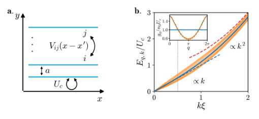 
FIG. 1. (a) Array of Nt tubes with spacing a, intra-tube contact interaction Uc and inter-tube density coupling Vij(x− x′). (b) Dispersion of the uniform array Eq,k/Uc against kξ for the dipolar kernel at V = 0.3: solid, V = 0; shaded, the range over transverse q; dashed, the phonon limit E = √n0Uc k and the free-particle limit εk + n0Uc. Inset: gq(k) across the transverse zone at kξ = 0.5 (dotted line), against its V = 0 value (horizontal line).

📷 Fig 2

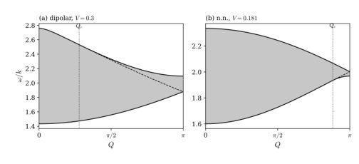 
FIG. 2. Support of the pair spectrum ΠQ(ω|k), Eq. (36), at k = 0.1 (grey), for (a) the dipolar kernel at V = 0.3 and (b) the n.n. kernel at the matched bond V = 0.181. Solid lines are the band edges, critical points of ΩQ(q) at q = 0 and q = π or at the pair ±qc; the dashed line is the interior critical point that exists for Q &gt; Qc (dotted). Every line is an inverse-square-root singularity; the weight SQ, not shown, vanishes as Q2 at small Q and is largest near Q = π. For (b), Eq. (37) gives Qc = π −2V = 2.78 and the support [2 −V 2, 2] at Q = π, against 2.77 and [1.968, 2.003] from the full dispersion.

📷 Fig 3

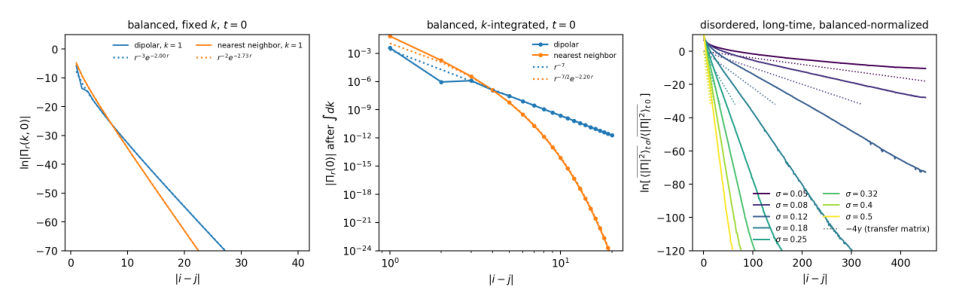 
FIG. 3. Spatial structure of the momentum correlator at V = 0.3. Panel (a) shows the fixed-k profile of the uniform array at k = 1 for both kernels, from Eq. (42). Dotted lines give the predicted asymptotic forms of Eqs. (45) and (46), anchored to the data at r = 8: r−2e−2κEr with 2κE = 2.73 for nearest neighbors, and r−3e−2|k|r for dipolar. Both the decay rates and the algebraic prefactors are reproduced. Panel (b) shows the same profiles after integration over longitudinal momentum, on log-log axes, against the r−7 law of Eq. (49) and the r−7/2e−2r arccosh(Uc/2V ) form of Eq. (48). Panel (c) shows the normalized long-time average of Eq. (63) for disordered dipolar arrays at Nt = 1000 and...

📷 Fig 4

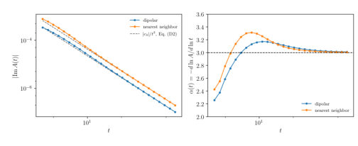 
FIG. 4. Temporal decay of the small-Q response of the uni- form array at V = 0.3 for both kernels. The left panel shows |Im A(t)| against the t−3 law of Eq. (51), with c3 eval- uated from Eq. (E2). The nearest-neighbor curve uses the closed form of Eq. (52); the dipolar curve is Eq. (50) by di- rect quadrature, that reduction not applying when the band disperses with k. The right panel shows the local exponent α(t) = −d ln A/d ln t, which overshoots 3 before settling onto it once the subleading t−5 correction has died off. The cutoff used for it is discussed in Appendix I 5.

📷 Fig 5

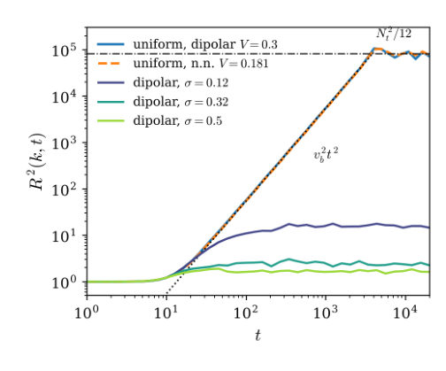 
FIG. 5. Spatial variance R2(k, t) of the intensity profile, Eq. (54), at k = 1, Nt = 1000: uniform dipolar (V = 0.3) and n.n. (V = 0.181) arrays, the ballistic law v2 bt2 of Eq. (56) (dotted), the flat-ring value N 2 t /12 (dash-dotted), and disor- dered dipolar arrays at three σ (4 realizations, 20 source tubes each), which leave the ballistic line at t ∼ξloc/vb and saturate at the values of Fig. 10.

**Summary.** This paper theoretically examines momentum transport and mode localization in arrays of 1D Bose gases coupled by dipolar interactions. Using Bogoliubov theory, the authors show that disorder localizes collective excitations, while the dipolar nature leads to distinct power-law decay rates compared to nearest-neighbor coupling. The findings are crucial for understanding transport in engineered quantum matter arrays.

**Why it may be interesting.** This work provides a detailed theoretical framework for understanding how long-range, anisotropic interactions (dipolar) combined with disorder affect collective excitations in quasi-1D quantum systems, which is highly relevant to cold atom setups.

Detailed structure

**Main problem.** The study investigates transverse momentum transport and the localization of collective modes in arrays of one-dimensional Bose gases interacting via dipolar forces.

**Main result.** Density imbalance acts as quenched disorder, localizing the transverse collective modes by arresting the growth of the intensity profile. Furthermore, strong repulsion can destabilize the uniform state into staggered density modulations.

**Method.** The analysis employs zero-temperature Bogoliubov theory, characterizing transport using momentum correlators (amplitude and intensity) and analyzing the system's response to disorder via Lyapunov exponents.

**Model / system.** The system is an array of $N_t$ equidistant 1D Bose tubes coupled by dipolar interactions, analyzed under the key assumption of zero particle tunneling ($t_\perp=0$). Disorder is introduced via quenched random density imbalance across the tubes.

**Key observables.** Inter-tube momentum correlator ($\Pi_{ij}(t)$), intensity $|\Pi_{ij}(t)|^2$, localization length ($\xi_{	ext{loc}}$), and the Lyapunov exponent.

**Important parameters / regimes.** Dipolar coupling strength, disorder strength ($\sigma$), and the longitudinal momentum $k$.

**Assumptions / limitations.** The analysis is restricted to zero temperature, and the primary approximation involves setting the inter-tube tunneling to zero ($t_\perp=0$).

**Figures summary.** Figures illustrate the dispersion relation for the uniform array, compare spatial decay profiles of correlators for dipolar vs. nearest-neighbor coupling, and show the transfer-matrix Lyapunov exponent across the band.

**Paper structure.** The paper progresses from setting up the Hamiltonian and using Bogoliubov theory to calculate momentum correlators in uniform arrays. It then analyzes the effect of quenched disorder, calculating localization measures like the Lyapunov exponent and comparing results from different theoretical approximations.

Abstract

We study transverse transport of longitudinal momentum in an array of one-dimensional Bose gases coupled by dipolar interactions without particle tunneling. Within zero-temperature Bogoliubov theory, we characterize this transport using the inter-tube momentum correlator and its squared magnitude, termed amplitude and intensity. In a uniform array, pairs of Bogoliubov quasiparticles propagate ballistically across the tubes, while their dephasing produces a $t^{-3}$ decay of the long-wavelength amplitude. Tube-to-tube density imbalance acts as quenched disorder and localizes the transverse collective modes. At fixed longitudinal momentum, this arrests the growth of the intensity profile, whose time-averaged spatial decay measures the localization length. Equal-time correlations are much less sensitive to disorder and primarily reflect the interaction range: in the uniform array they decay with tube separation as $r^{-7}$ for dipolar coupling, compared with exponential decay for nearest-neighbor coupling. Finally, sufficiently strong inter-tube repulsion destabilizes the longitudinally uniform state toward density modulations staggered between neighboring tubes, at a threshold independent of density imbalance.

[↑ back to top](#top)

### ⭐ [Thermodynamic cost of locally maintaining a steady state](http://arxiv.org/abs/2610.38925v1)

**Highlighted author(s):** Sarang Gopalakrishnan  
**Authors:** Sarang Gopalakrishnan  
**Type:** theory · **Category:** statistical mechanics · **PDF:** <https://arxiv.org/pdf/2610.38925v1>  
**Analysis basis:** full PDF text, analyzed in chunks
**Topic relevance:** `Keldysh / 2PI / non-Gaussian methods` **3/5** · `non-equilibrium universality` **3/5** · `correlated / nonlocal dissipation` **2/5** · `driven-dissipative phase transition` **2/5** · `methods for driven-dissipative` **2/5** · `quantum measurements` **1/5**

📷 Fig 1

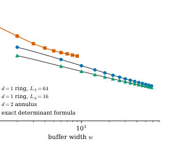 
Figure 1: (a) The annular tripartition used throughout: a buffer B of width w sep- arates a region A from the rest of the system C; in d = 1 the annulus degenerates to the two buffer segments of the ring geometry used in panel (b). (b) Exact Gaus- sian conditional mutual information of the near-Coulomb state (5), computed from covariance determinants, with an infinitesimal regulator (C →C + T1, T1 = 10−6) keeping the CMI finite. d = 1: ring of N = 512 sites, blocks LA = 64 and 16, two- sided buffer of width w per side. Markers: exact evaluation; lines: the determinant formula (23) of Appendix A. d = 2: torus of 40 × 40 sites, A a disk of radius 5, B an annulus of width w.

📷 Fig 2

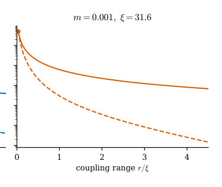 
Figure 2: The range–dissipation tradeoff for C = m + 4sin2(k/2), at m = 0.01 and 0.001. Dashed curves: the lower bound from optimizing over (14). Solid curves: entropy production of the explicit bath construction (17). The bounds coincide at nearest-neighbor range. Both curves use the lattice momentum measure; the lower bound is not asserted to be physically attainable at higher range.

**Summary.** This paper establishes fundamental trade-offs in non-equilibrium statistical mechanics, quantifying the minimum entropy production required to sustain steady states with long-range correlations. It rigorously compares continuous Gaussian processes against discrete jump processes, showing that the required entropy cost scales with the correlation length ($\xi^2$). The work is crucial for understanding the fundamental limits of maintaining non-equilibrium order in physical systems.

**Why it may be interesting.** It provides rigorous, quantitative bounds connecting non-equilibrium thermodynamics (entropy production) directly to information-theoretic measures (CMI), which is central to understanding steady states in complex, interacting quantum and classical systems.

Detailed structure

**Main problem.** The paper investigates the minimum entropy production required to maintain a steady state exhibiting long-range conditional correlations in various physical models.

**Main result.** For local Gaussian processes, entropy production is lower-bounded by the square of the Markov length ($\hat{\sigma} \ge c \xi^2$), while for discrete jump processes, long-range correlations generally require violating detailed balance.

**Method.** The analysis employs stochastic thermodynamics, information theory (CMI), and field-theoretic techniques (Gaussian processes, Keldysh formalism) to derive quantitative bounds.

**Model / system.** The study compares continuous Gaussian processes (modeled by local quadratic Hamiltonians coupled to baths) with discrete jump processes on lattices. It also analyzes string order decay in local jump processes.

**Key observables.** Conditional Mutual Information (CMI), Entropy Production ($\hat{\sigma}$), Markov Length ($\xi$), and String Order ($\langle S_n 
angle$).

**Important parameters / regimes.** The length scale $\xi$ characterizing the exponential decay of CMI; the coupling range and the bath relaxation rate.

**Assumptions / limitations.** The analysis often assumes the existence of a unique steady state and relies on specific structural properties like translational invariance or the applicability of local quadratic Hamiltonians.

**Figures summary.** Not specified by the notes, but the structure suggests comparisons between different process types (Gaussian vs. Jump) and the scaling of correlations with distance.

**Paper structure.** The paper progresses by first establishing the general framework relating entropy production to correlations, then analyzing continuous Gaussian processes, contrasting them with discrete jump processes, and finally examining structural constraints like string order decay.

Abstract

The Gibbs states of local Hamiltonians have short-range conditional correlations. To maintain a steady state with long-range conditional correlations, one might expect that a stochastic process must ``pay'' either in nonlocal moves or entropy production. Surprisingly, we find strictly local Gaussian processes that obey detailed balance and have unique steady states with arbitrarily long-range conditional correlations. We show that such processes must still produce entropy, if implemented using a local quadratic Hamiltonian coupled locally to equilibrium, rapidly relaxing baths. We lower-bound this entropy production in terms of the steady state's conditional mutual information (CMI); if the CMI decays exponentially with distance, the associated length-scale is called the Markov length $ξ$. The entropy production per site per relaxation time obeys $\hatσ\ge c ξ^2$ for large $ξ$, and with $c$ an implementation-dependent constant. We also bound the tradeoff between coupling range and entropy production. We contrast these Gaussian processes with jump processes on discrete state spaces, for which, under certain irreducibility assumptions, steady states with long-range CMI are only possible if detailed balance is violated. We conjecture (and present evidence) that rapidly mixing local jump processes cannot stabilize steady states with long-range CMI.

[↑ back to top](#top)

### ⭐ [Gravitational Interactions in Nuclear Clocks](http://arxiv.org/abs/2610.38832v1)

**Highlighted author(s):** Mikhail Lukin  
**Authors:** Konstantin Beyer, Niklas E. Önne, Shimon Kolkowitz, Dolev Bluvstein, Mikhail Lukin, Jun Ye, Igor Pikovski  
**Type:** theory · **Category:** other · **PDF:** <https://arxiv.org/pdf/2610.38832v1>  
**Analysis basis:** full PDF text, analyzed in chunks
**Topic relevance:** `quantum measurements` **3/5** · `analog quantum simulation` **1/5**

📷 Fig 1

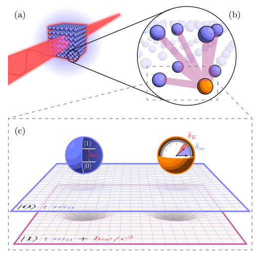 
FIG. 1. We investigate the effect of gravitational interactions on the time-keeping of clocks consisting of many atoms with a nuclear clock transition, as shown in (a). (b) Each clock nucleus experiences the gravitational redshift from all other atoms due to the long-range gravitational interaction. (c) The mutual redshift arises from both the rest mass m0 of the atoms and from the energy superpositions of the clock nuclei, which gravitate according to mass-energy equivalence and add mE = ℏωc/c2 to the total mass if the nucleus is in the |1⟩state, creating a stronger gravitational potential. These result in the redshifts δm and δE, respectively, from a single neighboring atom. Summing over...

📷 Fig 2

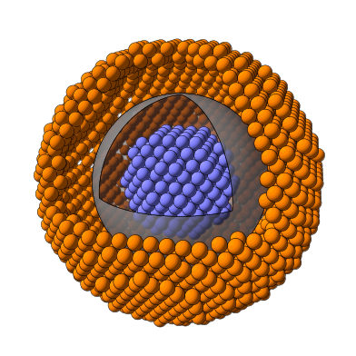 
FIG. 2. Two nuclear clock systems, each consisting of a macroscopic number of atoms, will induce a mutual redshift on similar scales as the single-clock-system setup. Here, one clock (blue) can serve as the source, while the other (orange) as the probe of the gravitational field. This allows for direct modulation of the source clock’s gravitational field induced by its internal levels, and read-out with lock-in detection which can mitigate the inevitable background noise within one clock sample. The spherical geometry maximizes the interaction strength and can be utilized to mitigate dipole effects. Ad- ditionally, a Faraday shield between the two clocks could be used to further isolate the...

📷 Fig 3

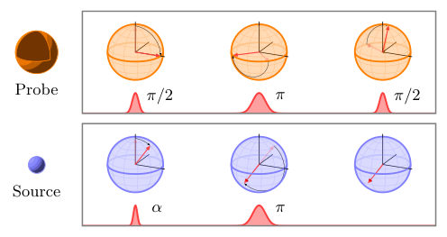 
FIG. 3. Protocol to isolate the gravitational signature sourced by an energy superposition in a nuclear clock. The top row shows the spectroscopic sequence for the probe clock, while the bottom row shows the sequence for the source, represented on a Bloch sphere. The signal depends on the state of the clock through α, which can be isolated from the constant or slowly varying background noise contributions. The probe is initialized in the balanced superposition and is flipped by a π-pulse in the middle of the protocol. The source is prepared with angle α, i.e. an energy population proportional to p(α) = 1 −cos(α) [see Eq. (26)]. At time tR/2 the population is flipped, changing the...

📷 Fig 4

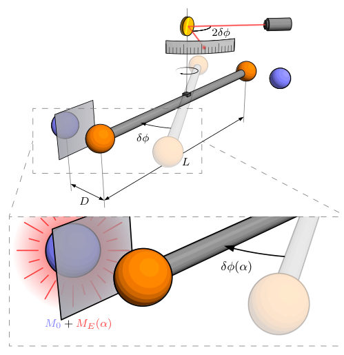 
FIG. 4. Torsion balance experiment for the measurement of the active gravitational mass of energy in superposition. The excited state is heavier which leads to an additional deflection of the pendulum. By alternating the excitation and therefore the mass of the clocks through the parameter α [see Eq. (14)], the deflection angle changes.

📷 Fig 5

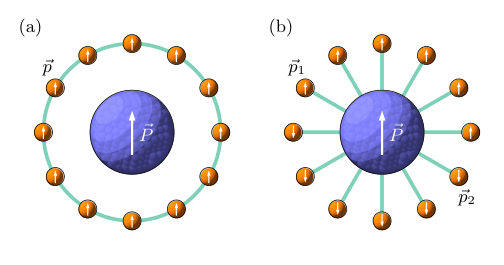 
FIG. 5. We want to detect the monopole contribution of the gravitational field of the internal energy by measuring the red- shift of the clock nuclei in the shell (orange) which is sourced by the sphere in the center (blue). Electromagnetic dipole contributions cancel on average if the shell is spherical and has a uniform dipole alignment (a). However, the variance of the dipole interaction energies does not vanish, which leads to an inhomogeneous broadening that may mask the gravitational signal. Using a GHZ state, the broadening can in principle be canceled coherently (see main text). A more practical al- ternative scenario is to use only bipartite entangled states in order to cancel...

**Summary.** This theoretical study explores using highly precise nuclear clocks to measure the mutual gravitational interaction between many atoms. It shows that the energy stored in quantum superpositions can generate a measurable, non-Newtonian gravitational redshift in large ensembles. While the redshift effect is potentially observable, the authors conclude that detecting gravity-induced entanglement is currently limited by spontaneous emission decoherence.

**Why it may be interesting.** This work directly applies quantum control and precision measurement techniques (central to AMO physics) to test fundamental physics (gravity) at the quantum level, providing concrete, albeit challenging, experimental targets for future clock technology.

Detailed structure

**Main problem.** The paper investigates the feasibility of observing mutual gravitational interactions between large ensembles of atoms/nuclei using ultra-precise atomic or nuclear clocks.

**Main result.** The mutual gravitational redshift due to internal energy superpositions can become non-negligible for macroscopic ensembles, suggesting a pathway to probe gravity at short distances. However, observing gravity-induced entanglement is currently limited by spontaneous emission decoherence.

**Method.** The authors derived the total Hamiltonian including terms for rest mass and energy-superposition sourced gravity, and analyzed the resulting frequency shifts and decoherence rates.

**Model / system.** The system involves two-level atomic/nuclear clocks modeled by a Hamiltonian expanded in powers of $c^{-2}$ and $c^{-4}$. The analysis considers both the classical gravitational redshift ($\delta_m$) and the quantum, energy-superposition induced redshift ($\delta_E$).

**Key observables.** Gravitational redshift ($\delta_t$), frequency shift ($\omega_c 	o (1 - \delta_t)\omega_c$), and entanglement rates ($\omega_{	ext{ent}}$).

**Important parameters / regimes.** Macroscopic number of nuclei ($N$), solid-state lattice spacing ($a$), and the ratio of interaction strength to decoherence rate.

**Assumptions / limitations.** The analysis assumes fixed atomic positions (neglecting motion) and treats the interaction Hamiltonian perturbatively. It also assumes that decoherence from spontaneous emission is the dominant limiting factor for entanglement.

**Figures summary.** Figure 1 illustrates the gravitational redshift effect from both rest mass and energy superpositions. The notes also reference tables comparing parameters for Th-229, Sc-45, and U-235.

**Paper structure.** The paper systematically builds the Hamiltonian for interacting quantum clocks, calculates the resulting frequency shifts from both classical and quantum gravitational terms, and finally assesses the feasibility of observing gravity-induced entanglement versus the decoherence rates.

Abstract

Atomic clocks achieve extraordinary precision through quantum control over large ensembles of atoms, with precision increasing and atom number advancing steadily. Emerging nuclear clock technology encodes clock states in nuclear rather than electronic transitions, offering a new frontier for precision measurement. Here we study whether a large ensemble of such clock nuclei could be used to observe their mutual gravitational interaction. We investigate the gravitational redshift induced by neighboring atoms, including nuclear energy superpositions as sources of gravity, giving rise to a genuinely quantum gravitational interaction between pairs of nuclei. We find that the resulting clock frequency shift due to mutual gravity may become non-negligible for a macroscopic number of nuclei, for instance in a solid-state thorium clock, and we propose approaches to mitigate electromagnetic field effects by exploiting spatial symmetry and high-precision spectroscopy. We further discuss how energy-induced mass superpositions could be directly probed using external gravitational field sensors. By contrast, observing gravity-induced entanglement involving clocks would require substantially greater experimental advances due to decoherence from spontaneous emission. Taken together, our results suggest that nuclear clocks, either alone or in combination with complementary sensors such as optomechanical systems, may offer a future route toward probing gravity at short distances and testing gravitating quantum source masses beyond the Newtonian limit.

[↑ back to top](#top)

### [Individually Addressed Logical Pauli Measurements by QLDPC Surgery on a Trapped Ion Quantum Computer](http://arxiv.org/abs/2610.39067v1)

**Authors:** Surabhi Luthra, Alex Owens  
**Type:** experiment · **Category:** quantum information and computing · **PDF:** <https://arxiv.org/pdf/2610.39067v1>  
**Analysis basis:** full PDF text, analyzed in chunks
**Topic relevance:** 🔥 `QC/QI experiment` **5/5** · `quantum measurements` **3/5**

📷 Fig 1

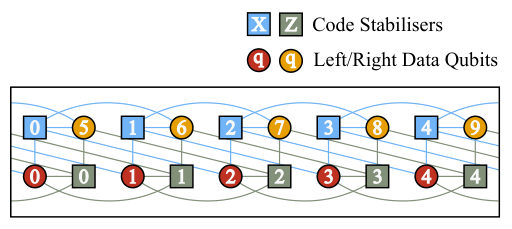 
FIG. 1: The [[10,2,3]] generalised bicycle code construction with l = 5, a(x) = 1 + x2, and b(x) = 1 + x. For readability we omit all but the numeric label from the nodes, encoding X- and Z-type checks and left- and right-block data qubits in the colour and shape of the nodes as indicated in the legend.

📷 Fig 2

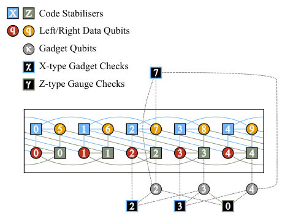 
FIG. 2: [[10,2,3]] code merged with ¯X1 measurement gadget.

📷 Fig 3

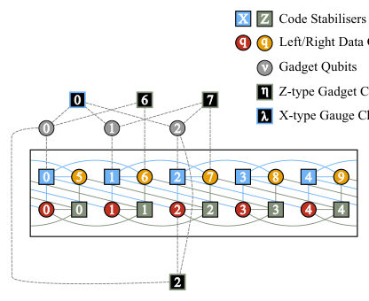 
FIG. 3: [[10,2,3]] code merged with ¯Z2 measurement gadget. Here we label the gadget qubits as ν, Z-type gadget checks as η and X-type gauge checks as λ for distinction with the X-type gadget in Fig. 2.

📷 Fig 4

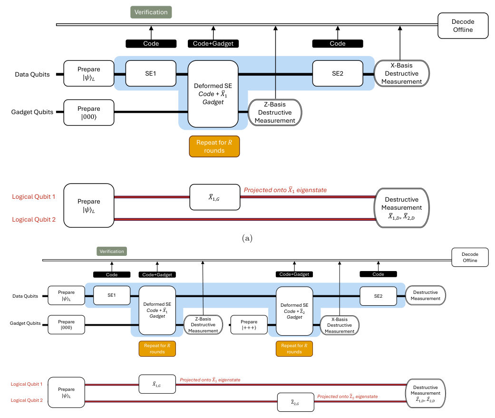 
FIG. 4: Experiment flow at the physical (upper) and logical (lower) level. Ancilla not pictured. Blue shading represents which qubits comprise the code block at each time-step, representing the code deformation. (a) Single-gadget circuit. The logical state |ψ⟩L and is prepared on the data qubits and the gadget qubits κ are initialised in |0⟩. The preparation of |ψ⟩L is verified by trivial syndrome in the first bare code syndrome extraction SE1. The gadget and code are merged and the deformed codes syndrome extraction is repeated R times. The gadget is detached from the code by measuring the κ qubits in the Z basis. After the system is returned to the [[10,2,3]] code there is one final bare...

📷 Fig 5

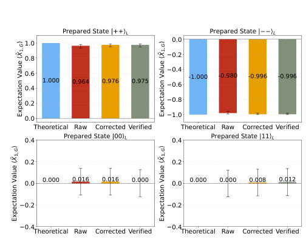 
FIG. 5: Expectation of ⟨¯X1,G⟩for different logical state preparations, compared to the ideal value (Theoretical). Raw is directly inferred from χ2χ3χ7, Corrected is the Tesseract decoded result, Verified is the Corrected result calculated only from the shots passing verification. Error bars are 95% Jeffreys intervals.

**Summary.** This paper demonstrates the implementation of QLDPC surgery, a technique allowing for individual logical Pauli measurements within a multi-qubit code block, on a trapped ion quantum computer. By using ancillary 'gadget' qubits, the authors successfully suppress measurement errors over multiple syndrome extraction rounds. This work provides critical hardware validation for the generalized surgery primitive required for scaling fault-tolerant quantum computation using QLDPC codes.

**Why it may be interesting.** This work provides a crucial hardware validation of a generalized primitive (QLDPC surgery) necessary for scaling quantum computation beyond current limitations, directly impacting the feasibility of fault-tolerant quantum algorithms.

Detailed structure

**Main problem.** The paper addresses the challenge of performing selective, individual logical Pauli measurements within the highly entangled structure of QLDPC codes to enable fault-tolerant quantum computation.

**Main result.** The authors successfully demonstrated the generalized QLDPC surgery primitive on a trapped ion quantum computer, achieving error rates below 0.26% after syndrome extraction, validating the approach for Pauli-based computing.

**Method.** The core method involves implementing QLDPC surgery, which uses ancillary 'gadget' systems transiently entangled with the code block to perform non-destructive Pauli measurements.

**Model / system.** The experiment is performed on a trapped ion quantum computer using Quantinuum’s H2-2 processor, implementing measurements on a specific $[[10,2,3]]$ generalized bicycle code.

**Key observables.** Error rates for single-round and three-round syndrome extraction (e.g., $ar{X}_1$ measurement error rate of 0.72% initially, suppressed to <0.26%), and spectator qubit preservation error.

**Important parameters / regimes.** The code used is a $[[10,2,3]]$ generalized bicycle code; the process involves multiple rounds ($R=3$) of syndrome extraction to suppress errors.

**Assumptions / limitations.** The primary assumptions relate to the connectivity defined by the Tanner graph for surgery and the error model, which may not fully account for measurement cross-talk.

**Figures summary.** Figures illustrate the structure of the code and the merging of the measurement gadget with the code block, showing the support of the gadget components ($\kappa, \chi, \gamma$).

**Paper structure.** The paper progresses by establishing the need for selective measurement, detailing the gadget construction for $ar{X}_1$, presenting the hardware implementation on the trapped ion platform, and finally validating the primitive through single-round, three-round, and sequential two-gadget measurements.

Abstract

Quantum low-density parity check (QLDPC) codes may lead to order-of-magnitude reductions in the qubit overhead required for fault-tolerant quantum computation. Achieving this improved overhead requires logical operations that selectively address individual logical qubits encoded within multi-qubit code blocks. Recently proposed architectures achieve this through QLDPC surgery, in which non-destructive Pauli measurements are performed using ancillary ''gadget'' systems transiently entangled with the code block, generalising lattice surgery. Here we implement QLDPC surgery on a [[10,2,3]] generalised bicycle code using Quantinuum's H2-2 trapped ion processor. A single-round surgery measurement using seven gadget qubits measures the $\bar{X}_1$ operator with a 0.72 [0.32, 1.41]% (95% credible interval) error rate and agrees with subsequent transversal measurement with 1.03 [0.60, 1.65]% error. Decoding across three rounds of syndrome extraction suppresses the gadget measurement error, reducing the error rate to below 0.26%. The syndrome after surgery confirms return to the code space and the unaddressed ''spectator'' qubit is preserved with error 0.21 [0.04, 0.67]% during the three-round measurement. We further demonstrate composition of conjugate basis gadgets by sequentially measuring $\bar{X}_1$ then $\bar{Z}_2$, reusing the gadget qubits, and obtain a 1.12 [0.60, 1.94]% error in the $\bar{Z}_2$ measurement. These results constitute a hardware validation of the generalised surgery primitive underlying Pauli-based computing for QLDPC architectures.

[↑ back to top](#top)

### [Entanglement diagnostics of stochastic-resetting steady states: theory and measurement on superconducting qubits](http://arxiv.org/abs/2610.40638v1)

**Authors:** Jakob Murauer, Sabine Tornow, Manas Kulkarni, Eli Barkai, Satya N. Majumdar, Monalisa Singh Roy  
**Type:** both · **Category:** statistical mechanics · **PDF:** <https://arxiv.org/pdf/2610.40638v1>  
**Analysis basis:** full PDF text, analyzed in chunks
**Topic relevance:** 🔥 `QC/QI experiment` **4/5** · `correlated / nonlocal dissipation` **3/5** · `driven-dissipative phase transition` **3/5** · `methods for driven-dissipative` **3/5** · `non-equilibrium universality` **3/5** · `quantum measurements` **3/5** · `analog quantum simulation` **2/5** · `Keldysh / 2PI / non-Gaussian methods` **1/5**

📷 Fig 1

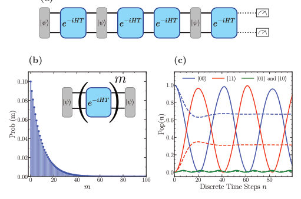 
FIG. 1. (a) Quantum circuit of length n = 4 implementing the discrete-time reset protocol with reset probability p to the reset state |ψ0⟩. At the end of the circuit the reduced or full density matrix is reconstructed by quantum state tomography (QST). (b) Geometric distribution p(1 −p)m of the age m Eq. (10)], the number of unitary steps since the most recent reset, for p = 0.1; the inset shows the reset-free block of the circuit. (c) Population probabilities of the states |00⟩, |01⟩, |10⟩, and |11⟩for the product-state reset |ψ0⟩= |00⟩, at Ω= 1, α = 3.2, and p = 0.1, as a function of the total number of steps n. The probabilities for |01⟩and |10⟩coincide. With a finite reset probability...

📷 Fig 2

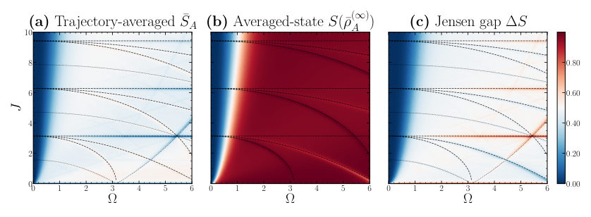 
FIG. 2. Entropy diagnostics of the product-state reset stationary state in the (Ω, J) plane at p = 0.1. (a) Trajectory-averaged entropy ¯SA, Eq. (13), evaluated by trajectory sampling. (b) Averaged-state entropy S(¯ρ(∞) A ), Eq. (12), from the closed form (29). (c) Jensen gap ∆S, Eq. (47), the difference between the two entropy evaluations. All three panels, and those of Fig. 3, share one colour scale, from 0 (blue) through 0.5 (white) to 1 bit (red). Both entropies are below 0.17 bits at small Ω, where the state is near a Hamiltonian eigenstate, and rise across a crossover whose midpoint lies at ( √

📷 Fig 3

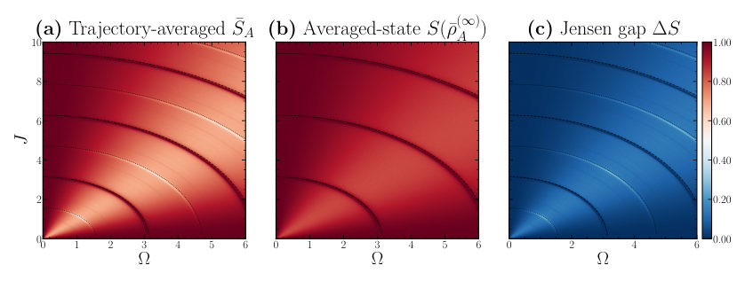 
FIG. 3. Entropy diagnostics of the Bell-reset stationary state in the (Ω, J) plane at p = 0.1. Away from the arcs both entropies depend on α = J/Ωalone, up to corrections of order p. They equal 1 bit along both axes, are lowest near J = Ω, and differ by less than 0.14 bits over 90 percent of the plotted plane. (a) Trajectory-averaged entropy ¯SA, Eq. (13), evaluated by trajectory sampling. The dark arcs of panel (b) recur, and ¯SA is in addition lowered (light to blue) on the half-integer circles √

📷 Fig 4

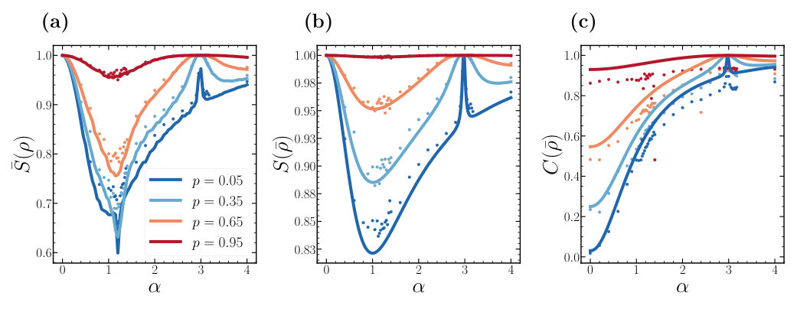 
FIG. 4. Entanglement diagnostics of the Bell-reset stationary state against the ibm_pittsburgh measurement, from left to right: (a) trajectory-averaged entropy ¯SA [Eq. (13)], (b) averaged-state entropy S(¯ρ(∞) A ) [Eq. (12)], and (c) Wootters concurrence C(¯ρ∞) [Eq. (30)], as functions of the coupling ratio α = J/Ωat Ω= 1, for p ∈{0.05, 0.35, 0.65, 0.95} (from dark blue for p = 0.05 to dark red for p = 0.95). Solid curves: exact noiseless evaluation of the renewal sum (9). Symbols: hardware data from qubits 4 and 5 of ibm_pittsburgh, reconstructed by quantum state tomography with 104 shots per setting, using dynamical decoupling with gate and measurement twirling. The sampling is dense...

📷 Fig 5

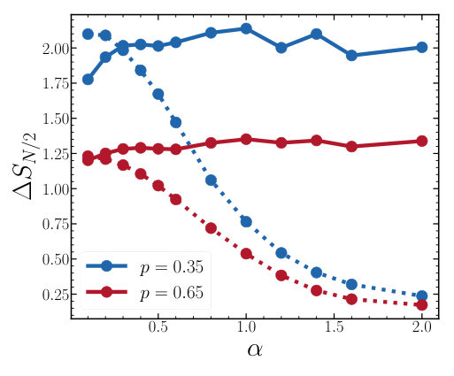 
FIG. 5. Half-chain Jensen gap [Eq. (47)] of the reset station- ary state at N = 12 versus the coupling ratio α = J/Ω, for the tiled-Bell reset (solid) and the product-state reset (dot- ted), at p = 0.35 and 0.65 (dark blue and red). Markers are the exact evaluation; entropies in bits. The two coupling ra- tios of Fig. 6 are read off this profile: comparable reset states at α = 0.2, an order-of-magnitude separation at α = 2.0.

**Summary.** This work analyzes entanglement in quantum systems driven into non-equilibrium steady states via stochastic resetting. By comparing theoretical predictions for the transverse-field Ising chain with superconducting qubit measurements, the authors show that different entanglement diagnostics (like entropy vs. concurrence) respond differently to the reset process. The key finding establishes a direct physical interpretation for the difference between averaged and trajectory-averaged entanglement measures.

**Why it may be interesting.** It provides a concrete, measurable link between non-equilibrium statistical mechanics (stochastic resetting) and quantum information measures (entanglement), using superconducting qubits as a testbed.

Detailed structure

**Main problem.** The paper investigates how entanglement diagnostics behave in non-equilibrium steady states generated by stochastic resetting protocols.

**Main result.** The Jensen gap of entanglement entropy equals the Holevo information quantifying subsystem memory of the reset time, and this information grows with chain length for a Bell-state reset.

**Method.** The authors derive closed-form theoretical results for the transverse-field Ising chain and validate them by performing measurements on an IBM superconducting quantum processor.

**Model / system.** The system is the transverse-field Ising chain, subjected to a discrete-time stochastic resetting protocol. The dynamics are governed by a mixture of unitary evolution and resetting to a fixed state.

**Key observables.** Averaged-state entropy, trajectory-averaged entropy, Wootters concurrence, and the Jensen gap of entanglement entropy.

**Important parameters / regimes.** Reset probability ($p$), coupling ratio ($\alpha$), and chain length ($N$, up to 12).

**Assumptions / limitations.** The trajectory-averaged entropy is obtained without postselection, unlike monitored circuits which require sampling rare measurement records.

**Figures summary.** Figure 1 illustrates the quantum circuit implementing the discrete-time reset protocol and the associated geometric distribution of the system's 'age' (time since last reset).

**Paper structure.** The paper first establishes the theoretical framework for stochastic resetting, deriving exact results for small systems. It then compares these theory results against hardware measurements on superconducting qubits, focusing on the differential behavior of entropy diagnostics versus concurrence.

Abstract

Stochastic resetting drives quantum systems into nonequilibrium stationary states unreachable under uninterrupted unitary evolution, and their entanglement depends on whether the reset history is resolved or averaged over. We study this interplay in the transverse-field Ising chain, deriving closed-form results for two qubits and evaluating chains of up to 12 qubits exactly. In the two-qubit system, these closed-form results show that phase matching between energy eigenstates produces resonances, and their visibility in the stationary state is determined by the symmetry of the reset state. Measurements on an IBM superconducting processor show the entropies evaluated before and after the reset average closely following noiseless predictions with no fitted parameter, while concurrence lies below prediction across most of the hardware measurements. The two diagnostics respond differently because they read different components of the same reconstructed state, and a depolarizing model captures the concurrence suppression with one fitted parameter. The difference between the two entropies, i. e., the Jensen gap of entanglement entropy, equals the Holevo information that a subsystem retains about the time since the last reset. With a Bell-state reset, this information grows with chain length across a half-chain cut over the sizes studied, without visible saturation at the smaller reset probabilities. Since reset times are sampled and recorded classically, the trajectory-averaged entropy, and with it the Jensen gap, is obtained without postselection, in contrast to monitored circuits, where trajectory-resolved entanglement requires sampling exponentially rare measurement records.

[↑ back to top](#top)

### [Probing fluctuations in photon emission statistics of spin injected quantum dots with time dependent electronic excitation](http://arxiv.org/abs/2610.40593v1)

**Authors:** Chiran Wijesundara, Vincent Iglesias-Cardinale, Yuan Lu, Herbert Fotso, Bo Xu, Tim Thomay  
**Type:** both · **Category:** other · **PDF:** <https://arxiv.org/pdf/2610.40593v1>  
**Analysis basis:** full PDF text, analyzed in chunks
**Topic relevance:** 🔥 `Full counting statistics` **4/5** · 🔥 `methods for driven-dissipative` **4/5** · `interference shaping light` **3/5** · `quantum optics experiment` **3/5** · `correlated / nonlocal dissipation` **2/5** · `quantum measurements` **2/5** · `Keldysh / 2PI / non-Gaussian methods` **1/5** · `Tavis-Cummings & cavity-many-emitter` **1/5** · `analog quantum simulation` **1/5** · `driven-dissipative phase transition` **1/5**

📷 Fig 1

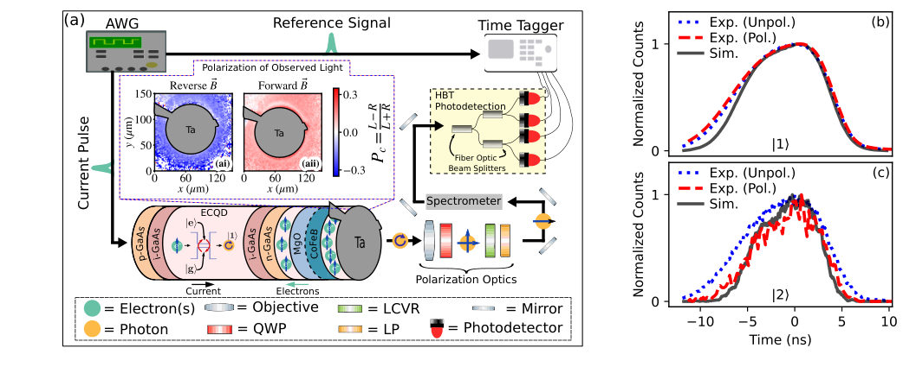 
FIG. 1. (a) Experimental set up: Beginning with the arbitrary waveform generator (AWG), an electronic pulse is applied to the ECQD ensemble depicted here in its place in the cylindrical sample. A reference pulse is simultaneously sent to the time tagger. The excitation stimulates the emission of photons into a full 4π solid angle which are collected using an infinity-corrected objective located coaxially with the stack and analyzed with a series of optical elements. Polarization analysis is performed using a quarter-wave plate (QWP) in combination with a liquid-crystal variable retarder (LCVR) and a linear polarizer (LP) to isolate spin components. The signal is then spectrally resolved by...

📷 Fig 2

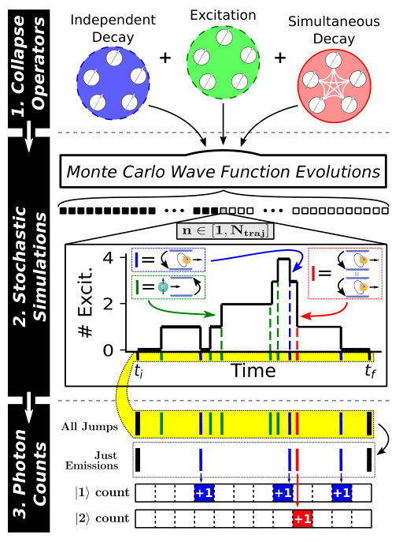 
FIG. 2. The simulation scheme begins with constructing the desired collapse operators. These are then implemented in a Monte Carlo wavefunction method, stochastically producing jump times. Excitations are disregarded and the |1⟩- and |2⟩- photon events are identified based on the jump times of their associated operator.

📷 Fig 3

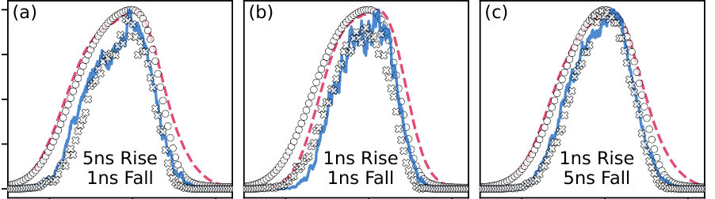 
FIG. 3. Variation of the applied current pulse, described in each panel by the rising and falling time of the pulse, produces mild variations in the experimentally observed |1⟩-photon events. Constructing the excitation function Ω(t) so the simulated |1⟩-photon curve matches the corresponding experimental data produces significant overlap in the simulated and experimental |2⟩-photon curves.

📷 Fig 4

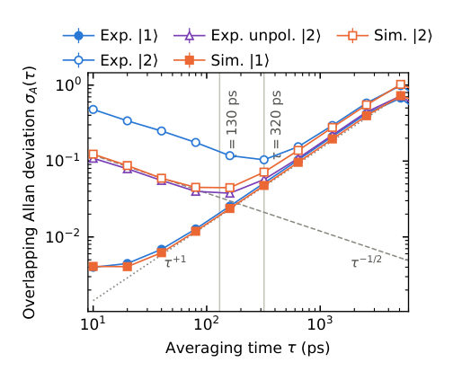 
FIG. 4. Comparison of Allan deviation of |2⟩and |1⟩-photon for experimental (pol. and unpol.) and simulation. Refer- ence lines (dotted and dashed) refer to standard mapping for physical noise sources. It should be noted the noise is in the time domain not in number state.

**Summary.** This paper investigates how spin polarization controls the higher-order photon emission statistics from quantum dots. Using time-resolved HBT measurements and advanced simulation, the authors show that two-photon emission exhibits fluctuations directly linked to the spin state of the injected electrons. This opens a pathway for electrically driven, spin-controlled sources of multi-photon Fock states.

**Why it may be interesting.** This work provides a sophisticated testbed for studying spin-conditioned multi-emitter dynamics in solid-state quantum light sources, moving beyond simple antibunching measurements to characterize higher-order correlations.

Detailed structure

**Main problem.** The study aims to probe the higher-order photon emission statistics from spin-injected quantum dots to understand the underlying multi-emitter dynamics beyond simple second-order correlation measurements.

**Main result.** Pronounced fluctuations in the two-photon ($|2
angle$) emission statistics, which vanish upon demagnetization, establish a direct link between multi-photon emission dynamics and the spin polarization of the injected carriers.

**Method.** The research combines time-resolved, extended Hanbury Brown-Twiss (HBT) interferometry with advanced theoretical modeling using Monte Carlo Wavefunction evolution incorporating joint collapse operators.

**Model / system.** The physical system is an ensemble of InGaAs/GaAs quantum dots driven by spin-polarized electron injection from a CoFeB layer. The theoretical model uses a stochastic wave function evolution framework to capture multi-emitter dynamics.

**Key observables.** Time-resolved photon-number statistics, specifically the counts for $|1
angle$ and $|2
angle$ Fock states, and the Allan deviation for these photon numbers.

**Important parameters / regimes.** Spin polarization of injected carriers, the excitation pulse profile $\Omega(t)$, and the coupling strength $\kappa$ governing joint emission.

**Assumptions / limitations.** The model phenomenologically incorporates joint collapse operators that do not arise from standard Weisskopf-Wigner treatments, and the analysis assumes the system can be described by a stochastic wave function evolution.

**Figures summary.** Figures show time-resolved counts of $|1
angle$ and $|2
angle$ photons for polarized vs. unpolarized samples, demonstrating fluctuations only in the polarized case. Other figures compare Allan deviations and confirm simulation fidelity across varying excitation pulse shapes.

**Paper structure.** The paper establishes the experimental setup (HBT/time-tagging) to measure time-resolved photon statistics. It then develops a theoretical model using collapse operators to capture multi-emitter dynamics. Finally, it compares the simulation results against the measured polarization-dependent fluctuations in $|2
angle$ photon counts.

Abstract

Electrically spin-injected ensembles of InGaAs/GaAs quantum dots emit circularly polarized single photons, with the emission helicity determined by the spin polarization of the injected electrons. A ferromagnetic CoFeB spin-injection layer with perpendicular magnetic anisotropy, combined with an MgO tunnel barrier, enables spin-polarized electron injection into the quantum-dot active region, resulting in circularly polarized photon emission at zero applied magnetic field. These devices realize direct spin-charge-photon conversion in an electrically driven, microelectronics-compatible quantum light source that operates without an external pump laser. Using an extended Hanbury Brown-Twiss interferometer with four detectors and time-tagged readout, we measure time-resolved photon-number statistics that resolve up to $|2\rangle$ Fock states within a single excitation cycle. While single-photon ($n=|1\rangle$) emission tracks the electrical excitation pulse as expected, the two-photon ($n=|2\rangle$) statistics exhibit pronounced fluctuations at multiple temporal positions within the pulse. These fluctuations vanish upon demagnetization of the spin-injection layer, establishing a direct link between the multi-photon emission dynamics and the spin polarization of the injected carriers. The observations indicate that spin injection controls not only the helicity of the emitted photons but also higher-order temporal correlations of the emission. The behavior is phenomenologically captured by inserting both a variable excitation mechanism and a set of multi-emitter collapse operators within a stochastic wave function evolution. The platform thus opens a route to electrically driven, spin-controlled single and multi-photon Fock-state sources and provides a testbed for spin-conditioned multi-emitter dynamics in solid-state quantum light sources.

[↑ back to top](#top)

### [Mixed-State Topological Transition and Emergent Fractionalized Supersymmetry in the Non-Abelian Kitaev Spin Liquid](http://arxiv.org/abs/2610.38741v1)

**Authors:** Zhou-Quan Wan, Hong Yao, Shao-Kai Jian  
**Type:** theory · **Category:** statistical mechanics · **PDF:** <https://arxiv.org/pdf/2610.38741v1>  
**Analysis basis:** full PDF text, analyzed in chunks
**Topic relevance:** 🔥 `driven-dissipative phase transition` **4/5** · 🔥 `methods for driven-dissipative` **4/5** · 🔥 `non-equilibrium universality` **4/5** · `analog quantum simulation` **3/5** · `correlated / nonlocal dissipation` **3/5** · `Keldysh / 2PI / non-Gaussian methods` **2/5** · `quantum measurements` **1/5**

📷 Fig 1

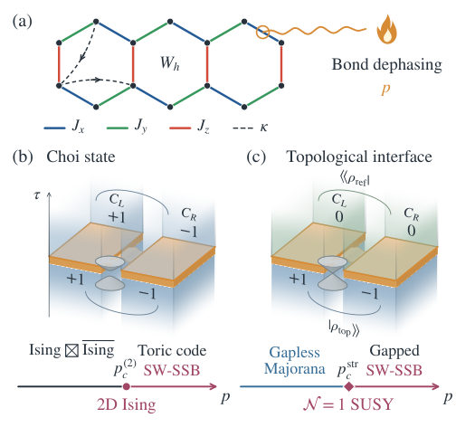 
FIG. 1. (a) Kitaev honeycomb model with bond couplings Jx, Jy, Jz and chiral coupling κ. Dashed arrows indicate oriented next-nearest- neighbor hopping, and Wh denotes the plaquette flux. Bond dephas- ing acts as Eα ij(ρ) = (1 −p)ρ + pBα ijρBα ij. (b) Choi-state geometry with no Chern mismatch across the temporal interface. Increasing p condenses the inter-copy boson ψ ¯ψ, producing SW-SSB and con- verting Ising ⊠Ising topological order into toric-code order. The transition at p(2) c belongs to the two-dimensional Ising universality class. (c) Temporal interface between topological and trivial states. The Chern mismatch |∆C| = 1 supports a gapless Majorana mode at weak dephasing. Increasing...

📷 Fig 2

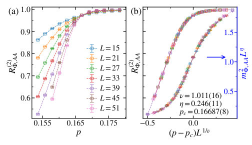 
FIG. 2. Inter-copy condensation in the normalized Choi state. (a) R´enyi-2 Wilson-string correlation ratio R(2) Φ = 1 − S(2) Φ (qmin)/S(2) Φ (0) for L = 15, 21, . . . , 51. Here S(2) Φ (q) = L−2 P

📷 Fig 3

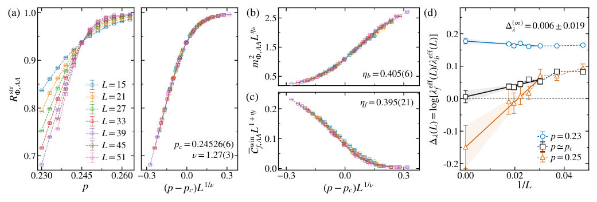 
FIG. 3. Emergent supersymmetry at the temporal interface. (a) Inter-copy correlation ratio Rstr Φ,AA for L = 15, 21, . . . , 51 (left) and its finite-size collapse (right), yielding pc = 0.24526(6) and ν = 1.27(3). (b),(c) Data collapses of the rescaled bosonic estimator m2 Φ,AALηb and

**Summary.** This work analyzes how bond dephasing drives a mixed-state topological transition in the Kitaev spin liquid. By studying the system's evolution in the doubled Hilbert space, the authors identify a transition point where gapless Majorana modes emerge and subsequently develop emergent N=1 supersymmetry. The methodology combines advanced quantum simulation techniques with critical exponent analysis.

**Why it may be interesting.** The connection between non-equilibrium dynamics (dephasing) and the emergence of fundamental symmetries like supersymmetry in a highly entangled quantum magnet is a rich area for AMO physics and open quantum systems.

Detailed structure

**Main problem.** The study investigates mixed-state topological transitions and the emergence of fractionalized supersymmetry within the non-Abelian Kitaev spin liquid when subjected to bond-dephasing.

**Main result.** The dephasing drives a mixed-state topological transition, leading to emergent N=1 supersymmetry, with Monte Carlo simulations yielding critical exponents consistent with exact supersymmetric values.

**Method.** The analysis employs techniques involving the doubled Hilbert space (Choi map), Monte Carlo simulations, and finite-size scaling analysis to characterize the critical points.

**Model / system.** The system is the spin-1/2 Kitaev honeycomb model undergoing bond dephasing described by a specific master equation. The analysis utilizes concepts from topological order, mapping the problem to inter-copy fermion pairing instabilities.

**Key observables.** Gauge-invariant Rényi-2 pairing correlator, critical exponents ($
u, \eta$), and the relative anisotropy mismatch ($\Delta\lambda$).

**Important parameters / regimes.** Dephasing strength ($p$), critical points ($p_c$), and the resulting topological order (Ising $\otimes$ Ising to Toric Code).

**Assumptions / limitations.** The analysis relies on mapping the problem to the doubled Hilbert space and interpreting the resulting state via 'unfolding' the density matrix.

**Figures summary.** Figures illustrate the transition from Ising $\otimes$ Ising to Toric code order in the Choi state, the gapless Majorana mode at a temporal interface, and finite-size scaling collapses confirming critical exponents.

**Paper structure.** The paper systematically analyzes two transitions: first, the inter-copy anyon condensation in the Choi state, and second, the transition occurring at a temporal interface between topological and trivial Kitaev states, linking both to emergent supersymmetry.

Abstract

We study a mixed-state topological transition in the non-Abelian Kitaev spin liquid driven by a bond-dephasing channel. In the vectorized picture, bond dephasing maps onto interactions between two time-reversed fractionalized Majorana systems coupled to gapped $\mathbb Z_2$ gauge fields, enabling sign-problem-free Monte Carlo simulations. We show that increasing dephasing condenses an inter-copy fermion pair, converting ${\rm Ising}\boxtimes\overline{\rm{Ising}}$ to toric-code order in the Choi state and yielding intrinsically mixed-state topological order upon unfolding. More interestingly, at a temporal interface between topological and trivial Kitaev states, a Chern-number mismatch enforces a gapless Majorana mode. Dephasing then drives a mixed-state topological transition at which the gapless mode develops emergent $\mathcal N=1$ supersymmetry. Our Monte Carlo simulations yield $ν=1.27(3)$ and $η_b\simeqη_f\simeq0.40$, consistent with the exact supersymmetric values $5/4$ and $2/5$. The supersymmetric partners are fractionalized and appear physically as distinct gauge-invariant spin strings, providing concrete observables for future experiments.

[↑ back to top](#top)

### [Resonance and Transition-Channel Competition in Cavity-Assisted Floquet-State Stabilization](http://arxiv.org/abs/2610.39169v1)

**Authors:** Zhuocheng Ma, Hongzheng Zhao, Liang-You Peng  
**Type:** theory · **Category:** other · **PDF:** <https://arxiv.org/pdf/2610.39169v1>  
**Analysis basis:** full PDF text, analyzed in chunks
**Topic relevance:** 🔥 `driven-dissipative phase transition` **4/5** · 🔥 `methods for driven-dissipative` **4/5** · `Tavis-Cummings & cavity-many-emitter` **3/5** · `correlated / nonlocal dissipation` **3/5** · `analog quantum simulation` **2/5** · `non-equilibrium universality` **2/5** · `quantum measurements` **2/5** · `Keldysh / 2PI / non-Gaussian methods` **1/5**

📷 Fig 1

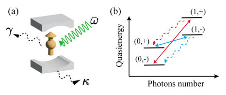 
FIG. 1. The dissipative cavity stabilizes the periodically driven spin. (a) Schematic of the periodically driven system. The spin is driven by an external time-dependent magnetic field that evolves periodically with frequency ω; κ denotes the cavity photon dissipation rate, which is much larger than the spin spontaneous emission rate γ. (b) Two sets of transition- dissipation processes. Here |u+⟩and |u−⟩denote the Floquet excited state and Floquet ground state, respectively; the num- bers 0, 1 denote photon numbers. The red lines depict the Red process: the system and cavity absorb energy from the drive to transition from |u−, 0⟩to |u+, 1⟩, followed by photon dis- sipation to |u+, 0⟩. The...

📷 Fig 2

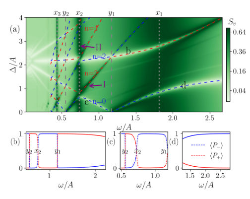 
FIG. 2. (a) Converged stroboscopic entropy of the two-level system as a function of cavity frequency ∆and driving fre- quency ω. Blue dashed lines indicate ∆= δε + nω and red dashed lines indicate ∆= −δε + nω. The dotted gray lines ω/A = xi mark the frequency regions where the two matrix elements M 2 r/b cross (see Fig. 3), predicting high entropy. We classify the high-entropy regions into two categories: those distributed along the resonance conditions (Region I) and those vertical regions near the dotted lines (Region II), as indicated by the purple arrows. (b–d) Fidelities to the Flo- quet ground state (blue) or excited state (red) along the three low-entropy branches labeled (b–d) in...

📷 Fig 3

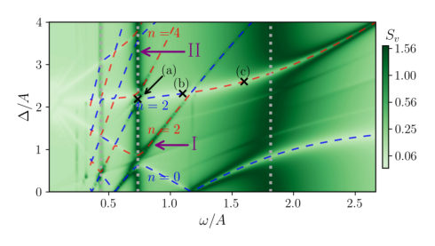 
FIG. 4. Entropy landscape of the five-level (S = 2) system as a function of cavity frequency ∆and driving frequency ω. The cooperation–competition framework of the two-level system persists in the multilevel case: low-entropy branches follow the sideband-resonance conditions, while two types of high- entropy regions appear. In Region I, the leading transition pathway conflicts with the resonant pathway; in Region II, Floquet-zone hybridization makes the competing transition channels comparable. Blue (red) dashed lines denote the Blue (Red) sideband-resonance conditions, ∆= ±δεF + nω. Black arrows indicate the three parameter points (a–c) analyzed in Fig. 5, and purple arrows mark Regions I...

📷 Fig 4

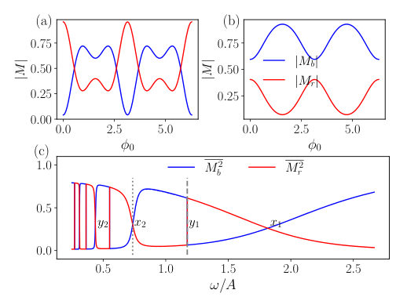 
FIG. 3. Transition matrix elements at different driving fre- quencies. (a,b) Instantaneous transition matrix elements Mb = |⟨u−(t)|σ−|u+(t)⟩| (blue) and Mr = |⟨u+(t)|σ−|u−(t)⟩| (red) as functions of the initial Floquet phase, at driving fre- quencies ω/A = 0.736 (a) and ω/A = 1.17 (b), marked by the dotted and dashed lines in (c), respectively. (c) Period- averaged squared matrix elements M 2 r/b versus driving fre- quency. By comparing with the fidelities in Fig. 2(b-d), the dominant matrix element is found to indicate the stabilized Floquet state at intermediate driving frequencies, ω ∼A (e.g. 0.5 &lt; ω/A &lt; 1.5). The points xi label crossovers of the two matrix elements (predicting...

📷 Fig 5

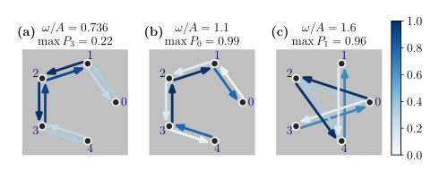 
FIG. 5. (a–c) Time-averaged squared transition matrix el- ements M 2 of the five-level (S = 2) system, visualized as directed graphs, at the three parameter points marked by ar- rows in the entropy landscape of Fig. 4 (ω/A = 0.736, 1.1, 1.6). Each node represents a quasienergy level, numbered in as- cending order within the chosen Floquet zone; a pair of oppo- sitely directed arrows connects every adjacent pair, with the color depth encoding M 2. In panels (b) and (c), one direction dominates at every adjacent pair of the unfolded quasiener- gies, so the transition graph possesses a single terminal node, which becomes the stabilized Floquet eigenstate when the sideband-resonance condition...

**Summary.** This paper analyzes the stabilization of Floquet eigenstates in driven quantum systems coupled to a dissipative cavity. It demonstrates that while resonance is necessary, stabilization critically depends on the balance between competing transition pathways (Red vs. Blue). The findings establish a general framework showing that competition can lead to mixed states or complete breakdown, providing deep insight into engineered quantum control.

**Why it may be interesting.** This work provides a general, quantitative framework for understanding how engineered dissipation can be used to control and stabilize quantum states in driven systems, a key topic in quantum optics and open quantum systems.

Detailed structure

**Main problem.** The paper investigates the conditions under which coupling a periodically driven quantum system to a dissipative cavity can autonomously stabilize a specific Floquet eigenstate.

**Main result.** Stabilization is not guaranteed by resonance alone; it critically depends on the interplay between resonance selection and the relative strengths of competing transition channels (Red vs. Blue processes).

**Method.** The analysis uses master equations and Floquet theory, examining transition rates derived from symmetry constraints and Fourier decomposition of coupling terms.

**Model / system.** The model involves a periodically driven spin system coupled to a dissipative cavity, described by a master equation incorporating cavity decay ($\kappa$) and spin relaxation ($\gamma$).

**Key observables.** Von Neumann Entropy ($S_v$) and Stroboscopic Fidelity ($\langle P_{\pm}(nT) 
angle$) are used to diagnose the purity and stability of the Floquet state.

**Important parameters / regimes.** Intermediate driving frequencies ($\omega \sim A, \Omega$) are crucial, as these reveal failure modes where the simple resonant picture breaks down.

**Assumptions / limitations.** The analysis often relies on approximating the Floquet state as a product state $|u_{\pm}, n
angle$ and analyzing the system in different frequency regimes (high vs. intermediate).

**Figures summary.** Figures illustrate the entropy landscape showing low-entropy (stable) white branches versus high-entropy (mixed) dark regions, and fidelity plots confirm stabilization success along specific resonance paths.

**Paper structure.** The paper progresses from establishing the general stabilization mechanism via cavity coupling, detailing the roles of Red and Blue processes, and then analyzing how symmetry constraints and frequency regimes dictate whether the stabilization is successful or fails due to competition.

Abstract

Static coupling to a dissipative cavity has been proposed as a route to autonomously stabilize Floquet eigenstates. The cavity provides an energy-selective relaxation channel: when its photon energy matches a quasienergy difference modulo drive quanta, it mediates transitions between Floquet states, followed by irreversible photon loss. Here, we show that at intermediate driving frequencies, this resonance condition alone is not sufficient for stabilization. Instead, the steady state is controlled by the interplay between resonance selection and the cavity-induced transition strengths between Floquet states, which can either cooperate or compete. This interplay leads to successful stabilization, mixed steady states despite resonance, and complete breakdown near Floquet-zone hybridization. We further show that the same mechanism extends to multilevel spin-S systems, providing a general framework for understanding when static dissipation can reliably stabilize driven quantum states.

[↑ back to top](#top)

### [Efficient Quantum Optimization via Dissipative False Vacuum Decay](http://arxiv.org/abs/2610.39266v1)

**Authors:** Zhi-Hao Huang, Tian-Mu Hu, Shuaifan Cao, Ye Lu, Xiaopeng Li  
**Type:** theory · **Category:** other · **PDF:** <https://arxiv.org/pdf/2610.39266v1>  
**Analysis basis:** full PDF text, analyzed in chunks
**Topic relevance:** 🔥 `methods for driven-dissipative` **4/5** · `Tavis-Cummings & cavity-many-emitter` **3/5** · `analog quantum simulation` **3/5** · `driven-dissipative phase transition` **3/5** · `correlated / nonlocal dissipation` **2/5** · `non-equilibrium universality` **2/5** · `Keldysh / 2PI / non-Gaussian methods` **1/5** · `quantum measurements` **1/5**

📷 Fig 1

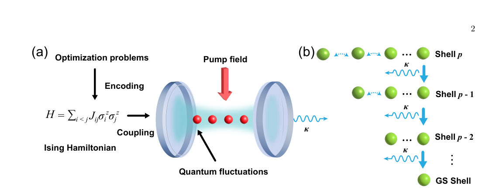 
FIG. 1. Schematic illustration of the cavity-based dissipative quantum solver and its many-body relaxation mechanism. (a) Physical realization. A combinatorial optimization problem is encoded in an atomic-spin Hamiltonian Hproblem, whose ground- state manifold represents the optimal solutions. The spin system is collectively coupled to a lossy single-mode optical cavity. Cavity-field quantum fluctuations mediate coherent spin-photon transitions through the atom-photon interaction, while the effective cavity-mode energy ∆in the rotating frame can be tuned by the pump field. Photon leakage at rate κ provides an irreversible dissipation channel. (b) Energy-shell picture of the dissipative...

📷 Fig 2

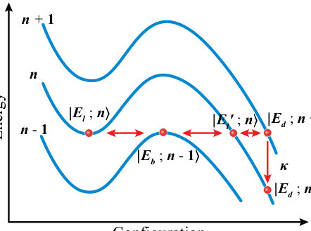 
FIG. 2. Dissipative false vacuum decay in configuration space. The blue curves represent the effective composite en- ergy landscapes Eq(C) = E(C)+q∆in the neighboring cavity- photon sectors q = n −1, n, and n + 1, where C labels a spin configuration. Starting from a composite state |Eℓ; n⟩with n &gt; 0 and a spin configuration at a nonglobal local minimum, population can leave the original basin through the photon- assisted resonant pathway |Eℓ; n⟩↔|Eb; n −1⟩↔|E′ ℓ; n⟩. Here, |Eb⟩is a higher-energy bridge configuration, while |E′ ℓ⟩is a distinct degenerate configuration located outside the original local basin. When Eb −Eℓ= ∆, these com- posite states are resonantly connected, as indicated by...

📷 Fig 3

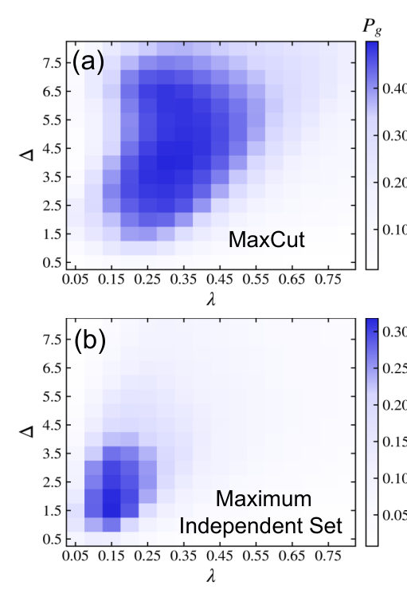 
FIG. 3. Instance-averaged ground-state preparation proba- bility Pg(T = 200) for Max-Cut and MIS on random 3-regular graphs of size N = 10. At each parameter point (∆, λ), Pg is averaged over ten independently generated graph instances. For each problem, the same ten graph instances are used throughout the parameter scan. The atom-photon coupling is time independent throughout the evolution, λ(t) = λ. The photon-loss rate is fixed at κ = 1.0, and the cavity Hilbert space is truncated to dphoton = 4. For Max-Cut, energies and rates are expressed in units of J. For MIS, energies and rates are expressed in units of δ. (a) For Max-Cut with unit edge weights, regions of comparatively high...

📷 Fig 4

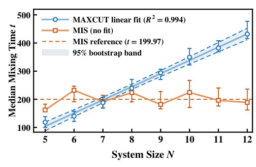 
FIG. 4. Finite-size mixing-time scaling of the cavity-based quantum solver for MaxCut (blue circles) and MIS (orange squares) on random connected graphs with ensemble-averaged degree ⟨k⟩= 3. Each point is the median over 100 in- stances per problem at N = 5, . . . , 12. For each instance, the mixing time is defined as the earliest time T0 satisfying max1≤j≤1000 |Pg(T0 + jδt) −Pg(T0)|/Pg(T0) ≤0.01, where δt = 0.05, corresponding to a subsequent monitoring win- dow of 50 time units. Error bars indicate bootstrap uncer- tainties in the medians. The blue solid line is a linear fit (R2 = 0.994), with shading showing its 95% bootstrap con- fidence band. The dashed line at t = 200 is an MIS refer-...

**Summary.** This paper proposes using a cavity-based quantum solver that leverages dissipative false-vacuum decay to solve NP-hard optimization problems like MaxCut and MIS. By coupling the spin system to a lossy cavity, the dissipation acts as a controlled resource, guiding the system efficiently out of local energy minima toward the true ground state. The resulting time complexity estimates are shown to surpass those of standard quantum search methods.

**Why it may be interesting.** This work directly applies concepts from open quantum systems and cavity QED (dissipation, cavity coupling) to solve a fundamental problem in quantum computation (optimization), making it highly relevant to AMO physicists studying engineered quantum dynamics.

Detailed structure

**Main problem.** Developing efficient quantum solvers for computationally hard, NP-hard combinatorial optimization problems.

**Main result.** The authors show that cavity dissipation can be harnessed as a controllable resource to drive the system out of local minima toward the ground state, achieving time complexities better than standard Grover search.

**Method.** The mechanism relies on exploiting dissipative false-vacuum decay by coupling the spin system to a lossy optical cavity, which facilitates irreversible population transfer.

**Model / system.** The system is modeled using a cavity-based quantum solver described by a Lindblad master equation involving a problem Hamiltonian (Ising-type), a coupling Hamiltonian, and a photon Hamiltonian. The dynamics are governed by the interplay between coherent tunneling and photon loss.

**Key observables.** Ground-State Preparation Probability ($P_g(T)$) and median mixing time ($t_{mix}$).

**Important parameters / regimes.** Photon leakage rate ($\kappa$), cavity detuning ($\Delta$), and atom-photon coupling strength ($\lambda$).

**Assumptions / limitations.** The analysis assumes the interplay between coherent transitions and irreversible photon-loss-induced relaxation, and the time complexity estimate excludes state preparation and readout costs.

**Figures summary.** Figures illustrate the physical realization and the energy-shell picture of dissipative dynamics, showing how photon loss drives population flow toward the ground state. Other figures show $P_g(T)$ and $t_{mix}$ scaling for MaxCut and MIS.

**Paper structure.** The paper introduces the problem, details the Hamiltonian and the dissipative mechanism (dissipative false-vacuum decay), presents numerical results for MaxCut and MIS, and concludes by estimating favorable time complexities compared to existing quantum search algorithms.

Abstract

Efficient quantum solvers for computationally hard problems are highly desirable for near-term quantum platforms. Here, we propose a cavity-based dissipative quantum solver for a class of NP-hard combinatorial optimization problems encoded in atomic-spin Hamiltonians with a few discrete single-spin-flip transition energies. We show that the cavity-based quantum solver exploits dissipative false-vacuum decay in configuration space to facilitate escape from metastable local minima in rugged energy landscapes. Numerical studies of MaxCut and Maximum Independent Set identify favorable parameter regions for ground-state preparation. Based on the finite-size scalings of the median mixing time and instance-averaged ground-state preparation probability, we estimate time complexities for our solver that are more favorable than those of standard Grover search. These results highlight cavity dissipation as a controllable resource for quantum optimization.

[↑ back to top](#top)

### [Generating Multipartite Entanglement via Structured-Bath Engineering](http://arxiv.org/abs/2610.38807v1)

**Authors:** Baptiste Debecker, Philipp Westhoff, Visal So, Sebastian Paeckel, Guido Pagano, John Martin, Mattia Moroder, François Damanet  
**Type:** theory · **Category:** statistical mechanics · **PDF:** <https://arxiv.org/pdf/2610.38807v1>  
**Analysis basis:** full PDF text, analyzed in chunks
**Topic relevance:** 🔥 `correlated / nonlocal dissipation` **4/5** · 🔥 `methods for driven-dissipative` **4/5** · `analog quantum simulation` **3/5** · `driven-dissipative phase transition` **3/5** · `non-equilibrium universality` **2/5** · `Keldysh / 2PI / non-Gaussian methods` **1/5** · `quantum measurements` **1/5**

📷 Fig 1

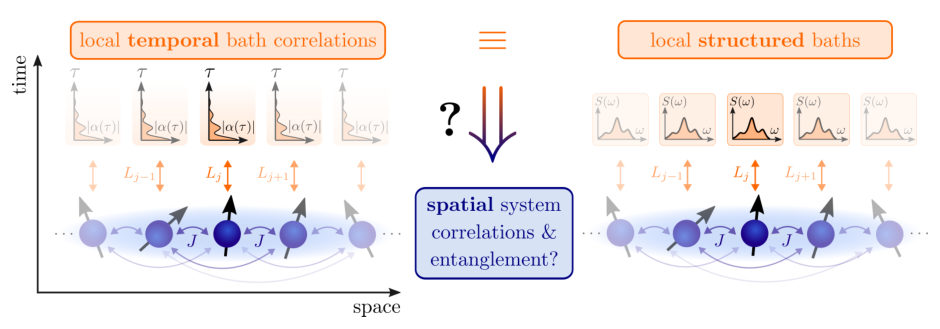 
FIG. 1. Sketch of the central question: Can independent local reservoirs with temporal correlations α(τ) (left) — or, equivalently, with structured spectra S(ω) (right) — generate spatial correlations and even stabilize global multipartite entan- glement in a one-dimensional system? Here, the system consists of an Ising chain in which each spin interacts with its own local reservoir via the coupling operators Lj (j = 1, . . . , N).

📷 Fig 2

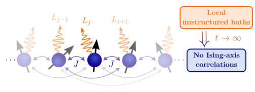 
FIG. 2. No-go theorem: For flat, unstructured baths, the dissipation is in standard Lindblad form. Our no-go result (see Sec. III) applies, forcing the bath to exponentially damp Ising correlations. After an infinite time, all Ising correlations have been washed out.

📷 Fig 3

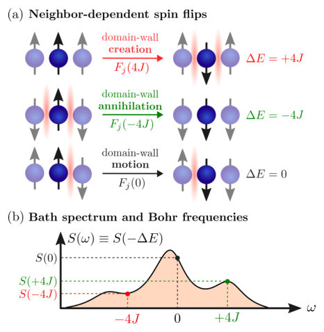 
FIG. 3. Spectrally-resolved spin-flips: (a) Sketch of the three possible neighbor-dependent spin flips associated with jump operators Fj for the nearest-neighbor Ising chain. When the spins enclosing a spin j are aligned with spin j, flipping spin j creates two domain walls and increases the system en- ergy by +4J (red). When the spins enclosing a spin j are aligned with each other but anti-aligned with spin j, flipping spin j destroys the two domain walls and decreases the system energy by −4J (green). When the spins enclosing a spin j are anti-aligned, flipping spin j induces domain wall motion and dephasing without modifying the system energy (black). (b) Bath spectrum S(−ω) sampled at...

📷 Fig 4

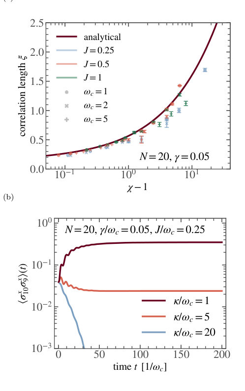 
FIG. 4. Universal behavior of the correlation length and buildup of correlations. (a): Correlation length as a function of χ−1 for different Lorentzian baths and compared with the analytical prediction of Eq. (35). We work in units where γ = 0.05. (b): Example showing the κ-dependence in the buildup of correlations as a function of time. For a very short bath correlation time (large κ), the Ising-axis correlator ⟨σx 10σx 9⟩decays almost exponentially in agreement with our no-go result. However, diminishing κ increases the stabilized Ising-axis correlations. All points were computed with the exact Markovian embedding (38) with Lj = σ− j , for N = 20 sites using the CLIK-MPS method (see...

📷 Fig 5

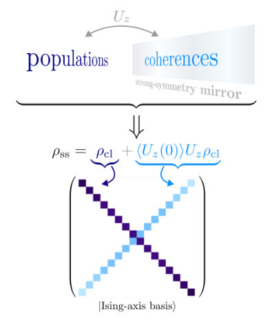 
FIG. 5. Sketch of the role of strong symmetry. The strong symmetry Uz forces the coherences Cs between globally-reversed configurations to mirror the dynamics of the populations Ps in the Ising basis. This mechanism leads to the analytical steady-state manifold (53).

**Summary.** This paper shows that global multipartite entanglement can be generated in an Ising spin chain using structured environmental baths, even when the coupling remains locally applied. By exploiting an underlying Abelian strong symmetry, the bath's temporal correlations are converted into classical spatial correlations, which are then promoted to quantum entanglement. This provides a concrete theoretical framework applicable to platforms like trapped ions.

**Why it may be interesting.** This work directly addresses the fundamental question of how environmental coupling can generate non-trivial quantum correlations, providing a mechanism that bypasses known limitations in open quantum system theory.

Detailed structure

**Main problem.** The central problem is determining if local, independent reservoirs can generate and stabilize genuine multipartite entanglement in an interacting quantum system.

**Main result.** Structured baths, by converting temporal bath correlations into classical spatial correlations, allow an Abelian strong symmetry to promote these classical correlations into global quantum multipartite entanglement.

**Method.** The analysis uses weak-coupling theory, mapping the dynamics onto an effective Lindbladian, and employs tensor-network simulations (CLIK-MPS) to find the steady state.

**Model / system.** The system is an interacting Ising chain of spin-1/2 degrees of freedom, governed by an Ising Hamiltonian. The dynamics are driven by coupling to local, independent reservoirs.

**Key observables.** Ising-axis correlators, negativity across bipartitions, and classical distinguishability.

**Important parameters / regimes.** The structure of the bath spectrum $S(\omega)$ and the strength of the coupling $J_{ij}$.

**Assumptions / limitations.** The mechanism requires harnessing an Abelian strong symmetry, and the initial analysis relies on weak-coupling theory.

**Figures summary.** Figure 1 sketches the core question regarding structured baths generating entanglement. Figure 2 illustrates the 'No-go theorem' showing exponential decay of correlations for flat baths.

**Paper structure.** The paper first establishes the 'No-go theorem' for flat baths, then introduces structured baths and strong symmetries to overcome this. It derives an exact connection between classical distinguishability and quantum entanglement, and finally proposes engineering the bath spectrum to prepare specific entangled states.

Abstract

We present how to dissipatively prepare genuinely multipartite-entangled steady states with mutually independent local reservoirs by harnessing an Abelian strong symmetry and temporal bath correlations. In interacting Ising chains, we demonstrate that, for a broad class of system-environment couplings, flat baths exponentially erase Ising-axis correlations. Structured baths overcome this obstruction by converting temporal bath correlations into classical spatial correlations. Strong symmetry then promotes these correlations to the quantum domain, enabling global multipartite entanglement. Within weak-coupling theory, we obtain exact steady states despite the generator's nonquadratic nature: strong symmetry reduces their construction to a classical problem for arbitrary Ising couplings. This reduction reveals an exact connection between classical distinguishability and entanglement. We then show how to engineer the bath spectrum to increase the correlation length and enable the preparation of GHZ-like states from separable initial conditions. We test the mechanism beyond the analytical regime using exact Markovian embeddings and tensor-network simulations. Our approach is particularly suited to superconducting and trapped-ion platforms, and we propose a concrete implementation for the latter using sympathetically cooled motional modes.

[↑ back to top](#top)

### [Non-Bloch Dynamical Quantum Phase Transitions with Memory](http://arxiv.org/abs/2610.39994v1)

**Authors:** Zhesen Yang, Wei-Wei Yang, Henning Schomerus, Jiangping Hu  
**Type:** theory · **Category:** statistical mechanics · **PDF:** <https://arxiv.org/pdf/2610.39994v1>  
**Analysis basis:** full PDF text, analyzed in chunks
**Topic relevance:** 🔥 `driven-dissipative phase transition` **4/5** · `methods for driven-dissipative` **3/5** · `non-equilibrium universality` **3/5** · `Keldysh / 2PI / non-Gaussian methods` **2/5** · `correlated / nonlocal dissipation` **2/5** · `Frenkel-Kontorova` **1/5** · `analog quantum simulation` **1/5**

📷 Fig 1

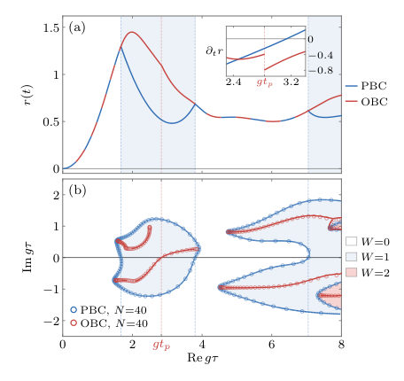 
FIG. 1. Boundary-dependent subspace DQPTs. (a) Dynam- ical free energy r(t) under PBC (blue) and OBC (red, from non-Bloch band theory) in the thermodynamic limit; where the two coincide, the curve alternates in color. Inset: ∂tr (in units of the chain-substrate coupling g) near the non-Bloch DQPT at gtp = 2.83, where the OBC slope jumps. (b) Fisher zeros, i.e., complex times τ with det USS(τ) = 0, in the thermo- dynamic limit (curves) and for N = 40 cells (circles), colored as in (a); black line: real-time axis of (a). Shading in (a) and (b): winding number W (key on the right); dashed lines: PBC (blue) and non-Bloch (red) DQPTs. Numerical details: Appendix A.

📷 Fig 2

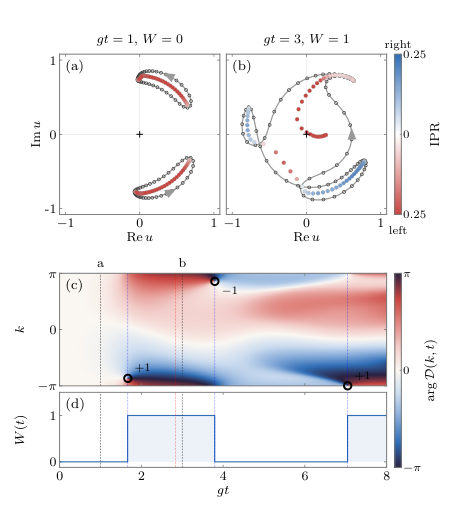 
FIG. 2. Non-Markovian skin effect and dynamical vortices. (a),(b) Eigenvalues u of USS at gt = 1 and 3 under PBC for continuous k (gray curves; arrows: increasing k) and for N = 40 cells under PBC (open circles) and OBC (dots); + marks u = 0. At gt = 3, the two eigenvalues are interchanged after one turn of k and together encircle u = 0 once. Dot color: red (blue) for right eigenvectors centered in the left (right) half of the chain; intensity: their inverse participation ratio. (c) arg D(k, t); circles: vortices labeled by their charges q. (d) Winding number W(t). Dashed lines: the times of (a) and (b) (labels a, b), the PBC DQPTs (blue), and the non-Bloch DQPT (red). Numerical details:...

📷 Fig 3

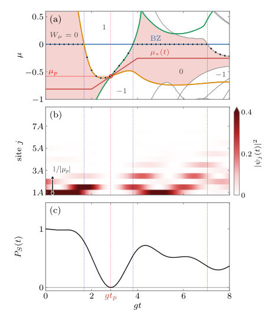 
FIG. 3. Analytic continuation and non-Bloch DQPT. (a) Winding number Wµ (numbers) in the (t, µ) plane, with winding boundaries (gray lines, except the two that bound the plateau in the first interval with W = 1, in orange and green), the zero-winding plateau (shading) closing at (tp, µp) (red circle), the BZ (blue line), and the path µ∗(t) (red curve); dots: rPBC(t) −rOBC(t) at intervals of 0.2/g. (b) Density |ψj(t)|2 of e−iHt|r⟩on the first 8 cells of an open chain with N = 40, where |r⟩is the right eigenvector of USS(tp) with the eigenvalue closest to zero; arrow: localization length 1/|µp|. (c) Survival probability PS(t) of |r⟩on the chain. Dashed lines as in Fig. 1; numerical details:...

📷 Fig 4

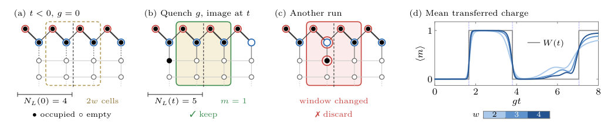 
FIG. 4. Many-body detection of the winding number. (a)–(c) Protocol. A filled chain and an empty substrate (a) evolve after g is switched on. A snapshot taken at time t is kept if its window of 2w cells returns to the initial pattern (b) and discarded otherwise (c); for each kept snapshot, the transferred charge m = NL(t) −NL(0) is recorded. Black disks mark occupied sites, and red (blue) circles the A (B) sites; in (c), large red rings mark the sites that differ from the initial pattern. (d) Conditional mean ⟨m⟩for w = 2, 3, 4, compared with W(t); dashed lines: PBC DQPTs. Open chain with N = 30 cells (Sec. S5 of the Supplemental Material).

📷 Fig 5

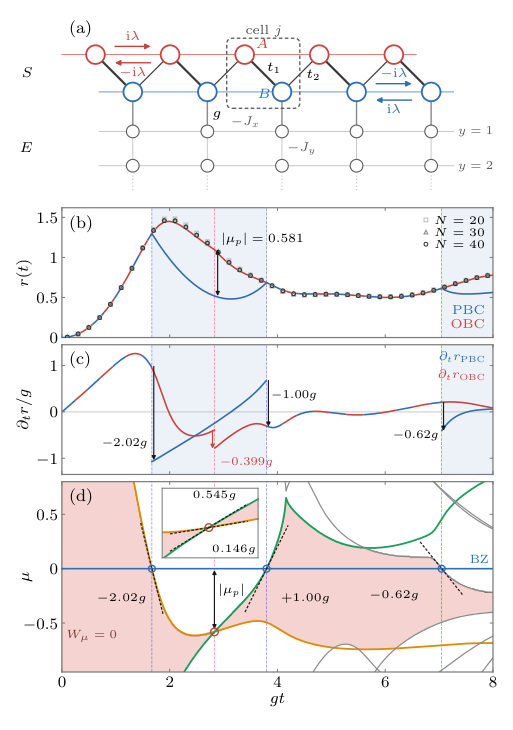 
FIG. 5. Lattice model and dynamical free energy of open chains. (a) Bonds of H, with the amplitude ⟨i|H|j⟩of a hop j →i along each arrow; dashed box: cell j. (b) r(t) for N →∞under PBC and OBC [Eqs. (9) and (11)], colored as in Fig. 1(a), and for open chains (symbols); shading: W(t) = 1; arrow: the gap |µp| at tp [Eq. (14)]. (c) Slopes of the N →∞curves in (b); arrows: jumps predicted by the tangent slopes in (d). (d) Winding boundaries near the BZ (blue line), colored as in Fig. 3(a), and the zero-winding plateau (shading), which closes at (tp, µp) (red circle); dashed: tangents where a winding boundary crosses the BZ (circles) and at (tp, µp) (inset). Vertical lines as in Fig. 1.

**Summary.** This work investigates non-Bloch Dynamical Quantum Phase Transitions in open quantum chains coupled to a substrate with memory. By utilizing the winding number, the authors show that the boundary conditions fundamentally alter the system's dynamics when the winding number is non-zero. This establishes a dynamical bulk-boundary correspondence, linking non-Hermitian topology to the dynamics of Hermitian systems.

**Why it may be interesting.** The connection between topological invariants (winding number) and non-equilibrium dynamics (DQPTs) in open systems is highly relevant for understanding boundary effects in quantum materials and open quantum systems.

Detailed structure

**Main problem.** The paper identifies and characterizes non-Bloch Dynamical Quantum Phase Transitions (DQPTs) that occur specifically in open quantum chains, contrasting them with standard Bloch-momentum dependent transitions.

**Main result.** The existence of non-zero winding numbers ($W 
eq 0$) causes the dynamical free energy calculated for open chains to differ significantly from that of periodic chains, revealing a dynamical bulk-boundary correspondence.

**Method.** The analysis relies on calculating the winding number ($W$) via the argument principle applied to the projected propagator, and relating the open boundary energy to the periodic one via analytic continuation to complex momenta.

**Model / system.** The system is a Hermitian quantum chain coupled to a simple substrate, resulting in non-Markovian dynamics due to the substrate's memory. The dynamics are analyzed using block Hamiltonian diagonalization and the concept of the dynamical free energy.

**Key observables.** Dynamical free energy ($r(t)$), winding number ($W$), and the difference between OBC and PBC free energies.

**Important parameters / regimes.** The winding number $W$, the time $t$, and the complex momentum $\mu$.

**Assumptions / limitations.** The analysis assumes the substrate memory can be treated exactly, and that the difference between OBC and PBC can be mapped via analytic continuation.

**Figures summary.** Figures illustrate the difference in dynamical free energy between PBC and OBC, showing how the winding number dictates this difference, and visualizing the winding number contours in the time-momentum plane.

**Paper structure.** The paper progresses by first defining the system and the DQPT concept, then introducing the winding number as the diagnostic tool, deriving the relationship between OBC and PBC energies, and finally demonstrating the physical consequences of $W 
eq 0$ via the dynamical bulk-boundary correspondence.

Abstract

Dynamical quantum phase transitions (DQPTs) of periodic chains are determined by real Bloch momenta. We identify non-Bloch DQPTs, which occur only in open chains and are determined by complex momenta instead. They arise in a Hermitian chain coupled to a simple substrate, whose memory is treated exactly, and originate from the point-gap winding number $W$ of the projected propagator: for $W\neq0$, open boundaries change both the dynamical free energy and the critical times, even in the thermodynamic limit. We find that both follow from an analytic continuation to complex momenta, and show that $W$ can be measured by particle counting. This reveals a dynamical bulk-boundary correspondence, in which non-Hermitian topology emerges from Hermitian dynamics with memory.

[↑ back to top](#top)

### [Error-Corrected Quantum Optimization via Rydberg Atom Array Embeddings](http://arxiv.org/abs/2610.39670v1)

**Authors:** Andrew Byun, Berend Klaver, Arinjoy De, Pedro Ildefonso, Davit Khachatryan, Alexei Bylinskii, Michael Schuler, Wolfgang Lechner  
**Type:** both · **Category:** quantum information and computing · **PDF:** <https://arxiv.org/pdf/2610.39670v1>  
**Analysis basis:** full PDF text, analyzed in chunks
**Topic relevance:** 🔥 `QC/QI experiment` **4/5** · 🔥 `Rydberg arrays` **4/5** · `analog quantum simulation` **3/5** · `quantum measurements` **1/5**

📷 Fig 1

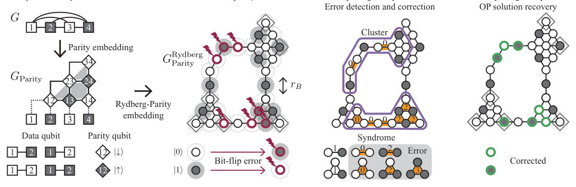 
FIG. 1. Overview of error-corrected quantum optimization via Rydberg atom array embeddings. (a) An optimization problem (OP) on a logical graph G (here, a QUBO instance) is first mapped to the parity encoding GParity. Squares denote data qubits and diamonds denote parity qubits, with empty (filled) markers indicating the qubit state |↓⟩(|↑⟩). Gray triangles and squares represent three- and four-body parity constraints, respectively. (b) The parity-encoded problem is embedded into a Rydberg-blockade-based atomic layout GRydberg Parity , yielding the Rydberg-Parity embedding. Adiabatic quantum computing (AQC) is then performed on this layout. Empty (filled) circles correspond to physical...

📷 Fig 2

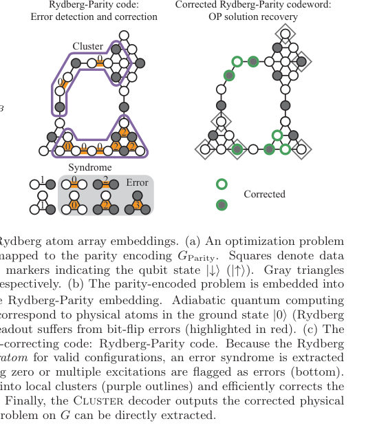 
Figure 1 summarizes our full workflow for error- corrected quantum optimization with Rydberg gadget embeddings. An optimization problem is first mapped to the physical Rydberg-Parity embedding on an array of atoms via an intermediate parity mapping [Fig. 1(a, b)]. Then, noisy AQC is performed on this Rydberg- Parity layout [Fig. 1(b)], typically yielding a noisy bit- string. Interpreting the atomic layout as a Rydberg- Parity code, we extract the error syndrome, apply the Cluster decoder to correct errors, and recover a valid bitstring [Fig. 1(c)]. Finally, the solution of the origi- nal OP is directly obtained from the corrected bitstring [Fig. 1(d)].

📷 Fig 3

 
FIG. 2. Gadget-based Rydberg-Parity embedding. (a) The physical layout GRydberg Parity is constructed through the amalga- mation of two fundamental gadgets [26]: (b) The LINK gad- get, which copies the bit from one end to the other, nA = nA′; (c) The 3BODY gadget, which satisfies the parity constraint: nA ⊕nB ⊕nAB = 1. Amalgamation glues gadgets together at shared atoms (e.g., atom A), thereby summing their local detunings ∆i (indicated by the circle colors). The smaller con- figurations shown in (b) and (c) enumerate all valid MWIS bitstrings of the corresponding gadgets. (d, e) LINK and 3BODY gadgets can themselves be interpreted as an amalga- mation of dimer and trimer superatoms. The...

📷 Fig 4

 
FIG. 3. Cluster decoder. (a) The iterative decoding algorithm consists of four stages: (0) Initialize: Initial clusters Γi (the active regions of interest) are defined by grouping adjacent superatom sets (sets of atoms belonging to the same superatom) that are flagged by the syndrome (highlighted in orange). (1) Resolve: The decoder attempts to locally correct the errors in each cluster by finding a unique bitstring configuration using the lookup-table search detailed in (b). All atoms outside the cluster are frozen, whereas the atoms inside the cluster remain unfrozen and are outlined in orange. If the Resolve step fails (e.g., Γ2 and Γ3), i.e., no unique valid configuration is found, the...

📷 Fig 5

 
FIG. 4. Logical error rate (LER) under i.i.d. bit-flip noise for OPs on (a) complete graphs G = KN and (b) bipartite graphs G = KN,N for varying problem sizes N (indicated by color). The crossing of the curves reveals an error thresh- old pth, below which the LER decreases monotonically as the system size N increases. From the crossing of the curves cor- responding to the two largest considered graph sizes, we es- timate pth ≈0.275 for complete graphs (a), and pth ≈0.263 for bipartite graphs (b). The left side of each panel illustrates the mapping from the OP, through the parity-encoded prob- lem, to the Rydberg-Parity embedding. Increasing problem sizes N are represented by progressively...

**Summary.** This work demonstrates that embedding general optimization problems onto Rydberg atom arrays not only maps the problem but also inherently builds in a classical error-correcting code. By utilizing this structure and a specialized Cluster decoder, the authors achieve high fidelity in recovering optimal solutions despite hardware noise.

**Why it may be interesting.** It provides a concrete, physical realization of error correction being an intrinsic byproduct of the computational embedding structure, which is a major goal in scalable quantum computation.

Detailed structure

**Main problem.** The paper addresses the challenge of solving general combinatorial optimization problems (OPs) on complex topologies using Rydberg atom arrays, which requires embedding techniques beyond the native maximum independent set problem.

**Main result.** The embedding structure itself is shown to naturally form a classical error-correcting code, allowing the use of a tailored Cluster decoder to achieve an error threshold of $p_{	ext{th}}\gtrsim26\%$ and recover solutions experimentally.

**Method.** The approach combines gadget-based embedding (e.g., Parity Architecture) to map OPs to the hardware, followed by Adiabatic Quantum Computation (AQC) and error correction using a specialized Cluster decoder.

**Model / system.** The physical system is a Rydberg atom array utilizing the Rydberg blockade mechanism. The Hamiltonian involves mixing ($\hat{H}_{mix}$) and cost ($\hat{H}_{cost}$) terms, and the computation relies on mapping the problem onto a Unit-Distance-Weighted Maximum Independent Set (UD-MWIS) problem on an expanded graph.

**Key observables.** Error threshold ($p_{	ext{th}} \gtrsim 26\%$), average success rate ($\gtrsim 8\%$) for recovering exact solutions on the QuEra Aquila QPU.

**Important parameters / regimes.** Error threshold, Rabi frequency ($\Omega$), detuning ($\Delta$), and the specific structure of the gadgets (LINK, 3BODY).

**Assumptions / limitations.** The primary assumption is that the redundancy introduced by the embedding gadgets provides sufficient structure to act as a classical error-correcting code, which is strictly nonlinear.

**Figures summary.** Figure 1 illustrates the full workflow: OP $	o$ Parity Encoding $	o$ Rydberg-Parity Embedding $	o$ Error Syndrome Extraction $	o$ OP Solution Recovery. Other figures detail the state preparation pulse and gadget performance.

**Paper structure.** The paper first establishes the need for embedding beyond native graph constraints. It then details the construction of the Rydberg-Parity embedding, which simultaneously encodes the problem and provides error correction. The methodology involves AQC, error syndrome extraction via local constraints, and decoding using the Cluster decoder.

Abstract

Rydberg atom quantum optimizers naturally encode the maximum independent set problem on geometric graphs. However, to solve general combinatorial optimization problems on more complex topologies, an embedding is required to overcome the limited-range native interactions. Such embeddings use gadgets, specific arrangements of atoms, which inevitably introduce ancillary atoms. Here, we show that this apparent overhead instead provides an intrinsic resource for error correction. Specifically, we demonstrate that the Parity Architecture-based Rydberg embedding naturally forms a classical error-correcting code, a principle that extends to other Rydberg blockade-based embeddings. Within superatom substructures, exact Rydberg-excitation-number constraints provide local error syndromes at no additional hardware cost and give rise to a strictly nonlinear code. To correct bit-flip errors, we introduce the precisely tailored Cluster decoder, which exploits these local constraints and the underlying gadget structure. Numerically, this approach achieves an error threshold of $p_{\text{th}}\gtrsim26 \%$ across different layout geometries. Experimentally, on the QuEra Aquila QPU, the Cluster decoder recovers exact optimization solutions with an average success rate of $\gtrsim8\%$ for systems of up to 107 atoms, even when bare hardware and standard greedy post-processing find none. A Rydberg atom array embedding is therefore not merely a hardware mapping of an optimization problem, but a co-designed architecture for quantum optimization in which embedding, computation, and error correction emerge from the same physical structure.

[↑ back to top](#top)

### [Provably efficient experimental classification of quantum data with quantum kernels](http://arxiv.org/abs/2610.39350v1)

**Authors:** Keitaro Anai, Akimoto Nakayama, Shintaro Ooka, Hiroko Tomoda, Yuto Morohoshi, Yohji Chin, Shigehito Miki, Masahiro Yabuno, Hirotaka Terai, Peter van Loock, Kosuke Mitarai, Shuntaro Takeda  
**Type:** both · **Category:** quantum information and computing · **PDF:** <https://arxiv.org/pdf/2610.39350v1>  
**Analysis basis:** full PDF text, analyzed in chunks
**Topic relevance:** 🔥 `QC/QI experiment` **4/5** · `quantum measurements` **3/5** · `quantum optics experiment` **3/5** · `analog quantum simulation` **2/5**

📷 Fig 1

 
FIG. 1. Conceptual overview of the proposed quantum-state classification framework. Our frame- work is designed to address diverse quantum-state classifica- tion tasks motivated by questions in quantum science, such as determining whether a state is entangled, identifying phases of matter, and detecting faulty outputs from quantum devices (left). Across these tasks, we assess the structure of quan- tum data using a common measure based on a quantum ker- nel, which quantifies similarity between states (center). For data satisfying our sufficient conditions, the same quantum kernel method enables accurate learning and prediction with numbers of training states and measurement shots that scale...

📷 Fig 2

 
FIG. 2. Numerical simulation of the mode-number dependence of classification accuracy in stellar-rank- based quantum data classification. Blue, red, green, and orange lines correspond to results obtained using the fidelity kernel as a linear baseline, quantum RBF kernel, non-QML methods with random-candidate testing, and non-QML meth- ods with optimized-candidate testing, respectively. Here, as the non-QML method, we adopt the approach proposed in Ref. [18], which is based on a witness called stellar robustness (see Supplementary Sec. D for the detailed procedure). For the quantum-kernel methods, the horizontal axis denotes the number of labeled quantum data used to train the classifier,...

📷 Fig 3

 
FIG. 3. Fidelity values | ⟨ψj|ψi⟩|2 between quantum data. The horizontal and vertical axes in Fig. 3 represent the index of the 180 quantum data. In a–c, the colormap represents the fidelity values between quantum data with the corresponding indices; in d, it represents the element-wise difference between a and b. The rows and columns of the matrix are ordered identically. The data are grouped according to their class label, with stellar-rank-zero states placed first and stellar-rank-one states placed second. See Supplementary Sec. F for details on the ordering. a. Experimental fidelities. Each element’s standard error is approximately 0.004, determined via bootstrap resampling. b....

📷 Fig 4

 
FIG. 4. Classification accuracy versus training dataset size. Markers represent experimentally measured accura- cies (exp.), solid lines indicate simulated theoretical accura- cies including experimental imperfections (realistic sim.), and dashed lines indicate simulated theoretical accuracies without experimental imperfections (ideal sim.). Blue, red, and green correspond to results obtained using the quantum fidelity ker- nel, quantum RBF kernel, and non-QML methods with ran- dom candidates, respectively. The shaded area represents the standard error (see Supplementary Sec. A for details).

📷 Fig 5

 
FIG. 5. Experimental measurement of quantum kernel entries. a, Conceptual quantum circuit for quantum kernel measurement. Quantum data |ψi⟩are generated and the fidelities | ⟨ψj|ψi⟩|2 of quantum data are measured by projection onto quantum data |ψj⟩. b, Detailed quantum circuit implementation. Squeezed vacuum states or squeezed single-photon states are generated, depending on the measurement result of the photon detector. For the projection onto ⟨ψj| = ⟨nj| ˆG† j, we implement the measurement-induced operation ˆG† j with an ancillary state from OPO-2, and the projection onto ⟨nj|. Disp., displacement operation; OPO, optical parametric oscillator.

**Summary.** This paper presents a theory-guided framework for efficiently classifying quantum states using quantum kernel methods, bypassing the need for exponentially complex measurements. The authors theoretically prove polynomial resource scaling and experimentally demonstrate this scheme by classifying the stellar rank of continuous-variable quantum states using a programmable photonic processor.

**Why it may be interesting.** The work provides a concrete, experimentally validated blueprint for implementing quantum machine learning tasks on current photonic hardware, moving beyond purely theoretical bounds by addressing resource scaling.

Detailed structure

**Main problem.** The paper addresses the challenge of efficiently classifying quantum states without requiring an exponentially large number of measurements, a necessity for practical quantum machine learning.

**Main result.** They establish a theory-guided framework guaranteeing classification accuracy with a number of measurements polynomial in system size, which was experimentally validated on a photonic processor.

**Method.** The core method uses quantum kernel methods, specifically the quantum Radial Basis Function (RBF) kernel derived from quantum fidelities, framed as a Support-Vector-Machine classifier.

**Model / system.** The experiments are performed on a programmable photonic processor capable of generating and processing continuous-variable (CV) quantum states, specifically classifying single-mode states based on their stellar rank (a measure of non-Gaussianity).

**Key observables.** Classification accuracy, quantum fidelity ($|\langle\psi_j|\psi_i
angle|^2$), and the stellar rank of the quantum states.

**Important parameters / regimes.** The theoretical guarantee relies on the margin $\eta$ being bounded below by an inverse polynomial in system size $m$. Experimentally, the setup uses specific squeezing levels and measurement parameters ($\alpha, eta$).

**Assumptions / limitations.** The theoretical guarantee assumes the class does not collapse onto its representatives. Experimentally, the method is shown to be robust despite experimental imperfections.

**Figures summary.** Figures illustrate the conceptual framework (Fig 1), the mode-number dependence of classification accuracy comparing different kernels (Fig 2), measured fidelities (Fig 3), and the comparison of classification accuracy vs. training set size (Fig 4).

**Paper structure.** The paper first theoretically establishes the framework linking learning efficiency to data structure, deriving polynomial resource bounds. It then applies this to the resource problem of stellar rank classification in CV states. The latter part details the experimental implementation, including the measurement procedures for estimating quantum fidelities using homodyne detection on a photonic platform.

Abstract

Analyzing quantum systems is essential for quantum information processing, but can require exponentially many measurements without exploiting the structure of the system or task. Quantum machine learning offers a promising way to reduce this cost by learning from quantum data. Here, we theoretically establish a framework for efficient quantum-state classification and experimentally demonstrate the resulting scheme on a programmable photonic processor. Our analysis links learning efficiency to the structure of quantum data, without relying on a physical description tailored to each task. We derive sufficient conditions for accurate classification with a number of measurements polynomial in system size. We apply this guarantee to a resource problem in continuous-variable (CV) quantum computing: classifying stellar rank, a measure of non-Gaussianity. Experimentally, we implement the classification of single-mode CV quantum states with stellar rank zero and one. This is enabled by developing a programmable CV photonic processor capable of preparing and processing diverse Gaussian and non-Gaussian states and performing virtual projection onto such states, going beyond the Gaussian-only capabilities of most existing photonic platforms. The experiment demonstrates accurate classification despite experimental imperfections. Our results establish a theory-guided and experimentally validated framework for quantum-state classification that can be implemented on quantum devices available today.

[↑ back to top](#top)

### [High-Fidelity Universal Quantum Gates in a Cryogenic Atom Array](http://arxiv.org/abs/2610.40329v1)

**Authors:** Junlan Jin, Donghyuk Seo, Yue Shi, Yukai Lu, Jeff D. Thompson, Waseem S. Bakr  
**Type:** experiment · **Category:** other · **PDF:** <https://arxiv.org/pdf/2610.40329v1>  
**Analysis basis:** full PDF text, analyzed in chunks
**Topic relevance:** 🔥 `QC/QI experiment` **4/5** · 🔥 `Rydberg arrays` **4/5** · `analog quantum simulation` **2/5** · `quantum optics experiment` **1/5**

📷 Fig 1

 
FIG. 1. Experimental setup and state preparation. (a) Simplified schematic of the experimental setup, showing the 4 K and 35 K radiation shields enclosed within a vacuum chamber, superconducting coils, electrodes, aspheric lenses, and laser beam paths. Inset: a 7 × 2 atom array, with interpair and intrapair spacings of 12 µm and 3.2 µm, respectively, is located at the focus of the lenses. The tweezer trapping light is at the cesium magic wavelength of 936 nm, where the 6S1/2 and 6P3/2 states have similar dynamic polarizabilities. (b) Energy-level diagram of 133Cs showing the relevant transitions. The qubit is encoded in the hyperfine clock states |0⟩= |3, 0⟩and |1⟩= |4, 0⟩. The Raman...

📷 Fig 2

 
FIG. 2. Coherent control of the clock-state qubit. (a) Raman- driven clock-state Rabi oscillations with a Rabi frequency of 2π × 349.8(7) kHz. (b) Ramsey measurement. Orange points and the solid line show the array-averaged data and a Gaus- sian fit with a 1/e decay time of 1.92(4) ms. The shaded decay envelope corresponds to T ∗ 2 = 3.14(2) ms, the average coher- ence time extracted from individual-site fits. (c) Randomized benchmarking of single-qubit gates. An exponential fit with a baseline of 1/2 yields an average Clifford gate fidelity of 99.970(2)%. Inset: Randomized benchmarking circuit. Cr, Cf, and n denote a random Clifford gate, the final recovery gate, and the number of Clifford...

📷 Fig 3

 
FIG. 4. High-fidelity time-optimal CZ gate using Rydberg P state interactions. (a) Interaction energies of relevant Rydberg pair states versus interatomic separation R at θ = 90◦(left) and versus θ at the experimental separation of R = 3.2 µm (right), calculated using ARC [54]. The colors of the solid lines indicate the coupling strength between |1r⟩and the pair states. (b) Amplitude (purple) and phase (light blue) profiles of the time-optimal CZ gate. (c) Echo randomized benchmarking and (d) symmetric stabilizer benchmarking of the CZ gate. Exponential fits with zero offset yield fidelities of 99.76(8)% and 99.78(10)%, respectively. Insets: Circuit diagrams. n denotes the number of CZ...

**Summary.** This paper reports the successful demonstration of a universal quantum gate set using $^{133}	ext{Cs}$ atoms trapped in an optical tweezer array operating at cryogenic temperatures. By suppressing blackbody radiation effects, the authors achieved state-of-the-art gate fidelities, establishing a clear pathway to fault-tolerant quantum computation beyond current room-temperature limitations.

**Why it may be interesting.** This work is highly relevant as it pushes the boundaries of quantum computation hardware by demonstrating how cryogenic cooling can fundamentally suppress decoherence mechanisms (like BBR) that limit gate fidelity in neutral atom platforms.

Detailed structure

**Main problem.** The primary challenge addressed is achieving high-fidelity universal quantum gates in neutral atom arrays while mitigating decoherence caused by blackbody radiation (BBR) in room-temperature environments.

**Main result.** The authors demonstrated a universal gate set in a cryogenic $^{133}	ext{Cs}$ atom array, achieving single-qubit gate fidelity of 99.970(2)% and two-qubit entangling-gate fidelity of 99.76(8)%, surpassing room-temperature limits.

**Method.** The experiment utilizes optical tweezer arrays and cryogenic cooling to suppress BBR-induced transitions. Gate operations are performed using direct single-photon coupling to Rydberg P states for the entangling gate.

**Model / system.** The physical system is a trapped array of $^{133}	ext{Cs}$ atoms. Qubits are encoded in hyperfine clock states, and the entangling gate relies on controlled Rydberg interactions mediated by single-photon excitation.

**Key observables.** Single-qubit gate fidelity (99.970(2)%), raw two-qubit entangling-gate fidelity (99.76(8)%), and coherence times ($T_2^*$).

**Important parameters / regimes.** Cryogenic temperatures (suppressing BBR), Rabi frequency ($2\pi 	imes 4.3$ MHz), and the fundamental error contribution from Rydberg decay (below $3	imes10^{-4}$).

**Assumptions / limitations.** The error model suggests that atomic motion, rather than Rydberg decay, is the dominant source of infidelity, pointing to improved cooling as the primary path for fidelity enhancement.

**Figures summary.** Figures illustrate the experimental setup (cryogenic shields), energy level diagrams for $^{133}	ext{Cs}$, and detailed measurements of Rabi oscillations, Ramsey decay, and gate fidelity using randomized benchmarking.

**Paper structure.** The paper details the platform (cryogenic atom arrays), describes the single-qubit control using Raman transitions, and then presents the implementation and benchmarking of the two-qubit entangling gate using single-photon coupling to Rydberg states.

Abstract

Neutral atoms in optical tweezer arrays have emerged as a leading platform for quantum information processing. The fidelity of entangling gates mediated by Rydberg interactions has improved rapidly and is increasingly constrained by blackbody-radiation-induced transitions, which shorten Rydberg lifetimes and create contaminant states that can cause correlated errors. Cryogenic environments can suppress these transition rates by more than an order of magnitude. However, realizing a universal gate set in such an environment has remained an outstanding challenge. Here, we demonstrate a universal quantum gate set in a cryogenic $^{133}$Cs atom array, with a single-qubit gate fidelity of 99.970(2)% and a raw two-qubit entangling-gate fidelity of 99.76(8)%, within the range of leading room-temperature implementations. The entangling gate uses direct single-photon coupling between the electronic ground state and a Rydberg $P$ state, avoiding scattering and light shifts associated with two-photon coupling. The gate operates at a modest Rabi frequency of $2π\times4.3$ MHz. The measured fidelity agrees with our error model dominated by atomic motion, indicating a straightforward route to higher fidelity through improved cooling, while the fundamental error contribution from Rydberg decay is below $3\times10^{-4}$. These results establish a path to entangling-gate fidelities substantially beyond the current state of the art through cryogenic suppression of Rydberg decay, reducing the overhead for fault-tolerant computation.

[↑ back to top](#top)

### [High bandwidth heterodyne sensing with bulk NV diamond](http://arxiv.org/abs/2610.39022v1)

**Authors:** H. A. M. Taylor, J. P. Duff, L. B. Miller, A. Tritt, M. S. Oldfield, K. Helmerson, M. S. J. Barson  
**Type:** both · **Category:** other · **PDF:** <https://arxiv.org/pdf/2610.39022v1>  
**Analysis basis:** full PDF text, analyzed in chunks
**Topic relevance:** 🔥 `quantum optics experiment` **4/5** · `interference shaping light` **3/5** · `quantum measurements` **2/5** · `QC/QI experiment` **1/5**

📷 Fig 1

 
Figure 1. Principles of conventional and heterodyne ODMR in NV centres. (a) During continuous-wave (CW) optical and microwave driving of the NV centre, the rate dynamics of the ground state spin triplet can be expressed in terms of an optical polarization rate Γp, microwave de-polarization rate Γb, and longitudinal relaxation rate Γ1, all of which drive exchange between the |0⟩and |1⟩spin populations. (b) In conventional ODMR, a resonant microwave generates a fixed microwave de-polarization rate Γb, which may be enabled or extinguished to vary the equilibrium bright state population P ∞ 0 . (c) The bright state population P0(t) approaches the new equilibrium value at a rate determined by...

📷 Fig 2

 
Figure 2. (a) Theoretical shot noise-limited SNR (as δ →0) of the quantum heterodyne measurement in the case of a perfectly resonant control microwave (∆= 0), showing a broad optima at Γp = 3Γcon. The optical SNR as a function of heterodyne detuning is measured for a fixed optical excitation power and a range of values of the control microwave power Pcon, with corresponding values of Γp and Γcon marked. (b) Measured (circles) and modelled (lines) optical SNR as function of detuning for values of Pcon towards the optimum value at 12 dBm, and (c) up to our maximum tested value of 34 dBm.

📷 Fig 3

 
Figure 3. (a) Illustration of the multi-channel bandwidth expansion scheme, showing a number of subsensors with overlapping sensing bands, each produced by a sub-ensemble of the NV diamond paired with a modulated auxiliary control microwave. (b) Equivalent block diagram of the multi-channel sensor. Each subsensor acts as a mixer and low-pass filter, converting the target microwave to a series of baseband PL signals. The microwave spectrum within the heterodyne bandwidth of each auxiliary microwave is then recovered by post-hoc demodulation of the combined PL signal using the corresponding modulation key. (c) Recovered target microwave spectrum using the multi-channel bandwidth expansion...

📷 Fig 4

 
Figure 4. (a) Experimental layout of the high bandwidth heterodyne sensor with magnetic gradient. D: quantum diamond; PCB: planar loop antenna printed circuit board; M: permament magnet pair; L: excitation laser; BS: beam splitter; DM: dichroic mirror; O: objective lens; F: longpass filter; BPD: balanced photodetector; ACQ: acquisition digitiser; LO: local oscillator; A: microwave amplifier. (b) Model of the diamond volume, excitation region, and magnetic field geometry.

📷 Fig 5

 
Figure 5. Conventional ODMR (red line) and heterodyne ODMR (black squares) measurement of NV magnetic reso- nance line broadened by magnetic gradient across the ensem- ble.

**Summary.** This paper details an advanced quantum sensing technique using NV centers in diamond to overcome the bandwidth limitations of conventional magnetic resonance measurements. By employing heterodyne mixing with strong optical and microwave driving, the authors achieve MHz-scale bandwidths while maintaining high sensitivity. The methodology integrates theoretical rate equations with complex signal processing to enable wide-band, multiplexed sensing for practical applications.

**Why it may be interesting.** This work is highly relevant to AMO physics and quantum optics as it pushes the boundaries of quantum sensing by engineering the measurement bandwidth using coherent driving fields (heterodyne mixing) rather than relying solely on intrinsic linewidths.

Detailed structure

**Main problem.** The primary challenge is developing high-performance, portable quantum sensors with significantly increased instantaneous bandwidth beyond the intrinsic limits imposed by the narrow linewidth of the NV spin resonance.

**Main result.** The authors successfully demonstrated achieving MHz-scale instantaneous bandwidth using heterodyne mixing and further expanded this using magnetic gradients, reaching a peak sensitivity of 8.5 nT/sqrt(Hz).

**Method.** The work combines theoretical rate equation modeling with experimental demonstrations of heterodyne detection and advanced signal processing techniques like code-division multiplexing.

**Model / system.** The physical system is the Nitrogen Vacancy (NV) center in diamond, which acts as the quantum sensor platform. The sensing mechanism relies on Optically-Detected Magnetic Resonance (ODMR) enhanced via heterodyne mixing.

**Key observables.** Sensitivity (e.g., 548 pT/sqrt(Hz) to 8.5 nT/sqrt(Hz)), Signal-to-Noise Ratio (SNR), and the instantaneous bandwidth (BW_het).

**Important parameters / regimes.** The bandwidth is governed by the sum of optical ($\Gamma_p$) and microwave control ($\Gamma_{con}$) de-polarization rates; the system is analyzed in regimes where $\Gamma_p \gg \Gamma_1$.

**Assumptions / limitations.** Key approximations include assuming the dark state degeneracy is lifted by a static magnetic field and approximating the true NV resonance distribution using the ODMR spectrum for ensemble averaging.

**Figures summary.** Figures illustrate the rate dynamics for conventional vs. heterodyne ODMR, show the theoretical SNR dependence on detuning ($\delta$) and control power ($P_{con}$), and detail the multi-channel expansion scheme using QPSK.

**Paper structure.** The paper progresses from establishing the need for high bandwidth sensing, detailing the theoretical framework using rate equations and heterodyne mixing, demonstrating bandwidth enhancement via gradients, and finally showcasing a complex multi-channel multiplexing scheme for wide-band target recovery.

Abstract

Developing high performance portable sensors is of significant importance for both terrestrial and satellite communications, with quantum sensors offering potential advantages in sensitivity and bandwidth. The nitrogen vacancy center in diamond is a popular quantum sensing platform for its relative simplicity and wide range of acceptable operating conditions, but suffers a limited instantaneous bandwidth due to the narrow linewidth of the spin resonance. In this work, we first present a magnetic quantum sensing scheme utilizing heterodyne mixing with strong optical and microwave driving, achieving MHz-scale instantaneous bandwidth with a sensitivity of $548 \; \text{pT/}\sqrt{\text{Hz}}$ in an active diamond volume of $ 2.5\times 10^{-4} \; \text{mm}^3$ with $2 \times 10^{11}$ NV centers. We then demonstrate expansion of the sensing bandwidth by employing a strong magnetic gradient and many individually modulated microwave control fields, expanding the single resonance bandwidth to 48 MHz with a peak sensitivity of $8.5 \; \text{nT/}\sqrt{\text{Hz}}$.

[↑ back to top](#top)

### [Homodyne versus heterodyne detection for classifying families of optical quantum states from finite records of detection events](http://arxiv.org/abs/2610.38671v1)

**Authors:** Franciszek Grzywa, Sebastian Dolata, Karol Bartkiewicz  
**Type:** both · **Category:** other · **PDF:** <https://arxiv.org/pdf/2610.38671v1>  
**Analysis basis:** full PDF text, analyzed in chunks
**Topic relevance:** 🔥 `quantum optics experiment` **4/5** · `quantum measurements` **3/5** · `methods for driven-dissipative` **2/5** · `Full counting statistics` **1/5**

📷 Fig 1

 
FIG. 1. State families of the base set at ¯n = 3 [1, 40–45]: exact W (dashed contour: W = 0), exact Q (both on (x, p) ∈[−7, 7]2, x horizontal, common color scales, square root for Q) and P(n), whose mean (dashed line) is the same in every column while its shape differs. Under each column: definition and parameter condition. Shown: even cat (odd: |α|2 coth |α|2 = ¯n), binomial (s, J, µ) = (1, 2, 0), GKP µ = 0. In the data the phases and squeezing axes are random, the GKP and binomial code words keep their orientation, and the cat parity and code words are drawn at random.

📷 Fig 2

 
FIG. 2. The same even cat state (|α| = 2) estimated from N events. Top: heterodyne, a histogram of N outcomes (Q). Bottom: homodyne, filtered back-projection of K = 36 histograms (W). Columns: N = 103, 105 and N →∞(exact projections for W), on [−4, 4]2. The fringes at the origin are present in W and absent in Q (equation (4)); hatching marks W &lt; −0.1 max |W|. At N = 103 the Q estimate is a scatter of counts and the W estimate is dominated by the amplified noise. One realization per panel, each panel with its own vertical scale.

📷 Fig 3

 
FIG. 3. Design of the study. (a) Every family is trained on the same sequence of 114 files with one noise condition each (bar height: strength; channel coded by shade and pattern), and within every file ⟨ˆn⟩cycles through 2, 3, 4, 5, so neither the noise nor the energy identifies a family. (b) The 135 networks, one marker per independent training run, in groups that test the representation (W, Q, and S, the homodyne classifier without reconstruction), the data split, phase drift, the number of homodyne phases K, generalization to held-out states (primes: an independently generated replica of the held-out training set of the set of Ref. [30]), a narrow noise range and squeezed GKP states.

📷 Fig 4

 
FIG. 4. Error rate of the exact-image classifiers versus photon loss (mean and range over three runs). Lowest tick: zero errors. Triangles: cells of figure 6. Under dephasing (γ = 3p/100 ≤3) and Gaussian noise (σ2 ≤1) neither classifier makes an error at any strength.

📷 Fig 5

 
Figure 5 shows the accuracy versus N for networks trained on finite records. We define N95 as the smallest N at which a network reaches 95% of its own accuracy at N →∞(section IV C), by linear interpolation of the accuracy against log10 N between the grid points N = 102, . . . , 106. The entry “&lt; 102” means that the shortest records already reach it. On noiseless states N95 is &lt; 102

**Summary.** This paper rigorously compares homodyne and heterodyne detection for quantum state classification using finite measurement records. It finds that while heterodyne detection shows an initial advantage in neural network classification accuracy, this advantage fades at higher event counts. The study highlights that the performance gap is largely due to the reconstruction pipeline used for homodyne data, not the detection method itself.

**Why it may be interesting.** This work is highly relevant to quantum optics and open quantum systems, as it provides quantitative benchmarks for the practical limitations of quantum state measurement techniques when dealing with realistic, noisy experimental data.

Detailed structure

**Main problem.** The paper compares the performance of homodyne versus heterodyne detection schemes for accurately classifying families of optical quantum states using finite records of measurement events.

**Main result.** Heterodyne detection outperforms homodyne detection in classification accuracy at low event numbers ($N=100$), but this advantage diminishes significantly as the number of events increases ($N\ge 10^3$).

**Method.** The authors use neural networks (CNNs) trained on simulated finite records of detection events, comparing the reconstruction quality derived from both detection types.

**Model / system.** The system involves single-mode optical quantum states, including GKP states and squeezed states, subjected to realistic noise channels like loss, dephasing, and Gaussian noise.

**Key observables.** Classification accuracy, reconstruction error ($	ext{E}_Q$ vs $	ext{E}_W$), and the state's phase-space representation (Husimi Q function and Wigner function).

**Important parameters / regimes.** Number of events ($N$), noise strengths (e.g., 20% dephasing), and the specific state family being tested.

**Assumptions / limitations.** The observed advantage of heterodyne detection is attributed to the reconstruction-based pipeline for homodyne data, not the detection scheme in general. The comparison is based on finite records, not ideal measurements.

**Figures summary.** Figure 1 illustrates various state families (Fock, cat, GKP, etc.) at $ar{n}=3$ showing their Wigner, Husimi Q, and photon number distributions. Figure 2 compares state estimation using heterodyne vs. homodyne methods for large $N$.

**Paper structure.** The paper introduces the problem of state classification from finite records, details the physics of homodyne vs. heterodyne measurements, presents simulations comparing the two methods across various noise levels and event numbers, and concludes by analyzing the source of the observed performance differences.

Abstract

Neural networks can identify an optical quantum state from an image of its phase-space function, but a real measurement gives a finite record of $N$ detection events. Heterodyne detection samples the Husimi $Q$ function directly, whereas homodyne detection gives the Wigner function only after a reconstruction from several phases. We ask which scheme better identifies one of seven families of states, including Gottesman-Kitaev-Preskill (GKP) states, under loss, dephasing and Gaussian noise. We simulate finite records on identical states for two sets of families, one with equal mean photon number and one built from the code of Ahmed et al. For convolutional networks, heterodyne detection outperforms homodyne detection with filtered back-projection by 14.1 percentage points at $N=100$ events and 20% dephasing in the first set (adjusted $p=0.003$ over $24$ cells across training runs), and it depends on the number of phases and on the reconstruction. At $N=10^3$ and $10^4$ no difference is significant, but the intervals are wide. At $N=100$, a homodyne network without reconstruction does not differ significantly from heterodyne detection in the first set and is nominally worse in the second. Near thermal states we show to leading order that heterodyne detection damps phase-space structure of order $n$ exponentially, whereas homodyne detection shares unit weight among $n+1$ angular components, a local result that does not explain the finite-record differences. Experimental records of a GKP state, photon-subtracted squeezed states and one mode of an Einstein-Podolsky-Rosen source are classified like simulated ones, but these low-power tests probe our counting-noise model, not the seven-class accuracy. A likelihood-ratio observer shows no such gap at $N=100$, so our evidence concerns a reconstruction-based pipeline, not homodyne detection in general.

[↑ back to top](#top)

### [Dissipation dilution enhances SiV coupling to vdW diamond nanomechanics](http://arxiv.org/abs/2610.39271v1)

**Authors:** Guanhao Huang, Amberly Xie, Chang Jin, Evelyn Hu, Marko Lončar  
**Type:** experiment · **Category:** quantum information and computing · **PDF:** <https://arxiv.org/pdf/2610.39271v1>  
**Analysis basis:** full PDF text, analyzed in chunks
**Topic relevance:** 🔥 `QC/QI experiment` **4/5** · `analog quantum simulation` **1/5** · `correlated / nonlocal dissipation` **1/5** · `driven-dissipative phase transition` **1/5** · `quantum measurements` **1/5** · `quantum optics experiment` **1/5**

📷 Fig 1

 
FIG. 1. Enhanced SiV-mechanical coupling in a vdW-tensioned diamond nanomechanical resonator. (a) (i) Two diamond nanobeams are brought together with a vdW self-assembly process [9] utilizing water condensation. (ii) The displacement of the resonator devices is read out using optical interferometry. SiVs at the device clamp experience enhanced defect-phonon coupling as a result of localized dynamical strain. (b) Electronic level structure of the SiV defect center at zero strain showing ground and excited manifolds with spin-orbit eigenstates. The four optical transitions A, B, C, and D are indicated. (c) SiV photoluminescence (PL) spectra as a function of uniaxial [110] static (i) and...

📷 Fig 2

 
FIG. 2. Accurate characterization of SiV strain susceptibil- ity using self-tensioned diamond resonators. (a) Represen- tative PL spectrum at 4 K of SiVs under 0.24 GPa of stress (2.29 × 10−4 strain). (b) Measured SiV PL spectra as a func- tion of static strain. Overlaid theory lines use susceptibility parameters from Ref. [10, 11] (left) and our updated param- eters (right). C-line is bolded for easier visualization. See SI section D on details of strain corrections due to local varia- tions in thickness.

📷 Fig 3

 
FIG. 3. Enhanced SiV orbital-resonator coupling due to dynamical strain localization at the resonator clamp. (a) Time-averaged PL spectra of SiV defect centers implanted at the clamp and the center of a mechanical resonator where the fundamental out- of-plane mode at 810 kHz (∼500 MPa tensioned) is excited. The single-phonon coupling rates gorbit with the SiV orbitals are characterized using the measured spectral peak splittings ∆νpp and the resonator displacement amplitudes. Differences between the left and right spectra are attributed to nonlinear dynamics in the driven resonator, which lead to temporal envelope modulation of the dynamical strain. (b) Orbital coupling rates gorbit as a...

📷 Fig 4

 
FIG. 4. Connection between SiV PL spectra and the multi-frequency phononic excitations. (a) Time-averaged PL spectra of a SiV defect center implanted at the left clamp when both fundamental and second-order out-of-plane modes are externally excited, with PL modulation amplitudes A1 and A2 from each mode. This allows us to study PL spectra under nonlinear acoustic dynamics by mimicking a temporal modulation of the dynamical strain amplitude from ∣A1 + A2∣to ∣A1 −A2∣. The solid vertical lines mark the maximum modulation amplitude ∣A1+A2∣, whereas the dashed vertical lines mark the peak splitting set by ∣A1 −A2∣. The A2/A1 value at the top of the plot is estimated using the interferometer...

**Summary.** This paper reports on an experimental platform using SiV color centers in tensioned diamond nanobeams to create hybrid quantum systems. By engineering the mechanical environment, the researchers simultaneously enhance the coupling between the SiV spins and mechanical vibrations while extending the system's coherence time. This work provides a highly accurate method for strain sensing and opens a pathway for quantum information processing using point defects.

**Why it may be interesting.** This work directly addresses the physical realization of solid-state qubits coupled to mechanical oscillators, a core topic in quantum transduction and quantum computing architectures.

Detailed structure

**Main problem.** Developing hybrid quantum systems that combine strong quantum interactions with long coherence times while overcoming decoherence sources from material defects.

**Main result.** The authors demonstrated that tensioning the diamond nanobeam enhances SiV-mechanical coupling and mechanical coherence simultaneously, achieving a highly accurate strain sensitivity.

**Method.** They monitored the optical response (PL) of SiV centers to static and dynamical strain applied to a tensioned diamond nanobeam resonator.

**Model / system.** The platform uses negatively charged silicon vacancy centers ($	ext{SiV}^-$) embedded in tensioned diamond nanobeams. These centers couple their orbital states to mechanical vibrations (phonons) mediated by strain.

**Key observables.** SiV optical response (PL spectra), strain susceptibility, orbital-phonon coupling rates ($	ilde{g}_{	ext{orbit}}$), and mechanical coherence times ($Q_m$).

**Important parameters / regimes.** Tension ($\sigma$), mechanical quality factor ($Q_m$), strain enhancement factor, and coupling rates ($	ext{g}_{	ext{spin}} / 2\pi$).

**Assumptions / limitations.** The method overcomes systematic uncertainties from previous work by using a strain profile uniform across different SiV implantation depths.

**Figures summary.** Figures show enhanced SiV-mechanical coupling profiles, the localization of dynamical strain near clamps under static stress, and comparisons of measured strain susceptibilities against theory.

**Paper structure.** The paper establishes the need for high-coherence, strongly coupled quantum platforms. It details the use of tensioned nanobeams to achieve dissipation dilution and strain localization. Key results demonstrate enhanced coupling rates and accurate strain sensing, opening a pathway for quantum information processing.

Abstract

Solid-state color centers embedded into mechanical resonators, where orbital states mediate interactions between spins and long-lived phonons, are a promising platform for hybrid quantum systems. The negatively charged silicon vacancy center in diamond (SiV-) is particularly favorable for strain-coupling to nanomechanical resonators because of its large spin-strain susceptibility and compatibility with device integration. Tensioned nanomechanical resonators offer an attractive route due to their ultra-long mechanical coherence times enabled by diluting defect-induced dissipation, though it is unclear if the same dilution effect undermines strain-mediated coupling to material defect centers. Here, we experimentally demonstrate a tensioned diamond nanobeam platform that enables enhanced strain coupling to SiV- orbital states. Through monitoring the optical response of the SiVs to the static and dynamical strain of the mechanical resonator, we observe that dynamical strain localizes near the clamps of these resonators under static strain. This allows us to enhance SiV-mechanical coupling and the mechanical coherence simultaneously, and provide a SiV-strain sensitivity with greatly improved accuracy over previous literature values. Thus, our work opens a pathway towards seconds-long coherence hybrid quantum systems utilizing point defects in diamond nanomechanics for quantum information processing.

[↑ back to top](#top)

### [NAKO: A Benchmarking Framework for Evaluating and Diagnosing Neutral-Atom Quantum Compilers](http://arxiv.org/abs/2610.39296v1)

**Authors:** Wenjie Sun, Zhigang Wang, Xiaoyu Li, Desheng Zheng, Lianhui Yu, Geng Chen, Guowu Yang  
**Type:** theory · **Category:** other · **PDF:** <https://arxiv.org/pdf/2610.39296v1>  
**Analysis basis:** full PDF text, analyzed in chunks
**Topic relevance:** 🔥 `QC/QI experiment` **4/5** · `Rydberg arrays` **3/5** · `analog quantum simulation` **1/5**

📷 Fig 1

 
Fig. 1. Overview of NAKO. Given workload and resource parameters, NAKO constructs a benchmark circuit C, a certified resource target (R, T, M), and an executable physical witness Sref. The compiler under test compiles C; NAKO compares the resulting schedule with the certified target to quantify resource gaps, and uses Sref to diagnose the compiler decisions responsible for those gaps.

📷 Fig 2

 
Fig. 2. Physical constraints and resource accounting for reconfigurable neutral-atom execution. Left: atoms sharing an AOD column move together; dashed circles mark their previous positions. Center: the illustrated movements reverse column order and conflict within one AOD array. Right: a global pulse executes CZ gates on the isolated pairs (a, b) and (c, d). Bottom: two routing intervals contain two and one movement layers, respectively, giving (R, T, M) = (3, 2, 3). Geometry and event spacing are schematic. The constraints follow [23]–[26].

📷 Fig 3

 
Fig. 3. Construction with target (R, T, M) = (5, 3, 4). Initial matching, 111, 223, and 100 produce five pulses with movement counts 1, 1, 2, 0 between them. Workload parameters determine the requested gate counts. In this example, subtracting the backbone’s 20 CZ gates from the request of 25 leaves five CZ gates to add; one static pair supplies these across the five pulses. The single-qubit request is completed with two Hadamard (H) gates. The resulting circuit contains 25 CZ gates and two H gates, and its reference retains (R, T, M) = (5, 3, 4). Numbered pairs show backbone states; event widths indicate order.

📷 Fig 4

 
Fig. 4. Primitive execution witnesses with time advancing downward. Numbered circles identify backbone qubits, and connecting trajectories show coordinate changes. Input denotes the inherited configuration. Shaded rows labeled Rydberg mark newly executed entangling stages; green pair marks indicate their CZ gates. Gray pair marks show co-location in the input and intermediate configurations. The 223 primitive executes Rydberg stages after m1 and m3; its intermediate configuration after m2 has no pulse. The 100 and 111 primitives each add one Rydberg stage.

📷 Fig 5

 
Fig. 5. Experiment A: depth scaling. From left to right, Rydberg, routing-interval, and movement ratios use the constructed reference as denominator. Points show individual runs, connected markers show means, and error bars show sample standard deviations. The dashed line marks reference attainment.

**Summary.** This paper introduces NAKO, a comprehensive benchmarking framework designed to evaluate quantum compilers for neutral-atom processors. It quantifies physical resource overheads—such as movement and Rydberg stages—beyond simple logical depth. By comparing compiler outputs against achievable physical reference schedules, NAKO precisely diagnoses where and why compilers waste resources, guiding future compiler development.

**Why it may be interesting.** This work provides a rigorous, quantitative tool for benchmarking quantum compilers on a leading physical platform (neutral atoms), directly linking abstract compilation decisions to measurable physical overheads like movement and stage count.

Detailed structure

**Main problem.** The paper addresses the challenge of accurately evaluating and diagnosing the physical execution costs associated with quantum compilers designed for neutral-atom processors.

**Main result.** The proposed NAKO framework successfully quantifies resource gaps by comparing compiler outputs against attainable physical reference schedules, allowing diagnosis of specific compiler bottlenecks.

**Method.** The authors introduce NAKO, a benchmarking framework that parameterizes circuits and assigns attainable resource targets (Rydberg stages, routing intervals, movement layers) based on an executable reference schedule.

**Model / system.** The system is a reconfigurable neutral-atom processor utilizing movable traps (AODs) and Rydberg interactions for quantum gates. The model tracks resource costs across physical execution steps, including gate scheduling, atom placement, and parallel atom transport.

**Key observables.** Resource metrics include Rydberg stages (R), routing intervals (T), and movement layers (M). Diagnostics include resource gaps and quantified excess costs.

**Important parameters / regimes.** Qubit count, logical depth, and requested one- and two-qubit gate densities are used to parameterize the circuits.

**Assumptions / limitations.** The framework assumes a dependency-preserving execution model and relies on constructing an 'executable physical reference schedule' to establish minimum resource bounds.

**Figures summary.** Figure 1 outlines the NAKO workflow from workload parameters to resource comparison and diagnosis. Figure 2 illustrates the physical constraints and resource accounting for neutral-atom execution.

**Paper structure.** The paper introduces the physical complexity of neutral-atom compilation, details the NAKO framework for setting resource targets, and then presents case studies (Enola and OLSQ-DPQA) demonstrating how the framework diagnoses specific, avoidable resource overheads.

Abstract

Reconfigurable neutral-atom processors couple gate scheduling, atom placement, and parallel atom transport, so compiler decisions jointly determine physical execution costs. Evaluating these compilers requires attainable resource references and a way to trace excess costs to their causes. We present NAKO, a benchmarking framework that parameterizes circuits by qubit count, logical depth, and requested one- and two-qubit gate densities, and assigns attainable targets for Rydberg stages, routing intervals, and movement layers. Each benchmark is paired with an executable reference schedule; under the stated execution model, construction guarantees minimum Rydberg-stage and routing-interval counts, and minimum movement among schedules with the minimum Rydberg-stage count. Comparing compiler outputs with these references quantifies resource gaps, while reference mappings and intermediate physical states enable controlled interventions that trace excess costs to specific compiler decisions. In a 648-run evaluation of Enola and OLSQ-DPQA, NAKO identifies distinct bottlenecks. For Enola, placement scoring and cross-stage layout management contribute to excess movement; diagnosis-guided interventions reduce mean movement by 78.9% across five matched circuits. For OLSQ-DPQA, premature candidate selection and limited exploration of preparatory states produce avoidable entangling stages and routing intervals; four fixed-checkpoint continuations each eliminate one Rydberg stage and one routing interval without increasing movement. NAKO thus links resource targets backed by constructive optimality guarantees to controlled diagnosis and validation of compiler-specific resource savings.

[↑ back to top](#top)

### [Reversible photorefractive attack in continuous-variable quantum key distribution](http://arxiv.org/abs/2610.40155v1)

**Authors:** Junxuan Liu, Yuchao Liu, Qingquan Peng, Piao Tan, Tao Wang, Peng Huang, Anqi Huang  
**Type:** experiment · **Category:** quantum information and computing · **PDF:** <https://arxiv.org/pdf/2610.40155v1>  
**Analysis basis:** full PDF text, analyzed in chunks
**Topic relevance:** 🔥 `quantum optics experiment` **4/5** · `QC/QI experiment` **3/5** · `quantum measurements` **1/5**

📷 Fig 1

 
FIG. 1. Schematic of the LLO CV-QKD system under photorefractive attack. (a) The 1550-nm optical carrier generated by the Tx laser is modulated by an IQM, where electrical modulation signals generated by an AWG are encoded onto the orthogonal quadratures of the optical field. The modulated signal light is subsequently attenuated to the quantum signal level by a VOA and transmitted through the quantum channel. After passing through the quantum channel, whose attenuation was measured to be approximately 10.2 dB, the signal light reaches the Rx, where its polarization is compensated by a PC. The signal light is then combined with the local oscillator generated by the Rx laser through a...

📷 Fig 2

 
FIG. 2. Photorefractive response of the IQM under blue-light illumination and after its removal. (a) Temporal evolution of the measured modulation variance at incident blue-light powers from 1 to 7 µW. The color scale gives the modulation variance in SNU. Blue-light illumination is stopped after 180 min. (b) Measured modulation variance during 5 µW illumination, showing the degradation, oscillation, and steady stages. The vertical dashed lines indicate approximate stage boundaries. (c) Recovery of the modulation variance after removal of the 5 µW illumination. In (b) and (c), open circles indicate measured values, solid lines guide the eye, and horizontal dashed lines mark the...

📷 Fig 3

 
FIG. 3. Experimental measurements relevant to the photorefractive attack. (a) Excess-noise estimates from 20 independent acquisitions per condition before illumination, after stabilization under 4 µW or 5 µW illumination, and during 6 µW illumina- tion. The modulation variance remains unstable in the last condition. The shaded band marks 0.04–0.06 SNU. (b) Calibration mismatch k = V ′ A/VA calculated from the stabilized and recovered modulation variances in Table I. No stable illuminated state was reached at 6 µW or 7 µW. (c,d) Channel transmittance and excess noise estimated after recovery from 5 µW illumination. Actual denotes values calculated using the modulation variance after...

📷 Fig 4

 
FIG. 4. Asymptotic key-rate analysis of the IQM photorefractive attack. (a) The solid line shows the actual rate calculated using the recovered modulation variance. The dashed and dotted lines show the rates estimated using the modulation variances measured under 4 µW and 5 µW illumination, respectively. The purple line uses the estimated parameters obtained from receiver measurements for the 5 µW condition. The star marks the estimated rate under the measured system conditions. The estimated curves begin at nonzero distances because their apparent channel transmittance would exceed unity at shorter distances. (b) Key-rate outcomes at different calibration mismatch ratios k and transmission...

📷 Fig 5

 
FIG. 5. Bias-voltage evolution and optical-transmission characteristics of the IQM under the photorefractive effect. The blue curves represent the original operating condition, where the I- and Q-branch bias voltages are initialized at the target operating points. The modulation-voltage range is de- noted by Vmod. The red curves represent the condition after the photorefractive perturbation, where the equivalent bias shifts by ∆V (ph). The ABC controller subsequently adjusts the DC bias voltage and relocks the modulator to a stable tar- get operating condition, resulting in a new bias voltage V ∗ bias.

**Summary.** This paper presents the first experimental demonstration of a reversible photorefractive attack against Continuous-Variable Quantum Key Distribution (CV-QKD). By illuminating the modulator with blue light, the attacker degrades the calibration parameters, and the subsequent recovery of the modulator's response allows the attacker to calculate an artificially high, positive key rate. This highlights that transient, reversible optical perturbations are a significant, practical security concern for quantum communication systems.

**Why it may be interesting.** This work provides crucial experimental evidence regarding practical, time-dependent security vulnerabilities in quantum optical hardware, moving beyond purely theoretical security proofs.

Detailed structure

**Main problem.** The paper investigates and experimentally demonstrates a reversible photorefractive attack targeting the modulation calibration of Continuous-Variable Quantum Key Distribution (CV-QKD) systems.

**Main result.** The attack compromises key rate calculations by exploiting the reversible photorefractive response of the IQ modulator, allowing an attacker to generate a positive estimated key rate even when the true rate is nonpositive.

**Method.** The authors performed system-level experiments using a Local-Local-Oscillator CV-QKD setup, injecting blue light to induce photorefraction, and then measuring the subsequent recovery of the modulation variance.

**Model / system.** The physical platform is a Local-Local-Oscillator (LLO) CV-QKD system utilizing an IQ modulator. The attack exploits the nonlinear, reversible photorefractive effect induced by 405-nm blue light illumination.

**Key observables.** Modulation variance (SNU), channel transmittance, excess noise, and the calculated secret key rate.

**Important parameters / regimes.** Blue-light illumination power ($\mu$W), modulation variance recovery timescales (minutes to hours), and the key rate formula parameters ($eta, I_{	ext{het}}^{AB}, \chi_{	ext{het}}^{BE}$).

**Assumptions / limitations.** The analysis assumes that the key rate calculation relies on parameters measured after the photorefractive perturbation and subsequent recovery.

**Figures summary.** Figure 1 shows the schematic setup for the attack. Figure 2 details the temporal evolution of the modulation variance, showing degradation, oscillation, and subsequent recovery curves after blue-light illumination.

**Paper structure.** The paper first establishes the security context of CV-QKD, then details the experimental setup and the process of inducing the photorefractive attack, followed by the analysis of the resulting calibration mismatch and its impact on key rate estimation.

Abstract

Quantum key distribution (QKD) offers information-theoretic security, but device imperfections introduce implementation vulnerabilities. Experimental evidence of the security consequences of transmitter vulnerabilities in continuous-variable QKD (CV-QKD) remains limited. Here, we experimentally investigate a reversible photorefractive attack in a local-local-oscillator CV-QKD system. Moderate blue-light illumination reduces the modulation variance of a lithium-niobate IQ modulator to a stable value without appreciably increasing estimated excess noise. The variance recovers after illumination is removed. We elucidate the underlying physical mechanisms and develop an attack that exploits recovery to compromise modulation calibration. Receiver measurements confirm that the resulting calibration mismatch leads to overestimated channel transmittance and underestimated excess noise. Key rate calculations based on measured parameters yield a positive estimated rate when the correctly calibrated rate is nonpositive. Recovery can also make the preceding manipulation harder to identify through later inspection. This work provides the first system-level experimental evidence that a reversible photorefractive response can be exploited to compromise modulation calibration in CV-QKD. These findings highlight reversible changes in quantum transmitters as a practical security concern, motivating security analyses and protection strategies that account for both optical perturbations and subsequent recovery.

[↑ back to top](#top)

### [Temporal Correlations and Optimal Feedback Control of an Active Information Engine](http://arxiv.org/abs/2610.39632v1)

**Authors:** Laura Hoek, Yael Roichman  
**Type:** both · **Category:** statistical mechanics · **PDF:** <https://arxiv.org/pdf/2610.39632v1>  
**Analysis basis:** full PDF text, analyzed in chunks
**Topic relevance:** 🔥 `quantum measurements` **4/5** · `correlated / nonlocal dissipation` **1/5** · `driven-dissipative phase transition` **1/5** · `methods for driven-dissipative` **1/5** · `non-equilibrium universality` **1/5**

📷 Fig 1

 
FIG. 1. (a) Schematic of the operation protocol of the piston- like information engine containing self-propelled bristle- robots. (i) The engine monitors a region of width ∆x adjacent to the piston. (ii) Measurements are repeated until the mon- itored region is empty, allowing the piston to (iii) advance by ∆x without directly pushing the particles. (b) Representative binary signals A(t) for three normalized compression widths, δx = ∆x/Lx, at fixed particle density Φ = 0.053. The signal takes the value A = 1 when the monitored region is empty and A = 0 otherwise. (c) Normalized conditional transition prob- ability p0→1(τ)/p1 as a function of the time interval τ between measurements, for...

📷 Fig 2

 
FIG. 2. (a) Representative first-passage survival probabil- ity S(t), giving the probability of observing no empty-region states up to time t, given that the region was initially occu- pied. Experimental results (pink circles) are compared with the independent-measurement approximation (orange dashed line) and the first-order Markov model (blue solid line) for Φ = 0.053, δx = 0.398, and τm = 1/30 s. (b) Mean first- passage time ⟨TF P ⟩as a function of the measurement inter- val τm, comparing experimental measurements with the same two statistical models as panel (a). (c) Ratio of experimental to independent mean first-passage times, ⟨TFP⟩exp/⟨TFP⟩ind, for three packing fractions Φ, at fixed...

📷 Fig 3

 
FIG. 3. (a) Schematic of an engine cycle, showing repeated measurements at intervals τm until the monitored region is found empty. A successful measurement triggers an instanta- neous piston displacement ∆x, followed by expansion toward its initial position. (b) Experimental power landscape P/F as a function of normalized compression width and measure- ment interval τm, at fixed packing fraction Φ = 0.053. Here, F is the force opposing piston expansion. (c) Power as a function of δx at fixed Φ = 0.053 and τm = 1/30 s, com- paring experimental first-passage statistics (pink) with the first-order Markov (blue) and independent-measurement (or- ange dashed) predictions. Symbols indicate the...

📷 Fig 4

 
Figure 3(b) shows the experimental power landscape as a function of the normalized compression distance δx = ∆x/Lx and measurement interval τm, at Φ = 0.053. Increasing the compression distance increases the work extracted per cycle, but reduces the probability of de- tecting an empty region, leading to longer waiting times. This competition produces a power maximum at an in- termediate compression distance. Temporal correlations shift its location. Frequent measurements probe strongly correlated configurations, so reducing τm does not pro- portionally reduce the waiting time for a vacancy. Nev- ertheless, for nested measurement intervals, finer sam-

📷 Fig 5

 
FIG. 4. (a) Maximum normalized net-power objective Jmax as a function of dimensionless measurement cost Λm = ϵm/(FLx), for rapid (τm ≤0.5 s) and sparse (τm &gt; 0.5 s) sensing protocols at fixed packing fraction Φ = 0.053. The vertical dotted line marks the cost at which sparse and rapid sensing become equal. The objective accounts for both ex- tracted work and the cost of repeated measurements. (b) Op- timal measurement interval τ ∗ m as a function of packing frac- tion Φ and measurement cost Λm, obtained from experimen- tal first-passage statistics (top) and the first-order Markov approximation (bottom). The color scale indicates τ ∗ m, while gray regions denote conditions under which no...

**Summary.** This work analyzes an active information engine powered by self-propelled robots, focusing on how temporal correlations in the measurement signal affect work extraction. The authors demonstrate that while the true dynamics may have complex memory, using a simple first-order Markov model is sufficient to design protocols that achieve near-optimal power output. This highlights that for optimal control, a simplified statistical description can be highly effective.

**Why it may be interesting.** It provides a concrete example of how non-equilibrium statistical mechanics governs energy extraction in active matter, showing that complex dynamics can be effectively modeled by simpler Markovian descriptions for practical optimization.

Detailed structure

**Main problem.** The paper investigates how much knowledge of temporal correlations in a fluctuating environment is necessary to achieve near-optimal feedback control for extracting work from an active information engine.

**Main result.** Near-optimal control can be achieved using a simple first-order Markov description, even though the full dynamics exhibit higher-order memory, demonstrating that simplicity can suffice for near-optimal performance.

**Method.** The authors compare the performance (power output) of feedback protocols derived from three statistical models: independent measurements, first-order Markov approximations, and the full experimental data.

**Model / system.** The system is a macroscopic information engine driven by self-propelled bristle-robots, which measures the occupancy of a region ($\Delta x$) via a binary signal $A(t)$. The engine advances a piston upon detecting an empty region.

**Key observables.** Mean first-passage time ($\langle TFP 
angle$), power output ($P$), and the conditional transition probability $p_{0	o 1}(	au)$.

**Important parameters / regimes.** Measurement interval ($	au_m$), compression distance ($\Delta x$), and sensing cost.

**Assumptions / limitations.** The analysis compares predictions from the independent model and the first-order Markov approximation against empirical measurements, noting that the Markov model is sufficient for near-optimal control.

**Figures summary.** Figures compare experimental occupancy signals and first-passage time statistics against predictions from independent and Markov models, showing close agreement near optimal operating points.

**Paper structure.** The paper establishes the physical setup and observables, compares the predictive power of independent vs. Markov models for waiting times, analyzes power loss due to correlation neglect, and concludes by validating the Markov model's near-optimality via cross-validation.

Abstract

How much does a feedback controller need to know about the fluctuations it exploits? We address this question using a macroscopic information engine driven by self-propelled bristle-robots. Experimentally measured occupancy time series show that temporal correlations strongly affect vacancy detection. At short measurement intervals, mean first-passage times exceed independent-measurement predictions by more than an order of magnitude. A first-order Markov approximation captures much of this effect. It does not reproduce the full first-passage distribution, revealing higher-order temporal memory. Nevertheless, Markov-selected protocols come within 0.15\% of the maximum experimental power. Neglecting correlations causes power losses of several percent and favors larger compression distances. Introducing a sensing cost shifts the optimal strategy toward sparse sensing. The independent model cannot predict this shift, whereas the Markov model captures it. Cross-validation on separate time segments confirms the near-optimal performance of Markov-selected protocols. These findings demonstrate that near-optimal feedback control in correlated nonequilibrium systems can require a simpler statistical description than predicting their full temporal dynamics.

[↑ back to top](#top)

### [Spatial-Mode Selection for Local Mineral Absorption Spectroscopy](http://arxiv.org/abs/2610.39221v1)

**Authors:** Qipeng Qian, Jialiang Jin, Shihao Wang, Yuntao Qian  
**Type:** theory · **Category:** other · **PDF:** <https://arxiv.org/pdf/2610.39221v1>  
**Analysis basis:** full PDF text, analyzed in chunks
**Topic relevance:** 🔥 `quantum measurements` **4/5** · `interference shaping light` **3/5**

📷 Fig 1

 
Fig. 1. Binary SPADE separates a selected optical field mode from its orthogonal complement and records a spectrum at each port. A mode matching the field from a point near the target can retain much of a small target’s light while directing much of an extended background to the other port. Both spectra remain target/background mixtures and are fitted jointly for depth. DI records pixel spectra instead. The schematic illustrates the principle; precision depends on scene geometry, spectra, and receiver loss.

📷 Fig 2

 
Fig. 2. C4 scene and acquisition. (a) Finite calcite target in dolomite with a left-to-right brightness gradient, before diffraction. The blue cross is the fixed-comparison mode center; the inset shows its offset from the target. Coordinates use L = 1.09975 mm [(6)]. (b) USGS component reflectances before mixing/filtering. Target depth is the fractional dip below the orange dashed continuum at maximum absorption. (c) Preparation supplies target shape and geometry. DI observes for 9.5 s; adaptive acquisition uses 1.8 s DI localization, 0.2 s alignment, and 7.0 s dual-port observation, fitted jointly. Dark and calibration complete the 10 s budgets (Table III).

📷 Fig 3

 
Fig. 3. Ideal C4 comparison at 2335.97 nm, with L = 1.09975 mm. (a) Target retention versus background acceptance for circular DI regions at pitches 0.25L and 0.125L. The marked region maximizes summed-count Fisher information. (b) Information for equal 1 s exposures: the best summed region, all DI pixels/optimal local weights, and both mode ports. The mode center is (0.5L, 0) and target center (0.62L, 0.08L). Brightness, position, and background are known; extra transmission is unity and crosstalk zero. SPADE exceeds even the finer-DI information.

📷 Fig 4

 
Fig. 4. Fixed-response design with an estimated C4 background. (a) Effective depth information relative to DI versus mode exposure fraction. Solid curves use the nominal center at labeled transmissions; the blue dashed curve uses the true center at transmission 0.70. The horizontal line denotes equal information. (b) Information in 1 s for DI and 20/80 DI–mode acquisition, retaining one or both ports. Background level/shape are fixed in the known group; all 25 values are fitted in the estimated group. The complement primarily constrains background. Both panels include 12 nm response and known 1% crosstalk, with unknown target brightness, slope, and position. Responses/calibration are fixed;...

📷 Fig 5

 
Fig. 5. Complete 10 s acquisitions with the same freely estimated background in both receivers, 400 trials per arm. (a) Depth RMSE at five true depths with fixed target continuum/profile; lines guide the eye. (b) Adaptive/DI ratios with pointwise 95% intervals (dark) and seven-comparison Bonferroni intervals (light); values below one favor adaptive acquisition. Reference-error tests use new perturbations of one standard error of the mean (SEM), with 12 nm correlation; the last also applies a shared offset within ±0.5 nm. Adaptive trials include DI localization, alignment time, calibration, and detector costs.

**Summary.** This paper introduces a quantum-inspired measurement technique called Spatial-Mode Demultiplexing (SPADE) to improve the measurement of mineral absorption depth. By splitting the light into two orthogonal spatial modes, the method effectively suppresses background photon noise that plagues conventional spectral analysis. This results in a significant reduction in the estimation error for local mineral spectroscopy.

**Why it may be interesting.** The use of spatial-mode demultiplexing to suppress background noise in a spectral measurement is highly relevant to quantum optics and open quantum systems, as it models noise reduction techniques analogous to quantum measurement strategies.

Detailed structure

**Main problem.** The core problem is quantitatively measuring the absorption depth of a small mineral region while accurately separating this target signal from background photon noise introduced by diffraction and the surrounding environment.

**Main result.** The proposed quantum-inspired acquisition method reduces the depth root-mean-square error (RMSE) by 14%–26% compared to direct imaging (DI) under equivalent background freedom.

**Method.** The authors developed a framework using Spatial-Mode Demultiplexing (SPADE), which separates the optical field into a selected mode and its orthogonal complement to suppress background noise before detection.

**Model / system.** The system is local mineral absorption spectroscopy, involving a finite mineral target embedded in a background. The model incorporates concepts from diffraction, spectral fitting, and quantum-inspired measurement theory.

**Key observables.** Target absorption depth (fractional decrease in reflectance), unknown spatially shared background spectrum, and the root-mean-square error (RMSE) of the depth estimate.

**Important parameters / regimes.** Absorption strength, background photon noise, spatial mode selection efficiency, and acquisition time/cost.

**Assumptions / limitations.** The analysis assumes fixed-response Poisson measurements, and the initial modeling relies on supplied target feature shapes and geometries.

**Figures summary.** Figure 1 schematically shows how Binary SPADE separates the optical field into two modes to reduce background noise. Figure 2 illustrates the experimental setup, showing a finite target in a background and the sequence of DI and adaptive SPADE measurements.

**Paper structure.** The paper progresses from defining the spectral measurement challenge to introducing the SPADE framework, detailing the joint inference process using initial DI data and dual-port SPADE measurements, and concluding with quantitative performance comparisons against DI.

Abstract

Absorption-band depth measures the fractional decrease in mineral reflectance below its local continuum. Recovering this feature strength for a small mineral region supports quantitative comparisons between regions, but diffraction mixes its light with the surroundings. Conventional spectral fitting can separate mean contributions; it cannot remove background photon noise already recorded. We develop a quantum-inspired measurement framework that uses spatial-mode demultiplexing (SPADE) to retain the target absorption response while reducing background acceptance before detection. The framework connects finite mineral-region geometry and reference spectra to estimation precision. A loss-dependent design condition identifies when adding SPADE exposure improves on direct imaging (DI) under fixed-response Poisson measurements with unknown scene parameters. Joint inference from initial DI observations and both mode ports estimates target depth together with an unknown, spatially shared background spectrum. In equal-time simulations that include localization uncertainty, alignment time, calibration, and detector costs, this acquisition reduces depth root-mean-square error (RMSE) by 14\%--26\% across five absorption strengths relative to all-pixel DI with the same background freedom. These results use a supplied target feature shape and geometry, with target continuum slope fitted and curvature fixed. The analysis separates optical selectivity from parameter ambiguity and acquisition cost, providing a quantitative basis for spatial-mode receiver design in local mineral spectroscopy.

[↑ back to top](#top)

### [Beyond Direct Imaging: Quantum Measurement Design for Small-Target Detection in UAV Hyperspectral Sensing](http://arxiv.org/abs/2610.39226v1)

**Authors:** Qipeng Qian, Jialiang Jin, Shihao Wang, Yuntao Qian  
**Type:** theory · **Category:** other · **PDF:** <https://arxiv.org/pdf/2610.39226v1>  
**Analysis basis:** full PDF text, analyzed in chunks
**Topic relevance:** 🔥 `quantum measurements` **4/5** · `interference shaping light` **1/5**

📷 Fig 1

 
Fig. 1. The common optical scene and two alternative acquisitions. Complete direct imaging uses the full observation budget for all image pixels and spectral channels. The adaptive receiver uses a paid imaging pilot to select eight candidate PSF modes, measures new light in those modes and their complement, and combines both records in a full-ROI presence test. Green paths carry scene light; blue paths carry recorded data, and the dashed arrow carries classical control of the mode measurement. The true target position is supplied to neither receiver.

📷 Fig 2

 
Fig. 2. Literature-grounded scene inputs and physical scales. Measured calcite and dolomite reflectances determine the finite spectral contrast. The scale comparison distinguishes the target diameter, the 6.075-mm simulated DI pixel pitch, diffraction scale, reference-camera ground sampling, and search-ROI width. The fine DI grid represents the complete optical image; the 48.6-mm reference-camera GSD is not the sampling used by the DI baseline.

📷 Fig 3

 
Fig. 3. From the quantum information gap to a finite optical measurement. Left: specified-position local information relative to DI after eliminating per-band brightness. Right: finite-contrast Chernoff information at d = 6.5 mm with position and brightness supplied. The reference PSF uses the actual chromatic pupil projections and a complement output. Local efficient information and finite-contrast Chernoff information answer different questions, but both show strong concentration in a small number of spatial modes.

📷 Fig 4

 
Fig. 4. Coverage of the unknown target by eight pilot-selected candidate centers. Coverage denotes at least one candidate within 10 mm of the true center; the truth is used only for this diagnostic. The pilot uses 70% of the shared active observation and the same fixed 6.5-mm detection template for every true diameter.

📷 Fig 5

 
Figure 4 reports whether any of the eight pilot-selected centers lies within 10 mm of the target. This descriptive alignment diagnostic uses truth only for evaluation; it neither restricts the position prior nor determines detection acceptance. Coverage rises from 66.10% at 5.5 mm to 90.25% at 6.5 mm, reaching 98.80% at 7.5 mm. Keeping separated max- ima usually supplies a useful candidate in the high-detection regime. The subsequent acquisition uses the actual orthogonal- ized fields, accounting for overlap among the original PSFs. The full-field experiment below measures whether this placement, together with the retained pilot evidence, makes the remaining mode-stage exposure useful.

**Summary.** This paper proposes a quantum-assisted framework to improve the detection of small mineral targets in UAV hyperspectral images by moving beyond simple intensity measurements. It leverages the information contained within the optical measurement itself by designing adaptive spatial-mode receivers. The results show that this quantum approach significantly boosts detection rates compared to standard direct imaging techniques under shared measurement budgets.

**Why it may be interesting.** Although the application is remote sensing, the core methodology involves designing optimal quantum measurements (spatial-mode selection) to extract maximum information about a localized unknown parameter (the target spectrum) from a noisy, mixed signal, which is highly relevant to quantum sensing and quantum estimation theory.

Detailed structure

**Main problem.** The paper addresses the challenge of detecting small, spectrally distinct mineral patches in UAV hyperspectral sensing when their light signal is mixed with the background due to diffraction.

**Main result.** A quantum-assisted framework was developed that demonstrates detection gains (e.g., 62.95% to 69.65%) over complete direct imaging by exploiting information encoded in the optical measurement itself.

**Method.** The authors utilize a quantum-assisted framework based on a common radiometric and diffraction model, employing spatial-mode estimation and advanced information metrics to quantify residual target information.

**Model / system.** The physical system is an unmanned aerial vehicle (UAV) hyperspectral imager observing a geological region. The model compares direct imaging (DI) with adaptive spatial-mode measurements to distinguish localized compositional changes from the continuous background matrix.

**Key observables.** Detection probability (%), information retention, quantum Chernoff Information ($C_Q$), and background-aware information metrics ($J_{Q,eff}, J_{E,eff}$).

**Important parameters / regimes.** Active-exposure budget, false alarm rates (1% region-level), and the spectral/spatial characteristics of the target mineral patches.

**Assumptions / limitations.** The analysis assumes a common radiometric and diffraction model, and the quantum benchmark is linked to finite receiver design, while local tests may approximate full-scene convergence.

**Figures summary.** Figure 1 illustrates the comparison between Complete Direct Imaging (DI) and the Adaptive Receiver using an imaging pilot to select candidate modes. Other figures compare detection probabilities under various acquisition strategies.

**Paper structure.** The paper develops a theoretical framework by modeling the measurement process using coherence operators and information theory, deriving performance metrics, and then simulating and comparing the detection capabilities of different measurement strategies (DI vs. Adaptive Receiver) using measured mineral spectra.

Abstract

Small mineral patches can be spectrally distinct yet difficult to detect when diffraction mixes their light with the surrounding rock. Conventional hyperspectral detectors analyze recorded intensities, leaving an opportunity to recover target evidence through the optical measurement itself. We develop a quantum-assisted framework for exploiting this opportunity in prospective unmanned aerial vehicle (UAV) hyperspectral sensing. A common radiometric and diffraction model describes direct imaging and spatial-mode measurements of the same light. The theory identifies target changes that survive background fitting and explains when mode measurements retain more detection information. It quantifies losses from mode mismatch and unresolved outputs, linking the quantum benchmark to finite receiver design. A common-basis result identifies when material spectra can share a spatial measurement at fixed geometry. An adaptive receiver uses an imaging pilot to select candidate modes and combines both stages in a full-region presence test. Simulations based on measured mineral spectra and published UAV acquisition scales demonstrate gains over complete direct imaging at a shared active-exposure budget, including pilot cost and optical loss. At matched empirical 1\% region-level false alarms, detection increases from 62.95\% to 69.65\% for a representative target. Paired analysis supports gains with registration uncertainty and, separately, under controlled nonuniform backgrounds. Calibrated mode errors reveal where measurement losses weaken or reverse the benefit. These results connect background identifiability to receiver choices and their operating conditions. They provide a framework for designing spatial measurements alongside spectral channels to detect small material features.

[↑ back to top](#top)

### [Optimized Dynamical Decoupling for Spin Ensembles with Large Inhomogeneities](http://arxiv.org/abs/2610.39693v1)

**Authors:** Rajan Paul, Genko Genov, Oliver Schmid, Shinobu Onoda, Yutaka Kobayashi, Junichi Isoya, Fedor Jelezko  
**Type:** experiment · **Category:** other · **PDF:** <https://arxiv.org/pdf/2610.39693v1>  
**Analysis basis:** full PDF text, analyzed in chunks
**Topic relevance:** 🔥 `QC/QI experiment` **4/5** · `quantum measurements` **1/5**

📷 Fig 1

 
FIG. 1: (a) Energy level diagram of the NV−center at bias magnetic field of amplitude 1.1 mT. The NV is prepared in state |0⟩by an off-resonant green laser (532 nm), coherently manipulated using microwave fields coupling states |0⟩ and |-1⟩, and optically read out via spin-dependent fluorescence [8, 13]. (b) Home-built microwave resonator, labeled PCB, used in the experiment, modified from Sasaki et al. [19]. (c) Cross-sectional schematic of the experimental assembly. The Helmholtz coil encloses the optical detection system. Labels: CPC, compound parabolic concentrator; SL, spherical lens; LP, long-pass filter; PD, photodiode. The pink element represents the diamond sample. (d) Schematic...

📷 Fig 2

 
FIG. 2: Example of the evolution on the Bloch sphere of (a) a rectangular and (b) a RAP pulse in the pres- ence of a 20% amplitude error, i.e., eΩ= Ω(1 + ϵ), ϵ = −0.2, and no detuning errors δϵ = 0. The green semi-transparent (solid) arrow shows the Bloch vector at the beginning (end) of the respective pulse. The red transparent (solid) arrow shows the normalized torque vector during (at the end) of the pulse. The duration of the rectangular pulse is Tpulse = π/Ω. The example RAP pulse follows the Allen-Eberly model [20, 56], where Ω(t) = Ω0 sech (t/T), δ(t) = (R/2) tanh (t/T) with peak Rabi frequency Ω0 = (2π) 11.45 MHz, maximum chirp range R = (2π) 7.5 MHz, pulse duration Tpulse = 1 µs,...

📷 Fig 3

 
FIG. 3: Schematic illustrations of the applied pulses in the respective sequences for (a) standard rectangu- lar pulses, (b) sine- and parabola-shaped π pulses, and (c) RAP pulses. (d) Signal decay curves for various dynamical decoupling (DD) protocols, comparing XY8, XY16, and KDD16 sequences implemented with stan- dard, parabola-shaped, and sine-shaped pulses. The hor- izontal axis represents the total interaction time t = Nτ, where we vary the sequence order N, i.e, the number of times a sequence is repeated, and the vertical axis displays the photoluminescence signal normalized to the contrast of standard Rabi oscillations. The time separa- tion between the centers of the pulses τ was...

📷 Fig 4

 
FIG. 4: Comparison of the signal intensity decay with KDD16-RAP sequence in the presence of an AC mag- netic field with varying amplitude. (Top) Coherence decay curves in the presence of a 500 kHz test signal applied at different power amplification, from −50 to +10 dBm. The “Ref” data (dotted grey) represent the reference signal in the absence of an externally applied field. The filter function was set at τ = 1µs to perform order-N sweeps. The extended coherence time T2 and enhanced contrast C, provided by the RAPs, lead to sig- nificant improvement in sensitivity, according to the rela- tion η ∝1/(γC√T2), where γ is the gyromagnetic ratio. The decay curves are fitted with a stretched...

📷 Fig 5

 
FIG. 5: Intensity of the signal difference, obtained with KDD16-RAP sequence, repeated N = 8 times, in the presence and absence of an external target field with a test signal at fs = 450 kHz, measured at three power levels vs. probe frequency fp = 1/(2τ). The primary resonance at 450 kHz scales with power, as do the spu- rious harmonics observed at 340 kHz and 400 kHz (see text).

**Summary.** This paper develops and experimentally validates optimized Dynamical Decoupling (DD) sequences for protecting quantum coherence in NV spin ensembles. By replacing standard square pulses with adiabatically shaped Rapid Adiabatic Passage (RAP) pulses, the researchers significantly extend the memory time and improve the signal contrast. This optimized protocol is shown to be generally applicable for high-inhomogeneity spin systems and is successfully applied for enhanced quantum sensing.

**Why it may be interesting.** This work provides concrete, experimentally validated techniques (RAP pulse shaping) to push the limits of coherence in solid-state quantum memories, which is crucial for building practical quantum sensors and quantum information processors.

Detailed structure

**Main problem.** Protecting the coherent properties of spin ensembles from environmental noise, especially when the system exhibits large amplitude and frequency inhomogeneities.

**Main result.** The optimal coherence protection protocol involves using Rapid Adiabatic Passage (RAP) pulses combined with phase variation, achieving an order-of-magnitude increase in memory time compared to standard sequences.

**Method.** The authors compare numerous Dynamical Decoupling (DD) protocols, optimizing pulse shaping by replacing standard rectangular pulses with smooth, adiabatic pulse envelopes.

**Model / system.** The study uses negatively charged Nitrogen-Vacancy (NV) centers in diamond as the spin ensemble platform. The dynamics are modeled using the von Neumann equation, focusing on the evolution of the Bloch vector.

**Key observables.** Coherence time ($T_2$), signal contrast, and the ability to sense weak oscillating magnetic fields (AC magnetometry).

**Important parameters / regimes.** Amplitude and frequency inhomogeneities ($\epsilon, \delta_\epsilon$), pulse duration ($T_{	ext{pulse}}$), and the Rabi frequency ($\Omega$).

**Assumptions / limitations.** The primary limitation addressed is the presence of significant and varying environmental noise ($\delta_\epsilon$ and $\epsilon$) in the spin ensemble.

**Figures summary.** Figures illustrate energy level diagrams, experimental setups, and crucial comparisons of Rabi oscillations decay curves showing the superior contrast and longer coherence times achieved with RAP pulses versus standard pulses.

**Paper structure.** The paper systematically compares various DD protocols, introduces the concept of pulse shaping (sine/parabolic envelopes), demonstrates the robustness of RAP pulses against inhomogeneities, and finally applies the optimized sequence to measure external magnetic fields.

Abstract

Spin ensembles show increasing promise for highly efficient quantum sensing and quantum technologies. However, protecting their coherent properties remains a significant challenge. Dynamical decoupling (DD) typically employs a sequence of fast pulses that aim to reduce the effect of unwanted system-environment interactions. However, the performance of the DD sequences typically suffers in spin ensembles, e.g., due to amplitude and frequency inhomogeneities and control errors. In this work, we compare the performance of an extensive number of DD protocols for coherence protection and quantum sensing in an ensemble of negatively charged NV centers under ambient conditions. We identify the optimal approach that uses rapid adiabatic passage pulses, which are robust to amplitude and frequency inhomogeneity, in combination with the variation of their phases. We experimentally demonstrate an improved signal contrast and an order-of-magnitude increase in memory time with the optimal sequence compared to the widely used XY8 with standard rectangular pulses. We also apply our approach for improved sensing of a weak oscillating field. While our particular demonstration is with NV centers in diamond, the optimized protocol is generally applicable to other spin ensembles and to systems with high amplitude and/or frequency inhomogeneities.

[↑ back to top](#top)

### [Adaptive Local Measurements For Quantum Learning Can Exponentially Outperform Nonadaptive Global Measurements](http://arxiv.org/abs/2610.38922v1)

**Authors:** Alireza Goldar, Zhen Qin, Zhihui Zhu, Zhe-Xuan Gong, Michael B. Wakin  
**Type:** theory · **Category:** quantum information and computing · **PDF:** <https://arxiv.org/pdf/2610.38922v1>  
**Analysis basis:** full PDF text, analyzed in chunks
**Topic relevance:** 🔥 `quantum measurements` **4/5**

📷 Fig 1

 
Low-resolution page preview, page 2

📷 Fig 2

 
Low-resolution page preview, page 3

📷 Fig 3

 
Low-resolution page preview, page 4

📷 Fig 4

 
Low-resolution page preview, page 5

📷 Fig 5

 
Low-resolution page preview, page 6

**Summary.** This work proves that adaptively choosing quantum measurements based on intermediate results can yield an exponential advantage in information gain over any fixed, nonadaptive measurement strategy. This advantage is shown to stem purely from the incompatibility of the candidate observables, requiring no entanglement or quantum memory. It establishes measurement incompatibility as a novel resource in quantum learning theory.

**Why it may be interesting.** It provides a fundamental resource theory result, showing that measurement incompatibility itself can be a resource for quantum learning, distinct from entanglement, which is highly relevant for understanding measurement limitations in complex quantum systems.

Detailed structure

**Main problem.** The paper investigates whether adaptively chosen quantum measurements, based on previous outcomes, can provide an exponential advantage in information gain over measurements fixed in advance (nonadaptive global measurements).

**Main result.** An exponential advantage is demonstrated by showing that an adaptive protocol requires only logarithmically many copies, while the best nonadaptive protocol requires exponentially many copies, even for separable states.

**Method.** The analysis uses Fisher information bounds to quantify the information gain, comparing the sample complexity required for adaptive versus nonadaptive estimation protocols.

**Model / system.** The model involves multi-qubit states constructed with a 'marker register' and a 'signal register,' where an unknown scalar parameter is encoded in one of exponentially many candidate observables.

**Key observables.** Fisher information, Mean Squared Error (MSE), and the number of required measurement copies.

**Important parameters / regimes.** The separation scales are logarithmic ($\log n$) for adaptive vs. exponential ($2\Omega(n)$) for nonadaptive, where $n$ is the number of qubits.

**Assumptions / limitations.** The separation relies fundamentally on the measurement incompatibility of the candidate observables, not on entanglement or quantum memory.

**Paper structure.** The paper develops the problem by first establishing the exponential advantage using a ternary construction, showing the advantage persists even when enlarging the measurement class to arbitrary product POVMs, and finally confirming the resource is measurement incompatibility.

Abstract

Can measurements chosen adaptively, in response to earlier outcomes, be exponentially more informative than measurements fixed in advance? In many quantum settings, adaptivity helps at most polynomially; known exponential advantages require coherent measurements across copies or restricted measurements. We show an exponential advantage measuring one copy at a time, with no quantum memory kept between state copies, even when the nonadaptive learner may perform arbitrary global measurements on each copy. We construct explicit families of multi-qubit states in which a scalar parameter is encoded in one of exponentially many candidate observables, with an auxiliary marker indicating which one. An adaptive protocol identifies the relevant observable and then measures it using only single-qubit measurements and one round of adaptation. At fixed accuracy, it needs logarithmically many copies as the qubit count grows, whereas every nonadaptive protocol needs exponentially many. The same mechanism yields an exponential gap in local asymptotic minimax mean squared error constants, tight up to the exponential base. The states are separable and classical in label-dependent product bases; no entanglement or other nonclassical correlations are required. The gap comes from measurement incompatibility: the candidate observables cannot be measured jointly, so a fixed measurement must divide its information budget among them, while adaptivity selects the informative one. Accordingly, the separation disappears when the candidate observables commute, and cannot occur with fully observed classical samples. Measurement incompatibility thus emerges as a resource for quantum learning, distinct from entanglement and quantum memory, that classical feedback alone can exploit.

[↑ back to top](#top)

### [Inevitability of the Petz transpose map](http://arxiv.org/abs/2610.40158v1)

**Authors:** Jacopo Surace, Chenxu Li, Francesco Buscemi  
**Type:** theory · **Category:** other · **PDF:** <https://arxiv.org/pdf/2610.40158v1>  
**Analysis basis:** full PDF text, analyzed in chunks
**Topic relevance:** 🔥 `quantum measurements` **4/5**

📷 Fig 1

 
Figure 1. Controlled-swap circuits for (a) the mixture eΦ and (b) its retrodiction. Here Φi(π) = σ, Ri = Rπ→σ[Φi], and ω = (1 −t)|0⟩⟨0| + t|1⟩⟨1|, with 0 &lt; t &lt; 1. The gates UA and UB swap the wires when the control is |1⟩. Both circuits read from left to right, with arbitrary inputs X and Y .

**Summary.** This paper rigorously proves that the Petz transpose map is the unique mathematical structure that serves as the quantum analogue of Bayes' rule. By imposing fundamental consistency requirements—such as composition rules and involutivity—on a general retrodiction assignment, the authors constrain the map to this specific, well-known form. This establishes the deep theoretical necessity of the Petz map across various areas of quantum physics.

**Why it may be interesting.** This work provides a deep, axiomatic justification for the structure of quantum retrodiction, which is crucial for understanding measurement theory and state estimation in open quantum systems.

Detailed structure

**Main problem.** The paper seeks to find the unique quantum analogue of Bayes' rule (a retrodiction assignment) that is consistent with fundamental physical axioms in quantum theory.

**Main result.** The unique assignment satisfying the consistency requirements (involutivity, composition rules, unitary inversion) is proven to be the Petz transpose map, establishing its necessity.

**Method.** The authors employ an axiomatic approach, imposing four consistency requirements on the retrodiction map and using algebraic constraints derived from composition rules to uniquely determine its functional form.

**Model / system.** The theory applies to quantum channels acting on finite-dimensional full matrix algebras, characterized by input and output reference states ($\pi, \sigma$).

**Key observables.** The retrodiction assignment $R_{\pi 	o \sigma}[\Phi]$ and the Petz transpose map.

**Important parameters / regimes.** The reference states ($\pi, \sigma$), the channel $\Phi$, and the phase factor $t$ derived from continuity requirements.

**Assumptions / limitations.** The theorem is proven for channels between finite-dimensional full matrix algebras, and the derivation relies heavily on assuming involutivity for the strongest result.

**Figures summary.** Figures illustrate controlled-swap circuits used to model the forward process and its retrodiction, linking the abstract axioms to concrete quantum circuit structures.

**Paper structure.** The paper builds by first defining the retrodiction assignment based on classical analogy, then imposing four consistency axioms, and finally using these axioms—along with techniques involving ancillary systems and unitary conjugations—to derive the unique form of the Petz map.

Abstract

Bayes' rule is central to classical statistical inference: given a prior and a stochastic model, it determines the corresponding retrodictive conditional probabilities. In quantum theory, however, the question of whether an equally general rule of retrodiction exists and, if so, whether it is uniquely determined remains nontrivial. Here we prove that a retrodiction assignment defined for all priors and channels, which takes each predicted output state back to its prior, must coincide with the Petz transpose map if it is involutive, respects sequential and parallel composition, and agrees with unitary inversion. The theorem holds for channels between finite-dimensional full matrix algebras, with the input and output spaces restricted to the supports of the corresponding reference states. In particular, affinity under probabilistic mixtures and the characteristic square-root dependence on the reference states follow from these requirements rather than being postulated. Without involutivity, the remaining requirements characterize a family of doubly rotated Petz maps. Our result thus explains why the Petz transpose map arises in seemingly different areas of quantum theory: it is the unique quantum analogue of Bayes' rule compatible with these consistency requirements.

[↑ back to top](#top)

### [Trajectory sharpening under quantum reference frame transformations](http://arxiv.org/abs/2610.40452v1)

**Authors:** Matteo Fadel, Giulia Gubitosi  
**Type:** theory · **Category:** other · **PDF:** <https://arxiv.org/pdf/2610.40452v1>  
**Analysis basis:** full PDF text, analyzed in chunks
**Topic relevance:** 🔥 `quantum measurements` **4/5**

📷 Fig 1

 
FIG. 1. Illustration of a reference frame transformation between three particles. a) In the reference frame of C, systems A, B can have well-defined position at time t = 0, but at the cost of giving trajectories with position uncertainty for t &gt; 0 (blue shaded regions). b) Relative to A, however, the trajectory of system B can be made arbitrarily sharp at any fixed time, or uniformly over any prescribed finite time interval, by simultaneously reducing the uncertainties of the commuting EPR observables. In the ideal joint-sharpness limit the entire relational trajectory is sharply defined. Its time evolution is governed by ˆp(A) C , rather than by ˆp(A) B , see Eq. (34).

📷 Fig 2

 
FIG. 2. Relational trajectory sharpness. Snapshots of the joint distribution of the commuting relational observables ˆQ(C) B|A and ˆΠ(C) B|A at two different times under opposite-mass free evolution. The marginal product M(C) B|A(t) of Eq. (44) is proportional to the area of the axis-aligned uncertainty rectangle determined by the two marginal standard deviations, while A(C) B|A(t) of Eq. (54) is proportional to the area of the corresponding covariance ellipse. Both quantities are invariant under QRF transformations. Under free opposite-mass evolution, AB|A is exactly conserved, whereas MB|A(t) changes whenever the covariance between the two observables changes. Since [ ˆQ(C) B|A, ˆΠ(C)...

**Summary.** This paper connects the abstract concept of Quantum Reference Frame transformations to measurable physical effects, specifically trajectory sharpening. Using toy models with negative masses, the authors show that this sharpening is mathematically equivalent to a QRF transformation. The key finding is that sharpness can be distributed across multiple coupled systems rather than being confined to a single reference frame.

**Why it may be interesting.** The work provides a concrete, measurable framework for understanding how reference frames affect quantum measurements, which is crucial for interpreting results in quantum metrology and quantum information processing.

Detailed structure

**Main problem.** The paper aims to provide an operational, experimentally relevant interpretation of abstract Quantum Reference Frame (QRF) transformations, particularly concerning trajectory sharpening.

**Main result.** It shows that trajectory sharpening relative to a negative-mass reference frame is equivalent to a QRF transformation, and it derives monogamy relations showing sharpness can be distributed across collective modes rather than localized in a single frame.

**Method.** The analysis uses minimal toy models of free particles with signed masses, developing QRF-invariant sharpness measures and analyzing the transformation of observables under both kinematical and dynamical QRF transformations.

**Model / system.** The model involves multiple quantum systems (A, B, C) whose dynamics are analyzed using free Hamiltonians. The core mathematical tool is the QRF transformation operator, which is extended to handle effective negative masses.

**Key observables.** Trajectory sharpness measures (marginal uncertainty product, covariance-area measure), and commuting relational observables (EPR-type observables).

**Important parameters / regimes.** Effective negative mass ($m_A = -m$), the mass ratio $\lambda_{CA} = |m_C/m_A|$, and the time dependence of the transformation $\hat{S}_T(t)$.

**Assumptions / limitations.** The derivation relies on the assumption of block-diagonal covariance between internal and collective modes, and the initial justification of negative mass systems via experimental contexts like atomic spin ensembles.

**Figures summary.** Figures illustrate the transformation process, showing position uncertainty in different frames and demonstrating how relative trajectory sharpness can be achieved via the negative-mass reference system.

**Paper structure.** The paper progresses from establishing the physical problem (QRF interpretation) to developing the mathematical machinery (QRF transformations, handling negative masses) and finally applying this to derive quantitative results regarding the distribution and limits of trajectory sharpness.

Abstract

Quantum reference frame (QRF) transformations relate the description of a physical system to different quantum observers, but their connection to concrete experimental phenomena remains largely unclear. Here we show that the trajectory-sharpening effect obtained by correlating a probed system with an effective negative-mass reference admits a natural interpretation as a QRF transformation to the frame of a negative-mass system. Using a minimal toy model of free particles with signed masses, we identify the Einstein-Podolsky-Rosen-type observables responsible for this effect with a pair of commuting relational observables that, under the instantaneous QRF transformation, are mapped to operators local to distinct subsystems. We then show that the corresponding relational trajectory is reproduced by the dynamical QRF transformation, where the transformed relational position acquires an explicit time dependence. We introduce QRF-invariant sharpness measures for relational trajectories and derive monogamy relations showing that a trajectory cannot be made simultaneously arbitrarily sharp with respect to two distinct negative-mass frames. We further show that trajectory sharpness can instead reside in a collective reference mode encoded across two physical systems, even when neither constituent alone provides an arbitrarily sharp reference, so that sharpness can be distributed rather than localized in a single constituent frame. These results provide an operational, experimentally relevant interpretation of QRF transformations for continuous-variable systems.

[↑ back to top](#top)

### [Non-Markovian quantum-emitter dynamics and bound-state formation in an Aubry--André--Harper photonic lattice](http://arxiv.org/abs/2610.39707v1)

**Authors:** Zahra Jalali-Mola, Jule Neidhart, Saeid Asgarnezhad-Zorgabad, Ortwin Hess  
**Type:** theory · **Category:** disordered systems and neural networks · **PDF:** <https://arxiv.org/pdf/2610.39707v1>  
**Analysis basis:** full PDF text, analyzed in chunks
**Topic relevance:** `analog quantum simulation` **3/5** · `correlated / nonlocal dissipation` **3/5** · `driven-dissipative phase transition` **3/5** · `methods for driven-dissipative` **3/5** · `quantum measurements` **3/5** · `Keldysh / 2PI / non-Gaussian methods` **2/5** · `interference shaping light` **2/5** · `non-equilibrium universality` **2/5** · `Frenkel-Kontorova` **1/5** · `Tavis-Cummings & cavity-many-emitter` **1/5** · `scars & prethermalization` **1/5**

📷 Fig 1

 
FIG. 1. Schematic of a two-level QE coupled to an AAH photonic lattice. (a) Real-space representation of the system. The QE is locally coupled with strength 𝑔to the cavity at site 𝑗0. Photons tunnel between adjacent cavities with hopping amplitude 𝐽, while the onsite detunings in the frame rotating at 𝜔0 follow the quasiperiodic modulation 𝜀𝑗= 𝑉cos(2𝜋𝛽𝑗+𝜙).(b) Representative spatial intensity profiles |𝜙𝛼( 𝑗)|2 of the AAH eigenmodes in the extended (𝑉&lt; 𝑉c), multifractal critical (𝑉= 𝑉c), and localized (𝑉&gt; 𝑉c) regimes. In the eigenmode representation, the effective coupling of mode 𝛼to the QE is determined by its local amplitude at the emitter position, 𝑔𝛼= 𝑔𝜙𝛼( 𝑗0). For the standard...

📷 Fig 2

 
FIG. 3. QE excited-state population dynamics |𝑐e(𝑡)|2 of QE for different coupling positions in the AAH lattice in (a) and localized LDOS in (b). The QE is coupled at positions 𝑛0 = [𝑁/4], [𝑁/3], 𝑁 and N = 341. Two values of the quasiperiodic modulation strength are considered: 𝑉/𝐽= 0.1 (dot-dashed lines) and 𝑉/𝐽= 2 (solid lines). The coupling strength 𝑔/𝐽= 1, emitter transition frequency Δeg = 0, the brackets [·] denotes the integer part, and rest of param- eters is same as Fig. 2.

📷 Fig 3

 
FIG. 2. Spatially resolved LDOS 𝜌𝑗(𝜔) of the AAH lattice as a function of normalized frequency 𝜔/𝐽and lattice position 𝑗. Pan- els (a)–(d) correspond to modulation strengths 𝑉/𝐽= 0.1, 1, 2, and 3, respectively. The color scale represents the LDOS magnitude. The LDOS is evaluated on a uniform frequency grid with spacing 𝑑𝜔= 0.001𝐽using a frequency-bin width Δ𝜔= 0.1𝐽. At every lat- tice site, it satisfies the sum rule ∫∞ −∞𝜌𝑗(𝜔), 𝑑𝜔= 1. The remaining parameters are 𝑁= 987, 𝛽= 610/987, and 𝜃= 0.

📷 Fig 4

 
Figure 2 shows the spatially resolved LDOS 𝜌𝑗(𝜔) as a func- tion of frequency 𝜔and lattice position 𝑗for representative values of the modulation strength 𝑉. In the extended regime, represented by 𝑉= 0.1𝐽and 𝑉= 𝐽in Figs. 2(a) and 2(b), respectively, the LDOS is broadly distributed across the lattice and exhibits comparatively weak spatial variations, consistent with the extended character of the bath eigenmodes. Conse- quently, the local spectral density sampled by the QE varies only weakly with the coupling position 𝑗0, and the resulting QE dynamics are expected to be comparatively insensitive to posi- tion in this regime. Within the extended regime, the LDOS is enhanced near the band...

📷 Fig 5

 
FIG. 4. QE excited-state dynamics and corresponding phase-plane projections for different AAH modulation strengths and emitter de- tunings. Panels (a) and (b) show the excited-state population |𝑐e(𝑡)|2

**Summary.** This paper explores how a quantum emitter coupled to an Aubry-André-Harper photonic lattice exhibits non-Markovian dynamics dictated by the lattice's quasiperiodic structure. By tuning the modulation strength, the system transitions through localization regimes, which fundamentally alters the spectral coupling and leads to the formation of stable emitter-photon bound states. The findings establish a clear theoretical link between quasiperiodic localization physics and complex open quantum dynamics.

**Why it may be interesting.** This work directly connects the concepts of quasiperiodic localization (a hallmark of disordered/quasiperiodic systems) with open quantum system dynamics (non-Markovianity), providing a rich platform for studying engineered quantum light-matter interactions.

Detailed structure

**Main problem.** The paper investigates how non-Markovian light-matter interactions, influenced by a spectrally structured bath, alter the dynamics of a quantum emitter coupled to a quasiperiodic photonic lattice.

**Main result.** The dynamics are strongly controlled by the quasiperiodic modulation, leading to coherent back-action and the formation of emitter-photon bound states, establishing a link between localization and non-Markovian effects.

**Method.** The study uses modal analysis in the single-excitation sector, analyzing the time evolution governed by a non-Markovian equation derived from the local density of states (LDOS).

**Model / system.** The system consists of a two-level quantum emitter coupled to an Aubry-André-Harper (AAH) photonic lattice. The AAH lattice exhibits a transition from extended to localized regimes via a critical point characterized by multifractal modes.

**Key observables.** Excited-state population $|c_e(t)|^2$, local density of states $
ho_j(\omega)$, and the population backflow measure $\chi(T)$.

**Important parameters / regimes.** The quasiperiodic modulation strength ($V$), which tunes the system between extended, critical, and localized regimes.

**Assumptions / limitations.** The analysis focuses on the coherent single-excitation dynamics, neglecting cavity losses, emitter dephasing, and multilevel structure.

**Figures summary.** Figures illustrate the spatial profiles of AAH eigenmodes in different regimes and show the time evolution of photonic population $P_j(t)$ and the recurrence time $T_{rec}$ under varying modulation strengths.

**Paper structure.** The paper builds from defining the full Hamiltonian and restricting dynamics to the single-excitation sector. It then analyzes the spectral structure (LDOS) across the AAH transition regimes (extended, critical, localized) to derive the non-Markovian dynamics equation, culminating in the identification of bound states and their physical consequences.

Abstract

In non-Markovian light-matter interactions, a spectrally structured bath can alter the evolution of a quantum emitter by modifying the vacuum fluctuations experienced by the emitter. This raises the question of how the localization transition and the associated multifractal critical modes induced by a quasiperiodic potential shape the emitter dynamics. We investigate this scenario in the single-excitation sector for a two-level quantum emitter coupled to an Aubry-André-Harper (AAH) photonic lattice. By externally tuning the strength of the quasiperiodic onsite modulation, the lattice is tuned from the extended to the localized regime through a critical point characterized by multifractal modes. Using modal analysis, we show that the quasiperiodic modulation reshapes the local density of states at the coupling site and thereby controls the effective spectral coupling between the emitter and the lattice. The transient dynamics depend strongly on the spatial and spectral overlap between the emitter and the lattice modes: extended modes below the critical modulation generally produce rapid depopulation, whereas critical and localized modes give rise to coherent back-action and persistent Rabi-like oscillations, with particularly pronounced behavior at the critical point. We further identify emitter-photon bound states whose formation is controlled by the quasiperiodic spectral structure of the bath and whose overlap with the initially excited state leads to partial long-time population trapping. These results establish a direct connection between quasiperiodic localization, non-Markovian dynamics, and emitter-photon bound-state formation.

[↑ back to top](#top)

### [Quantum Observables of Nonperturbative Superradiant Scattering](http://arxiv.org/abs/2610.38690v1)

**Authors:** Asimina Arvanitaki, Savas Dimopoulos, Marios Galanis, Derek J. Li  
**Type:** theory · **Category:** other · **PDF:** <https://arxiv.org/pdf/2610.38690v1>  
**Analysis basis:** full PDF text, analyzed in chunks
**Topic relevance:** `Keldysh / 2PI / non-Gaussian methods` **3/5** · `correlated / nonlocal dissipation` **3/5** · `quantum measurements` **3/5** · `Dicke superradiance` **2/5** · `Full counting statistics` **2/5** · `driven-dissipative phase transition` **2/5** · `methods for driven-dissipative` **2/5** · `non-equilibrium universality` **2/5** · `Tavis-Cummings & cavity-many-emitter` **1/5** · `analog quantum simulation` **1/5** · `superradiant laser` **1/5**

📷 Fig 1

 
FIG. 1. Born, weak-eikonal, and strong-eikonal regimes at q0R ≪1, with coupling increasing from top to bottom. Gray denotes the target; orange and blue indicate strong and weak scattering, separated by |¯χ(b∗)| = 1. Scalings apply to Vℓ(r) = V0(R/r)ℓoutside the target, while contact denotes V0Θ(R−r). Born scattering holds at every impact parameter only if Nflips ln[1/(q0R)] ≪1. Only the contact saturation prefactor is retained.

📷 Fig 2

 
Figure 1 summarizes these regimes. Internal degrees of freedom— For operator-valued V±, the scalar eikonal factor becomes a path-ordered ma- trix exponential. Consider a P with spin-1/2 and a con- tact interaction at energy scale Λ

📷 Fig 3

 
FIG. 2. Mean energy-transfer and decoherence rates divided by the total interaction rate, for a monoenergetic bath. The total rate is given by Φσtot, where Φ is the flux and the total cross-section is given by Eq. (6). Spin-orbit scattering (blue) permits multiquantum transfer and so Born-like growth with Nflips, while polarized spin-1/2 exchange (orange, Pz = 1) approaches the geometric ratio 1/4. Here q0/k = 10−4 and we terminate the plot at Nflips ∼k/q0, where eikonal approx- imation breaks down.

📷 Fig 4

 
FIG. 3. Quantum observables for superradiant scattering of thermal neutrons at 300 K (orange) and an axial proton beam at 1 MeV (blue) with a spin-polarized 3He target of radius R in the equatorial product state. The target den- sity is ns = 1020 cm−3, the neutron flux Φ = 1010 cm−2s−1, and the proton flux Φ = 109 cm−2s−1. We assume splittings ω0 = 10−12 eV and 10−10 eV for the neutron and proton plots, respectively, to ensure coherence over all plotted radii R. Top panel: Mean energy transfer. Neutrons deposit en- ergy, while protons absorb. Bottom panel: Variance growth. The black dashed lines correspond to SQL/s, namely p

📷 Fig 5

 
FIG. 4. Projected mCP reach for the accumulation scenario of Ref. [16], with R = 10 cm, ns = 3 × 1021 cm−3 of 3He, and tcoh = 103 s. Integration times are 103 s (orange) and 3 yr (blue). The variance projection further assumes squeezing 10 log10(ξ−2) ≃48 dB [4], becoming a more sensitive observ- able to the right of the dashed line. Gray regions denote accelerator [17–25] and SN1987A [26] constraints.

**Summary.** This paper develops a nonperturbative quantum theory for superradiant scattering from many coupled spins. It calculates key observables like energy transfer and variance rates by extending the eikonal approximation to higher orders. The results provide theoretical tools for designing experiments to search for exotic particles like millicharged relics using polarized beams.

**Why it may be interesting.** The rigorous treatment of nonperturbative scattering and the derivation of energy diffusion/variance rates in the presence of strong collective coupling are highly relevant to open quantum systems and quantum detection protocols.

Detailed structure

**Main problem.** Developing a nonperturbative theory for superradiant scattering from $N$ coherent spins and analyzing its backreaction on the target system.

**Main result.** The theory successfully calculates energy transfer and energy variance rates, showing that spin-orbit interactions allow for multiquantum exchange, while spin-spin interactions limit exchange to single quanta per encounter.

**Method.** The analysis employs advanced scattering techniques including the eikonal approximation, Floquet theory, and bosonization to treat spin fluctuations and backreaction dynamics.

**Model / system.** The system involves inelastic scattering from $N$ two-level systems (spins) interacting with an incident particle beam. The Hamiltonian describes the coupling, and the dynamics are analyzed in regimes ranging from Born to strong eikonal scattering.

**Key observables.** Mean energy transfer ($\langle J_z 
angle$), energy variance ($	ext{var}[J_z]$), and total cross sections ($\sigma_{tot}$).

**Important parameters / regimes.** The scaling factor $N^2$ for scattering, the eikonal phase $ar{\chi}(b)$, and the momentum transfer $q_0$.

**Assumptions / limitations.** The analysis relies on the eikonal approximation, and initial rate calculations neglect beam attenuation, neutron capture, and heating effects.

**Figures summary.** Figures compare initial mean spin-transfer and variance-growth rates for different beam types (thermal neutrons vs. axial protons) and project the reach for millicharged particle searches.

**Paper structure.** The paper develops the nonperturbative theory by first establishing the eikonal framework, then calculating the NLO corrections to observables like cross-sections ($\sigma_n$), and finally applying this formalism to calculate time-dependent rates for energy transfer and variance in various physical scenarios (mCP searches, neutron beams).

Abstract

Inelastic scattering from $N$ coherent spins, or any two-state system, scales as $N^2$, invalidating the Born approximation at large $N$ even at weak coupling. We develop a nonperturbative theory of this superradiant scattering and its backreaction on the spins. Since one particle can exchange many quanta, the target's energy-transfer and energy-variance rates keep their favorable $N^2$ scaling even after the cross section saturates, unless a conservation law limits each encounter to exchange of one quantum. We apply the theory to millicharged-particle searches, as well as neutron and charged-particle beams that can test quantum protocols for detecting cosmic relics.

[↑ back to top](#top)

### [Renormalization for Robust Memory without Synchronization](http://arxiv.org/abs/2610.40651v1)

**Authors:** Shashwat Chakraborty, Jong Yeon Lee  
**Type:** theory · **Category:** statistical mechanics · **PDF:** <https://arxiv.org/pdf/2610.40651v1>  
**Analysis basis:** full PDF text, analyzed in chunks
**Topic relevance:** `correlated / nonlocal dissipation` **3/5** · `driven-dissipative phase transition` **3/5** · `methods for driven-dissipative` **3/5** · `non-equilibrium universality` **3/5** · `Keldysh / 2PI / non-Gaussian methods` **2/5** · `analog quantum simulation` **2/5** · `quantum measurements` **2/5** · `scars & prethermalization` **2/5**

📷 Fig 1

 
FIG. 1. Synchronous and asynchronous updates. (a) Under synchronous updates, all sites are updated simultane- ously at each discrete time step. (b) Under asynchronous updates on a system of N sites, each time step is divided into N substeps, and one randomly chosen site is updated at each substep. Thus, each site is updated once on average per time step, although the order and number of updates at individual sites are random. As N →∞, with substep duration 1/N, the update clocks on any fixed finite collection of sites con- verge to independent rate-one Poisson processes.

📷 Fig 2

 
FIG. 2. Spacetime renormalization argument. (a) For a fixed microscopic update history and in the absence of errorn,z, evolving a state and then coarse-graining is dominated by coarse-graining first and then applying Φ, as stated in Eq. (19). (b) The microscopic lattice is partitioned into congruent, possibly anisotropic boxes QH, which form the coarse-grained lattice. (c) Illustration of the two paths in (a) for the R rule: black squares represent microscopic defects, while 1 denotes a defective coarse cell. The argument is completed by showing that the (one-sided) deviation between two paths (red and blue) is suppressed with the coarse-graining scale. Intuitively, violations of the...

📷 Fig 3

 
FIG. 3. Schematic spectral behavior. Schematic depen- dence of the inverse relaxation gap on system size under a bias q = ε↓/ε↑, where ε↑(ε↓) is the error rate attacking the disfavored (favored) phase. (a) Low-temperature Ising. Here the bias is applied via an external field h. At h = 0, the spectral gap decreases exponentially with the linear system size. At any fixed positive field, the gap remains bounded away from zero uniformly in system size. (b) R process. At a fixed, sufficiently small noise strength ε↑+ ε↓, both phases remain stable under arbitrary bias q, exhibiting a memory life-time that grows exponentially in system size [27]. The dashed curves schematically illustrate the...

📷 Fig 4

 
FIG. 4. (a,b) Geometric conditions for stability. (a) illustrates that a direction ℓis stable if a defect-free half-space cannot be invaded by defects under the noiseless dynamics. (b) shows a balanced family of stable directions ℓ1 = −e∗ 1, ℓ2 = −e∗ 2, and ℓ3 = e∗ 1 + e∗ 2 with positive weights αi = 1 for i ∈{1, 2, 3}, such that P

📷 Fig 5

 
FIG. 5. Illustration of the noiseless block process. (Left) For a stable direction ℓi, we define the block process to start from the worst-case configuration: the predecessor region QH(z + Si) is clean (˜0), while the rest of the buffer is defective (˜1). All the sites outside the buffer are frozen to 1. (Right) After noiseless continuous-time evolution for a block time TH, the block process for the core cell QH(z) succeeds if every site in the core is clean and fails if at least one defect remains (black squares). These outcomes have probabilities 1 −rH,i and rH,i, respectively.

**Summary.** This work introduces a spacetime renormalization framework to analyze memory retention in local systems operating under asynchronous, noisy dynamics. By comparing coarse-grained evolution paths, the authors establish rigorous stability criteria for codes like the R squeezing code. This provides a powerful tool for designing autonomous memory elements sustained by competing local stochastic processes.

**Why it may be interesting.** The techniques developed for analyzing memory in asynchronous stochastic dynamics are highly relevant to open quantum systems, particularly those modeled by local Hamiltonians or Lindblad master equations where noise and non-Markovian effects are present.

Detailed structure

**Main problem.** The paper addresses the challenge of establishing robust memory in local update systems when the dynamics are subject to random local errors and asynchronous updates, where synchronization assumptions fail.

**Main result.** The authors develop a spacetime renormalization framework to prove stability for the asynchronous R squeezing code and introduce robust processes in 2D and 3D, showing memory persistence even when noise favors one phase.

**Method.** The core method is a spacetime renormalization framework that compares coarse-grained evolution paths, allowing the derivation of stability criteria for continuous-time Markov processes.

**Model / system.** The system is modeled as a cellular automaton on a lattice undergoing continuous-time, asynchronous updates governed by local stochastic rules (e.g., the R squeezing code).

**Key observables.** Erosion property, relaxation gap, defect droplet size, and the probability of defect survival.

**Important parameters / regimes.** Noise strength ($\epsilon$), system dimension ($d=2, 3$), and the coarse-graining scale ($H$).

**Assumptions / limitations.** The analysis relies on showing that the deviation between synchronous and asynchronous evolution paths is suppressed in the large-scale limit.

**Figures summary.** Figures illustrate the difference between synchronous and asynchronous updates, and the spacetime renormalization argument comparing two evolution paths.

**Paper structure.** The paper progresses from defining the problem of asynchronous stability to developing the renormalization framework, applying it to prove stability for specific codes, and finally analyzing the dimensional dependence of stability (2D vs 3D R process).

Abstract

Local error correction can preserve classical information against noise, but protection under synchronized updates need not survive when sites evolve at independent random times. Establishing stability is particularly challenging when protection relies on the collective action of competing local rules. Here we develop a spacetime renormalization framework that reveals how independently acting local updates can collectively stabilize memory. We identify sufficient conditions under which the geometry of stable interfaces and suppression of defect propagation produce reliable erosion at large scales. Applying this framework, we prove stability of the asynchronous \textsf{R} squeezing code and introduce robust processes in two and three dimensions. In these systems, both encoded phases persist under sufficiently weak noise, even when the noise favors one phase. Our results provide a criterion for designing autonomous memories sustained by competing local stochastic dynamics.

[↑ back to top](#top)

### [Fate of Quantum Magic](http://arxiv.org/abs/2610.39059v1)

**Authors:** Liuke Lyu, Erik S. Sørensen, William Witczak-Krempa  
**Type:** theory · **Category:** statistical mechanics · **PDF:** <https://arxiv.org/pdf/2610.39059v1>  
**Analysis basis:** full PDF text, analyzed in chunks
**Topic relevance:** `analog quantum simulation` **3/5** · `correlated / nonlocal dissipation` **3/5** · `methods for driven-dissipative` **3/5** · `non-equilibrium universality` **3/5** · `Keldysh / 2PI / non-Gaussian methods` **2/5** · `driven-dissipative phase transition` **2/5** · `scars & prethermalization` **2/5** · `quantum measurements` **1/5**

📷 Fig 1

 
FIG. 1. Set of stabilizer states without magic (STAB), and the set without entanglement (SEP). Typical late-stage thermal (T) and temporal (t) evolutions are shown in red and blue, respectively. STAB-first entry is the typical case. The infinite-temperature maximally mixed state is I/d.

📷 Fig 2

 
FIG. 2. Finite temperature evolution of magic in subregions of L sites in the infinite transverse field Ising model as measured by the Bures distances to STAB. a) Full temperature range. The vertical dashed lines denote the full-PPT temperatures for each L. b) Near-death scaling with cubic fits dB = ax + bx2 + cx3, where x = Tc −T. L = 12 is not fitted due to looser convergence near threshold. Inset: extrapolation of Tc to the thermodynamic limit.

📷 Fig 3

 
FIG. 3. a Thermal evolution of magic in the isotropic Kitaev honeycomb model for various subregions of a 32-site torus, up to 8 sites. The coloured subregions are the ones that have the most resilient magic against temperature for a given number of spins. b Inset: near-death scaling of magic. c The magic witness WK of the four-site star over the anisotropy–T plane going from the B-phase (gapless) to the A-phase (gapped), Jz = 1 + 2α, Jx = Jy = 1 −α. ¯J is the average coupling. : αc = 1/4 at T = 0. From the Gibbs state of a 24-site torus. At α = 0 the critical Tc for WK is Tc = 2.361 in agreement with a.

📷 Fig 4

 
FIG. 4. Dynamical fate of magic for quantum quenches in the Ising +J2 spin chain; 6-site subregions are studied. The initial condition is a dimer cover of nearest-neighbour Bell states. For the integrable case J2 = 0, we work in the thermodynamic limit, whereas we use N = 24 for finite J2.

📷 Fig 5

 
FIG. 5. Death of genuine bipartite magic versus separation as measured with respect to the Bell producible hull, dHS(ρr,B); dHS is the Hilbert-Schmidt distance. We normalise with respect to the distance to the set without bipartite entanglement, d(ρr,SEP). The arrows denote the death of bipartite entanglement.

**Summary.** This work introduces and rigorously studies 'quantum magic,' a resource quantifying deviation from classically describable stabilizer states. The authors analyze how this resource decays in various physical settings, including thermalization and quantum quenches, using advanced mathematical tools. The findings reveal distinct decay pathways, providing new insights into the hierarchy of quantum correlations in condensed matter systems.

**Why it may be interesting.** It provides a quantitative, resource-theoretic understanding of how different quantum correlations decay in realistic, interacting many-body systems, which is crucial for understanding quantum information storage in physical materials.

Detailed structure

**Main problem.** The paper investigates the fate (decay) of 'quantum magic,' a quantum resource distinct from entanglement, under thermal and dynamical evolution, and with spatial separation.

**Main result.** The decay dynamics depend on the process: thermal evolution shows a sudden death of magic occurring after entanglement death in some models, while quenches typically cause magic to die before entanglement.

**Method.** The authors develop and apply a framework using the Bures distance to quantify magic, employing advanced algorithms like SOFA for mixed states and analyzing resource decay across different physical trajectories.

**Model / system.** The study analyzes generic many-body quantum systems, including the Transverse Field Ising Model (TFIM), generic spin chains, and the Kitaev quantum spin liquid on the honeycomb lattice.

**Key observables.** Magic (measured by Bures distance to stabilizer states), Entanglement (tracked via PPT), Quantum Fisher Information (QFI), and various witnesses ($\Delta_{XZ}, \Delta_2$).

**Important parameters / regimes.** Temperature ($T$), time ($t$), system size ($L$), and preparation tolerance ($\epsilon$).

**Assumptions / limitations.** The Bures distance is used as a faithful mixed-state magic monotone, and the analysis relies on rigorous bounds derived from quantum information theory.

**Figures summary.** Figures illustrate the geometric relationship between stabilizer states (STAB) and other sets, showing how different evolution paths (thermal vs. temporal) intersect these boundaries.

**Paper structure.** The paper systematically introduces magic as a resource, develops tools to quantify it, and then applies these tools to analyze its decay under three distinct physical scenarios: thermal equilibrium, quantum quenches, and spatial separation.

Abstract

Magic, a quantum resource distinct from entanglement, measures departure from states stabilized by products of Pauli operators. Such stabilizer states can be maximally entangled yet admit efficient classical description: quantum advantage requires magic. We develop a powerful framework to evaluate the degree of magic in generic many-body states. We use it to study the fate of magic under thermal and dynamical evolution. In the transverse field Ising model, we find a thermal sudden death of magic that saturates with system size, and occurs after the death of entanglement. We reach similar conclusions in generic spin chains, and in the Kitaev quantum spin liquid on the honeycomb lattice, where the threshold shows an intricate dependence on subregion shape. We then study how magic equilibrates after a quantum quench. In quenches of generic spin chains, the magic of a subregion typically dies before entanglement, contrary to thermal trajectories. An explanation is given in terms of the geometry of non-magical states. As a third type of trajectory, we examine the fate of magic with separation with an appropriate notion of non-local magic and establish a sudden death. Finally, we show how to experimentally witness a volume law of frame-robust magic in quantum materials by using neutron scattering.

[↑ back to top](#top)

### [Hop rates of H and D on Pt(111) at finite coverage: the memory equation and the collective friction](http://arxiv.org/abs/2610.39436v1)

**Authors:** S. Miret-Artés  
**Type:** both · **Category:** statistical mechanics · **PDF:** <https://arxiv.org/pdf/2610.39436v1>  
**Analysis basis:** full PDF text, analyzed in chunks
**Topic relevance:** `Frenkel-Kontorova` **3/5** · `correlated / nonlocal dissipation` **3/5** · `methods for driven-dissipative` **3/5** · `Keldysh / 2PI / non-Gaussian methods` **2/5** · `driven-dissipative phase transition` **2/5** · `quantum measurements` **2/5** · `analog quantum simulation` **1/5** · `non-equilibrium universality` **1/5** · `scars & prethermalization` **1/5**

📷 Fig 1

 
Figure 1: Direction of the momentum transfer on Pt(111). (a) fcc sites (circles), the jump vectors ±L1, ±L2 (blue) and ±L3 (orange), and the azimuths [11¯2] and [1¯10]. (b) Right-hand side of the sum rule (11) in units of Γeff on [1¯10] (left) and [11¯2] (right). Shown are the contributions of L1, L2 (blue) and L3 (orange) and the total 1 −fK (grey). Dotted lines mark the nodes K0, K′ 0 of fK, where the total equals one. ¯M and ¯K are zone-boundary points. Arrows mark the momentum transfers of the QHAS measurements of Ref. [1] and the HSE measurements of Ref. [2]. All curves are calculated from the lattice geometry. Nothing is fitted.

📷 Fig 2

 
Figure 2: The lattice gas against the QHAS coverage series of Ref. [1], at 0.44 ˚A−1 on [1¯10]. (a) Measured widths ΓQHAS = 2ℏα at θ = 0.1, 0.2 and 0.4 (symbols), digitized without error bars, and calculated widths for the temperature-dependent coupling (lines). (b) Activation energy Ed and (c) prefactor ν0 of Arrhenius fits between 130 and 250 K. Circles are the published values of Ref. [1], obtained from the measured widths, with their error bars. Lines are the same fits of the calculated widths, for ε(T) with ep = 9.5 meV and T ∗= 222 K (solid) and for the constant coupling ε = −8.6 meV (dashed). The calculated widths are obtained from (11), (20), (23) and (27). Fitted are the two...

📷 Fig 3

 
Figure 3: Interaction factor below the QHAS range. (a) Value g0 of the interaction factor at the node K0 of [11¯2] against 1000/T, at θ = 0.1 (blue) and 0.2 (orange). (b) SSF divided by 1 −θ (circles and line) and R = Ωτc (diamonds) against K at 80 K and θ = 0.2, on [1¯10] (left) and [11¯2] (right). (c) Interaction factor g(K) against K at 80 K for θ = 0.1, 0.2 and 0.4. All symbols are simulated by KMC, with the reduced coupling given at each temperature by the coupling ε(T) fitted in Sec. 5.2. In (a) the line is a quadratic fit in βε to the simulated points at θ = 0.1, and the shaded band is the QHAS range. In (b) the circles are the simulated ISF at t = 0. The diamonds combine Ω, from the...

📷 Fig 4

 
Figure 4: Momentum-resolved dephasing rates of H and D on Pt(111), divided by the height of the Chudley–Elliott form fitted to each curve. (a) HSE on [11¯2] at 0.1 ML [2]. (b) QHAS on [11¯2] [1]. (c) QHAS on [1¯10] [1]. The temperatures and coverages are given in the legends and in Table 2. Lines show the ideal-layer shape 1 −fK, calculated from the lattice geometry. Dotted lines mark the zone-boundary points ¯M and ¯K. Symbols are measured and digitized. Error bars are the published bars, digitized and divided by ¯α. The only fitted quantity is ¯α of each curve. No simulation enters this figure.

📷 Fig 5

 
Figure 5: Shape of the measured dephasing rate at 0.1 ML for H and D. (a) Ratio of the measured HSE rate α to the Chudley–Elliott form ¯α[1 −fK] against fK on [11¯2], for H at 220, 140 and 90 K and D at 140 K [2]. Each symbol is the weighted mean of the measured ratios in a bin of fK, and the symbols of different curves are shifted slightly in fK for clarity. Points with 1 −fK &lt; 0.25 are omitted. (b) Tilt δ against temperature at 0.1 ML, for the HSE curves of H (circles) and D (triangle) and the QHAS curves of H on [11¯2] (squares) and [1¯10] (diamond). In (a) the solid line is the common tilt δ = −0.40, the weighted mean of the tilts of the four measured curves, and the dashed line is the...

**Summary.** This work analyzes the diffusion of H and D on Pt(111) using Helium scattering data interpreted through the memory equation. By modeling the adlayer's collective friction, the authors successfully decouple the adlayer effects from the single-adsorbate hopping process. This allows them to determine the substrate's intrinsic friction, independent of the adlayer coverage.

**Why it may be interesting.** The use of the memory equation to model collective dynamics and extract intrinsic single-particle rates is highly relevant to open quantum systems and many-body dynamics, providing a framework to decouple local quantum processes from environmental coupling.

Detailed structure

**Main problem.** To analyze the hop rates of H and D on Pt(111) at finite coverage by interpreting the coherent intermediate scattering function (ISF) measured via Helium scattering.

**Main result.** The extracted single-adsorbate hop rates yield the substrate friction ($124$ and $75 	ext{ ps}^{-1}$ for H and D, respectively), which is found to be independent of the adlayer coverage.

**Method.** The analysis employs the memory equation, which describes the decay of the ISF, allowing the separation of single-adsorbate dynamics from the collective friction exerted by the adlayer.

**Model / system.** The system is an adlayer of H or D atoms on a Pt(111) surface, modeled as a lattice gas whose dynamics are governed by the memory equation and analyzed using concepts like collective friction and lateral coupling.

**Key observables.** Dephasing rate, interaction factor ($g$), tilt (deformation from Chudley–Elliott form), and the collective friction (memory function).

**Important parameters / regimes.** Coverage ($	heta$), Temperature ($T$), and the substrate friction values ($124, 75 	ext{ ps}^{-1}$).

**Assumptions / limitations.** The analysis assumes the memory equation holds for detailed balance, and the single-adsorbate hop rate is extracted by dividing the measured rate by an interaction factor $g$.

**Figures summary.** The notes do not provide a summary of figures, but mention analyzing coverage series, momentum-resolved curves, and fitting the law $\delta \propto 1/T$ to measured tilts.

**Paper structure.** The paper progresses by introducing the ISF measurement, applying the memory equation to model adlayer dynamics, separating the single-adsorbate rate using an interaction factor, and finally extracting the substrate friction by analyzing the coverage dependence.

Abstract

Helium scattering measures the coherent intermediate scattering function of an adlayer, the characteristic function of the separation between adparticles at two times. Published dephasing rates of H and D on Pt(111) are analysed with its memory equation and a nearest-neighbour Ising lattice gas. The measured rate belongs to the adlayer. The hop rate of a single adsorbate is extracted from it by dividing out an interaction factor, without a model of the barrier. This factor lies between $0.97$ and $1.17$ at $0.1$~ML, so that the published single-adsorbate analyses hold there. At $0.4$~ML and $80$~K it lies between $1.2$ and $4.7$, depending on how the occupied neighbours modify a tunnelling jump. The memory function is interpreted as a friction, the collective friction, which the adlayer exerts on its own density fluctuations. The lateral coupling, fixed by the coverage series, is the free energy of a neighbouring pair, with a vibrational pair entropy. The small deformation of the measured curves from the Chudley--Elliott form, the tilt, is proposed as an observable of the coupling. The tilts at $0.15$ and $0.2$~ML are consistent with it, although they are hard to extract from the published curves. The memory equation provides a transition-state theory for the adlayer, with the collective friction in the role of the friction of the substrate and without divergence at the crossover. Combined with the standard quantum transition-state theory of a single adsorbate, the extracted hop rates give the friction of the substrate, $124$ and $75$~ps$^{-1}$ for H and D, independent of the coverage.

[↑ back to top](#top)

### [Single-atom billiards in an ultracold bath with energy-tunable collisions and threshold-sensitive detection](http://arxiv.org/abs/2610.40098v1)

**Authors:** Silvia Hiebel, Sabrina Burgardt, Julian Feß, Artur Widera  
**Type:** experiment · **Category:** other · **PDF:** <https://arxiv.org/pdf/2610.40098v1>  
**Analysis basis:** full PDF text, analyzed in chunks
**Topic relevance:** `analog quantum simulation` **3/5** · `driven-dissipative phase transition` **3/5** · `non-equilibrium universality` **3/5** · `correlated / nonlocal dissipation` **2/5** · `methods for driven-dissipative` **2/5** · `quantum measurements` **2/5** · `Frenkel-Kontorova` **1/5** · `Keldysh / 2PI / non-Gaussian methods` **1/5** · `scars & prethermalization` **1/5**

📷 Fig 1

 
FIG. 1: Experimental setup and data evaluation. a) Sketch of the experimental setup. The Rb cloud and the individual Cs atoms are initially prepared in spatially separated regions. Both species are confined radially by a common dipole-trap beam propagating along the z direction. Following the preparation stage, the Cs atoms are loaded into a one-dimensional optical lattice, which enables their controlled transport along the shared dipole trap into or beyond the Rb cloud. b) Exemplary histogram showing the summed Cs atom positions along the z direction for 12 individual measurement runs. The colored vertical lines indicate the centers of the corresponding regions: green line: Cs preparation...

📷 Fig 2

 
FIG. 2: Cs atom transport in the one-dimensional lattice. a) Lattice motion during transport. The purple graph shows the acceleration during transport, the teal graph shows the velocity, and the light green curve shows the corresponding distance traveled. The orange background indicates when the atoms traverse the Rb bath. b) Transport efficiency of the Cs atoms without additional Rb bath as a function of lattice depth and acceleration. The black dashed line indicates Ulat/kB = sa, with s = 5 × 10−3 µK s2 m−1 and shows the boundary between locked and running behavior.

📷 Fig 3

 
FIG. 3: Transport efficiency for different bath parameters. a) Low-density: T = 955 ± 16 nK, n = 0.60 ± 0.07 × 1013 cm−3. b) Intermediate-density: T = 918 ± 40 nK, n = 1.55 ± 0.06 × 1013 cm−3. c) High-density: T = 906 ± 40 nK, n = 1.80 ± 0.05 × 1013 cm−3. The displayed results are averages over 15 repetitions for each data point. d) Integrated transport efficiency relative to the efficiency without the Rb bath. The labels indicate the assignment of panels a)-c). e) Maximum average number of collisions for different bath parameters at a velocity of 7 cm s−1. The black circles indicate the positions of the measurement data from d). The dashed lines indicate contour lines for ⟨Ncoll⟩= 1 −5....

📷 Fig 4

 
FIG. 4: Ejection probability as a function of collision energy and lattice depth. a) Mean ejection probability ⟨pej⟩as a function of Ulat/kB and ⟨Ecoll⟩. b) Mean ejection probability as a function of the dimensionless ratio ⟨Ecoll⟩/Ulat. The error bars denote the standard deviation of the contributing data points. For a monoenergetic collision and an initially stationary Cs atom, the vertical dashed line at Ecoll/Ulat = 1/1.58 gives minimum collision energy for which direct ejection is kinematically possible and serves as a kinematic reference. The experiment involves finite collision-energy and initial motional distributions as well as subsequent dynamics in the moving lattice potential....

📷 Fig 5

 
FIG. 5: Influence of the transport lattice on the Rb cloud for different lattice depths and velocities. Each column shows results for one lattice velocity, while the rows represent two different lattice depths (given in units of temperature). The column density is reduced as the lattice depth increases. For a lattice depth of Ulat/kB = 38 µK, the cloud densities are visibly reduced, and their profile is elongated in the z-direction.

**Summary.** This experiment uses ultracold atoms to create an energy-tunable single-atom collider, sending Cesium atoms through a Rubidium bath within an optical lattice. By precisely controlling the collision energy relative to the lattice confinement, the researchers demonstrate that transport disruption is governed by individual, discrete scattering events rather than continuous drag forces. This offers a controlled link between microscopic scattering physics and emergent dissipative transport.

**Why it may be interesting.** This work provides a highly controllable, quantum-mechanical platform to study non-equilibrium transport and dissipation, directly linking single-particle scattering events to macroscopic transport properties, which is crucial for understanding open quantum systems.

Detailed structure

**Main problem.** The study investigates transport processes at the microscopic scale, particularly when the environment is an unordered thermal medium, where individual scattering events dictate the outcome.

**Main result.** The experiment successfully converts microscopic collisional energy transfer into a binary single-atom observable, showing that the ejection probability rises sharply as collision energy exceeds the lattice confinement scale.

**Method.** The researchers use an energy-tunable single-atom collider by transporting individual Cesium atoms through an ultracold Rubidium bath, measuring transport efficiency.

**Model / system.** The system involves transporting single Cs atoms in a shallow 1D optical lattice through a controlled Rb bath. The lattice depth and constant velocity are used to tune the collision energy and set an energy threshold for transport disruption.

**Key observables.** Transport efficiency ($\eta_t$), single-collision ejection probability ($\langle p_{	ext{ej}} 
angle$), and mean free path ($\ell$).

**Important parameters / regimes.** Lattice depth ($U_{	ext{lat}}$), bath density ($n_{	ext{Rb}}$), bath temperature ($T$), and the ratio of collision energy to lattice confinement scale ($\langle E_{	ext{coll}} 
angle / U_{	ext{lat}}$).

**Assumptions / limitations.** The analysis assumes the ability to independently control the collision event number and collision energy, and that the transport is governed by few, discrete collisions.

**Figures summary.** Figures illustrate the experimental setup, histograms of atom positions, and plots showing transport efficiency ($\eta_t$) dependence on lattice depth and collision energy ratios, alongside calculations of the mean free path ($\ell$).

**Paper structure.** The paper details the experimental setup, measures transport efficiency by varying bath parameters, and then focuses on analyzing the single-collision ejection probability by tuning the collision energy relative to the lattice confinement energy.

Abstract

Transport processes at the microscopic scale can differ strongly from their macroscopic counterparts, particularly when the environment is not a well-defined surface but an unordered thermal medium. Ultracold quantum gases offer a high degree of controllability and directly observable dynamics, thereby providing a versatile platform to study such transport processes under precisely controllable conditions. Here, we realize an energy-tunable single-atom collider by transporting individual cesium atoms at controlled velocity through an ultracold rubidium bath. The constant lattice velocity sets the directed contribution to the collision-energy distribution, while the lattice depth provides a tunable energy threshold for collision-induced transport disruption. By independently varying these parameters together with bath density and temperature, we separate the number of collision events from their probability to disrupt transport. Across a regime with only a few expected collisions per passage, the inferred single-collision ejection probability rises from small values to near unity as the collision energy exceeds the lattice confinement scale. The experiment thus converts microscopic collisional energy transfer into a binary single-atom observable and provides a controlled link between individual scattering events and emergent dissipative transport.

[↑ back to top](#top)

### [Spectrum of the steady-state distribution function of disordered Lindbladian fermions at large channel number](http://arxiv.org/abs/2610.38805v1)

**Authors:** Maksim Parfenov, Igor Burmistrov  
**Type:** theory · **Category:** disordered systems and neural networks · **PDF:** <https://arxiv.org/pdf/2610.38805v1>  
**Analysis basis:** full PDF text, analyzed in chunks
**Topic relevance:** `correlated / nonlocal dissipation` **3/5** · `driven-dissipative phase transition` **3/5** · `methods for driven-dissipative` **3/5** · `non-equilibrium universality` **3/5** · `Keldysh / 2PI / non-Gaussian methods` **2/5** · `Full counting statistics` **1/5** · `analog quantum simulation` **1/5** · `quantum measurements` **1/5** · `scars & prethermalization` **1/5**

📷 Fig 1

 
Figure 2: Eigenvalues of H = H0 −iQ for the GUE H0 (points) and the boundary (13) (black line). In (a) and (b) the vertical axis is broken: the upper strip shows the piece next to the real axis, which is thinner than a line on the scale of the full cloud. (a) Three pieces at m = 0.07, γ = 1.7, ˜γ = 0.5 (N = 400, 12 realisations). (b) Two pieces at m = 0.1, γ = ˜γ = 3 (N = 400, 12 realisations). (c) One piece at m = 1.5, γ = 1, ˜γ = 0.3 (N = 300, 30 realisations). (d) One piece at m = 20, γ = 1.5, ˜γ = 0.5 (N = 300, 10 realisations), together with the elliptic law (15) (red, dashed).

📷 Fig 2

 
Figure 3: Validity of the leading order and the width. (a) Difference ∆βj be- tween the sorted eigenvalues of the exact Hst and of β0 + Y , Eq. (20), for one realisation (N = 400, m = 40, γ = 1.5, ˜γ = 0.5), in units of the width σβ = p

📷 Fig 3

 
Figure 4: Only the density of states matters. (a) Spacings of the unfolded levels in the bulk of four Hamiltonians with the same semicircular ν but different level statistics, N = 800. Dashed: Wigner surmises and the Poisson law. The rigid levels have all spacings equal to one. (b) ϱst from exact solutions of the Lyapunov equation (11) for the same four Hamiltonians (N = 800, m = 20, s = 2, γ/˜γ = 3), against the vector Dyson equation (37) (red, dashed).

📷 Fig 4

 
Figure 5: The limiting laws in their regimes, at m = 20. (a) s = 32 (γ = 24, ˜γ = 8, N = 600, 5 realisations) against the semicircle (42). (b) s = 0.02 (γ = 0.015, ˜γ = 0.005, N = 800, 4 realisations) against (49). Histograms: exact solutions. Solid line: vector Dyson equation, evaluated at η = σβ/60. Dashed: the limiting law.

📷 Fig 5

 
Figure 6: Local semicircles at s ≪W for the GUE. (a) Density of states ν(E). Coloured: four levels (circles) and their neighbours within ∼s, which give the bulk of the coupling u(E). The area of each strip is ∝ν(E) ∝R(E)2. Grey and dashed: the coupling zone and the coupling profile S(E1, E′) of a level E1. The width s is exaggerated. (b) Local semicircles −1

**Summary.** This theoretical paper investigates the steady-state distribution of occupations for free fermions coupled to random gain and loss channels. It finds that the distribution's spread is governed by the bath noise and scales with the inverse square root of the channel number, $m^{-1/2}$. The results are significant for understanding how dissipation limits quantum fluctuations in disordered open systems.

**Why it may be interesting.** This work provides quantitative results on how disorder and dissipation constrain the steady-state statistics of quantum systems, which is crucial for understanding open quantum dynamics in disordered materials.

Detailed structure

**Main problem.** The paper determines the steady-state distribution function ($\varrho_{st}$) for free fermions coupled to random gain and loss channels in the limit of many coupling channels.

**Main result.** The width of the distribution scales as $m^{-1/2}$ and is bounded by the bath properties, suppressing particle-number fluctuations below the binomial value.

**Method.** The analysis uses perturbation theory in powers of $m^{-1/2}$ to solve the Lyapunov-Sylvester equation, relying on averaging over random Hamiltonians and bath fluctuations.

**Model / system.** The system consists of free fermions undergoing Lindbladian evolution (open quantum system) governed by an effective non-Hermitian Hamiltonian $H = H_0 - iQ$. The dynamics are analyzed in the limit of a large number of coupling channels ($m \gg 1$).

**Key observables.** The steady-state distribution function $\varrho_{st}(eta)$, the modular energies $eta_j$, and the variance $\sigma^2_eta$ of the distribution.

**Important parameters / regimes.** The number of channels ($m$), the density of states $
u(E)$ of the system Hamiltonian $H_0$, and the bath rates ($\gamma, 	ilde{\gamma}$).

**Assumptions / limitations.** The system reaches a unique Gaussian steady state, and the analysis utilizes matched asymptotic expansions near spectral edges.

**Figures summary.** Figure 2 compares the calculated boundary of eigenvalues of $H$ to the elliptic law for varying $m$. Figure 3 compares the calculated width $\sigma^2_eta$ to theoretical predictions.

**Paper structure.** The paper progresses from defining the steady-state problem via the Lindbladian evolution to calculating the distribution width using perturbation theory, culminating in detailed analysis of spectral edges using matched asymptotic expansions.

Abstract

Free fermions coupled to particle gain and loss relax to a Gaussian steady state, in which every natural orbital has its own occupation. We find the distribution of these occupations $\varrho_{\rm st}$ for a random Hamiltonian coupled to many random gain and loss channels. Each orbital is filled and emptied at its own rates, and the Hamiltonian, moving particles across the levels during their lifetime, averages the differences between the orbitals. We show that this averaging is incomplete: the spread of the occupations decreases only as the inverse square root of the number of channels per level. At large system size the distribution depends on the grain Hamiltonian only through its density of states $ν(E)$. The spread is bounded by the baths alone: even Hamiltonians with unbounded, heavy-tailed spectra cannot widen it beyond this bound. The spread suppresses the particle-number fluctuations below their binomial value.

[↑ back to top](#top)

### [Locality in Dissipative Ground-State Preparation](http://arxiv.org/abs/2610.40628v1)

**Authors:** Qicheng Tang, Ruhanshi Barad, Xueda Wen  
**Type:** theory · **Category:** statistical mechanics · **PDF:** <https://arxiv.org/pdf/2610.40628v1>  
**Analysis basis:** full PDF text, analyzed in chunks
**Topic relevance:** `correlated / nonlocal dissipation` **3/5** · `driven-dissipative phase transition` **3/5** · `methods for driven-dissipative` **3/5** · `Keldysh / 2PI / non-Gaussian methods` **2/5** · `analog quantum simulation` **2/5** · `non-equilibrium universality` **2/5** · `quantum measurements` **1/5** · `scars & prethermalization` **1/5**

📷 Fig 1

 
Low-resolution page preview, page 2

📷 Fig 2

 
Low-resolution page preview, page 3

📷 Fig 3

 
Low-resolution page preview, page 4

📷 Fig 4

 
Low-resolution page preview, page 5

📷 Fig 5

 
Low-resolution page preview, page 6

**Summary.** This paper establishes rigorous spectral criteria determining when the ground state of a local Hamiltonian can be prepared via local dissipation. It proves that spectral features, such as sign-changing Fermi-level crossings, act as necessary obstructions to this preparation process. The findings connect the spectral structure of the target state to the required locality of the dissipative coupling operators.

**Why it may be interesting.** This work directly addresses the feasibility and limitations of engineering quantum states using open system dynamics, which is crucial for understanding quantum control and thermalization processes in many-body systems.

Detailed structure

**Main problem.** The central question is whether the ground state of a local Hamiltonian can be prepared using local dissipation mechanisms.

**Main result.** The authors derive a spectral criterion showing that sign-changing Fermi-level crossings are obstructions to local preparation in 1D, and they identify additional obstructions in higher dimensions.

**Method.** The analysis uses the Fourier correspondence for translation-invariant systems to relate spatial locality of jump operators to analyticity in momentum space, leading to spectral selection rules.

**Model / system.** The study focuses on free-fermion Hamiltonians on a d-dimensional lattice, governed by a quadratic Lindbladian describing the dissipative evolution.

**Key observables.** Locality (exponential decay of jump operator coefficients), spectral structure (Fermi-level crossings), and the existence of a spectral criterion.

**Important parameters / regimes.** Dimensionality (d), the gap structure of the target Hamiltonian, and the nature of the correlations (short-range vs. algebraic).

**Assumptions / limitations.** The analysis primarily focuses on free-fermion systems and assumes the use of quadratic Lindbladians with linear jump operators.

**Figures summary.** Not specified by the notes.

**Paper structure.** The paper develops the necessary and sufficient criterion for exponential locality, first establishing the no-go theorem based on Fermi-level crossings in 1D, then generalizing to higher dimensions, and finally showing sufficiency using short-range correlations.

Abstract

Can the ground state of a local Hamiltonian be prepared by local dissipation? We address this question for free-fermion Hamiltonians, using a quadratic Lindbladian with linear jump operators for the dissipative ground-state preparation. For translation-invariant targets, Fourier correspondence relates spatial locality to momentum-space analyticity, allowing us to derive a complete spectral criterion for the existence of exponentially local linear jump operators that prepare the ground state. This criterion leads to a no-go theorem that, sign-changing Fermi-level crossings exclude exponentially local linear jump operators for preparing the ground state. While these crossings are the complete obstruction in one dimension, additional obstructions generally arise in higher dimensions. We illustrate these additional obstructions using two quadratic-band-touching models with algebraically decaying ground-state correlations. We further show that short-range ground-state correlations, although not necessary, are sufficient for local dissipative preparation even without translation invariance. Our results establish how the spectral structure of the target Hamiltonian governs the locality of dissipative ground-state preparation.

[↑ back to top](#top)

### [Left-Handed Transmission Lines for the Dynamical Casimir Effect](http://arxiv.org/abs/2610.40624v1)

**Authors:** Valentin E. Salari, Fernando C. Lombardo, Paula I. Villar  
**Type:** theory · **Category:** other · **PDF:** <https://arxiv.org/pdf/2610.40624v1>  
**Analysis basis:** full PDF text, analyzed in chunks
**Topic relevance:** `analog quantum simulation` **3/5** · `correlated / nonlocal dissipation` **3/5** · `Keldysh / 2PI / non-Gaussian methods` **2/5** · `Tavis-Cummings & cavity-many-emitter` **2/5** · `driven-dissipative phase transition` **2/5** · `methods for driven-dissipative` **2/5** · `interference shaping light` **1/5** · `non-equilibrium universality` **1/5**

📷 Fig 1

 
FIG. 1: Schematics of the transmission lines terminated by a SQUID. Top: LHST with series capacitors C and shunt inductors L to ground. Bottom: RHST with series inductors L and shunt capacitors C – same SQUID termination in both (CJ, IJ, external flux Φext).

📷 Fig 2

 
FIG. 2: Eigenfrequencies of the LHST (ωi/2π, red circles) and RHST (νi/2π, blue circles) lines as a function of the dimensionless wavevector χi (χi = ki∆x for LHST and χi = pi∆x for RHST). The horizontal dashed lines indicate the upper band edge of the RHST line, νmax/2π = 10.07GHz, and the lower band edge of the LHST line, ωmin/2π = 2.52GHz. Parameters used: η = 0.01, L = 1nH, C = 1pF, IJ = 10µA, CJ = 0.1pF, N = 30.

📷 Fig 3

 
FIG. 3: Boundary amplitudes as a function of the dimensionless wavevector. The difference between these boundary terms arises from the geometrical differences in the transcendental equations. Circuit parameters match those of Fig. 2.

📷 Fig 4

 
FIG. 4: Top panel: Single-mode couplings |gkk|/2π of both lines as a function of the mode frequency fk. The frequency is fk = νk/2π for the RHST and fk = ωk/2π for the LHST. The red (blue) region marks where gL kk &gt; gR kk (gL kk &lt; gR kk). The colored star markers correspond to the specific operational points analyzed below. Bottom panels: Time evolution of the energy of the target mode, fk⟨Nk⟩. The border colors of these plots match the corresponding star markers in the top panel. From left to right, the panels display three distinct operational regimes: the LHST creating fewer particles (left with ωk/2π = 2.6GHz, gL kk/2π = 2 × 10−4MHz and νk/2π = 2.6GHz, gR kk/2π = 7 × 10−3MHz), both...

📷 Fig 5

 
FIG. 5: Final energy of the target mode as a function of the target mode frequency fk. The red line corresponds to the final energy, computed as fk × ⟨Nk(tf)⟩, for the target mode k in the LHST line utilizing an optimized two mode pumping scheme (Ω= ωk + ωl). The blue line represents the maximum achievable energy for the identical target frequency fk in the RHST line, allowing for either one mode or two mode pumping. The star markers highlight a specific example at fk = 3.1GHz: the LHST pairs it with an auxiliary mode at fl = 16.0GHz (Ω= 19.1GHz and gL kl/2π = 0.022MHz), whereas the RHST optimally pairs it with a fl = 5.9GHz mode (Ω= 9.0GHz and gR kl/2π = 0.010MHz). Parameters are identical...

**Summary.** This paper investigates the Dynamical Casimir Effect using superconducting transmission lines, contrasting left-handed (LH) and right-handed (RH) configurations. The key finding is that the LH line exhibits superior coupling characteristics at higher frequencies compared to the RH line. This work is significant for understanding how circuit geometry dictates quantum field dynamics in superconducting quantum devices.

**Why it may be interesting.** The comparison between LH and RH structures provides a concrete, tunable superconducting circuit model for studying non-standard quantum field dynamics, which is highly relevant to cavity QED and open quantum systems.

Detailed structure

**Main problem.** The study compares the Dynamical Casimir Effect (DCE) generated in Left-Handed (LH) versus Right-Handed (RH) superconducting transmission lines.

**Main result.** The LH line exhibits coupling that grows with frequency above a crossover point, possesses resonances above the RH band edge, and retains created particles in the target mode, unlike the RH line.

**Method.** The authors derived the quantum Hamiltonian for both systems, analyzed the spectra, and compared the mode-dependent coupling constants.

**Model / system.** The system involves superconducting transmission lines (LH: series capacitors/shunt inductors; RH: series inductors/shunt capacitors) terminated by a flux-modulated SQUID.

**Key observables.** Particle creation rate, inter-mode coupling constants, spectral features (band edges, resonances).

**Important parameters / regimes.** Pump frequency ($\Omega$), crossover pump frequency ($\Omega_c$), inductance ($L$), and capacitance ($C$).

**Assumptions / limitations.** The analysis is performed for a finite number of unit cells ($N$) without taking the continuum limit.

**Figures summary.** Figure 1 shows schematics for both LHST and RHST lines terminated by a SQUID.

**Paper structure.** The paper proceeds by deriving the Lagrangian and Hamiltonian for both LH and RH circuits, analyzing their respective spectra and coupling terms, and finally comparing the resulting DCE particle creation rates and mode dynamics.

Abstract

Left-handed (LH) superconducting transmission lines, built with series capacitors and shunt inductors instead of the series inductors and shunt capacitors of a conventional right-handed (RH) line, have a spectrum with a nonzero lower band edge and modes that become sparse at high frequencies. We study the dynamical Casimir effect in a LH line terminated by a flux-modulated SQUID and compare it with an RH line built from the same elements and with a long coplanar waveguide terminated by the same SQUID. We derive the quantum Hamiltonian and show that the coupling between two modes factorizes into their amplitudes at the SQUID. Together, the LH spectrum and the mode dependence of this coupling determine which modes are populated and how fast. With equal elements, the LH coupling grows with frequency and exceeds the RH one above a crossover pump frequency set by the cell inductance and capacitance, and only the LH line has resonances above the RH band edge. Pumping two modes at once lets a weakly coupled mode borrow coupling from a strongly coupled one, while crossings of resonance lines populate three or four modes without increasing the growth rate. Compared with the coplanar waveguide, the LH line has a similar coupling but keeps the created particles in the target mode, whereas the nearly equidistant waveguide spreads them over many pairs and needs more pump energy.

[↑ back to top](#top)

### [A universal gauge structure in the photon content of light-matter systems](http://arxiv.org/abs/2610.40446v1)

**Authors:** Arka Dutta, Marcus Kollar  
**Type:** theory · **Category:** other · **PDF:** <https://arxiv.org/pdf/2610.40446v1>  
**Analysis basis:** full PDF text, analyzed in chunks
**Topic relevance:** `Dicke superradiance` **3/5** · `Tavis-Cummings & cavity-many-emitter` **3/5** · `analog quantum simulation` **2/5** · `driven-dissipative phase transition` **2/5** · `methods for driven-dissipative` **2/5** · `Keldysh / 2PI / non-Gaussian methods` **1/5** · `correlated / nonlocal dissipation` **1/5** · `quantum measurements` **1/5**

📷 Fig 1

 
Figure 1: The gauge family of the photon dressing. Changing the gauge param- eter λ in Uλ = exp[iλG(a + a†)] leaves the position quadrature x of the field unchanged and both shifts and reshapes the momentum quadrature p. The top row shows phase-space insets from the Coulomb gauge (left), through λ∗, to the dipole gauge (right). The momentum fluctuation ⟨p2⟩λ is itself a parabola in λ, narrowest at λ∗. The ground-state photon number ⟨a†a⟩λ follows the matching exact parabola (bottom), and its minimum at λ∗is strictly positive and the same in every gauge, corresponding to the photon dressing that no gauge choice re- moves (Sec. 2).

📷 Fig 2

 
Figure 2: Validity of the truncated tunable-coherent-state expansion for ∆= 0.7, Π = 1, g = 0.8. (a) Convergence of the coherent-state parameter ξ with the truncation N. (b) Coefficient magnitudes |cn| for N = 8, 12, 16, 24 (markers, shown only up to n = N), which fall on the converged curve (line) and reach about 10−25 at N = 24. (c) ln |cn| against ln n! is linear with slope ≈−0.96, so |cn| ∼(n!)−0.96, a decay faster than any geometric rate. The displacement ξ obtained from the truncation condition cN+1(ξ) = 0 converges quickly with N, so a short truncation already gives a numerically exact approximation of the Rabi wavefunctions.

📷 Fig 3

 
Figure 3: Ground-state photon number of the standard Rabi model (10), which equals that in the dipole gauge, versus coupling g, from exact diagonalization (Ncutoff = 160, ωc = 1), for three detunings ∆= 0.3, 0.5, 0.7 ωc. The curves grow monotonically as the counter-rotating terms dress the ground state. The Jaynes- Cummings counterpart at ∆= 0.7 ωc stays at zero, because its ground state decouples exactly from the coupling for g &lt; √2ωc∆≈1.18 ωc. The two mod- els therefore separate strongly once the counter-rotating terms matter, which is where the gauge question becomes consequential. Open circles show the tunable- coherent-state result (N = 14) at each of the three detunings. They...

📷 Fig 4

 
Figure 4: Gauge dependence of the ground-state photon number for the α-gauge family, with ωc = 1 (and ∆= 0.7 where a single value is used). (a) Photon number versus coupling g for several values of the gauge parameter α: it depends strongly on the gauge. (b) Gauge of minimal photon number, αmin = C/2η, versus g: it stays strictly between the Coulomb (α = 0) and dipole (α = 1) gauges, starting from the Jaynes-Cummings gauge 2∆/(ωc + 2∆), (30), at weak coupling. (c) Photon number versus α for several g (dots mark the minima), following the fixed-curvature parabola of (26). (d) Minimal photon number ⟨a†a⟩min versus g, reached at αmin = C/2η.

📷 Fig 5

 
Figure 5: The Dicke model across gauges (exact diagonalization, ωc = ωx = 1). (a) Photon number across gauges for Ns = 1-4 at g = 0.8 ωc in the gauge-invariant model; dots mark the minima. The photon number is an exact parabola in the gauge parameter for every Ns, and (4) matches the numerics to machine precision. (b) Curvature Q = ⟨G2⟩versus coupling, for the gauge-invariant model (solid) and the standard model (dashed). Q is an ordinary ground-state moment and is well defined for either Hamiltonian. It equals one for Ns = 1. For Ns &gt; 1 it grows with coupling in the standard model, while the dipole self-energy keeps it near one, slightly below. This is the same term that forbids...

**Summary.** This paper analyzes the gauge dependence of the ground-state photon number in light-matter systems like the QRM and Dicke model. It proves that this dependence is quadratic in the gauge parameter, leading to a unique, gauge-invariant minimum photon number. This minimum is shown to be strictly positive, indicating a residual, physically meaningful photon content even when the system is strongly coupled.

**Why it may be interesting.** This work provides a rigorous mathematical framework for handling gauge ambiguities in open quantum systems, which is crucial for correctly identifying physical observables in cavity QED and light-matter interactions.

Detailed structure

**Main problem.** The paper investigates the gauge dependence of the ground-state photon number in light-matter systems after truncating the matter Hilbert space.

**Main result.** The ground-state photon number follows an exact quadratic law in the gauge parameter, and its minimum value across all gauges is gauge-invariant and strictly positive for models like the QRM and Dicke model.

**Method.** The analysis uses unitary gauge transformations parameterized by $\lambda$ to transform field operators and calculate the expectation value $\langle a^\dagger a 
angle_\lambda$ exactly.

**Model / system.** The study focuses on single-mode light-matter models, specifically the Quantum Rabi Model (QRM) and the Dicke model, involving coupling between a single cavity mode and a matter system.

**Key observables.** Ground-state photon number ($\langle a^\dagger a 
angle_\lambda$), minimum photon number ($\langle a^\dagger a 
angle_{\min}$), and the coefficients $C$ and $Q$ defining the quadratic dependence.

**Important parameters / regimes.** The gauge parameter $\lambda$, coupling strengths, and the level splitting of the matter system are key parameters.

**Assumptions / limitations.** The analysis assumes the gauge transformation acts as a displacement of the field coupled to a matter operator $G$, and it relies on truncating the matter Hilbert space.

**Figures summary.** Figure 1 illustrates the gauge family of the photon dressing, showing the invariance of the position quadrature and the parabolic dependence of $\langle p^2 
angle_\lambda$ and $\langle a^\dagger a 
angle_\lambda$ on $\lambda$.

**Paper structure.** The paper establishes the quadratic dependence of $\langle a^\dagger a 
angle_\lambda$ on $\lambda$, derives the gauge-invariant minimum, and then applies this framework to the QRM and Dicke models to show the physical implications regarding residual photon content and superradiance.

Abstract

After truncating the matter Hilbert space of a single-mode light-matter model, gauge transformations leave the spectrum invariant whereas the ground-state photon number is gauge dependent, hence, its meaning remains disputed. We show that this gauge dependence obeys an exact algebraic law whenever the gauge transformation acts as a displacement of the field coupled to a matter operator $G$. Namely, the ground-state photon number is a quadratic polynomial in the gauge parameter $λ$, $\langle a^{\dagger} a\rangle_λ$ $=$ $\langle a^{\dagger} a\rangle_{0}$ $+$ $Cλ$ $+$ $Qλ^2$. Here the coefficients are the correlator $C=\langle G\,p\rangle$ of $G$ and the field momentum $p$, and $Q=\langle G^2\rangle$. Its minimum over all gauges is naturally gauge-invariant, and for the quantum Rabi model it is determined by the ground-state energy alone. We show that it is strictly positive for the quantum Rabi and Dicke models with level splitting, so that a residual photon content survives in every gauge. At weak coupling the gauge of minimal photon number is the Jaynes-Cummings gauge, and for the Dicke model it remains so at all couplings in the thermodynamic limit.

[↑ back to top](#top)

### [Non-Gaussian transport in tempered fractional Laplace motion](http://arxiv.org/abs/2610.40113v1)

**Authors:** Yiming Zhao, Wei Wang, Ralf Metzler  
**Type:** theory · **Category:** statistical mechanics · **PDF:** <https://arxiv.org/pdf/2610.40113v1>  
**Analysis basis:** full PDF text, analyzed in chunks
**Topic relevance:** `Keldysh / 2PI / non-Gaussian methods` **3/5** · `correlated / nonlocal dissipation` **2/5** · `driven-dissipative phase transition` **2/5** · `methods for driven-dissipative` **2/5** · `non-equilibrium universality` **2/5** · `analog quantum simulation` **1/5** · `quantum measurements` **1/5**

📷 Fig 1

 
FIG. 1. Schematic of active transport of passive cargo parti- cles. A quasi-two-dimensional system contains passive cargo particles and a nonuniform distribution of active cells. While most cells move freely, a subset adheres directly to cargo par- ticles and exerts active forces. Inset: A microscopic view of a cargo particle interacting with five active cells, illustrating the resulting tug-of-war competition between their active pulling exerted on the cargo particle.

📷 Fig 2

 
FIG. 2. (a) MSD of exponentially-tempered FLM with gamma-distributed diffusivity for H = 0.7 and 0.9. Solid lines show the theoretical prediction in equation (18), while circles denote results of stochastic simulations at 20 selected time points. The dashed black line indicates the linear scaling ⟨x2(t)⟩∝t as a guide to the eye. For details on the simula- tions see appendix C, the simulations parameters are listed in table I. (b) MSD for the case λ = 1, such that the short time linear scaling can be seen.

📷 Fig 3

 
FIG. 3. Kurtosis (a) and non-Gaussianity parameter (b) for exponentially-tempered FLM with gamma-distributed diffu- sivity for Hurst index H = 0.7 and 0.9. (a) Theoretical result (solid curve) from equation (22a) and simulation result (cir- cles) for the kurtosis. The black dashed line is the kurtosis at long times as predicted by equation (26). (b) Simulations results for the non-Gaussianity parameter. The black dashed line corresponds to y = 1/α when α = 2.

📷 Fig 4

 
FIG. 4. PDF for exponentially-tempered FLM (H=0.7,0.9) with gamma-distributed diffusivity at four different time points (t = 0.5, 5, 20, and 100). The solid coloured curves show the theoretical prediction, via numerical integral of equation (34), and the circles represent simulations results. .

**Summary.** This paper presents a comprehensive stochastic model for active transport, aiming to explain the complex crossover from superdiffusive to normal diffusion while maintaining non-Gaussian statistics. It achieves this by combining three distinct physical mechanisms: exponential tempering of correlations, random temporal fluctuations via a Gamma clock, and spatial disorder modeled by a Gamma diffusivity distribution. The model provides a quantitative fit to experimental data from amoeba cell transport.

**Why it may be interesting.** While focused on classical active matter, the mathematical machinery involving fractional processes, subordination, and non-equilibrium statistical descriptions of transport is highly relevant to understanding dissipation and dynamics in complex quantum many-body systems or open quantum systems.

Detailed structure

**Main problem.** The study focuses on developing a minimal stochastic model to describe non-Gaussian transport and transient superdiffusion observed in active matter systems.

**Main result.** The proposed model successfully derives analytical expressions and simulations showing that the combination of exponential tempering, Lévy-Gamma subordination, and Gamma-distributed diffusivities reproduces the full experimental crossover behavior.

**Method.** The authors derive analytical expressions for key observables (MSD, kurtosis, PDF) by combining three stochastic ingredients: tempered fractional Brownian motion, a Gamma-distributed random clock, and a Gamma-distributed diffusivity.

**Model / system.** The model describes active cargo particle transport by a carpet of amoeba cells, treating the dynamics as a combination of correlated motion (FBM with tempering), temporal fluctuations (Lévy-Gamma subordination), and spatial heterogeneity (Gamma diffusivity).

**Key observables.** Mean-Squared Displacement (MSD), Kurtosis ($\kappa(t)$), Non-Gaussianity parameter, and the displacement Probability Density Function (PDF).

**Important parameters / regimes.** Hurst exponent ($H$), Tempering cutoff time ($	au$), Gamma process parameters ($\eta, \lambda$), and Diffusivity parameters ($\alpha, D_eta$).

**Assumptions / limitations.** The model assumes that the three components—tempering, Lévy-Gamma subordination, and Gamma diffusivity—are all necessary to capture the full complexity observed experimentally.

**Figures summary.** Figure 2 is expected to show the MSD ($\langle x^2(t) 
angle$) exhibiting three distinct scaling regimes: linear growth, anomalous superdiffusion, and finally, normal diffusion, matching theoretical predictions.

**Paper structure.** The paper builds from the general context of anomalous diffusion in active matter, introduces the need for a multi-component model, derives the mathematical framework combining the three stochastic elements, and validates the results through analytical derivations and stochastic simulations.

Abstract

We study a minimal stochastic model for active transport featuring a non-Gaussian displacement probability density function and transient superdiffusion. Our approach is based on a combination of an exponential tempering in the parental fractional Brownian noise correlations, augmented by a gamma-distribution of the diffusivity across the ensemble. For the resulting tempered fractional Laplace motion we derive analytical expressions for the mean-squared displacement, the kurtosis, the non-Gaussianity parameter and the displacement probability density function. We also show via stochastic simulations that the model quantitatively reproduces the main experimental observations in a recent study of active cargo particle transport by a carpet of amoeba cells.

[↑ back to top](#top)

### [Reconstructing hidden observables via quantum snapshot thermometry](http://arxiv.org/abs/2610.40652v1)

**Authors:** Jie Ren, Andrew Hallam, Luheng Zhao, Huanqian Loh, Zlatko Papić  
**Type:** theory · **Category:** statistical mechanics · **PDF:** <https://arxiv.org/pdf/2610.40652v1>  
**Analysis basis:** full PDF text, analyzed in chunks
**Topic relevance:** `analog quantum simulation` **3/5** · `quantum measurements` **3/5** · `methods for driven-dissipative` **2/5** · `non-equilibrium universality` **2/5** · `Keldysh / 2PI / non-Gaussian methods` **1/5** · `driven-dissipative phase transition` **1/5** · `scars & prethermalization` **1/5**

📷 Fig 1

 
FIG. 1. Quantum snapshot thermometry principle. (a) The equilibrium EOS, Oeq(q), connects a measured diag- onal observable O to a hidden conserved density q. Once local equilibrium is reached at fixed q (orange arrow), the dashed red and blue arrows illustrate reconstruction via qsnap = O−1 eq (Omeas). (b) Multiple hidden conserved densities can be reconstructed from the same snapshots. Local diagonal ob- servables O1, O2, O3, . . . are measured from the same set of snapshots. In this example, O1 directly determines a con- served density q1 (red). Based on this input and other mea- sured observables, an equilibrium EOS allows us to infer the remaining conserved densities q2, q3, . . ....

📷 Fig 2

 
FIG. 2. Energy diffusion from MFIM snapshots. (a) Local magnetization versus energy density at the junction at t = 0 (orange) and in the bulk at t = 10 (blue), compared with the independently calibrated EOS (black). Inset: root- mean-square deviation rrms from the EOS over the six sites nearest to the junction. (b) Reconstructed energy profiles at t = 12, 36, 60 (symbols, with Nshot = 8192), compared with directly computed profiles (dashed). Profiles are smoothed over seven sites, where i = 0 denotes the center of the initial wall. Inset: effective diffusion constants from the growth of reconstructed front widths over 12 ≤t ≤60. The line fit is Deff = D0+c(δβ)2, with the star marking D0 =...

📷 Fig 3

 
FIG. 3. Spin and energy transport in the XXZ model. (a) Directly evaluated local energy (solid line), linear readout elin from Eq. (14) (dashed line), and numerical joint-EOS readout based on Eq. (15) (circles), at t = 12, 24, 38 (blue, orange, and purple, respectively). In this panel, the data are obtained by computing expectation values rather than sampling, in order to isolate the accuracy of the recovery map from sampling noise. (b) Magnetization changes and (c) reconstructed energy changes relative to their initial profiles, with the junction located at i = 0. Dashed lines indicate the spreading fronts, consistent with diffusive ∝ √

📷 Fig 4

 
FIG. 4. Readout of hidden charge in a Floquet circuit. (a) One period of the spin-1 brickwall circuit in Eq. (18), applying the same gate ˆu on alternating bonds. Each gate conserves the bond occupation ˆni + ˆni+1, giving blocks of di- mensions 1, 4, 4 in sectors 0, 1, 2. (b) Probability P0,j of a zero Sz outcome versus the local charge density nj = ⟨( ˆSx j )2⟩for the wall state in Eq. (21). Filled circles in blue, orange, and green denote times t = 0, 2, 6, respectively, in units of circuit period 2τ. The black line is the equilibrium EOS, Eq. (20). (c) Root-mean-square trace distance drms(t) between the one- site reduced states and ˆρLE[nj(t)] for the wall (blue circles) and droplet...

📷 Fig 5

 
FIG. 5. Branch-resolved energy reconstruction in the PXP model. (a) Schematic of the magnetization EOS which is an even function of e, and branch selection from the known wall orientation (see text). (b) Magnetization profiles at t = 4, 12, 24. Shading marks the calibrated magnetization interval; red crosses indicate values outside this interval, for which reconstruction is not performed. (c) Directly computed (black) and reconstructed (orange) energy profiles. Reconstruction uses magnetization averages from 8192 snapshots per time. To prepare a wall, we use the ground states prepared by DMRG with + ˆH on the left and −ˆH on the right in system size L = 128. We omit the Hamiltonian terms...

**Summary.** This paper introduces 'quantum snapshot thermometry,' a technique to reconstruct hidden conserved densities in quantum systems using only standard, fixed-basis measurements. By exploiting local equilibrium and a calibrated equation of state, the method bypasses the need for full quantum state tomography. It successfully demonstrates the recovery of key hydrodynamic information, such as energy fronts and diffusion constants, from limited experimental readouts.

**Why it may be interesting.** This work provides a powerful, measurement-efficient tool for characterizing non-equilibrium dynamics in quantum simulators, allowing access to conserved quantities that are otherwise experimentally inaccessible.

Detailed structure

**Main problem.** The paper addresses the challenge of reconstructing hidden, conserved-density profiles (observables not diagonal in the measurement basis) using only standard, fixed-basis projective measurements (quantum snapshots).

**Main result.** The proposed 'quantum snapshot thermometry' method successfully recovers quantitative hydrodynamic information, such as energy fronts and diffusion constants, bypassing the need for additional measurement bases or full quantum state tomography.

**Method.** It leverages local equilibration and an independently calibrated equilibrium equation of state (EOS) to invert the measured diagonal observables back to the underlying conserved densities.

**Model / system.** The framework is applied to general 1D quantum systems, demonstrated using models like the 1D mixed-field Ising model (MFIM) and the XXZ chain.

**Key observables.** Measurable: Local magnetization ($m$), nearest-neighbor correlation ($C$). Hidden/Target: Local conserved densities (e.g., energy, conserved charge). Diagnostics include energy fronts and diffusion constants.

**Important parameters / regimes.** The method requires an independently calibrated EOS, and the analysis is sensitive to the assumption of local equilibration.

**Assumptions / limitations.** The primary assumption is that local equilibration is established during dynamics, allowing the use of the calibrated EOS for reconstruction. Symmetries can introduce ambiguities requiring prior knowledge to resolve.

**Figures summary.** Figures illustrate the principle of using the EOS to map measured observables to hidden densities, and show quantitative results like energy front recovery and comparison of different transport spreading laws ($\propto \sqrt{t}$ vs $\propto t$).

**Paper structure.** The paper introduces the problem of limited measurement bases, develops the theoretical framework using the EOS Jacobian for reconstruction, and then applies this method to specific quantum models (MFIM, XXZ) to extract transport coefficients and profile shapes.

Abstract

Projective snapshots are a standard readout tool for quantum simulators, but they directly probe only observables that are diagonal in the measurement basis. We show how local equilibration and an independently calibrated equilibrium equation of state can reveal otherwise hidden conserved-density profiles. We demonstrate numerically that such ``quantum snapshot thermometry'' can recover energy fronts and a diffusion constant, distinguish spin transport from energy spreading, and reveal conserved-charge profiles invisible in the initial measurements. We also identify symmetry-imposed ambiguities in the readout and show how prior knowledge of the spatial structure can resolve them. Fixed-basis snapshot thermometry thus provides quantitative hydrodynamic information beyond transport exponents, bypassing additional measurement bases and quantum state tomography.

[↑ back to top](#top)

### [Tunable periodic cascade of delocalization transitions in non-Hermitian IAAF model](http://arxiv.org/abs/2610.39514v1)

**Authors:** Yi Xue, Yunhua Wang  
**Type:** theory · **Category:** disordered systems and neural networks · **PDF:** <https://arxiv.org/pdf/2610.39514v1>  
**Analysis basis:** full PDF text, analyzed in chunks
**Topic relevance:** `analog quantum simulation` **3/5** · `driven-dissipative phase transition` **3/5** · `methods for driven-dissipative` **2/5** · `non-equilibrium universality` **2/5** · `Frenkel-Kontorova` **1/5** · `correlated / nonlocal dissipation` **1/5** · `scars & prethermalization` **1/5**

📷 Fig 1

 
FIG. 2. Phase diagrams in the (β, λ) plane for (a) the IPR of ground state of the Hermitian IAAF system with γ = 0, and (b) the mean IPR of the non-Hermitian IAAF system with γ = 1. Here the system size is L = 600 for both cases. The emerged cascade phenomenon of delocalization transitions in (a) agrees with the earlier prediction [1]. A remarkable peri- odic cascade appears when λ is less than about 4 in (b).

📷 Fig 2

 
FIG. 1. These curves show the profiles of Vk(β) in the complex plane with γ = 1, λ = 1, and k ∈[1, L] for (a) β = 8.248, 9.022, 9.422, and 9.622, and (b) β =9.622, 9.922, 10.222, and 10.997, where the circles mark the values of Vk(β) for L = 600 as an example. (c) and (d) The corresponding probability plots of Vk(β), where the colorbar represents the probability of lattice sites taking a given value of Vk(β) for the total lattice size. Here L = 85000 is taken for curve profiles of Vk(β).

📷 Fig 3

 
FIG. 3. Phase diagrams of the non-Hermitian IAAF system in the (β, λ) plane with size L = 600 and a fixed γ = 1, for (a) ⟨IPR⟩, (b) ⟨NPR⟩, (c) Γ, and (d) Snorm.

📷 Fig 4

 
FIG. 4. Corresponding line plots selected from Fig. 3 with a fixed λ = 1, for (a) ¡IPR¿, (b) ¡NPR¿, (c) Γ, and (d) Snorm.

📷 Fig 5

 
FIG. 5. The ⟨IPR⟩of the non-Hermitian IAAF system with β ∈[2, 19], and λ ∈[0, 4], for γ = 0.4, 0.8, 1.2, and 1.6, in (a)-(d), respectively.

**Summary.** This work demonstrates a novel mechanism for controlling quantum localization by realizing a tunable, periodic cascade of delocalization transitions in a non-Hermitian model. By introducing an imaginary phase shift, the authors show that the cascade period can be precisely controlled, opening a pathway for experimentally programmable quantum control.

**Why it may be interesting.** The tunable nature of the cascade period via a single parameter ($\gamma$) offers a direct, controllable mechanism for engineering quantum transport properties, which is highly relevant for designing quantum simulators or artificial lattices.

Detailed structure

**Main problem.** The primary challenge addressed is achieving a programmable, tunable, and periodic cascade of delocalization transitions in a quantum system.

**Main result.** The authors demonstrate a tunable periodic cascade of delocalization transitions in the non-Hermitian IAAF model, with the cascade period analytically shown to depend solely on the imaginary phase shift.

**Method.** The study employs static localization characterizations (phase diagrams) and dynamical diagnostics, including the Inverse Participation Ratio (IPR) and root-mean-square displacement ($\sigma(t)$), alongside analytical derivations.

**Model / system.** The system is the non-Hermitian Interpolating Aubry-André-Fibonacci (IAAF) model. Non-Hermiticity is introduced via a complex on-site potential $V_k(eta)$ dependent on an imaginary phase shift ($\gamma$).

**Key observables.** Inverse Participation Ratio (IPR), Root-Mean-Square Displacement ($\sigma(t)$), and the cascade period ($\Deltaeta$).

**Important parameters / regimes.** The imaginary phase shift ($\gamma$), potential strength ($\lambda$), and the quasiperiodic modulation frequency ($\alpha$).

**Assumptions / limitations.** The cascade period is analytically derived based on the poles of the potential, and the analysis relies on the competition between kinetic energy and gain-loss regulation.

**Figures summary.** Figures illustrate the complex potential profile in the $(	ext{U}, 	ext{W})$ plane, phase diagrams showing IPR vs. parameters, and time evolution plots of wave spreading ($\sigma(t)$) for both localized and extended states.

**Paper structure.** The paper first introduces the non-Hermitian IAAF model and the concept of the cascade. It then uses static diagnostics (IPR) to map out phase diagrams. The core contribution involves deriving the analytical expression for the cascade period based on $\gamma$, which is confirmed by complementary dynamical measurements.

Abstract

Cascade of delocalization transitions provides a route to multi-step control of delocalization, yet achieving a programmable periodic cascade remains a challenge. Here, we demonstrate a tunable periodic cascade of delocalization transitions in a non-Hermitian interpolating Aubry-André-Fibonacci (IAAF) model by introducing an imaginary phase shift into the quasiperiodic potential. Such a periodic cascade of delocalization transitions arises from the competition between kinetic-energy-facilitated delocalization and gain-loss-regulated localization. In numerical static localization characterizations, successive regular stripe patterns for localized and extended states emerge in phase diagrams. We also derive an analytical expression for the cascade period and find that it relies solely on the imaginary phase shift. This provides a direct way of continuously tuning the cascade period via a single control parameter. Complementary static and dynamical diagnostics consistently confirm this periodic cascade of delocalization transitions in the non-Hermitian IAAF system. Our findings identify a novel class of delocalization transitions with tunable cascading periods, opening a route toward experimentally programmable control of delocalization.

[↑ back to top](#top)

### [Entropic Fluctuations in Quantum Statistical Mechanics: A Review](http://arxiv.org/abs/2610.40463v1)

**Authors:** Tristan Benoist, Laurent Bruneau, Vojkan Jakšić, Aannalisa Panati, Claude-Alain Pillet  
**Type:** theory · **Category:** statistical mechanics · **PDF:** <https://arxiv.org/pdf/2610.40463v1>  
**Analysis basis:** full PDF text, analyzed in chunks
**Topic relevance:** `Keldysh / 2PI / non-Gaussian methods` **3/5** · `methods for driven-dissipative` **3/5** · `non-equilibrium universality` **3/5** · `correlated / nonlocal dissipation` **1/5** · `driven-dissipative phase transition` **1/5** · `quantum measurements` **1/5**

📷 Fig 1

 
Low-resolution page preview, page 2

📷 Fig 2

 
Low-resolution page preview, page 3

📷 Fig 3

 
Low-resolution page preview, page 4

📷 Fig 4

 
Low-resolution page preview, page 5

📷 Fig 5

 
Low-resolution page preview, page 6

**Summary.** This review compares multiple theoretical approaches for extending classical fluctuation theorems to quantum statistical mechanics. It develops the theory using tools like modular theory and spectral analysis, demonstrating how quantum systems exhibit entropic fluctuations. The work is significant for establishing the quantum generalizations of fundamental theorems governing non-equilibrium processes.

**Why it may be interesting.** This work is highly relevant as it provides a rigorous, modern theoretical framework for understanding non-equilibrium dynamics and fluctuation theorems in quantum systems, which is central to quantum thermodynamics and open quantum systems.

Detailed structure

**Main problem.** The paper reviews and compares various extensions of classical fluctuation theorems (like Evans-Searles and Gallavotti-Cohen) to the quantum domain, focusing on entropic fluctuations.

**Main result.** It establishes connections between different quantum approaches (Two-Time Measurement, Ancilla State Tomography) and shows that under certain conditions, the Principle of Regular Entropic Fluctuations (PREF) holds, leading to quantum fluctuation theorems.

**Method.** The analysis employs advanced theoretical tools including modular theory, spectral resonance theory applied to quantum transfer operators, and the framework of large deviation principles (LDP).

**Model / system.** The focus is on open quantum systems where a small system interacts with external reservoirs. A paradigmatic model used for illustration is the spin-fermion model.

**Key observables.** Entropy production rate, relative entropy, and various entropic functionals ($F_{east}$, $F_{QPSC}$, $Q_{\omega,t}$).

**Important parameters / regimes.** The coupling constant ($\lambda$), the waiting time ($T$), and the measurement time ($t$).

**Assumptions / limitations.** The analysis relies on assumptions ensuring reservoir ergodicity, regularity for analytic deformations of Liouvilleans, and the applicability of LDP theorems.

**Paper structure.** The paper progresses by first reviewing classical theorems, then introducing the quantum framework, detailing and comparing multiple quantum approaches (2TM, QPSC, EAST), and finally applying the theory to the spin-fermion model using spectral resonance techniques.

Abstract

The celebrated Evans--Searles, respectively Gallavotti--Cohen, fluctuation theorem concerns certain universal statistical features of the entropy production rate of a classical system in a transient, respectively steady, state. In this paper, we review and compare several possible extensions of these fluctuation theorems to quantum systems. We present, in an introductory way, the approach proposed in a recent series of works [Lett. Math. Phys. 114, 32 (2024): doi:10.1007/s11005-024-01777-0], [Rev. Math. Phys 38, 2461006 (2026): doi:10.1142/S0129055X24610063], [Commun. Math. Phys. 406, 201 (2025): 10.1007/s00220-025-05360-z] and [J. Math. Phys. 67, 022101 (2026): doi:10.1063/5.0311182] including a previously missing extension of the Gallavotti--Cohen (steady state) version of the FT to two-time measurement entropy production in the algebraic setting of quantum dynamical systems. We focus on the open quantum systems, where a small system interacts with several (infinitely extended) reservoirs, and discuss the following approaches: naive, two-time measurement, phase space contraction and ancilla state tomography. We review the connection with modular theory. The latter provides a way to extend the classical notions to the quantum domain. We discuss the quantum version of the principle of regular entropic fluctuations, introduced in the classical context in [Nonlinearity 24, 699 (2011): doi:10.1088/0951-7715/24/3/003]. Finally, we relate the statistical properties of these various notions of entropy production to spectral resonances of quantum transfer operators and apply this approach to a paradigmatic model of non-equilibrium statistical mechanics: the spin-fermion model. The results presented here shed a new light on the nature of entropic fluctuations in quantum statistical mechanics.

[↑ back to top](#top)

### [Nonequilibrium statistical thermodynamics of a small quantum system coupled to quantum reservoirs](http://arxiv.org/abs/2610.39973v1)

**Authors:** Jeremy Schofield, Raymond Kapral  
**Type:** theory · **Category:** statistical mechanics · **PDF:** <https://arxiv.org/pdf/2610.39973v1>  
**Analysis basis:** full PDF text, analyzed in chunks
**Topic relevance:** `Keldysh / 2PI / non-Gaussian methods` **3/5** · `methods for driven-dissipative` **3/5** · `non-equilibrium universality` **3/5** · `correlated / nonlocal dissipation` **1/5** · `driven-dissipative phase transition` **1/5** · `quantum measurements` **1/5**

📷 Fig 1

 
FIG. 1. Schematic diagram showing the quantum subsystem and reservoir particles (grey filled circles) near the interaction zones. The subsystem is confined to the spatial domain lying between zL and zR, while the reservoirs lie outside this region. The coupling regions where bVcL and bVcR are nonzero are in- dicated by vertical dashed lines. The inverse temperatures of the reservoirs far from the interaction regions are denoted by β+ R,L = 1/kBT + R,L.

**Summary.** This paper develops a generalized statistical mechanical framework to study the non-equilibrium thermodynamics of a small quantum system interacting with large quantum reservoirs. It utilizes a local density operator formalism, constrained by measured average observables, to derive exact equations of motion for key quantities like internal energy and entropy production. This provides a powerful theoretical tool for analyzing energy and entropy flow in driven quantum systems.

**Why it may be interesting.** This work provides a rigorous, general framework for calculating non-equilibrium quantities like entropy production and energy flow in open quantum systems, which is crucial for understanding quantum thermal machines and energy conversion processes.

Detailed structure

**Main problem.** The paper addresses the theoretical description of non-equilibrium dynamics and thermodynamics for a small quantum system coupled to large quantum reservoirs.

**Main result.** It derives exact evolution equations for internal energy and entropy production using a local density operator formalism constrained by thermodynamic forces.

**Method.** The core method involves constructing a local density operator by maximizing an entropy functional subject to constraints derived from the system's average observables.

**Model / system.** The model consists of a small quantum subsystem coupled to large quantum reservoirs, described by a total Hamiltonian $H(\lambda t) = H_S(\lambda t) + V_c + H_R$. The dynamics are governed by the Liouville equation.

**Key observables.** Average internal energy, entropy production ($\sigma(t)$), work ($W(t)$), and the local density operators ($\hat{
ho}_L(t)$).

**Important parameters / regimes.** External driving protocols ($\lambda t$), reservoir temperatures, and the set of constrained observables $\{A(r)\}$.

**Assumptions / limitations.** The formalism assumes that the effects of the subsystem on the reservoirs can be captured via boundary conditions, and certain mode-coupling corrections are neglected.

**Figures summary.** Not specified.

**Paper structure.** The paper develops the formalism by first defining the local density operator via entropy maximization, then deriving the evolution equations for average fields and energy, and finally presenting appendices detailing the calculation of projected evolution operators and constraint variable dynamics.

Abstract

A statistical mechanical formulation where nonequilibrium averages of selected quantum observables are given exactly as averages over local density operators is used to describe the dynamics and thermodynamics of a small quantum system coupled to reservoirs. The local density operators are functionals of constraint variables that play the role of thermodynamic forces that satisfy a set of equations of motion. A focus of the work is on the evolution of the average internal energy of the quantum subsystem that may be subject to external autonomous driving that does work on the system, and on entropy production in the system. The nonequilibrium statistical thermodynamics the quantum subsystem coupled to reservoirs, as well as that for the isolated subsystem and reservoirs, are discussed. When the subsystem is coupled to large quantum reservoirs, the effects of the quantum subsystem on the reservoirs can be captured through boundary conditions on the reservoir equations, and these boundary conditions are derived. The formulation is illustrated by considering the heat transfer through a system comprising a quantum system coupled to two heat reservoirs with different temperatures.

[↑ back to top](#top)

### [Drive-tunable Floquet exchange spectroscopy with Hong--Ou--Mandel interference](http://arxiv.org/abs/2610.38878v1)

**Authors:** Eric R Bittner  
**Type:** theory · **Category:** other · **PDF:** <https://arxiv.org/pdf/2610.38878v1>  
**Analysis basis:** full PDF text, analyzed in chunks
**Topic relevance:** `Tavis-Cummings & cavity-many-emitter` **3/5** · `interference shaping light` **3/5** · `Full counting statistics` **1/5** · `analog quantum simulation` **1/5** · `driven-dissipative phase transition` **1/5** · `methods for driven-dissipative` **1/5** · `quantum measurements` **1/5**

📷 Fig 1

 
FIG. 1. Proposed HOM spectroscopy of a Floquet Tavis– Cummings cavity. An SPDC source generates a frequency- entangled signal–idler pair. The signal traverses a collectively coupled cavity–emitter system with cavity frequency modu- lated as ωc(t) = ωc + A sin(Ωt), while the idler acquires a controllable delay τ. Coincidences after the balanced beam splitter measure the exchange overlap of the outgoing pho- tons.

📷 Fig 2

 
FIG. 2. Delay-domain and drive-frequency dependence of the same biphoton probe. (a) Conditional HOM interferograms with no cavity, a bare cavity, and a static Tavis–Cummings cavity (A = 0). (b) Phase-averaged conditional coincidence P c(τ, Ω) for the Tavis–Cummings cavity as a function of idler delay and positive drive frequency 0.2 ≤Ω/κ ≤5. The unmodulated Ω= 0 response is shown in (a) and is omitted from the lower map. We use A/κ = 2.385 and the drive convention A sin(Ωt). The color scale is the absolute coincidence probability. The dashed line marks the static polariton splitting ∆pol from Eq. (16).

📷 Fig 3

 
FIG. 3. Drive-tunable Floquet exchange spectrum at fixed A/κ = 2.385. (a) Magnitude of the Fourier transform of P c(τ)−1/2 versus drive frequency Ωand exchange-beat frequency ν. White markers track the two dominant complementary branches; the vertical dotted line marks the static polariton splitting ∆pol. (b) Selected spectra show the drive-dependent transfer of exchange weight between the branches.

📷 Fig 4

 
FIG. 4. Predicted HOM response metric over drive controls (Ω, A). The diagonal components measure the integrated trace response to each control; gΩA measures their alignment, and det g the squared area spanned by the two local responses. The cross in panel (c) marks (Ω, A)/κ = (2.2, 2.385), selected for the phase-sensitive controls in the Supplemental Material.

**Summary.** This paper theoretically shows how periodic driving (Floquet engineering) can be used to control and spectroscopically map the two-photon exchange response in a cavity QED system using Hong-Ou-Mandel interference. By analyzing the coincidence rate, the authors reveal tunable exchange branches that provide a richer diagnostic tool than traditional single-photon measurements. This establishes a pathway for actively programming the coincidence spectrum in quantum optical experiments.

**Why it may be interesting.** This work is highly relevant to AMO physics and quantum optics as it demonstrates a powerful, non-linear control mechanism (Floquet driving) to engineer and spectroscopically map complex quantum correlations (two-photon exchange) in cavity QED systems.

Detailed structure

**Main problem.** The study aims to probe how Floquet driving modifies the two-photon exchange response in a cavity system, a feature not accessible by measuring single-photon sideband populations alone.

**Main result.** The research demonstrates that Floquet driving allows for the spectral tuning of the two-photon exchange spectrum, shifting characteristic branches and changing the dominant output order in a way that single-photon measurements cannot replicate.

**Method.** The authors theoretically model the system using delay-resolved Hong-Ou-Mandel (HOM) coincidences, analyzing the coincidence rate after Fourier transforming the delay-domain signal.

**Model / system.** The system is a collectively coupled cavity, modeled using the Tavis-Cummings framework and subjected to periodic Floquet driving. The analysis involves solving a tridiagonal system describing the cavity field amplitude in the frequency domain.

**Key observables.** Delay-resolved Hong-Ou-Mandel (HOM) coincidences, which yield two drive-dependent exchange branches in the Fourier spectrum, and a count-model-dependent Fisher information metric.

**Important parameters / regimes.** Drive frequency ($\Omega$), drive amplitude ($A$), cavity detuning, and the time delay ($	au$) between the signal and idler photons.

**Assumptions / limitations.** The analysis assumes weak excitation, a single-mode homogeneous collective bright mode, and that the cavity acts linearly on the signal photon, with the two-photon observable arising from final-stage interference.

**Figures summary.** Figure 1 proposes the HOM spectroscopy setup. Figure 2 shows the delay-domain and drive-frequency dependence of the biphoton probe. Figure 4 illustrates the predicted HOM response metric over the drive controls ($\Omega, A$).

**Paper structure.** The paper establishes the theoretical framework for using HOM interference to measure two-photon exchange. It derives the necessary equations for the coincidence probability, analyzes the spectral features resulting from the drive, and finally maps the tunability using response metrics.

Abstract

Floquet driving reshapes cavity spectra, but single-photon sideband populations do not reveal how it changes two-photon exchange. Here we show theoretically that delay-resolved Hong--Ou--Mandel (HOM) coincidences can probe this response in a collectively coupled cavity. A frequency-entangled signal photon scatters linearly from the driven cavity while its idler provides a delayed reference. Averaging over an unsynchronized drive phase removes coherence between different net output orders but preserves exchange interference within each order. Fourier transformation of the coincidence trace yields two drive-dependent exchange branches associated with the Floquet-polariton spectrum. As the drive changes, the branches shift and exchange weight; the dominant physical output order also changes, a transfer not reproduced by single-photon sideband populations. We further map the coincidence-trace response over drive frequency and amplitude and connect it to a count-model-dependent Fisher information. Floquet control thus adds a tunable exchange spectrum to HOM interferometry and gives quantitative targets for an experiment.

[↑ back to top](#top)

### [Multidimensional revival dynamics in a bosonic many-body system](http://arxiv.org/abs/2610.40353v1)

**Authors:** Denis Ullmo, Steven Tomsovic, Gabriel M. Lando, Peter Schlagheck  
**Type:** theory · **Category:** quantum gases · **PDF:** <https://arxiv.org/pdf/2610.40353v1>  
**Analysis basis:** full PDF text, analyzed in chunks
**Topic relevance:** `Keldysh / 2PI / non-Gaussian methods` **3/5** · `analog quantum simulation` **3/5** · `scars & prethermalization` **3/5** · `interference shaping light` **1/5** · `methods for driven-dissipative` **1/5**

📷 Fig 1

 
Figure 1: Mean value of position for the single-site Bose-Hubbard model perturbed by a cubic nonlinearity, Eq. (2.69), as a function of the scaled time τ = t/t0 rev, with t0 rev = 2πℏ/U. The initial state is the coherent state |zα⟩with zα = 6, and the Hamiltonian parameters are ε = 0.005, U = 1. Solid red curve : exact quantum calculation; Dashed black curve (near the origin): TWA approximation Eq. (2.79); Dashed blue curve (near the revival time): EBK-embedded TWA approximation Eq. (2.80). Notice how the revival time in the original system, at τ = 1, is pushed to earlier due to the nonlinear term (dotted green line). When the revival takes place, there is also a visible decrease in the...

📷 Fig 2

 
Figure 2: Coherence on the initially populated site as a function of the scaled time τ = t/t0 rev (t0 rev = 2πℏ/U), calculated for Nα = 200 and γ = 0.14 (red line). As highlighted in the inset, the restoration of coherence at the revival time is nearly 99 percent. A perfect revival of the coherence would be obtained for an isolated-site time evolution, as shown by the dashed orange line in the inset.

📷 Fig 3

 
Figure 3: Return probability to the initial state as a function of the scaled time τ = t/t0 rev, calculated for Nα = 200 and γ = 0.14 (a,b,d,f,h) and compared with the corresponding isolated-site return probability (calculated for γ = 0) (c,e,g,i). The zoomed panels highlight the first collapse of the recurrence oscillations (d,e), the first half-revival near τ = 0.5 (f,g), as well as the first full revival near τ = 1 (h,i).

📷 Fig 4

 
Figure 4: Maximal value of the revival peak for the renormalized occupied-site coherence (red line) and the return probability to the initial state (green line) as a function of γ, for (a) Nα = 50, (b) Nα = 100, (c) Nα = 200. On panel (c), the dashed lines at γ = 0.098, 0.14, and 0.17 indicate local maxima of the curve associated with the return probability. These maxima are essentially perfectly reproduced by a high order quantum perturbative calculation, indicated by the black dots, which is based on the quantum perturbative framework developed in Appendix Appendix A. Similar, but far smaller variations of the renormalized occupied-site coherence (red line) exist, but are effectively...

📷 Fig 5

 
Figure 5: Signatures of the collapse and revival dynamics on the initially unpopulated site. Panels(a,b,c) show the mean occupancy, panels (d,e,f) show the mean coherence, and panels (g,h,i) show the entanglement entropy between the two sites, plotted as a function of τ = t/t0 rev for Nα = 200 and γ = 0.14. Panels (a,d,g) and (c,f,i) show zooms on the initial collapse and the revival feature, respectively.

**Summary.** This paper analyzes quantum revival dynamics in a two-site Bose-Hubbard model, a simple but non-trivial bosonic many-body system. It discovers several complex revival features not seen in 1D systems, such as synchronized resurgence. The key finding is that these phenomena are fully explained by developing and validating a comprehensive semiclassical theory.

**Why it may be interesting.** It provides a rigorous theoretical framework for understanding how quantum interference manifests in higher-dimensional, integrable bosonic systems, linking mean-field dynamics to genuine quantum effects.

Detailed structure

**Main problem.** Investigating complex quantum revival dynamics in genuinely multidimensional bosonic many-body systems, moving beyond simple 1D models.

**Main result.** The study identifies new revival features, including synchronized resurgence and observable-dependent revival times, which are fully explained by a comprehensive semiclassical theory.

**Method.** Theoretical derivation using semiclassical methods, quantum perturbation theory, and comparison against full quantum many-body dynamics.

**Model / system.** The primary model is the symmetric two-site Bose-Hubbard model (a Bose-Hubbard dimer), which is integrable and serves as the simplest non-trivial bosonic many-body system.

**Key observables.** Expectation values, coherences, autocorrelation function, and entanglement behavior.

**Important parameters / regimes.** Strongly self-trapping regime, and the comparison between quantum and semiclassical limits.

**Assumptions / limitations.** The system is assumed to remain integrable (like the two-site dimer); the semiclassical approach is an approximation valid for small inverse filling factor.

**Figures summary.** Not specified.

**Paper structure.** The paper reviews 1D revivals, focuses on the Bose-Hubbard dimer dynamics, and develops the theoretical framework by comparing semiclassical predictions with quantum perturbative and exact calculations.

Abstract

The collapse and revival of localized states in many-body systems is a quintessential example of a quantum interference phenomenon that cannot be explained purely within mean-field theories. Historically, the majority of previous work on quantum revivals has been in a Schrödinger mechanics context, typically for effectively 1D systems with a focus on the autocorrelation function as the key detection observable. The general revival subject acquires a far greater complexity in the bosonic many-body context that offers a larger variety of observables and intrinsically implies high dimensionality. Here, the focus is on the simplest nontrivial (i.e., not 1D) bosonic many-body system, namely a symmetric two-site Bose-Hubbard model. The non-equilibrium situation of a coherent initial state prepared on one of the two sites of this integrable 2D system in the strongly self-trapping regime is considered. The revival behaviors emerging from the resulting dynamics within expectation values, coherences, and the autocorrelation function are theoretically derived, and the entanglement behavior is illustrated. Several new features, unknown so far in the Schrödinger context and identified here in terms of five ``puzzles'', are encountered and discussed, among them, a synchronized resurgence behavior, differing revivals times depending on the specific observable, and a manifestation of a precession that appears in the underlying mean field dynamics. These new phenomena can be entirely understood through a comprehensive semiclassical theory, building upon the underlying classical (mean-field) phase-space structure. A quantitative comparison of the latter with semiclassical predictions and quantum perturbative calculations yields an overall excellent agreement and confirms that a full semiclassical theory is pivotal for the understanding of these genuinely quantum many-body interference phenomena.

[↑ back to top](#top)

### [Probing micron-range fifth forces with cold atoms in optical tweezer arrays](http://arxiv.org/abs/2610.38660v1)

**Authors:** Marios Galanis, Andrew A. Geraci  
**Type:** both · **Category:** other · **PDF:** <https://arxiv.org/pdf/2610.38660v1>  
**Analysis basis:** full PDF text, analyzed in chunks
**Topic relevance:** `analog quantum simulation` **3/5** · `quantum measurements` **3/5** · `quantum optics experiment` **2/5** · `QC/QI experiment` **1/5** · `Rydberg arrays` **1/5**

📷 Fig 1

 
FIG. 1. 1 σ sensitivity of a 171Yb tweezer array to a reso- nant Yukawa force of strength α and range λ, according to Eq. (4). We assume density contrast ∆ρ = 17 g/cm3, ade- quate cooling 2¯nx + 1 ≈1, 80% readout efficiency, and Ttot = 100 days of incoherent averaging. The source- tweezer distance is d = 900 nm. Parameters for existing technologies (Phase I), near-term capabilities (Phase II), and long-term improvements (Phase III) are given in Ta- ble I below. Optimizing the source periodicity w per λ yields the dashed curves, while choosing its optimal value at 1 µm yields the solid curves. The shaded gray region corresponds to leading laboratory constraints [5, 8], and neutron star...

📷 Fig 2

 
FIG. 2. Proposed setup. An array of optical tweezers is used to confine a two-dimensional grid of atoms at sub- micron range from a thin metallic reflective surface (only a one-dimensional array is shown). Behind the surface, a periodic array of source masses, such as a high-density- contrast sheet of Au and Si, is translated to produce a force on the atoms due to their gravitational interaction plus any fifth force to be searched for.

📷 Fig 3

 
FIG. 3. Square-root of the ratio of the marginalized Fisher matrix under the homodyne sideband thermometry read- out protocol with respect to the QFI, optimized against the homodyne and Raman pulses, as discussed in App. A. The vertical axis is equal to the readout efficiency η in Eq. (4). We have included a Raman pulse area error σϵ to suppress artificial large-area pulses. The breaking fea- tures at large ¯nx reflect discontinuities in the numerical optimization.

**Summary.** This paper proposes a novel, highly sensitive method to search for fifth forces at micron scales using cold atoms trapped in optical tweezer arrays. By employing a quantum-limited homodyne readout protocol, the authors demonstrate a massive improvement in sensitivity, allowing them to probe extra dimensions beyond current experimental capabilities.

**Why it may be interesting.** This work is highly relevant as it merges advanced quantum measurement techniques (sideband thermometry, QFI optimization) with fundamental physics searches (fifth forces/extra dimensions) using state-of-the-art AMO platforms (optical tweezer arrays).

Detailed structure

**Main problem.** The paper aims to search for deviations from Newton's law (fifth forces) at micron-range distances, which are predicted by theories involving extra spatial dimensions.

**Main result.** The proposed method can extend the discovery reach for fifth forces by up to four orders of magnitude compared to existing constraints, surpassing current tabletop limits for extra dimensions.

**Method.** The technique involves resonantly exciting the motional state of ground-state-cooled atoms trapped in an optical tweezer array and using a homodyne readout protocol based on sideband thermometry.

**Model / system.** The physical system is cold atoms (e.g., $^{171}	ext{Yb}$) confined in an optical tweezer array near a periodic mass source. The theoretical framework models the force deviation using a Yukawa-type potential, and the analysis incorporates concepts from higher-dimensional gravity and Weyl's law.

**Key observables.** The primary observable is the sideband asymmetry, $R$, or the Quantum Fisher Information (QFI), which quantifies the measurement sensitivity to the force coupling constant $\alpha$.

**Important parameters / regimes.** Micron-range distances ($d \approx 900 	ext{ nm}$), trap frequencies ($
u_x \approx 10 	ext{ kHz}$), and the coupling strength $\alpha$ are key parameters.

**Assumptions / limitations.** The analysis assumes the measurement can approach the Standard Quantum Limit and utilizes approximations like the Born-Markov equation for decay dynamics.

**Figures summary.** Figure 1 illustrates the $1\sigma$ sensitivity of the atomic array to a resonant Yukawa force as a function of source-tweezer distance. Table I provides benchmarks for the fifth force strength $\alpha$ and the size of extra dimensions that can be probed.

**Paper structure.** The paper develops the theoretical framework for the force signal, details the advanced homodyne readout protocol using sideband thermometry, calculates the optimal measurement using QFI, and applies this to constrain parameters related to extra dimensions using scaling laws like Weyl's law.

Abstract

We propose a new method to search for fifth forces at micron scales, by resonantly exciting the motional state of ground-state-cooled atoms in optical tweezer arrays. We develop a homodyne readout protocol based on sideband thermometry, which can approach the Standard Quantum Limit, and expand the discovery reach for fifth forces by up to four orders of magnitude compared to existing constraints. We show that this level of sensitivity can also probe well-motivated models of extra dimensions beyond the current tabletop state of the art, by leveraging the parametric enhancement of higher-dimensional gravity.

[↑ back to top](#top)

### [Signatures of Narrowband and Ultrashort-Pulse-Like Probing in Coherent Anti-Stokes Raman Scattering Using Twin Beams and Sum-Frequency Generation Readout](http://arxiv.org/abs/2610.39138v1)

**Authors:** Yujiro Eto, Hideaki Kano, Masahiro Takeoka  
**Type:** theory · **Category:** other · **PDF:** <https://arxiv.org/pdf/2610.39138v1>  
**Analysis basis:** full PDF text, analyzed in chunks
**Topic relevance:** `Keldysh / 2PI / non-Gaussian methods` **3/5** · `interference shaping light` **3/5** · `methods for driven-dissipative` **2/5** · `quantum measurements` **2/5**

📷 Fig 1

 
FIG. 1. (a) Roles of the signal and idler fields gener- ated by parametric down-conversion (PDC) in coherent anti- Stokes Raman scattering (CARS) and sum-frequency gener- ation (SFG). (b) Energy-level diagrams for CARS and SFG.

**Summary.** This theoretical paper analyzes CARS measurements using twin beams and SFG readout by treating the output as a quantum correlation function. By decomposing the spectrum into distinct correlation terms, the authors demonstrate that the measurement can yield signatures of both narrowband and ultrashort-pulse probing regimes. This technique offers a powerful method to resolve spectral information while mitigating artifacts from the probing fields.

**Why it may be interesting.** This work provides a sophisticated quantum-field theoretical approach to nonlinear spectroscopy, demonstrating how quantum correlations can be engineered to decouple spectral convolution effects, which is highly relevant for advanced quantum optical measurements.

Detailed structure

**Main problem.** The study investigates the spectral and temporal signatures of Coherent Anti-Stokes Raman Scattering (CARS) when utilizing bright twin beams and Sum-Frequency Generation (SFG) readout.

**Main result.** The analysis shows that frequency correlations between the CARS probe and SFG gating fields allow the fields to act as an effective narrowband probe, while the other field retains information characteristic of ultrashort-pulse probing.

**Method.** The SFG output is analyzed by expressing it as a fourth-order quantum-field correlation function and decomposing the total spectrum into multiple pathway-dependent correlation structures.

**Model / system.** The system involves CARS driven by twin beams generated via Parametric Down-Conversion (PDC) and read out using SFG. The material response is modeled by a single Lorentzian Raman resonance.

**Key observables.** The SFG spectral intensity, $S(\omega_{sfg}, 	au_{pr}, 	au_{ga})$, and its decomposition into contributions like $S_{	ext{diag}}$ and $S_{	ext{off}}$.

**Important parameters / regimes.** The time delays ($	au_{pr}$ and $	au_{ga}$) of the probe and gating fields, and the Raman linewidth ($\Gamma$).

**Assumptions / limitations.** Dispersive phases accumulated during propagation are neglected, and the PDC process is assumed to be type-0.

**Figures summary.** Figure 1 illustrates the roles of signal and idler fields in CARS and SFG, alongside energy-level diagrams for both processes. Table I summarizes the different delta-function products contributing to the correlation terms.

**Paper structure.** The paper develops the theoretical framework by expressing the SFG output as a quantum correlation function, decomposes the spectrum into five distinct contributions, and then analyzes specific terms ($S_{	ext{diag}}$ and $S_{	ext{off}}$) to reveal the distinct probing signatures.

Abstract

We theoretically investigate coherent anti-Stokes Raman scattering (CARS) driven by bright twin beams with sum-frequency generation (SFG) readout. Expressing the SFG output in terms of quantum-field correlation functions yields multiple correlation structures with distinct properties associated with different interaction pathways on the bra and ket sides. Among them, frequency correlations between the CARS probe and SFG gating fields enable the two fields to act collectively as an effective narrowband probe, avoiding probe-induced spectral convolution. When this behavior appears on either the bra or ket side, the other retains Raman relaxation information as if probed by an ultrashort pulse.

[↑ back to top](#top)

### [Transport in spinful non-Hermitian gauge lattices](http://arxiv.org/abs/2610.40317v1)

**Authors:** Hamed Ghaemi-Dizicheh, Shahram Dehdashti, Janis Nötzel  
**Type:** theory · **Category:** other · **PDF:** <https://arxiv.org/pdf/2610.40317v1>  
**Analysis basis:** full PDF text, analyzed in chunks
**Topic relevance:** `driven-dissipative phase transition` **3/5** · `Keldysh / 2PI / non-Gaussian methods` **1/5** · `analog quantum simulation` **1/5** · `correlated / nonlocal dissipation` **1/5** · `interference shaping light` **1/5** · `methods for driven-dissipative` **1/5** · `non-equilibrium universality` **1/5** · `superradiant laser` **1/5**

📷 Fig 1

 
FIG. 1. Schematic of the transport geometry for the spinful non-Hermitian tight-binding chain. Each physical site n hosts the two-component spinor cn = (cn,+, cn,−)T . The arrows R and L represent the right- and left-directed matrix hoppings t2Tν(ϕ) and t1Tµ(θ), respectively. Since these matrices act on the complete spin doublet, each link generally contains both spin-preserving and spin-flipping hopping amplitudes. The finite sample is connected to spin-degenerate leads, where a state incident from the left generates reflected and transmit- ted components.

📷 Fig 2

 
FIG. 2. Transfer-matrix reproduction of the PBC and OBC spectra and the bipolar NHSE previously reported for the Abelian spinful model in Ref. [39]. All plots are generated using the spin-resolved transfer matrices Ms(E) for N = 90, t1 = t2 = 1, V = 0, µ = ν = z, θ = 0.3i, and ϕ = 1.5. (a) Normalized spatial profiles of the 2N OBC eigenstates. Thin curves represent individual states and thick curves represent the spin-sector averages, showing accumulation of the s = +1 and s = −1 sectors at the right and left boundaries, respectively. (b) PBC spectral loops obtained from det[Ms(E)−eikI2] = 0 and exact finite-chain OBC eigenvalues obtained from [MN s (E)]11 = 0. Colors distinguish the two...

📷 Fig 3

 
FIG. 3. Transfer-matrix PBC and OBC spectra, skin profiles, and generalized Brillouin zones of the non-Abelian spinful chain with N = 80, V = 0, R = JReiθRσx, and L = JLeiθLσy. The upper row uses JL = JR = 0.6, θL = 0.5, and θR = −1.5, while the lower row uses JL = 0.7, JR = 0.6, θL = 1.2, and θR = −1.5. (a1,b1) Normalized spin-summed densities of all finite- chain OBC eigenstates; the thick curve is their mean profile. (a2,b2) PBC spectra obtained from det[M(E) −eikI4] = 0 and exact finite-chain OBC eigenvalues obtained from det{[MN(E)]11} = 0. (a3,b3) Non-Abelian GBZs formed by the two middle transfer eigenvalues satisfying |β2| = |β3|; the dashed curve is the unit circle. The two...

📷 Fig 4

 
FIG. 4. Quasibound poles and real-axis outgoing-state crossings obtained from det M22 = 0 for N = 12, JR = JL = 0.6, θR = −1.5, θL = 0.5, Γ = 0.7, and w = −1, with V (g) = −iΓI2 + igI2. The Abelian row uses L = JLeiθLσz and R = JReiθRσz, whereas the non-Abelian row uses L = JLeiθLσy and R = JReiθRσx. (a1,b1) Complete sets of 2N = 24 poles at g = 0, together with the vertical trajectories of the selected pole pairs as g is varied. (a2,b2) Real-axis residual log10 Rpole, with Rpole defined in Eq. (169). Blue dots mark the positive-g crossings of initially damped poles. The red dots in (b2) mark the negative-g crossings of the upper-half-plane poles shown in red in (b1). Plots (a3,b3) show the...

📷 Fig 5

 
FIG. 5. Signed real-axis-crossing gain g⋆(Bz) for the non- Abelian chain, calculated from det M22 = 0 with N = 12, JR = JL = 0.6, θR = −1.5, θL = 0.5, Γ = 0.7, and w = −1. Only Bz ≥0 is shown. In the red region, 0 ≤Bz &lt; Bc, the signed quantity is negative because an outgoing pole already lies above the real axis at zero pump; this is not a physical negative-pump threshold. At Bc ≃0.04115 the uppermost pole lies on the real axis. For Bz &gt; Bc, the blue curve gives the physical threshold gth = g⋆&gt; 0. The slope change near Bz ≃0.30 marks a switch in the pole pair determining the first lasing threshold.

**Summary.** This paper develops an advanced transfer-matrix method to analyze transport in spinful non-Hermitian lattices with complex gauge couplings. It unifies the description of the bulk spectrum and open-boundary scattering by distinguishing between Abelian and non-Abelian coupling regimes. The results provide clear, measurable criteria for phenomena like spin-hybridized lasing and directional reflectionless transport.

**Why it may be interesting.** This work is highly relevant as it bridges spectral properties (skin effect) with measurable transport phenomena (lasing, CPA) in non-Hermitian systems, providing concrete, experimentally accessible signatures like spin conversion.

Detailed structure

**Main problem.** To develop a unified framework connecting the non-Bloch spectrum/skin localization (closed chain) with the finite-length transport eigenchannels (open chain) in spinful non-Hermitian lattices.

**Main result.** The work establishes that the same transfer matrix determines both the bulk spectrum and the scattering response, revealing distinct signatures for Abelian (spin-dependent skin localization) and non-Abelian (spin-hybridized lasing, CPA) transport regimes.

**Method.** The authors extend the generalized transfer-matrix method, deriving a minimal channel-resolved transfer matrix and analyzing its properties in both Abelian and non-Abelian limits.

**Model / system.** The model is a one-dimensional spinful non-Hermitian tight-binding lattice incorporating matrix-valued Abelian and non-Abelian gauge couplings.

**Key observables.** Generalized Bloch factors, periodic/open-boundary spectra, skin localization, Lasing thresholds, Coherent Perfect Absorption (CPA), Reflectionlessness, Transparency, and Invisibility.

**Important parameters / regimes.** Spin polarization, spin conversion, Zeeman field strength, and the nature of the gauge coupling (Abelian vs. non-Abelian).

**Assumptions / limitations.** The central advance is connecting the bulk transfer matrix to the scattering properties, and the analysis relies on Schur complement reduction to simplify the propagation dimension.

**Figures summary.** The notes mention a schematic of the transport geometry and a table summarizing strong matrix conditions for various boundary-condition-derived transport effects.

**Paper structure.** The paper builds from the general transfer-matrix formalism to derive channel-resolved boundary conditions, first analyzing the simpler Abelian limit, and then tackling the complex, coherently mixing non-Abelian gauge field regime.

Abstract

We extend the generalized transfer-matrix method introduced in [H. Ghaemi-Dizicheh, Phys.\ Rev.\ B \textbf{107}, 125155 (2023)] to one-dimensional spinful non-Hermitian tight-binding lattices with matrix-valued Abelian and non-Abelian gauge couplings. We derive a minimal channel-resolved transfer matrix and identify its eigenvalues with the generalized Bloch factors. The same transfer matrix determines the periodic- and open-boundary spectra, generalized Brillouin zone, skin localization, and finite-sample scattering conditions. In the Abelian limit, the model separates into fixed spin sectors, yielding exact spectral results and closed finite-length transport expressions in terms of Chebyshev polynomials. These results reveal bipolar spin-dependent skin localization and distinguish the reciprocal hopping scale, which governs poles, zeros, and reflectionlessness, from the directed-amplification factor controlling transmission asymmetry, transparency, and invisibility. For non-Abelian gauge fields, noncommuting link matrices coherently mix the spin sectors, such that four transfer eigenmodes jointly determine the non-Bloch spectrum and transport eigenchannels. We show that this mixing produces spin-hybridized lasing and coherent-perfect-absorption channels, Zeeman-tunable lasing thresholds, and direction-dependent reflectionless transport accompanied by pronounced spin conversion. The resulting boundary-condition criteria describe lasing, coherent perfect absorption, reflectionlessness, transparency, and invisibility, while identifying spin polarization and conversion as experimentally accessible signatures that distinguish Abelian from non-Abelian non-Hermitian transport.

[↑ back to top](#top)

### [A Primer on Instanton Physics - A Short Course](http://arxiv.org/abs/2610.38717v1)

**Authors:** Pervez Hoodbhoy  
**Type:** theory · **Category:** other · **PDF:** <https://arxiv.org/pdf/2610.38717v1>  
**Analysis basis:** full PDF text, analyzed in chunks
**Topic relevance:** `Keldysh / 2PI / non-Gaussian methods` **3/5** · `analog quantum simulation` **1/5** · `correlated / nonlocal dissipation` **1/5** · `driven-dissipative phase transition` **1/5** · `methods for driven-dissipative` **1/5** · `non-equilibrium universality` **1/5** · `quantum measurements` **1/5**

📷 Fig 1

 
Figure 1: Decay of false vacuum

📷 Fig 2

 
Figure 2: Classical particle climbing the barrier vs. Quantum particle tunneling through the barrier.

📷 Fig 3

 
Figure 3: A visual representation of a wave packet tunneling through a finite potential barrier. Note the exponentially decaying amplitude inside the barrier region.

📷 Fig 4

 
Figure 4: Double Slit Experiment.

📷 Fig 5

 
Figure 7: Reflected light paths. Constructive interference primarily occurs along the path c0 which minimizes travel time (Fermat’s Principle).

**Summary.** This course provides a comprehensive theoretical introduction to instanton physics, focusing on calculating non-perturbative quantum tunneling effects. It systematically develops methods using the path integral and functional determinants, applying them to models ranging from simple potentials to complex Yang-Mills theories. The material is crucial for understanding phenomena like vacuum decay and the strong CP problem in QCD.

**Why it may be interesting.** The techniques developed for calculating vacuum decay rates and topological susceptibilities (e.g., using functional determinants) are highly relevant for studying non-equilibrium dynamics and tunneling in complex quantum systems, which has parallels in open quantum systems theory.

Detailed structure

**Main problem.** The central problem is understanding non-perturbative quantum phenomena like vacuum decay and tunneling, which cannot be treated by standard perturbation theory.

**Main result.** The theory develops methods to calculate tunneling amplitudes and vacuum decay rates using instanton solutions and functional determinants, resolving issues like the U(1)A anomaly.

**Method.** The primary methods involve the Feynman path integral, WKB approximation, and advanced mathematical tools like the Gel’fand-Yaglom theorem to evaluate functional determinants.

**Model / system.** The analysis progresses from the simple double-well potential to general quantum field theory models, including Yang-Mills gauge theories and the Higgs field potential.

**Key observables.** Tunneling amplitude (A_A->B), vacuum decay rate ($\Gamma$), topological charge density ($q(x)$), and the $	heta$ parameter.

**Important parameters / regimes.** Planck's constant ($\hbar$), coupling constants ($g$), and the vacuum expectation values defining the potential minima.

**Assumptions / limitations.** The path integral requires normalization against a known system, and the calculation of decay rates often relies on the thin-wall approximation or semi-classical WKB assumptions.

**Figures summary.** Figures illustrate vacuum decay paths, wave packet tunneling, the structure of the path integral, and the periodic vacuum structure of Yang-Mills theory mediated by instantons.

**Paper structure.** The course builds logically: first, basic quantum tunneling via the double-well potential (WKB/Path Integral); second, advanced calculation of fluctuation determinants using the Gel’fand-Yaglom theorem; third, application to QFT, including the O(4) bounce and Yang-Mills instantons; and finally, addressing the U(1)A anomaly and the $	heta$-vacuum.

Abstract

These six lectures, delivered at the University of New Brunswick 6-21 October 2026, are an introduction to instantons in quantum mechanics and quantum field theory for senior undergraduate and beginning graduate students. The first four lectures deal solely with particle mechanics, building the necessary background for the last two that cover applications in semi-classical field theory.

[↑ back to top](#top)

### [Algebraic strong-to-weak symmetry breaking and partial decodability in the surface code](http://arxiv.org/abs/2610.40567v1)

**Authors:** Stephen W. Yan, Yimu Bao, Sagar Vijay  
**Type:** theory · **Category:** statistical mechanics · **PDF:** <https://arxiv.org/pdf/2610.40567v1>  
**Analysis basis:** full PDF text, analyzed in chunks
**Topic relevance:** `non-equilibrium universality` **3/5** · `Keldysh / 2PI / non-Gaussian methods` **2/5** · `analog quantum simulation` **1/5** · `correlated / nonlocal dissipation` **1/5** · `driven-dissipative phase transition` **1/5** · `methods for driven-dissipative` **1/5**

📷 Fig 1

 
Figure 2. Main results. In both setups, the coherent rota- tion tunes a phase transition at θc. The critical phase θ &gt; θc exhibits partial decodability and algebraic SWSSB, as sum- marized in the table.

📷 Fig 2

 
Figure 1. Setup. (a) Triangular-lattice surface codes with co- herent errors. The code operates on physical qubits on edges and consists of vertex stabilizers Av (blue) and plaquette sta- bilizers Bp (red). The qubits are subject to coherent rotations eiθ P ℓZℓfollowed by syndrome measurements, with their com- bined effect modeled by Eθ. (b) The Wegner dual problem involves qubits on the vertices initialized in the symmetric state |+⟩⊗N. This state is evolved under the strongly sym- metric channel ˜Eθ consisting of two-qubit coherent rotation eiθ P ⟨i,j⟩ZiZj followed by single-qubit Pauli-X measurements.

📷 Fig 3

 
Figure 3. Triangular-lattice surface code on a cylinder with (a) armchair and (b) zig-zag rough boundaries in the verti- cal direction. Red dotted triangles denote plaquette stabiliz- ers, and blue markers denote vertex stabilizers. The high- lighted incomplete plaquette B∂ p acts on two edge qubits. Panel (b) shows the logical operators X and Z. In our con- vention, the system sizes are (L, T) = (2 √

📷 Fig 4

 
Figure 4. The Z2-orbifold twist field of the NLσM. Across the defect indicated in red, the field satisfies the twisted bound- ary condition O 7→ΛOΛ. (a) Twist ϕ associated with a bulk defect. This twist is used to compute the fidelity correlator. (b) A large twist defect Φ inserted along the longitudinal di- rection of the cylinder. This twist is related to the fidelity of the surface code decoder.

📷 Fig 5

 
Figure 5. We plot the decoding fidelity. In (a) and (b), F is plotted against θ fixing κ, with lighter to darker color repre- senting increasing system size L = 8, 16, 24, 32 (L = 8 √

**Summary.** This work connects quantum error correction in the surface code to the physics of symmetry breaking in dual spin systems using a nonlinear sigma model. It predicts universal power-law behaviors characterizing a critical, partially decodable phase. This provides a deep theoretical link between quantum information theory and critical phenomena in condensed matter physics.

**Why it may be interesting.** The connection between quantum error correction thresholds and critical phenomena/symmetry breaking in statistical mechanics provides a powerful, unified theoretical framework for understanding noise effects in quantum systems.

Detailed structure

**Main problem.** The paper investigates unconventional regimes of quantum information recovery and mixed-state order arising from coherent noise, linking quantum error correction transitions to symmetry breaking in dual systems.

**Main result.** The transition into a critical phase is characterized by universal power-law decays in fidelity correlators and the emergence of algebraic strong-to-weak spontaneous symmetry breaking (SWSSB).

**Method.** The analysis unifies the phenomena using a weakly coupled SO(n) nonlinear sigma model in the replica limit, deriving universal signatures from this field-theoretic description.

**Model / system.** The study examines the triangular-lattice surface code under Pauli-Z rotations and its dual, a Z2 paramagnet subjected to decoherence. These are connected via Wegner duality.

**Key observables.** Optimal Pauli decoding fidelity, dual fidelity correlator, and correlations of twist operators in the sigma model.

**Important parameters / regimes.** The rotation angle (parameterizing the transition), system aspect ratio ($\kappa$), and the replica limit ($n 	o 1$).

**Assumptions / limitations.** The analysis relies on the replica trick and the weak-coupling expansion of the nonlinear sigma model.

**Figures summary.** Figures illustrate the setup involving the surface code and its dual, and summarize the dependence of decoding fidelity and fidelity correlators on the noise parameter $	heta$.

**Paper structure.** The paper establishes the connection between the surface code and the dual paramagnet, develops the common description via the NL$\sigma$M, derives universal scaling laws for the critical phase, and concludes by probing the non-classical nature of the observed symmetry breaking.

Abstract

Coherent noise can give rise to unconventional regimes of quantum information recovery and mixed-state order. We study these phenomena in two settings related by Wegner duality: the triangular-lattice surface code subject to single-qubit Pauli-$Z$ rotations followed by syndrome measurements, and a $\mathbb{Z}_2$ paramagnet subject to strongly symmetric decoherence. Increasing the rotation angle drives a transition from a decodable phase to a \emph{partially decodable} critical phase in the code, and from a strongly symmetric phase to a phase with \emph{algebraic} $\mathbb{Z}_2$ strong-to-weak spontaneous symmetry breaking (SWSSB) in the dual paramagnet. We develop a common description of these phenomena in terms of a weakly coupled $\mathrm{SO}(n)$ nonlinear sigma model in the replica limit $n\to1$. Taking this replica limit analytically, we derive universal signatures of the critical phase: an optimal Pauli decoding fidelity that approaches a universal function of the system's aspect ratio in the thermodynamic limit, and a dual fidelity correlator that decays as a universal power law. These observables relate to correlations of twist operators in the sigma model description. Large-scale numerical simulations confirm these analytical predictions. We also argue that the algebraic SWSSB phase cannot be realized by any Pauli dephasing channel acting on the $\mathbb{Z}_{2}$ paramagnet. We probe this "non-classical" character through the output state's sensitivity to well-separated $\mathbb{Z}_{2}$ fluxes inserted in the initial state, which reveals persistent coherence between distinct $\mathbb{Z}_{2}$ charge trajectories at long distances.

[↑ back to top](#top)

### [Dynamical mean-field theory for associative memory with block-correlated patterns](http://arxiv.org/abs/2610.40060v1)

**Authors:** Andrea Callegaris, Yoshiyuki Kabashima  
**Type:** theory · **Category:** disordered systems and neural networks · **PDF:** <https://arxiv.org/pdf/2610.40060v1>  
**Analysis basis:** full PDF text, analyzed in chunks
**Topic relevance:** `Keldysh / 2PI / non-Gaussian methods` **3/5** · `methods for driven-dissipative` **3/5** · `driven-dissipative phase transition` **1/5** · `non-equilibrium universality` **1/5** · `quantum measurements` **1/5**

📷 Fig 1

 
FIG. 1. Basin of retrieval pattern ξ1,1 according to Eq. (41). Direct-simulation values are retrieval

📷 Fig 2

 
FIG. 2. DMFT endpoint classes. The symmetric class η is identified by equal descendant overlaps

📷 Fig 3

 
FIG. 3. Time dependence of the retrieval basin. The same trajectories are classified at both

📷 Fig 4

 
FIG. 4. Readout trajectories at α = 0.05. Dashed curves give (M2 + M3)/2. Direct simulations

📷 Fig 5

 
FIG. 5. Readout trajectories as the loading increases. Dashed curves give (M2 + M3)/2. Direct

**Summary.** This paper extends Dynamical Mean-Field Theory (DMFT) to analyze associative memories storing correlated patterns. It determines the dynamics governing the selection between mixed and target retrieval states by deriving self-consistent equations for noise and feedback. The work shows that DMFT accurately predicts the complex retrieval boundaries and trajectories observed in simulations.

**Why it may be interesting.** The use of advanced mean-field techniques (DMFT) to analyze complex, non-equilibrium dynamics in a system exhibiting glassy behavior (associative memory) provides theoretical tools applicable to understanding complex many-body dynamics in disordered quantum systems.

Detailed structure

**Main problem.** The paper addresses the dynamical selection process among coexisting mixed states and target retrieval states in associative memories that store correlated patterns.

**Main result.** The Dynamical Mean-Field Theory (DMFT) successfully reproduces the retrieval trajectories and basin geometry observed in direct simulations, particularly detailing how correlations affect the retrieval boundary.

**Method.** The authors extend DMFT, originally for independent patterns, to handle blocks of correlated binary patterns by analyzing the generating functional and deriving self-consistent equations for noise covariance and feedback coefficients.

**Model / system.** The system is an associative memory modeled by recurrent neural networks storing correlated binary patterns. The analysis uses the DMFT framework to derive effective single-neuron dynamics.

**Key observables.** Output overlaps ($m_
u(t)$, $M_
u(t)$), cross-talk noise covariance ($Q(t, t')$), and self-feedback coefficients ($\Lambda$).

**Important parameters / regimes.** Loading rate ($\alpha$), block-covariance eigenvalues ($\lambda_+, \lambda_-$), and the correlation strength ($b$).

**Assumptions / limitations.** The analysis assumes the block size $s$ is fixed to $O(1)$ as $N 	o \infty$, and relies on Gaussian limit approximations for disorder averaging.

**Figures summary.** Figures illustrate the basin of retrieval patterns, showing the competition between symmetric mixed states and target retrieval, and how the upper boundary shifts based on initial overlap.

**Paper structure.** The paper follows a structure of setting up the model, deriving the extended DMFT equations, comparing the theoretical predictions with direct simulations, and summarizing the findings regarding retrieval dynamics.

Abstract

In associative memories storing correlated patterns, retrieval of individual memories can compete with symmetric mixed states. A dynamical description is needed to determine how the initial state selects between these outcomes. We extend the generating-functional dynamical mean-field theory (DMFT) for independent patterns to independent blocks of correlated binary patterns of fixed finite size. The resulting effective single-neuron process has a self-consistent cross-talk noise covariance and self-feedback coefficients that depend on the block-covariance eigenvalues. For hierarchically correlated patterns with nonmonotonic transfer, increasing the loading can permit retrieval from an imperfect initial state before further loading prevents it. DMFT reproduces the retrieval trajectories and basin geometry found in direct simulations. Near the lower boundary of this re-entrant region, direct networks reveal stationary saddles separating coexisting mixed and target-retrieval states. Parameter sensitivities of DMFT trajectories predict nearby shifts of this boundary. At the tested upper boundary, retrieval remains accessible from initial states with larger target overlap, indicating a change in basin access. Under fixed-point convergence assumptions, the theory recovers the equations of generalized self-consistent signal-to-noise analysis.

[↑ back to top](#top)

### [An Eigenvector-Continued Green's Function Method](http://arxiv.org/abs/2610.38780v1)

**Authors:** Stefano Brolli, Carlo Barbieri  
**Type:** theory · **Category:** strongly correlated electrons · **PDF:** <https://arxiv.org/pdf/2610.38780v1>  
**Analysis basis:** full PDF text, analyzed in chunks
**Topic relevance:** `Keldysh / 2PI / non-Gaussian methods` **3/5** · `methods for driven-dissipative` **3/5** · `analog quantum simulation` **2/5**

📷 Fig 1

 
FIG. 1. Emulated hole spectral-strength distribution for each single-particle level p of the Richardson model at coupling g = 1.3. The peaks were smeared with a Lorentzian of width η = 0.2. The emulation was performed as detailed in the text.

📷 Fig 2

 
FIG. 3. spectral-strength distribution of the Hubbard ring for the coupling U = 2.0. The spectral peaks have been widened with a Lorentzian smearing with η = 0.1, and results using ν = 0, 2, and 8 for the emulator are presented. We also report in brackets the dimension of the emulator eigenvalue problem of equation (10) for each ν, together with the W1 distance between exact and emulated spectral distributions. The bot- tom panel shows the difference between emulated and exact distribution. The Fermi energy separating holes and particles is shown as a vertical dotted line.

📷 Fig 3

 
FIG. 2. Dominant quasihole peaks of the spectral-strength distribution of the Richardson model for the coupling g = 1.3. Note the different scales for the spectral strength on the ver- tical axes. The panels show the levels p = 1, 5, 6, and 10. The plot shows the exact and emulated peaks, with a Lorentzian smearing of width η = 0.2 of the Dirac delta distributions. Each panel also reports the W1 distance of the exact and em- ulated distributions.

📷 Fig 4

 
FIG. 4. Exact and emulated spectral-strength distribution of the Hubbard ring shown for different values of the coupling U. The W1 distance between emulated and exact distributions is shown on the left of each computed distribution.

**Summary.** This paper introduces an eigenvector-continued Green's function (ECGF) emulator to overcome the computational bottleneck associated with calculating the full Green's function in many-body physics. By combining eigenvector continuation with moment-matching, the method achieves significant speedups while rigorously preserving key physical observables like the density matrix and spectral moments. It is highly valuable for simulating complex, parameter-dependent quantum models like the Hubbard ring.

**Why it may be interesting.** The development of efficient emulators for Green's functions is crucial for simulating complex, parameter-dependent quantum many-body systems, providing a powerful tool for phase diagram mapping and uncertainty quantification in condensed matter theory.

Detailed structure

**Main problem.** The challenge lies in emulating the information-rich Green's function for many-body systems while maintaining computational efficiency for repeated evaluations.

**Main result.** The proposed eigenvector-continued Green's function (ECGF) emulator accurately reproduces key physical quantities, such as the one-body density matrix and spectral moments, with significantly reduced computational cost compared to exact methods.

**Method.** The method constructs an emulator by combining Eigenvector Continuation (EC) with moment-matching techniques, allowing the calculation to be separated into offline (construction) and online (evaluation) stages.

**Model / system.** The method is tested on models relevant to strongly correlated systems, including the Richardson model of nuclear pairing and the Hubbard ring model, which exhibit parameter dependence.

**Key observables.** Green's function $G_{\alphaeta}(\omega)$, Spectral Strength Distribution $S(\omega)$, One-body Density Matrix $
ho_{aeta}$, and the Wasserstein-1 ($W_1$) distance used for accuracy quantification.

**Important parameters / regimes.** Coupling strengths ($g$ or $U$), the order of moment matching ($
u$), and the spectral broadening parameter ($\eta$).

**Assumptions / limitations.** The core approximation relies on the accuracy of the eigenvector continuation process, and the diagonal approximation technique sacrifices exact moment-matching across the entire parameter space for linear scaling.

**Figures summary.** Figures compare the emulated hole spectral-strength distribution against exact results for the Richardson model and Hubbard ring, quantifying agreement using $W_1$ distances.

**Paper structure.** The paper introduces the ECGF emulator, details the underlying mathematical framework involving EC and moment-matching, compares the computational scaling and accuracy of different approximation techniques (Power Grouping vs. Diagonal Approximation), and validates the results on established models like the Hubbard ring.

Abstract

Emulating the Green's function using reduced-order equations is challenging because of the amount of information it contains. This information includes the one-particle spectroscopy over the entire energy spectrum, the one-body density matrix, and the ground-state energy. Nevertheless, the computational speedup offered by emulators is essential for applications requiring repeated model evaluations, which are ubiquitous in many-body physics. These include parameter calibration, uncertainty quantification, phase-diagram mapping, and geometry optimization. In this Letter, we introduce a systematically improvable emulator based on eigenvector continuation and moment-matching. The resulting approximation, which we refer to as an ``eigenvector-continued Green's function,'' can be obtained by solving linear equations, enabling an efficient separation of the computational workload into offline and online stages.

[↑ back to top](#top)

### [Collaborative AI agents for autonomous experimental research with solid-state quantum spins](http://arxiv.org/abs/2610.40589v1)

**Authors:** El Mustapha Mansouri, Eikichi Kimura, Masato Koga, Keigo Arai  
**Type:** both · **Category:** other · **PDF:** <https://arxiv.org/pdf/2610.40589v1>  
**Analysis basis:** full PDF text, analyzed in chunks
**Topic relevance:** `QC/QI experiment` **3/5** · `quantum measurements` **3/5** · `analog quantum simulation` **1/5** · `quantum optics experiment` **1/5**

📷 Fig 1

 
Figure 1: Scientific workflow and coordination of the collaborative AI laboratory. (a) Five- stage research cycle with checkpoints overseen by the principal investigator (PI). Dotted lines indicate PI involvement; dashed arrows indicate rejection and revision. (b) Specialized AI agents and their exchanges of research outputs, with safety-agent approval required before experimentation. (c) Document flow during one pass through the API-orchestrated workflow, from left to right (not to scale). The orchestrator routes documents to the persistent PI conversation (blue). Dots mark document deliveries, circled ticks and crosses indicate PI decisions, and dashed links trace rejected work. Upper...

📷 Fig 2

 
Figure 2: How the accepted proposal emerged. (a) Every proposal at its delivery time, marked by the PI’s decision. The dashed line marks when the repeatedly rejected idea families were listed in the proposers’ instructions. The ringed proposal was rejected but named the best seed, and its revision was accepted. (b) Reasons for rejecting 75 proposals, in four categories: logically invalid (false or invalid claims, overclaims), already known, not significant (no core theorem, trivial, renamed mathematics, too narrow) and no feasible test. Dark bars count the decisive reason and light bars every reason cited.

📷 Fig 3

 
Figure 3: Discovery and verification of a minimal ensemble-calibration law. (a) The revised proposal supplied an upper bound of 8L2 + 6L + 1 calibrations, which the principal-investigator agent refined to the exact necessary-and-sufficient count L2 + 1 under persistent pulse errors. (b) Calibration requirements compared with the number of possible sequences for five phase choices per pulse, with the first phase fixed. (c) Certified prediction-error and calibration-ambiguity bounds under hidden phase rotations, relative to photon-counting noise.

📷 Fig 4

 
Figure 4: Experimental design to distinguish the calibration law from interpolation. (a) Rejected design using a complete grid of three-pulse calibrations, from which the withheld targets can already be determined by Fourier interpolation. (b) Revised design combining five three-pulse calibrations with five shorter sequences to predict four withheld targets (T1–T4). Filled symbols indicate calibration sequences and open symbols indicate withheld targets. In both maps, rows give the phase of pulse 2 and columns the phase of pulse 3. Both designs also include the same five shorter calibrations of zero to two pulses, which are not drawn. (c) Measured signals of the final run along each row of...

📷 Fig 5

 
Figure 5: Critical rejection and experimental support for the AI-derived calibration predictions. (a) Signal of the first run in each 10-min sub-run, in weighted counts per shot, for the two acquisition programs; the dashed line marks 11:48, when the room light came on. (b) The global-phase and reference-pulse checks of each acquisition, as a ratio to their preset limits; checks in the shaded region fail. (c) The four withheld targets, relative to the mean of the five three-pulse calibrations: locked predictions of the calibration law (blue) and of the two interpolation-based rival rules (grey), and the final measurements (orange), whose standard errors are smaller than the symbols. (d) The...

**Summary.** This work presents an autonomous research laboratory powered by collaborative AI agents that tackles a problem in quantum spin physics using NV centers in diamond. The agents successfully derived a theoretical minimum for required calibration measurements and then iteratively refined an experimental protocol to validate this theory against real-world signal drift. It demonstrates a powerful paradigm for AI-driven scientific discovery.

**Why it may be interesting.** The integration of advanced AI agent frameworks directly into the experimental loop for quantum physics provides a blueprint for accelerating discovery in complex quantum systems, moving beyond simple data analysis.

Detailed structure

**Main problem.** Developing an autonomous research laboratory using AI agents to conduct a complete scientific study, while ensuring conclusions are rigorously supported by evidence and experimental validation.

**Main result.** Collaborating AI agents successfully selected, challenged, and substantiated a new physical claim regarding quantum spins through iterative theoretical derivation and experimental refinement.

**Method.** The study employs a multi-agent system where specialized AI agents (PI, computational researcher, experimentalist) interact to propose, test, and revise hypotheses regarding quantum spin ensembles.

**Model / system.** The physical system investigated is an ensemble of nitrogen-vacancy (NV) centers in diamond, whose collective quantum spin response is probed using controlled microwave-pulse sequences.

**Key observables.** Signal drift during data collection, calibration ambiguity, and the final measured fluorescence signal supporting the derived calibration law.

**Important parameters / regimes.** The minimum number of calibration settings required to predict ensemble responses, which was determined to be $L^2 + 1$ for sequences of length $L$.

**Assumptions / limitations.** The core assumption is that the system can be modeled by a law derived from the agents, and that iterative self-correction (e.g., revising protocols after drift) is possible.

**Figures summary.** Figure 1 illustrates the scientific workflow and coordination among the various AI roles; Figure 2 details the process of research question selection and rejection by the Principal Investigator agent.

**Paper structure.** The paper follows a cycle: agents propose questions $
ightarrow$ theoretical derivation (finding the minimum calibration law) $
ightarrow$ computational verification $
ightarrow$ initial experiment (finding drift) $
ightarrow$ protocol revision $
ightarrow$ final successful experiment supporting the theory.

Abstract

An autonomous research laboratory could conduct an entire study, from formulating questions to preparing manuscripts. Artificial intelligence (AI) offers one route towards this goal. Recent AI systems take on several research roles, but may draw conclusions that the evidence does not support. Here, we present an autonomous research laboratory in which agents based on large language models assess one another's work and can stop or redirect investigations. They can generate and reject research questions, require separate theoretical checks and conduct experiments designed to challenge their claims. We demonstrate these capabilities by investigating ensembles of quantum spins in diamond. The agents derived the minimum number of calibration settings needed to predict responses to a defined family of microwave pulse sequences. They checked the result computationally and designed experiments to distinguish competing predictions. An initial experiment agreed with the theoretical predictions, but repeated reference measurements showed that the signal was drifting during data collection. The agents therefore treated the result as inconclusive and revised the measurement protocol without relaxing the acceptance criteria. The revised experiment met those criteria and supported the theoretical predictions. This study demonstrates that collaborating AI agents can select research questions, derive theoretical results and test their predictions experimentally.

[↑ back to top](#top)

### [Detection and Inhibition of Decoherence Through Collisions: A dynamical approach](http://arxiv.org/abs/2610.39657v1)

**Authors:** Sagnik Chakraborty, Srijon Ghosh, Federico Amato, Gniewomir Sarbicki, Dariusz Chruściński, Rosario Lo Franco  
**Type:** theory · **Category:** quantum information and computing · **PDF:** <https://arxiv.org/pdf/2610.39657v1>  
**Analysis basis:** full PDF text, analyzed in chunks
**Topic relevance:** `methods for driven-dissipative` **3/5** · `quantum measurements` **3/5** · `correlated / nonlocal dissipation` **1/5** · `driven-dissipative phase transition` **1/5**

📷 Fig 1

 
FIG. 1. Schematic representation of the proposed protocol. (A) is the illustration of a single run of the protocol, and (B) represents the complete protocol after multiple runs.

📷 Fig 2

 
FIG. 2. Comparison in terms of infidelity between the actual free evolution of a single-qubit quantum state under noise (marked as “ ∗ ”) and the recovered evolution for different noise pairs. a) Noises are general noise and amplitude damping noise. Here γ = 1.0 indicates the strength of the noise, b) O = {Bitflip, Amplitude Damping}, γ = 3.0, c) O = {Amplitude Damping, Phase Damping}, γ = 1.0, and d) Noises are two different instances of general noise, Here we take ∆t = π/100 and g = 1. P = (0.5, 0.5).

📷 Fig 3

 
FIG. 3. Recovery of an N-qubit entangled state in the presence of unknown noise for γ = 10.0. Panels (a) and (b) correspond to the two-qubit case (N = 2), panels (c) and (d) to the three-qubit case (N = 3), and panels (e) and (f) to the four-qubit case (N = 4). All other parameters and simulation details are identical to those used in Fig. 2.

📷 Fig 4

 
FIG. 4. Average infidelity 1 −F with respect to the state parameter β of the first recovery collision over a sample of 100 Haar-uniformly generated 4-qubit code space states (∈C). Here, two noise channels are bit-flip channels with γ1 x = γ2 x = 1.0. (a) Illustrates infidelity for different values of N and (b) shows the variation with ∆t. Here w = 0.9.

📷 Fig 5

 
FIG. 5. Trends of infidelity with β. Unlike Fig. 4, here γ1 x ̸= γ2 x. In (a), γ2 x is fixed at unity, and variation of 1 −F is presented for different values of γ1 x, and the number of qubits N, for ∆t = 0.1. (b) Illustrates the same for different values of ∆t with γ1 x = 1 and γ2 x = 2.

**Summary.** This paper introduces a novel, noise-agnostic quantum state protection protocol based on collisional dynamics. It details a detection-and-recovery cycle that allows quantum systems to actively counteract environmental noise without needing full knowledge of the noise process. The framework successfully demonstrates high-fidelity state preservation for single, entangled, and logical qubits.

**Why it may be interesting.** This work directly addresses open quantum systems dynamics and quantum error correction, providing a concrete, implementable framework for mitigating decoherence using measurement-based feedback.

Detailed structure

**Main problem.** The core challenge is preserving fragile quantum states against environmental noise (decoherence) to enable practical quantum technologies.

**Main result.** The proposed collisional model protocol provides robust, noise-agnostic protection for arbitrary single-qubit, entangled, and logical quantum states.

**Method.** The protocol uses a detection-and-recovery cycle involving collisions with ancillas, minimum-error discrimination measurements to diagnose noise, and applying the Petz recovery map.

**Model / system.** The system involves quantum states (single-qubit, multi-qubit, logical subspaces) interacting with an environment, modeled using a collisional model (CM) framework.

**Key observables.** Fidelity (F), which measures state preservation; Infidelity (1-F), which measures deviation from the initial state.

**Important parameters / regimes.** Noise strengths ($\gamma_1, \gamma_2$), time evolution ($\Delta t$), and the number of qubits ($N$).

**Assumptions / limitations.** The protocol assumes the ability to perform optimal discrimination measurements on the ancilla and that the Petz recovery map can be effectively implemented via collision dynamics.

**Figures summary.** Figures illustrate the protocol schematic, showing steps for single and multiple runs, and plot fidelity vs. noise actions, comparing recovered evolution against free evolution.

**Paper structure.** The paper develops the protocol by first outlining the general collisional model, detailing the iterative steps of detection and recovery, and then applying this framework to single-qubit, multi-qubit, and logical subspace protection.

Abstract

Quantum systems are intrinsically fragile and highly vulnerable to environmental noise, making the preservation of quantum states one of the fundamental challenges in realizing practical quantum technologies. We propose two noise-agnostic quantum state protection protocols based on a collisional model. The first protocol preserves quantum states of qubits without requiring complete prior knowledge of the underlying noise dynamics, and the second even protects a logical qubit under similar circumstances. These protocols provide robust protection for arbitrary single-qubit and entangled states against general noise processes. Furthermore, their capability to safeguard quantum states with an arbitrary number of qubits enhances the reliability, robustness, and scalability of emerging quantum architectures. These results establish the proposed framework as a promising approach for practical quantum information processing.

[↑ back to top](#top)

### [Goldbach Representations in Quantum Optics and Metrology](http://arxiv.org/abs/2610.38675v1)

**Authors:** Akira Sone, Maxim Olshanii  
**Type:** theory · **Category:** quantum information and computing · **PDF:** <https://arxiv.org/pdf/2610.38675v1>  
**Analysis basis:** full PDF text, analyzed in chunks
**Topic relevance:** `Full counting statistics` **3/5** · `analog quantum simulation` **2/5** · `quantum measurements` **2/5** · `interference shaping light` **1/5**

📷 Fig 1

 
FIG. 1. Splitting of 2n photons by a stochastic beam split- ter (BS) with a random transmissivity 0 ⩽T ⩽1 uniformly distributed. Here, a1 (a′† 1 ) and a2 (a′† 2 ) denote the input (out- put) field operators for modes 1 and 2, respectively. An even- number Fock state |2n⟩is injected into mode 1, while mode 2 is initialized in the vacuum state |0⟩, resulting in the output state |ψ2n,T ⟩.

📷 Fig 2

 
FIG. 2. Plot of number of Goldbach representations |G2n| for 2n = 4, 6, 8, · · · , 5000.

📷 Fig 3

 
FIG. 3. Comparison of the QFI of the BS Goldbach state, I(φ) Φ (2n), at T = 1/2, and the equally weighted Gold- bach state, I(φ) Ψ (2n), for 2n = 4, 6, 8, . . . , 5000 in the loga- rithmic scale. The green and pink dots represent I(φ) Φ (2n) and I(φ) Ψ (2n), respectively. The black dashed line shows the asymptotic prediction I(φ) Φ (2n) ∼8n, while the black solid line represents I(φ) Ψ (2n) ∼(16/3)n2. The equally weighted Goldbach state exhibits quadratic QFI scaling, in contrast to the linear scaling of the BS Goldbach state.

**Summary.** This paper establishes a novel connection between Goldbach's conjecture and quantum metrology by using photon-number statistics in a beam splitter setup. It shows that the probability of observing a Goldbach representation is measurable and that the ultimate precision limit (QFI) can be engineered to scale between the Standard Quantum Limit and the Heisenberg Limit depending on the quantum state used.

**Why it may be interesting.** This work provides a highly non-trivial, concrete quantum-optical realization of a classical number theory conjecture, linking fundamental mathematical structures to the ultimate limits of quantum measurement precision.

Detailed structure

**Main problem.** The paper derives a direct, measurable relationship between the arithmetic structure of Goldbach representations (expressing an even number as a sum of two primes) and photon-number statistics in a quantum-optical setup.

**Main result.** It shows that the average detection probability is proportional to the number of Goldbach representations, and critically, it demonstrates that the metrological scaling for phase estimation can transition from the Standard Quantum Limit (SQL) to the Heisenberg Limit by altering the quantum state preparation.

**Method.** The analysis combines quantum optics formalism (beam splitters, Fock states) with number theory (Hardy-Littlewood asymptotic formula) to calculate the Quantum Fisher Information (QFI) for phase estimation.

**Model / system.** The physical model involves injecting an even-number Fock state $|2n\rangle$ into a stochastic beam splitter (BS) with random transmissivity $T$. The output modes are projected onto prime subspaces, mapping the photon statistics to Goldbach representations.

**Key observables.** Quantum Fisher Information (QFI), average detection probability $P_{2n}$, and the number of Goldbach representations $|G_{2n}|$.

**Important parameters / regimes.** Photon number $2n$, beam splitter transmissivity $T$, and the squeezing parameter $r$ (in later sections).

**Assumptions / limitations.** The analysis heavily relies on the Hardy–Littlewood asymptotic formula for estimating the density of Goldbach representations, and various limiting procedures ($n \to \infty$).

**Figures summary.** Figures illustrate the scaling of the number of Goldbach representations $|G_{2n}|$ and compare the predicted QFI scaling for different input states.

**Paper structure.** The paper first establishes the link between photon counting and Goldbach representations. It then analyzes the QFI for phase estimation using two distinct states: the BS Goldbach state (yielding SQL scaling) and the equally weighted superposition state (yielding Heisenberg scaling).

Abstract

We derive a relation between Goldbach representations and photon-number statistics in a quantum-optical setup. Considering an even-number Fock state injected into a stochastic beam splitter with uniformly distributed transmissivity and projections of the two output modes onto prime subspaces, we demonstrate that each successful outcome corresponds to an Goldbach representation and that the averaged detection probability is exactly proportional to the number of Goldbach representations. Then, employing the Hardy--Littlewood asymptotic formula, we demonstrate that the post-measurement state generated by a beam splitter with fixed transmissivity exhibits standard quantum limit scaling of the ultimate precision limit in terms of phase estimation, whereas an equally weighted superposition of Goldbach representations exhibits Heisenberg scaling. These results provide a quantum-optical realization of Goldbach representations and relate their statistics of with quantum metrology.

[↑ back to top](#top)

### [Inferring the Number of Quantum State Transfers with Neural Networks](http://arxiv.org/abs/2610.38844v1)

**Authors:** Hayden Zammit, Tony J. G. Apollaro, Gianluca Valentino, Johann A. Briffa  
**Type:** theory · **Category:** quantum information and computing · **PDF:** <https://arxiv.org/pdf/2610.38844v1>  
**Analysis basis:** full PDF text, analyzed in chunks
**Topic relevance:** `methods for driven-dissipative` **3/5** · `quantum measurements` **2/5** · `analog quantum simulation` **1/5** · `correlated / nonlocal dissipation` **1/5** · `driven-dissipative phase transition` **1/5**

📷 Fig 1

 
FIG. 1. The repeated-use QST protocol. Quantum informa- tion held in an n-qubit sender register (red) is transferred, one qubit per use, to an n-qubit receiver register (blue) through a shared spin-chain channel (green) that evolves for a time ti at the ith use and is not reset between uses.

📷 Fig 2

 
FIG. 2. Action of the map Φn,ε on the Bloch ball for the first five uses of the chain. (a) Image of the Bloch ball under the map of each use at ε = 0.18. Each image is a spheroid about the z axis. The transverse semi-axis |f N 1 (t)|An−1 shrinks from use to use, the semi-axis |f N 1 (t)|2 along z is the same for every use, and the centre z0 shifts downward. (b) Sections of the images in the reduced output coordinates (r′ ⊥, r′ z) for ε = 0.05, 0.1, 0.15 and 0.2. The grey semicircle is the boundary of the Bloch ball.

📷 Fig 3

 
FIG. 3. The training grid. Each cell corresponds to a data set with Nt equally spaced timings and Ns states per use and timing, and gives its size Ntot = 5NsNt in thousands. Cells mirrored across the diagonal Ns = Nt contain the same num- ber of examples. For each point in the grid 100 independent realisations of the data set are generated.

📷 Fig 4

 
FIG. 4. Row-normalised confusion matrices of the representative models for the raw (left) and reduced (right) parameterisations, evaluated on the master test set. Entry (i, j) is the fraction of examples of true class i assigned to class j, and class c corresponds to the (c + 1)th use of the chain. The test set contains 105 examples per class, each with a fresh Haar-random input state and a timing offset drawn uniformly from ε ∈[0, 0.2]. Both models are the most typical of the 100 trained at Ns = Nt = 100.

📷 Fig 5

 
FIG. 5. Row-normalised confusion matrices of the same representative models as in Fig. 4, for the raw (left) and reduced (right) parameterisations, averaged over 100 repeated test sets. Each set contains 100 freshly sampled states per use at each of the 99 midpoints of the Nt = 100 training grid, i.e., 9,900 examples per class. The upper number in each cell is the mean over the test sets and the lower number is the standard deviation across them.

**Summary.** This work demonstrates that the history of repeated quantum state transfers, which imparts memory to the transmission channel, can be read out using a neural network classifier. By training on input and output Bloch vectors, the network accurately infers the number of uses, showing that exploiting the system's underlying symmetries significantly boosts performance.

**Why it may be interesting.** It provides a novel, data-driven method to characterize the history and degradation of an open quantum system (the quantum bus) without needing external measurement or resetting, which is crucial for quantum network resource accounting.

Detailed structure

**Main problem.** The paper addresses whether the number of times ($n$) a quantum state transfer (QST) channel has been used, accumulating memory effects, can be inferred solely from the input and output quantum state data.

**Main result.** A feed-forward neural network can successfully classify the use number with high accuracy, especially when using a reduced two-component representation exploiting the channel's U(1) symmetry.

**Method.** The authors frame the problem as a supervised machine learning task, training a neural network on simulated Bloch vector data from repeated QST operations.

**Model / system.** The system is a one-dimensional spin-1/2 chain used for QST. The memory effect causes the channel map to depend on the history of uses, which is modeled by tracking the evolution of the state through the chain.

**Key observables.** Classification accuracy (e.g., >95% with reduced coordinates), Earth-Mover Distance on the confusion matrix, and the dependence of accuracy on the product of sampled states and timings.

**Important parameters / regimes.** The number of uses ($n$), the transfer time ($t$), the size of the training data ($N_s N_t$), and the systematic timing offset ($\epsilon$).

**Assumptions / limitations.** The channel dynamics are restricted to U(1)-symmetric Hamiltonians, and the memory effect is modeled by the accumulated map $\Phi_n$.

**Figures summary.** Figures illustrate confusion matrices comparing raw vs. reduced parameterizations, and show the dependence of test accuracy on the product of sampled states and timings.

**Paper structure.** The paper first reviews the QST protocol and derives the memory-dependent channel map, then details the classification setup using Bloch vectors, and finally presents the results demonstrating the recoverability of the use number.

Abstract

Repeated-use quantum state transfer (QST) goes beyond the single-use paradigm by accounting for the memory that accumulates inside the transmission channel when it is not reset between uses. Consequently, the map governing the $n^{\mathrm{th}}$ use of the channel differs from use to use and carries a signature of each previous use. We ask whether this use number can be recovered from transmission data alone, and show that it can: a simple feed-forward neural network, given as input the Bloch vectors sent and received over a single use of an XX spin-chain channel, is able to identify the use number with an accuracy exceeding 90%. Exploiting the U(1) symmetry of the channel, we find that a reduced two-component representation of the transmitted states improves the accuracy further, to about 95%. We characterise the dependence of the classifier on the size and composition of the training data, finding that the number of sampled states and of sampled timings are equally important. We also identify the data set sizes required to reach a given accuracy. Finally, we quantify the severity of the residual misclassifications with an earth-mover distance on the confusion matrix.

[↑ back to top](#top)

### [Detuning-assisted cavity enhancement in spectroscopy](http://arxiv.org/abs/2610.40216v1)

**Authors:** Subhasish Guha, Sourav Das, Francesco Albarelli, Aiman Khan, Elnaz Darsheshdar, Adam D. Wright, Animesh Datta  
**Type:** theory · **Category:** other · **PDF:** <https://arxiv.org/pdf/2610.40216v1>  
**Analysis basis:** full PDF text, analyzed in chunks
**Topic relevance:** `quantum measurements` **3/5** · `Tavis-Cummings & cavity-many-emitter` **2/5** · `Keldysh / 2PI / non-Gaussian methods` **1/5** · `analog quantum simulation` **1/5**

📷 Fig 1

 
Figure 1. Schematic of cavity-enhanced spectroscopy, showing the two types of light probes we consider. In typical mod- els for spectroscopy, continuous-wave monochromatic light probes (a) are considered, and the output light amplitude is modified according to the transmission of the sample. For pulsed single photon probes (b), the sample modifies the shape of the input pulse. K represents the strength of coupling between the input probe light and the cavity mode, whereas g is the interaction strength between the cavity and the two- level atom (TLA). Γ and K⊥represent the losses from the atom and the cavity into the continuum respectively.

📷 Fig 2

 
Figure 2. Transmission spectra T (ω)(top panels) and the dimensionless FI (bottom panels) of photodetection for CEAS including atomic loss (a) Γ = g/100 and (b) Γ = g are plotted against the detuning between the input probe frequency ωin and the cavity frequency, with solid blue and black lines respectively. The dashed blue lines represent the polariton frequencies ϵ±, while the green dash dotted lines and red dotted lines represent the bare frequencies of the cavity and atom respectively. We set K = g/2, K⊥= 0, g = 3.3 × 10−4cm−1 ≈10MHz in these plots.

📷 Fig 3

 
Fig. 2 shows the transmission and the dimensionless FI per photon G2Fp G (ωin) for two different values of the atomic loss Γ and the atom-cavity detuning ∆AC. See Appendix B 1 for analytical expressions. The peaks in the transmission occur at the polariton frequencies  ϵ± = ωC + 1

📷 Fig 4

 
Figure 4. Dimensionless FI of photodetection for CEAS max- imised over all input frequencies ωin is plotted against the atom-cavity detuning and the atomic loss. The red and blue shades correspond to regions in the parameter space where the FI is greater and smaller than the FI at resonance.

📷 Fig 5

 
Figure 3. Dimensionless FI of photodetection for CEAS max- imised over all input frequencies ωin is plotted against the atom-cavity detuning for different values of the atomic loss Γ. The monotonically increasing solid black line corresponds to Γ = 0.

**Summary.** This paper theoretically investigates cavity-enhanced spectroscopy, proving that detuning the cavity frequency from the atomic transition can dramatically boost measurement precision. The enhancement, termed Detuning-Assisted Enhancement, is quantified using both classical and quantum Fisher Information metrics. It shows this technique is robust and applicable using standard detection methods.

**Why it may be interesting.** This work provides quantitative, rigorous bounds on measurement precision in a fundamental quantum optics setup (cavity QED), showing how detuning can be a powerful tool to overcome limitations inherent at resonance.

Detailed structure

**Main problem.** To demonstrate that detuning the cavity frequency from the atomic transition can significantly enhance the precision of dipole moment estimation in cavity-enhanced spectroscopy (CES).

**Main result.** Detuning-Assisted Enhancement (DAE) boosts estimation precision by up to two orders of magnitude compared to the resonant case, applicable to both classical and single-photon probes.

**Method.** The study employs both semiclassical (Fisher Information) and fully quantum (Quantum Fisher Information) approaches to quantify the enhancement.

**Model / system.** The system models a Two-Level Atom (TLA) coupled to a Fabry-Perot cavity, analyzed under both continuous-wave (CW) and pulsed single-photon probing conditions.

**Key observables.** Fisher Information (FI) and Quantum Fisher Information (QFI) for dipole moment estimation.

**Important parameters / regimes.** Detunings ($\Delta_C, \Delta_{AC}$), cavity loss rate ($K$), atomic loss rate ($\Gamma$), and coupling strength ($g$).

**Assumptions / limitations.** The analysis uses the transfer matrix method and assumes the TLA can be mapped to effective single-atom models for ensembles.

**Figures summary.** Figures illustrate transmission spectra and dimensionless FI/QFI plots, comparing resonant vs. detuned conditions for both CW and pulsed probes.

**Paper structure.** The paper systematically develops the theoretical framework for CES, first addressing the semiclassical CW limit, then moving to the fully quantum single-photon regime, and finally quantifying the enhancement using FI and QFI.

Abstract

Cavity-enhanced spectroscopy is a widely used experimental technique. We show that detuning the cavity frequency from the transition of interest can enhance the precision for dipole moment estimation by up to two orders of magnitude beyond the improvement when the cavity is resonant with the transition. We show this for both classical continuous-wave (CW) and pulsed single-photon probes, even in the presence of losses. We trace this enhancement to a detuning-controlled redistribution of information between the light- and matter-like polaritons, with losses determining the optimal branch. We show that this enhancement remains accessible using conventional photodetection and time-correlated single-photon counting.

[↑ back to top](#top)

### [Micromagnetic Lagrangian and Hamiltonian Normal-Mode Formulation of Cavity Magnon-Photon Interactions](http://arxiv.org/abs/2610.40416v1)

**Authors:** Claudio Serpico, Marco Lembo, Giovanni Miano  
**Type:** theory · **Category:** other · **PDF:** <https://arxiv.org/pdf/2610.40416v1>  
**Analysis basis:** full PDF text, analyzed in chunks
**Topic relevance:** `analog quantum simulation` **3/5** · `Keldysh / 2PI / non-Gaussian methods` **2/5** · `Tavis-Cummings & cavity-many-emitter` **2/5**

📷 Fig 1

 
FIG. 1. Schematic geometry (not to scale). The cavity oc- cupies the region V , while the magnetic body occupies the subregion VM ⊂V . The region Vdc contains the stationary sources of the applied dc field. The vector n is the inward unit normal on ∂V , while nM is the outward unit normal on ∂VM.

📷 Fig 2

 
FIG. 2. Cross-section (xz plane, y = b/2) of the WR-187 cavity, with the three disk positions xc=0.2, 1.0, and 2.0 mm, all centered at (yc, zc) = (b/2, L/2). The inset magnifies the black-outlined region (0 ≤x ≤8 mm, 24 ≤z ≤37 mm). The disk normal and the static bias field are along x.

📷 Fig 3

 
FIG. 3. Magnetic field of the TE101 mode (4.00 GHz) in the xz plane of the empty WR-187 cavity. Color represents the normalized magnitude |H1|/Hmax, and the white streamlines show the direction of H1 at an instant of maximum magnetic amplitude. After half a period all directions reverse, while the field-line pattern and the magnitude are unchanged. The open circle marks the magnetic-field node at the cavity center.

📷 Fig 4

 
FIG. 4. First fifteen positive-frequency modes of the branch with nearly uniform dynamic magnetization across the thickness, for µ0Hdc = (319.228 mT) ex (140 × 140 × 1 mesh). Each panel shows the real part of the y component of a mode, with the horizontal and vertical axes along y and z, and the mode frequency below it. The slight splittings within nominally degenerate pairs are due to the discretization.

📷 Fig 5

 
FIG. 5. Frequencies versus dc bias field (140 × 140 × 1 mesh). (a) Fifteen uncoupled magnetic modes. (b) Magnetic modes including the cavity-induced magnetostatic contribution at xc = 0.2 mm, without the direct Zeeman coupling. (c) Full magnon–photon spectrum at the same disk position, with the branches n = 1, 6, 15, 16 in black. The horizontal line in (a) and (b) marks the 4 GHz TE101 frequency.

**Summary.** This paper develops a comprehensive theoretical framework to model the interaction between magnons (spin waves) and photons in a resonant cavity. By employing an advanced Lagrangian and Hamiltonian formulation using the electric vector potential, the authors derive canonical polariton variables. This allows for the prediction of key phenomena like mode hybridization and frequency shifts in magnetic polariton systems.

**Why it may be interesting.** This work is highly relevant to AMO physics and quantum optics as it provides a rigorous, advanced field-theoretic framework (Lagrangian/Hamiltonian/Bogoliubov) to model strong coupling between two distinct quantum systems: cavity photons and magnons.

Detailed structure

**Main problem.** The paper investigates the fundamental physics of magnon-photon interactions within a resonant cavity, aiming to derive a robust theoretical framework for these coupled excitations.

**Main result.** The authors successfully derive a canonical polariton basis by diagonalizing the coupled system using a generalized Bogoliubov transformation, predicting hybridization and frequency shifts.

**Method.** The methodology involves linearizing coupled Maxwell and Landau-Lifshitz equations, formulating the dynamics via a Lagrangian/Hamiltonian approach using the electric vector potential, and solving the resulting eigenvalue problem.

**Model / system.** The system models a ferromagnetic material (e.g., YIG disk) placed inside a microwave cavity, coupling the quantized electromagnetic field (photons) to the collective spin excitations (magnons).

**Key observables.** Hybrid collective excitations (magnetic polaritons), radiative magnon-photon coupling strength, and cavity-wall-induced frequency shifts.

**Important parameters / regimes.** Gyromagnetic ratio ($\gamma$), exchange stiffness ($A$), anisotropy constant ($K_1$), and the number of retained normal modes ($P$).

**Assumptions / limitations.** The formulation assumes the use of the electric vector potential to avoid magnetostatic contribution cancellations, and it relies on linearizing the dynamics around a stable micromagnetic ground state.

**Figures summary.** Figure 1 schematically illustrates the geometry of the system, showing the cavity, the magnetic body, and the DC source region.

**Paper structure.** The paper progresses from introducing the fundamental coupled field equations (Maxwell and LL) to developing the advanced Lagrangian/Hamiltonian formulation using the vector potential, deriving the normal modes, and finally applying the formalism to a specific YIG cavity system.

Abstract

We investigate magnon-photon interactions in a resonant cavity starting from the coupled Maxwell and Landau-Lifshitz equations linearized about an arbitrary micromagnetic ground state. By introducing an electric vector potential and a suitable interaction Lagrangian, the formulation avoids the cancellation of large magnetostatic contributions that arises in the conventional magnetic-vector-potential description and becomes inaccurate under modal truncation. The magnetization and cavity fields are expanded in the normal modes of the uncoupled magnetic and electromagnetic subsystems, with coupling coefficients given by overlap integrals of the corresponding eigenfunctions. The resulting multimode Lagrangian has a noncanonical structure due to the gyrotropic terms, and the corresponding Hamiltonian formulation is obtained using the Faddeev-Jackiw approach. The radiative magnon-photon interaction is encoded in the resulting Poisson-bracket structure, while the cavity-induced modification of the magnetostatic field enters explicitly in the Hamiltonian. The coupled system is diagonalized through a generalized Bogoliubov transformation, yielding canonical polariton variables that provide a natural basis for quantization. Application to a perpendicularly magnetized YIG disk in a rectangular microwave cavity shows hybridization between the cavity mode and several magnetostatic modes, together with appreciable cavity-wall-induced frequency shifts when the sample is placed close to the conducting walls.

[↑ back to top](#top)

### [Using domain walls to benchmark fast quantum anneals](http://arxiv.org/abs/2610.40504v1)

**Authors:** Shushmi Chowdhury, Asa Hopkins, Nick Chancellor, Viv Kendon  
**Type:** both · **Category:** other · **PDF:** <https://arxiv.org/pdf/2610.40504v1>  
**Analysis basis:** full PDF text, analyzed in chunks
**Topic relevance:** `QC/QI experiment` **3/5** · `analog quantum simulation` **3/5** · `Frenkel-Kontorova` **1/5**

📷 Fig 1

 
FIG. 1. Schematic showing an Ising chain of L = N + 1 spins with twisted boundary conditions imposed by longitu- dinal fields ±h on spins 0 and N + 1, with a single domain wall between spin sites N −1 and N. The N possible domain wall positions are labeled above and the N + 1 spins are la- beled below. Ferromagnetic coupling strengths J are applied between neighboring spins.

📷 Fig 2

 
FIG. 2. Illustration of the expected domain wall distribu- tions for classical (top row) and quantum (bottom row) ideal (left) and with random fields (right) frustrated spin chains in their ground states (single domain wall).

📷 Fig 3

 
FIG. 3. Outline of the experimental settings on the D- Wave quantum annealer. Problem instances are submitted using both the standard anneal protocol with an anneal time of 20 µs, and the fast anneal protocol with times of 0.005 µs, 0.01 µs, 0.03 µs, and 20 µs. In the fast anneal protocol, a flux bias is applied since non-zero local fields (hi) cannot be directly specified. A chain length of L = 10 was used in the standard protocol with 562 chains embedded across the available hardware qubits, and L = 12 in the fast anneal protocol with 468 chains embedded. Due to maximum QPU run time constraint per submission, the 10 000 were divided into four batches.

📷 Fig 4

 
FIG. 4. Probability distribution from the fast anneal proto- col averaged over 468 chains for a chain length of 12 with 104 runs for different anneal times. The data have been post selected to only show single domain wall instances. On average across 468 chains per run the single domain wall count is 7072.9 ± 11.2 for 0.005 µs, 9119.4 ± 17.4 for 0.01 µs, 9960.9 ± 26.7 for 0.03 µs, and 9762.9 ± 21.3 for 20 µs (see table II). Error bars represent the uncertainty obtained by combining in quadrature the propagated binomial uncertainty from finite domain wall occurrences and the standard error of the mean across chains.

📷 Fig 5

 
Figure 4 shows the domain wall distributions for anneal times of 0.005 µs, 0.01 µs, 0.03 µs and 20 µs. We observe a fair approximation of the sine-squared particle-in-a-box profile at 0.01 µs. This behavior was anticipated in [17], but short enough anneal times were not available then. The profiles at longer times of 0.03 µs and 20 µs show the emergence of the U-shape after thermalization that was reported in [17]. The fastest anneal runs, 0.005 µs yield a slightly skewed M-shaped profile, U-shaped in the middle with turned down ends. This is quite distinct from the U-shape produced after thermalization in the 0.03 µs and 20 µs profiles. It is more consistent with the domain wall not having...

**Summary.** This work uses the behavior of domain walls in frustrated Ising spin chains to benchmark the performance of fast quantum annealers. By comparing the observed distribution profiles to theoretical predictions for quantum, classical, and disordered regimes, the authors propose using the domain wall tail length as a robust, hardware-independent metric for quantifying coherence and noise in quantum computation.

**Why it may be interesting.** The study provides a concrete, measurable diagnostic tool (domain wall tail length) derived from fundamental many-body physics to assess the performance and coherence of near-term quantum hardware.

Detailed structure

**Main problem.** The paper benchmarks fast quantum annealers by analyzing the distribution of domain walls in frustrated 1D Ising spin chains.

**Main result.** The tail length of the domain wall distribution in the fast anneal regime is proposed as a platform-independent metric to characterize both coherence time and noise levels.

**Method.** The authors compare theoretical predictions (sine-squared vs. U-shaped) with experimental measurements on a D-Wave quantum annealer, analyzing how the annealing speed affects the observed distribution.

**Model / system.** The system is a frustrated 1D Ising spin chain with anti-parallel boundary spins, modeled by a time-dependent Hamiltonian. The analysis focuses on the distribution of domain walls arising in the ground state.

**Key observables.** Domain wall distribution profile, tail length of the distribution, total and single domain wall occurrence counts.

**Important parameters / regimes.** Annealing time (fast vs. standard), coupling strength (J), disorder strength ($\zeta$), and temperature/thermalization regime ($eta$).

**Assumptions / limitations.** The metric relies on the domain wall behaving as an effective quantum particle in the coherent regime, and the analysis distinguishes between thermalized and coherent dynamics.

**Figures summary.** Figures illustrate schematic domain wall distributions for ideal quantum/classical cases and those with random fields. Later figures show probability distributions of domain walls for various anneal times and hardware settings.

**Paper structure.** The paper progresses from establishing the theoretical expectation for domain wall distributions (ideal vs. random fields) to applying this concept to the D-Wave hardware, comparing results across different annealing speeds and analyzing systematic hardware effects like gauge dependence.

Abstract

We consider the distribution of domain walls arising in ground states of frustrated 1-dimensional Ising spin chains with anti-parallel boundary spins. For ideal chains, a sine-squared particle-in-a-box distribution of domain walls is expected in the quantum setting, and a uniform distribution expected classically. However, for chains with random imperfections, prior work [Chancellor et al., npj Quantum Inf. 8, 73, 2022] found that the distribution in a physical implementation corresponded to neither. Instead, the domain wall distribution forms a U-shaped profile arising from a classical model with random fields, where the combination of averaging over these fields and thermal averaging produces the characteristic U-shape. With D-Wave's newer fast anneal feature, we access anneal times shorter than the coherence time and observe the expected coherent quantum behavior in the form of a sine-squared distribution. For the shortest available anneal time, the dynamics have not yet reached the sine-squared shape and instead display a different U-shape in the middle of the chains. This motivates using the extent of the domain wall distribution tail in this regime as a platform independent metric that provides a signature of both coherence time and noise levels.

[↑ back to top](#top)

### [Distributed Inner-Product Estimation for Continuous-Variable Quantum States](http://arxiv.org/abs/2610.40141v1)

**Authors:** Jun Tang, Congcong Zheng, Xutao Yu, Zaichen Zhang  
**Type:** theory · **Category:** quantum information and computing · **PDF:** <https://arxiv.org/pdf/2610.40141v1>  
**Analysis basis:** full PDF text, analyzed in chunks
**Topic relevance:** `quantum measurements` **3/5** · `quantum optics experiment` **3/5**

📷 Fig 1

 
FIG. 1. Schematic workflow for continuous-variable distributed inner-product estimation (CV-DIPE). Platform A prepares the state described by ρ, and platform B prepares the state described by σ. For each shared phase setting θi, i = 1, . . . , Nθ, each platform performs n local homodyne measurements, with each measurement producing an M-dimensional outcome vector. The corresponding records are denoted by {x(1) i , . . . , x(n) i } and {y(1) i , . . . , y(n) i }. Classical post-processing of these records yields an unbiased estimator of the truncated inner product, satisfying E[ efR(ρ, σ)] = fR(ρ, σ). Here, R is the truncation radius, and the expectation is taken over the randomly sampled...

📷 Fig 2

 
FIG. 2. Truncation radius dependence for a same-state coherent-product benchmark |α⟩⊗2, with α = 0.6 + 0.2i, M = 2 modes, mean energy per mode ¯E = |α|2 = 0.4, and n = 10 shots per state per setting. (a) The MSE is evaluated as the analytic |f(ρ, σ) −fR(ρ, σ)|2 plus the sample variance estimating Var( efR(ρ, σ)), as in Eq. (37), at Nθ = 800 shared phase settings. The truncation radius is selected using 80 repetitions, and the curves use 80 independent validation repetitions on the truncation radius grid fixed before validation. The square, circle, and diamond mark R∗ G = 4.44, R∗ emp = 3.05, and R∗ E = 4.04, respectively. R∗ G and R∗ E are defined in Eqs. (41) and (39). (b) The direct...

📷 Fig 3

 
Fig. 2(a) shows opposite trends in the two error components as the truncation radius increases. The squared truncation bias falls from order unity to below 10−6, whereas the empirical variance increases from below 10−6 to above 10−2. Consequently, the MSE is nonmonotonic. The selection data give R∗ emp = 3.05, at which the independently evaluated MSE decomposition is approximately 1.4 × 10−3. The two radii, R∗ E = 4.04 and R∗ G = 4.44, defined in Eqs. (39) and (41), both lie on the variance-dominated branch. These choices of radius are conservative because they minimize the uniform upper bounds for the respective state classes in Eqs. (38) and (40), rather than the actual MSE of the present...

📷 Fig 4

 
Fig. 2(b) compares the dependence of the MSE on Nθ at three fixed truncation radii. For R = 2.0, the MSE remains near 6 × 10−2 as Nθ increases from 100 to 800. For R = 4.5, it decreases from approximately 8 × 10−2 to 8 × 10−3, but remains above the result obtained at R∗ emp. At R∗ emp = 3.05, the MSE decreases from approximately 7 × 10−3 to 1.1 × 10−3 and approximately follows the displayed T −1 tot reference over the tested range of Nθ.

📷 Fig 5

 
FIG. 3. Finite-sample MSE versus mode number and mean energy per mode for same-state comparisons with f(ρ, σ) = 1. (a) MSE versus the mode number M = 1, 2, 3, 4 at fixed mean energy per mode ¯E = 1. (b) MSE versus ¯E = 0.5, 1.0, 1.5, 2.0, 2.5 at fixed M = 2. The benchmarks are coherent states NM ℓ=1 |αℓ⟩with |αℓ|2 = ¯E; squeezed-vacuum states [S(ξ)|0⟩]⊗M with ξ ≥0 and sinh2 ξ = ¯E; Fock states NM ℓ=1 |mℓ⟩with P

**Summary.** This paper develops a protocol to estimate the inner product between two unknown continuous-variable quantum states prepared on separate, distributed platforms using only local homodyne measurements. By analyzing the required measurement resources, the authors provide explicit sample complexity bounds, showing how the required data scales differently for general versus Gaussian states, which is vital for experimental quantum networking.

**Why it may be interesting.** This work provides a concrete, resource-efficient protocol for quantum state verification and benchmarking in CV quantum optics, which is highly relevant for experimental quantum information science.

Detailed structure

**Main problem.** The paper addresses Distributed Inner-Product Estimation (DIPE) for continuous-variable (CV) quantum states, which is crucial for benchmarking state preparations across independent quantum platforms.

**Main result.** They derive finite-sample guarantees for estimating the inner product using only local homodyne measurements and classical communication, providing distinct scaling laws for general and Gaussian states.

**Method.** The estimation relies on approximating the infinite-dimensional inner product integral via truncation in phase space, followed by constructing an unbiased estimator based on multiple independent homodyne measurement settings.

**Model / system.** The system involves multimode bosonic CV quantum states, whose properties are analyzed using their characteristic functions and covariance matrices, measured via local homodyne detection.

**Key observables.** The inner product $	ext{Tr}(
ho\sigma)$, the truncated inner product $f_R(
ho, \sigma)$, and the characteristic functions $\chi_
ho(u)$ and $\chi_\sigma(u)$.

**Important parameters / regimes.** Truncation radius $R$, number of measurement settings $N_	heta$, number of local shots $n$, and the mean energy bound $E$.

**Assumptions / limitations.** The analysis assumes a known bound on the mean energy per mode ($E$) and relies on truncating the infinite phase-space integral to control the estimation error.

**Figures summary.** Figure 1 schematically illustrates the workflow where two independent platforms perform local homodyne measurements at shared phases, followed by classical post-processing to estimate the truncated inner product.

**Paper structure.** The paper builds from defining the DIPE problem for CV states, establishing the measurement protocol using homodyne data to estimate the characteristic function product, and finally deriving rigorous sample complexity bounds by analyzing the bias (truncation error) and variance separately for general and Gaussian states.

Abstract

Distributed inner product estimation (DIPE) is a fundamental task in quantum information, aiming to estimate the inner product between two unknown quantum states prepared on distributed quantum platforms. For multimode continuous-variable (CV) systems, the infinite-dimensional Hilbert space poses an additional challenge. In this work, we develop a CV-DIPE protocol using only local homodyne measurements at shared phase settings and classical communication. Under a known bound on the mean energy per mode, we derive explicit finite-sample guarantees and sufficient copy counts for estimating the full inner product to prescribed accuracy and confidence. The energy constraint yields an inverse-square truncation-bias bound, while Gaussian structure strengthens the tail control to exponential decay and improves the resulting accuracy scaling. Numerical simulations with Gaussian and non-Gaussian states illustrate the balance between truncation bias and statistical error and its dependence on mode number and energy. Our results enable independent CV platforms to benchmark their state preparations against one another, even when neither state admits a tractable classical description.

[↑ back to top](#top)

### [Execution bias, repeatability and mitigation cost in parameter-frozen molecular VQE energy evaluation](http://arxiv.org/abs/2610.38885v1)

**Authors:** Julen Larrucea  
**Type:** experiment · **Category:** other · **PDF:** <https://arxiv.org/pdf/2610.38885v1>  
**Analysis basis:** full PDF text, analyzed in chunks
**Topic relevance:** `QC/QI experiment` **3/5** · `quantum measurements` **3/5**

📷 Fig 1

 
Figure 1: (a) Aachen pilot O2 energy ladder relative to full-space F: A is the exact active reference, V the frozen ideal energy, black links the active-space and ansatz contributions, and colored arrows the execution residual Y −V . Raw is a three-job mean and each mitigation estimate is one PUB; cancellation reduces |Y −F| from 256 to 236 mHa under TREX even as |Y −V | grows. (b) Start times show the O2 subset of each isolated window on Aachen and Pittsburgh; each complete device window has 14 jobs over 6.5–9.8 min. Window gaps are omitted, order was fixed, and BeH2 had no ZNE arm.

📷 Fig 2

 
Figure 2: Individual isolated residuals Y −V on (a) Aachen and (b) Pittsburgh, with returned Estimator standard errors s. Markers identify Raw 1024, Raw 4096, TREX and the ZNE package; black crosses show the calibration prediction Pprod from Eq. (2) averaged over matching windows. The signed logarithmic scale is linear within ±0.3 mHa. Raw 1024 has six jobs per system and device; other supported cells have three, with BeH2 ZNE unmeasured.

📷 Fig 3

 
Figure 3: Within-window and between-window moment SD components for six Raw 1024 jobs in three windows, compared with mean returned uncertainty ¯s. Negative between-window moment variance estimates are displayed at zero with hatching and an open downward marker. The between-window component has two degrees of freedom; the within-window component has three.

📷 Fig 4

 
Figure 4: Signed residual changes from V relative to each window’s mean Raw 1024 bracket versus charge relative to one Raw 1024 job of the same system and backend. Colors identify systems, filled markers Aachen and open markers Pittsburgh; diamonds, squares and triangles identify Raw 4096, TREX and the ZNE package. Positive changes raise the signed residual; a negative change can still increase absolute error if the estimate crosses V . Each cell contributes three window points; per-cell and absolute-reduction views appear in Figs. S11 and S8.

**Summary.** This work rigorously tests the accuracy of molecular energy calculations using VQE on real quantum hardware, comparing raw measurements against advanced error mitigation techniques. The findings demonstrate that while mitigation methods significantly reduce noise, the results highlight that hardware noise and execution bias remain dominant error sources that require careful workload checking before drawing strong physical conclusions.

**Why it may be interesting.** It provides a crucial, practical assessment of the noise floor and the efficacy of current error mitigation protocols (ZNE, TREX) when applying quantum computation to fundamental molecular physics problems.

Detailed structure

**Main problem.** The paper addresses the ambiguity in interpreting quantum energy measurements, specifically determining if a small statistical error bar implies true accuracy when evaluating molecular energies using VQE on noisy quantum hardware.

**Main result.** Raw measurements show significant execution error, but error mitigation techniques like Zero-Noise Extrapolation (ZNE) and Twirled Readout Error Extinction (TREX) provide measurable improvements in reducing absolute energy residuals.

**Method.** The study evaluates energy evaluation runs on two 156-qubit quantum processors, comparing raw measurements against those processed using ZNE and TREX techniques.

**Model / system.** The calculations focus on several small molecular systems ($	ext{H}_2, 	ext{LiH}, 	ext{O}_2, 	ext{BeH}_2, 	ext{H}_2	ext{O}$) using STO-3G model definitions, with the full-space FCI energy serving as the reference.

**Key observables.** Energy residuals (in mHa), standard deviations ($\sigma$), and the relative performance of mitigation techniques (ZNE vs. TREX) across different molecular charges.

**Important parameters / regimes.** The study utilized 156-qubit Heron processors (Aachen and Pittsburgh) and tested various job sizes (1024, 4096 shots).

**Assumptions / limitations.** The analysis separates the energy evaluation step from the full VQE optimization process, and the interpretation of residuals does not guarantee chemical accuracy.

**Figures summary.** Figures compare energy ladders and residual changes across different error mitigation arms (Raw, TREX, ZNE) for various molecules and charges.

**Paper structure.** The paper systematically evaluates energy estimates across multiple molecular systems and hardware backends, comparing raw measurements against those corrected by ZNE and TREX, concluding with diagnostics on repeatability and error sources.

Abstract

A smaller statistical error bar need not mean a more accurate molecular energy. We evaluate noiselessly optimized molecular variational quantum eigensolver states on IBM Aachen and Pittsburgh, two 156-qubit Heron processors (provider-reported revision 3). Only energy evaluation runs on hardware, with parameters, layouts and compiled circuits frozen and dynamical decoupling disabled. A five-molecule pilot, three-molecule isolated cohort in three windows and known-state controls comprise 110 jobs and 28.2 billed quantum processing unit (QPU) minutes; the isolated cohort spans 30.2 h within a 31.7 h campaign. Raw 1024 O2 and BeH2 mean residuals exceed returned uncertainty by factors 12-32. Pittsburgh BeH2 cross-job standard deviation is 5.6 times mean returned uncertainty. The zero-noise extrapolation (ZNE) package reduces O2 absolute residuals by 49.7% on Aachen and 83.5% on Pittsburgh at about fourfold charge. On Pittsburgh, twirled readout error extinction (TREX) removes 80 millihartree (mHa) per Raw 1024 job charge versus 50 mHa for ZNE. Controls reveal qubit-124 preparation or readout errors 5.4-5.6 times calibration; 13 mitigated energy point estimates fall outside the mapped spectrum, with no Raw counterpart. These results support workload checks and repeated measurements before additional sampling.

[↑ back to top](#top)

### [Probabilistic imaginary-time evolution via compiled diagonal representations](http://arxiv.org/abs/2610.39600v1)

**Authors:** Hengyue Li, Huazhe Lou, Yang Li, Mingyu Huang, Yusheng Yang, Jianyong Sheng, Jian Sun, Shenggang Ying  
**Type:** theory · **Category:** strongly correlated electrons · **PDF:** <https://arxiv.org/pdf/2610.39600v1>  
**Analysis basis:** full PDF text, analyzed in chunks
**Topic relevance:** `analog quantum simulation` **3/5** · `methods for driven-dissipative` **3/5**

📷 Fig 1

 
Figure 1. Overview of FITE. (a) Offline compilation starts from θ0, φ0 and minimizes CLHST(UT, V ) for V = WDW †. The decision tests the optimizer stopping criterion; W(θ⋆) is the retained basis circuit. (b) Each filter block Fk comprises a joint unitary Uk and ancilla postselection, with a⟨0|Uk|0⟩a = Kk. All K outcomes must be zero; otherwise the attempt is aborted and the same input is prepared again. The ancilla is reused; reset operations are omitted from the drawing, since a successful readout leaves it in |0⟩. (c) For Zk = Qwk j=1 Zqj, CX gates encode parity onto qwk. Here wk is the number of nonidentity factors; unaffected qubits are omitted. For nonzero ξk, bk = [1 + sgn(ξk)]/2, and...

📷 Fig 2

 
Figure 2. The circuit estimates the normalized trace of Ukj = ZkW †PjW using 2n + 1 qubits. Registers A and B are prepared in n Bell pairs, and the ancilla readout satisfies Eq. (13). The controlled Ukj can be implemented with un- conditional W and W † together with controlled Pauli gates.

📷 Fig 3

 
Figure 3. Panels (a,c,e) show mean infidelity with 95% point- wise bands, and panels (b,d,f) show exact Haar-mean success. The rows correspond to Hubbard, XY and XYZ. All base- lines use τ = 0.05, and FITE uses phase-derived coefficients. Success axes have different ranges. Hubbard G2 errors be- low 10−14 are omitted in (a), and overlapping curves indicate equal results. Coefficient sampling noise is excluded.

📷 Fig 4

 
Figure 4. Online logical CX costs at a common 1% mean-infidelity threshold. Panels (a–c) show CX gates per full attempt, G(β); panels (d–f) show the input-averaged cost per accepted output, Cabort, including early abort and retries of the same input. At each sampled β, each baseline uses the smallest M ∈{1, . . . , 400} satisfying (1 −F) + 1.96 SE ≤0.01; FITE uses one fixed compiled representation. All circuits use one reused ancilla. Counts exclude input preparation, offline compilation and coefficient estimation, and hardware routing. The upper panels share a vertical scale; the lower-panel ranges differ. Lines guide the eye. See Appendix F for accounting details.

📷 Fig 5

 
Figure 4(a–c) shows the cost per full attempt. FITE uses 12, 58 and 50 CX for Hubbard, XY and XYZ, re- spectively, independent of β: changing the evolution time changes only the filter angles. The P1 and P2 counts in- crease as more steps are needed to meet the accuracy threshold. For both chains, FITE uses fewer CX than all three baselines at β = 1.1 and 5. Hubbard G2 remains at 10 CX, since a single block implements exact ITE.

**Summary.** This work presents a novel, resource-efficient probabilistic method for simulating imaginary-time evolution in quantum many-body systems. By compiling an approximate diagonal representation of the Hamiltonian offline, the online circuit depth becomes independent of the evolution time $eta$. This significantly reduces the computational cost compared to standard Pauli-based simulation techniques.

**Why it may be interesting.** The focus on efficient quantum simulation techniques for strongly correlated models, particularly by optimizing resource scaling with imaginary time, is highly relevant for simulating ground states and thermalization.

Detailed structure

**Main problem.** The paper addresses the challenge of efficiently implementing imaginary-time evolution (ITE) for state preparation and equilibrium calculations in quantum many-body systems.

**Main result.** A probabilistic imaginary-time evolution scheme (FITE) based on compiled diagonal representations significantly reduces the online computational cost compared to termwise Pauli-based methods while maintaining high accuracy.

**Method.** The method involves an offline optimization of a basis transformation to approximate the Hamiltonian's diagonal form, followed by an online probabilistic filtering process for the evolution.

**Model / system.** The techniques are tested on various quantum many-body models, including the two-site Hubbard model, open XY, and XYZ chains, governed by Pauli-string Hamiltonians.

**Key observables.** Mean infidelity, success probability, online gate count per attempt (G(β)), and cost per accepted output (Cabort).

**Important parameters / regimes.** Imaginary time ($eta$), approximation error, and the structure of the Hamiltonian $H = \sum c_j P_j$.

**Assumptions / limitations.** The core assumption is that the Hamiltonian can be effectively approximated by a diagonal representation via an optimized basis transformation $W$.

**Figures summary.** Figures compare infidelity and success probability versus $eta$ against baseline methods, and compare resource costs (CX gates) per attempt versus $eta$.

**Paper structure.** The paper introduces FITE, details the offline compilation and online filtering process, compares its resource costs and accuracy against established Pauli-based methods (PITE), and validates the approach on Hubbard, XY, and XYZ models.

Abstract

We introduce a probabilistic imaginary-time evolution scheme based on a compiled approximate diagonal representation of the Hamiltonian. A basis transformation is optimized offline. For a fixed compiled representation, the online circuit structure and gate count per attempt are independent of the imaginary time, and the same representation can be reused across different input states and evolution times. We derive a condition for enhanced success probability. Numerical tests show reduced online cost relative to termwise Pauli-based methods at a common accuracy threshold. We also examine how approximation errors and offline preparation costs affect the overall benefit.

[↑ back to top](#top)

### [Gravitational anomaly spectroscopy of a Kitaev spin liquid](http://arxiv.org/abs/2610.38704v1)

**Authors:** Kumar Ghosh  
**Type:** both · **Category:** strongly correlated electrons · **PDF:** <https://arxiv.org/pdf/2610.38704v1>  
**Analysis basis:** full PDF text, analyzed in chunks
**Topic relevance:** `analog quantum simulation` **3/5** · `quantum measurements` **2/5**

📷 Fig 1

 
FIG. 1. Principle. (a) Hexagonal flake of the Kitaev honeycomb model (216 spins). The edge couplings are modulated by a traveling wave δJb ∝cos(Qnxb −ωt); the colors show a snapshot for n = 2. The edge hosts one chiral Majorana mode. (b) Exact absorption spectra of the two propagation directions on a 384-spin flake (κ = 0.3). Only the drive that co-propagates with the edge mode has a line below the bulk gap; its weight W2 is the input of the sum rule. The bulk continuum above the gap is common to both. (c) Processor protocol of Sec. VI.

📷 Fig 2

 
FIG. 2. The sum rule. (a) Calibrated weights Dn on the L = 512 cylinder (κ = 0.3, edge drive) in the NS and R sectors; lines are Eq. (5) with c = 1

📷 Fig 3

 
FIG. 3. Robustness. (a) |C|/c in thermal edge states (calibration in the ground state) and in kicked non-stationary states, against T or the temperature Teff with the same injected edge energy; the band marks ±1%. (b) Static vison gas at density 0.05 per plaquette: fraction of 16 random configurations with C within 1%, against the minimum distance of any vison from the edge. (c) Random coupling errors of relative size σJ (24 random samples; flakes, κ = 0.3): ladder against line calibration.

📷 Fig 4

 
FIG. 4. Interacting edge Majoranas (DMRG on flakes, κ = 0.3, χ = 256). (a) C(g)/C(0); the band marks ±1%. The 150-spin scan is limited by χ (Table II). (b) On 96 spins: level spacing ωF , calibration ∂λωF and raw line weight W2 relative to g = 0, with C (dashed). (c) Internal check D3/D2; the conformal value is 4.

📷 Fig 5

 
FIG. 5. Simulated experiment. (a) Echo readout on flakes (NS, σt = 4): |C|/c from the exact return probabilities against the pulse amplitude, with the line calibration from the same readout. (b) Correlator readout: error of C against the maximum evolution time, without decoherence (solid) and with an uncorrected decay rate γ = 0.03 (dotted). (c) The Floquet bond-layer circuit of Ref. [9] with V = 0.3: |C|/c (line calibration) against the Trotter step.

**Summary.** This work presents a novel spectroscopic method to measure the chiral central charge, a topological invariant, in systems like the Kitaev spin liquid. By analyzing how edge couplings absorb energy from a weak modulation, the authors extract $c$ and the anyon's conformal spin. This provides a powerful, experimentally relevant diagnostic tool for characterizing topological quantum matter.

**Why it may be interesting.** The technique provides a highly sensitive, spectroscopic probe for topological invariants ($c$), which is a key diagnostic tool for understanding fractionalized excitations and topological order in strongly correlated quantum materials.

Detailed structure

**Main problem.** The paper aims to measure the chiral central charge ($c$), which quantifies the gravitational anomaly of a 2D topological phase, by analyzing spectroscopic signatures at the edge.

**Main result.** The method successfully extracts the central charge ($c$) and the conformal spin ($h_\sigma$) for the Kitaev honeycomb spin liquid, showing robustness against disorder and interactions.

**Method.** The central charge is extracted using a sum rule derived from the Virasoro algebra applied to the edge stress tensor, measured via the directional absorption of a weak edge coupling modulation.

**Model / system.** The study focuses on the Kitaev honeycomb spin liquid, a model hosting chiral edge modes and non-Abelian Ising anyons. The physics is analyzed by mapping the system to free Majorana fermions in the gauge-invariant flux sector.

**Key observables.** Chiral central charge ($c$), conformal spin ($h_\sigma$), and the ratio of line weights ($\Lambda = 4h_\sigma/c$).

**Important parameters / regimes.** System size (up to 7168 spins), coupling modulation strength, and interaction strengths ($g$).

**Assumptions / limitations.** The measurement assumes the edge theory is described by a chiral CFT and requires the bulk Majorana vacuum to be present for the measurement to be valid.

**Figures summary.** Figures illustrate the principle using edge coupling modulation, the quantum processor protocol, and show the robustness of the measured quantities against various perturbations.

**Paper structure.** The paper develops a theoretical sum rule based on the Virasoro algebra for the edge, details the spectroscopic measurement technique using modulated couplings, and verifies the results numerically using DMRG simulations for interacting edge Majoranas.

Abstract

The chiral central charge $c$ measures the gravitational anomaly of a two-dimensional topological phase. It fixes the heat current carried along the edge. So far, it has been accessed through thermal transport, where phonons complicate the signal, or through wave-function probes that need a pure ground state. Here we show that $c$ is a spectroscopic quantity of the edge. A weak modulation of the edge couplings that travel along the edge is absorbed according to the Virasoro algebra. Normalized by the response to a static change of the same couplings, the absorbed weights obey $D_n=2n\langle L_0\rangle+\frac{c}{12}(n^3-n)$, so that $\mathcal{C}\equiv2D_2-4D_1=c$ in any state of the ideal edge theory, thermal or not. The central charge thus appears in transition weights, although it cancels from excitation gaps. The ratio of line weights with and without a vison in the bulk, $Λ=4h_σ/c$, needs no calibration and fixes the conformal spin $h_σ$ of the non-Abelian Ising anyon. For the Kitaev honeycomb spin liquid we find $\mathcal{C}=0.49999$ and $h_σ=0.06250$ on 7168 spins. Calibrating with the shift of the measured line itself gives $c$ within about $1\%$ on 96 spins and within $1\%$ under $20\%$ random coupling errors. Interacting edge Majoranas in a fixed flux sector, treated with DMRG, keep $\mathcal{C}$ within $1.5\%$ while the edge velocity changes by $\pm13\%$. An exact simulation of a quantum-processor protocol, including the native Floquet circuit, returns $c$ within $3.5\%$ on 96 to 600 spins.

[↑ back to top](#top)

### [Influence of pairing and correlations on transport properties in three-terminal superconducting nanostructure](http://arxiv.org/abs/2610.40059v1)

**Authors:** G. Górski, V. Pokorný, T. Domański  
**Type:** theory · **Category:** strongly correlated electrons · **PDF:** <https://arxiv.org/pdf/2610.40059v1>  
**Analysis basis:** full PDF text, analyzed in chunks
**Topic relevance:** `Keldysh / 2PI / non-Gaussian methods` **3/5** · `methods for driven-dissipative` **2/5**

📷 Fig 1

 
FIG. 1. Schematics of the three-terminal junction, consisting of the correlated quantum dot (QD) embedded between two metallic leads (NL, NR) and superconducting electrode (S).

📷 Fig 2

 
FIG. 2. Normalized spectral function of the half-filled QD obtained for several temperatures, using the model parame- ters ΓS = 1, ΓNL = ΓNR = 0.125, ∆= 2 and different values of U as indicated.

📷 Fig 3

 
FIG. 3. Transmittance of the ET and CAR channels obtained for the half-filled QD, ε = −U

📷 Fig 4

 
FIG. 4. Diagram obtained for ΓN = 0, showing the singlet- double phase boundary for ∆= ∞(black dashed line) and for finite pairing gap (red line with points) Ref. [12]. In the case ΓN ̸= 0 relevant to out setup the quantum phase tran- sition evolves into crossover (marked in color). We indicate the regions where the negative nonlocal conductance and the reversed Seebeck coefficients occur due to the dominant CAR transport channel which occur on the BCS-singlet side, and the subgap Kondo effect which strongly enhances the local conductance in the crossover region [23, 24].

📷 Fig 5

 
FIG. 5. Variation of the (a) local GLL and (b) nonlocal GRL linear conductance with respect to the interaction potential U obtained for several temperatures (indicated in legend). Results are obtained for the half-filled QD, ε = −U

**Summary.** This theoretical work analyzes charge transport in a superconducting nanostructure containing a correlated quantum dot. By applying linear response theory, the authors map out how electron-electron correlations and superconducting pairing manifest in measurable quantities like conductance and thermopower. The results provide a clear diagnostic tool to distinguish between different ground state configurations, such as the BCS singlet state versus the Kondo doublet state.

**Why it may be interesting.** The interplay between superconductivity (pairing) and strong correlations (Kondo physics) in nanoscale devices is a frontier area in condensed matter physics, directly relevant to understanding superconducting spintronics and quantum transport.

Detailed structure

**Main problem.** The study investigates how the interplay between induced on-dot pairing (superconductivity) and electron correlation effects influences the local and nonlocal charge transport properties in a three-terminal nanostructure.

**Main result.** The calculations predict distinct signatures: negative nonlocal conductance and Seebeck coefficient reversal in the BCS singlet state due to crossed Andreev scattering, while the Kondo effect is visible on the doublet side via conductance enhancement.

**Method.** The analysis employs linear response theory, utilizing the Dyson equation framework to calculate transport coefficients by treating correlation effects perturbatively via the self-energy.

**Model / system.** The system is a correlated quantum dot (QD) modeled by the Anderson impurity Hamiltonian, coupled to two normal metallic leads and one superconducting electrode. The model incorporates Coulomb repulsion (U) and the superconducting pairing gap (Delta).

**Key observables.** Local and nonlocal conductance ($G$), thermopower (Seebeck coefficient $S$), and the spectral function $A(\omega)$.

**Important parameters / regimes.** The key regimes include the BCS-type singlet ground state, the Kondo regime (doublet side), and the crossover region between them, controlled by parameters like U, Delta, and temperature T.

**Assumptions / limitations.** The primary approximation involves treating correlation effects perturbatively via the self-energy, which is assumed reliable for studying the Kondo effect and parity transition.

**Figures summary.** Figures illustrate the spectral function transition from BCS-type peaks to the Kondo Abrikosov-Suhl peak, and diagrams show the phase boundary between singlet and doublet configurations.

**Paper structure.** The paper builds from defining the three-terminal setup and the underlying Hamiltonian, progresses through the application of linear response theory to derive transport currents, and concludes by analyzing the specific signatures of the Kondo effect and pairing interactions in the resulting conductance and thermopower.

Abstract

We study the local and nonlocal charge transport properties of three-terminal nanostructure, consisting of the correlated quantum dot embedded between two metallic electrodes and superconductor. Using the linear response theory, we analyze interplay of the induced on-dot pairing with the correlation effects, inspecting their influence on the conductance and thermopower. Our calculations predict negative values of the nonlocal conductance and reversal of the Seebeck coefficient when the quantum dot ground state is represented by the BCS-type singlet configuration. These phenomena are realized when the subgap charge transport is predominantly contributed by the crossed Andreev scattering. In contrast, on the doublet side, we obtain signatures for the Kondo effect manifested by the low-temperature enhancement of the charge conductance and clearly evident in the thermopower. Such temperature-dependent local and nonlocal transport properties can unambiguously identify the specific configuration of the correlated quantum dot and reveal the rich physics emerging in the doublet-to-singlet crossover region.

[↑ back to top](#top)

### [Metastability, collective excitations, and traveling states of one-dimensional spin-orbit-coupled quantum droplets](http://arxiv.org/abs/2610.39361v1)

**Authors:** Harsimranjit Kaur, Ritu, Rajat, Kuldeep Suthar, Sandeep Gautam  
**Type:** theory · **Category:** quantum gases · **PDF:** <https://arxiv.org/pdf/2610.39361v1>  
**Analysis basis:** full PDF text, analyzed in chunks
**Topic relevance:** `analog quantum simulation` **3/5** · `Keldysh / 2PI / non-Gaussian methods` **2/5**

📷 Fig 1

 
FIG. 1. Energy per particle E as a function of the Rabi coupling strength Ωfor a droplet with g↑↓= −0.9. Solid black stars represent the numerical ground-state energy per particle for the infinite-size system, while open magenta circles show the corresponding results for a finite-size droplet with N = 300. The lines show variational estimates of E given by Eq. (21) (dashed red), Eq. (31) (dash-dotted green), and Eq. (36) (solid blue). As discussed in the text, E obtained by the variational method is plotted over the ranges 0 ≤Ω&lt; 2 for the ST phase and 0 ≤Ω&lt; 1.54 for the PW phase. The vertical lines at Ωvar cr = 1.58 (light blue) and Ωnum cr = 1.64 (gray) indicate the boundary between the ST...

📷 Fig 2

 
FIG. 2. (a) Condensate momentum k1 and (b) transverse spin po- larization ⟨σx⟩as a function of the Raman coupling Ω. The solid blue line represents the results from the variational approach for the infinite droplet, whereas the symbols represent the numerically ob- tained values for the infinite droplet (black stars) and the finite-size droplet (open magenta circles). Here, we consider N = 300 and g↑↓= −0.9. The differences close to the ST-ZM boundary are due to higher-order harmonics and finite-size effects.

📷 Fig 3

 
FIG. 3. (a)-(e) Ground-state component densities n↑=n↓at representative Raman coupling for N = 300 and g↑↓= −0.9. At Ω= 0, the density has zero stripe contrast; increasing Ωproduces distinct stripe-number ground-state density profiles before the transition to the ZM droplet. (f) Excitation spectrum below the particle emission threshold as a function of Ω; black stars mark the density breathing modes. Panels (g)–(i) resolve the spectra of six-, five-, and four-stripe stationary solutions, respectively, including the regions where they appear as higher- energy metastable solutions (darkred markers). The discontinuities in (f) coincide with the changes in the ground-state density...

📷 Fig 4

 
FIG. 4. Ground-state density profiles of quantum droplets for different numbers of atoms in (a)–(f) the stripe phase at Ω= 0.5 and (g) the ZM phase at Ω= 2. The excitations below the particle-emission threshold as a function of N are shown for (h) Ω= 0.5 and (i) Ω= 2. Here, g↑↓= −0.9. The black stars in (h) and (i) correspond to the largest peak frequencies in the Fourier transform of the oscillations in ⟨x2⟩during the real-time dynamics of the ground state generated by suitably perturbing the Hamiltonian as discussed in the text.

📷 Fig 5

 
FIG. 5. Density profiles of SO-coupled droplets with N = 300 and g↑↓= −0.9 moving at velocity v = 0.1ˆx at different times for (a) a stripe droplet at Ω= 0.5 and (b) an unmodulated droplet at Ω= 2. The solid red and dashed blue lines represent the two component densities at successive times. The profiles translate while retaining their characteristic internal structures over the displayed time inter- val. The contour plots of total density are also shown in the x-t plane.

**Summary.** This paper theoretically explores the complex phase diagram of 1D spin-orbit-coupled Bose-Bose mixtures. It determines that the system supports stable traveling droplet phases, characterized by finite magnetization, which are found by analyzing the system in the droplet's comoving frame. The methodology combines variational calculations with Bogoliubov analysis to map out these quantum phases and their excitations.

**Why it may be interesting.** This work provides detailed theoretical insights into how spin-orbit coupling and interactions stabilize exotic quantum phases (like traveling droplets) in ultracold atomic mixtures, which is highly relevant to modern AMO research.

Detailed structure

**Main problem.** The study investigates the static and traveling droplet phases, collective excitations, and stability of one-dimensional spin-orbit-coupled Bose-Bose mixtures.

**Main result.** The system exhibits distinct ground-state phases (stripe, plane-wave) in the comoving frame, and the analysis confirms the stability of these traveling droplet phases through Bogoliubov analysis.

**Method.** The study employs variational analysis for infinite systems, numerical simulations for finite droplets, and Bogoliubov-de Gennes (BdG) analysis in the comoving frame to determine excitation spectra.

**Model / system.** The system is a 1D Bose-Bose mixture incorporating spin-orbit coupling and a Lee-Huang-Yang correction, governed by coupled Gross-Pitaevskii equations.

**Key observables.** Ground-state energy, density profiles, longitudinal and transverse spin polarizations ($\langle\sigma_z
angle, \langle\sigma_x
angle$), and the excitation spectrum ($\omega$).

**Important parameters / regimes.** Rabi coupling strength ($\Omega$), SO coupling strength ($k_R$), and the LHY correction strength ($\alpha$).

**Assumptions / limitations.** Approximations are made regarding the LHY correction, and the analysis relies on variational ansatze and linearization around the ground state.

**Figures summary.** Figures illustrate density profiles of moving droplets, ground-state properties ($\langle\sigma_x
angle, \langle\sigma_z
angle, k_1$) versus $\Omega$, and the excitation spectrum across phase transitions.

**Paper structure.** The paper progresses from analyzing static droplet phases via variational methods to investigating the dynamics and stability of moving droplets by transforming to the comoving frame and performing Bogoliubov analysis.

Abstract

We study the static and traveling droplet phases of spin-orbit coupled, one-dimensional Bose-Bose mixtures with a Lee-Huang-Yang correction. For the static droplets, employing a variational analysis for an infinitely extended mixture, we show that the system can feature two ground-state droplet phases: a stripe droplet phase up to a critical Rabi coupling strength, at which it undergoes a first-order transition to a zero-momentum droplet phase. The variational results for the ground-state properties are shown to be in good agreement with numerical solutions for droplets in the thermodynamic limit as well as finite-size droplets in the "flat-top regime". For finite-size droplets, the stripe phase can feature multiple stationary states with different numbers of peaks in their stripe density patterns. The calculation of the excitation spectrum for these stationary states confirms their stability. To study the moving droplets, we investigate the ground-state phases of the system in the droplet's comoving frame. We show that in the comoving frame, droplets acquire a finite longitudinal magnetization. As a consequence, the phase diagram features two distinct phases: a traveling stripe droplet and a plane-wave droplet. The real-time evolution of these droplets in the space-fixed frame, complemented by the Bogoliubov analysis in the comoving frame, illustrates the stability of these traveling droplet phases.

[↑ back to top](#top)

### [Static dipolar impurity in a Fermi gas](http://arxiv.org/abs/2610.40460v1)

**Authors:** Eugen Dizer, Xin Chen, Richard Schmidt, Arthur Christianen  
**Type:** theory · **Category:** quantum gases · **PDF:** <https://arxiv.org/pdf/2610.40460v1>  
**Analysis basis:** full PDF text, analyzed in chunks
**Topic relevance:** `analog quantum simulation` **3/5** · `Keldysh / 2PI / non-Gaussian methods` **2/5**

📷 Fig 1

 
Figure 1. Static dipolar impurity in a Fermi gas. (a) A static dipolar impurity (red) is immersed in a three-dimensional Fermi gas (blue), and coupled via dipole-dipole interactions. (b) Regularized dipole–dipole potential V (r, θ) between the bath fermions and the impurity, shown for several angles θ to the polarization axis. The inset shows the model potential as a function of r and θ.

📷 Fig 2

 
Figure 2. (a) The s-wave scattering length a/ad as a function of ad/R0. Regions without bound states (green), with an even-wave bound state (blue), and with an odd-wave bound state (red) are highlighted. The corresponding bound-state energies Eb/Ed are indicated by blue solid (even-wave) and red dashed (odd-wave) curves. For ad &gt; 0, the odd-wave bound state belongs to the m = 0 angular-momentum sector, whereas for ad &lt; 0, it appears twice in the |m| = 1 sector. (b) The real part of the dipole scattering length Re a02/aBorn 02 as a function of ad/a for different collision energies kad. A characteristic dip appears at the s-wave resonance. The behavior is well captured by the analytic...

📷 Fig 3

 
Figure 3. Sum of eigenphase shifts P

📷 Fig 4

 
Figure 4. Dipolar polaron energy from Fumi’s theorem. (a) Polaron energy Epol in units of EF as a function of dipole strength kF ad, for three inverse scattering lengths 1/(kF a). The black points denote the results from contact interactions. (b,c) Relative polaron energy ∆Epol(ad) = Epol(ad)−Epol(0) as a function of 1/(kF a) for several dipole strengths kF ad, on the anti-dipolar (b) and dipolar (c) side.

📷 Fig 5

 
Figure 5. Impurity spectrum A(ω)EF at fixed kF ad = 1 as a function of the inverse short-range cutoff ad/R0, which tunes the depth of the model potential and hence the bound-state content [see Fig. 2(a)]. The polaron energy from Fumi’s the- orem, Eq. (22), is overlaid as a white dashed line.

**Summary.** This paper theoretically analyzes the interaction between a static dipolar impurity and a Fermi gas, focusing on how anisotropic dipolar forces modify the system's many-body properties. Key findings include the prediction of a doubly occupied ground state structure and the weakening of the orthogonality catastrophe due to long-range interactions. The results are directly applicable to experiments using ultracold polar molecules.

**Why it may be interesting.** This work is highly relevant as it tackles the complex, anisotropic nature of dipolar interactions in ultracold quantum gases, providing concrete theoretical predictions for experimental verification using polar molecules.

Detailed structure

**Main problem.** To investigate how anisotropic dipolar interactions fundamentally alter the few-body scattering properties and the resulting polaron physics when a static dipolar impurity is immersed in a Fermi gas.

**Main result.** The impurity spectrum is found to be a convolution of even- and odd-wave contributions, leading to a ground state with simultaneously occupied even- and odd-wave bound states, and long-range interactions weaken the Anderson orthogonality catastrophe.

**Method.** The study employs generalized Fumi's theorem to relate energy shifts to scattering phase shifts, and utilizes functional determinant approaches and partial wave expansions to calculate the polaron energy.

**Model / system.** The system modeled is a static dipolar impurity interacting with a non-interacting Fermi gas. The interaction is governed by a model dipolar potential, leading to a Hamiltonian analyzed via scattering theory.

**Key observables.** Polaron energy ($E_{	ext{pol}}$), scattering length ($a$), scattering phase shifts ($\delta(E)$), and the impurity spectral function $A(\omega)$.

**Important parameters / regimes.** Dipole length, Fermi energy ($E_F$), and the ratio of dipole strength to characteristic energy scales ($k_F |a_d|$).

**Assumptions / limitations.** The analysis often compares results derived from the full theory against limitations of variational ansatze, such as the one-particle-hole (1ph) excitation approximation.

**Figures summary.** Figures illustrate the dependence of the scattering length on dipole strength, the universal shapes of scattering amplitudes near resonances, and the polaron energy shift as a function of dipole strength.

**Paper structure.** The paper progresses from establishing the theoretical framework using Fumi's theorem and scattering theory, calculating the polaron energy, analyzing the spectral function via determinant methods, and finally discussing the implications of long-range dipolar interactions.

Abstract

We consider a static dipolar impurity immersed in a Fermi gas and show how dipolar interactions shape both the few-body scattering properties and the resulting polaron physics. Using Fumi's theorem, we connect the anisotropic phase shifts directly to the ground-state energy, and compute the exact impurity spectrum via the functional determinant approach. The resulting spectrum is a convolution of independent even- and odd-wave contributions, giving rise to a ground state with simultaneously occupied even- and odd-wave bound states whose separation is tunable via the dipole length. A variational ansatz limited to one particle-hole excitation fails to capture this doubly occupied ground state. We further find that long-range dipolar interactions weaken Anderson's orthogonality catastrophe, reducing the power-law decay of the quasiparticle weight. These effects can be tested with ultracold polar molecules, where microwave shielding and independent tunability of interactions enable experimental access to the predicted regimes.

[↑ back to top](#top)

### [Thermodynamic Crossovers in Supercritical Matter: One, No One, and One Hundred Thousand](http://arxiv.org/abs/2610.39986v1)

**Authors:** Yang Xu, Matteo Baggioli  
**Type:** theory · **Category:** statistical mechanics · **PDF:** <https://arxiv.org/pdf/2610.39986v1>  
**Analysis basis:** full PDF text, analyzed in chunks
**Topic relevance:** `non-equilibrium universality` **3/5** · `Keldysh / 2PI / non-Gaussian methods` **1/5** · `analog quantum simulation` **1/5**

📷 Fig 1

 
FIG. 1. Nonuniqueness of thermodynamic crossover lines in the van der Waals model. For each choice of thermodynamic paths, the solid and dashed curves denote the two branches of maxima of the volume susceptibility. The blue curves are the L± lines of Ref. [12] (ζ = 0), while the purple and orange curves correspond to ζ = +2 and ζ = −2, respectively, with ζ defined with respect to the unnormalized field h of Eq. (51). The red curve is the Widom-type line obtained from isother- mal maxima [9], which is approached by one branch of each pair in the limit |ζ| →∞, while the other branch moves away from it. All curves emanate from the critical point (CP) and exhibit the expected critical scaling...

**Summary.** This theoretical paper argues that the concept of a unique thermodynamic crossover boundary in supercritical fluids is ill-defined. By analyzing scaling laws, the authors show that multiple, distinct crossover lines can satisfy the requirements of universal critical behavior. Ultimately, the location of these boundaries depends entirely on the specific operational path chosen to probe the system, suggesting that no single, intrinsic boundary exists beyond the critical point.

**Why it may be interesting.** While focused on classical thermodynamics, the concept of protocol-dependent definitions of boundaries and the distinction between intrinsic singularities and operational projections is highly relevant to defining quantum phase transitions or crossover regimes in quantum systems.

Detailed structure

**Main problem.** The paper investigates the fundamental ambiguity in defining unique thermodynamic crossover boundaries in the supercritical region of matter.

**Main result.** Universal critical behavior alone is insufficient to select a unique crossover boundary, as infinitely many paths satisfy the required scaling laws, making the definition dependent on the operational probing protocol.

**Method.** The authors use Renormalization Group scaling analysis and examine the extremum conditions of thermodynamic response functions along various defined thermodynamic paths.

**Model / system.** The study focuses on supercritical matter, using the liquid-gas transition as the paradigmatic example, and draws parallels with the critical behavior described by the Ising model.

**Key observables.** Crossover lines ($L^\pm$), thermodynamic response functions (e.g., heat capacity, compressibility), and the width of the intermediate crossover region.

**Important parameters / regimes.** Critical exponents ($eta, \delta$), the path parameter $\zeta$, and the reduced temperature/field variables ($t, h$).

**Assumptions / limitations.** The analysis explores assumptions regarding the probing path (protocol) and compares results derived from different choices of paths, such as those respecting $Z_2$ symmetry.

**Figures summary.** Not specified (Analysis relies on derived equations and functional forms rather than described figures).

**Paper structure.** The paper progresses by first establishing the problem of non-uniqueness, deriving the general form of crossover lines from scaling arguments, demonstrating the path dependence of these lines, and finally contrasting this operational dependence with the intrinsic nature of true critical singularities.

Abstract

Beyond a critical point, two thermodynamic phases become continuously connected, without being separated by any thermodynamic singularity. The paradigmatic example is the liquid-gas transition, where several criteria have been proposed to distinguish liquid-like and gas-like regimes within the supercritical region. Recently, a pair of thermodynamic crossover lines, $L^\pm$, was introduced to address a proposed incompatibility of previous definitions with the universal critical behavior of the Ising model. These lines divide the supercritical region into three regimes, meet only at the critical point, and obey the expected critical scaling laws. Here, we demonstrate that these requirements do not uniquely determine the crossover boundaries. Instead, infinitely many pairs of lines satisfy the same conditions, with different choices of thermodynamic paths selecting different crossover boundaries. We further show that the Lee-Yang formalism, despite providing an intrinsic characterization of critical singularities, does not resolve this ambiguity in defining real-axis crossover boundaries. Restricting to regular probing paths that respect the $Z_2$ symmetry of the critical point recovers the Widom and $L^\pm$ prescriptions asymptotically. This restriction, however, is a choice of protocol rather than a property of the system, and even then two inequivalent prescriptions survive. Our results demonstrate that universal critical behavior alone does not select privileged supercritical thermodynamic crossover boundaries. While such lines may identify physically meaningful changes in thermodynamic, structural, or transport properties, their precise locations and the widths of the regions they delimit remain dependent on the operational criteria used to define them.

[↑ back to top](#top)

### [Universality in randomly connected neural networks: old and new on a conjecture of Geman and Hwang](http://arxiv.org/abs/2610.38893v1)

**Authors:** Jonathan Touboul  
**Type:** theory · **Category:** disordered systems and neural networks · **PDF:** <https://arxiv.org/pdf/2610.38893v1>  
**Analysis basis:** full PDF text, analyzed in chunks
**Topic relevance:** `non-equilibrium universality` **3/5** · `Keldysh / 2PI / non-Gaussian methods` **2/5**

📷 Fig 1

 
Figure 1. Trajectories and statistics of networks (1) in each of the three conjecture regimes. Colored curves: simulations with identical initial conditions and Brownian motions but dis- tinct coupling distributions. Top: weakly heterogeneous couplings Jij = −1/n + 2gij/√an with an = n3/2, gij centered with unit variance (Gaussian, Rademacher, centered log-normal). Middle: same laws with an = n (strongly heterogeneous regime). Bottom: heavy-tailed couplings Jij = gijn−1/α, α = 1, with gij symmetric Pareto, symmetric α-stable or Student, normalized to the same tail P(|g| &gt; x) ∼x−α. Left: trajectory of neuron 1; bottom left: neu- ron 1 and the two neurons whose trajectories differ most...

📷 Fig 2

 
Figure 2. Tests of the conjecture in the three regimes: (a- b) Weakly heterogeneous regimes. (a) Wasserstein distance between the network and the McKean–Vlasov solution, an ∈ {n log n, n3/2, n2} and three laws of the couplings (markers); dashed: sampling level; dotted: Monte Carlo floor, estimating the fluctuation in the estimate of the limit. (b) Ratio of the dis- tance to the sampling level. (c-e) Strongly heterogeneous regime (an = n), for five light-tailed laws and symmetric Pareto couplings with α ∈{5/2, 3, 7/2} normalized to unit variance; (c) distance to the Gaussian self-consistent limit; (d) ratio to the sampling level; (e) correlation functions at n = 8 000 and in the limit. (f-g)...

**Summary.** This paper rigorously investigates the universality of dynamics in large, randomly connected neural networks. It establishes that the system's long-term behavior depends critically on the statistical properties of the random couplings. By proving convergence to different limiting equations—including McKean–Vlasov, Gaussian, and $\alpha$-stable processes—the work deepens the understanding of collective dynamics in complex, disordered systems.

**Why it may be interesting.** The study of complex, non-equilibrium dynamics in large, disordered systems, such as neural networks, shares mathematical techniques with spin-glass models and disordered quantum systems, making it relevant for understanding emergent collective behavior.

Detailed structure

**Main problem.** The paper investigates the universality of collective dynamics in randomly connected neural networks, determining if the long-term behavior depends on the specific distribution of random coupling strengths.

**Main result.** The authors prove convergence to different limiting equations—McKean–Vlasov, non-Markovian Gaussian, or $\alpha$-stable—depending on whether the couplings are weakly, strongly, or heavy-tailed.

**Method.** The analysis relies on extending the Geman and Hwang conjecture by proving quenched convergence, using relative-entropy comparisons, and analyzing the propagation of chaos across different coupling regimes.

**Model / system.** The system is a randomly connected neural network governed by a firing-rate equation involving intrinsic dynamics, random couplings ($J_{ij}$), and stochastic noise. The analysis covers three regimes: weakly heterogeneous (variance $o(1/n)$), strongly heterogeneous (variance $O(1/n)$), and heavy-tailed couplings.

**Key observables.** The limiting dynamics are the key observables, including the McKean–Vlasov equation, self-consistent Gaussian processes, and $\alpha$-stable processes.

**Important parameters / regimes.** The key parameters are the scaling of the coupling variance relative to $1/n$, and the tail index $\alpha$ for heavy-tailed couplings.

**Assumptions / limitations.** Assumptions include the Lipschitz continuity of the intrinsic dynamics, moment conditions (e.g., fourth-moment assumption for weak heterogeneity), and the assumption of sub-Gaussian couplings for one proof.

**Figures summary.** Figures are noted to show trajectories illustrating convergence in the weakly heterogeneous regime and quantitative comparisons of network simulations to predicted limits across different coupling scalings.

**Paper structure.** The paper reviews the foundational conjecture, then presents new proofs and extensions for the three distinct coupling regimes (weakly, strongly, and heavy-tailed), concluding with proposals for new conjectures.

Abstract

Randomly connected networks are ubiquitous in computer science, physics or biology. A central question is whether, and how, their collective dynamics depend on the choice of the distribution of the random couplings. Forty years ago, Geman and Hwang formulated a precise version of this \emph{universality} question for randomly connected neural networks. We come back to these conjectures, review what was proven since, provide a few new extensions and propose new conjectures in this paper. For $n$ neuron networks with couplings with a mean scaling as $1/n$ and light enough tails, two classes of limits are expected. For \emph{weakly heterogeneous} couplings, with variance $o(1/n)$, the network is predicted to converge to a McKean--Vlasov equation, and a broad literature has established this under general assumptions. For \emph{strongly heterogeneous} couplings, with variance of order $1/n$, the limit is a non-Markovian equation driven by a self-consistent Gaussian process. After landmark results for Gaussian couplings, universality was only recently established for linear interactions, while the continuous-time nonlinear case relevant to neuroscience remained open. Here, in the weakly heterogeneous regime, we prove quenched convergence on every time interval under a fourth-moment assumption only, and convergence in probability under an assumption slightly stronger than a second moment. In the strongly heterogeneous regime, we prove convergence for nonlinear interactions in continuous time, averaged over sub-Gaussian couplings and on every time interval, by a relative-entropy comparison with Gaussian couplings. We then extend the conjecture to heavy-tailed couplings, and propose a limit driven by a self-consistent $α$-stable process, for which we prove existence for every $α\in(0,2)$ and uniqueness for $α\in[1,2)$, and provide extensive numerical evidence in all three cases.

[↑ back to top](#top)

### [Pöschl-Teller type of Jaynes-Cummings Hamiltonians: SUSY transformations](http://arxiv.org/abs/2610.39401v1)

**Authors:** İsmail Burak Ateş, Şengül Kuru, Javier Negro, Efe Serbest  
**Type:** theory · **Category:** other · **PDF:** <https://arxiv.org/pdf/2610.39401v1>  
**Analysis basis:** full PDF text, analyzed in chunks
**Topic relevance:** `Tavis-Cummings & cavity-many-emitter` **3/5** · `analog quantum simulation` **1/5**

📷 Fig 1

 
Figure 1: (a): Spectrum for scalar and matrix PT Hamiltonians (εn ℓand εn,± ℓ , respectively) for the initial Hamiltonian with (ℓ= 3, β = 1, δℓ= 8). (b): Spectrum for a k = 4 partner Hamiltonian ˜εn ℓand ˜εn,± ℓ . (c): For both spectra together. The spectra coincide except for the first four levels which are not present in the k = 4 partner Hamiltonian.

📷 Fig 2

 
Figure 2: (a) Inversion probabilities for a coherent state in blue for ψP T (z) and z = 20, ℓ= 20, δ = 0, k = 0, β = 1. (b) Plot of the previous case together with another evolution under a k = 1 partner (in red). (c) The same elements: initial evolution in blue, with that of a k = 4 partner in red. Dashing lines of classical and revival time are also included.

📷 Fig 3

 
Figure 3: Spectrum for scalar εn ℓand matrix PT Hamiltonians εn,± ℓ for (ℓ= 6, β = 1, δℓ= 2) (a) and (ℓ= 6, β = 1, δℓ= 0), resonance (b). In resonance the initial energy level is the same for scalar and for matrix Hamiltonians, as it can be appreciated in the figure.

📷 Fig 4

 
Figure 4: Evolution in time of the atomic inversion W of coherent states in decreasing hJC Hamiltonians corresponding to ξ = 1, ℓ= 8, β = 1, δ = 0 (blue) k = 0 and ξ = 1, ℓ= 8, β = 1, δ = 0 (Red, panel (a)) k = −1, ξ = 1, ℓ= 8, β = 1, δ = 0 (Red, panel (b)) k = −2.

**Summary.** This paper generalizes the Jaynes-Cummings model by incorporating Pöschl-Teller potentials within the framework of Supersymmetric Quantum Mechanics. The authors establish a hierarchy of partner Hamiltonians and demonstrate that these generalized models retain key physical symmetries of the original JC model. This suggests that the JC interaction belongs to a wider, mathematically tractable class of interacting quantum systems.

**Why it may be interesting.** This work provides a systematic, mathematically rigorous framework (SUSY) to generalize fundamental models in quantum optics (JC model) using exactly solvable potentials (PT), yielding insights into anharmonic dynamics and spectral symmetries.

Detailed structure

**Main problem.** To define and investigate generalized Jaynes-Cummings (JC) Hamiltonians using supersymmetric (SUSY) quantum mechanics methods.

**Main result.** The generalized JC Hamiltonians, built using Pöschl-Teller potentials, share key characteristics with the standard JC model, suggesting they belong to a broader class of solvable interacting systems.

**Method.** The study employs SUSY quantum mechanics, utilizing shape-invariant hierarchies and intertwining relations to construct and analyze partner Hamiltonians.

**Model / system.** The system models the interaction between an atom and a quantized field, generalized by replacing standard photon operators with those derived from trigonometric or hyperbolic Pöschl-Teller (PT) potentials.

**Key observables.** Atomic inversion ($\langle\sigma_3
angle$), Rabi frequency ($\Omega$), classical and revival times ($T_{cl}, T_{rev}$), and energy eigenvalues ($\epsilon_{n,\pm}^\ell$).

**Important parameters / regimes.** Detuning parameter ($\delta$), coupling coefficient ($eta$), and the order index ($\ell$).

**Assumptions / limitations.** The analysis assumes the existence of a shape-invariant hierarchy $\{H_\ell\}$ factorizable by first-order operators, and the structure relies on specific ansatz forms for intertwining operators.

**Figures summary.** Figures illustrate the time evolution of atomic inversion for coherent states under different partner Hamiltonians ($k=0, 1, 4$) and compare spectra for scalar and matrix Hamiltonians.

**Paper structure.** The paper progresses by first defining the generalized JC Hamiltonian using SUSY methods, then establishing a hierarchy of partner Hamiltonians via intertwining relations, and finally analyzing the time evolution and spectral properties for both trigonometric and hyperbolic PT potentials.

Abstract

The aim of this work is to define and investigate the generalized Jaynes-Cummings (JC) Hamiltonian by means of supersymmetric (SUSY) quantum mechanics methods. We have considered trigonometric and hyperbolic Pöschl-Teller (PT) potentials as two natural ingredients to modify the standard JC model. We show that these generalized JC Hamiltonians have a list of characteristics in common with the JC Hamiltonian, for example: matrix intertwining, excitation number symmetry, Rabi frequency, formulas for atomic inversion and classical and revival times. Therefore, we conclude that JC Hamiltonians can be considered as one example of a wider a class of generalized Hamiltonians which can be useful in broader interaction problems.

[↑ back to top](#top)

### [Two-dimensional binary Lennard-Jones mixtures with ECMC](http://arxiv.org/abs/2610.39793v1)

**Authors:** Kush Patel, Gabriele Tartero, Werner Krauth  
**Type:** theory · **Category:** statistical mechanics · **PDF:** <https://arxiv.org/pdf/2610.39793v1>  
**Analysis basis:** full PDF text, analyzed in chunks
**Topic relevance:** `methods for driven-dissipative` **3/5** · `scars & prethermalization` **1/5**

📷 Fig 1

 
FIG. 1: Pope-in-the-crowd effect and depletion limit for the binary Lennard-Jones mixture with a single solute particle and Ns = 102, 103, 104, 105 solvent particles, at ρ∗ l = ρ∗ s = 0.09 (with T ∗ l = T ∗ s = 1, εsl = 1). (a): Equilibrium configurations of binary Lennard-Jones mixtures (b): Mean proposed displacement ⟨∆⟩of the solute particle yielding an acceptance probability of about 50% (±2%), as a function of Ns. For ECMC, ⟨∆⟩is the inverse event rate for the solute particle.

📷 Fig 2

 
FIG. 2: Large-scale consequences of the pope-in-the-crowd effect in the factorized Metropolis algorithm and in ECMC. In the former, single solvent particles reject the move of the solute particle, but then do not move away. In contrast, after a rejection, ECMC moves away the particle causing it. In front of the solute particle, this liberates space that can be occupied by its next move.

📷 Fig 3

 
FIG. 3: Equilibrium benchmark. Horizontal–vertical switching of a Lennard-Jones system with Ns = 460 solvent particles in a square box (σl/σs = 10, ρ∗ l = 0.16, ρ∗ s = 0.184, T ∗ l = T ∗ s = 0.571, εsl = 1.75), under factorized-Metropolis and ECMC dynamics. (a): Typical “vertical” and “horizontal” equilibrium configurations, separated by the intermediate “central” one. (b): Time evolution of δ(x, y) (see Eq. (10)) for the factorized Metropolis algorithm and for ECMC. The speedup of ECMC, from the autocorrelation time of δ(x, y), is roughly 150.

📷 Fig 4

 
FIG. 4: Non-equilibrium benchmark. Lennard-Jones coarsening dynamics of the factorized Metropolis algorithm and of ECMC with Ns = 10000 and Nl = 200, (σs/σl = 10, ρ∗ l = 0.05, ρ∗ s = 0.025, T ∗ l = 0.46, T ∗ s = 0, 575, εsl = 1.087). Initially, solute and solvent are in independent homogeneous vapor states corresponding to εsl = 0. ECMC equilibrates after ∼4 × 108

📷 Fig 5

 
FIG. 5: Phase diagram of the two-dimensional monodisperse Lennard-Jones system with a cutoff (adapted from Ref. [29, Fig. 7]). At ρ∗= 0.05, T ∗= 0.46, the system is in the vapor phase, while at ρ∗= 0.4, T ∗= 0.46, it exhibits a vapor–liquid phase coexistence with, for N = 1000, a stripe-shaped interface. At T ∗= 0, 575, it remains above the critical point. The binary mixtures in Sec. IV are built from the monodisperse configurations indicated here.

**Summary.** This work develops and compares advanced Monte Carlo algorithms, notably ECMC, for simulating 2D binary Lennard-Jones mixtures with long-range interactions. The research demonstrates that non-reversible sampling methods provide substantial computational speedups over traditional reversible methods. This advances our understanding of phase behavior and dynamics in systems governed by solvent-induced depletion forces.

**Why it may be interesting.** The development and benchmarking of non-reversible sampling techniques like ECMC are highly relevant for simulating complex, slow dynamics in many-body systems, which is a core challenge in modern statistical mechanics simulations.

Detailed structure

**Main problem.** The paper analyzes and compares local Monte Carlo algorithms for simulating the complex dynamics and phase behavior of two-dimensional binary Lennard-Jones mixtures, particularly focusing on long-range interactions.

**Main result.** Non-reversible algorithms, specifically ECMC, demonstrate significant speedups (orders of magnitude) over reversible methods like Metropolis when simulating equilibrium and out-of-equilibrium dynamics.

**Method.** The study employs advanced Monte Carlo techniques, including factorized Metropolis filters and the non-reversible Event-Chain Monte Carlo (ECMC) algorithm, adapted with a cell-veto strategy to handle long-range interactions.

**Model / system.** The system is a two-dimensional binary Lennard-Jones mixture (solute and solvent particles) governed by a Lennard-Jones potential, allowing for the study of induced 'depletion interactions' from the solvent.

**Key observables.** Equilibrium and out-of-equilibrium dynamics, switching rates between free-energy minima, mean step size, and the local orientation parameter ($\psi_6$) to distinguish solid/fluid phases.

**Important parameters / regimes.** The depletion limit (where solvent density increases while solute parameters are fixed), temperature ($T$), and interaction strengths ($\epsilon_{sl}$).

**Assumptions / limitations.** The primary assumption is that the use of non-reversible Markov chains (ECMC) provides a superior sampling efficiency compared to traditional reversible methods for these complex systems.

**Figures summary.** Figures illustrate equilibrium configurations and mean proposed displacements in the depletion limit, and show the evolution of solute-solvent mixtures under varying interaction strengths, revealing phase transitions.

**Paper structure.** The paper progresses by first introducing the physical model and the need for specialized algorithms. It then details the comparison between Metropolis, factorized Metropolis, and ECMC, benchmarking their performance in various thermodynamic limits, and finally analyzing structural properties using local order parameters.

Abstract

We discuss reversible and non-reversible local Monte Carlo algorithms for long-range two-dimensional binary Lennard-Jones mixtures. We illustrate how the factorized Metropolis filter efficiently handles long-range interactions even for binary mixtures, using an adapted cell-veto strategy. We then benchmark the non-reversible event-chain Monte Carlo (ECMC) algorithm against the factorized Metropolis algorithm. For simple test cases, we demonstrate speedups of several orders of magnitude in the equilibrium and the out-of-equilibrium dynamics. Using the ECMC algorithm, we provide an overview of the physics of binary Lennard-Jones mixtures, from the case without depletion (no interaction between solute and solvent) all the way to the depletion limit (with a diverging number of solvent particles). We analyze the algorithms in different thermodynamic phases and in the corresponding limits.

[↑ back to top](#top)

### [Chiral $p$-Wave Superconductivity Proximate to a Fractional Chern Insulator and a Topological Charge Density Wave in a Moiré Chern Band](http://arxiv.org/abs/2610.40469v1)

**Authors:** Yunze Ouyang, Fengcheng Wu  
**Type:** theory · **Category:** strongly correlated electrons · **PDF:** <https://arxiv.org/pdf/2610.40469v1>  
**Analysis basis:** full PDF text, analyzed in chunks
**Topic relevance:** `analog quantum simulation` **3/5**

📷 Fig 1

 
FIG. 1. (a) Hartree–Fock band at filling ν = 1 along high- symmetry lines of the moir´e BZ for V1 = 0, 1, 2, 3, and 4 meV. (b) Ωk (left) and Tr gk (right) in units of 2π/ABZ, with ABZ the BZ area. Arrows mark the data range of each map. (c) ED phase diagram as functions of ν and V1. Markers, colored by −Eb, indicate pair binding for Ns = 31 (down triangles), 36 (circles), 37 (squares), and 39 (up triangles); fractions indicate N/Ns. Blue and yellow bars mark the FCI and TCDW, respectively, for Ns = 36.

📷 Fig 2

 
FIG. 2. (a) ED spectrum of the FCI at ν = 2/3 relative to the ground-state energy Eg, with the three quasidegenerate ground states (×3) in red. (b) ⟨nk⟩averaged over the FCI ground states. (c) The TCDW spectrum at ν = 3/4, with four quasidegenerate ground states. (d) Band-projected structure factor ¯S(q) averaged over the TCDW ground states. All pan- els are for Ns = 36 and V1 = 3.5 meV.

📷 Fig 3

 
FIG. 3. (a) ED spectrum, with the nondegenerate ground state (×1) in red. (b) ⟨nk⟩of the ground state in (a). (c) Eb(N) for Ns = 36 (circles) and 37 (squares). Vermilion marks Eb &lt; 0 and cyan Eb &gt; 0. (d) Ds (solid lines) and −Eb (dashed lines, open markers) as functions of V1 where Eb &lt; 0, for N/Ns = 27/36 (circles), 28/37 (squares), and 30/39 (triangles). (e) Energy levels as functions of V1, with the ground state in red. Pink, hatched, and yellow shaded regions denote the pair-binding, transition, and TCDW regimes, respectively; ×n indicates an n-fold ground-state degeneracy. (f) F(k) in the BZ. (g) χ0(k) for the ground state in (a). In (f) and (g), the hue represents the phase, while the...

📷 Fig 4

 
FIG. 4. (a) Feynman diagrams of the KL pairing interaction to second order in the bare interaction (wavy lines), includ- ing the first-order term and the four second-order terms. (b) ⟨c† kc† −k⟩in the BZ. Hue represents the phase and brightness

**Summary.** This work theoretically examines how superconductivity emerges in a moiré Chern band system, showing it exists near both a Fractional Chern Insulator and a Topological Charge Density Wave. Using ED and KL theory, the authors confirm chiral p-wave pairing and characterize the resulting superconducting state as topologically non-trivial ($C_{\text{BdG}}=-1$). This highlights the rich competition between different correlated electronic orders.

**Why it may be interesting.** The interplay between topological order (FCI/Chern bands) and unconventional superconductivity is a major frontier in condensed matter physics, highly relevant to understanding emergent quantum phenomena in moiré heterostructures.

Detailed structure

**Main problem.** The study investigates the complex interplay between superconductivity, fractional topological states (FCI), and charge order (TCDW) in a moiré Chern band system.

**Main result.** The system exhibits chiral p-wave superconductivity proximate to an FCI at $\nu=2/3$ and a TCDW at $\nu=3/4$, characterized by a topological superconducting state with $C_{\text{BdG}}=-1$.

**Method.** The research employs Exact Diagonalization (ED) on finite clusters and utilizes Kohn-Luttinger theory to analyze pairing instabilities.

**Model / system.** The physical system is a spin-polarized moiré Chern band derived from twisted $\text{MoTe}_2$, modeled with a continuum Hamiltonian and subjected to short-range repulsive interactions.

**Key observables.** Pair binding energy ($E_b$), superfluid stiffness, Bogoliubov-de Gennes Chern number ($C_{\text{BdG}}$), and pairing correlation functions.

**Important parameters / regimes.** Filling factors $\nu=2/3$ (FCI) and $\nu=3/4$ (TCDW); interaction strength $V_1$.

**Assumptions / limitations.** The analysis assumes the system can be projected onto the lowest-energy band and relies on mean-field approximations (like KL theory) for certain analyses.

**Figures summary.** Figures illustrate pair binding across system sizes, the evolution of the ED spectrum, momentum distribution, and superfluid stiffness across different pairing regimes.

**Paper structure.** The paper analyzes the system by first establishing the model Hamiltonian, then using ED to find pair-binding signatures, and finally applying KL theory and topological invariants to characterize the resulting superconducting and ordered phases.

Abstract

We study a spin-polarized moiré Chern band of twisted MoTe$_2$ with short-range repulsion, finding superconductivity proximate to a fractional Chern insulator at filling $ν=2/3$ and a topological charge density wave at $ν=3/4$. Exact diagonalization reveals pair binding over $0.7\lesssimν\lesssim0.77$, consistent with experiment, along with finite superfluid stiffness, chiral $p$-wave pairing correlations, and adiabatic connectivity to an attractive model. At weak repulsion, Kohn-Luttinger theory supports a Fermi-surface instability with the same pairing symmetry. The superconducting state has a Bogoliubov-de Gennes Chern number $C_{\mathrm{BdG}}=-1$, opposite to the normal-state Chern number at $ν=1$. Our results reveal interplay among superconductivity, fractional topology, and charge order.

[↑ back to top](#top)

### [Composable Device-Independent Quantum Digital Signatures](http://arxiv.org/abs/2610.39360v1)

**Authors:** Jing-Wei Bian, Bing-Hong Li, Xu-Yang Lu, Shi-Gen Li, Hua-Lei Yin, Zeng-Bing Chen  
**Type:** theory · **Category:** quantum information and computing · **PDF:** <https://arxiv.org/pdf/2610.39360v1>  
**Analysis basis:** full PDF text, analyzed in chunks
**Topic relevance:** `quantum measurements` **3/5**

📷 Fig 1

 
FIG. 1. Schematic of the distribution stage of the proposed QDS protocol. (a) Alice and Bob each generate mr entangled photon pairs. For each pair, the local k photon is measured immediately, while the corresponding t photon is transmitted to the intermediate node Eve through an optical channel. At Eve’s node, quantum nondemolition (QND) measurements identify the successfully arrived photons. Based on the QND outcomes, SWs adaptively pair the arrived photons from Alice and Bob and route each formed photon pair to a separate BSA, where the Bell measurements are performed in parallel. (b) Optical implementation of one BSA, consisting of polarizing beam splitters (PBSs), half-wave plates...

📷 Fig 2

 
FIG. 2. Schematic of the messaging stage of the proposed QDS protocol following successful slot preparation. The pro- cess involves three stages: the signing of Alice, the verifica- tion of Bob, and the verificationof Charlie. Information is ex- changed among three parties via classical and authenticated classical communication channels.

📷 Fig 3

 
FIG. 3. The cascade energy level structure diagram of neu- tral biexcitons generating entangled photon pairs in QDs. |↑⟩ and |↓⟩represent the spin-up and spin-down states, and the subscripts e and h indicate these states of electrons or holes. H and V represent horizontal polarization and vertical po- larization of photons. ∆FSS represents the energy difference between the two eigenstates of the neutral exciton. ω1, ω2, ω3 and ω4 denote the angular frequencies of the correspond- ing emitted photons. EXX represents the eigenenergy of the biexciton state.

📷 Fig 4

 
FIG. 4. Actual and equivalent virtual descriptions of the retained entanglement swapping event. (a) Alice and Bob first measure the local photons ka and kb, followed by Eve’s Bell measurement F ta,tb µ on ta and tb. (b) Equivalently, the Bell measurement can be considered first, preparing ρka,kb|µ before the local measurements. The two orders give the same conditional outcome statistics because the corresponding measurements act on different subsystems.

📷 Fig 5

 
FIG. 5. Demonstration of number of effective rounds ver- sus number of channels under different fiber transmission dis- tances L = 50 km, 80 km, and 100 km. We set the number of entangled photon pairs generated by each party to N = 1011. The red stars represent the optimal points and the blue circles represent the simplified points we take.

**Summary.** This paper develops a novel, composably secure framework for Quantum Digital Signatures (QDS) that operates in a device-independent manner. It achieves this by proposing a DI-QDS protocol utilizing one-time universal hashing and multi-channel multiplexing. The work is significant for establishing QDS as a robust, composable primitive for future quantum networks.

**Why it may be interesting.** The focus on composable security and extending DI quantum cryptography to support full information security objectives is highly relevant to the theoretical understanding of quantum network protocols.

Detailed structure

**Main problem.** The paper addresses the need to extend device-independent (DI) quantum cryptography to composably support all fundamental information security objectives, specifically requiring composable quantum digital signatures (QDSs).

**Main result.** The authors establish the first composable security framework for QDS and realize an ideal DI-QDS resource using one-time universal hashing and multi-channel multiplexing.

**Method.** The methodology involves establishing a composable security framework, developing a DI-QDS protocol, and deriving a related-key security bound for the underlying Toeplitz authentication.

**Model / system.** The protocol utilizes an all-photon DI-Key Generation Protocol (DI-KGP) involving three parties (Alice, Bob, Charlie) and relies on entanglement distribution via QND measurements at an intermediate node (Eve).

**Key observables.** Successful Bell measurement clicks, CHSH inequality violation ($\sum \chi(U_j = 0) \le n_r \gamma (1 - \omega_{thr})$), and the final signature $	ext{Sig}$.

**Important parameters / regimes.** The protocol is demonstrated to work in the finite-size regime over lossy quantum channels, enabling signing over metropolitan-scale distances.

**Assumptions / limitations.** The security analysis requires avoiding memory loopholes by setting up independent sublaboratories/devices for each party.

**Figures summary.** Figure 1 schematically illustrates the distribution stage involving Alice, Bob, Eve, PBSs, HWPs, and BSA measurements for entanglement distribution.

**Paper structure.** The paper details the DI-KGP distribution stage, followed by the QDS messaging stage which uses an OTUH-QDS scheme based on LFSR-based Toeplitz matrices for signing and verification.

Abstract

Extending device-independent (DI) quantum cryptography to composably support all fundamental information security objectives is crucial for secure quantum networks. Achieving this goal requires composable quantum digital signatures (QDSs), which support integrity, authenticity, and nonrepudiation when integrated into quantum networks. Yet existing QDS protocols generally rely on assumptions about the underlying quantum devices, while their security analyses remain largely restricted to stand-alone settings, leaving related-key attacks on the underlying linear feedback shift register (LFSR)-based Toeplitz authentication unaddressed. Here, we establish the first composable security framework for QDS within constructive cryptography, and realize the corresponding ideal QDS resource by developing a DI-QDS protocol employing one-time universal hashing and multi-channel multiplexing. We further derive a related-key security bound for the underlying LFSR-based Toeplitz authentication, thereby establishing unforgeability while extending the forgery boundary considered in previous QDS security analyses. We also demonstrate the practical feasibility of our DI-QDS protocol under realistic quantum network conditions in the finite-size regime, with numerical simulations showing that it enables efficient signing of multibit documents over metropolitan-scale distances. Our results establish QDS as a composable cryptographic primitive and extend DI quantum cryptography to support the full range of information security objectives with composable security guarantees in future quantum networks.

[↑ back to top](#top)

### [Digital-Analog Quantum Neural Network with Long-Range Interactions](http://arxiv.org/abs/2610.39847v1)

**Authors:** Zongyuan Ge, Daili Li, Zewen Zhang  
**Type:** theory · **Category:** quantum information and computing · **PDF:** <https://arxiv.org/pdf/2610.39847v1>  
**Analysis basis:** full PDF text, analyzed in chunks
**Topic relevance:** `analog quantum simulation` **3/5**

📷 Fig 1

 
Figure 1. DA-QNN pipeline. An MNIST image is decomposed via PCA into 2N components {(θq, ϕq)} and encoded on qubits through Bloch-sphere rotations U(θq, ϕq). The encoded state is then processed by alternating digital and analog operations. Blue boxes denote the encoding rotations U(θq, ϕq) and the digital single-qubit rotations R(θq,j) of Eq. (2); the red box denotes an analog evolution under the LR-TFIM parameterized by time τ, in which the arcs indicate the power-law couplings and the horizontal arrow indicates the transverse field h. One of the qubits is measured at the end for classification.

📷 Fig 2

 
Figure 2. Binary classification accuracy of the digit pair 3v8 across (τ, ℓ) values for (a) h=1.0 and (b) h=3.0 at N =8 and α=1.0. Results are averaged over random seeds. The best and worst cells of each panel are annotated.

📷 Fig 3

 
Figure 3. Minimum resources to reach acc⋆=0.70 versus α on the pair 3v8 with N =8. Blue: the shortest layerwise evolution time τmin. Orange: the lowest depth ℓmin. Solid circles: h=1.0, dashed squares: h=3.0. Error bars are 95% bootstrap confidence intervals over random seeds. Markers have been shifted slightly along the horizontal axis for better visibility.

📷 Fig 4

 
Figure 4. Binary classification accuracy with various system sizes N at h=1.0 for (a) ℓ=1 and (b) ℓ=2, averaged over six digit pairs. The curves for α=6.0 and α→∞nearly coincide. Error bars are one standard deviation across the six pairs and random seeds and shown only for α=0.2 and α→∞for clarity.

📷 Fig 5

 
Figure 5. Effect of the encoding strategy on binary classification accuracy across α for the pair 3v8 at N =8, h=1.0, and ℓ=1. Each strategy encodes PCA components in order of importance and assigns a readout qubit: E1 [starting from the central qubit q5 and outward (q5 →q6 →q4 . . . q1) with readout qubit q1, the scheme used throughout this work], E2 [starting from q5 and outward (q5 →q4 →q6 . . . q1), q1], E3 [sequential (q1 →q8), q1], E4 [(q5 →q6 →q4 . . . q1), q5], E5 [(q5 →q4 →q6 . . . q1), q5], E6 [sequential, q5]. Error bars are 95% confidence intervals of the mean over random seeds and shown only for E1 and E6 for clarity.

**Summary.** This paper investigates Digital-Analog Quantum Neural Networks (DA-QNNs) by analyzing the impact of long-range interactions within the underlying Ising model. The authors demonstrate that incorporating long-range couplings significantly boosts the efficiency of these hybrid quantum algorithms for tasks like image classification. This suggests that designing quantum hardware with tunable, long-range connectivity is a key resource for advancing practical, large-scale quantum computation.

**Why it may be interesting.** The work directly addresses resource scaling in hybrid quantum algorithms, showing how engineered long-range connectivity can mimic the efficiency gains of deeper circuits or longer evolution times, which is crucial for hardware implementation.

Detailed structure

**Main problem.** Developing efficient quantum neural network (QNN) protocols by combining single-qubit digital operations with analog quantum evolutions (DA-QNN).

**Main result.** Incorporating long-range interactions significantly enhances the efficiency of DA-QNNs, requiring fewer computational resources (layers or time) for tasks like image classification.

**Method.** The authors train the DA-QNN by minimizing binary cross-entropy loss using AdaGrad, obtaining gradients via reverse-mode automatic differentiation.

**Model / system.** The core model is the Digital-Analog Quantum Neural Network (DA-QNN), which uses an analog block governed by the Long-Range Transverse-Field Ising Model (LR-TFIM) Hamiltonian.

**Key observables.** Test accuracy (for classification), minimum required circuit depth ($\ell_{\min}$), and minimum evolution time ($	au_{\min}$).

**Important parameters / regimes.** Interaction range exponent ($\alpha$), transverse field ($h$), circuit depth ($\ell$), and evolution time ($	au$).

**Assumptions / limitations.** The primary focus is on quantifying the advantage conferred by tuning the interaction range $\alpha$ across a wide spectrum.

**Figures summary.** Figures illustrate the DA-QNN pipeline, comparing resource requirements ($	au_{\min}$ vs $\alpha$) for classification, and showing how long-range interactions reduce resource needs compared to short-range ones.

**Paper structure.** The paper systematically analyzes the DA-QNN framework, first demonstrating resource reduction using long-range interactions for supervised tasks, then exploring complementary signatures for unsupervised phase detection, and finally confirming the general advantage of long-range couplings.

Abstract

Protocols combining single-qubit digital operations with analog quantum evolutions bypass large numbers of two-qubit entangling gates, offering a promising approach to variational algorithms and hybrid quantum simulation. Focusing on the digital-analog quantum neural network (DA-QNN) as a representative framework, this work demonstrates that incorporating long-range interactions enhances the efficiency of such hybrid algorithms. Within the analog blocks, an Ising model with power-law interactions is employed to generate entanglement, and this protocol is benchmarked across supervised and unsupervised learning tasks. Beyond discussing the effects of the transverse field and evolution time, the primary analysis focuses on how the interaction range governs the expressibility and trainability of the ansatz. For supervised image classification and many-body phase detection, long-range ansatzes match the performance of their short-range counterparts with fewer DA-QNN layers or shorter evolution times, owing to the rapid information propagation across the system enabled by nonlocal couplings. This resource reduction alleviates the classical optimization overhead and eases experimental implementation. In unsupervised phase detection, although the long-range ansatz does not outperform its short-range counterpart in every regime, the two ansatzes provide complementary signatures that jointly reconstruct the complete phase diagram. These findings establish long-range interacting platforms as a compelling resource for advancing practical, large-scale digital-analog quantum computing.

[↑ back to top](#top)

### [Distributed Inner Product Estimation of Continuous-Variable Quantum States](http://arxiv.org/abs/2610.39912v1)

**Authors:** Kun Wang  
**Type:** theory · **Category:** quantum information and computing · **PDF:** <https://arxiv.org/pdf/2610.39912v1>  
**Analysis basis:** full PDF text, analyzed in chunks
**Topic relevance:** `quantum measurements` **3/5**

📷 Fig 1

 
FIG. 1: CV-DIPE via coordinated displaced parity. Stage 1 selects the ball BR from the energy bound, with R2 = 2mE/ε. Its volume |BR| determines the sufficient number N of parity rounds at statistical tolerance ε/2 and failure probability δ. In Stage 2, Alice and Bob sample common points uniformly from BR, apply the corresponding displacements to fresh copies of their states, and measure Fock occupations with detectors that resolve photon number (PNRDs). The rescaled average product of their total parities yields bTBR, which estimates Tr(ρσ) with controlled truncation bias and statistical error.

**Summary.** This paper presents theoretical protocols for estimating the inner product of unknown continuous-variable quantum states distributed between two parties. It compares three measurement schemes—displaced parity, Haar measurements, and homodyne shadows—to provide worst-case sample complexity guarantees. The results are crucial for developing certified benchmarking techniques for quantum optical systems.

**Why it may be interesting.** This work is highly relevant to quantum optics and quantum information theory, providing rigorous, resource-aware protocols for benchmarking quantum processes (like state comparison) in realistic, distributed quantum hardware settings.

Detailed structure

**Main problem.** The paper addresses Continuous-Variable Distributed Inner Product Estimation (CV-DIPE): estimating the inner product $	ext{Tr}(
ho\sigma)$ of two unknown quantum states $
ho$ and $\sigma$ prepared by distant, independent bosonic systems using only local measurements.

**Main result.** The authors develop and analyze three distinct protocols (Coordinated Displaced Parity, Coordinated Haar Measurements, and Independent Homodyne Shadows) that provide certified, worst-case sample complexity guarantees for estimating the inner product from local data.

**Method.** The estimation relies on relating the inner product to the Wigner function integral, which is then approximated by truncating the integral to a finite region $\Omega$ and using local measurements (like parity or homodyne measurements) to estimate the integral's value.

**Model / system.** The system involves continuous-variable (CV) bosonic quantum states, which can be entangled or non-Gaussian, and are constrained by an energy bound $E$. The protocols are designed for distributed settings where local measurements are the only resource.

**Key observables.** The primary observable is the inner product $	ext{Tr}(
ho\sigma)$. Diagnostics include the Wigner function $W_
ho(\alpha)$ and local measurement outcomes from parity or homodyne measurements.

**Important parameters / regimes.** Key parameters include the target error $\epsilon$, the failure probability $\delta$, the energy constraint $E$, and the truncation radius $R$ or photon cutoff $L$.

**Assumptions / limitations.** The analysis assumes the states belong to an energy-constrained class $\mathcal{C}_m^E$, which allows for the necessary finite truncation of the phase space integral to bound the bias.

**Figures summary.** Figure 1 illustrates the CV-DIPE measurement scheme using displaced parity, involving selecting a measurement ball $\mathcal{B}_R$ and sampling points $\alpha_t$ to measure total parities $X_t, Y_t$. Table I compares the worst-case sample complexity scaling for the three protocols.

**Paper structure.** The paper systematically develops and compares three protocols: 1) Coordinated Displaced Parity (using local parity measurements), 2) Coordinated Haar Measurements (projecting to finite dimensions), and 3) Independent Homodyne Shadows (using quadrature measurements). Each section derives sample complexity bounds for estimating $	ext{Tr}(
ho\sigma)$.

Abstract

Continuous-variable distributed inner product estimation (CV-DIPE) compares unknown states prepared by distant bosonic and quantum optical systems. It supports benchmarking without efficient classical descriptions or joint measurements. We develop three CV-DIPE protocols for the natural class of energy-constrained continuous-variable quantum states, based on coordinated displaced parity, coordinated Haar measurements, and independent homodyne shadows. For arbitrary multimode inputs in this class, including entangled and non-Gaussian states, we establish truncation error bounds and worst-case sample complexity guarantees for the exact inner product. The leading terms of these bounds favor coordinated Haar measurements, whose global implementation is experimentally challenging. The three protocols provide certified inner product estimates for distributed continuous-variable systems from local measurement data.

[↑ back to top](#top)

### [Electronic liquid crystals and superconductivity from doping a moiré Mott insulator](http://arxiv.org/abs/2610.39978v1)

**Authors:** Yichi Zhang, Yiyu Xia, Zhongdong Han, Jekwan Lee, Brandon Bauer, Kenji Watanabe, Takashi Taniguchi, Wenjin Zhao, Kin Fai Mak, Jie Shan  
**Type:** experiment · **Category:** strongly correlated electrons · **PDF:** <https://arxiv.org/pdf/2610.39978v1>  
**Analysis basis:** full PDF text, analyzed in chunks
**Topic relevance:** `analog quantum simulation` **3/5**

📷 Fig 1

 
Figure 1 | Fermi surfaces of a doped moiré Mott insulator. a, Schematic moiré Mott insulator with one hole per moiré unit cell (i.e. 𝜈= 1) in tWSe2. b, Schematic stripe phase in a doped moiré Mott insulator. The hole density is self-organized into stripes with broken rotational symmetry and translational symmetry. c, The topmost moiré valence bands from the 𝐾-valley (spin up, blue) and 𝐾(-valley (spin down, orange) of tWSe2 at 𝐸= 0 (upper) and 𝐸= 50mV/nm (lower). Arrows mark the van Hove singularity (vHS). d, Electronic density of states (DOS) as a function of 𝜈 and 𝐸 showing the dispersion of the vHS. Results in c and d were obtained from continuum model calculations for a 4.0! sample. e,...

📷 Fig 2

 
Figure 2 | Emergent stripe phases from doping a Mott insulator. a, b, Transverse resistivity 𝜌# as a function of 𝜈 and 𝐸 at 𝑇= 20mK and 𝐵= 0T measured for two different transverse electrode pairs. The inset shows the Hall bar measurement geometry. c, Constructed stripe phase diagram versus 𝜈 and 𝐸. The grey, blue and yellow regions mark the Mott insulator, the stripe metal and the stripe insulator, respectively. The dashed lines mark the vHS and the doped Mott insulator regions. d-f, 𝜌∥ (d), 𝜌#/𝜌∥ (e) and 𝜌$ (f, measured at 𝐵= 100mT) as a function of 𝜈 and 𝑇 at constant 𝐸= 53.8mV/nm (horizontal dashed line in a). The doping dependence of the stripe metal transition temperature 𝑇' for 𝜈&lt; 1...

📷 Fig 3

 
Figure 3 | Thermodynamic phase transitions for stripe phases. a-c, Temperature dependence of 𝜌∥ (a), 𝜌#/𝜌∥ (b) and 𝜌$ (c, measured at 𝐵= 100mT) at 𝜈= 0.915 and selected electric fields 𝐸= 33, 43, 53, 63mV/nm . A peak/bump in 𝜌∥ is observed at the stripe metal transition temperature 𝑇', and is correlated with the onset for 𝜌#/𝜌∥ and 𝜌$. At 𝐸= 33mV/nm, a second thermodynamic phase transition to a stripe insulator is observed at 𝑇'

📷 Fig 4

 
Figure 4 | Insulating stripe phase and sliding density wave transport. a, Temperature dependence of 𝜌∥ (solid) and 𝜌#/𝜌∥ (dashed) for an insulating stripe phase at 𝜈= 0.915 and 𝐸= 36V/nm (𝐵= 0T). The arrow marks the stripe insulator transition temperature 𝑇'

📷 Fig 5

 
Figure 5 | Stripe insulator-to-superconductor transition. a, 𝜌∥ as a function of 𝐸 and 𝑇 at 𝜈= 0.937 (𝐵= 0T). The electric field dependence of the superconducting 𝑇- (green), 𝑇'

**Summary.** This work uses twisted bilayer WSe2 to study the physics of doped Mott insulators, focusing on the emergence of electronic stripe phases. Through detailed transport measurements, the authors map out the phase diagram, revealing a sequence of transitions from an isotropic metal to a stripe phase, and ultimately to a superconducting state. This work provides a crucial platform for understanding intertwined electronic orders in correlated materials.

**Why it may be interesting.** The study provides experimental realization of correlated electron physics in a tunable moiré platform, directly addressing the interplay between competing orders (stripes vs. superconductivity) which is a major theme in strongly correlated systems.

Detailed structure

**Main problem.** The paper investigates the complex relationship between electronic liquid crystal states (like stripe phases) and the emergence of high-temperature superconductivity in doped Mott insulators.

**Main result.** The authors report clear evidence for the generic appearance of stripe phases and observe a continuous quantum phase transition from the stripe phase into the superconducting state in twisted bilayer WSe2.

**Method.** The study relies heavily on low-temperature, multi-parameter electrical transport measurements, including longitudinal resistivity, Hall coefficient, and anisotropic resistivity tensor measurements.

**Model / system.** The physical system is a moiré semiconductor formed by twisted bilayer WSe2, which is modeled as a doped Mott insulator, allowing for the study of correlated electron physics near half-filling.

**Key observables.** Longitudinal resistivity (rho_||), anisotropic resistivity (rho_#), Hall coefficient (rho_s), and the temperature-dependent transport anisotropy ratio (xi_||).

**Important parameters / regimes.** Hole doping density (nu), perpendicular electric field (E), and temperature (T) are the primary tunable parameters used to map out the phase diagram.

**Assumptions / limitations.** The stripe direction is noted to be potentially oriented by unintentional strain, and the analysis sometimes relies on fitting temperature dependencies to extract critical exponents.

**Figures summary.** Figures map out phase diagrams showing transitions between Mott insulator, stripe metal, stripe insulator, and superconducting regimes, supported by characteristic changes in resistivity and anisotropy measurements.

**Paper structure.** The paper systematically presents evidence for the stripe phase emergence via transport anisotropy, details the two-step transition (metal to stripe metal, then stripe metal to stripe insulator), and culminates in mapping the continuous quantum phase transition from the stripe phase to the superconductor.

Abstract

Electronic liquid crystals, such as stripe phases and nematics, are self-organized states of matter with spontaneously broken rotational symmetry. They are expected to emerge in a doped Mott insulator as a compromise between short- and long-range Coulomb interactions, and are believed to be intimately connected to the emergence of high temperature superconductivity either as a competing order or an intertwined order. Moiré semiconductors provide a controllable platform to explore the relationship between stripe phases and superconductivity near a Mott insulator. Here we report the generic appearance of stripe phases in a doped moiré Mott insulator and the observation of a stripe to-superconductor quantum phase transition in twisted bilayer WSe2. The stripe phases were revealed by electrical transport studies as a thermodynamic phase transition from a high temperature isotropic phase to a low-temperature anisotropic phase accompanied by a Fermi surface reconstruction. Near the stripe-to-superconductor transition, we also observed an additional thermodynamic phase transition from metallic stripes to pinned insulating stripes. The stripe-to-superconductor transition further exhibits an intriguing self-similarity that highlights the intimate relationship between the two orders. Our results pave the path for studying intertwined orders in moiré materials.

[↑ back to top](#top)

### [Fault-Tolerant Heisenberg-Limited Quantum Metrology with Bosonic Probes](http://arxiv.org/abs/2610.40405v1)

**Authors:** Daniel G. Li, Lorcán O Conlon, Yu-Xin Wang, Erfan Abbasgholinejad, Twesh Upadhyaya, Alexey V. Gorshkov  
**Type:** theory · **Category:** quantum information and computing · **PDF:** <https://arxiv.org/pdf/2610.40405v1>  
**Analysis basis:** full PDF text, analyzed in chunks
**Topic relevance:** `quantum measurements` **3/5**

📷 Fig 1

 
Low-resolution page preview, page 2

📷 Fig 2

 
Low-resolution page preview, page 3

📷 Fig 3

 
Low-resolution page preview, page 4

📷 Fig 4

 
Low-resolution page preview, page 5

📷 Fig 5

 
Low-resolution page preview, page 6

**Summary.** This paper develops a fault-tolerant quantum sensing protocol for estimating displacements using bosonic probes. It uses quantum error correction codes to protect the encoded logical phase against environmental dephasing and hardware errors. The key achievement is demonstrating that the sensing precision can maintain Heisenberg scaling over much longer interrogation times than previously possible in noisy environments.

**Why it may be interesting.** This work provides a concrete, resource-aware framework for designing practical quantum sensors, directly addressing the gap between theoretical Heisenberg limits and noisy, physical implementations using bosonic systems.

Detailed structure

**Main problem.** The paper addresses the challenge of achieving high-precision quantum measurements (Heisenberg scaling) using bosonic probes while maintaining robustness against environmental noise and hardware errors.

**Main result.** A fault-tolerant protocol is proposed that successfully suppresses logical failures due to noise, allowing the Fisher information to scale as $NT^2$ over interrogation times significantly longer than those achievable by non-fault-tolerant methods.

**Method.** The authors employ quantum error correction codes (specifically, a repetition code) to encode the logical phase in a qubit register, coupled to a bosonic probe undergoing controlled displacements and parity measurements.

**Model / system.** The system involves a bosonic probe mode coupled to a repetition-encoded qubit register. The dynamics are governed by a signal Hamiltonian for displacement estimation, and noise is modeled as Markovian photon-number dephasing and circuit-level bit-flip errors.

**Key observables.** Fisher Information ($F_C$), logical relative phase, and the error budget ($\eta_M$).

**Important parameters / regimes.** Mean photon number budget ($N$), total sensing time ($T$), dephasing rate ($\gamma_A$), and code distance ($d$).

**Assumptions / limitations.** The analysis relies on specific fault models (e.g., independent error probabilities for gates) and assumes the ability to perform syndrome measurements and resets without erasing the stored logical phase.

**Paper structure.** The paper builds from establishing the ideal, noise-free Heisenberg scaling, to incorporating bosonic dephasing, and finally developing rigorous bounds on the classical Fisher Information by averaging over complex histories of circuit faults and noise.

Abstract

Quantum sensors have been shown to enable more precise measurements than classical sensors. By using entanglement and coherent evolution, the estimation error can be made to scale better in interrogation time, photon count, and other resources, achieving Heisenberg-limited scaling. However, environmental noise and hardware errors typically destroy the coherence of the sensitive quantum states. This motivates the use of fault-tolerant techniques to create more robust quantum sensing protocols. Such fault-tolerant quantum sensing approaches have been shown to enhance sensitivity for qubit systems, but many practical sensors require bosonic probes. In this paper, we propose a fault-tolerant protocol using bosons to estimate displacements in the presence of dephasing noise. We construct an optimal error-correcting code under a mean photon-number constraint. Controlled displacements couple the probe to a repetition-encoded qubit register, while repeated boson-parity measurements and resets remove probe noise without erasing the stored logical phase. Under circuit-level bit-flip noise, a distance-$d$ code suppresses logical failures to order $p^{(d+1)/2}$. We show that, for a decay rate $γ_A$, a total sensing time $T$ and a mean photon number budget $N$, and for sufficiently small residual signals, the Fisher information scales as $NT^2$ over interrogation times of order $γ_A^{-(d+1)/2}$. This is a significant improvement over the non-fault-tolerant approach that achieves Heisenberg scaling only for a total time $\mathcal O(γ_A^{-1})$.

[↑ back to top](#top)

### [High-Field Heat Capacity of Atacamite Cu$_2$Cl(OH)$_3$ for $\mathbf{H} \parallel b$ axis: From Antiferromagnetic Order to Correlated Disorder](http://arxiv.org/abs/2610.39669v1)

**Authors:** L. Stödter, A. Demuer, T. Kotte, A. U. B. Wolter, B. Büchner, K. C. Rule, S. Süllow  
**Type:** experiment · **Category:** strongly correlated electrons · **PDF:** <https://arxiv.org/pdf/2610.39669v1>  
**Analysis basis:** full PDF text, analyzed in chunks
**Topic relevance:** `analog quantum simulation` **3/5**

📷 Fig 1

 
FIG. 1. (a)–(b) Magnetic specific heat of atacamite, plotted as cmag/T, measured in fields up to 35 T (H ∥b axis) for the field regions (a) of the AFM phase (together with the zero-field reference) and (b) beyond the AFM phase. (c) Magnetic entropy, calculated from the applied-field heat-capacity data, as function of temperature.

📷 Fig 2

 
FIG. 2. Specific heat, plotted as ln(cmag) over 1/T, for the data recorded in the field region beyond the AFM phase. The line denotes a linear fit to the low-temperature behavior of the 32 T-data resulting in a slope of −1.31.

**Summary.** This work reports on high-field heat capacity measurements of the frustrated magnet atacamite. The research documents the magnetic transition from an ordered antiferromagnetic state to a field-induced, disordered state above 32 T. The observation of exponential heat capacity decay strongly suggests the opening of a spin gap, characterizing the material as a quantum magnet near a quantum critical point.

**Why it may be interesting.** The study provides experimental evidence of a quantum phase transition in a geometrically frustrated magnet, exhibiting signatures of spin-liquid behavior, which is highly relevant for understanding exotic quantum ground states in correlated materials.

Detailed structure

**Main problem.** The study investigates the magnetic phase transition in the frustrated sawtooth-chain compound atacamite under high magnetic fields, tracing the evolution from antiferromagnetic order to a field-induced disordered state.

**Main result.** The sharp AFM transition anomaly disappears in high fields, replaced by a broad anomaly and low-temperature heat capacity exhibiting exponential behavior, consistent with a field-induced spin-liquid-like state.

**Method.** Heat capacity measurements ($C_{	ext{mag}}$) were performed up to 35 T, analyzed by observing temperature and field dependence, and low-temperature data were fitted to an exponential form.

**Model / system.** The system is atacamite ($	ext{Cu}_2	ext{Cl}(	ext{OH})_3$), modeled using a quantum sawtooth chain Hamiltonian incorporating basal and apical spin interactions. Measurements are conducted on the $H \parallel b$ axis.

**Key observables.** Magnetic specific heat ($C_{	ext{mag}}$), magnetic entropy ($S_{	ext{mag}}$), and the temperature dependence of $C_{	ext{mag}}$ at low temperatures.

**Important parameters / regimes.** High magnetic fields (up to 35 T), critical fields for QPT ($\sim 31.5 	ext{ T}$ for $H \parallel b$), and the extracted spin gap parameter ($\Delta_{	ext{PM}}$).

**Assumptions / limitations.** The low-temperature behavior is assumed to be governed by thermal activation over a spin gap, and the high-field state is modeled by the decoupling of basal and apical spin subsystems.

**Figures summary.** Figures show the magnetic specific heat versus temperature and field, illustrating the shift of the transition anomaly and the exponential decay of $C_{	ext{mag}}$ at low T in high fields.

**Paper structure.** The paper first establishes the experimental setup and the theoretical model (sawtooth chain Hamiltonian). It then presents the observation of the AFM transition anomaly at low fields, followed by the key findings in high fields, where the transition vanishes and exponential behavior emerges, linking this to spin decoupling.

Abstract

We present the heat capacity of the frustrated sawtooth-chain compound atacamite Cu$_2$Cl(OH)$_3$ in high magnetic fields up to 35 T for $\mathbf{H} \parallel b$ axis. We clearly observe the change from antiferromagnetic long-range order, indicated by a sharp transition anomaly shifted to lower temperatures when increasing field, to a field-induced spin-liquid-like state with the absence of any transition anomaly. Here, in highest magnetic fields above 32 T a broad anomaly is present which is shifted to higher temperatures as the field is increased. The low-temperature heat capacity in the high-field region can be described well by an exponential behavior indicating a thermal activation over a spin gap. The findings are consistent with our scenario for the high-field state in atacamite for $\mathbf{H} \parallel c$ axis, where we proposed the sawtooth chains to decouple into two spin subsystems, basal and apical spin sites, leading to a partially polarized state with $M \sim M_\mathrm{sat}/2$.

[↑ back to top](#top)

### [Identifying Logical Operations from Syndrome Histories for qLDPC Codes](http://arxiv.org/abs/2610.40052v1)

**Authors:** Yizhuo Tan, Shifan Xu, Yongshan Ding, Jakub Szefer  
**Type:** theory · **Category:** quantum information and computing · **PDF:** <https://arxiv.org/pdf/2610.40052v1>  
**Analysis basis:** full PDF text, analyzed in chunks
**Topic relevance:** `quantum measurements` **3/5**

📷 Fig 1

 
Fig. 1. Error transport can make candidate automorphisms distinguishable. The same detectable Pauli error et is present before either candidate auto- morphism. The two automorphisms transport the error to different data qubits, producing different syndromes at the next SEC.

📷 Fig 2

 
Fig. 2. Comparison of error decoding and logical-operation identification. (a) Error decoding assumes the executed circuit is known and uses the syndrome history to determine a correction or Pauli-frame update for unknown errors. (b) Logical-operation identification assumes both the executed circuit and errors are unknown, and uses the same syndrome history, optionally supplemented by auxiliary measurement outcomes, to identify the logical operations.

📷 Fig 3

 
Fig. 3. Coupling across a noisy syndrome history. The circuit interval contains one automorphism operation g followed by syndrome extraction. Interval fault pattern Ft determines new data error ut and measurement error mt. Together with the existing data error et−1 transported by g, these effects determine the current data error et and the measured syndrome yt. Since et becomes input to the next operation-SEC interval, adjacent syndromes are coupled and cannot be scored independently.

📷 Fig 4

 
Fig. 4. Exact automorphism identification. (a) For candidate sequence h and incoming hidden boundary state bt−1, the method sums the probabilities of interval fault patterns F 1 t , F 2 t , . . . that produce measured syndrome yt and outgoing hidden boundary state bt, yielding the transition probability Kh t (yt, bt | bt−1). (b) Transition probabilities are composed across syndrome boundaries. Probabilities associated with the same hidden boundary state are summed before the next circuit interval, yielding the candidate likelihood P(Y | h). (c) Prior-weighted candidate likelihoods are summed over candidate sequences that share recovery target c = τ(h), yielding the unnormalized target...

📷 Fig 5

 
Fig. 5. Scalable automorphism identification. The scalable method follows the same three steps as the exact method while limiting the fault-pattern and hidden-boundary-state spaces. (a) For candidate sequence h and incoming hidden boundary state bt−1, up to BF selected interval fault patterns are evaluated to construct the approximate transition probability e Kh t (yt, bt | bt−1). (b) The resulting probabilities are propagated and summed for equal hidden boundary states, after which up to BS states are retained for the next circuit interval. Repeating this step gives the approximate candidate likelihood eP(Y | h). (c) Approximate candidate likelihoods are combined over candidate sequences...

**Summary.** This paper shows that syndrome histories from quantum error correction codes can be used not just to correct errors, but also to deduce the specific logical operations that were executed. By developing advanced inference methods, the authors achieve high accuracy in identifying complex quantum circuits, suggesting that the measurement record itself is a rich source of information about the computation's history.

**Why it may be interesting.** This work provides a powerful diagnostic tool for quantum computation, suggesting that the measurement record itself can act as a forensic tool to reconstruct the computational history, which is relevant for understanding decoherence and process verification in quantum hardware.

Detailed structure

**Main problem.** The paper addresses the problem of identifying which logical operations or circuits were executed during fault-tolerant quantum computation using only syndrome histories or by combining them with classical measurement outcomes.

**Main result.** The authors achieved high identification accuracies (e.g., >94% for single instructions) by analyzing syndrome histories, demonstrating that syndromes reveal information beyond simple error decoding.

**Method.** They developed an exact inference method and a scalable approximation to calculate candidate likelihoods, accounting for unknown circuit faults and measurement randomness.

**Model / system.** The study uses Quantum Low-Density Parity-Check (qLDPC) codes, specifically Bivariate Bicycle (BB) codes, to model the physical system undergoing fault-tolerant computation.

**Key observables.** Syndrome histories (Y), classical measurement outcomes from logical Pauli measurements and T injections, and the identification accuracy (%) of the executed operation.

**Important parameters / regimes.** Error rates between $10^{-5}$ and $10^{-3}$; code sizes like $	ext{[[18,4,2]]}$ and $	ext{[[72,12,6]]]}$

**Assumptions / limitations.** The methods account for unknown circuit faults and ideal measurement randomness, though ambiguities remain due to insufficient measurement information or approximation limitations.

**Figures summary.** Figures illustrate how error transport via automorphisms distinguishes candidate operations (Fig. 1) and compare the results of standard error decoding versus logical-operation identification (Fig. 2).

**Paper structure.** The work introduces the problem, details the use of syndrome histories and auxiliary measurements, presents the inference methods, evaluates performance on specific codes and operations (automorphisms, Pauli measurements, T injections), and discusses limitations and refinements.

Abstract

Syndrome histories are normally used to detect and correct errors in fault-tolerant quantum computation, but they can also reveal information about the logical operations executed during computation. We study logical-operation identification using syndrome histories alone or together with other classical measurement outcomes. We develop an exact inference method and a scalable approximation that account for unknown circuit faults and ideal measurement randomness. We evaluate automorphisms, logical Pauli measurements, T injections, and logical circuits combining these instructions on \([[18,4,2]]\) and \([[72,12,6]]\) bivariate bicycle (BB) codes under multiple noise models and error rates. A single logical instruction can be identified with over 94\% accuracy under circuit-level noise with error rates between \(10^ {-5} \) and \(10^{-3}\). We also achieve over 99\% accuracy for automorphism-based logical circuits and 78.32\% for logical circuits combining all three instructions. We further analyze identification ambiguities arising from insufficient or indistinguishable measurement information, fault timing, and approximation inference. Together, these results extend the role of syndromes beyond error decoding to identifying executed logical operations and circuits during fault-tolerant quantum computation. They also suggest that access to syndrome histories and related classical measurement outcomes may unintentionally reveal information about the executed computation.

[↑ back to top](#top)

### [Key Evaluation of a Relativistic Quantum Key Distribution Over a Turbulent Free-space Optical Channel](http://arxiv.org/abs/2610.38808v1)

**Authors:** G. Bebrov  
**Type:** theory · **Category:** quantum information and computing · **PDF:** <https://arxiv.org/pdf/2610.38808v1>  
**Analysis basis:** full PDF text, analyzed in chunks
**Topic relevance:** `interference shaping light` **3/5**

📷 Fig 1

 
Fig. 1: Interferometric setup of single–photon RQKD. BS—beamsplitter; M—mirror; D—detector; ϕa(b)—phase shift induced by Alice (Bob); r—interferometer arms sep- aration. Note that a vacuum state (|0⟩b) is fed into input b.

📷 Fig 2

 
Fig. 2: Spacetime diagram of the single-photon RQKD setup. The setup is placed on P (V WUQ) plane. Note that the dashed lines represent planes of constant time t = ti. The time interval ∆T is a function of the arms separation r (∆T ∝r). Only the destructive (key-generation, relevant) output of BSf is depicted.

📷 Fig 3

 
Fig. 3: Setup of coherent–state RQKD. BS—beamsplitter; M—mirror; D—detector; φa(b)—phase shift induced by Alice (Bob); r—interferometer arms separation. System A′ identifies the signal coherent state, whereas B′ identifies the reference coherent state. The intensity of the coherent states is denoted by µ. Two detectors are involved in the scheme: detector D−at which a click takes place if signal and coherent states interfere in a destructive manner (the states are out of phase); detector D−at which a click takes place if signal and coherent states interfere in a destructive manner (the states are out of phase).

📷 Fig 4

 
Fig. 4: Spacetime diagram of the coherent-state RQKD setup. The setup is placed on P (V WUQ) plane. Note that the dashed lines represent planes of constant time t = ti. The time interval ∆T is a function of the arms separation r (∆T ∝r). Only the destructive (key-generation, relevant) output of BSf is depicted.

📷 Fig 5

 
Fig. 6: Key–rate of a single–photon RQKD over a turbulent FSO channel. Three scenarios are considered: (i) r = r0

**Summary.** This work quantifies the impact of atmospheric turbulence on Relativistic Quantum Key Distribution (RQKD) over free-space optical links. By modeling phase fluctuations, the authors show that while single-photon protocols are robust, coherent-state implementations face a critical threshold due to turbulence. The findings provide essential guidelines for designing reliable quantum communication systems in atmospheric channels.

**Why it may be interesting.** It directly addresses the practical limitations of quantum communication protocols in realistic atmospheric environments, which is crucial for quantum optics and quantum networking research.

Detailed structure

**Main problem.** The paper evaluates the performance of Relativistic Quantum Key Distribution (RQKD) when transmitted over a turbulent Free-space Optical (FSO) channel.

**Main result.** Atmospheric turbulence degrades key rate by reducing interference visibility; the single-photon protocol remains robust, while the coherent-state implementation fails beyond a critical interferometer geometry.

**Method.** A theoretical model incorporating turbulence-induced phase fluctuations is developed, followed by numerical simulations to analyze the achievable secret-key rate.

**Model / system.** The system involves interferometric setups for both single-photon and weak coherent-state RQKD protocols transmitted through a turbulent FSO channel.

**Key observables.** Secret-key rate, interference visibility, Quantum Bit Error Rate (QBER).

**Important parameters / regimes.** Interferometer-arm separation ($r$ or $\Delta T$), Fried's parameter, turbulence variance ($\sigma^2_\phi$), and channel transmissivity ($\eta$).

**Assumptions / limitations.** The analysis assumes independent fluctuations for phase components and uses asymptotic limits for key rate calculations.

**Figures summary.** Figures illustrate the interferometric setups for both single-photon and coherent-state RQKD, along with spacetime diagrams showing the time evolution of the quantum states.

**Paper structure.** The paper develops the theoretical model, analyzes the key rate expressions for both single-photon and coherent-state regimes, derives the impact of turbulence on detection probability and error rates, and concludes with practical guidelines.

Abstract

We investigate the performance of relativistic quantum key distribution (RQKD) over turbulent free-space optical channels for both single-photon and coherent-state implementations. A theoretical model is developed to describe the effect of atmospheric turbulence on interferometric visibility and secret-key generation by incorporating turbulence-induced phase fluctuations into the key-rate analysis. Numerical simulations are performed under realistic channel conditions to evaluate the achievable communication distance and secret-key rate. The results show that atmospheric turbulence degrades the protocol performance by reducing interference visibility, with the severity of the degradation determined by the ratio between the interferometer-arm separation $r$ (or temporal separation of signal and reference states $ΔT$) and Fried's parameter. The single-photon protocol remains operational over all investigated turbulence regimes, whereas the coherent-state implementation exhibits a critical dependence on the interferometer geometry (especially on $ΔT$), leading to a threshold beyond which secure key generation is no longer possible. These findings quantify the impact of atmospheric turbulence on relativistic quantum key distribution and provide practical guidelines for the design and optimization of free-space RQKD systems.

[↑ back to top](#top)

### [On the gauge-invariant orbital angular momentum of vector optical vortices in the paraxial approximation and beyond](http://arxiv.org/abs/2610.40523v1)

**Authors:** E. V. Maliutina, E. A. Vashukevich, V. A. Leonov, D. D. Reshetnikov, T. Yu. Golubeva  
**Type:** theory · **Category:** other · **PDF:** <https://arxiv.org/pdf/2610.40523v1>  
**Analysis basis:** full PDF text, analyzed in chunks
**Topic relevance:** `interference shaping light` **3/5**

📷 Fig 1

 
Figure 1. Dependence of the gauge-invariant orbital angular momentum on the inverse nonparaxiality parameter for vari- ous values of the topological charge 𝑙

**Summary.** This paper introduces a gauge-invariant framework to calculate the orbital and spin angular momenta of vector optical vortices. It successfully separates the total angular momentum into two distinct components: one related to the phase structure and another related to the polarization inhomogeneity. This advancement is crucial for accurately modeling light beams beyond the simple paraxial approximation.

**Why it may be interesting.** This work provides rigorous mathematical tools to quantify angular momentum in complex light fields, which is fundamental for understanding light-matter interactions and quantum state manipulation in quantum optics.

Detailed structure

**Main problem.** The paper develops a gauge-invariant formalism to accurately describe the spin and orbital angular momenta (OAM) of both scalar and vector optical vortices, especially beyond the paraxial approximation.

**Main result.** The OAM of vector vortices is shown to have two distinct physical contributions: one related to the phase singularity (polarization-independent) and another proportional to the helical topological charge (polarization-dependent).

**Method.** The authors construct gauge-invariant quantities by incorporating non-local corrections to the vector potential, solving related Poisson equations in Fourier space, and employing Borel regularization for divergent asymptotic series.

**Model / system.** The system under study is vector optical vortices, characterized by a vector potential A, which can be analyzed for arbitrary multimode fields with spatially inhomogeneous polarization.

**Key observables.** Gauge-invariant Orbital Angular Momentum ($\mathcal{L}_{inv}$), Spin Angular Momentum ($\mathcal{S}_{inv}$), and the total angular momentum ($\mathcal{J}_{inv}$).

**Important parameters / regimes.** Topological charge ($l$), Helicity ($\sigma$), and the helical topological charge ($w$). The nonparaxiality parameter $\xi$ is also crucial.

**Assumptions / limitations.** The formalism requires careful handling of gauge invariance, and the derived series expansions are asymptotic, necessitating Borel regularization for physical interpretation.

**Paper structure.** The paper progresses by first establishing the need for gauge invariance in angular momentum calculations, deriving the gauge-invariant potentials, and then applying this formalism to separate the OAM into polarization-independent and polarization-dependent components for multimode fields.

Abstract

In this paper we present a gauge-invariant formalism for describing the spin and orbital angular momenta of scalar and vector optical vortices. The correction term, arising from consistent incorporation of the transverse vector potential's nonlocality, restores gauge invariance and makes it possible to separate the total angular momentum into spin and orbital components. We propose a method for calculating the orbital and spin angular momenta of multimode vector vortex fields and show that the orbital angular momentum of such beams contains two qualitatively different components. The polarization-independent contribution to the orbital angular momentum is related to the topological charge that determines the order of the phase singularity, while the polarization-dependent one is proportional to the helical topological charge that determines the spatial inhomogeneity of the polarization. We also discuss the quantization procedure for fields with spatially inhomogeneous polarization in terms of modes with a helical topological charge, and examine the limits of applicability of the proposed formalism.

[↑ back to top](#top)

### [Quantum Computing through Computational Imaging: Representations, Measurement, and Inference](http://arxiv.org/abs/2610.40393v1)

**Authors:** George Kourousias, Sergio Carrato, Roberto Pugliese, Panagiotis Dimitrakis, Alberto Carini  
**Type:** theory · **Category:** quantum information and computing · **PDF:** <https://arxiv.org/pdf/2610.40393v1>  
**Analysis basis:** full PDF text, analyzed in chunks
**Topic relevance:** `quantum measurements` **3/5**

📷 Fig 1

 
FIG. 1. One shot proceeds from preparation to readout; classical inference combines outcomes into an estimate or decision. Each stage specifies its access or resource cost; 𝑝(𝑘) depends on the preparation, circuit and measurement basis. The dashed return denotes new preparations for further acquisition, with optional classical parameter updates.

📷 Fig 2

 
FIG. 2. A single-qubit circuit and its ideal interference fringe. The phase gate alone leaves both probabilities at 1/2; the final Hadamard converts relative phase into outcome contrast. The continuous curve is a probability, estimated experimentally through repeated shots.

📷 Fig 3

 
FIG. 4. Delta-method phase variance divided by the local 1/(2𝑁) benchmark for 𝑁X and 𝑁Y measurements. The curve extends the regular-phase expression continuously to 𝜙= 𝑘𝜋/2, where determinis- tic outcomes require separate regularity treatment. The marker locates 𝜙= 2.30 rad.

📷 Fig 4

 
FIG. 5. Bell preparation and exact ideal outcome probabilities. 𝑍𝑍denotes computational readout of both qubits, and 𝑋𝑋denotes an 𝐻before each readout. The second setting distinguishes coherence that the first record does not reveal (ochre).

📷 Fig 5

 
FIG. 6. The four-pixel input and two classical labeling decisions. The top strip represents 𝑔𝑖by grayscale, with brighter cells denoting larger values. The outlined third label exposes the tradeoff between unary fit and boundary cost. A labeling specifies a four-qubit basis state; 1111 is the exact classical reference.

**Summary.** This paper provides a comprehensive theoretical framework for analyzing quantum imaging models by separating the quantum state preparation, the measurement process, and the classical inference step. It argues that the computational output is dictated by this entire pipeline, not just the initial quantum state. The work establishes rigorous resource accounting principles applicable to quantum information processing and imaging.

**Why it may be interesting.** It provides a deep, mathematically rigorous framework for assessing the true computational resource requirements of quantum imaging algorithms, which is crucial for understanding the practical limits of quantum sensing and reconstruction.

Detailed structure

**Main problem.** To develop a rigorous framework distinguishing the computational output of quantum-enhanced imaging models by separating the quantum state representation, the measurement process, and the final classical inference/decision.

**Main result.** The computational power is determined not just by the quantum state, but by the specific sequence of input access, measurement, and decoding steps, which must be accounted for in resource analysis.

**Method.** The authors use complex linear algebra and probability theory to develop four technical distinctions between different encoding and readout methods for quantum imaging problems.

**Model / system.** The model involves quantum states, represented by complex vectors, undergoing unitary transformations followed by measurement in the computational basis. The analysis compares amplitude encoding versus decision encoding for information processing.

**Key observables.** Amplitudes ($\alpha, eta$), measurement probabilities ($	ext{Pr}(k) = |\psi_k|^2$), and the relative phase ($\phi$) between basis states.

**Important parameters / regimes.** The resource cost associated with preparation, transformation, measurement, and classical computation.

**Assumptions / limitations.** The derivations assume complex linear algebra and probability, explicitly avoiding prior knowledge of quantum mechanics, and focus on information access rather than arbitrary amplitude loading.

**Figures summary.** Figure 1 illustrates the workflow from state preparation to classical inference, detailing resource costs. Table 1 summarizes the four technical distinctions governing computational power.

**Paper structure.** The paper progresses by first establishing the fundamental limitations of algebraic correspondence, then developing four technical distinctions (e.g., data vs. decision encoding), illustrating these with interference experiments, and finally connecting these concepts to end-to-end resource accounting for quantum imaging proposals.

Abstract

An algebraic correspondence between an imaging model and a quantum state does not specify a computational method: input access, measurement and decoding determine what can be returned. This exposition develops four distinctions for computational-imaging and engineering readers. It separates amplitude encodings of input values from encodings of complete candidate labelings, explaining why amplitude storage does not provide full-array readout. Complex-field interference motivates unknown-phase inference: complementary measurements resolve ambiguities that local Fisher information alone does not detect. Reshaping joint amplitudes into a matrix connects singular-value decomposition to pure-state entanglement, while distinguishing Schmidt rank from conditions for efficient classical simulation. In a four-pixel segmentation, an objective becomes a cost operator and a sampling circuit. One layer of the quantum approximate optimization algorithm (QAOA) lowers mean energy from $1.675$ to $0.686$ relative to uniform sampling, yet makes a nonoptimal labeling more probable than the optimum 0.484 versus 0.365. Archived IBM and IQM measurements illustrate a separate six-variable local boundary decision. Low-rank state reconstruction and selected quantum algorithms connect these distinctions to an end-to-end resource account. The derivations and reproducible numerical references assume complex linear algebra and probability, without prior quantum mechanics. The accompanying Seeing Amplitudes browser laboratory supports interactive exploration; the article remains self-contained and connects each representation to the estimate or decision it permits and the resources that output requires.

[↑ back to top](#top)

### [Quantum field theory with scale-dependent weighted measures: nonlinear momentum representations, vacuum fluctuations, and causal structure](http://arxiv.org/abs/2610.39285v1)

**Authors:** S. González-Salud, R. Cartas-Fuentevilla  
**Type:** theory · **Category:** other · **PDF:** <https://arxiv.org/pdf/2610.39285v1>  
**Analysis basis:** full PDF text, analyzed in chunks
**Topic relevance:** `Keldysh / 2PI / non-Gaussian methods` **3/5**

📷 Fig 1

 
FIG. 1. Normalized spatial kernel for n = 2, D = 3 and different values of r. The Snyder value r = 4 is included for comparison; ultraviolet finiteness of the weighted energy requires r &gt; 4.

📷 Fig 2

 
FIG. 2. Coincident vacuum fluctuations for n = 2, D = 3, normalized by their massless values, as functions of m/Λ. All curves shown have finite field variance; the weighted vacuum energy is also finite when r &gt; 4.

📷 Fig 3

 
FIG. 3. Signed Pauli–Jordan commutator for D = 3, n = 2, r = 6, and m/Λ = 0.4, evaluated along T = (1 + a)X, T = X, and T = (1 −a)X, with a = 0.4, corresponding to the inside, on-cone, and outside regions, respectively. The left panel shows the behavior at smaller separations, while the right panel extends the comparison to larger distances. The gray dashed curves represent the leading stationary-phase envelopes ±A(ΛX)−3/2 of the timelike contribution. Its oscillatory behavior contrasts with the exponential suppression of the on-cone and spacelike amplitudes.

📷 Fig 4

 
FIG. 4. Massless Pauli–Jordan commutator for D = 3, n = 2, and r = 6. The left panel compares the signed amplitudes inside, on, and outside the light cone, using T = X + a/Λ, T = X, and T = X −a/Λ, respectively, with a = 0.4. The right panel shows the differences between the on-cone and inside amplitudes (solid curve), and between the inside and outside amplitudes (dashed curve), now taking T = (1 ± a)X. The latter difference remains positive, whereas the former changes sign, reflecting the transition between the short-distance and asymptotic hierarchies.

**Summary.** This theoretical paper develops a novel framework for quantum field theory by modifying the standard momentum-space measure using a scale-dependent weight function. This modification successfully regularizes vacuum fluctuations and equal-time commutators, providing a method to handle UV divergences. The analysis highlights the trade-off between achieving finite observables and maintaining strict microcausality in the resulting field algebra.

**Why it may be interesting.** While highly abstract, the techniques of modifying momentum space measures to tame UV divergences are foundational to modern quantum field theory, which is relevant for understanding effective field theories in condensed matter or high-energy physics.

Detailed structure

**Main problem.** The paper reconsiders constructing free quantum fields by modifying the momentum-space measure to address ultraviolet (UV) divergences in QFT without relying solely on standard renormalization techniques.

**Main result.** The proposed weighted measure allows for finite vacuum expectation values and finite equal-time commutators, though it results in suppressed spacelike correlations rather than strict microcausality.

**Method.** The authors introduce a scale-dependent weighted measure, $d\mu_F(k)$, parameterized by a crossover scale $\Lambda$, and analyze its consequences for field observables like the two-point function and the Pauli-Jordan commutator.

**Model / system.** The primary model is the complex Klein-Gordon field, analyzed in arbitrary spatial dimensions ($D$). The framework is extended to include observer-covariant weights dependent on a timelike four-velocity $u_\mu$.

**Key observables.** Vacuum fluctuations, two-point functions, equal-time algebra, and the Pauli-Jordan commutator $\Delta_F^C(T, X)$.

**Important parameters / regimes.** The weight function parameters ($n, r$), the energy scale $\Lambda$, and the mass $m$.

**Assumptions / limitations.** The construction assumes that modifying the momentum measure is a viable path to UV finiteness, though the authors note this does not guarantee finiteness for the full interacting theory.

**Figures summary.** Figures illustrate the spatial averaging kernel $K_F(X)$ and the behavior of the commutator $\Delta_F^C(T, X)$ in different spacetime regimes relative to the light cone.

**Paper structure.** The paper progresses from defining the weighted measure and its relation to modified dispersion relations, through calculating conserved quantities and vacuum fluctuations, to analyzing the commutator structure in various spacetime separations, and finally discussing the implications for interacting extensions.

Abstract

We reconsider the construction of free quantum fields through momentum-space weighted measures, introducing an independent energy scale that restores the conventional theory at low momenta. The resulting family is characterized by a dimensionless spectral function and includes, as a distinguished case, the spatial weight associated with the Euclidean Snyder algebra. We discuss its relation to modified dispersion relations and nonlinear momentum coordinates, and introduce an observer-covariant spectral weight defined using a timelike four-velocity. For the complex Klein-Gordon field we obtain the equal-time algebra, conserved weighted observables, vacuum fluctuations, and two-point functions in arbitrary spatial dimension. The ultraviolet conditions for their finiteness are established, and the nonlocal causal structure is analyzed in terms of a spatial convolution of the ordinary Pauli-Jordan distribution. An illustrative interacting extension and numerical profiles of the kernels and amplitudes are also presented.

[↑ back to top](#top)

### [Topological Quantum Spin Liquids in a Ladder with Majorana fermions and p-wave Superconductivity](http://arxiv.org/abs/2610.40297v1)

**Authors:** Magali Korolev, Fan Yang, Erik S. Sørensen, Karyn Le Hur  
**Type:** theory · **Category:** strongly correlated electrons · **PDF:** <https://arxiv.org/pdf/2610.40297v1>  
**Analysis basis:** full PDF text, analyzed in chunks
**Topic relevance:** `analog quantum simulation` **3/5**

📷 Fig 1

 
Figure 1. Illustration of the ladder. The color blue refers to the coupling J1, the color green to the coupling J2, the color yellow to the coupling J3 and the color orange to the coupling J4. We also illustrate the presence at each site of the Majorana fermions cj and dj. The Majorana fermions dj encode the presence of a macroscopic degeneracy associated to the ground state e.g. for a blue link we have the two possible ground states | +x −x⟩and | −x +x⟩. The Majorana fermions dj in the ladder geometry then encode the Z2 gauge fields that result in the loop operator Wp = ±1 referring to 0, π flux ground state.

📷 Fig 2

 
Figure 2. Phase diagram for generic Ji’s including three quantum spin liquid phases Ax, Ay, Az, with a gap in the bulk, and the Majorana liquid phase B. The metallic phase B refers to the surface with ||J1| −|J2|| = p

📷 Fig 3

 
Figure 3. Generalized Lieb theorem on the ladder geometry. In the ground state, the flux sector (red arrow) selects (a) Wp = −1, π flux when the number of AFM couplings (Ji &gt; 0) is even and (b) Wp = +1, 0 flux when odd. The (±) signs are assigned to the linking variables uν j,k = ibν j bν k following the direction of black arrows on the bonds.

📷 Fig 4

 
Figure 4. Illustration of the flux for the ground state from ⟨Wm⟩= ⟨Oz(r = 1)⟩= (−1)⟨σy 1σy 2σx 3 σx 4 ⟩[27] in iDMRG for the path J3 = J4 = 1, J2 = J1 −J3 as a function of J1.

📷 Fig 5

 
Figure 5. Mappings with Horizontal Bond Fermions (top) and with Vertical Bond Fermions (bottom).

**Summary.** This work analyzes a generalized ladder spin model to explore topological quantum spin liquid phases. By mapping the system onto Majorana fermions and applying advanced theoretical tools, the authors classify the phase diagram, predicting protected Majorana edge modes in gapped phases. This establishes a strong theoretical link between frustrated magnetism and topological superconductivity.

**Why it may be interesting.** The rigorous connection established between magnetic spin models (quantum spin liquids) and topological superconductivity via Majorana fermions is highly relevant for understanding emergent phenomena in condensed matter systems.

Detailed structure

**Main problem.** The paper investigates the existence and properties of topological quantum spin liquids in a ladder system, specifically linking magnetic models to $p$-wave superconductivity.

**Main result.** The model predicts three distinct spin-liquid phases and a metallic phase, characterized by a bulk-edge correspondence that reveals protected zero-energy Majorana fermions at the edges in gapped regions.

**Method.** The analysis employs a combination of quantum field theory, Density Matrix Renormalization Group (DMRG) techniques, and mathematical diagonalization of the Majorana fermion representation.

**Model / system.** The system is a generalized ladder geometry, modeled as a spin Hamiltonian derived from a generalization of the Kitaev honeycomb model. It is mapped onto Majorana fermions coupled via $Z_2$ gauge fields.

**Key observables.** Topological invariant ($
u$ or $|C|$), central charge ($c$), and the presence/absence of zero-energy Majorana edge modes.

**Important parameters / regimes.** Coupling constants ($J_1, J_2, J_3, J_4$) and the relative signs of these couplings, which determine the flux sector ($	ext{0}$ or $\pi$).

**Assumptions / limitations.** The analysis initially focuses on the case where all couplings $J_i \ge 0$, though the method is shown to be generalizable.

**Figures summary.** Figures illustrate the ladder structure with couplings and Majorana fermions, the phase diagram showing three spin-liquid phases and a metallic phase, and diagrams detailing the flux selection based on coupling signs.

**Paper structure.** The paper progresses by defining the Hamiltonian, mapping it to Majorana fermions, utilizing quantum field theory and DMRG to classify the topological phases via observables, and finally establishing the bulk-edge correspondence.

Abstract

In this article, we address the possibility of topological quantum spin liquids with only short-range (spin) correlations in the whole phase diagram in a ladder system, through an exactly solvable model which represents a generalization of the two-dimensional Kitaev honeycomb spin model to a ribbon geometry. This system gives rise to $\mathbb{Z}_2$ gauge fields emerging in a static way in the ground state through Majorana fermions which then produce either $0$ or $π$ flux. Through a quantum field theory perspective, mathematical and Density Matrix Renormalization Group results, we present our progress on the geometrical, topological and physical classification of this model through observables navigating on the whole phase diagram presenting three spin-liquid phases with a spin gap and a metallic phase in the sense of Majorana fermions. We propose a bulk-edge correspondence revealing the presence of protected zero-energy Majorana fermions at the edge in the phases with a gap and revealing also the presence of itinerant Majorana fermions in the bulk in the topological liquid phase. The proposed approach allows us to distinguish between properties of the brickwall ladder giving rise to a special line and those of the square ladder allowing for the gapless Majorana liquid phase. This model gives some hope on finding solutions for topological quantum spin models, e.g. with $π$ flux, on a square lattice geometry. This approach also allows for a correspondence onto models of topological superconductivity.

[↑ back to top](#top)

### [Exceptional Points as Witnesses of Non-Gaussian Noise](http://arxiv.org/abs/2610.40612v1)

**Authors:** Aritra Ghosh, Subhashish Banerjee, M. Bhattacharya  
**Type:** theory · **Category:** statistical mechanics · **PDF:** <https://arxiv.org/pdf/2610.40612v1>  
**Analysis basis:** full PDF text, analyzed in chunks
**Topic relevance:** `Keldysh / 2PI / non-Gaussian methods` **2/5** · `correlated / nonlocal dissipation` **2/5** · `driven-dissipative phase transition` **2/5** · `quantum measurements` **2/5** · `analog quantum simulation` **1/5** · `methods for driven-dissipative` **1/5** · `non-equilibrium universality` **1/5**

📷 Fig 1

 
FIG. 1: Schematic of environmental noise coupled to a quantum system whose output is monitored. The fluctuations can degrade device performance while also imprinting statistical information on the measured re- sponse, including signatures of non-Gaussian statistics.

📷 Fig 2

 
FIG. 2: Real eigenvalues of the tilted three-state gener- ators for the two switching rules with matched statistics up to the third order, as a function of the rescaled noise coupling σ|χ|/γ. In (a), all the three branches meet at an EP3. In (b), only two branches meet at an EP2.

📷 Fig 3

 
Fig. 2 shows the mode coalescences. To obtain this result (see End Matter), we start with the stationary probabil- ities, follow the phase accumulated as the noise switches among its three states, and sum over the final states to recover the device’s coherence. The positive and neg- ative states accumulate opposite noise-induced phases,

📷 Fig 4

 
FIG. 3: Scaling of cumulants with EPM+1 location at x = |χ(M) EP |/|χEP| = √

📷 Fig 5

 
FIG. 4: (a) Schematic of a ring condensate with oppo- site winding components and fluctuating synthetic flux. (b) Exponentially weighted normalized density harmonic at the respective EPs of the input noises ηγ/2 and ηγ, whose correlations agree up to the third order. The curves use separate α values corresponding to σ|χ2ℓ|/γ = 1/ √

**Summary.** This paper introduces Exceptional Points (EPs) as a novel diagnostic tool to characterize non-Gaussian environmental noise in quantum systems. By analyzing the EP structure in the dephasing response, the authors demonstrate that one can distinguish between noise sources even when their mean and power spectrum are identical. This provides a crucial pathway for improving quantum devices by accurately quantifying environmental coupling.

**Why it may be interesting.** This work provides a powerful, non-standard diagnostic tool (EPs) to characterize the complex, non-Gaussian nature of realistic environmental noise impacting quantum coherence, which is crucial for building reliable quantum technologies.

Detailed structure

**Main problem.** The primary challenge is characterizing non-Gaussian environmental noise in quantum devices, as standard measurements like the power spectrum are insufficient to capture the full environmental statistics.

**Main result.** Exceptional Points (EPs) in the noise-averaged dephasing response provide a diagnostic tool capable of distinguishing between noise environments that share identical mean, power spectrum, and even third-order correlations.

**Method.** The authors use the mathematical framework of Exceptional Points (EPs) arising from the noise-averaged dephasing response ($\Phi$) to probe higher-order noise statistics.

**Model / system.** The study models quantum systems undergoing dephasing due to environmental noise, often considering the noise as a sum of $M$ independent sources. The analysis is applied to an atomtronic readout involving a ring-trapped condensate.

**Key observables.** The order of the Exceptional Point ($r$ or $R_M$), the coherence factor ($\Phi$), and higher-order connected correlations ($	ext{C}^{(M)}_n$).

**Important parameters / regimes.** The number of independent noise sources ($M$), the noise coupling strength ($\chi$), and the noise correlation time ($	au$).

**Assumptions / limitations.** The analysis assumes the noise can be modeled as a sum of independent sources, and the Gaussian limit is established via the Central Limit Theorem.

**Figures summary.** Figures illustrate the coalescence of eigenvalues at EPs for different noise models (EP3 vs. EP2) and show the scaling of cumulants with the EP location, confirming the statistical distinction.

**Paper structure.** The paper progresses by first establishing the insufficiency of low-order statistics, then developing the EP diagnostic tool, demonstrating its power by distinguishing two switching noise models, and finally analyzing the scaling behavior for multiple independent noise sources and the Gaussian limit.

Abstract

Efficient control of quantum devices requires the knowledge of their environmental noise, yet the commonly measured power spectrum does not fully characterize non-Gaussian fluctuations of realistic environments. Here we show that exceptional points (EPs) in the noise-averaged dephasing response can expose observable signatures of non-Gaussian statistics, distinguishing environments with identical lower-order statistics. We also introduce a theoretical model that describes dephasing environments in terms of identical independent noise sources while preserving the power spectrum. Given a calibrated single-source model, the largest EP order extracted from the measured dephasing response determines the number of sources and predicts the higher-order statistics of the combined noise. We illustrate an atomtronic readout that maps distinct EP signatures onto an evolving ensemble-averaged atomic interference pattern. Our results connect non-Hermitian dynamics to environmental noise statistics, providing a route to characterize noise in quantum devices used in computing, metrology, and precision measurement.

[↑ back to top](#top)

### [Spectral theory of large data with power-law latent features](http://arxiv.org/abs/2610.39013v1)

**Authors:** Philipp Fleig  
**Type:** theory · **Category:** disordered systems and neural networks · **PDF:** <https://arxiv.org/pdf/2610.39013v1>  
**Analysis basis:** full PDF text, analyzed in chunks
**Topic relevance:** `Keldysh / 2PI / non-Gaussian methods` **2/5** · `methods for driven-dissipative` **2/5** · `analog quantum simulation` **1/5** · `correlated / nonlocal dissipation` **1/5** · `driven-dissipative phase transition` **1/5** · `non-equilibrium universality` **1/5** · `quantum measurements` **1/5** · `scars & prethermalization` **1/5**

📷 Fig 1

 
FIG. 1. Spectral phenomenology of the power-law latent fea- ture model. Top: ranked eigenvalue spectra. Bottom: the corresponding eigenvalue densities. Blue: α = 0, noiseless. Green: α = 1.1, noiseless. Red: α = 1.1 at SNR = 1. Grey: the Marˇcenko–Pastur distribution of pure noise at aspect ratio q, in the same trace normalisation. Simulations of the model at N = 400, ℓ= 300, and T = 800 (q = 0.5 and qV = 0.75). Lines are the rank-wise means over 20 independent realisa- tions. Points mark log-spaced ranks. Error bars mark the 10th–90th percentile range over realisations and are small. The N −ℓzero eigenvalues of the noiseless spectra are omit- ted on the logarithmic axes. The densities are...

📷 Fig 2

 
FIG. 2. Theory versus simulated densities across the power-law exponent regimes. Panels: exponent values α ∈ {0, 0.3, 0.75, 1.5}, without noise. The α = 0 panel is shown on linear and on logarithmic density axes. Blue: Lorentzian- smoothed empirical density. Black: density from the self-consistent equations. Red dashed vertical lines: channel positions, the roots of the outlier condition, Eq. (46). All panels at N = 400, ℓ= 300, and T = 800 (q = 0.5 and qV = 0.75). Both densities are smoothed at width η = 0.01. The empirical density is averaged over 80 independent realisations.

📷 Fig 3

 
FIG. 3. Theory versus simulated densities across noise levels. Panels: noise levels σ2 ∈{2, 25, 75} (nσ ≈0.44, 0.91, 0.97; SNR ≈1.25, 0.10, 0.033) at α = 1.5. The noiseless baseline is the α = 1.5 panel of Fig. 2. Blue: Lorentzian-smoothed empirical density. Black: density from the self-consistent equations. Dashed vertical lines: channel positions, the roots of the outlier condition, Eq. (46). All panels at N = 400, ℓ= 300, and T = 800 (q = 0.5 and qV = 0.75). Both densities are smoothed at width η = 0.01. The empirical density is averaged over 80 independent realisations.

📷 Fig 4

 
FIG. 4. Theory versus simulation at the top of the spectrum. Positions (left) and fluctuations (right) of the outlier eigenvalues, the dashed lines marking equality. Left: theory position from the outlier condition, Eq. (46), versus the simulated rank-wise mean, for all channel-tracked ranks of four ensembles: α ∈{1.5, 2} (blue and orange, respectively), noiseless (circles) and noisy at σ2 = 2 (squares). Right: theory versus simulated variance of the top eigenvalues, for the same ensembles and ranks in the same conventions. Filled markers: the fluctuation law, Eq. (47). Open markers: its far-outlier limit, Eq. (H15). All ensembles at N = 400, ℓ= 300, and T = 800 (q = 0.5 and qV = 0.75),...

📷 Fig 5

 
FIG. 5. Ranked-spectrum version of the density comparisons of Figs. 2 and 3, at the same parameters. (a) The noiseless ensembles of Fig. 2, α ∈{0, 0.3, 0.75, 1.5}. (b) The noise levels of Fig. 3, σ2 ∈{2, 25, 75} at α = 1.5; the noiseless α = 1.5 curve is in (a). Lines are the theory curves of Eq. (F2). Points are the simulated rank-wise means at log-spaced ranks, in the conventions of Fig. 1. Means over 80 independent realisations. Error bars mark the 10th–90th percentile range over realisations.

**Summary.** This paper provides a rigorous spectral theory for analyzing large datasets whose underlying structure is governed by a power-law hierarchy of latent features. Using advanced Random Matrix Theory, the authors derive self-consistent equations to predict the bulk eigenvalue distribution and precisely quantify the behavior and fluctuations of any isolated, outlier eigenvalues. This work establishes a powerful 'generative null model' for structured data.

**Why it may be interesting.** While the focus is on data analysis, the mathematical machinery—using RMT to characterize spectral rigidity and deviations from Gaussian behavior—is highly relevant to understanding spectral properties in complex quantum systems, such as those exhibiting disorder or structured correlations.

Detailed structure

**Main problem.** The paper develops a quantitative spectral theory for the empirical covariance matrix of data generated by a latent feature model where the latent feature variances decay according to a power law.

**Main result.** It derives closed leading-order self-consistent equations for the Stieltjes transform, allowing for the calculation of the bulk eigenvalue density and the positions/fluctuations of isolated top eigenvalues.

**Method.** The theory heavily employs Random Matrix Theory (RMT), utilizing the mean Stieltjes transform and deriving self-consistent equations via variational principles and saddle-point approximations.

**Model / system.** The model is a generative latent feature model $X := UV + \sigma R$, where $U$ are latent activities, $V$ has power-law decaying variances ($m^{-\alpha}$), and $R$ is additive measurement noise. The analysis focuses on the eigenvalues of the normalized Gram matrix $W = X^T X / \gamma^2$.

**Key observables.** Bulk eigenvalue density ($
u(\lambda)$), isolated top eigenvalues ($\lambda_m$), and their variance ($	ext{Var}(\hat{\lambda}_m)$).

**Important parameters / regimes.** Power-law exponent $\alpha$, latent aspect ratio $q_V = \ell/N$, and noise amplitude $\sigma$. Key regimes include super-critical ($\alpha > 1$) vs. sub-critical ($\alpha < 1$).

**Assumptions / limitations.** The analysis is performed at leading order ($O(1/N)$) using the annealed average, which is assumed to match the quenched average. It also assumes Gaussian fluctuations for the latent channels.

**Figures summary.** Figures illustrate spectral phenomenology for varying parameters ($\alpha$), comparing theoretical predictions to simulations, and showing the evolution of both the bulk density and the top eigenvalues.

**Paper structure.** The paper first establishes the general RMT framework for the mean Stieltjes transform, deriving self-consistent equations. It then specializes this theory to the power-law latent feature model, deriving equations for the bulk density and separately deriving the fluctuation law for the discrete top eigenvalues.

Abstract

Power-law eigenvalue spectra of covariance matrices estimated from data appear in diverse domains ranging from neural populations to proteins. We introduce a generative latent feature model for such data, optionally corrupted by measurement noise, and develop its spectral theory. We derive closed leading-order self-consistent equations for the Stieltjes transform of the covariance matrix from which the bulk eigenvalue density is obtained and provide a variational principle for the self-consistent equations. We also compute the positions and fluctuations of isolated top eigenvalues. The theory is validated in known algebraic limits and tested against simulations.

[↑ back to top](#top)

### [Rapid mixing for Gibbs samplers for quantum spin systems with all-to-all interactions](http://arxiv.org/abs/2610.40361v1)

**Authors:** Nicola Bertoni, Giacomo De Palma  
**Type:** theory · **Category:** statistical mechanics · **PDF:** <https://arxiv.org/pdf/2610.40361v1>  
**Analysis basis:** full PDF text, analyzed in chunks
**Topic relevance:** `analog quantum simulation` **2/5** · `methods for driven-dissipative` **2/5** · `correlated / nonlocal dissipation` **1/5** · `driven-dissipative phase transition` **1/5** · `non-equilibrium universality` **1/5** · `scars & prethermalization` **1/5**

📷 Fig 1

 
Low-resolution page preview, page 2

📷 Fig 2

 
Low-resolution page preview, page 3

📷 Fig 3

 
Low-resolution page preview, page 4

📷 Fig 4

 
Low-resolution page preview, page 5

📷 Fig 5

 
Low-resolution page preview, page 6

**Summary.** This paper establishes conditions for rapid thermalization in quantum spin systems, particularly those with all-to-all interactions. By adapting the Dobrushin condition using quantum Wasserstein distance, the authors prove that the mixing time scales only logarithmically with system size. This result is significant because it provides robust bounds for Gibbs state preparation without assuming any specific spatial geometry for the interactions.

**Why it may be interesting.** This work provides rigorous, geometry-independent bounds on thermalization times for complex quantum systems, which is crucial for understanding open quantum systems dynamics.

Detailed structure

**Main problem.** The central problem is determining the conditions under which quantum many-body systems rapidly converge to their thermal equilibrium state (Gibbs state).

**Main result.** The authors derive a sufficient condition ensuring that the mixing time for Gibbs state preparation is logarithmic in the system size, $O(\log(n/\epsilon))$, even for fully connected systems.

**Method.** The approach uses a quantum analogue of the classical Dobrushin condition, quantifying perturbation propagation via the quantum Wasserstein distance of order 1.

**Model / system.** The study focuses on two-body quantum spin Hamiltonians on arbitrary interaction graphs, including fully connected models, evolving under Lindblad dynamics satisfying KMS detailed balance.

**Key observables.** The convergence rate to the Gibbs state $\sigma$, measured by the trace distance $\|
ho(t) - \sigma\|_{	ext{tr}}$.

**Important parameters / regimes.** The inverse temperature ($eta$) and the maximum total interaction strength per site ($\Lambda$), which controls the high-temperature regime.

**Assumptions / limitations.** The analysis is restricted to two-body qubit interactions and requires the temperature to be sufficiently high relative to the interaction strength ($eta\Lambda < 1/100$).

**Paper structure.** The paper builds upon the Dobrushin-to-mixing framework, analyzing the dynamics via the quantum Wasserstein distance to derive contraction estimates for the Gibbs state preparation.

Abstract

Understanding when quantum many-body systems rapidly converge to thermal equilibrium is a central problem in quantum statistical mechanics. While spatial locality provides powerful tools for systems with an underlying geometry, fully connected models require estimates that accommodate interactions between every pair of spins. We study Gibbs-state preparation for two-local quantum Hamiltonians on arbitrary interaction graphs, including fully connected systems, via Lindblad dynamics that satisfies Kubo--Martin--Schwinger (KMS) detailed balance. Our approach is based on a quantum analogue of the classical Dobrushin condition, which controls the influence of local perturbations on the rest of the system. Using the quantum Wasserstein distance of order $1$, we quantify how these perturbations propagate under the dynamics and derive contraction estimates in a high-temperature regime controlled by the maximum total interaction strength per site. These estimates require no assumptions on spatial geometry or graph growth and yield mixing times logarithmic in the system size and the inverse error tolerance, uniformly over all initial states.

[↑ back to top](#top)

### [Time Reflection-Refraction Crossover at Topological Kramers Edge States](http://arxiv.org/abs/2610.40442v1)

**Authors:** Junpeng Hou, Ya-Jie Wu  
**Type:** theory · **Category:** other · **PDF:** <https://arxiv.org/pdf/2610.40442v1>  
**Analysis basis:** full PDF text, analyzed in chunks
**Topic relevance:** `analog quantum simulation` **2/5** · `driven-dissipative phase transition` **2/5** · `non-equilibrium universality` **2/5** · `Keldysh / 2PI / non-Gaussian methods` **1/5** · `methods for driven-dissipative` **1/5**

📷 Fig 1

 
FIG. 2. Bulk contribution to edge-channel conversion. (a) A TR-even control is scalar in a fixed crossing doublet. Virtual transitions through Q change its velocity matrix. (b) Mass reflection susceptibility χm from the bulk spectral sum and a parallel-transported finite difference. (c) Full-ribbon (circles) and projected edge (crosses) dynamics. The mass ramp uses m/J : −0.35 →0.35, gy = 0, and (λSO, λR)/J = (0.15, 0.30). The fixed-axis control holds V and the initial and final velocity axes constant, giving R = 0. (d) Near- total time reflection, R = 99.9%, in the lossless coupled-mode model. Here (λSO, λR)/J = (0.50, 0.35) and T = 80. The curved path runs from λi/J ≃(−0.52, 0) to λf/J...

📷 Fig 2

 
FIG. 1. Temporal scattering at a Kramers edge. (a) Static backscattering would connect opposite momenta at fixed energy, a process forbidden by TRS. Time reflection connects opposite-velocity channels at fixed momentum. (b) At q = 0.01, final weight outside the edge doublet PQ(T) becomes small while reflection remains finite. (c) Time re- flection map in (q, T). The gray band marks T &lt; ∆−1 b . Solid and dashed white contours denote PQ(T) = 10−3 and R/Rgeo = 1/2, where Rgeo is the limiting reflection proba- bility with negligible bulk excitation. (d) Examples of time reflective and refractive packets. Hue denotes spin polariza- tion and brightness denotes density. All panels use the same...

📷 Fig 3

 
FIG. 3. Reflection-refraction crossover. (a) Normalized reflection R(q, T)/Rgeo on full ribbons with the effective pre- diction R(u) using parameters in Fig. 1(d). (b) Reflection R at q = 0.01 using parameters from Fig. 2(d). Colored symbols select the durations in (c). (c) Effective negative-velocity oc- cupation p−(s) at different u on the same path as (b). The inset enlarges u = 48.

📷 Fig 4

 
FIG. 4. Geometric refraction of initially TR-related packets. (a) Full-ribbon physical displacements and their midpoint. (b) Midpoint compared with the curvature inte- gral averaged over the same incident spectrum. (c) Midpoint displacement versus duration at fixed spectrum. The dashed line marks the slow ramp limit ∆Xgeo = 0.107 cells.

**Summary.** This paper theoretically examines how time-dependent modulation controls transport at topological Kramers edge states, leading to a crossover between time reflection and time refraction. By analyzing the edge subspace dynamics, the authors show that the process is governed by the product of momentum offset and ramp time ($qT$). This work demonstrates that temporal control can isolate and measure the geometric contribution of the Berry curvature in these protected quantum channels.

**Why it may be interesting.** The work provides a detailed theoretical framework for controlling topological edge states using time-dependent driving, which is highly relevant for understanding coherent quantum transport in engineered superconducting or topological materials.

Detailed structure

**Main problem.** The paper investigates the crossover between time reflection and time refraction phenomena at topological Kramers edge states when subjected to time-dependent modulation.

**Main result.** Temporal modulation allows for controlled time reflection/refraction even when time-reversal symmetry is preserved, and the adiabatic limit isolates the Berry curvature contribution to the geometric displacement.

**Method.** The analysis uses effective Schrödinger equations for the edge subspace, employing covariant derivatives and analyzing the evolution in a parallel frame to derive scaling laws based on the product of momentum offset and ramp duration (qT).

**Model / system.** The system is modeled using Quantum Spin Hall (QSH) edge states, analyzed via an effective Hamiltonian that couples the edge doublet to the bulk spectrum. The dynamics are controlled by a time-dependent parameter that drives the system through a Kramers crossing.

**Key observables.** Reflection probability (R), Refraction probability (T), physical geometric displacement ($\Delta X_K$), and the scaling dependence on $qT$.

**Important parameters / regimes.** The crossover dynamics are governed by the product $qT$, the finite bulk gap ($\Delta_b$), and the vanishing edge splitting ($\Delta_e(q)$) at the crossing.

**Assumptions / limitations.** The analysis assumes a finite bulk gap, allowing the edge subspace to track the control, and utilizes approximations to decouple the edge dynamics from the bulk continuum.

**Figures summary.** Figures illustrate temporal scattering, contrasting forbidden static backscattering with allowed time reflection. They also show the dependence of reflection on $qT$ and the convergence of the physical pair midpoint to the geometric limit in the adiabatic regime.

**Paper structure.** The paper develops the dynamics by projecting the full Hamiltonian onto the edge subspace, deriving the evolution equation in the parallel frame, analyzing the resulting coupled differential equations for branch amplitudes, and finally calculating the geometric displacement in the adiabatic limit.

Abstract

Time-reversal symmetry protects helical edge states against static nonmagnetic backscattering. We show that spatially uniform temporal modulation produces a time reflection-refraction crossover within the same quantum spin Hall phase while preserving time-reversal symmetry of the instantaneous Hamiltonian. A finite gap to the bulk and an edge splitting that vanishes at the Kramers crossing allow the modulation to suppress bulk excitation while remaining nonadiabatic between the edge channels. Virtual transitions through bulk states enable coherent conversion between counter-propagating edge channels at fixed crystal momentum. Near the crossing, $qT$ governs the leading crossover dynamics for a fixed ramp shape, where $q$ is the momentum offset and $T$ the ramp duration. Coherent interference can suppress and restore reflection as the ramp slows. In the adiabatic limit, two initially time-reversed wave packets follow their respective propagation branches and acquire equal geometric displacements. Their group-velocity contributions cancel, isolating the contribution from the Berry curvature to be directly observable. Temporal modulation thus controls protected states and quantum geometry along a topological edge.

[↑ back to top](#top)

### [Force Sensing in a Recoverable Bosonic Quantum Memory](http://arxiv.org/abs/2610.39208v1)

**Authors:** Tairong Bai, Wen Zheng, Haoyang Cai, Xianke Li, Yangyang Ge, Kun Zhou, Xiangmin Yu, Yu Zhang, Shaoxiong Li, Xinsheng Tan, Jie Zhao, Yang Yu  
**Type:** theory · **Category:** quantum information and computing · **PDF:** <https://arxiv.org/pdf/2610.39208v1>  
**Analysis basis:** full PDF text, analyzed in chunks
**Topic relevance:** `quantum measurements` **2/5** · `QC/QI experiment` **1/5** · `Tavis-Cummings & cavity-many-emitter` **1/5** · `analog quantum simulation` **1/5** · `correlated / nonlocal dissipation` **1/5** · `methods for driven-dissipative` **1/5**

📷 Fig 1

 
FIG. 1. Simultaneous force sensing and recoverable quantum storage in a single bosonic mode. (a) Logical qubit amplitudes are encoded across discrete wave-packet sites with binomial weights (1/4 and 3/4), while a shared internal coordinate y (x = LJ + y) captures the force-induced displacement, illus- trated by dashed lines. The green curve illustrates the periodic phase factor e−2πix/L, ensuring that the endpoint probe read- out is strictly independent of the logical state. (b) Protocol circuit. While retaining entanglement with an untouched ref- erence R, the encoded oscillator state (V ) accumulates a force signal under continuous photon loss over duration T. Under endpoint controls...

📷 Fig 2

 
FIG. 2. Performance under continuous photon loss for four through ten wave packets using envelopes g(y) ∝ cos2r+2(πy/w) at L = 3 and w = 1.8. (a) Exact physical- channel memory entanglement infidelity 1 −Fe versus loss γ = κT at λT = 0.2 and h = 1. Dashed lines show the analyti- cal leading-order predictions of Eq. (10); gray crosses indicate unrecovered four-packet code projection (including erasures). (b) Normalized probe QFI F (h) Q /T 2 versus readout harmonic h at γ = 10−3, compared against the coherent-state bench- mark 2τ 2 κ/T 2 ≃2 (dotted line). Tighter spatial localization of higher-order envelopes slows form-factor decay, shifting the optimal readout to higher harmonics.

📷 Fig 3

 
FIG. 3. Cavity memory benchmarks showing entanglement infidelity 1 −Fe versus sensing duration T under (a) com- bined photon loss (T c 1 = 25.6 ms), residual Kerr nonlinearity (K/2π = 3.6 Hz), and intrinsic number dephasing (Tϕ = 0.5 s), and (b) the same evolution followed by endpoint Kerr reversal, evaluated at λT = 0.2 and h = 2. At T = 20 µs, the six-packet code is optimal without compensation, whereas the ten-packet code performs best with Kerr reversal.

📷 Fig 4

 
FIG. 4. Joint-channel tests retaining the reference, erasures, and physical-cell crossings. (a) The computed bound 2DChoi in Eq. (A6) for four through ten packets at h = 1. Filled and open markers show λT = 0.2 and 0. (b) Four-packet Choi residuals in Eq. (A7) at λT = 0.2 for h = 1, 2. Both exhibit cubic scaling in the resolved window; the two Dfact curves coincide. The dotted guide shows γ3; the empirical residual floor is indicated.

**Summary.** This paper presents a method to overcome the fundamental conflict between quantum sensing and error correction in bosonic quantum memories. By designing specific finite-energy bosonic codes and implementing a binomial site recovery protocol, the authors enable the memory to sense external forces while actively protecting the stored quantum information. This results in highly suppressed errors and state-independent readout, paving the way for practical quantum sensing devices.

**Why it may be interesting.** This work provides a concrete, scalable theoretical framework for integrating sensing and QEC in bosonic systems, directly relevant to superconducting circuit implementations of quantum memories.

Detailed structure

**Main problem.** The paper addresses the intrinsic trade-off between quantum sensing (which requires accumulating external displacements) and quantum error correction (which suppresses such shifts) within a single bosonic quantum memory.

**Main result.** By employing finite-energy bosonic codes and binomial site recovery, the authors achieve a protocol where the force sensing readout is independent of the logical state, suppressing memory infidelity to $O(\gamma^{r+1})$ and memory-probe correlations to $O(\gamma^{r+2})$.

**Method.** The analysis involves constructing and analyzing the joint output channel mapping the encoded memory state to the recovered logical register and the unmeasured probe, utilizing systematic site recovery operators.

**Model / system.** The system is a bosonic quantum memory, modeled using superconducting cavities, where logical information is encoded across discrete wave-packet sites, and the external force signal is captured in a shared internal coordinate.

**Key observables.** Memory Infidelity ($1 - F_e$), Probe Quantum Fisher Information ($F_Q$), and Memory-Probe Correlations.

**Important parameters / regimes.** Photon loss rate ($\gamma$), code size (number of packets $2r+2$), and the ratio of coherence times ($T/T_\phi$).

**Assumptions / limitations.** The analysis assumes the displacement remains within a positive decoding guard, and it treats state preparation and endpoint controls as ideal impulses.

**Figures summary.** Figures illustrate the encoding scheme (logical amplitudes across sites and a shared coordinate) and the full protocol circuit, showing encoding, force accumulation, readout, and recovery steps.

**Paper structure.** The paper systematically develops the encoding scheme, derives the joint output channel, proves the error suppression scaling using binomial site recovery, and concludes with superconducting circuit benchmarks comparing different noise regimes.

Abstract

In continuous-variable quantum information, sensing and quantum error correction in the same mode face an intrinsic trade-off: sensors must accumulate weak external displacements, whereas bosonic codes typically suppress such shifts as errors. Here, we establish compatibility by constructing finite-energy bosonic codes that enable a single oscillator to sense an external force while actively protecting an unknown logical qubit. By encoding logical amplitudes across discrete wave-packet sites and capturing the force signal in a shared internal coordinate, we achieve an endpoint probe readout that is independent of the logical state under continuous photon loss $γ$. Crucially, binomial site recovery cancels packet-dependent probe distortions alongside logical errors: for a $(2r+2)$-packet code, memory infidelity is suppressed to $O(γ^{r+1})$ while residual memory-probe correlations scale as $O(γ^{r+2})$. Finally, superconducting quantum circuit benchmarks under competing photon-number dephasing and Kerr nonlinearity identify preferred encoding regimes for hardware implementation.

[↑ back to top](#top)

### [Multi-excited random walks on general trees](http://arxiv.org/abs/2610.40084v1)

**Authors:** Jack Mills, Tuan-Minh Nguyen  
**Type:** theory · **Category:** statistical mechanics · **PDF:** <https://arxiv.org/pdf/2610.40084v1>  
**Analysis basis:** full PDF text, analyzed in chunks
**Topic relevance:** `analog quantum simulation` **2/5** · `driven-dissipative phase transition` **2/5** · `non-equilibrium universality` **2/5** · `Keldysh / 2PI / non-Gaussian methods` **1/5**

📷 Fig 1

 
FIGURE 1. Three successive steps u →v →u →v of a walk started at u. Each vertex initially has a stack of 2 cookies.

📷 Fig 2

 
FIGURE 2. Dependencies of the results used in the proof of Theorem 1.1.

**Summary.** This paper analyzes the recurrence and transience of a memory-dependent random walk (MERW) on general trees, linking it to resource depletion models. It establishes a sharp phase transition governed by comparing the tree's structural property, the branching-ruin number, against a dimension derived from the walk's bias. The methodology combines advanced probability theory, percolation theory, and spectral analysis.

**Why it may be interesting.** While the core subject is random walks, the mathematical machinery—especially the use of percolation theory, dimension counting ($	ext{brr}(T)$), and phase transitions—is highly relevant to understanding critical phenomena in complex quantum systems or disordered media.

Detailed structure

**Main problem.** The paper investigates the phase transition between recurrence and transience for a multi-excited random walk (MERW) on general infinite locally finite trees.

**Main result.** The process exhibits a sharp phase transition determined by comparing the tree's branching-ruin number ($	ext{brr}(T)$) against a dimension parameter ($D+1$).

**Method.** The analysis employs advanced techniques involving ruin percolation, quasi-independent probability measures, and comparing the walk's behavior to associated flow/conductance arguments.

**Model / system.** The model is a Multi-excited Random Walk (MERW) on a tree, where movement biases depend on the local depletion of resources (cookies) at visited vertices, mimicking foraging ecology.

**Key observables.** Recurrence/Transience of the walk; the probability $Q(
ho \leftrightarrow \infty)$ that the cluster containing the root is infinite.

**Important parameters / regimes.** The branching-ruin number ($	ext{brr}(T)$), the dimension parameter $D$, and the bias structure $\lambda(j)_v$.

**Assumptions / limitations.** The walk is defined on a locally finite infinite tree, and the proof heavily relies on the quasi-independence property of the associated ruin percolation process.

**Figures summary.** Figure 1 illustrates the mechanism of the walk over three steps, showing the concept of cookie depletion and state changes.

**Paper structure.** The paper develops the theory by defining the complex walk process, establishing the connection to ruin percolation, and then using flow/conductance arguments to prove the main theorem by analyzing cases relative to the critical threshold $D+1$.

Abstract

We study multi-excited random walks on infinite locally finite trees. The model is described by placing a stack of ``cookies'' at each vertex, with one cookie consumed on each successive visit. As long as cookies remain, the walk is in an excited regime and makes nearest-neighbour steps according to a prescribed sequence of biases. Once the stack is exhausted, the walk is in a non-excited regime and moves uniformly among the neighbouring vertices. The model is closely connected to foraging ecology, where repeated visits to a location can deplete local resources and thereby influence the attractiveness of that location for future visits. We prove that the process exhibits a sharp phase transition between recurrence and transience. The critical threshold is determined by the branching-ruin number of the tree, which is equal to the Hausdorff dimension of the tree's boundary under a suitable metric. Our result substantially extends Zerner's recurrence-transience criterion for multi-excited random walks on $\mathbb Z$ [Probab. Theory Related Fields 133 (2005)] to general trees.

[↑ back to top](#top)

### [Adiabatic Variational Principle: Born-Oppenheimer Theory for Emergent Electronic-Order Dynamics](http://arxiv.org/abs/2610.40117v1)

**Authors:** Yang Yang, Ali Rayat, Ho Jang, Yunhao Fan, Sankha Subhra Bakshi, Gia-Wei Chern  
**Type:** theory · **Category:** strongly correlated electrons · **PDF:** <https://arxiv.org/pdf/2610.40117v1>  
**Analysis basis:** full PDF text, analyzed in chunks
**Topic relevance:** `Keldysh / 2PI / non-Gaussian methods` **2/5** · `methods for driven-dissipative` **2/5** · `analog quantum simulation` **1/5** · `quantum measurements` **1/5**

📷 Fig 1

 
FIG. 1. Schematic of the Adiabatic Variational Principle (AVP). In analogy with the Born–Oppenheimer separation of slow and fast degrees of freedom, a slowly evolving order-parameter field ϕ(r, t) defines, at each instant, a constrained microscopic many- body state ˆρ[ϕ]. Here, however, the slow variable is an emergent collective observable rather than an independent microscopic coordinate. The associated Lagrange multipliers provide the thermodynamic forces that drive the collective evolution, while the microscopic state follows the changing order-parameter configuration adiabatically.

📷 Fig 2

 
FIG. 2. Schematic illustration of adiabatic dynamics based on the AVP. For a given instantaneous configuration of the slow order parameters, the constrained variational problem determines the corresponding adiabatic microscopic state and the conjugate thermodynamic forces. The resulting state also provides the expectation values of microscopic observables characterizing the nonequilibrium system. The effective equa- tion of motion, including both reversible and dissipative con- tributions, then advances the order parameters to the next time step. Repeating these two steps generates the coupled evolution of the slow collective variables and the microscopic many-body state.

📷 Fig 3

 
FIG. 3. Schematic of the MF-AVP workflow. For a pre- scribed order-parameter configuration ϕ, the inner loop deter- mines the single-particle density matrix G and the Lagrange multipliers f enforcing the constraints. The map F converts constraint residuals A[G] −ϕ into corrections to f and de- pends on the numerical implementation. At convergence, the multipliers provide the thermodynamic forces f = −∂F/∂ϕ used to advance ϕ in the outer dynamical loop.

📷 Fig 4

 
FIG. 4. Coarsening dynamics of the charge-density-wave state in the square-lattice t–V model. The columns show snapshots at t = 0, 5, 10, and 40, with time measured in units of (Γtnn)−1, where Γ is the dissipative coefficient in Eq. (49). (a) Local checkerboard order parameter ϕi defined in Eq. (46), showing the formation and coarsening of domains whose opposite signs distinguish the two symmetry-related checkerboard states. (b) Conjugate thermodynamic force fi associated with the dynamical density variable ni. (c) Local density of states ρi near the Fermi energy, evaluated from the instantaneous constrained mean-field Hamiltonian.

📷 Fig 5

 
FIG. 5. Dynamical scaling of square-lattice CDW coarsen- ing. The normalized equal-time correlation function C(r, t) of the staggered CDW field is plotted against r/L(t), where C(L(t), t) = 1/2. Correlations at different times collapse at short rescaled distances, with deviations at larger distances as finite-size effects become important. The inset shows the characteristic domain size L(t), whose growth is consistent with the Allen–Cahn law L(t) ∼t1/2 over the coarsening regime.

**Summary.** This paper introduces the Adiabatic Variational Principle (AVP) to derive the dynamics of emergent electronic order directly from a full many-body Hamiltonian. By assuming fast electronic relaxation relative to slow order-parameter changes, it establishes a rigorous, microscopic foundation for phase-field simulations. This framework successfully reproduces known dynamics for CDW and magnetic systems.

**Why it may be interesting.** This work provides a rigorous, microscopic derivation for dynamics often modeled phenomenologically in AMO and condensed matter, connecting slow collective variables to fast quantum fluctuations.

Detailed structure

**Main problem.** The paper addresses the need for a microscopic foundation to simulate the non-equilibrium dynamics of emergent electronic order, bridging the gap between fundamental many-body theory and phenomenological phase-field models.

**Main result.** The Adiabatic Variational Principle (AVP) successfully derives order-parameter dynamics directly from the interacting many-body Hamiltonian, providing a solver-independent framework for such simulations.

**Method.** The core method is the Adiabatic Variational Principle (AVP), which assumes the system evolves adiabatically with respect to slow order parameters, analogous to the Born-Oppenheimer approximation.

**Model / system.** The study applies to correlated quantum matter exhibiting emergent electronic order, such as charge-density waves (CDW) and itinerant magnetism, starting from an interacting many-body Hamiltonian.

**Key observables.** Order parameters ($\phi$), thermodynamic forces derived from Lagrange multipliers, and domain growth patterns (e.g., Allen-Cahn dynamics).

**Important parameters / regimes.** The separation of time scales ($	au_{qp} \ll 	au_{\phi}$) is crucial, defining the adiabatic limit.

**Assumptions / limitations.** The primary assumption is that microscopic relaxation is fast compared to the evolution of the order parameter (adiabatic assumption), and the dynamics are treated in the Markovian limit.

**Figures summary.** Figure 1 schematically illustrates the AVP, drawing an analogy to the Born-Oppenheimer separation where the slow order parameter defines a constrained microscopic state, and Lagrange multipliers provide the driving forces.

**Paper structure.** The paper introduces the AVP framework, details its connection to Born-Oppenheimer theory, derives the equations of motion using Mori-Zwanzig theory, and applies the formalism to recover known dynamics like Allen-Cahn and Landau-Lifshitz equations.

Abstract

Recent advances in microscopic many-body methods have enabled increasingly accurate descriptions of equilibrium quantum states, yet large-scale simulations of emergent-order dynamics typically rely on phenomenological equations with prescribed free-energy functionals. We introduce the Adiabatic Variational Principle (AVP), a framework for deriving order-parameter dynamics directly from an interacting many-body Hamiltonian. When microscopic relaxation is fast compared with order-parameter evolution, the many-body state follows the collective configuration adiabatically, in analogy with the Born--Oppenheimer separation of electronic and nuclear motion. This assumption makes explicit the adiabatic closure implicit in conventional phase-field descriptions. Each instantaneous order-parameter configuration then defines a constrained quasi-stationary many-body state, and the Lagrange multipliers enforcing these constraints directly provide the thermodynamic forces driving the collective evolution. Nonlinear Mori--Zwanzig projection theory further connects the reversible dynamics to the microscopic algebra of the collective variables and relates dissipation and fluctuations to the eliminated degrees of freedom. Applications to charge- and spin-density-wave dynamics recover Allen--Cahn domain growth, resolve evolving domain networks together with their microscopic electronic structure, and yield generalized Landau--Lifshitz dynamics for itinerant magnetism. The AVP thus provides a solver-independent microscopic foundation for phase-field-like simulations of the nonequilibrium dynamics of emergent electronic order.

[↑ back to top](#top)

### [Computing with Coupled Oscillator Networks: Optimization, Memory, and Modern AI Primitives](http://arxiv.org/abs/2610.39703v1)

**Authors:** Ahmed Allibhoy, Fabio Pasqualetti  
**Type:** theory · **Category:** disordered systems and neural networks · **PDF:** <https://arxiv.org/pdf/2610.39703v1>  
**Analysis basis:** full PDF text, analyzed in chunks
**Topic relevance:** `analog quantum simulation` **2/5** · `Frenkel-Kontorova` **1/5** · `driven-dissipative phase transition` **1/5** · `methods for driven-dissipative` **1/5** · `non-equilibrium universality` **1/5**

📷 Fig 1

 
FIGURE 1 Overview of relationships between various concepts introduced in this survey. Phase reduction theory connects mathe- matical descriptions of a variety of physical realizations of oscillator networks to universal coupled phase oscillator models. The Ising model provides a bridge between coupled oscillator networks and their computing capabilities.

📷 Fig 2

 
FIGURE 2 Types of ordering of spin configurations. Spins are aligned in the same direction in a ferromagnet, aligned in alternating directions in an antiferromagnet, and disordered in a spin glass.

📷 Fig 3

 
FIGURE 3 Example of a frustrated network with antiferromagnetic interactions (depicted by dashed lines) between nodes, where for any spin configuration there exists a pair of adjacent nodes with aligned spins.

📷 Fig 4

 
FIGURE 4 (Left) The blue waveform has phase shift ϕ relative to the reference waveform depicted in black. (Right) Network where each node is associated to a phase shifted oscillation, depicted in blue, relative to the uniform reference in black.

📷 Fig 5

 
FIGURE 5 Signed graphs corresponding to spin configurations of the network J = [0, −1, −1; −1, 0, −1; −1, −1, 0]. Because the network is frustrated, no configuration results in a signed graph with only positive edges.

**Summary.** This paper proposes that coupled oscillator networks offer a powerful, energy-efficient alternative to digital computers for AI tasks. It establishes a theoretical link between the system's dynamics and the Ising model, demonstrating how synchronization can solve optimization problems, store memories, and model attention. This suggests a physical realization pathway for next-generation, bio-inspired computing hardware.

**Why it may be interesting.** The connection between the physics of coupled oscillators (a topic in AMO/cond-mat) and the mathematical structure of the Ising model, which is central to disordered systems, provides a rich platform for studying non-equilibrium computation.

Detailed structure

**Main problem.** The paper explores using synchronization dynamics in coupled oscillator networks as an energy-efficient alternative to conventional digital computation for complex AI tasks.

**Main result.** These oscillator networks can be shown to implement fundamental computational primitives, including solving NP-hard optimization problems, acting as associative memory, and dynamically modeling the attention mechanism.

**Method.** The theoretical framework maps the dynamics of coupled oscillators onto an energy minimization problem governed by an Ising-like Hamiltonian.

**Model / system.** The core model is the coupled oscillator network, whose dynamics are mathematically related to the Ising model via the XY-model energy function. This allows the system to encode computation in its stable synchronization patterns.

**Key observables.** Synchronization patterns, phase evolution, energy efficiency, and the successful realization of computational primitives (optimization, memory retrieval, attention alignment).

**Important parameters / regimes.** The coupling strengths (J_ij), external fields (h_i), and the effective temperature/inverse temperature parameter ($eta$) governing the system's state.

**Assumptions / limitations.** The primary assumption is that the continuous, analog nature of oscillator dynamics provides a more energy-efficient and biologically plausible computing paradigm than current digital simulations.

**Figures summary.** Figures illustrate the conceptual link between coupled oscillator networks, the Ising Model, and the three target computational primitives: optimization, memory, and attention.

**Paper structure.** The paper establishes the motivation by contrasting oscillator computing with digital limitations, develops the theoretical bridge using the Ising/XY model, and then systematically discusses the implementation of optimization, memory, and attention using this framework.

Abstract

We explore how synchronization in coupled oscillator networks may be employed to perform a variety of computing tasks. These systems are becoming more attractive as an alternative to conventional digital computers due to the increasing energy demands of the latter, particularly for large-scale problems in machine learning and artificial intelligence. The ubiquity of coupled oscillator networks means that oscillator-based computing can be thought of as a universal computing paradigm encompassing systems with a diversity of physical realizations, e.g. as analog circuits, neurological systems, spintronic systems. The bridge between the dynamics of coupled oscillator networks and computational primitives they implement is the Ising model, which originates in statistical physics, and when applied to oscillator networks, explains the emergence of globally complex and disordered synchronization patterns from local interactions in the network. We discuss the application of coupled oscillator networks to three fundamental computing operations. First, oscillator networks as specialized hardware solvers of NP-hard combinatorial optimization problems, with the solution encoded in the synchrony patterns. Second, oscillator networks as associative memory systems, enabling storage and retrieval of data represented through phases of oscillations. Finally, oscillator networks as a dynamical implementation of attention, with synchronization providing the mechanism for the alignment of keys to queries. The ability of oscillator networks to implement these computational primitives paves the way for novel realizations of intelligent systems through a variety of physical substrates.

[↑ back to top](#top)

### [Dissipative controller as a hidden source of errors in quantum gates](http://arxiv.org/abs/2610.40072v1)

**Authors:** Serhat C. Kadıoğlu, Saulo V. Moreira, Mark T. Mitchison, Anthony Kiely  
**Type:** theory · **Category:** statistical mechanics · **PDF:** <https://arxiv.org/pdf/2610.40072v1>  
**Analysis basis:** full PDF text, analyzed in chunks
**Topic relevance:** `quantum measurements` **2/5** · `Keldysh / 2PI / non-Gaussian methods` **1/5** · `correlated / nonlocal dissipation` **1/5** · `driven-dissipative phase transition` **1/5** · `methods for driven-dissipative` **1/5**

📷 Fig 1

 
FIG. 1. Schematic of setting considered. Classical control ap- paratus (black cylinder) dissipates into a surrounding thermal environment (red), quantified by the entropy production Σ. It is also used to generate the control field g (purple lines), which has fluctuations δg. These fluctuations lead to aver- age infidelity χ ≈1 −⟨F⟩in the controlled quantum system (blue). The broad goal is to understand the interplay between Σ and χ.

📷 Fig 2

 
FIG. 2. Gate infidelity χU ≃1 −FU as a function of the dis- sipative cost Σ for the gates {S, T, H, CNOT}. The points along each curve are generated by varying τ/τc. Shorter durations correspond to larger dissipative costs and smaller gate susceptibilities. At a fixed duration, the gates share the same normalized susceptibility, while their energetic costs dif- fer through the rotation angle θ. For visual clarity, markers are displayed only for a subset of the calculated points. The connecting lines represent the complete numerical dataset and are not fitted curves.

📷 Fig 3

 
FIG. 3. The fidelity susceptibility χS versus γ and 1/τc. The results are calculated with a 5th order polynomial ramp control. The white dashed line represents the perturbative boundary τ 2γ/τc &lt; 10−2.

📷 Fig 4

 
FIG. 4. Scatter plot of infidelity χS vs energetic cost Σtotal. Marker colour shows the operation time τ, and different in- verse noise correlation times 1/τc are represented by markers shown in legend. The data presented is cut-off for τ values not satisfying the perturbative boundary condition.

📷 Fig 5

 
Figure 3 shows the dependence of the error χS on the correlation time τc and the noise strength γ. The dashed line indicates the threshold τ 2γ/τc = 10−2, with the re- gion satisfying τ 2γ/τc &lt; 10−2 corresponding to the per- turbative regime. Note that Eq. (9) still emerges as the condition for validity of our perturbative noise treatment, as can be seen by comparing the fluctuations to the maxi- mum intensity of the counterdiabatic field GCD. We again use a fifth-order polynomial ramp for g(t). In Fig. 4, we show a log-scale scatter plot of χS versus the energy cost of the control Σtotal. We can see two dis- tinct regimes, depending on the duration of the protocol. For short protocol...

**Summary.** This paper establishes a fundamental thermodynamic trade-off in quantum control, showing that reducing errors in quantum gates requires accepting a corresponding level of energy dissipation in the classical control electronics. By analyzing the relationship between gate fidelity susceptibility and entropy production, it provides quantitative bounds for designing energy-efficient and high-fidelity quantum operations.

**Why it may be interesting.** This work directly addresses the thermodynamic constraints on quantum computation, providing a quantitative link between the energy cost (dissipation) and the achievable fidelity of quantum gates, which is crucial for designing practical quantum hardware.

Detailed structure

**Main problem.** The paper investigates the fundamental trade-off between minimizing quantum gate errors and managing the unavoidable energy dissipation generated by the classical control apparatus.

**Main result.** It quantitatively demonstrates that suppressing quantum errors in control protocols necessarily incurs a cost in macroscopic dissipation within the classical controller.

**Method.** The analysis uses second-order perturbative corrections to calculate gate fidelity susceptibility ($\chi$) and relates this error measure to the irreversible entropy production ($\Sigma$) of the classical circuit.

**Model / system.** The system involves a quantum processor controlled by classical devices modeled as dissipative RL circuits. The Hamiltonian is time-dependent and perturbed by noise ($\delta g(t)$) originating from the controller's fluctuations.

**Key observables.** Gate fidelity susceptibility ($\chi$), Entropy Production ($\Sigma$), and the trade-off relationship between them.

**Important parameters / regimes.** Fast control regimes, high fidelity requirements, and the ratio of protocol time ($	au$) to noise correlation time ($	au_c$).

**Assumptions / limitations.** The classical controller is treated as a dissipative system, and the error analysis relies on perturbative approximations valid under specific time/field strength conditions.

**Figures summary.** Figures illustrate the schematic relationship between dissipation ($\Sigma$), noise ($\delta g$), and resulting infidelity ($\chi$) in the quantum system, and compare gate infidelity vs. dissipative cost for various gates.

**Paper structure.** The paper develops the theoretical framework by modeling the noise source, deriving the susceptibility $\chi$ from noise correlations, and then establishing the quantitative trade-off inequality linking $\chi$ and $\Sigma$ across various quantum control protocols.

Abstract

Quantum systems are typically controlled by classical devices that necessarily dissipate energy to the surrounding environment. By the fluctuation-dissipation theorem, this implies noise in the control field produced. We investigate the relationship between the resulting errors and the entropy produced by the macroscopic controller, working in the context of a concrete minimal model. In the most experimentally relevant regime of fast control and high fidelity, we find a tradeoff between dissipation and control errors. These findings are exemplified by perturbative calculations of the gate fidelity for simple gate implementations and of the fidelity of state transfer via shortcuts to adiabaticity in the Landau-Zener model. Our results quantitatively demonstrate that suppressing errors in quantum control typically comes at the cost of macroscopic dissipation, which is needed to tame fluctuations in the classical controller.

[↑ back to top](#top)

### [Quenched Thermodynamics from Ancilla-Assisted Imaginary-Time Evolution](http://arxiv.org/abs/2610.38707v1)

**Authors:** Ibukunoluwa Adisa, Daniele Cuomo  
**Type:** theory · **Category:** statistical mechanics · **PDF:** <https://arxiv.org/pdf/2610.38707v1>  
**Analysis basis:** full PDF text, analyzed in chunks
**Topic relevance:** `Keldysh / 2PI / non-Gaussian methods` **2/5** · `quantum measurements` **2/5** · `analog quantum simulation` **1/5** · `methods for driven-dissipative` **1/5**

📷 Fig 1

 
Figure 1. Using ancilla records to reconstruct disorder averages. (a) On a tree, local spin transformations make all bond signs positive. (b) On a square loop, the sign product Φ survives these transformations. Φ = +1 and −1 distinguish unfrustrated and frustrated configurations. (c) Multiplying the recorded bond signs around each plaquette gives Φ(γ, ω) and identifies the flux class [ω]. (d) The class-conditioned circuit energies Tr H(ω)ρβ(ω), combined with the fixed disorder prior Pr[ω], give Ecirc(β). Finite-shot measurements estimate this quantity as Eshot(β) and replacing the circuit energies by Gibbs expectations gives the target E(β). Integrating the prescribed circuit average over...

📷 Fig 2

 
Figure 2. Reconstruction of the prescribed energy on the open 3 × 3 lattice at β = 0.75. (a) Gibbs class energies from exact diagonalization (ED), exact conditional expectations of the one-step circuit, and finite-shot estimates, grouped by rotations and reflections of the square lattice. The labels specify the number and arrangement of frustrated plaquettes, for which Φ = −1. “None” means that all four plaquettes are unfrustrated, while “Two adjacent” and “Two diagonal” distinguish the two arrangements of two frustrated plaquettes (Fig. 9). Parentheses give the number of distinct flux classes in each symmetry group. For the uniform couplings and circuit ordering used here, symmetry-related...

📷 Fig 3

 
Figure 3. Quenched free energy from thermodynamic integration for the fixed prior p+ = 0.8. (a) Gibbs energies Ediag(β) and exact one-step circuit energies Ecirc(β), averaged with the same prescribed class weights Pr[ω]. (b) The corresponding reduced free energies βF diag + n log 2 and βF circ + n log 2, together with the ED annealed reference β eF + n log 2. The circuit curve is obtained by Simpson integration on fifteen inverse-temperature points, with markers displayed at every second point. The bands show the projected one-standard-error sampling uncertainty for the prescription in Appendix D 1, propagated through the integral in panel (b). The central circuit curves are calculated from...

📷 Fig 4

 
Figure 6. Reuse of resolved class data and its sampling cost. (a) The same Gibbs and exact one-step circuit class energies at β = 0.75 give Ediag and Ecirc for each displayed positive-bond probability p+. The finite-shot point is Eshot at the production choice p+ = 0.8, with one estimated standard error. (b) The nominal effective fraction Neff/Nshots from Eq. (C5), evaluated using Pr[ω] and Prβ[ω], for the four fixed priors p+ = 1, 0.9, 0.8, 0.5. The vertical dotted line marks β = 0.75. This fraction measures distribution overlap. The variance of an energy estimate also depends on the class-conditioned measurement fluctuations.

📷 Fig 5

 
Figure 7. Circuit sampling probabilities on the open 2 × 3 lattice. (a) Total-variation distances between the exact circuit class probabilities Prβ[ω] and, respectively, the ED extended-Gibbs class weights and the uniform class prior. The extended-Gibbs weights are P

**Summary.** This paper presents a quantum algorithm to calculate quenched disorder averages for models like the transverse-field Ising model. It uses ancilla-assisted imaginary-time evolution, where the measurement record helps classify the disorder configuration into gauge classes. This allows for the estimation of quenched free energies, providing access to complex disordered systems otherwise inaccessible to current methods.

**Why it may be interesting.** The technique provides a powerful quantum simulation tool to probe complex, disordered many-body physics (like spin glasses) that are analytically or numerically intractable, bridging quantum computation with advanced statistical mechanics.

Detailed structure

**Main problem.** The paper addresses the generally intractable problem of calculating quenched disorder averages in quantum systems, particularly for the transverse-field Ising model.

**Main result.** They successfully provide a quantum algorithm to estimate these disorder averages and free energies by leveraging ancilla-assisted imaginary-time evolution.

**Method.** The core method involves preparing approximate Gibbs states via imaginary-time evolution and using the measurement record to identify and weight contributions from distinct gauge classes.

**Model / system.** The study focuses on the transverse-field Ising model on a lattice, whose disorder is encoded in the signs of the coupling constants ($s_\ell(u,v)$). The physics is characterized by gauge classes determined by the magnetic flux ($\Phi$) around lattice loops.

**Key observables.** Quenched disorder averages, quenched free energy ($F(eta)$), class-conditioned energy estimates ($\langle H(\omega) 
angle_eta$), and the difference between quenched and annealed free energies.

**Important parameters / regimes.** Inverse temperature ($eta$), lattice size ($3	imes3$ lattice used for validation), and the disorder distribution ($	ext{Pr}[\omega]$).

**Assumptions / limitations.** The method relies on the measurement record accurately identifying the gauge class, and approximations are made regarding the finite-step nature of the imaginary-time evolution circuit.

**Figures summary.** Figures illustrate the process of identifying flux classes via plaquette products, comparing calculated class energies (ED vs. circuit estimates), and showing the reconstruction of quenched energy on open lattices.

**Paper structure.** The paper develops the theoretical framework for quenched averages, details the quantum algorithmic implementation using ancilla-assisted evolution, validates the method on small lattices, and compares the resulting quenched free energy estimates against exact diagonalization results.

Abstract

Quenched thermodynamics combines the equilibrium physics of fixed coupling configurations with a prescribed distribution of disorder. Problems related to quenched thermodynamics are generally intractable to approximate. We provide a quantum algorithm to calculate quenched disorder averages for the transverse-field Ising model, whose coupling configurations are organized into gauge classes. We show how to estimate these averages by preparing approximate Gibbs states through ancilla-assisted imaginary-time evolution. At each measurement, the ancilla record identifies the gauge class to which the energy estimate contributes.   We validate our framework through an open $3\times3$ lattice. A one-step circuit resolves all sixteen flux classes, and a finite-shot calculation estimates the quenched energy for independently distributed bond signs. Thermodynamic integration extends the reconstruction to a quenched free-energy estimate, while comparison with exact diagonalization identifies the finite-step approximation as the dominant source of error. This use of the measurement record provides access to the thermodynamics of frustrated spin systems with a disorder distribution chosen independently of the circuit's sampling frequencies.

[↑ back to top](#top)

### [A rhombic spin-1 interpretation of a room-temperature GaN emitter](http://arxiv.org/abs/2610.39081v1)

**Authors:** Daniel Hashemi  
**Type:** both · **Category:** other · **PDF:** <https://arxiv.org/pdf/2610.39081v1>  
**Analysis basis:** full PDF text, analyzed in chunks
**Topic relevance:** `quantum measurements` **2/5** · `QC/QI experiment` **1/5** · `analog quantum simulation` **1/5** · `quantum optics experiment` **1/5**

📷 Fig 1

 
FIG. 1. (a) Level schemes at 633 G, drawn to scale. For S=1, q connects the outer levels. In the S=3 / 2 ladder of Luo et

📷 Fig 2

 
FIG. 2. The line q lies near u+l and is separated from 2c, u+c and c+l. (a) For defect 2, filled circles show q- (u+l)

📷 Fig 3

 
FIG. 3. (a) Positions of q in defect 2 (diamonds), compared with the S=1 prediction fitted to u and l alone (line; band gives

📷 Fig 4

 
FIG. 4. Zero- and weak-field predictions of the tested spin Hamiltonians. (a) Zero-field frequencies for S=1 (bands spanning

**Summary.** This paper re-examines the spin structure of defects in GaN by analyzing their room-temperature ODMR spectrum. The authors argue that an $S=1$ rhombic spin model provides a superior fit to the observed spectral lines compared to the previously used $S=3/2$ model. The work is crucial for accurately characterizing solid-state quantum emitters for potential quantum applications.

**Why it may be interesting.** This work is highly relevant to AMO physics and quantum optics as it deals with characterizing the spin Hamiltonian and energy levels of solid-state quantum emitters, which are foundational components for solid-state qubits.

Detailed structure

**Main problem.** The paper aims to correctly interpret the optically detected magnetic resonance (ODMR) spectrum of single defects in GaN, specifically resolving the origin of an unexplained fourth spectral line ($q$).

**Main result.** The authors argue that a rhombic $S=1$ spin model successfully reproduces the positions of the three main lines ($u, c, l$) and the fourth line ($q$) with high accuracy, while the standard $S=3/2$ model fails to account for the observed spectral pattern.

**Method.** The study combines experimental analysis of ODMR data with theoretical fitting procedures, comparing predictions from different spin Hamiltonians ($S=1$ vs. $S=3/2$) against measured line positions.

**Model / system.** The system is single defects in GaN, modeled using spin Hamiltonians, primarily comparing an $S=1$ rhombic model against a minimal $S=3/2$ model. The Hamiltonian includes terms for zero-field splitting ($D', E$) and Zeeman coupling.

**Key observables.** The relative positions of four spectral lines ($u, c, l, q$), and the comparison of predicted line shifts (e.g., $q$ vs. $u+l$ or $2c$).

**Important parameters / regimes.** Room temperature operation, specific energy splittings derived from the spin Hamiltonian parameters ($D', E$), and the required magnetic field sweeps.

**Assumptions / limitations.** The primary assumption is that the observed spectral features can be uniquely assigned to a specific spin manifold ($S=1$ or $S=3/2$), though the authors acknowledge data limitations.

**Figures summary.** Figures illustrate the level schemes for $S=1$ versus $S=3/2$ and compare the relative positions of the fourth line ($q$) against predictions from various models, including $u+l$ and $2c$.

**Paper structure.** The paper analyzes the ODMR spectrum, first testing the established $S=3/2$ model against the unexplained line $q$. It then proposes and tests the $S=1$ rhombic model, concluding with suggestions for future zero-field measurements to confirm the $S=1$ assignment.

Abstract

Single defects in GaN show optically detected magnetic resonance at room temperature. In the more abundant class, a minimal $S=3/2$ model leaves a $g\approx 4$ line unexplained. For one defect, this line lies near the sum of the two outer lines, consistent with transitions among three shared levels. A rhombic $S=1$ model reproduces the three line positions with rms errors of 8.1-9.8 MHz. The tested second-order $S=3/2$ fits containing all three transitions and the published minimal model do not reproduce these positions. A ladder fitted to the strong lines remains viable if the $g\approx 4$ line is a separate transition near the sum of the outer two. An unresolved frequency-window shift prevents the existing data from establishing the $S=1$ assignment uniquely. We propose a zero-field sweep that directly tests the isolated $S=1$ assignment.

[↑ back to top](#top)

### [Bath-state (In)dependence of Non-Markovianity Measures in Quadratic Open Systems](http://arxiv.org/abs/2610.39970v1)

**Authors:** Mirko Consiglio, Ilia Khomchenko, Tony J. G. Apollaro  
**Type:** theory · **Category:** other · **PDF:** <https://arxiv.org/pdf/2610.39970v1>  
**Analysis basis:** full PDF text, analyzed in chunks
**Topic relevance:** `methods for driven-dissipative` **2/5** · `Keldysh / 2PI / non-Gaussian methods` **1/5** · `correlated / nonlocal dissipation` **1/5** · `driven-dissipative phase transition` **1/5**

📷 Fig 1

 
FIG. 1. Quadratic system–bath model of Sec. II. A sin- gle fermionic site ˆd, with empty and occupied states |0⟩and |1⟩, is coupled to a reservoir of K sites ˆck; system, reservoir and coupling together form an arbitrary quadratic Hamilto- nian (4), with normal terms Uij (solid lines) and pairing terms Vij (dashed), ˆfi ∈{ ˆd, ˆc1, . . . , ˆcK}. System and reservoir start uncorrelated, and the reservoir state ˆρB need only be parity even, for instance a Gibbs state at inverse temperature β and chemical potential µ.

📷 Fig 2

 
FIG. 2. A single fermionic site with on-site energy E, cou- pled to a reservoir modeled as a semi-infinite spin chain. The system–reservoir coupling has strength √

📷 Fig 3

 
FIG. 3. (a) Propagator and canonical rates for E = 2Ω, Γ = Ω/2 at T = Ω, shown to Ωt = 40; the measures in (b) are integrated over the full window Ωtmax = 320 (nt = 32001). Shading marks the intervals with γ(t) &lt; 0, on which |G(t)| rises and backflow accumulates, and the dotted line is the bound-state residue Rb; here mint |G(t)| = 0.941. (b) The five measures of Sec. II A against reservoir temperature at the same parameters. NBLP and NLPP are independent of T, as Theorem 1 requires, while the other three vary by 11–60%. Inset: deviation of NBLP and NLPP from their lowest-temperature values; note the 10−16

📷 Fig 4

 
FIG. 4. As Fig. 3, for E = Ω/2, Γ = Ωwith panel (a) at T = 0.02Ω. This point lies on the bound-state threshold |E| = Ω−Γ/2, where |G(t)| ∼t−1/2 and mint |G(t)| = 0.126. Panel (a) is shown to Ωt = 25; the measures in (b) are integrated to Ωtmax = 40, at which they are converged here for every T &gt; 0 (see Appendix B). (a) No interval has γ(t) &lt; 0, so |G| decreases monotonically, no shading appears in the upper two panels, and NBLP = NLPP = 0 identically. The individual rate Λ+(t) nevertheless first turns negative near Ωt ≃3.1, and p

📷 Fig 5

 
FIG. 5. As Fig. 3, for E = Γ = Ω/2, below the bound-state threshold (Ec = 0.75Ωfor this Γ), with panel (a) at T = 0.02Ω and the measures in (b) integrated to Ωtmax = 40. (a) |G(t)| decays through the band, with mint |G(t)| = 0.006. From Ωt ≃20 the two band edges beat at frequency 2Ω: γ(t) and both rates Λ±(t) turn negative once per period (gray shading), and p

**Summary.** This paper analyzes non-Markovianity in a fermionic quadratic open quantum system to determine which diagnostic measures are robust against changes in the environment's state. It proves that two measures (BLP and LPP) are bath-state independent, while others are sensitive to the bath's temperature and chemical potential. This helps theorists select appropriate metrics for characterizing memory effects in complex quantum dynamics.

**Why it may be interesting.** This work provides crucial theoretical insight into the robustness of different non-Markovianity diagnostics, distinguishing which measures are fundamentally robust (bath-independent) versus those that are highly sensitive to environmental details.

Detailed structure

**Main problem.** The paper investigates the dependence of various non-Markovianity measures on the specific state of the environment (bath) in open quantum systems.

**Main result.** For a fermionic quadratic open system, the BLP and LPP non-Markovianity measures are proven to be independent of the bath state, while other measures (like RHP and MSV) remain sensitive to the bath's temperature and chemical potential.

**Method.** The analysis involves deriving time-local master equations for the system dynamics and applying theoretical tools to calculate and compare multiple non-Markovianity measures.

**Model / system.** The model is a fermionic quadratic open quantum system consisting of a single fermionic site coupled to a reservoir of multiple sites. The dynamics are governed by a quadratic Hamiltonian, allowing for exact time-local master equation derivations.

**Key observables.** Non-Markovianity measures: Breuer–Laine–Piilo (BLP), Lorenzo–Plastina–Paternostro (LPP), Rivas–Huelga–Plenio (RHP), and Megier–Smirne–Vacchini (MSV).

**Important parameters / regimes.** Bath temperature ($eta$) and chemical potential ($\mu$); the system is analyzed in the context of quadratic Hamiltonians.

**Assumptions / limitations.** The derivation relies on the bath state being parity-even and the system Hamiltonian being quadratic. The analysis is restricted to these specific mathematical structures.

**Figures summary.** Figure 1 illustrates the quadratic system–bath model, detailing the coupling terms between the single fermionic site and the reservoir.

**Paper structure.** The paper establishes the physical model, derives the time evolution equations leading to a time-local master equation, and then systematically analyzes and compares the mathematical dependence of five different non-Markovianity measures on the bath state.

Abstract

Open quantum system dynamics fail to fulfill the conditions of the Markov approximation when the environment and system timescales are close to each other. Such behavior of these systems can be characterized by several non-Markovianity measures, which are expected to vary with the environment parameters. In this work, we consider a fermionic quadratic open quantum system, establishing bath-state independence of the Breuer--Laine--Piilo and the Lorenzo--Plastina--Paternostro non-Markovianity measures. However, our analytical results reveal that the entanglement-based and divisibility-based Rivas--Huelga--Plenio measures, as well as the entropic Megier--Smirne--Vacchini measure, remain sensitive to the reservoir state, through both its temperature and its chemical potential. Modeling the reservoir as a free-fermionic chain, we derive an exact time-local master equation for a single fermionic site in contact with it. Our numerical results for this model confirm these findings and show that the BLP and LPP measures vanish identically only on the bound-state threshold, where the bath-sensitive measures nevertheless remain finite.

[↑ back to top](#top)

### [Diffusion models for the $O(3)$ nonlinear sigma model](http://arxiv.org/abs/2610.39568v1)

**Authors:** Daniel Schubring  
**Type:** theory · **Category:** statistical mechanics · **PDF:** <https://arxiv.org/pdf/2610.39568v1>  
**Analysis basis:** full PDF text, analyzed in chunks
**Topic relevance:** `analog quantum simulation` **2/5** · `methods for driven-dissipative` **2/5** · `Keldysh / 2PI / non-Gaussian methods` **1/5**

📷 Fig 1

 
Figure 1: A two-point correlation function for an O(3) model coarse-grained from a 642 lattice (β = 1.5) to a 162 lattice (black). One-parameter renormalizations of β to β′, fitting either the correlation length (blue) or the energy per site (red), are compared to the generated configurations from a diffusion model (purple). See also Table 1.

📷 Fig 2

 
Figure 2: Distributions of the topological charge Q (left) and the number of lattice dislocations Ndis (right) for the two-dimensional O(3) model at β = 1.5 on a 642 lattice. The equilibrium heat-bath reference (black line) is compared with 104 configurations generated by a diffusion model using 800 score evaluations (blue histogram). Systematic errors in the configurations generated by the model are largely corrected after a cheap refinement of four heat-bath sweeps (purple error bars).

📷 Fig 3

 
Figure 3: Editing short-distance structure with diffusion models. Configurations of classical spins are visualized by mapping spin orientations to saturated colors. An image of Seurat’s painting A Sunday Af- ternoon on the Island of La Grande Jatte is first converted to saturated colors and then to a corresponding spin configuration. A diffusion model trained on the O(3) model at β = 1.5 is then used to modify the short-distance structure in a manner consistent with the local statistics of the equilibrium field theory. At the upper right is an enlarged 642 sample of the face of the man wearing a top hat. At the lower right is a genuine equilibrium 642 configuration for comparison. The...

📷 Fig 4

 
Figure 4: Comparison of approximations to the scalar score ∂z log K(θ, τ), where z = cos θ. The spectral expansion with ℓmax = 10 is used at large τ, while the MPSD and boundary-layer approximations are used at small τ. These approximations are shown at the switching time τ = 0.137, alongside a higher-order spectral expansion (ℓmax = 15).

📷 Fig 5

 
Figure 5: Two-point correlation function C(r) on the 642 lattice. Solid lines show equilibrium correlations at diffusion times u = 0, 0.5, and 0.75, while circles show the corresponding Stein estimates (40). Diamonds show correlations measured from configurations generated by the diffusion model using 800 score evaluations.

**Summary.** This work applies score-based diffusion models to simulate the 2D $O(3)$ nonlinear sigma model, a challenging system in statistical mechanics. By training these generative models on coarse-grained lattice data, the authors develop a powerful, scalable alternative to traditional MCMC sampling. The results demonstrate that diffusion models can accurately predict key physical properties, such as correlation functions and topological susceptibility, thereby advancing the field of ML-enhanced computational physics.

**Why it may be interesting.** While focused on classical statistical mechanics, the methodology—using advanced generative ML models to overcome sampling bottlenecks in complex physical systems—is highly relevant to developing efficient simulation techniques for quantum many-body systems.

Detailed structure

**Main problem.** The paper addresses the challenge of efficiently sampling configurations for the $O(3)$ nonlinear sigma model, which is computationally difficult using conventional Markov Chain Monte Carlo (MCMC) methods.

**Main result.** The authors successfully apply score-based diffusion models to generate configurations for the model, showing that these methods can accurately reproduce key physical observables like correlation functions and topological susceptibility.

**Method.** They train diffusion models on coarse-grained data from the lattice model, incorporating specialized diagnostics (Stein/Schwinger-Dyson) and handling the geometry of the $S^2$ manifold.

**Model / system.** The system is the two-dimensional $O(3)$ nonlinear sigma model (classical Heisenberg model) on a lattice, which is studied in its continuum limit and on discrete lattices.

**Key observables.** Two-point correlation function, magnetic susceptibility ($\chi_m$), and topological susceptibility ($\chi_t$).

**Important parameters / regimes.** The coupling constant $eta$ (set to 1.5), lattice size ($64^2, 32^2, 16^2$), and correlation length scales.

**Assumptions / limitations.** The primary assumptions involve the applicability of diffusion models to lattice field theories and the development of approximations for the heat kernel on $S^2$.

**Figures summary.** Figures compare observables like $C(1)$, $C(32)$, $\chi_m$, and $\chi_t$ generated by diffusion models (DM16) against reference heat-bath simulations, demonstrating convergence.

**Paper structure.** The paper introduces the physical model and the limitations of MCMC, details the diffusion model framework (training, multiscale approach), presents the specialized diagnostics for manifold geometry, and concludes with comparisons of key thermodynamic observables.

Abstract

A score-based diffusion model is trained on the two-dimensional classical Heisenberg model, the lattice representation of the $O(3)$ nonlinear sigma model. Neural networks are trained on three different coarse-grainings of the same training set to implement a multiscale sampling scheme that modestly improves both the accuracy and computational cost of direct sampling on the finest lattice. Stein (or Schwinger-Dyson) diagnostics for the two-point correlation function are introduced to assess the quality of the learned score without relying on reverse diffusion sampling. These diagnostics are also incorporated into an additional training loss. We discuss several technical considerations relevant to implementing diffusion models on $S^2$. These include a consideration of lifting the network input to $S^3$, as in the $CP^1$ representation, and developing a boundary-layer approximation to the short-time spherical heat kernel that extends its usefulness to larger diffusion times.

[↑ back to top](#top)

### [Edge-Plasmon-Induced Magnetization in Higher Chern Insulators](http://arxiv.org/abs/2610.39555v1)

**Authors:** Prathyush P. Poduval, Rofii, Muhammad S. Ukhtary, Thomas L. Schmidt, Eddwi H. Hasdeo  
**Type:** theory · **Category:** other · **PDF:** <https://arxiv.org/pdf/2610.39555v1>  
**Analysis basis:** full PDF text, analyzed in chunks
**Topic relevance:** `Keldysh / 2PI / non-Gaussian methods` **2/5** · `analog quantum simulation` **2/5** · `methods for driven-dissipative` **1/5**

📷 Fig 1

 
FIG. 1: Summary of results. (a) Chiral electrons exist at the domain wall separating C and −C higher Chern insulators. The collective mode of these electrons gives rise to a potential profile that oscillates along the domain wall and decays into the bulk ϕ ∝ei(qy−ωt)−λ|x| resulting in circularly polarized electric fields (E = −∇ϕ) in the bulk (shown by arrows). The contours indicate equipotentials. The signs along the edge show the oscillating charge density. (b) Schematic of the edge states (black) along the edges, which cause the electrons in the bulk to rotate giving rise to a static magnetization via the inverse Faraday effect. (c) The spectrum of the Hamiltonian with C = 3 with a...

📷 Fig 2

 
FIG. 2: Dispersion of edge plasmons: plasmon frequency ω as a function of wavevector q from Eq. (8). The parameters are ∆= 0.01 eV = 15 ℏTHz, v0 = 1 nm/fs, q0 = 1/a with a = 0.3 nm. Solid and dashed lines correspond to b = 10−2q0 and b = 10−3q0 respectively. The dispersion is linear in q, with slope increasing with the Chern number. For a fixed ω, decreasing b increases the corre- sponding value of q.

📷 Fig 3

 
FIG. 3: (a) 2D map of magnetization f M = M/M0 as functions of distance and frequency for C = 3 in the low frequency regime q ≪b. (b–d) Magnetization f M as a function of distance from the domain wall for different C values at the frequencies of (b) 6 GHz, (c) 30 GHz, and (d) 150 GHz, respectively. (e-f) Magnetization at (e) x = 0+ and (f) x = 2/b for different C values as a function of frequency. The dashed black curve in the inset of panel (e) corresponds to the magnetization of a normal metal, |f MM|. The insets in panel (e-f) magnify the weak responses on the low-frequency region. The temperature used in panel (a-f) is T = 40 K. (g) Temperature dependence of magnetization f M for ω = 30...

📷 Fig 4

 
FIG. 4: (a) Drude weight ( eD = D/D0) and (b) bulk density (eρb = ρb/ρb0) as a function of temperature for different Chern numbers. Both quantities vanish in the zero-temperature limit. (c) eD plotted as a function of eρb. (d) eD and eρb plotted as a function of C at fixed T = 40 K and ω = 30 GHz. Here D0 = e2∆ (2πℏ)2 and ρb0 = e (2πa)2

**Summary.** This paper theoretically analyzes the plasmon excitations in higher Chern insulators, which possess multiple chiral edge states. It shows that these edge plasmons generate a static orbital magnetization in the bulk via the inverse Faraday effect. Crucially, this magnetization scales strongly with the Chern number, providing a topological signature distinct from conventional metallic systems.

**Why it may be interesting.** The strong dependence of the induced magnetization on the Chern number provides a clear, measurable signature of topological order, which is a key concept in modern condensed matter theory relevant to topological quantum computing.

Detailed structure

**Main problem.** The study investigates the collective plasmon modes and the resulting static orbital magnetization induced by chiral edge states in Higher Chern Insulators.

**Main result.** The plasmon-induced magnetization grows strongly with the Chern number ($\mathcal{C}$) and exhibits a distinct linear dispersion ($\omega \propto q$) compared to conventional edge plasmons. This magnetization is controlled by the topological invariant $\mathcal{C}$.

**Method.** The analysis employs a semiclassical model incorporating Coulomb interactions, solving continuity equations, and calculating the magnetization via the inverse Faraday effect.

**Model / system.** The system is a Higher Chern Insulator hosting multiple dissipationless chiral edge states, modeled using continuum and lattice Hamiltonians. The study focuses on the domain wall between Chern numbers $\mathcal{C}$ and $-\mathcal{C}$.

**Key observables.** Plasmon dispersion ($\omega$ vs $q$), static orbital magnetization ($M$), and the temperature dependence of $M$.

**Important parameters / regimes.** Chern number ($\mathcal{C}$), edge-charge amplitude, plasmon wavelength, and temperature ($T$).

**Assumptions / limitations.** The analysis relies on a semiclassical framework, the linear response approximation, and the separation of bulk and edge contributions.

**Figures summary.** Figures illustrate the potential profile decay into the bulk, the linear $\omega$ vs $q$ dispersion relation whose slope increases with $\mathcal{C}$, and the spatial localization of edge states.

**Paper structure.** The paper develops the model by defining the edge states and plasmon modes, deriving the dispersion relation, and then calculating the magnetization using the inverse Faraday effect, showing its dependence on $\mathcal{C}$ and frequency.

Abstract

Higher Chern insulators host multiple dissipationless chiral edge states, one per unit of Chern number. We study the collective plasmon modes of these edge states at a domain wall between Chern numbers $\mathcal{C}$ and $-\mathcal{C}$, using a semiclassical model with Coulomb interactions. The plasmon dispersion is linear at long wavelengths, with a velocity that increases linearly with $\mathcal{C}$. As in conventional two-dimensional metals, the edge plasmon generates an elliptically polarized electric field that decays into the bulk and drives electrons in circular orbits, producing a static orbital magnetization (inverse Faraday effect). For topological edge plasmons, the magnetization has a nontrivial spatial profile set by two competing length scales: the finite extent of the edge states and the plasmon wavelength. At fixed edge-charge amplitude, it grows strongly with $\mathcal{C}$. At the domain wall, it approaches a finite plateau at low frequency and decays as $1/ω^2$ at high frequency. Its temperature dependence is nonmonotonic, with a maximum at an intermediate temperature. These results show how the Chern number controls plasmon-induced magnetization, in contrast to conventional edge plasmons.

[↑ back to top](#top)

### [Itô versus Stratonovich for shot noise with state-dependent amplitude: why the answer is Marcus](http://arxiv.org/abs/2610.39511v1)

**Authors:** Marco Bianucci, Riccardo Mannella  
**Type:** theory · **Category:** statistical mechanics · **PDF:** <https://arxiv.org/pdf/2610.39511v1>  
**Analysis basis:** full PDF text, analyzed in chunks
**Topic relevance:** `Keldysh / 2PI / non-Gaussian methods` **2/5** · `quantum measurements` **2/5** · `methods for driven-dissipative` **1/5**

📷 Fig 1

 
Fig. 4. P(x, t) at t = 128 from Monte Carlo integration of (2): purple is Itˆo, blue is Marcus, green is Heun, for β = 0.5, a = 1, and Gaussian jumps (left) or two-sided exponential jumps (right). Unlike the dichotomous case, the Itˆo density leaks below x∗= −2 for any a, as expected for unbounded jumps. Insets: mass below x∗as a function of time.

📷 Fig 2

 
Fig. 5. Per-event crossing probability versus z, for the four jump laws. Symbols are the result of numerical simulations, solid lines are the corresponding theoretical predictions (see Table 1).

**Summary.** This paper resolves the ambiguity in applying stochastic calculus to systems driven by impulsive, state-dependent noise (shot noise). It rigorously demonstrates that the Marcus kick, derived from the underlying flow map, is the physically correct description, especially near barriers where the Itô interpretation fails. This has significant implications for accurately modeling transport phenomena in condensed matter and biophysics.

**Why it may be interesting.** The rigorous mathematical distinction between stochastic calculus interpretations for non-Gaussian noise is crucial for correctly modeling physical systems like synaptic plasticity or charge transport where noise is impulsive, providing a necessary correction beyond standard Itô/Stratonovich treatments.

Detailed structure

**Main problem.** The paper compares the mathematical validity of the Itô, Stratonovich, and Marcus interpretations for stochastic differential equations driven by non-Gaussian, state-dependent shot noise (Dirac spikes).

**Main result.** The Marcus kick, derived from the flow map of the underlying autonomous equation, is shown to be the physically correct description because it preserves the flow structure and correctly models barrier behavior, unlike the Itô kick.

**Method.** The analysis involves comparing the resulting jump operators (kicks) derived from the three formalisms, particularly focusing on their behavior when the drift function $I(x)$ has zeros.

**Model / system.** The model is a stochastic process driven by renewal shot noise, described by $\dot{x} = -C(x) - I(x)\xi[t]$, where $\xi[t]$ is a train of Dirac spikes with finite random amplitude.

**Key observables.** The difference between the three kicks, barrier crossing behavior at $I(x)=0$, and the structure of the resulting master equation operator.

**Important parameters / regimes.** The jump amplitude ($\xi_q$), the parameters defining the gain function $I(x)$, and the comparison between finite jumps versus continuous white noise.

**Assumptions / limitations.** The analysis assumes the noise is composed of finite-amplitude Dirac spikes, making the difference between the formalisms a finite, non-perturbative effect, unlike the $O(dt)$ difference for Gaussian white noise.

**Figures summary.** Figures compare kink locations in probability distributions for different schemes (Itô, Marcus, Heun) at various jump amplitudes, and tables quantify the relative bias of $\langle x^2 
angle$ between schemes.

**Paper structure.** The paper builds by first establishing the physical model (shot noise), then comparing the mathematical formalisms (Itô vs. Marcus), demonstrating the topological differences (barrier vs. threshold), and finally comparing the exact Marcus kick against numerical approximations like the Heun kick.

Abstract

For Gaussian white noise the Itô and Stratonovich prescriptions differ by $O(dt)$ per time step, which accumulates into the familiar spurious drift $\tfrac12 D\,II'$. We show that for renewal shot noise with state-dependent gain, $\dot x=-C(x)-I(x)ξ[t]$ with $ξ[t]$ a train of Dirac spikes of finite random amplitude, the two prescriptions differ by a finite amount at every event, and that where $I$ vanishes the difference can become qualitative. The Marcus kick, the jump-process counterpart of the Stratonovich prescription, is the flow map of $dx/ds=I(x)$: no kick can cross a zero $x^\ast$ of $I$, for any jump and waiting-time statistics. The Itô kick is only the tangent map of that flow. For $I(x)=1+βx$ it crosses $x^\ast=-1/β$ if and only if $ξβ>1$ and collapses the whole line onto $x^\ast$ at $ξβ=1$; below threshold it is itself a Marcus kick with a remapped jump law. Bounded jump laws thus have a threshold, while unbounded ones leak across the barrier for \emph{any} parameters. The discrepancy cannot be absorbed into a renormalised drift beyond lowest order, and only the Marcus kick is generated by a single operator, which makes the master equation of Bianucci, Bologna and Mannella (2026) intrinsically Marcus. Numerically, the standard Heun kick is a second-order truncation of the Marcus map that preserves the barrier only because its order is even; it shortens every jump, biasing second moments in proportion to the squared jump amplitude and the jump kurtosis, and depleting the region near the barrier. We give the exact-flow integrator that replaces it.

[↑ back to top](#top)

### [On Zeros and Algorithms for Disordered Systems II: The Antiferromagnetic Ising Model up to Kesten-Stigum](http://arxiv.org/abs/2610.40598v1)

**Authors:** Ferenc Bencs, Brice Huang, Daniel Z. Lee, Kuikui Liu, Guus Regts  
**Type:** theory · **Category:** disordered systems and neural networks · **PDF:** <https://arxiv.org/pdf/2610.40598v1>  
**Analysis basis:** full PDF text, analyzed in chunks
**Topic relevance:** `Keldysh / 2PI / non-Gaussian methods` **2/5** · `analog quantum simulation` **2/5** · `methods for driven-dissipative` **1/5**

📷 Fig 1

 
Low-resolution page preview, page 2

📷 Fig 2

 
Low-resolution page preview, page 3

📷 Fig 3

 
Low-resolution page preview, page 4

📷 Fig 4

 
Low-resolution page preview, page 5

📷 Fig 5

 
Low-resolution page preview, page 6

**Summary.** This paper presents a breakthrough polynomial-time algorithm to accurately estimate the partition function of the antiferromagnetic Ising model on random graphs up to a critical temperature threshold. The core mathematical achievement is proving the absence of zeros for the partition function in a specific complex region. This work advances the understanding of computational tractability in disordered quantum systems.

**Why it may be interesting.** While focused on classical statistical mechanics, the techniques developed—especially the use of complex analysis, zero-free regions, and polynomial-time counting algorithms for partition functions—are highly relevant to understanding the complexity and computational limits of quantum many-body systems.

Detailed structure

**Main problem.** The paper aims to develop efficient algorithms for the approximate counting of the partition function of the antiferromagnetic Ising model on random regular graphs.

**Main result.** The authors provide the first polynomial-time algorithm to estimate the partition function up to the Kesten-Stigum threshold, contingent on proving the absence of Fisher zeros in a specific complex strip.

**Method.** The primary method involves adapting Barvinok’s interpolation technique, supported by rigorous proofs establishing moment bounds and zero-freeness for the partition function.

**Model / system.** The system is the Ising model defined by the Hamiltonian $H_G(\sigma) = \sum_{u v \in E} rac{1 - \sigma_u \sigma_v}{2}$ on a uniformly random $d$-regular graph $G$. The focus is on the antiferromagnetic case ($eta \ge 0$).

**Key observables.** The partition function $Z_G(eta)$, the quenched free energy, and the location of Fisher zeros.

**Important parameters / regimes.** The inverse temperature $eta$, the graph degree $d$, and the Kesten-Stigum threshold $eta_{KS}(d)$.

**Assumptions / limitations.** The results are established for the average-case setting (random graphs) and rely on the conjecture that the regime $eta \le eta_{KS}(d)$ is optimally solvable in polynomial time.

**Paper structure.** The paper builds from the main algorithmic result (Theorem 1.1) based on zero-free regions (Theorem 1.2), utilizing advanced techniques like moment bounds and lattice summation formulas (e.g., Poisson Summation Formula) to prove the necessary analytic properties.

Abstract

We give the first polynomial-time algorithm to estimate the partition function of the antiferromagnetic Ising model on the uniformly random $d$-regular graph to arbitrarily high accuracy for all inverse temperatures up to the Kesten-Stigum threshold. This is the entire regime in which the model is "replica symmetric," and is conjectured to be optimal for polynomial-time counting and sampling. To achieve our algorithmic result, we establish the absence of Fisher zeros for the partition function in a constant-width strip around the interval from $0$ up to the Kesten-Stigum threshold, with high probability over the randomness of the input graph.   AI Disclosure: The overarching vision and proof architecture were developed solely by the authors without AI input. GPT 5.5 Pro was used, with extensive guidance from the authors, for only a few minor technical aspects of the proof. The authors independently verified correctness and wrote everything by hand. We take full responsibility for its contents. A more detailed statement can be found in Section 1.2.

[↑ back to top](#top)

### [High-Threshold Fusion-Based Quantum Computation with Optical Hybrid Qubits](http://arxiv.org/abs/2610.38914v1)

**Authors:** Seong-Yeop Lim, Jaehak Lee, Nuri Kang, Seung-Woo Lee  
**Type:** theory · **Category:** quantum information and computing · **PDF:** <https://arxiv.org/pdf/2610.38914v1>  
**Analysis basis:** full PDF text, analyzed in chunks
**Topic relevance:** `analog quantum simulation` **2/5** · `QC/QI experiment` **1/5** · `quantum measurements` **1/5**

📷 Fig 1

 
FIG. 1. Optical hybrid FBQC. A unit cell of the 6-ring fusion network and its corresponding 6-ring resource state are shown as a representative architecture. Small hybrid resource states are connected via hybrid fusions, in which DV and CV Bell measurements are performed independently. The resulting measurement records are jointly processed by a decoder for quantum error correction.

📷 Fig 2

 
FIG. 2. Direct H-cat resource preparation. Red, green, and blue circles denote single-photon polarization, coherent-state, and cat-code component, respectively. Green squares denote even/odd cat superpositions of ancillary coherent states. (a) H-cat preparation using Type-I fusion BI and even-parity postselection. (b) A hybrid 4-Star state is generated by merg-

📷 Fig 3

 
FIG. 3. Photon loss threshold η versus CV-state amplitude α for the 4-Star and 6-Ring hybrid-FBQC architectures. Solid and dashed lines denote outcome-aware and outcome-unaware decoding respectively. Star marks the maximum threshold of each curve.

📷 Fig 4

 
FIG. 4. Optical fusion primitives. (a) Type-I DV fusion BI. PBS: polarizing beam splitter; QWP: quarter-wave plate. (b) Type-II DV fusion BD. HWP: half-wave plate. Photon- number resolution distinguishes loss from the intrinsic Bell- measurement failure. (c) Coherent-state Bell measurement Bβ [5]. BS: balanced beam splitter. (d) HA cat-code Bell measurement [6]. (e) SDR cat-code Bell measurement [7]; PS denotes a π/2 phase shifter.

📷 Fig 5

 
FIG. 5. Detailed resource-state-generation circuits. Red, green, and blue dots denote single-photon polarization, coherent-state, and cat-code modes, respectively. The same Type-I fusion symbol is used throughout, with local polarization rotations implicit; the correponding effective Kraus operators are given in Eqs. (1) and (67). (a) H-cat generation from two phase-rotated H-coh

**Summary.** This paper introduces a novel hybrid approach to fault-tolerant photonic quantum computation by combining discrete-variable and continuous-variable quantum encoding within a fusion-based framework. By developing protocols for direct resource state generation and using outcome-aware decoding, the authors significantly improve the fault-tolerance threshold and reduce the required physical resources compared to previous hybrid schemes.

**Why it may be interesting.** This work is highly relevant to quantum optics and open quantum systems as it proposes a concrete, resource-efficient pathway for fault-tolerant computation using photonic platforms, directly addressing scalability challenges in quantum information processing.

Detailed structure

**Main problem.** To develop a scalable, fault-tolerant photonic quantum computation scheme that effectively combines the advantages of discrete-variable (DV) and continuous-variable (CV) quantum encodings.

**Main result.** The proposed hybrid fusion-based quantum computation (FBQC) achieves a significantly improved photon loss threshold of 2.231% while requiring only 12 hybrid fusions per surface-code unit cell.

**Method.** The authors developed protocols for directly generating hybrid resource states and employing an outcome-aware decoding strategy that processes error information from individual hybrid-fusion outcomes.

**Model / system.** The system utilizes optical hybrid qubits combining single-photon polarization (DV) and coherent/cat-code states (CV). Computation is performed via fusion measurements on these hybrid resource states, forming a surface code structure.

**Key observables.** Photon loss threshold ($\eta$), number of hybrid fusions required per unit cell, and conditional error probabilities ($p_{	ext{ZZ}}, p_{	ext{XX}}$).

**Important parameters / regimes.** The CV-state amplitude ($\alpha$) is a key parameter influencing the threshold; the resource cost is measured by the number of required fusion operations.

**Assumptions / limitations.** The analysis assumes independent loss channels with a constant loss rate ($\eta$) and relies on the ability to assign outcome-conditioned error probabilities based on measurement records.

**Figures summary.** Figures illustrate the optical hybrid FBQC architecture, showing the unit cell structure, and detail the direct resource state preparation circuits for 4-Star and 6-Ring networks.

**Paper structure.** The paper progresses by first establishing the hybrid encoding and the FBQC framework, then detailing the direct resource state generation protocols, followed by a rigorous error analysis using outcome-aware decoding, culminating in the quantitative demonstration of the improved threshold and resource efficiency.

Abstract

Hybrid discrete- and continuous-variable (DV-CV) encodings have been developed to overcome operational drawbacks of each individual encoding, while fusion-based quantum computation (FBQC) has emerged to address the practical challenges of scalability toward fault-tolerant photonic quantum computation. Here we introduce hybrid FBQC using small optical DV-CV hybrid resource states connected through hybrid fusions, to combine the advantages of both approaches. We develop protocols for directly generating these resource states without requiring local hybrid logic such as the Hadamard gate, together with a tailored decoding strategy that exploits the error information contained in individual hybrid-fusion outcomes. We demonstrate that hybrid FBQC achieves a photon loss threshold of 2.231% while requiring only 12 hybrid fusions per surface-code unit cell, substantially improving upon the 0.89% threshold and 60-fusion requirement of previous hybrid measurement-based scheme. These results establish optical hybrid FBQC as a high-threshold resource-efficient route to scalable fault-tolerant photonic quantum computation.

[↑ back to top](#top)

### [The Constructive Cavity Method for the Ising Perceptron](http://arxiv.org/abs/2610.39141v1)

**Authors:** Simone Franchini, Francesco Concetti, Giampiero Bardella  
**Type:** theory · **Category:** disordered systems and neural networks · **PDF:** <https://arxiv.org/pdf/2610.39141v1>  
**Analysis basis:** full PDF text, analyzed in chunks
**Topic relevance:** `Keldysh / 2PI / non-Gaussian methods` **2/5** · `analog quantum simulation` **1/5** · `methods for driven-dissipative` **1/5**

📷 Fig 1

 
Low-resolution page preview, page 2

📷 Fig 2

 
Low-resolution page preview, page 3

📷 Fig 3

 
Low-resolution page preview, page 4

📷 Fig 4

 
Low-resolution page preview, page 5

📷 Fig 5

 
Low-resolution page preview, page 6

**Summary.** This paper develops the Constructive Cavity Method (CCM) to calculate the free energy of the Ising perceptron. It reformulates the model as a bipartite Gaussian system, leading to a recursive formula for the free energy functional. The results successfully reproduce established theoretical limits, confirming the method's power for analyzing complex disordered systems.

**Why it may be interesting.** While focused on classical statistical mechanics, the rigorous application of advanced cavity methods to complex, structured models like perceptrons provides powerful mathematical tools applicable to understanding correlations in quantum many-body systems or quantum information processing models.

Detailed structure

**Main problem.** The paper applies the Constructive Cavity Method (CCM) to calculate the free energy functional of the Ising perceptron, extending techniques from spin-glass models.

**Main result.** The CCM yields a recursive formula for the free energy functional, which reproduces known results like Gardner's formula for the replica-symmetric limit.

**Method.** The methodology involves rewriting the perceptron as a bipartite Gaussian model and using the CCM to define constructive variance profiles ($Q_\ell, \Gamma_\ell$) and calculate a scalar cavity functional.

**Model / system.** The system is the Ising perceptron, which is analyzed as a two-layer analogue of RBM/DBM geometry, involving Ising spins and a continuous auxiliary layer.

**Key observables.** The scalar cavity functional $\mathcal{A}_{\mathrm{perc}}(
u)$, the variance profiles ($Q_\ell, \Gamma_\ell$), and the final free energy functional $\mathcal{G}_{\mathrm{perc}}^{\mathrm{CCM}}$.

**Important parameters / regimes.** The coupling constant $\alpha$, the replica index $R$, and the bipartite shell scale $\Delta(Q\Gamma)_\ell = Q_{\ell+1}\Gamma_{\ell+1} - Q_\ell\Gamma_\ell$.

**Assumptions / limitations.** The core contribution ($\sum \Delta Q_\ell \Delta \Gamma_\ell$) vanishes under blanket refinement, and the auxiliary measure $
ho(dt)$ admits a finite exponential quadratic moment.

**Paper structure.** The paper develops the CCM by first establishing the auxiliary representation, deriving the scalar cavity functional, and then providing the recursive averaging formula. It concludes by specializing this formula to recover known limits like the replica-symmetric (Gardner) and hard channel (Krauth–Mézard) results.

Abstract

We apply the Constructive Cavity Method (CCM) to the Ising perceptron. The process starts from positive soft channels admitting an auxiliary representation $$ U(x)=\int_{\mathbb{R}} e^{tx}ρ(\mathrm{d}t),\qquad ρ\ge0, $$ with an auxiliary measure having a finite exponential quadratic moment. This rewrites the perceptron as a dense, bipartite Gaussian model with an Ising layer and a continuous auxiliary layer. The CCM blanket geometry then gives two constructive variance profiles, $Q_\ell$ on the Ising side and $Γ_\ell$ on the auxiliary side. The bipartite shell scale is $$ Q_{\ell+1}Γ_{\ell+1}-Q_\ellΓ_\ell, $$ and Gaussian core comparison removes the core contribution $ΔQ_\ellΔΓ_\ell$ under blanket refinement. The scalar cavity functional has three terms, $$ \mathcal{A}_{\mathrm{perc}}(ν)=\mathbb{E}\left[\log\langle2\cosh x\rangle_ν+α\log\langle U(s)\rangle_ν-\log\langle e^y\rangle_ν\right], $$ where $x$ is the new-spin field, $s$ is the new-constraint field, and $y$ is the cavity correction. CCM identifies the constructive cavity variables with the Aizenman--Sims--Starr random overlap structure (ROSt) variables. Parisi's recursive averaging then gives $$ \mathcal{G}_{\mathrm{perc}}^{\mathrm{CCM}}(ζ,Q,Γ)=X_0(0)+αY_0(0)-\frac{1}{2}\sum_{\ell=0}^{R}ζ_\ell\left(Q_{\ell+1}Γ_{\ell+1}-Q_\ellΓ_\ell\right). $$ The replica-symmetric specialization gives Gardner's formula for the generalized Ising perceptron. Specializing the constraint terminal to the hard channel gives the Krauth--Mézard functional for the binary perceptron.

[↑ back to top](#top)

### [Algebraic theory of abelian fractons and beyond](http://arxiv.org/abs/2610.40596v1)

**Authors:** Wilbur Shirley, Evan Wickenden, Bowen Yang, Agnès Beaudry, Michael Hermele  
**Type:** theory · **Category:** other · **PDF:** <https://arxiv.org/pdf/2610.40596v1>  
**Analysis basis:** full PDF text, analyzed in chunks
**Topic relevance:** `analog quantum simulation` **2/5** · `Full counting statistics` **1/5**

📷 Fig 1

 
FIG. 1. Two long but finite string operators A (dotted line) and B (dash-dot line) in a theory of 2d anyons, which create anyons at their endpoints (blue stars and red dots). Each string operator is a product of local operators of small support, and the commutator of the string operators is determined by commutators of these small-support operators, within a region near the intersection point.

📷 Fig 2

 
FIG. 2. Application of the 1-admissibility selection criterion to flux-line excitations of the 3D toric code (blue lines), showing two-dimensional cross sections of three-dimensional space. Dashed blue ends indicate continuations of the flux-line excitations to infinity. Panels (a) and (b) show the same flux line excitation with different choices of the plane, Π1 in (a) and Π′ 1 in (b), shown as dashed lines. The regions Ω1 and Ω′ 1 are denoted with green shading in (a) and (b). In (a), the line excitation intersects the plane at one point, where upon truncation a single pointlike violation is exposed (red dot). The homology class is the nontrivial element of Q1 ∼= Z2. In (b), the flux line...

📷 Fig 3

 
FIG. 3. Illustration of how the Q2 class detects a nontrivial 2-admissible membrane-like excitation; such excitations can occur in the 4D toric code with qudits on edges [65, Section 7.2]; each panel shows a three-dimensional cross section of four-dimensional space. In panel (a), the blue membrane excitation is truncated to Ω1, exposing a purple line of violations along the green plane Π1. This line has infinite support and the state is thus not 1-admissible. Panel (b) shows the further truncation of the violation line to Ω2, bounded by the green plane Π2, exposing a single pointlike higher violation (gold dot). Faint dashed outlines indicate removed portions; only finite portions of the...

📷 Fig 4

 
FIG. 4. The 2D toric code with smooth boundary. The bulk and boundary terms of (22).

📷 Fig 5

 
FIG. 5. Remote detection in the 2D toric code. (a) The detector δm is an infinite product of vertex stabilizers Av. Each cross represents one stabilizer, with its arms shortened to distinguish neighboring factors. A vertex excitation m is shown in red. (b) Truncating the product to vertices in a large square region Ωleaves Pauli Z operators (thickened blue edges) on the links crossing ∂Ω(dashed blue line). These form an e-string along the dual-lattice loop ∂Ω. (c) The action of the truncated detector δΩ m on the central m excitation can be understood in terms of the commutator of δΩ m with a semi-infinite Pauli X string sm (purple) that creates the m excitation. The two operators overlap on...

**Summary.** This paper develops a novel algebraic theory using Braided Fusion Complexes (BFCs) to classify topological phases characterized by abelian fracton excitations. It generalizes existing anyon theories by incorporating excitation mobility and establishes that the algebraic nondegeneracy of the theory is equivalent to the physical existence of a gapped phase. This provides a powerful invariant for characterizing exotic quantum matter states.

**Why it may be interesting.** This work provides a rigorous mathematical framework to classify topological phases based on their excitation statistics, which is crucial for understanding exotic quantum matter states beyond simple 2D anyons.

Detailed structure

**Main problem.** To develop a comprehensive algebraic theory describing fusion, mobility, and statistics for excitations in gapped topological phases, particularly those exhibiting restricted mobility (fractons).

**Main result.** The authors introduce Braided Fusion Complexes (BFCs) and Braided Fusion Theories (BFTs) as the fundamental invariants, establishing that nondegeneracy of the BFT is equivalent to the phase being a gapped abelian phase.

**Method.** The theory employs advanced algebraic structures, specifically chain complexes, to encode fusion (via quasi-isomorphism types) and statistics (via a braiding chain map).

**Model / system.** The theory applies to translation-invariant bosonic systems, encompassing abelian anyon theories in 2D, arbitrary Pauli codes, and general abelian fracton orders.

**Key observables.** Braided Fusion Complexes (BFCs), Braided Fusion Theories (BFTs), Mutual Statistics, and the Excitation-Detector Principle.

**Important parameters / regimes.** Finite fusion order, dimensionality (d), and the nondegeneracy condition.

**Assumptions / limitations.** The system is assumed to be bosonic, translation-invariant, and possess a unique infinite-space ground state for the equivalence proofs.

**Paper structure.** The paper builds from defining the basic algebraic objects (BFCs) to generalizing the theory beyond standard anyons to include mobility (fractons). It then derives constraints on these theories and proves the equivalence between nondegeneracy and the physical realization of the phase.

Abstract

We develop an algebraic theory of fusion, mobility, and statistics in abelian gapped fracton orders and topological phases. The framework generalizes the algebraic description of abelian anyons to systems with restricted-mobility and spatially extended excitations. We consider translation-invariant bosonic systems whose pointlike and extended excitations have finite fusion order. The basic objects are braided fusion complexes (BFCs): chain complexes encoding fusion and mobility, equipped with a braiding chain map encoding statistics. Their equivalence classes define braided fusion theories (BFTs). Our framework encompasses arbitrary translation-invariant Pauli codes, as well as all abelian anyon theories in two spatial dimensions, including chiral theories. We give evidence for the conjecture that every nondegenerate BFT can be realized as the excitation theory of a gapped phase and that the BFT describing such a phase is a phase invariant. We derive constraints on pointlike fusion and mobility, showing, for example, that neither the Pauli X nor Z sectors of the X-cube and anisotropic models can occur alone in a nondegenerate BFT. For nondegenerate theories with only pointlike excitations, we extract a simpler theory of mutual statistics, consisting of a fusion module and a map to its statistical dual. This theory of mutual statistics is an invariant of the BFT and, at odd fusion order, gives an equivalent description of the full braided fusion theory. We interpret remote detection as the generalization of mutual statistics to fracton orders. In the BFC setting, we give a precise formulation of the excitation-detector principle: every nontrivial excitation can be detected by an operator supported at spatial infinity, and every nontrivial detector detects some excitation. Assuming a unique infinite-space ground state, we prove that this principle is equivalent to nondegeneracy.

[↑ back to top](#top)

### [Bootstrapping Wilson lines in Critical Bosonic QED$_3$ Part 1: Large-$N$ endpoint correlators and CFT data](http://arxiv.org/abs/2610.38663v1)

**Authors:** Jun Maeda, Toshiki Onagi, Soichiro Shimamori  
**Type:** theory · **Category:** strongly correlated electrons · **PDF:** <https://arxiv.org/pdf/2610.38663v1>  
**Analysis basis:** full PDF text, analyzed in chunks
**Topic relevance:** `analog quantum simulation` **2/5** · `Keldysh / 2PI / non-Gaussian methods` **1/5**

📷 Fig 1

 
Figure 2. A defect-changing operator inserted on a straight Wilson line. With τ increasing from left to right, ϕab A (τ0) changes the defect from Da to Db. The double lines denote the two Wilson defects and the black dot denotes the local insertion.

📷 Fig 2

 
Figure 3. Schematic OPE of two compatible defect-changing operators. The adjacent sectors Da →Db →Dc combine into a single defect-changing insertion from Da to Dc. The OPE coefficients and the powers of τ in (2.20) are suppressed.

📷 Fig 3

 
Figure 5. The complete order-1/N diagram classes, illustrated for q = 2 in the sector m = 1. The four black dots are ordered as (1, 2, 3, 4), and one scalar propagator joins each of (12), (34), (14), and (32). A dashed line is the effective σ propagator, a wavy line is the effective photon, and a double line is a physical charge-two Wilson segment. In each panel the interaction is attached to every admissible scalar propagator or Wilson segment. Seagull tadpoles and the critical-mass insertion are scaleless in dimensional regularization; line-tension and endpoint counterterms cancel in the normalized correlator.

📷 Fig 4

 
Figure 7. The two nonlocal diagram classes contributing to the mixed correlator at order 1/N, shown for q = 2 with τ1 &lt; τ2 &lt; τ3 &lt; τ4 from left to right. The endpoint pair is joined by the charge-two Wilson segment and by two scalar propagators. In panel (a), both external σ fields attach to the same scalar propagator while the other scalar propagator has no σ insertion. In panel (b), they attach to different scalar propagators. Solid curves denote scalar propagators, dashed curves denote external σ propagators, and the double line denotes the Wilson segment. For general charge q, the respective multiplicities are q and q(q −1).

📷 Fig 5

 
Figure 8. The integration region responsible for the logarithmic divergence of I12|14 σ . The dashed σ propagator joins an interaction vertex w on the scalar propagator (12) to a vertex w′ on (14). On the right, both vertices approach x1, while all external endpoints remain fixed. Double lines denote the physical Wilson segments C12 and C34; the other scalar propagators are omitted. The curves indicate propagator connectivity, not particle trajectories.

**Summary.** This paper applies the conformal bootstrap program to study charged Wilson lines in critical bosonic QED$_3$. By combining diagrammatic calculations with endpoint crossing, the authors derive key conformal data, such as dimensions and OPE coefficients, for these lines. The results confirm consistency between bulk and defect spectra, providing a detailed understanding of the theory's critical behavior in the large-N limit.

**Why it may be interesting.** While focused on gauge theory, the use of conformal bootstrap techniques and the study of critical points are fundamental tools applicable to strongly correlated electron systems, particularly those exhibiting quantum criticality.

Detailed structure

**Main problem.** To systematically determine the conformal data (dimensions and OPE coefficients) of charged Wilson lines and their endpoints in a critical gauge theory.

**Main result.** The authors obtained closed-form expressions for four-endpoint correlators and demonstrated agreement between the bulk and Wilson-line spectra up to the first subleading order in 1/N.

**Method.** The study combines diagrammatic four-point calculations with the application of endpoint crossing equations, utilizing the large-N expansion.

**Model / system.** The physical system is critical bosonic QED$_3$ with $N$ complex scalar flavors, which is equivalent to the critical $	ext{CP}^{N-1}$ model. The analysis focuses on Wilson lines $W_q(C)$ and associated endpoint operators.

**Key observables.** Endpoint dimension, defect $g$-function, dimensions, and endpoint OPE coefficients of non-singlet Wilson-line primaries.

**Important parameters / regimes.** Large-$N$ limit with fixed charge $q$ ($q=O(N^0)$); calculations are performed up to first subleading order in $1/N$.

**Assumptions / limitations.** The analysis assumes the validity of the endpoint bootstrap program and is restricted to the first subleading order in $1/N$.

**Figures summary.** Not specified in the provided notes.

**Paper structure.** The paper proceeds by introducing the framework of Wilson lines and endpoint operators, calculating four-endpoint correlators using crossing relations, and finally addressing mixed correlators involving the bulk Hubbard-Stratonovich field.

Abstract

We study the conformal Wilson line with general charge $q$ in critical bosonic QED$_3$ with $N$ complex scalar flavors by combining diagrammatic four-point calculations with endpoint crossing. We formulate the endpoint crossing equations with the full $\mathrm{SU}(N)$ flavor structure, keeping positivity manifest. For arbitrary positive integer charge $q$ held fixed at large $N$, we obtain closed-form expressions for four-endpoint correlators and mixed correlators involving two bulk Hubbard--Stratonovich fields through first subleading order in $1/N$. These results determine the endpoint dimension, the defect $g$-function, and the dimensions and endpoint OPE coefficients of the lowest non-singlet Wilson-line primaries. Moreover, combining the diagrammatic correlator with endpoint crossing, somewhat surprisingly, we find agreement between the bulk and Wilson-line spectra in every non-singlet flavor channel through order $1/N$. At degenerate levels, this agreement concerns the OPE-weighted averages of anomalous dimensions probed by the endpoint correlator. For unit charge, we independently reproduce these averages from the known bulk higher-spin spectrum.

[↑ back to top](#top)

### [Bulk gap stability and spectral flow for fermions with weak long-range interactions](http://arxiv.org/abs/2610.40299v1)

**Authors:** Stefan Teufel  
**Type:** theory · **Category:** other · **PDF:** <https://arxiv.org/pdf/2610.40299v1>  
**Analysis basis:** full PDF text, analyzed in chunks
**Topic relevance:** `analog quantum simulation` **2/5** · `Keldysh / 2PI / non-Gaussian methods` **1/5**

📷 Fig 1

 
Figure 1: Closing the bootstrap for a fixed cutoff region 𝛬. The orange curve shows a schematic gap of 𝐾𝛬,𝜆, and the blue curve shows the lower bound 𝑔−𝐶∗|𝜆|∥V∥∗, proved on 𝐼𝛬∩𝐽loc. Since 𝐶∗≥1, [−4𝜆∗, 4𝜆∗] ⊆𝐽loc, so the locality estimates apply throughout the range of the blue curve. The lower blue line marks this guaranteed interval, while its dashed extensions indicate that 𝐽loc = [−4𝐶∗𝜆∗, 4𝐶∗𝜆∗] may be larger. The shaded interval is 𝐼∗= [−𝜆∗, 𝜆∗], where the gap bound is at least 3𝑔/4. By continuity from within 𝐼𝛬, an endpoint of 𝐼𝛬in 𝐼∗ would have gap at least 3𝑔/4 &gt; 𝑔/2, allowing continuation beyond it and proving 𝐼∗⊂𝐼𝛬; see Proposition 7.3 and Corollary 7.4.

📷 Fig 2

 
Figure 2: Stacking and the product vacuum. Circles represent the physical layer and squares the auxiliary layer at the same sites; shaded regions indicate factors of the state. Initially, the two free layers are independent, while the curves indicate possible entanglement between sites within each layer. After the change of coordinates (65), the state factorizes over sites, with entanglement between the physical and auxiliary degrees of freedom at each site. The transformed state is the empty state of the 𝑐-fields. The GNS Hamiltonian 𝐾0 = d𝛤(|ℎ|) generally still couples distinct sites, but satisfies (72).

📷 Fig 3

 
Figure 4: Filtering, centering, and transport of a single perturbation term, for 𝜆∈𝐼𝛬. In the first three panels, block matrices are taken with respect to the one-dimensional moving ground space ran 𝑃𝛬,𝜆and its orthogonal complement; in the last panel, with respect to the fixed vacuum ℂ𝛺pv and its orthogonal complement. The filter 𝐴↦→ ∫

**Summary.** This theoretical work establishes that weak, long-range interactions do not destroy the bulk gap of a gapped free fermion system. It constructs a mathematical tool, the quasi-local spectral flow, which quantitatively maps the free ground state onto the ground state of the interacting system. This result is fundamental for understanding the robustness of topological order and gapped phases in interacting quantum matter.

**Why it may be interesting.** The rigorous mathematical framework for proving gap stability and characterizing ground state changes under weak, long-range perturbations is crucial for understanding topological phases and the robustness of quantum states in condensed matter systems.

Detailed structure

**Main problem.** The paper aims to prove the stability of the bulk gap and construct a quasi-local spectral flow connecting the free ground state to the ground states of a system subjected to weak, long-range many-body interactions.

**Main result.** It proves that weak long-range interactions preserve the bulk gap of a free fermion system and that a quasi-local spectral flow transports the free ground state to the interacting ground states.

**Method.** The proof utilizes a spectral-flow strategy and relies on constructing pure ground states via quasi-local automorphisms, establishing gap stability through an excitation-number comparison.

**Model / system.** The system consists of fermionic Hamiltonians $\Phi_\lambda = \Phi_h + \lambda V$, where $\Phi_h$ is the free fermionic interaction (possibly with pairing terms) and $V$ is a weak, even self-adjoint many-body interaction. The analysis is performed in the infinite-volume limit.

**Key observables.** Bulk gap stability (showing the gap remains at least $g - C^*|\lambda|\|\mathcal{V}\|_*$), and the existence of a quasi-local spectral flow.

**Important parameters / regimes.** The strength of the interaction $\lambda$, the decay rate of the interactions (polynomial or stretched-exponential), and the initial bulk gap $g$ of the free system.

**Assumptions / limitations.** The free system must possess a bulk gap, and the interactions must decay sufficiently fast (e.g., polynomially with exponent $\xi > 2d$ for two-site interactions).

**Paper structure.** The paper builds upon prior work by establishing the necessary mathematical machinery (e.g., weighted Schur norms, polynomial propagation bounds) to prove the main theorems regarding gap stability and spectral flow for weakly perturbed gapped fermionic systems.

Abstract

We prove that weak long-range many-body interactions preserve the bulk gap of a free fermion system and that a quasi-local spectral flow transports the free ground state to ground states of the interacting system. Let $Φ_h$ be a free fermionic interaction, possibly including pairing terms, whose infinite-volume Majorana coefficient operator $h$ has no spectrum in $(-g,g)$, and let $\mathcal V$ be an even self-adjoint many-body interaction. For sufficiently small $|λ|$, we construct pure ground states $ω_λ$ of the interacting bulk system $Φ_λ=Φ_h+λ\mathcal V$ and quasi-local automorphisms $β_{0,λ}$ such that $ω_λ=ω_0\circβ_{0,λ}$, where $ω_0$ is the free ground state of $Φ_h$. Each $ω_λ$ has a GNS Hamiltonian with gap at least $g-C_*|λ| \|\mathcal V\|_*$, where $\|\cdot\|_*$ is the relevant interaction norm.   Our result allows polynomial decay of both the free coefficients and the many-body interaction. For two-site interactions on a uniformly discrete point set $Γ\subset\mathbb{R}^d$, a sufficient condition is decay as $(1+|x-y|)^{-\varpi}$ with $\varpi>2d$, for both the hopping and pairing coefficients and the interaction terms. The spectral-flow generator preserves the spatial exponent of the polynomial interaction norm, and its automorphisms satisfy locality bounds at that exponent. If $h$ and $\mathcal V$ have stretched-exponential decay, so does the spectral-flow generator.   The proof constructs the spectral flow and establishes the gap through an excitation-number comparison, using polynomial propagation bounds for evolved interactions proved in a companion paper.

[↑ back to top](#top)

### [Conditional Information Flow and Neural Representability of One-Dimensional Rotated Cluster States](http://arxiv.org/abs/2610.39392v1)

**Authors:** Ziqi Xu  
**Type:** both · **Category:** numerical methods · **PDF:** <https://arxiv.org/pdf/2610.39392v1>  
**Analysis basis:** full PDF text, analyzed in chunks
**Topic relevance:** `methods for driven-dissipative` **2/5** · `analog quantum simulation` **1/5**

📷 Fig 1

 
Figure 1: CMI from exact MPS probabilities. The upper panel shows finite-window length estimates for the stationary HC bulk protocol and the finite-endpoint HES protocol. Open conventional-cluster markers indicate fits that are sensitive to the fitting window or have very small CMI. The dashed curve shows the length scale obtained from the upper bound in Equation (76). The lower panel shows a representative CMI amplitude, which helps indicate where the fitted length is reliable.

📷 Fig 2

 
Figure 2: Optimization at N = 64 and θ = 0.35. The solid curve is one χ = 2 MPS-induced recurrent run, and the star is the final L-BFGS value. Dashed curves are the incomplete generic recurrent VMC runs from Section 4.3. The update counts do not represent matched computational cost.

📷 Fig 3

 
Figure 3: Independent checks at θ = 0. Panel (a) compares final energy-density errors. Exact zeros are shown at a 10−16 display floor. Panel (b) shows one deterministic optimization trajectory for the full-basis RBM and one for the MPS-induced recurrent model; the star marks the L-BFGS-refined result.

📷 Fig 4

 
Figure 4: Learning the N = 64, θ = 0.35 computational-basis distribution. Panel (a) shows one validation- KL curve for M = 8192. Panel (b) shows the test forward KL as the training set grows. Panel (c) shows classical infidelity 1 −Fcl and conditional-probability error. Lines are medians over three seeds and shaded regions show the full seed range.

📷 Fig 5

 
Figure 5: Singular values and determinant magnitude for one HES outcome map. Equal singular values at θ = 0 mean that both virtual directions survive equally. At θ = π/2, one singular value becomes zero and the map has rank one.

**Summary.** This paper explores the relationship between long-range quantum information flow, measured by Conditional Mutual Information (CMI), and the capacity of machine learning models to represent quantum states. Using rotated cluster states, the authors show that small virtual memory structures are sufficient to maintain long-range correlations, and that explicitly incorporating this structure into recurrent neural networks significantly improves the model's ability to accurately learn the underlying quantum physics.

**Why it may be interesting.** This work bridges quantum information theory (CMI) with modern computational techniques (ML), showing that structural knowledge (like the MPS bond structure) can provide a powerful inductive bias that makes complex quantum phenomena learnable by neural networks.

Detailed structure

**Main problem.** The paper investigates how quantum information flow, quantified by Conditional Mutual Information (CMI), can persist over long distances even when the underlying quantum state has a very small internal memory.

**Main result.** It demonstrates that long-range CMI does not necessitate a large bond dimension, and that incorporating a small, structured virtual memory into machine learning architectures significantly aids optimization for learning quantum states.

**Method.** The authors use exact Matrix Product State (MPS) contractions to calculate CMI for rotated cluster states and compare these results against the performance of various neural network models (GRU, RBM) trained to represent the state's probability distribution.

**Model / system.** The primary system is the one-dimensional rotated cluster state, which is analyzed using its exact MPS representation with a fixed bond dimension of D=2. The study also compares this to the AKLT chain and uses general variational quantum circuit/neural network ansatzes.

**Key observables.** Conditional Mutual Information (CMI) decay length ($\xi_{CMI}$), two-point correlation length ($\xi_{2pt}$), and the energy/error minimization achieved by various neural network architectures.

**Important parameters / regimes.** Rotation angle $	heta$, bond dimension $D=2$, and the virtual memory capacity ($\chi$) used in the recurrent models.

**Assumptions / limitations.** The CMI decay analysis assumes an exponential decay form, and the ML comparisons rely on specific training protocols (e.g., using only computational-basis data for GRU).

**Figures summary.** The notes indicate comparisons of CMI decay curves for different measurement protocols (endpoint vs. bulk) and performance metrics (e.g., stabilization of stabilizer expectations) across various ML models.

**Paper structure.** The paper is structured around three main comparisons: 1) Comparing CMI decay ($\xi_{CMI}$) to correlation lengths ($\xi_{2pt}$); 2) Comparing CMI to other quantum information measures (like $I(A:C)$); and 3) Benchmarking the ability of different ML architectures (GRU, RBM, MPS-induced) to learn the state's distribution, with the MPS-induced model showing superior performance.

Abstract

I study how measurement outcomes can remain conditionally dependent over long distances while the underlying state carries only a small internal memory, using one-dimensional rotated cluster states, whose exact matrix product state (MPS) bond dimension is $D=2$ at every rotation angle. Using exact MPS contraction, I compute the conditional mutual information (CMI) of two readout protocols: the entanglement-swapping endpoint CMI decreases from one bit at $θ=0$ to zero at $θ=π/2$, whereas a stationary bulk readout of the locally equivalent conventional cluster state vanishes at both limits. As an exact control, the spin-1 AKLT chain obeys $I_m=(4/9)\,3^{-m}$, so its CMI length equals its two-point correlation length, for an identifiable but non-generic reason. I then compare learners on the same $N=64$, $θ=0.35$ target. A positive autoregressive GRU learns the computational-basis Born distribution from a few thousand samples, but an exactly computable Bell-basis readout shows that this distribution does not fix the phases. A complex RBM reaches the $N=8$ ground state under an exact objective, while a short generic recurrent variational Monte Carlo pilot is still improving when its runs end. As a positive control, an MPS-induced recurrent model whose hidden state is the bond vector reaches the ground state to near machine precision at $χ=2$, whereas a $χ=1$ control fails. These results show that long CMI does not require a large bond dimension, and that building the small virtual memory into the architecture greatly eases optimization.

[↑ back to top](#top)

### [Exact holographic superfluid at the Bogomolny point: transport, large charge, and Rényi entropies](http://arxiv.org/abs/2610.40371v1)

**Authors:** Siqing Yu  
**Type:** theory · **Category:** strongly correlated electrons · **PDF:** <https://arxiv.org/pdf/2610.40371v1>  
**Analysis basis:** full PDF text, analyzed in chunks
**Topic relevance:** `analog quantum simulation` **2/5** · `Keldysh / 2PI / non-Gaussian methods` **1/5**

📷 Fig 1

 
Figure 1: The planar member of the family at fixed chemical potential µ = 2πTc. (a) The scalar, in units of the minimum ρ∗of the potential (dashed line), and (b) the gauge potential; each finite-temperature curve ends at the horizon, πTcuh = Tc/T, where ¯Bt vanishes. (c) The condensate (2.14) and the superfluid fraction (4.8).

📷 Fig 2

 
Figure 2: The soliton in global AdS5, eq. (2.10) with κ = 1 and uh →∞: (a) the scalar, in units of the minimum ρ∗= 2 √

📷 Fig 3

 
Figure 3: Regular part of the optical conductivity on the exact background at fixed chemical potential µ = 2πTc. The δ(ω) contribution of the superfluid, of weight πns/µ, is not shown. The thin gray dashed line is the conformal asymptote σ∞, and ωg marks the gap scale at T = 0. Inset: Re σ/σ∞at T = 0 on logarithmic axes, with the asymptotic form (4.15) (dashed).

📷 Fig 4

 
Figure 4: Longitudinal quasinormal modes on the exact background (dots). (a) Sound speed, with the curve (4.17). (b) Sound attenuation, with the curve (4.20). The strips below (a) and (b) show the relative deviation of the quasinormal modes from the closed forms. (c) Gap of the purely damped amplitude mode at ⃗k = 0.

📷 Fig 5

 
Figure 5: (a) The dimension per unit charge of the lowest state of charge Q, eq. (5.3), with q = Q/N, its small-charge expansion (5.4) to second order and its large-charge expansion (5.6) to third order. The dotted vertical line marks q∗= 16/(3 √

**Summary.** This paper provides an exact, closed-form holographic description of a strongly coupled superfluid using the Abelian Higgs model in AdS5 at the Bogomolny point. It calculates key properties across different physical regimes, including the superfluid fraction, large-charge scaling dimensions, and Rényi entropies. This work advances the understanding of strongly correlated quantum matter using the AdS/CFT correspondence.

**Why it may be interesting.** The holographic description of superfluidity and its connection to entanglement entropy provides powerful, non-perturbative tools to study strongly correlated quantum matter, analogous to phenomena in ultracold atomic gases or high-Tc superconductors.

Detailed structure

**Main problem.** To find an exact, closed-form description of the condensed phase of a strongly coupled superfluid modeled by the Abelian Higgs model in AdS5, particularly at the Bogomolny point.

**Main result.** The superfluid exhibits exact adherence to the Gorter-Casimir two-fluid law on the planar black brane, and closed-form results are derived for the scaling dimension of large-charge states and charged Rényi entropies.

**Method.** The analysis uses holographic duality (AdS/CFT) by studying the Abelian Higgs model in the probe limit on various backgrounds (planar, global, hyperbolic slicings).

**Model / system.** The system is the Abelian Higgs model in AdS5, serving as a holographic model for a strongly coupled superfluid. The analysis focuses on the Bogomolny point where the scalar mass saturates the BF bound.

**Key observables.** Superfluid fraction ($n_s/n$), sound speed, attenuation, scaling dimension $\Delta(Q)$, and charged Rényi entropies.

**Important parameters / regimes.** Bogomolny coupling, temperature ($T$), charge ($Q$), and the probe limit ($\kappa_5/(eL) \ll 1$).

**Assumptions / limitations.** The analysis is restricted to the probe limit, and the closed-form results are derived specifically at the Bogomolny coupling point.

**Figures summary.** Not specified.

**Paper structure.** The paper is structured by analyzing the superfluid behavior on different geometric slicings: the planar black brane (thermal superfluid), global AdS5 (large charge), and hyperbolic slicing (Rényi entropies).

Abstract

The Abelian Higgs model in AdS$_5$, in the probe limit, is a standard holographic model of a strongly coupled superfluid, usually solved numerically. When the scalar mass saturates the Breitenlohner-Freedman bound and the quartic coupling takes the Bogomolny value, its condensed phase can be found in closed form on every static, uncharged AdS$_5$ background with maximally symmetric spatial sections. We prove that it is linearly stable, as is any nodeless probe-limit condensate in the standard quantization with a nonnegative quartic coupling and no superflow. On each slicing it answers a different question about the dual conformal field theory. On the planar black brane it is the superfluid at all temperatures below $T_c$: the superfluid fraction follows the Gorter-Casimir two-fluid law exactly, and the speed and the attenuation of sound are found in closed form. In global AdS$_5$ it describes a state of charge $Q$ on $\mathbb{R}\times S^3$, arguably the lowest-energy one, and gives its scaling dimension in closed form at all $Q$, classically in the bulk. Its excitations include towers that the superfluid effective theory does not describe; they come from an infrared fixed point of the probe sector. The hyperbolic slicing gives in closed form a homogeneous hairy phase of the black holes that compute the charged Rényi entropies of a ball. Its condensate does not vanish at the entangling surface. When sourced by operators inserted there, the phase sets in at Rényi index exactly one at zero chemical potential, as found for a neutral scalar.

[↑ back to top](#top)

### [Generalized Mean-Field Ising Model as a Benchmark Family with Exact Solutions](http://arxiv.org/abs/2610.38803v1)

**Authors:** Madita Willsch, Gopal Chandra Santra, Dennis Willsch, Samuel Morales, Lukas Mauth, Vrinda Mehta, Fengping Jin, Kristel Michielsen  
**Type:** both · **Category:** quantum information and computing · **PDF:** <https://arxiv.org/pdf/2610.38803v1>  
**Analysis basis:** full PDF text, analyzed in chunks
**Topic relevance:** `QC/QI experiment` **2/5** · `analog quantum simulation` **1/5**

📷 Fig 1

 
Figure 1. Schematic representation of the GMFI Hamiltonian given by Eq. (1) with N = 10, h = 1, J = 1. The black line shows the site-dependent local interaction hi, which changes sign across the chain, with blue dots indicating positive hi and orange dots indicating negative hi; the color intensity re- flects its magnitude. Curved links represent long-range inter- actions, with blue and orange indicating positive and negative couplings Jij, respectively. The color intensity and line thick- ness encode the magnitude of Jij, as a function of their site indices i, j, which favors an asymmetric ground state of the form |↓· · · ↑⟩with ∼79% ↑spins on the right (cf. Eq. (21)), shown inside the...

📷 Fig 2

 
Figure 2. Characteristic energy landscape E(m0, m1) of the GMFI problem as a function of the two normalized collective spin variables (m0, m1) ∈[−1, 1]2 defined in Eqs. (14) and (15) for the case N = 40, highlighting (a) the domain of the possible grid values (m0, m1) and (b) the energy surface E(m0, m1) on this domain. The black (cyan) line indicates the lower (upper) bound m− 1 (m0) (m+ 1 (m0)) given by Eq. (17). Gray lines (blue parabolas) indicate the functional form of E(m0, m1) in Eq. (18) for fixed m0 (m1). The orange line indicates the particular line in m1 for which the slope as a function of m0 is zero. The orange circle indicates the saddle point (m0, m1) = (−2/N, −2/N) along...

📷 Fig 3

 
Figure 3. Spectral gap ∆E(s) = E1(s) −E0(s) of the quantum annealing Hamiltonian at different normalized times s for problems sizes 1 &lt; N &lt; 30. The data is obtained by diagonalizing the full Hamiltonian H(s) given by Eq. (30) for a linear annealing scheme using an in-house parallel Lanczos implementation (cf. [37, 66]; small spikes at s ≈0.25 for large N indicate too few Lanczos iterations that were not extended due to the high computational budget and their irrelevance for the main gaps). The insets show the size of the first and second gap as a function of the problem size N. For cases N ≤5, both gaps are the same since the seperate-gap structure in the GMFI model only emerges at N = 6....

📷 Fig 4

 
Figure 4. Characterization of the first and second gap in the quantum annealing spectrum in Fig. 3. (a) Size of the first gap obtained from exact diagonalization (stars) and the projection method described in Section V A 1 (circles) as a function of the problem size up to N = 231 qubits. Lines show two polynomial and two exponential models (see legend) fitted to the gap data for all N ≥N0, where N0 is chosen such that the Akaike Information Criterion is minimal [67, 68]; specifically, b ≈0.32 and N0 = 55 for the blue line, b ≈0.34 and c ≈2.45 and N0 = 34 for the yellow line, α ≈0.0026 and N0 = 54 for the green line, and α ≈0.0013 and c ≈22.42 and N0 = 60 for the red line. (b) Residuals of...

📷 Fig 5

 
Figure 5. Quantum annealing results for the GMFI model with h = J = 1. (a) Results from the D-Wave Advantage2 system2.1 QPU (blue asterisks: standard annealing schedule, green circles: fast annealing schedule) in comparison to results from ideal quantum annealing simulation (black crosses). For the degenerate case N = 15, we define the success rate as the total ground-state probability. The simulation data follows the oscillation of the classical energy gap (gray triangles, second axis, cf. App. D). While D-Wave data shows these oscillations too, there are some discrepancies (e.g., for N = 24, 25) for the data obtained with the standard annealing schedule. These discrepancies can be...

**Summary.** This paper introduces the Generalized Mean-Field Ising (GMFI) model, an exactly solvable Hamiltonian used as a benchmark for quantum and classical optimization. By analyzing its ground state and its behavior under quantum annealing, the authors demonstrate that the model provides a powerful, scalable testbed for understanding algorithmic limitations in quantum computing.

**Why it may be interesting.** The GMFI model serves as a perfect bridge, linking deep mathematical structures (number theory, exact solutions) to modern computational challenges (quantum annealing, optimization), making it highly relevant for testing quantum hardware capabilities.

Detailed structure

**Main problem.** The paper aims to develop a benchmark family of models that combine analytical tractability with challenging optimization structure to test classical and quantum optimization algorithms.

**Main result.** The Generalized Mean-Field Ising (GMFI) model is shown to be exactly solvable, providing a scalable benchmark that exhibits unexpected system-size-dependent oscillatory signatures when tested with quantum annealing.

**Method.** The authors combine theoretical analysis (number theory, algebraic methods) with computational approaches, including quantum annealing simulations on a D-Wave processor and classical optimization algorithms like QAOA and simulated annealing.

**Model / system.** The system is the Generalized Mean-Field Ising (GMFI) model, described by a fully connected, inhomogeneous Ising Hamiltonian. This model is exactly solvable, revealing a hidden low-dimensional structure.

**Key observables.** Ground state energy, quantum annealing gap, magnetization ($M_0, M_1$), and the number of up spins ($K$).

**Important parameters / regimes.** System size ($N$), coupling constants ($h, J$), and the annealing time/schedule ($s$).

**Assumptions / limitations.** The analysis assumes the model can be mapped onto quantum hardware topologies (like Zephyr) and that the exact solvability provides a reliable benchmark despite algorithmic challenges.

**Figures summary.** Figure 1 shows the Hamiltonian structure for small N. Figure 13 displays the low-energy spectrum during quantum annealing, showing gap behavior vs. time for increasing N.

**Paper structure.** The paper progresses from establishing the exact solvability and ground state structure (Theorem 1) to deriving energy expressions in terms of macroscopic observables ($M_0, M_1$). It then investigates the model's behavior using various computational methods, culminating in detailed analysis of quantum annealing dynamics and number-theoretic classification of special cases.

Abstract

Exactly solvable models provide opportunities to understand complex optimization problems while offering controlled benchmarks for computational methods. However, nontrivial models that combine analytical tractability with challenging optimization structure remain scarce. Here, we introduce the Generalized Mean-Field Ising (GMFI) family, a densely connected and inhomogeneous class of Ising Hamiltonians whose ground states can nevertheless be obtained exactly. This exact solution reveals a hidden low-dimensional structure and enables a complete number-theoretic classification of different system sizes and degenerate ground states. Uniquely, the GMFI family can be used to benchmark both quantum and classical optimization methods over system sizes far beyond exact diagonalization. We investigate the GMFI family using several approaches, including theoretical analysis of quantum annealing, experiments on a D-Wave quantum processor, the quantum approximate optimization algorithm (QAOA), imaginary-time evolution (ITE), greedy algorithm, simulated annealing, and a quantum-inspired greedy algorithm. Despite the GMFI model's exact solvability, it exhibits nontrivial algorithmic behavior: although the quantum-annealing gap is expected to decrease with increasing system size, it shows pronounced and unexpected system-size-dependent oscillatory signatures. These results establish GMFI models as a rare bridge between exact many-body theory, number theory, optimization, and quantum hardware, providing a scalable benchmark for identifying and understanding algorithmic limitations in classical and quantum computing.

[↑ back to top](#top)

### [Large connectivity expansion of Ising Spin Glasses on random graphs](http://arxiv.org/abs/2610.38724v1)

**Authors:** Luca Maria Del Bono, Flavio Nicoletti, Federico Ricci-Tersenghi  
**Type:** theory · **Category:** disordered systems and neural networks · **PDF:** <https://arxiv.org/pdf/2610.38724v1>  
**Analysis basis:** full PDF text, analyzed in chunks
**Topic relevance:** `Keldysh / 2PI / non-Gaussian methods` **2/5** · `analog quantum simulation` **1/5**

📷 Fig 1

 
Figure 1. Comparison between the numerically computed (solid color lines) and the fully connected (dashed black line) P(h) (18), at H = 0.2 and T = 0.726, for values of the connectivity c ranging from 3 to 200. For increasing c, the curves tend to collapse one on top of the other and to approach the fully connected one. Data are obtained by running a Population Dynamics algorithm with N = 106 elements, thermalization time tth = 1000, total time ttot = 5000, and by taking one measurement every δt = 50 steps. Data were further averaged over R = 50 independent runs. Errors are smaller than the lines.

📷 Fig 2

 
Figure 2. Comparison, at H = 0.2 and T = 0.726 and for different values of the connectivity, between the numerically computed P(h) (full color lines), the ones computed analytically in the uniform (dotted black line) and non-uniform (dashed gray line) approximations, and the fully connected one (18) (dash-dotted light gray line). The line obtained in the uniform approximation matches the data even for very low connectivities (c = 3, left panel). When the connectivity increases, the non-uniform approximation also starts to perform well (c = 5, middle panel). Finally, at high connectivities (c = 25, right panel), P(h) is approximately Gaussian and the expansion curves collapse on the fully...

📷 Fig 3

 
Figure 3. Comparison between the analytically computed Φ(h) (dashed black line) and the numerically computed ones (solid color lines) at H = 0.2 and T = 0.726, for values of the connectivity c ranging from 3 to 100. Data are obtained by running a Population Dynamics algorithm with N = 106 elements, thermalization time tth = 1000, total time ttot = 5000, and by taking one measurement every δt = 50 steps. Data were further averaged over R = 50 independent runs. Errors are not shown for visual clarity.

📷 Fig 4

 
Figure 4. Comparison between the dAT lines found using the different approximations, the ones found numerically and the fully connected (SK) one. Each color corresponds to a different connectivity. For each color, the dotted light line corresponds to the non-uniform approximation, the dashed medium line corresponds to the uniform approximation and the dark full line corresponds to the line obtained via population dynamics. The SK line is instead shown as a full black line. One can see that the non-uniform approximation works well in the high-T region, approximately up at β ≲√c (thus improving for increasing connectivities) but then breaks down. On the other hand, the uniform approximation...

📷 Fig 5

 
Figure 5. Difference ∆Tc at H = 0.205 between the critical temperature obtained by solving the BP equations numerically and the one obtained from the large connectivity expansion, as a function of 1/b2 = 1/(c −1)2, for c ranging from 10 to 200. The behavior is linear, as confirmed by a linear fit (dashed gray line) in the form A/b2. Numerical data are averaged over 4500 steps.

**Summary.** This work develops a high-connectivity analytical expansion for Ising spin glasses on random graphs to study their critical behavior. By expanding cavity equations around the mean-field limit, the authors derive closed-form equations for the de Almeida-Thouless line. The uniform expansion proves particularly useful, offering accurate descriptions of the system's critical properties across a wide range of temperatures.

**Why it may be interesting.** While focused on classical statistical mechanics, the techniques developed—analytical expansions around mean-field limits and the study of phase transitions in disordered systems—are foundational to understanding complex quantum many-body systems, particularly those exhibiting glassy dynamics.

Detailed structure

**Main problem.** The paper aims to compute a high-connectivity analytical expansion for Ising spin glasses defined on sparse random graphs, focusing specifically on determining the critical behavior of the system.

**Main result.** The authors derive closed analytical equations for the de Almeida-Thouless (dAT) line in the $T$-$H$ plane, providing a computational advantage over purely numerical methods for mean-field finitely-connected systems.

**Method.** The primary method involves expanding the cavity equations around the fully-connected mean-field limit, utilizing two distinct approaches: a non-uniform expansion and a uniform expansion.

**Model / system.** The system is the Ising spin glass defined on a Random Regular Graph with connectivity $c$. The Hamiltonian involves random couplings $J_{ij}$ (Rademacher variables) and external fields $a_i$.

**Key observables.** The de Almeida-Thouless (dAT) line in the temperature ($T$)–magnetic field ($H$) plane, and the critical behavior at $T=0$.

**Important parameters / regimes.** Connectivity $c$, temperature $T$, magnetic field $H$, and the branching ratio $b=c-1$.

**Assumptions / limitations.** The analysis relies on the high-connectivity limit ($c 	o \infty$) for the analytical expansion, and the uniform expansion is necessary to maintain accuracy across all temperatures.

**Figures summary.** Figure 1 compares numerically computed probability distributions $P(h)$ with the fully connected prediction, demonstrating convergence as connectivity $c$ increases.

**Paper structure.** The paper establishes the physical model and the cavity method framework, develops the high-$c$ expansion using two types of approximations (non-uniform and uniform), derives the analytical equations for the dAT line, and validates the results by extending the analysis to the $T=0$ limit.

Abstract

We compute a high-connectivity analytical expansion for Ising spin glasses on sparse random graphs. We expand the cavity equations around the fully-connected mean-field limit, focusing on the critical behavior of the system: our approach allows us to compute the de Almeida-Thouless line of mean-field finitely-connected systems in the temperature $T$--magnetic field $H$ plane, by means of closed analytical equations. The exact cavity solution of such systems can only be obtained by solving numerically iterative equations, so our approach brings a notable computational advantage. On the theoretical side, we are able to identify three sources of corrections to the fully-connected mean-field solution: i) the non-Gaussianity of the cavity fields, ii) the statistical correlation between the cavity fields and their fluctuations, and iii) the corrections to the cavity filter functions. These corrections are treated using two different expansions: a non-uniform expansion, where we expand all three contributions around the mean-field solution, and a uniform expansion, where we only expand the statistics but leave the cavity filters untouched. The former allows for a direct comparison with the Sherrington-Kirkpatrick model but fails at low temperatures, as a consequence of the de Almeida-Thouless line diverging in the zero-temperature limit. On the other hand, the uniform expansion describes with good accuracy the critical behavior of the system. We also extend these results to the $T = 0$ limit.

[↑ back to top](#top)

### [QSoftCore: A Conceptual Foundation for Quantum Software Engineering](http://arxiv.org/abs/2610.39406v1)

**Authors:** Tao Yue, Yuechen Li, Man Zhang  
**Type:** theory · **Category:** other · **PDF:** <https://arxiv.org/pdf/2610.39406v1>  
**Analysis basis:** full PDF text, analyzed in chunks
**Topic relevance:** `analog quantum simulation` **2/5** · `quantum measurements` **1/5**

📷 Fig 1

 
Figure 1: Application and software-system view. The diagram connects requirements and computational problems to algorithm configurations, quantum programs and their subroutines, software components, and execution relations.

📷 Fig 2

 
Figure 2: Quantum-computation paradigm view. The diagram represents computation specifications as circuits, Hamiltonian models with control schedules, energy models, or measurement patterns, with illustrative well- formedness constraints.

📷 Fig 3

 
Figure 3: Gate-based operation view. The diagram separates reusable operation definitions from circuit applications and relates operations to operands, parameters, contracts, states, representations, and bases.

📷 Fig 4

 
Figure 4: Qubit-characterization view. The diagram distinguishes logical and physical qubits and links qubit roles, states, representations, bases, and deployment-relevant physical attributes.

📷 Fig 5

 
Figure 4 separates qubits used in the logical circuit from qubits provided by hardware. A LogicalCircuit consists of LogicalQubit instances that serve as circuit operands, while a PhysicalQubit is a qubit realized in hardware via a QubitTechnology, e.g., superconducting, trapped-ion, neutral-atom, photonic, or spin. This distinction is central for QSE because a program and its tests are usually written over logical qubits, whereas execution depends on the physical qubits selected during compilation and deployment. QSoftCore classifies logical qubits by QubitPurpose. A data qubit carries application or intermediate data, while an ancilla qubit supports auxiliary computation, state...

**Summary.** This paper introduces QSoftCore, a conceptual framework designed to standardize Quantum Software Engineering (QSE) by unifying disparate quantum computing concepts. It maps the entire development lifecycle, from initial application requirements down to hardware execution evidence. This provides a crucial shared vocabulary necessary for building robust, multi-paradigm quantum software tools.

**Why it may be interesting.** While highly software-focused, the detailed breakdown of computation paradigms (gate-based vs. Hamiltonian/analog) provides a structured taxonomy that could inform the software modeling of complex open quantum systems or time-dependent Hamiltonians.

Detailed structure

**Main problem.** Quantum Software Engineering (QSE) lacks a consistent conceptual foundation to reference concepts across physical, mathematical, and paradigm-specific levels of abstraction.

**Main result.** The paper proposes QSoftCore, a conceptual model that reorganizes QC concepts from a software engineering perspective, providing shared referents across the entire QSE lifecycle.

**Method.** The authors developed a comprehensive conceptual model (QSoftCore) by analyzing the requirements of the QSE field and mapping existing QC concepts into software engineering artifacts.

**Model / system.** QSoftCore models the flow from Application Needs $\rightarrow$ Computational Problem $\rightarrow$ Algorithm Configuration $\rightarrow$ Quantum Program $\rightarrow$ Quantum Execution. It explicitly details specifications for various paradigms, including gate-based circuits and Hamiltonian models for analog computation.

**Key observables.** Computational Problem Kind (e.g., decision, optimization), execution results, and measurement evidence.

**Important parameters / regimes.** Backend constraints, noise levels, and computational resource budgets are critical constraints considered by the model.

**Assumptions / limitations.** The model is intentionally designed to be incomplete to allow for future evolution alongside advancements in quantum computing technologies and QSE practices.

**Figures summary.** Figure 1 illustrates the overall application and software-system view, connecting requirements to execution. Figure 2 details the quantum-computation paradigm view, showing specifications like circuits and Hamiltonian models.

**Paper structure.** The paper introduces the problem of conceptual inconsistency in QSE, presents the QSoftCore model detailing its components (Application View, Computation Specifications), assesses it against existing literature, and concludes by outlining its utility for standardizing the QSE lifecycle.

Abstract

Quantum software engineering (QSE) requires understanding application requirements, quantum programs and algorithms, quantum computation paradigms, executions, and deployment. However, relevant quantum computing (QC) concepts are often defined across physical, mathematical, and paradigm-specific levels of abstraction, making it difficult for the QSE community and hence proposed methods to refer to them consistently. To this end, we present QSoftCore, a conceptual model that reorganizes established QC concepts from a software engineering perspective and connects quantum applications, computational problems, algorithms, configurations, programs, and paradigm-specific computation specifications with state evolution, execution results, and backends. Our assessment against QSE literature across key software engineering activities indicates that QSoftCore provides shared QC referents for quantum computations, executions, deployment configurations, backends, and measurement evidence across the QSE lifecycle.

[↑ back to top](#top)

### [Comparison of entangling strategies for unitary synthesis](http://arxiv.org/abs/2610.40642v1)

**Authors:** Jonas Wunder, Hendrik Weimer, Ricardo Costa de Almeida  
**Type:** theory · **Category:** quantum information and computing · **PDF:** <https://arxiv.org/pdf/2610.40642v1>  
**Analysis basis:** full PDF text, analyzed in chunks
**Topic relevance:** `QC/QI experiment` **2/5**

📷 Fig 1

 
Figure 1: Two examples of variational quantum circuits with periodic ansatz as in Equations (2) and (4). The circuit on the left is the basic ansatz for four qubits, corresponding to strategy 4a, consisting of single qubit rotations about the z- and x-axis followed by a collective MS gate. On the right, we have entangling strategy 4a22a which employs a pair of two-qubit MS gates every second entangling pulse when compared to 4a. Parametric dependencies are omitted for brevity.

📷 Fig 2

 
Figure 2: Infidelities of different entangling strategies when synthesizing random four-qubit unitaries at different circuit depths. For illustrative purposes, three differ- ent x-axis transformations are shown. Data points show the average fidelity achieved out of 500 different target unitaries. On the left, the x-axis is simply the number of layers of the circuit. The middle plot contain the same data but with the total gate count as the x-axis, equally counting entangling gates and single qubit rotations. On the right, only entangling gates are counted on the x-axis.

📷 Fig 3

 
Figure 3: Optimality rate of different entangling strategies at different circuit depths. Optimality rate is defined as the relative number of target unitaries for which the respective entangling strategy produces the highest fidelity. Strategies color coded as in Figure 2.

📷 Fig 4

 
Figure 4: Infidelities of different entangling strategies when synthesizing random six-qubit unitaries at different circuit depths. Data points show the average fidelity achieved out of 100 different target unitaries. We observe similar features as in Fig- ure 4. However, the right panel shows entangling strategies with the same number of parameters per entangling layer, and a one can observe deviations among them for large layer count, unlike for the four-qubit strategies.

📷 Fig 5

 
Figure 5: Optimal infidelities for strategy 4a when accounting for hardware infideli- ties. On the left, results for good entangling with all idling regimes, worst idling in lighter shades. Similarly, on the right, we show results for bad entangling.

**Summary.** This work analyzes which entangling gate set is best suited for quantum computation on trapped-ion platforms by benchmarking unitary synthesis. By varying the complexity of the gate set and modeling hardware error scaling, the authors determine that the optimal strategy is highly dependent on the underlying physical error model. This provides crucial guidance for hardware engineers designing scalable quantum processors.

**Why it may be interesting.** It provides quantitative, hardware-aware guidelines for quantum algorithm design, directly informing which physical gate set (e.g., all-to-all vs. nearest-neighbor) is most resource-efficient for a given error model.

Detailed structure

**Main problem.** The paper investigates the trade-off between increasing the engineering complexity of a gate set (e.g., using more complex multiqubit gates) and the actual performance gain when synthesizing arbitrary quantum unitaries.

**Main result.** The optimal entangling strategy depends critically on the assumed scaling of hardware gate errors: full-register gates are superior under linear error scaling, while two-qubit gates can dominate under quadratic error scaling.

**Method.** The authors developed a versatile toolset using variational quantum circuits (ansatz) to benchmark unitary synthesis against Haar-random target unitaries.

**Model / system.** The study focuses on trapped-ion quantum computers, utilizing native Mølmer–Sørensen (MS) multiqubit gates alongside single-qubit rotations to construct the quantum circuit ansatz.

**Key observables.** Gate fidelity ($F$), infidelity ($1-F$), total circuit depth, and the number of entangling gates used.

**Important parameters / regimes.** The scaling exponent of gate infidelity (linear $N_g$ vs. quadratic $N_g^2$) and the number of qubits ($N=4, 6$).

**Assumptions / limitations.** The analysis assumes that gates within a single entangling layer can run in parallel, and the comparison is benchmarked against synthesizing Haar-random unitaries.

**Figures summary.** Figures illustrate the structure of the variational ansatz for different entangling strategies (e.g., 4a vs. 22a22b22c). Performance plots show fidelity vs. circuit depth, demonstrating how the optimal strategy changes based on the assumed error scaling.

**Paper structure.** The paper introduces the problem of gate set comparison, develops the general variational ansatz, benchmarks performance using unitary synthesis, and finally analyzes the results by comparing strategies under different error scaling models.

Abstract

Trapped-ion quantum computers are promising as a platform for realizing quantum computational advantage. They promise long coherence times, near all-to-all connectivity, and potential multiqubit gates as distinguishing advantages compared to competing platforms. Regarding these advantages, it is crucial to understand the trade-offs between increasing engineering complexity and actual improvements in running quantum algorithms with a more flexible gate set. In this work, we investigate this question and develop a versatile toolset to evaluate the performance of gate sets composed of native Mølmer--Sørensen multiqubit gates. To this end, we employ unitary synthesis as an application-agnostic benchmark target and identify specific hardware requirements for multiqubit gates to be advantageous.

[↑ back to top](#top)

### [Grow, Compress, and Perturb: A Hybrid Quantum-Classical Pathway to Scalable Quantum Chemistry on Quantum Computers](http://arxiv.org/abs/2610.40561v1)

**Authors:** Hugo D. Nogueira, Siwar Badreddine, Olivier Adjoua, Diata Traore, Guillaume Michel, Jean-Philip Piquemal  
**Type:** theory · **Category:** strongly correlated electrons · **PDF:** <https://arxiv.org/pdf/2610.40561v1>  
**Analysis basis:** full PDF text, analyzed in chunks
**Topic relevance:** `quantum measurements` **2/5**

📷 Fig 1

 
FIG. 1: Overview of the algorithmic pipeline. Phase 1 generates the operator pool classically: the vDBF flow generator is evaluated as a commutator with the target Hamiltonian and split into individual Pauli strings; operators are added to selected starters among them until a minimal complete pool is obtained, and the remaining vDBF operators are then appended. Phase 2 grows the ansatz one complete layer at a time, optimizing only the parameters of the newly appended layer. The optimized state serves as the target of an overlap-guided compression step, which inserts generators by decreasing overlap gradient until the infidelity gain becomes negligible or the compressed layer reaches a set...

📷 Fig 2

 
FIG. 2: Energy error with respect to the FCI energy as a function of CNOTs (left panel) for the BeH2 molecule with an internuclear distance d = 3.0 A and as a function of cumulative hardware circuit executions (right panel).

📷 Fig 3

 
FIG. 3: Energy error with respect to the FCI energy as a function of CNOTs (left panels) for hydrogen chains with an internuclear distance d = 0.85 A and as a function of cumulative hardware circuit executions (right panels).

📷 Fig 4

 
FIG. 4: Energy error with respect to the FCI energy as a function of CNOTs (left panels) for hydrogen chains with an internuclear distance d = 3.0 A and as a function of cumulative hardware circuit executions (right panels).

📷 Fig 5

 
FIG. 5: Energy error with respect to the FCI energy as a function of CNOTs (left panel) for the H2O molecule and as a function of cumulative hardware circuit executions (right panel) using the 6-31g basis set.

**Summary.** This paper introduces VULCAN, a novel hybrid quantum-classical algorithm designed to overcome the scalability limits of VQE variants for quantum chemistry. It dynamically builds quantum circuits by growing and compressing operator layers, thereby eliminating costly gradient measurements. This approach achieves chemical accuracy for molecular systems with significantly reduced measurement overhead compared to state-of-the-art adaptive methods.

**Why it may be interesting.** The focus on developing resource-efficient quantum algorithms for molecular Hamiltonians directly addresses the core challenge of simulating strongly correlated electron systems on near-term quantum hardware.

Detailed structure

**Main problem.** Accurately calculating the ground state energies for strongly correlated many-body systems, which is computationally intractable for classical methods due to Hilbert space size.

**Main result.** The proposed VULCAN framework achieves chemical accuracy for molecular systems with significantly lower measurement cost (5-20% of ADAPT-VQE) and successfully solves cases where standard adaptive methods fail.

**Method.** A hybrid quantum-classical approach called VULCAN, which uses Variational Double Bracket Flow (VDBF) to generate operators, employs a grow-then-compress scheme to manage circuit depth, and finishes with a stochastic Epstein-Nesbet perturbative correction.

**Model / system.** Electronic structure calculations for molecular systems, including hydrogen chains, BeH2, and H2O. The underlying model involves mapping the molecular Hamiltonian onto a qubit representation.

**Key observables.** Ground state energy, measurement cost (Pauli-term evaluations), CNOT gate count (circuit depth), and the error ($\sigma$) in the ENPT2 correction.

**Important parameters / regimes.** Chemical accuracy ($\sim 1$ kcal/mol), qubit count (up to 32 logical qubits), and the relative scaling of measurement cost compared to ADAPT-VQE.

**Assumptions / limitations.** The method assumes that the problem can be effectively decomposed into layers that can be added sequentially and compressed, and that classical post-processing (ENPT2) can provide necessary accuracy boosts.

**Figures summary.** Figure 1 illustrates the three primary phases of the VULCAN pipeline: Pool generation, the grow-then-compress loop, and the final perturbative correction.

**Paper structure.** The paper details the VULCAN framework in three phases: 1) Generating a minimal complete pool using VDBF equations; 2) Iteratively building the ansatz via a grow-then-compress loop; and 3) Applying a stochastic ENPT2 correction for final energy refinement.

Abstract

While Variational Quantum Eigensolver (VQE) variants are among leading candidates for electronic structure calculations on quantum computers, gradient-based operator selection limits their scalability. To solve this, we introduce the Hamiltonian-gradient-free VULCAN (Variational Upbuilding, Layered Compression, Adaptive N-body perturbation) layered VQE framework. Our method dynamically generates ansatz operators using Variational Double Bracket Flow (VDBF) equations. Combined with a linearly scaling minimal complete pool, it creates a pool 4-12 times smaller than QEB (Qubit-Excitation-Based) pools. By appending entire layers simultaneously, Hamiltonian gradient measurements are completely eliminated. Circuit depth is managed via a grow-then-compress scheme using efficient state-overlap measurements, and qubit requirements are reduced by projecting the Hamiltonian onto a dominant-determinant subspace. Using high-performance emulation up to 32 logical qubits, we achieve chemical accuracy at just 5-20% of the measurement cost of batched ADAPT-VQE for hydrogen chains, BeH2 and H2O. For the 32-qubit C3H6, where batched ADAPT-VQE does not reach chemical accuracy, a single VULCAN layer combined with a GPU-accelerated stochastic Epstein-Nesbet (ENPT2) correction does. This stochastic ENPT2 post-processing step enables early termination at chemical accuracy.

[↑ back to top](#top)

### [On the Quantum Chromatic Gap II](http://arxiv.org/abs/2610.40571v1)

**Authors:** Lorenzo Ciardo, Antoine Mottet  
**Type:** theory · **Category:** other · **PDF:** <https://arxiv.org/pdf/2610.40571v1>  
**Analysis basis:** full PDF text, analyzed in chunks
**Topic relevance:** `quantum measurements` **2/5**

📷 Fig 1

 
Figure 1: The stretched system Sλ of Definition 3.1, drawn as the Gaifman graph of Ψ(Sλ). Black squares are the original equations, white squares are wire equations, circles are variables, and each equation is joined to the three variables occurring in it. (a) illustrates the original equations; each wavy line stands for the wire of a pair (r, s) ∈[3]2, which joins Rr to Cs. (b) illustrates the wire of some fixed (r, s) together with Rr and Cs, with the subscript rs omitted; the grey edges at Rr and at Cs lead to the other wires. The grey numbers below the wire are the positions of the vertices of the wire; see Section 3.3.

**Summary.** This paper establishes a significant improvement on the quantum chromatic gap by proving that $\chi_q$ can be fixed (e.g., to 3) while the classical chromatic number $\chi$ can be arbitrarily large. The proof is highly technical, relying on connecting quantum pseudo-telepathy in complex label-cover games to graph coloring via multiple advanced mathematical reductions.

**Why it may be interesting.** While the focus is on graph theory and quantum information, the techniques—especially the use of complex reductions and the quantification of quantum advantage in local games—are highly relevant to understanding the limits of quantum correlations in physical systems.

Detailed structure

**Main problem.** The paper investigates the quantum chromatic gap, which measures the difference between the classical chromatic number ($\chi$) and the quantum chromatic number ($\chi_q$) of a graph.

**Main result.** The authors prove that the quantum chromatic gap is unbounded, demonstrating the existence of graphs where $\chi_q = 3$ but $\chi$ can be arbitrarily large.

**Method.** The proof proceeds by establishing a strong form of pseudo-telepathy for $d$-to-$1$ games, using a chain of complex reductions starting from a modified Mermin–Peres magic square.

**Model / system.** The core model involves quantum assignments for nonlocal games (specifically $d$-to-$1$ label-cover games) and their connection to graph coloring problems. The analysis relies on shared finite-dimensional entanglement.

**Key observables.** Quantum chromatic number ($\chi_q$), classical chromatic number ($\chi$), and the context radius ($k$) of quantum measurements.

**Important parameters / regimes.** The game parameter $d \geq 4$, the required precision $\epsilon > 0$, and the context radius $k \in \mathbb{N}$.

**Assumptions / limitations.** The proof relies on confirming a strong conjecture regarding perfect quantum strategies for $d$-to-$1$ games and the successful application of multiple complex reductions (PCP, hypergraph coloring, etc.).

**Paper structure.** The structure follows a sequence of mathematical constructions: starting with a 'stretched' Mermin–Peres magic square to increase context radius, applying parallel repetition to reduce classical value, transforming the system via PCP construction to a hypergraph, and finally reducing hypergraph coloring to $d$-to-$1$ games.

Abstract

We confirm a conjecture of the first author [SODA'26] on a strong form of pseudo-telepathy for Khot's $d$-to-$1$ games: for every $d\geq 4$, every $ε>0$, and every $k\in\mathbb N$, there is a $d$-to-$1$ label-cover game of classical value less than $ε$ that admits a perfect quantum strategy using finite-dimensional shared entanglement with measurement contexts of radius at least $k$. As a consequence, there exist graphs whose quantum chromatic number $χ_q$ is $3$ and whose classical chromatic number $χ$ is arbitrarily large. This is the first improvement on the quantum chromatic gap since the work of Brassard, Cleve, and Tapp [Phys. Rev. Lett.'99], which produced graphs for which $χ$ grows exponentially in $χ_q$.   To prove the conjecture, we proceed as follows. We start with a ``stretched'' version of the Mermin--Peres magic square, obtained by spacing out its equations and linking them with additional long equation wires. This operation increases the radius of the initial measurement contexts of a perfect quantum strategy for the game, while preserving classical unsatisfiability. We then apply parallel repetition to make the classical value small, and we turn the system into a pseudo-telepathic multi-layered Kneser hypergraph via a PCP construction of Dinur, Guruswami, Khot, and Regev [STOC'03]. Finally, we feed the resulting hypergraph into the reduction of Fei, Minzer, and Wang from hypergraph colouring to $4$-to-$1$ games, we establish quantum completeness of this reduction, and we show that it preserves context radius.

[↑ back to top](#top)

### [QDMin: Coherent Quantum Minimum Finding for Nuclear Deformation Landscapes](http://arxiv.org/abs/2610.40320v1)

**Authors:** Abhishek, P. Arumugam  
**Type:** theory · **Category:** quantum information and computing · **PDF:** <https://arxiv.org/pdf/2610.40320v1>  
**Analysis basis:** full PDF text, analyzed in chunks
**Topic relevance:** `analog quantum simulation` **2/5**

📷 Fig 1

 
FIG. 1. QDMin architecture. The main path keeps the collective coordinates coherent while compact H(ˆq), ground-state access, quantum phase estimation (QPE), reversible comparison, and uncomputation generate a below-incumbent phase predicate. BBHT/Dürr–Høyer minimum finding [10, 30] then updates the incumbent and returns (q⋆, Emin). The many-body, phase, and comparator register costs are accounted for separately from candidate-query counts.

📷 Fig 2

 
FIG. 2. Coordinate-register representation cost for a cen- tered quadratic Hamiltonian family compared with explicit grid-point control. The polynomial construction requires 2 + nq + nq(nq −1)/2 constant, linear, and quadratic coordinate- monomial contributions, whereas Hproj = P

📷 Fig 3

 
FIG. 3. Dynamic four-point QDMin with circuit-generated energies. (a) Exact candidate energies are added only after the returned result has been frozen. (b) The coordinate distribution begins uniformly at probability 0.25 per candidate and is concentrated on index 1 by the single nonzero-Grover round. (c) The incumbent is updated only when an independently measured QPE bin is lower. Search rounds count algorithmic iterations.

📷 Fig 4

 
FIG. 4. Validation of structured many-body energy access. (a) The second-order Suzuki error decreases systematically with repetition count. (b) A separate five-bit structured-QPE test resolves the validation energy within the expected phase-bin precision. The vertical lines mark the exact energy and the most-probable decoded QPE bin.

📷 Fig 5

 
FIG. 5. Two-coordinate execution on a 4×4 grid with circuit-generated energy estimates. (a) Exact energies are introduced only after the structured return has been fixed. (b) Before amplification, each of the 16 coordinate candidates has uniform probability 1/16 = 0.0625. (c) A representative two-iteration Grover round executes the complete structured threshold, uncomputation, and diffusion sequence after the final incumbent has already been sampled. The work registers return cleanly with probability 0.893. (d) Post-search exact diagonalization confirms the unique grid minimum. The coordinate axes represent the schematic quadrupole- and octupole-field coordinates.

**Summary.** This paper proposes QDMin, a quantum algorithm designed to find the minimum energy of complex nuclear shape landscapes by treating the coordinate dependence coherently. It leverages amplitude amplification to search the parameter space efficiently, showing promising scaling advantages over classical methods. The main limitation identified is the current fidelity of accessing the true ground state within the quantum circuit.

**Why it may be interesting.** The methodology of using coherent registers to encode continuous parameters (like nuclear deformation coordinates) and applying quantum search algorithms to find the minimum energy state is highly relevant to quantum simulation of many-body systems.

Detailed structure

**Main problem.** The core problem is efficiently locating the minimum energy of a complex, coordinate-dependent nuclear collective Hamiltonian, $\min_{q} E_0(q)$.

**Main result.** The QDMin algorithm demonstrates a significant potential quantum speedup, showing that one Grover round can raise the probability of finding the true minimum from 0.25 to 0.921 in a 1D case.

**Method.** It employs a coherent quantum search strategy using a collective-coordinate register and an on-demand ground-energy threshold oracle, avoiding explicit point-by-point energy landscape construction.

**Model / system.** The model is a schematic pairing-plus-multipole Hamiltonian used to simulate nuclear shape coexistence, parameterized by collective coordinates $q$. The Hamiltonian is encoded coherently using an operator expansion $\hat{q}$ rather than explicit projectors.

**Key observables.** The minimum ground-state energy ($E_{\min}$), the success probability of finding the minimum, and the required quantum circuit resources.

**Important parameters / regimes.** The scaling is expected to be $O(\sqrt{N_q})$ in the unstructured model; the fidelity of ground-state access (e.g., 0.744) is a critical parameter.

**Assumptions / limitations.** The primary bottleneck identified is the fidelity of coherent ground-state access, which falls below the target. The total advantage is conditional on the cost of the many-body oracle.

**Figures summary.** Figure 1 illustrates the QDMin architecture, showing the coherent path and oracle usage. Figure 2 compares the resource cost of the coherent operator representation versus explicit grid-point projectors.

**Paper structure.** The paper introduces the problem, details the QDMin coherent encoding and its resource advantages over classical/direct quantum methods, presents results on 1D and 2D calculations, and concludes by analyzing the overall quantum advantage.

Abstract

Locating the minimum of a nuclear collective landscape can require many interacting many-body calculations. QDMin (Quantum Deformation Minimum Finding) searches a parameterized Hamiltonian family with a coherent collective-coordinate register and an on-demand ground-energy threshold oracle. The oracle supplies the predicate required for quantum minimum-finding without first constructing the energy landscape point by point. We implement it for a schematic pairing-plus-multipole model using circuit-generated energy estimates during the search. In a four-point calculation, one Grover round raises the probability of the true minimum from 0.25 to 0.921. A $4\times4$ quadrupole--octupole-field calculation extends the complete circuit to two coordinates, although its minimum is first sampled in a round with zero Grover iterations. Its worst-case branch-preparation fidelity of 0.744 falls below the declared target, identifying coherent ground-state access as the current bottleneck. QDMin inherits expected $O(\sqrt{N_q})$ candidate-query scaling in the unstructured model; total advantage depends on the many-body oracle cost and remains unestablished.

[↑ back to top](#top)

### [Quasi-Phases of Quantum Matter](http://arxiv.org/abs/2610.40526v1)

**Authors:** Nick G. Jones, Paul Fendley, Nathanan Tantivasadakarn, Ruben Verresen  
**Type:** theory · **Category:** statistical mechanics · **PDF:** <https://arxiv.org/pdf/2610.40526v1>  
**Analysis basis:** full PDF text, analyzed in chunks
**Topic relevance:** `analog quantum simulation` **2/5**

📷 Fig 1

 
Figure 1: Left: Ground state phase diagram of the spin-1 chain in Eq. (7). For D ≫1, the two bond alternations are quasi-phases separated by a continuous phase transition. The latter can be gapped out by tuning through the multicritical point with central charge c = 3

📷 Fig 2

 
Figure 2: Numerical correlation functions at the multicritical point. The lines are a guide to the eye, using Eq. (17) for Km = 0.513.

📷 Fig 3

 
Figure 4: Interfaces between Θ = 0 and Θ = π, along with their Z2 charges.

📷 Fig 4

 
Figure 6: Limiting ground states for the gapped path described in Section 5.1.

📷 Fig 5

 
Figure 8: Finite entanglement scaling for the Hamiltonian (27) at µc. The lines c

**Summary.** This paper introduces the concept of 'quasi-phases' to address ambiguities in classifying quantum matter near continuous critical points. It argues that distinct gapped regimes can exist even if they are connected by a critical line, provided the connection is not accessible via simple perturbations. This framework refines our understanding of phase diagrams by incorporating interface modes and stricter criteria for phase separation.

**Why it may be interesting.** The concept of quasi-phases provides a powerful, refined tool for classifying quantum matter that goes beyond simple topological invariants, directly impacting the understanding of phase transitions in strongly correlated systems.

Detailed structure

**Main problem.** To determine if neighboring gapped regimes separated by continuous critical lines constitute distinct physical phases, moving beyond conventional topological classifications.

**Main result.** The authors introduce 'quasi-phases,' defined by a specific path-connectedness criterion near a critical point, leading to a richer understanding of phase structure than previously thought.

**Method.** The analysis involves studying the path-connectedness of gapped regimes via Renormalization Group (RG) flow arguments and developing a constructive principle by weakening the Lieb-Schultz-Mattis anomaly.

**Model / system.** The study uses general quantum many-body systems, exemplified by 1+1D spin chains (like the XXZ chain) exhibiting Symmetry-Protected Topological (SPT) and Representation Symmetry Protected Topological (RSPT) phenomena.

**Key observables.** Interface modes, entanglement spectrum degeneracy, correlation length ($\xi$), and the necessity of certain critical points (IR-necessary criticality).

**Important parameters / regimes.** Staggering parameter ($\delta$), anisotropy ($\Delta$), and the central charge ($c$) of the critical theory.

**Assumptions / limitations.** The core assumption is that the physical distinction between phases can be captured by the existence of a smooth interface connecting them in the RG flow neighborhood of the critical point.

**Figures summary.** Figures illustrate the spectrum of the transfer matrix for spin chains and show interpolations of observables like correlation length across different Hamiltonian regimes.

**Paper structure.** The paper introduces the concept of quasi-phases, applies it to specific models like spin chains to analyze SPT/RSPT transitions, and culminates in establishing a general constructive principle for defining these richer phase structures.

Abstract

Within quantum many-body phase diagrams, continuous transition lines can appear and then terminate. However, it has remained unclear whether the neighboring regimes can be meaningfully described as distinct phases, akin to water and vapour, since any sharp characterization would have to go beyond the usual notion of phases of matter. We answer this in the affirmative by introducing quasi-phases: gapped regimes near a critical point that are connected in the broader phase diagram, but not by any gapped path accessible from small perturbations of the critical theory. The physical consequences include interface modes between regimes in the same phase of matter. More striking still, describing both the extended critical line and the gapped path connecting the regimes requires a bigger multicritical parent theory. In spin-chain examples with continuous terminating lines with central charge $c=1$, we find multicritical $c=3/2$ and $c=9/5$ orbifolds describing so-called 'quotient symmetry protected' and 'representation symmetry protected' topological phenomena. While one-dimensional symmetry-protected topological phases are labeled by projective representation classes, these quasi-phases can have interface modes carrying higher-dimensional linear representations. We turn this into a constructive principle through a weakening of the Lieb-Schultz-Mattis anomaly. Supporting distinct quasi-phases makes an unnecessary critical point infrared-necessary, even if it is unnecessary at the ultraviolet scale. This condition is more restrictive than simply having a codimension-one critical line, revealing richer structure within phases of matter than their conventional classification suggests.

[↑ back to top](#top)

### [Three-dimensional QCA that are not stably circuits](http://arxiv.org/abs/2610.40235v1)

**Authors:** Bowen Yang  
**Type:** theory · **Category:** strongly correlated electrons · **PDF:** <https://arxiv.org/pdf/2610.40235v1>  
**Analysis basis:** full PDF text, analyzed in chunks
**Topic relevance:** `analog quantum simulation` **2/5**

📷 Fig 1

 
Low-resolution page preview, page 2

📷 Fig 2

 
Low-resolution page preview, page 3

📷 Fig 3

 
Low-resolution page preview, page 4

📷 Fig 4

 
Low-resolution page preview, page 5

📷 Fig 5

 
Low-resolution page preview, page 6

**Summary.** This theoretical paper proves that certain three-dimensional Quantum Cellular Automata (QCA) are fundamentally complex, as they cannot be reduced to simple quantum circuits. The authors achieve this by developing a novel algebraic invariant, $I(B)$, derived from the boundary algebra, which yields a non-zero value for these specific QCA, demonstrating their non-trivial nature.

**Why it may be interesting.** The work connects topological order (anyon theories) and algebraic invariants (Brauer group) to the classification of quantum dynamics, which is central to understanding exotic phases of matter in strongly correlated systems.

Detailed structure

**Main problem.** The paper aims to determine which three-dimensional Quantum Cellular Automata (QCA) are fundamentally distinct from those generated by finite-depth quantum circuits or simple translations.

**Main result.** The chiral $\mathbb{Z}_p$ QCA for any odd prime $p$ is proven not to be stably equivalent to a quantum circuit, implying the group of such QCA is not finitely generated.

**Method.** The proof introduces and utilizes a novel invariant, $I(B)$, defined for invertible subalgebras, which is conjectured to relate to the square of the total quantum dimension of the hosted anyon theory.

**Model / system.** The study focuses on three-dimensional chiral $\mathbb{Z}_p$ Clifford quantum cellular automata ($\alpha_{p,k}$) acting on lattices, which host specific anyon theories.

**Key observables.** The invariant $I(B) \in \mathbb{Q}^{>0}/\mathbb{Q}^2_{>0}$, which is computed to be $[p] \neq 0$ for the specific QCA.

**Important parameters / regimes.** The odd prime $p$ defining the $\mathbb{Z}_p$ structure, and the dimension $d=3$ of the QCA.

**Assumptions / limitations.** The key invariant $I(B)$ is conjectured to be the square of the total quantum dimension of the hosted anyon theory, modulo rational squares.

**Paper structure.** The paper builds from established results in 1D and 2D QCA novelty, introduces the boundary algebra invariant $\partial\alpha$ related to the Brauer group, develops the specific invariant $I(B)$ for invertible subalgebras, and finally applies this invariant to prove the non-triviality of the 3D QCA.

Abstract

We prove that the three-dimensional chiral $\Z_p$ Clifford quantum cellular automata of Haah and of Sun--Yang--Wang--Tantivasadakarn--Chen are, for every odd prime $p$, not finite-depth quantum circuits, even after tensoring with arbitrary ancillary degrees of freedom and composing with translations. Previously such statements were known only inside the Clifford category. As a consequence, the group of three-dimensional QCA modulo stabilized circuits and translations is not finitely generated. The key ingredient is a new invariant of invertible subalgebras, which we conjecture to be the square of the total quantum dimension of the hosted anyon theory, modulo rational squares.

[↑ back to top](#top)

### [The coupled spread of information and potential-driven motion in evacuating agent populations](http://arxiv.org/abs/2610.40081v1)

**Authors:** Benjamin A. Jasperson, Logan Dehay, Rahul Gulati, Siddhartha Srivastava, Krishna Garikipati  
**Type:** theory · **Category:** statistical mechanics · **PDF:** <https://arxiv.org/pdf/2610.40081v1>  
**Analysis basis:** full PDF text, analyzed in chunks
**Topic relevance:** `Frenkel-Kontorova` **1/5** · `Keldysh / 2PI / non-Gaussian methods` **1/5** · `analog quantum simulation` **1/5** · `correlated / nonlocal dissipation` **1/5** · `driven-dissipative phase transition` **1/5** · `methods for driven-dissipative` **1/5** · `non-equilibrium universality` **1/5** · `quantum measurements` **1/5** · `scars & prethermalization` **1/5**

📷 Fig 1

 
Figure 1: (a) Schematic of simulation domain, initialized with N agents in one of four states (S, E, I, R). (b) Illustration of the spread of information through an agent population by overlapping spheres of interaction of individual agents. Each agent’s radius of interaction varies according to their current state. (c) Illustration of the drift and stochastic components of individual agents’ motions.

📷 Fig 2

 
Figure 2: Effect of bimodal distributions for τE (exposed to informed delay) and τI (informed to reverted delay) on population-level response. Single: Gamma(α, θ), α = 1.5, θ = 0.75. Bimodal: 700 agents drawn from Gamma(α, θ), α = 1.5, θ = 0.75 and 300 from Gamma(α, θ), α = 4.5, θ = 0.75. Evaluated with 1000 agents over 150 timesteps, with exposure radius rE = 0.03 and information radius rI = 0.

📷 Fig 3

 
Figure 3: Effect of unimodal, bimodal, and multimodal distributions for τE. Five repeated runs, error bars show ± 1 standard deviation. Single: τE ∼Gamma(α, θ), α = 1.5, θ = 0.75. Bimodal: 700 agents from Gamma(α, θ), α = 1.5, θ = 0.75 and 300 from Gamma(α, θ), α = 1000, θ = 0.75. Multimodal: 500 agents from Gamma(α, θ), α = 1.5, θ = 0.75, 200 from Gamma(α, θ), α = 4.5, θ = 0.75 and 300 from Gamma(α, θ), α = 1000, θ = 0.75. Evaluated with 1000 agents over 500 timesteps (∆t = 0.02), with exposure radius rE = 0.03 and information radius rI = 0.

📷 Fig 4

 
Figure 4: Potential landscape and kinematics of the conduit-free environmental configuration. (a) Potential landscape featuring three local maxima (hazards) and a global minimum (safe zone). (b) The corresponding driving force vectors showing locally symmetric, radial drift velocities radiating from the hazards and into the safe zone.

📷 Fig 5

 
Figure 5: Time-series snapshots of evacuation dynamics under the potential landscape of Figure 4 with only maxima and minima. Agents rapidly transition from susceptible (blue) to informed (red) under a single Gamma distribution (τE ∼Gamma(α, θ), α = 10−5, θ = 0.75; τI ∼Gamma(α, θ), α = 800, θ = 0.75, no reversion within the simulation) and exposure/information radii rE = 0.3, rI = 0.0 (effective contact radius 0.1, set by the neighbor cutoff), respectively. Due to the absence of conduits, agents scatter in a locally radial manner, leading to the observed global pooling patterns. Agents on the plateaus move toward the minimum only under the weak residual gradient of its Gaussian tail.

**Summary.** This work models population evacuation as a coupled process involving physical movement and information spread using an agent-based framework. Agents move under the influence of environmental potentials and local interactions, with their movement gated by their information state (Susceptible, Exposed, Informed, Reverted). The findings reveal that while structured environments help evacuation, the mechanism of information transfer is highly sensitive to spatial constraints, showing deviations from mean-field predictions.

**Why it may be interesting.** While focused on social dynamics, the use of continuous stochastic differential equations, potential energy landscapes, and non-equilibrium statistical mechanics principles for modeling collective behavior is highly relevant to understanding complex many-body systems.

Detailed structure

**Main problem.** The paper investigates how the safe evacuation of a population depends on the coupling between the spread of information (warning) and the resulting physical movement of agents.

**Main result.** Potential landscapes with minima significantly improve evacuation outcomes compared to flat terrains, but physical conduits can paradoxically leave more agents never exposed by limiting necessary neighbor encounters.

**Method.** The study employs an agent-based framework simulating stochastic motion governed by an Itô SDE, coupled with SEIR-like information dynamics.

**Model / system.** The system models $N$ agents whose motion is dictated by a total potential $\psi_i$, which combines a state-dependent background potential $\psi_{BG}$ (encoding hazards/safe zones) and pairwise Lennard-Jones interactions. Agent states (S, E, I, R) determine their response to $\psi_{BG}$.

**Key observables.** Fraction of agents never exposed, fraction reaching safe zone minima, and the effective information transmission rate.

**Important parameters / regimes.** Diffusion coefficient ($D$), interaction cutoff radius ($r_c$), and the structure of the background potential ($\psi_{BG}$).

**Assumptions / limitations.** Only informed agents respond to the environmental potential, and mean-field closure fails to capture spatial suppression mechanisms in information transmission.

**Figures summary.** Figures schematically show domain initialization, information spread via overlapping spheres, and the drift/stochastic components of agent motion.

**Paper structure.** The paper builds the model by defining the coupled dynamics (information state transitions and stochastic motion) and then tests the model on various environmental landscapes (flat vs. potential minima vs. conduits) to quantify the impact on evacuation success.

Abstract

Whether a population evacuates safely depends on two coupled processes: how a warning spreads through it, and how that information moves people. We model this coupling with an agent-based framework, in which each agent's information state--susceptible, exposed, informed or reverted--gates its motion. Only informed agents respond to a global background potential encoding hazards and safe zones, while all agents interact locally through a Lennard-Jones potential. The total potential experienced by an agent drives an Ito stochastic differential equation. Tests show that landscapes with potential minima leave far fewer agents never exposed than in a flat, uniform potential control landscape, as informed agents driven toward the minima sweep past susceptible neighbors. In our tests, conduit routes raise the fraction of agents in the safe-zone minima, but leave greater numbers of agents never exposed, when compared to an unguided evacuation. This is attributed to conduits shortening trips at the cost of informed agents having fewer encounters with susceptible neighbors who could receive their information. Independently, the effective information transmission rate estimated from these encounters falls roughly sixty-fold below its well-mixed value within the first time unit, because state transitions create spatial mechanisms of net transmission suppression that mean-field closure does not capture.

[↑ back to top](#top)

### [Aging and protocol dependence of thermal activation events in structural glasses](http://arxiv.org/abs/2610.39405v1)

**Authors:** Yuki Takaha, Atsushi Ikeda  
**Type:** theory · **Category:** disordered systems and neural networks · **PDF:** <https://arxiv.org/pdf/2610.39405v1>  
**Analysis basis:** full PDF text, analyzed in chunks
**Topic relevance:** `Frenkel-Kontorova` **1/5** · `Keldysh / 2PI / non-Gaussian methods` **1/5** · `analog quantum simulation` **1/5** · `driven-dissipative phase transition` **1/5** · `methods for driven-dissipative` **1/5** · `non-equilibrium universality` **1/5** · `quantum measurements` **1/5** · `scars & prethermalization` **1/5**

📷 Fig 1

 
Figure 1. Waiting time tw dependence of the potential energy of ISs per particle. The error bars

📷 Fig 2

 
Figure 2. Waiting time dependence of (a) energy changes ∆EIS and (b) TSD S1 related to the

📷 Fig 3

 
Figure 3. Waiting time dependence of (a) the escape time tesc and (b) the rate resc. The error

📷 Fig 4

 
Figure 4. Waiting time dependence of the probability density distribution P(S1) of TSD S1.

📷 Fig 5

 
Figure 5. Schematic figures of stability in (a) glasses just after quenching and (b) glasses for tw &gt;

**Summary.** This work investigates how thermal activation events occur in structural glasses by analyzing their dependence on waiting time and preparation protocol. Using molecular simulations, the authors find a crossover in event character and demonstrate that the system's stability is governed by more than just its energy level. This highlights the crucial role of state connectivity and dynamical sampling in determining glass behavior.

**Why it may be interesting.** The findings regarding the failure of energy-level arguments to predict dynamics are highly relevant to understanding complex energy landscapes in disordered systems, which share conceptual links with many-body dynamics in amorphous materials.

Detailed structure

**Main problem.** The study investigates the waiting time dependence and protocol dependence of thermally activated events in structural glasses.

**Main result.** Activation properties are not solely determined by energy levels, as the parent-temperature-controlled glasses were found to be more unstable and maintain an avalanche-like nature compared to waiting-time-controlled ones.

**Method.** The research employs molecular simulations using Langevin dynamics, potential energy landscape analysis, and isoconfigurational ensemble analysis.

**Model / system.** The system models structural glasses using the modified Kob-Andersen model in two dimensions (a binary mixture). Dynamics are simulated using underdamped Langevin dynamics.

**Key observables.** Waiting time dependence of potential energy, nature of activation events (avalanche-like vs. local), effective number of paths, and reversibility.

**Important parameters / regimes.** Waiting time ($t_w$), parent temperature, and the inherent structure energy level ($e_{IS}$).

**Assumptions / limitations.** The analysis relies on comparing different control protocols (waiting time vs. parent temperature) to probe the underlying energy landscape structure.

**Figures summary.** Figure 1 shows the logarithmic or weak power-law decrease of $e_{IS}$ with waiting time, and the analysis tracks the crossover in event nature.

**Paper structure.** The paper systematically analyzes the waiting time dependence, observing a crossover from avalanche-like to local events, and then contrasts the results obtained from waiting-time-controlled versus parent-temperature-controlled glasses to highlight the role of state connectivity.

Abstract

In this study, we investigate the waiting time dependence and the protocol dependence of thermally activated events in structural glasses using molecular simulations and potential energy landscape analysis. We find a qualitative crossover in the nature of activation events; from avalanche-like events to local events. We also use the isoconfigurational ensemble analysis and reveal that the events become less diverse and more reversible. We discuss these crossovers from the perspective of the stability and the potential energy landscape of glasses. To investigate the protocol dependence, we compare the two types of glasses whose stability is controlled by waiting time and parent temperature, respectively. Surprisingly, at the same inherent structure energy level, the parent-temperature-controlled glasses are more unstable and maintain their avalanche-like nature. These results demonstrate that the activation properties of structural glasses are not determined solely by their energy levels, highlighting the essential role of state connectivity and the dynamical sampling in the complex energy landscape.

[↑ back to top](#top)

### [Process matrices on generalised theories](http://arxiv.org/abs/2610.40448v1)

**Authors:** Matt Wilson, James Hefford, Timothée Hoffreumon  
**Type:** theory · **Category:** other · **PDF:** <https://arxiv.org/pdf/2610.40448v1>  
**Analysis basis:** full PDF text, analyzed in chunks
**Topic relevance:** `Keldysh / 2PI / non-Gaussian methods` **1/5** · `analog quantum simulation` **1/5** · `correlated / nonlocal dissipation` **1/5** · `driven-dissipative phase transition` **1/5** · `methods for driven-dissipative` **1/5** · `quantum measurements` **1/5**

📷 Fig 1

 
Figure 3: Any product process functional on quantum systems has a linear (non-positive) representation in terms of a POPT tensor.

**Summary.** This paper develops a mathematical framework to characterize causal structures in generalized physical theories using process matrices. It establishes rigorous conditions, such as the Busch-Gleason axiom, under which abstract process functionals can be represented by process matrices, linking these concepts to established supermap formalisms. This provides a powerful tool for understanding the fundamental nature of causality in physics.

**Why it may be interesting.** This work provides a deep mathematical framework for understanding the fundamental limits of causality and correlation structures beyond standard quantum mechanics, which is crucial for theoretical physics exploring non-classical correlations.

Detailed structure

**Main problem.** The paper aims to extend the process-matrix framework to define indefinite causal orders across a broad class of generalized physical theories.

**Main result.** It provides a clean characterization of theories where abstract spacetime contexts admit a process-matrix representation, establishing precise conditions under which supermap and process-matrix perspectives coincide.

**Method.** The authors use a compositional perspective, developing process functionals defined via naturality over classical probes, and comparing these to supermap formulations.

**Model / system.** The framework applies to generalized theories, modeled as convex enriched symmetric monoidal categories, encompassing classical, quantum, and Boxworld-like correlation structures.

**Key observables.** Process functionals, supermaps, and process matrices are the key observables used to characterize causal structure.

**Important parameters / regimes.** The analysis hinges on axiomatic conditions such as the Busch-Gleason axiom and Tomographic Closure.

**Assumptions / limitations.** The derivation relies heavily on the assumption of Channel-state duality and the existence of a well-behaved classical interface for the generalized theories.

**Figures summary.** Figures illustrate the comparison between supermap and process matrix perspectives on higher-order operations, and show the application of process functionals in classical and quantum settings.

**Paper structure.** The paper builds by first defining process functionals, establishing their equivalence to strong natural transformations (Theorem 1). It then uses axioms like the Busch-Gleason axiom to prove the existence of process-matrix representations, culminating in theorems that equate process matrices with supermaps under specific conditions.

Abstract

We extend the process-matrix framework for defining indefinite causal orders to a broad class of generalised physical theories. We give a simple re-axiomatisation of spacetime contexts in terms of naturality over classical probes, which precisely captures non-contextual assignment together with compatibility with convexity and coarse-graining within local laboratories. Using this compositional perspective, we give a clean characterisation of theories in which abstract spacetime contexts admit a process-matrix representation, and we pin down the precise conditions (satisfied by classical theory, quantum theory, and a Boxworld-like theory) under which the supermap and process-matrix perspectives on higher-order processes coincide.

[↑ back to top](#top)

### [Stabilizing fluctuating Cooper pairs with a terahertz resonator](http://arxiv.org/abs/2610.40222v1)

**Authors:** Frieder Lindel, Jonathan B. Curtis, Jérôme Faist, Eugene Demler  
**Type:** theory · **Category:** statistical mechanics · **PDF:** <https://arxiv.org/pdf/2610.40222v1>  
**Analysis basis:** full PDF text, analyzed in chunks
**Topic relevance:** `Keldysh / 2PI / non-Gaussian methods` **1/5** · `Tavis-Cummings & cavity-many-emitter` **1/5** · `analog quantum simulation` **1/5** · `correlated / nonlocal dissipation` **1/5** · `driven-dissipative phase transition` **1/5** · `methods for driven-dissipative` **1/5**

📷 Fig 1

 
FIG. 1. (a) Illustration of a terahertz (split-ring) resonator in- teracting with a two-dimensional superconducting (SC) sam- ple. (b) Effective circuit description of the resonator and sam- ple within the two-fluid model approximation. (c) Basic mech- anism of enhancement. The impedance of the sample (purple line) drops at low frequencies in the superconducting state in comparison to the normal state (dashed line) due to the superfluid condensate shunting the dissipative normal fluid. The relevant resonator free energy is proportional to the over- lap of the sample impedance with the resonator spectrum (1/ZR, yellow line), the precise mathematical statement is given in Eq. (1) (see also...

📷 Fig 2

 
FIG. 2. (a) Renormalized superfluid density n∗ s as a function of temperature T without the cavity (black dashed line) and with cavity of increasing frequency ΩLC using σ□= 0.64e2/ℏ, L/ξGL(0) = 100, and (CR/e2)/(e2LR) = 400. The vertical dotted lines indicate the critical temperature for each con- figuration defined as the point of steepest descent of n∗ s(T). (b) Relative shift of the critical temperature δTc (purple line) compared to the critical temperature Tc of the same sample without the cavity. δTc increases with increasing resonator fre- quency, reaching 1% at ΩLC ∼6.7TBCS, while remaining be- low 0.1% neglecting fluctuation effects (bare BCS, gray line). (c) Relative shift of the...

📷 Fig 3

 
FIG. 4. (a) Superfluid density n∗ s as a function of T without the cavity (gray dashed line), and with cavities of increasing resonance frequency ΩLC. We take σ□= 0.64 and L/ξGL(0) = 100 and fix the resonator to have (CR/e2)/(e2LR) = 400 [35]. (b) The mean-field critical temperature increases with increasing resonator frequency, reaching ∼0.1% at ΩLC ∼ 15TBCS. For TBCS ∼6.4K this corresponds to ΩLC/2π ∼ 2THz.

📷 Fig 4

 
FIG. 5. Ratio of the critical temperature shift δTBCS of the bare BCS model obtained with the Zimmermann (δTBCS,Z) and the two-fluid (δTBCS,tf) model, respectively, for the pa- rameters used in the main text and γ = 103TBCS. The result changes by less than 15 % for any γ ≥102TBCS.

📷 Fig 5

 
FIG. 6. (a) Superfluid density vs. temperature without res- onator, and in presence of resonator for σ□= 0.64 and L/ξGL(0) = 100. We see the resonator tends to increase the transition temperature, but also seems to drive the transition first order, with a substantial jump appearing in ns(T) even for small ΩLC. (b) Comparison of enhancement for different models of the superconductor, still with (CR/e2)/(e2LR) = 400. We see the two different BKT modelings result in a quali- tatively similar form, though differ by a factor of roughly two; both are substantially more pronounced than the BCS model.

**Summary.** This theoretical work investigates how coupling a disordered superconductor to a THz resonator affects its critical temperature. By developing an equilibrium theory that accounts for superconducting phase fluctuations, the authors show that the coupling enhances $T_c$ by a measurable amount. This highlights superconductors with soft phase fluctuations as promising platforms for external electromagnetic control.

**Why it may be interesting.** The work bridges superconducting phase transitions (BKT physics) with cavity QED/THz control, providing a mechanism for external electromagnetic fields to tune fundamental material properties in a non-trivial, fluctuation-dependent way.

Detailed structure

**Main problem.** The paper develops an equilibrium theory to understand how coupling a mesoscopic, disordered superconductor to a terahertz resonator modifies its superconducting transition temperature ($T_c$).

**Main result.** The coupling enhances the superconducting transition temperature ($T_c$) by about $1\%$ for representative samples, an effect strongly dependent on phase fluctuations near the BKT transition.

**Method.** The analysis uses an equilibrium free energy approach, minimizing the total action over the superfluid density, and incorporates renormalization group techniques for BKT physics.

**Model / system.** The system is a disordered two-dimensional superconductor coupled to a subwavelength terahertz resonator, modeled using a lumped-element circuit and a dirty BCS superconductor framework.

**Key observables.** Critical temperature shift ($\delta T_c$), superfluid density ($n_s(T)$), and the total sample impedance ($Z$).

**Important parameters / regimes.** Sample size ($1\mu	ext{m} 	imes 1\mu	ext{m}$), film thickness ($8	ext{nm}$), resonator frequency ($\Omega_{LC}$), and the ratio of sample size to coherence length ($L/\xi_{GL}$).

**Assumptions / limitations.** The analysis assumes the sample is a dirty BCS superconductor and requires including the resistive normal-state background for accurate results.

**Figures summary.** Figures illustrate the setup, the mechanism of impedance change (superfluid shunting), the temperature dependence of superfluid density, and the calculated relative shift in $T_c$ under different theoretical treatments.

**Paper structure.** The paper builds the theory by defining the coupled action, deriving the sample impedance using the two-fluid model, minimizing the action to find the temperature dependence of superfluid density, and finally calculating the resulting enhancement of $T_c$ in the presence of phase fluctuations.

Abstract

Coupling quantum materials to electromagnetic cavities or resonators without external driving has gained prominence as a new control mechanism. Here we develop an equilibrium theory of a mesoscopic, disordered two-dimensional superconductor coupled to a subwavelength terahertz resonator, focusing on the interplay between superconducting phase fluctuations in the sample and electromagnetic fluctuations of the resonator. Modeling the resonator as a lumped-element circuit, we show that the coupling enhances, rather than suppresses, the superconducting transition temperature $T_c$. When the sample is smaller than the Pearl length, phase fluctuations near the Berezinskii--Kosterlitz--Thouless (BKT) transition strongly amplify this enhancement. Crucially, the resistive quasiparticle response of the sample must be included in the analysis: at low frequencies the superfluid shunts the normal-fluid channel, reducing the total sample impedance. For representative parameters, a $1 \,μ\mathrm{m} \times 1 \,μ\mathrm{m}$, $8 $nm-thick disordered film, we find a relative $T_c$ enhancement of about $1\%$, an order of magnitude larger than the $0.1\% $ obtained when phase fluctuations are neglected. These results identify superconductors with soft phase fluctuations as promising platforms for equilibrium control with terahertz resonators.

[↑ back to top](#top)

### [Two faces of symmetry match in gear-like coupled rotary motors](http://arxiv.org/abs/2610.39121v1)

**Authors:** Sara Iranbakhsh, David A. Sivak  
**Type:** theory · **Category:** statistical mechanics · **PDF:** <https://arxiv.org/pdf/2610.39121v1>  
**Analysis basis:** full PDF text, analyzed in chunks
**Topic relevance:** `Frenkel-Kontorova` **1/5** · `Keldysh / 2PI / non-Gaussian methods` **1/5** · `correlated / nonlocal dissipation` **1/5** · `driven-dissipative phase transition` **1/5** · `methods for driven-dissipative` **1/5** · `non-equilibrium universality` **1/5**

📷 Fig 1

 
FIG. 1. Schematics of Salmonella’s flagellar motor structure. a) The BFM consists of multiple rings: the C-ring, MS-ring, P-ring, and L-ring. A stator (composed of MotA and MotB proteins) binds to the peptidoglycan (PG) layer and rotates driven by ion flow. Rotation of the stators rotates the C-ring, which rotates the MS-ring, which in turn rotates the rod and the hook, and hence the flagellum. The motor is embedded in multiple layers: outer membrane (OM), PG, and cytoplasmic membrane (CM). b) When stators (light green) interact with the C-ring (purple), they drive the ring to rotate. c) Rotation of the C-ring drives rotation of the MS-ring (blue) in the same direction.

📷 Fig 2

 
FIG. 2. a) Schematic of gear-like coupling between arbi- trary rotors Ro (blue) and R1 (red). The number of teeth on each gear corresponds to the number n of subunits. µo and µ1 represent the respective driving forces (constant or scaling) on Ro and R1. b, c) Schematic of a possible tra- jectory contributing to slippage under intermediate-strength gear-like coupling. When one tooth from each rotor (here, dark blue and dark red) come in contact (b), the upstream rotor (Ro) can capitalize on the flexible coupling and rotate 2π/no while R1 maintains the same orientation (c).

📷 Fig 3

 
FIG. 3. Output power βP1 as a function of the number no of Ro subunits, for different coupling strengths βEc under constant driving. Rows each have fixed driving force βµo on Ro ranging from 8 to 64; columns each have fixed number n1 of R1 subunits ranging from 3 to 7. Gray vertical solid lines: symmetry match (n1 = no). Blue dashed vertical lines: power-maximizing n∗o predicted by finite-barrier tight-coupling theory (S23). βµ1 = −2 and βEo = βE1 = 2 throughout. Here and throughout other figures, shared axes use the same scales, and curves connecting data points are included as guides to the eye.

📷 Fig 4

 
FIG. 4. Occurrence of output-power global maxima and local minima under constant driving, as functions of the driving-force ratio −µo/µ1 and coupling strength βEc, for n1 = 3,5, and 7. For each parameter combination, blue and red circles indicate the presence of an interior global maximum or local minimum, respectively, in P1 as a function of upstream symmetry no. Extrema at the boundaries (no = 1,30) are excluded. Black dashed lines show the deterministic barrierless locking threshold (7) evaluated at no = n1. βµ1 = −2 and βEo = βE1 = 2 throughout.

📷 Fig 5

 
FIG. 5. Output power under scaling driving, as a function of the number no of Ro subunits, for different coupling strengths βEc. Each row has a fixed per-subunit driving force βµsub o on Ro (1 on the top row and 8 on the bottom); each column has fixed number n1 of subunits of R1 ranging from 3 to 7. Gray vertical solid lines show symmetry match (n1 = no). βµsub 1 = −2/3 and βEo = βE1 = 2 throughout.

**Summary.** This work analyzes coupled rotary motors, modeling them as gear-like systems whose energy transduction efficiency depends critically on symmetry matching. The authors find that while strong coupling favors symmetry matching for maximum power, weakening this coupling can destabilize the system, causing the optimal ratio to shift dramatically. This offers a general design principle for understanding how molecular motors operate.

**Why it may be interesting.** The study provides a general design principle for coupled molecular motors, showing how symmetry constraints dictate energy transduction efficiency, which is relevant to non-equilibrium statistical mechanics in biological systems.

Detailed structure

**Main problem.** The paper investigates how symmetry matching in gear-like coupled rotary motors controls the efficiency of energy transduction.

**Main result.** The optimal gear ratio for maximum power under strong coupling approaches symmetry match, but weakening the coupling can invert this effect, turning the power maximum into a local minimum.

**Method.** The study uses numerical solutions of the Fokker-Planck dynamics and analytical derivations for the barrierless limit to model the coupled rotors.

**Model / system.** The system models two coupled rotary molecular motors (like the C-ring–MS-ring in bacterial flagella) diffusing on periodic energy landscapes defined by a coupled potential. The dynamics are governed by the Fokker-Planck equation.

**Key observables.** Output power ($P_1$) as a function of the upstream rotor's subunit number ($n_o$), and the coupling strength ($E_c$).

**Important parameters / regimes.** Coupling strength ($E_c$), driving forces ($\mu_o, \mu_1$), and the ratio of subunit numbers ($n_o/n_1$).

**Assumptions / limitations.** The analysis compares results from the full Fokker-Planck dynamics (with finite barriers) against simplified barrierless models and Langevin descriptions.

**Figures summary.** Figures illustrate schematics of the BFM structure and gear-like coupling, showing output power vs. subunit number for various coupling strengths and driving schemes.

**Paper structure.** The paper progresses by defining the physical model and Hamiltonian, analyzing the dynamics in different coupling regimes (tight, intermediate, weak), deriving analytical results for the barrierless limit, and finally comparing these predictions with full numerical simulations.

Abstract

Rotary molecular motors commonly couple components with different rotational symmetries, but how this gearing controls energy transduction remains unclear. Here we show that symmetry can produce a fundamental tradeoff in coupled stochastic barrierless rotary motors: the gear ratio that maximizes output power under tight coupling is also the ratio that requires the strongest coupling to remain locked. Consequently, weakening the coupling can invert the effect of gearing, transforming a power maximum into a local minimum. At strong driving, both the power-optimal and most slip-susceptible ratios approach symmetry match. Numerical solutions of the Fokker-Planck dynamics for rotors with finite energy barriers reproduce these predictions and reveal how the behavior changes when driving strength is fixed per rotation or per subunit. Motivated by the bacterial flagellar motor, these results identify coupling strength as a key determinant of whether matched rotational symmetries enhance or suppress energy transduction, providing a general design principle for coupled molecular motors.

[↑ back to top](#top)

### [Fluctuation-dissipation relation in branching particle systems](http://arxiv.org/abs/2610.39624v1)

**Authors:** Tom Michoel  
**Type:** theory · **Category:** statistical mechanics · **PDF:** <https://arxiv.org/pdf/2610.39624v1>  
**Analysis basis:** full PDF text, analyzed in chunks
**Topic relevance:** `Keldysh / 2PI / non-Gaussian methods` **1/5** · `correlated / nonlocal dissipation` **1/5** · `driven-dissipative phase transition` **1/5** · `methods for driven-dissipative` **1/5** · `non-equilibrium universality` **1/5**

📷 Fig 1

 
FIG. 1. Theoretical values (left) and empirical estimates and 95% confidence intervals (right) for Varint(St)/⟨Nt⟩vs. t, with St = PNt i=1(Xt−µ) for a binary splitting one-dimensional OUP with mean µ = 0 and drift parameter α = r (“Normal”), 0.5r (“Critical”), and 0.025r (“Macroscopic”), with r = 1 the population growth rate; all simulations have the same stationary state variance σ2 st = σ2/(2α) = 1, that is, the OUP diffusion parameter is set to σ = √

📷 Fig 2

 
FIG. 3. Macroscopic clonal oscillations in a 2D binary split- ting OUP with drift and diffusion matrix defined in eq. (8), with α = 0.25, θ = 1.0, δ = 0.9, σ = 0.5, and branch rate one, showing the mean and 95% confidence interval of the rescaled empirical variance of the first component of the macroscopic process St estimated from bootstrapping 100 realizations of the branching process, with fixed initial state x = 0 (top left) and x = [3, 3] (top right), and with initial states sampled randomly from the stationary distribution (bottom). The dashed lines show the analytical values. The rescaling factor ⟨Nt⟩2(1−α) = e2(1−α)t removes the exponential growth factor of the clonal variance.

📷 Fig 3

 
FIG. 2. Macroscopic clonal cofluctuation in a 2D binary split- ting OUP with drift and diffusion matrix defined in eq. (7), with α = 0.25, σ = 0.5, and branch rate one. Top row: Scatter plots of the components of the rescaled macroscopic process St/⟨Nt⟩at times t = 0, 5, 10. Bottom left: Empirical Pearson correlation values (ρ) between the two components of the single-particle process X(t) (“single-particle” trajectory) and the macroscopic process St (“clonal” trajectory). Bot- tom right: The relative contribution of the eigenvalues of the empirical clonal covariance matrix to the trace of that matrix. Clonal values in all panels are estimated from the same 100 realizations of the branching...

**Summary.** This work establishes a Fluctuation-Dissipation Relation (FDR) for branching particle systems, linking the measurable fluctuations in entire clonal populations to the dissipative properties of the single-particle dynamics. It provides theoretical predictions for how these fluctuations behave—including oscillations in non-equilibrium states—offering a novel method to measure fluxes in systems where single-cell tracking is impossible.

**Why it may be interesting.** The connection between macroscopic, collective fluctuations (clonal memory) and the underlying single-particle dynamics via a generalized FDR is a powerful tool for characterizing non-equilibrium steady states in complex biological or physical systems.

Detailed structure

**Main problem.** The paper derives a Fluctuation-Dissipation Relation (FDR) for branching particle systems to explain how fluctuations in clonal populations encode both population growth and the dissipative structure of single-particle dynamics.

**Main result.** The FDR relates macroscopic clonal fluctuations to the single-particle dissipation function, predicting oscillatory fluctuations in non-equilibrium stationary states, which offers a way to measure non-equilibrium fluxes without single-cell tracking.

**Method.** The analysis involves deriving moment equations and applying the law of total variance to relate the variance of the total observable to the single-particle autocorrelation function and population growth rates.

**Model / system.** The model is a branching particle system where single-particle states evolve according to a stationary Markov process, often exemplified by Ornstein-Uhlenbeck Processes (OUPs).

**Key observables.** Intrinsic variance of the observable ($	ext{Var}_{	ext{int}}(S_t)$), clonal covariance ($	ext{Cov}_{	ext{int}}(S_t, S'_t)$), and the two-time autocorrelation function ($\kappa_{f,f}(t)$).

**Important parameters / regimes.** Population growth rate ($r$), spectral gap ($\lambda$), and the ratio of relaxation rates to growth rates (e.g., $2\alpha$ vs $r$).

**Assumptions / limitations.** The single-particle dynamics are assumed to follow a stationary Markov process, and the analysis often relies on the assumption of exponential lifetime distributions.

**Figures summary.** Figures compare theoretical and empirical estimates of clonal fluctuations across different regimes (OUPs), showing evidence of exponential divergence, linear growth, and oscillatory behavior.

**Paper structure.** The paper develops the FDR by analyzing the variance of the total observable, decomposing it using the law of total variance, and applying this framework to specific models like OUPs to derive predictions for different non-equilibrium regimes.

Abstract

A fluctuation-dissipation relation (FDR) for branching particle systems is derived that reveals how fluctuations in clonal populations originating from a single ancestor encode both population growth and the dissipative structure of the single-particle dynamics. For particles whose internal states evolve according to a stationary Markov process, the FDR holds in both equilibrium and nonequilibrium stationary states. It yields an upper bound on the spectral gap that is constrained by the magnitude of clonal fluctuations and implies that clonal dynamics is asymptotically dominated by the slowest modes of the single-particle dynamics. This provides a theoretical explanation for the persistence of clonal memory and for experimentally observed clonal cofluctuations between variables with zero covariance in the single-particle stationary state. In nonequilibrium stationary states, the FDR predicts oscillatory clonal fluctuations, suggesting a route to measuring nonequilibrium fluxes in proliferating cell populations without single-cell tracking.

[↑ back to top](#top)

### [Analytic Solutions To Fully Quantized Parametric Amplification](http://arxiv.org/abs/2610.39387v1)

**Authors:** Wanli Xing, Timothy C. Ralph  
**Type:** theory · **Category:** other · **PDF:** <https://arxiv.org/pdf/2610.39387v1>  
**Analysis basis:** full PDF text, analyzed in chunks
**Topic relevance:** `Keldysh / 2PI / non-Gaussian methods` **1/5** · `driven-dissipative phase transition` **1/5** · `methods for driven-dissipative` **1/5**

📷 Fig 1

 
FIG. 1. Coherent-pump population dynamics at α = 25. Nu- merical evolution (blue solid), the leading analytic approxima- tion (green dashed), and the corrected analytic result (orange dashed) are shown through χ = 200. The corrected result re- solves the repeated conversion cycles and their decaying enve- lope. Its relative population error, ∆P = |Pnum−Pana|/Pnum, is of order 10−13 during the first depletion and remains below 10−3 over the plotted interval. The error curves and detailed comparison are given in the SM; see also SM Fig. 3.

📷 Fig 2

 
FIG. 2. Two-mode squeezing from a coherent pump, with the signal and idler initially in vacuum. The normalized joint- quadrature variance VEPR is defined in Eq. (16). Black solid curves are evaluated from the resummed first-depletion expressions; blue dashed curves give the undepleted quadratic result e−2χ. The red dotted line denotes vacuum noise. (a) Fixed α = 25, with time varied through 0 ≤χ ≤2 log(4α), on a linear vertical scale. The first squeezing minimum is finite, and later conversion dynamics produce nonmonotonic noise. (b) Fixed τ = gt = 0.001, with 0 ≤α ≤12000, on a logarithmic vertical scale. Increasing α also increases the gain, revealing the minimum and the subsequent departure...

📷 Fig 3

 
FIG. 3. Control of a third-order signal–idler–pump correla- tion by input pump squeezing. The interaction is fixed at τ = 0.001, with θ = π and r = 0, 0.5, 1, 1.25 shown in black, blue, orange, and green, respectively. Vabc = −⟨XaXbδXc⟩in the convention of Eq. (1), where δXc = Xc −⟨Xc⟩. Stronger phase squeezing produces a negative interval followed by a sign reversal as α increases. The nonzero third-order central moment witnesses non-Gaussian correlations; its sign is set by the chosen quadrature phases.

📷 Fig 4

 
Figure 1: Numerics vs. analytics comparison for the normalized coherent amplitude C = ⟨c⟩/α, α = 25. (a) Leading order solution given by equation (A.4). (b) Ultra long-time behavior of numerics vs. leading order solution vs. best solution. The “best” solution has all corrections implemented (higher-order terms, passage interference and Poisson-clocks). The precise errors from numerical benchmark are shown in Figure 2 below.

📷 Fig 5

 
Figure 2: Absolute errors in our solutions against numerical benchmark (the numerical results were obtained by directly diagonalizing the Hamiltonian). Error = ∆C = |Cnumerics −Canalytics|. (a) For the best solution (all corrections applied), the maximum absolute error during the first depletion is 2.6 × 10−13; during the first return it is 3.0 × 10−4. This is a great improvement from the leading profile error, which reaches 0.012 at maximum. Note the “jump” in the blue curve at χ ≃10 occurs since the depletion profile was calculated to 19 orders, while the return was calculated to 1 order, thus order-by-order matching was not possible. (b) Long-time error: The error in the best solution (with...

**Summary.** This paper provides a comprehensive, fully quantized theoretical treatment of parametric amplification and three-wave mixing. It derives exact analytic expressions for quantum correlations, successfully handling the complex physics of pump depletion without resorting to approximations. The results are vital for advancing quantum optical technologies by accurately predicting noise characteristics.

**Why it may be interesting.** This work provides rigorous, non-perturbative analytical tools to calculate quantum noise and correlations in nonlinear optical processes, which is crucial for understanding quantum light sources and quantum information processing.

Detailed structure

**Main problem.** The paper derives analytic expressions for observable dynamics under the fully quantized trilinear Hamiltonian governing quantum three-wave mixing and parametric amplification, especially when pump depletion occurs.

**Main result.** The analytic framework successfully calculates first-, second-, and third-order correlations without relying on parametric approximations, resolving complex quantum noise features like finite minimum squeezing.

**Method.** The authors reorganize the Heisenberg expansion using Borel summation and define normalized moments to derive directly evaluable expressions for correlation functions.

**Model / system.** The system models quantum three-wave mixing and parametric amplification, governed by a quantized trilinear Hamiltonian. The analysis tracks the evolution of quantum operators under pump depletion.

**Key observables.** First-, second-, and third-order correlations; Pump quadrature variances ($V_{X_c}, V_{Y_c}$); Signal-idler squeezing variance ($	ext{VEPR}$).

**Important parameters / regimes.** Pump depletion level ($\chi$), input squeezing parameters ($r, 	heta$), and the coupling constant ($g$).

**Assumptions / limitations.** The method is designed to overcome limitations of previous work that used approximations or resulted in non-compact solutions; the analysis is restricted in later passages.

**Figures summary.** Figure 1 compares numerical evolution with corrected analytic results for pump population; Figure 2 shows $	ext{VEPR}$ vs. $\chi$ comparing different approximations; Figure 3 demonstrates how input squeezing controls third-order correlations.

**Paper structure.** The paper systematically develops the analytic framework by calculating moments, deriving expressions for correlations, and then presenting detailed mathematical machinery via index maps and polynomial fits to determine return profiles.

Abstract

We derive analytic expressions for observable dynamics under the fully quantized trilinear Hamiltonian, governing quantum three-wave mixing and parametric amplification. Starting from a coherent pump and vacuum signal and idler, the calculation reorganizes the Heisenberg expansion into resummed depletion and return profiles, yielding directly evaluable expressions for all 1st-, 2nd- and 3rd-order correlations. The construction uses no parametric approximation or fitted parameters. Representative numerical benchmarks show errors of order $10^{-12}$ throughout the entire pump depletion, and below $10^{-3}$ across dozens of depletion-and-back-conversion cycles, up to the first total collapse of the oscillation. The first-depletion treatment additionally provides 4th-order correlations, accommodates bright squeezed-pump inputs and reveals phenomena important to future optical quantum technologies. The framework can be extended to higher moments.

[↑ back to top](#top)

### [Electric field control of anisotropic spin traffic between spin-filtering and magnon-scattering in a layered antiferromagnet](http://arxiv.org/abs/2610.40423v1)

**Authors:** Mohamed Soliman, Jaime Garrido Aldea, Davy Borowski, Dorye L. Esteras, Neeraj K. Rajak, Niels Chapuis, Abdelkarim Ouerghi, Arnaud Gloppe, Jérôme Robert, Bernard Doudin, Takashi Taniguchi, Kenji Watanabe, José H. García, Stephan Roche, Jean-François Dayen  
**Type:** both · **Category:** other · **PDF:** <https://arxiv.org/pdf/2610.40423v1>  
**Analysis basis:** full PDF text, analyzed in chunks
**Topic relevance:** `Keldysh / 2PI / non-Gaussian methods` **1/5** · `analog quantum simulation` **1/5** · `quantum measurements` **1/5**

📷 Fig 1

 
Figure 1: Dual gate anisotropic antiferromagnetic transistor. (a) (Left) Schematic of the CrSBr multi-axis dual-gate field-effect transistor, with current measured along the a and b axes of the channel. (Top-right) Figure shows the vertical device structure (arrows indicate crystallographic axes), while the magnified inset highlights the crystal structure along the easy magnetic b-axis, illustrating the antiferromagnetic texture. (Bottom-right) Top view of the electrode configuration relative to the CrSBr crystal. (b) Magnetoresistance ratio (MRR) as a function of magnetic field H applied parallel to the three crystallographic axes, with current along the a-axis, at T = 10 K. (c) Same as...

📷 Fig 2

 
Figure 2: Magnon assisted transport and spin-wave gap modulation. (a) MRRa,c at H = -3T vs T. (b) Calculated magnon-electron MRRI,c for I ∥a and I ∥b (the two curves are superimposed). (Inset b) Evolution of the calculated spin-wave gap when the magnetic field is applied along the c-axis for T = 0 K. (c) Behaviour with temperature of ρnogap α −ρgap α ρgap α (%), where ρα is the calculated α-directional magnon-electron resistivity with or without a gapped magnon spectrum. (Inset c) The magnon number ratio (MNR) as defined in equation (2) vs temperature.

📷 Fig 3

 
Figure 3: Gate-resolved MRR. (a) MRRa,c vs. H for top-gate (∼8 nm hBN dielectric) voltages VTG = 0, −4, +5 V (left graph). MRRa,c vs. H for bottom-gate (285 nm SiO2 dielectric) voltages VBG = 0, −80, +80 V (right graph). (b) MRRa,c traces (extracted at H = −3 T) vs. VTG (purple color) and VBG (orange color). (c) Color map of the resistance (current along the a-axis) as a function of VTG and VBG at H = 0 in the antiferromagnetic state. (d) Color map of the resistance (current along the a-axis) as a function of VTG and VBG at H = −3 T in the induced ferromagnetic state. T = 10K

📷 Fig 4

 
Figure 4 examines the gate dependence of the MRR for a set of gate configurations selected to maximize either D or n, together with several intermediate values. For each trace, we calculated the corresponding D and n. The legend is arranged in ascending order of the MRR value at −3 T. Consistent with the previous observations, the D values follow the trend of the saturated MRR amplitude, whereas the n values show no clear correlation. Remarkably, when I ∥a, this behaviour is observed for all three magnetic-field orientations (a, b, and c). For MRRa,a (Figure 4a-top), +D has little effect, whereas increasing −D progressively enhances the NMR component, ultimately reversing the MRR completely...

📷 Fig 5

 
Figure 4: Disentangling the role of D and n on the Magnetoresistance control. (a) MRRa,H vs H, for H // a-axis (top), H // b-axis (middle), and H // c-axis (bottom). The traces represent different (D,n) combinations maximizing either D or n, with complementary intermediate cases. (b) MRRa,c(D, n) color map showing the variation of the magnetoresistance MRRa,c along the a axis for H // c-axis, as a function of the electrostatic gate-controlled carrier density n, and the displacement field D. (c) Extracted line cuts of MRR(D) at n = 0 and MRR(n) at D = 0.

**Summary.** This work investigates spin transport in layered antiferromagnets using a dual-gate FET structure based on $	ext{CrSBr}$. By combining transport measurements with DFT and spin-circuit modeling, the authors demonstrate that the electric displacement field, not just doping, controls the magnetoresistance. This reveals distinct interlayer and intralayer spin-dependent mechanisms responsible for the observed positive and negative magnetoresistance components.

**Why it may be interesting.** While focused on condensed matter magnetism, the ability to electrically tune spin transport using a displacement field in a layered material provides a model for controlling quantum spin states using external electric fields, relevant to spintronics and quantum information interfaces.

Detailed structure

**Main problem.** The study aims to microscopically understand the origins of anisotropic magnetoresistance (MRR) and how spin transport in layered antiferromagnets can be electrically controlled.

**Main result.** The displacement field, rather than carrier doping, is shown to be the dominant electrical control parameter governing the sign and magnitude of the MRR in $	ext{CrSBr}$.

**Method.** The research combines systematic magnetotransport measurements using a dual-gate FET structure with advanced theoretical tools, including DFT calculations and an effective spin-circuit model.

**Model / system.** The physical system is a layered A-type antiferromagnetic semiconductor, $	ext{CrSBr}$, fabricated into a dual-gate field-effect transistor. The theoretical framework involves modeling magnetic interactions via a Heisenberg Hamiltonian and calculating magnon-electron scattering effects.

**Key observables.** Magnetoresistance Ratio (MRR), which exhibits distinct positive (PMR) and negative (NMR) components depending on current and field orientations.

**Important parameters / regimes.** The displacement field ($D$) is highlighted as the crucial control parameter, alongside temperature ($T$) and external magnetic field ($H$).

**Assumptions / limitations.** The analysis assumes that the observed transport phenomena can be decomposed into contributions from interlayer spin-filtering (negative MRR) and intralayer mechanisms (positive MRR).

**Figures summary.** Figures illustrate the $	ext{MRR}$ dependence on magnetic field for different current directions ($	ext{I} \parallel a$ vs $	ext{I} \parallel b$), and show band structures confirming weak interlayer coupling.

**Paper structure.** The paper progresses from experimental characterization of anisotropic magnetotransport in the dual-gate FET to theoretical modeling, identifying the roles of the displacement field, interlayer coupling, and magnon-electron scattering in generating the observed MRR components.

Abstract

Layered A-type antiferromagnetic (AFM) semiconductors offer a unique platform for spintronic devices by combining robust magnetism with gate-tunable semiconducting properties. We present a dual-gate field-effect transistor based on CrSBr, a layered A-type AFM with pronounced transport anisotropy and complex spin dynamics. Our device provides independent control over carrier density and displacement field. Systematic transport measurements reveal that the displacement field, rather than doping, predominantly governs the sign and magnitude of magnetoresistance ratio (MRR). We identify the origins of both negative and positive MRR components and connect them to interlayer and intralayer spin-dependent transport mechanisms. We interpret these findings with ab initio calculations and an effective spin-circuit model that reproduces the anisotropic magnetotransport. Our results identify the displacement field as an efficient electrical control parameter of spin transport in CrSBr and suggest that multi-gate architectures could provide similar control in other layered antiferromagnetic semiconductors.

[↑ back to top](#top)

### [Fractal dimensions of paths on three-dimensional random-walk traces](http://arxiv.org/abs/2610.39612v1)

**Authors:** Qiyuan Shi, Xinyi Li, Youjin Deng  
**Type:** both · **Category:** statistical mechanics · **PDF:** <https://arxiv.org/pdf/2610.39612v1>  
**Analysis basis:** full PDF text, analyzed in chunks
**Topic relevance:** `analog quantum simulation` **1/5** · `methods for driven-dissipative` **1/5** · `non-equilibrium universality` **1/5**

📷 Fig 1

 
FIG. 1. Schematic illustration of paths constructed from a 16-step random walk on the cubic lattice. (a) One realization of the walk. The number t identifies the site Xt occupied at step t, for t = 0, . . . , 16. Each distinct site is labeled by its first-visit time, and an attached smaller circle records a later visit to the same site. The walk starts at the circle labeled 0. Its final position at t = 16 is the site first visited at t = 6, which is marked by a square and joined to the attached circle labeled 16. The walk visits M = 14 distinct sites. Panels (b)–(f) are constructed from the walk in panel (a). In panels (b), (c), (e), and (f), each site is identified by its first-visit time....

📷 Fig 2

 
FIG. 2. Mean mass and mean path lengths of 3D random walks against the diffusive length L. Open symbols are Monte Carlo data. Error bars are smaller than the symbol sizes in both main panels. (a) The mass M and the exact asymptote pL2 (solid line), where p is the escape probability. The inset shows M/L2 −p, and the solid line is proportional to L−1. (b) The mean path lengths S1, S2, S3, and De. The solid lines have slopes given by the exponents dO in Table I. The inset shows the ratios S2/S1 and S3/S2 on a logarithmic L axis, and the solid lines are proportional to LdS2 −dS1 and LdS3 −dS2 .

📷 Fig 3

 
FIG. 3. Fluctuations χO, Eq. (4), of the mass and the path lengths. Open symbols are Monte Carlo data. Error bars are smaller than the symbol sizes in both main panels. (a) The mass fluctuation χM on a logarithmic horizontal axis. The solid line is AM ln L + B, with the exact coefficient AM of Eq. (6) and the constant B from a fit to Eq. (7). The inset shows the remaining correction ∆χM = χM −A ln L −B. The solid line indicates its L−1 decay. (b) The path-length fluctuations χS1, χS2, χS3, and χDe. The solid lines are power laws with the exponents dχO in Table I.

📷 Fig 4

 
FIG. 4. Distributions of the mass for L = 2048, 4096, and 8192. (a) Cumulative distribution FL(m) of m = M/L2. The vertical dashed line marks the escape probability p. (b) Probability density fL(z) of the standardized mass z = (M− M)/σM. The dashed curve is the standard Gaussian density.

📷 Fig 5

 
FIG. 5. Scaling collapse of the path-length probability densities for L = 2048, 4096, and 8192. Panels (a)–(d) show S1, S2, S3, and De, respectively. The densities are plotted as LdOPO,L(ℓ) against ℓ/LdO, as in Eq. (12), where ℓis the path length and dO is taken from Table I.

**Summary.** This paper numerically determines the fractal dimensions of several distinct paths traced on the history of a random walk in 3D. By comparing paths defined by different constraints—such as shortest distance versus time-respecting order—the authors show that these constraints lead to measurably different scaling exponents. The results provide precise benchmarks for understanding path geometry in disordered or constrained random systems.

**Why it may be interesting.** While focused on classical random walks, the study of path geometry and scaling exponents in complex, constrained random processes shares mathematical techniques with analyzing entanglement structures or path integrals in quantum field theory.

Detailed structure

**Main problem.** The study investigates the fractal dimensions of various paths connecting the start and end points of a simple random walk on an infinite cubic lattice.

**Main result.** The fractal dimensions for different path selection rules (e.g., undirected shortest path vs. DFS path) are distinct and scale according to specific exponents, providing numerical benchmarks for path geometry.

**Method.** Monte Carlo simulations are used to calculate the mean lengths and analyze the scaling behavior of different path types over large lattice sizes.

**Model / system.** The system is a simple random walk on the infinite cubic lattice (Z^3). Paths are defined on the graph formed by the visited sites and traversed bonds of this walk.

**Key observables.** Mean path lengths ($S_1, S_2, S_3, D_e$), fractal dimensions ($d_O$), and the scaling exponents governing the tails of the path length probability distributions.

**Important parameters / regimes.** The lattice dimension (d=3), the number of steps ($N=L^2$), and the specific path selection rules (undirected shortest, time-respecting, DFS).

**Assumptions / limitations.** The analysis assumes a finite-size scaling ansatz for the path lengths and analyzes the algebraic and stretched exponential decay of the distribution tails.

**Figures summary.** Figures illustrate schematic comparisons of different paths (e.g., for a 16-step walk) and show the scaling collapse of path-length probability densities for various path types.

**Paper structure.** The paper systematically compares path lengths derived from different rules ($S_1, S_2, S_3, D_e$) against known benchmarks (LERW). It then analyzes the scaling of the mean lengths, fluctuations, and the functional form of the path length probability distributions.

Abstract

We study four paths that join the starting site to the final position of a simple random walk of \(N=L^2\) steps on the infinite cubic lattice. The paths are selected on the walk trace---the graph of visited sites and traversed bonds---by different rules: the undirected shortest path \(S_1\), the directed shortest path \(S_2\), the time-respecting shortest path \(S_3\), and the depth \(D_e\) of the final site in a depth-first-search tree. Monte Carlo simulations for \(L\) up to 32768 give mean lengths scaling as \(L^{d_O}\), with \(d_{S_1}=1.48005(9)\), \(d_{S_2}=1.49868(5)\), \(d_{S_3}=1.51205(5)\), and \(d_{D_e}=1.7099(7)\), so that \(d_{S_1}<d_{S_2}<d_{S_3}<d_{\rm LE}<d_{D_e}\), where $d_{\rm LE}=1.62400(5)$ is the known loop-erased-random-walk exponent. Imposing traversal directions increases the shortest-path exponent, and imposing time order increases it further; these constraints therefore change the scaling exponent, not only the amplitude. For every path, the standard deviation scales with the same exponent as the mean, so it is scale-invariant, unlike the visited-site mass; the rescaled length distributions collapse onto a finite-width scaling function. No analytical theory currently predicts these exponents; our results provide precise numerical benchmarks for future studies of path geometry on random-walk traces.

[↑ back to top](#top)

### [Microscopic Mechanism and Control of Reentrant Localization](http://arxiv.org/abs/2610.39961v1)

**Authors:** Pei-Jie Chang, Quanfeng Lu, Wentao Yang, Dong Ruan, Gui-Lu Long  
**Type:** theory · **Category:** disordered systems and neural networks · **PDF:** <https://arxiv.org/pdf/2610.39961v1>  
**Analysis basis:** full PDF text, analyzed in chunks
**Topic relevance:** `Frenkel-Kontorova` **1/5** · `analog quantum simulation` **1/5** · `driven-dissipative phase transition` **1/5**

📷 Fig 1

 
FIG. 1. Reentrance at the central-gap edge. (a) Dimer chain with hoppings t1, t2 and relative phase δ. (b) Gray: 3194-site spectrum; blue/orange: growth-based extended/localized samples. Gray curves: zero-growth contour B = 0; pur- ple dashed: edge g; vertical dashed: recovery ceiling λH = 2√t1t2. Markers (i–iv): λ/t1 = 2.00, λc/t1, 2.30, 2.90, with λc/t1 ≃2.12 (critical release). (c) Three-branch LE en- velopes; dashed: individual branches. (d) IPR scaling over ten sizes 3194 ≤Ns ≤242786; dashed: N −1 s . Methods: SM Sec. S4.

📷 Fig 2

 
FIG. 2. Capture and release in the hopping model. (a) Edge estimates with M physical Fourier channels per side. (b) Resonance estimates with R auxiliary dimers per side; ∞: independent bulk references in (a,b). (c) Return mechanism: ∆M,R = egM −ebR, with linear overview (upper) and asinh detail (lower). The first channel-return correction to g, (M, R) = (1, 0), already yields capture and release. Circles: refined contacts; upper dashed line: recovery ceiling λH. (d) Growth-rate check: mode estimate eρg (black), direct dual transfer (dots), and ordered controls (diamonds). Dotted: zero; dashed: channel-isolation threshold C/2. (e) Fixed- packet scaling ζI; lines/bands: two-phase mean/range....

📷 Fig 3

 
FIG. 3. Regions of reentrant recovery in (a) hopping and (b) onsite models. Blue: theory prediction from Eq. (7); dark lines: numerical recovery boundaries from a separate real- space diagonalization and participation protocol for the fixed IDS packet; gray: no ordered pair satisfying Eq. (7) detected by the stated search. Here χ = δ −πω. Participation criteria and finite-size checks: SM Sec. S4.

📷 Fig 4

 
FIG. 4. Compensated recovery in the onsite model. (a) Edge g (solid) and neutral boundaries b (dashed) for η = −0.25, 0, 0.30. Circles: contacts; vertical guide: pinned λR. (b) Corresponding edge growth Bg = Bη(g, λ) on an asinh scale. At η = 0.30, only recapture remains. (c) Blue/orange: Bg &lt; 0/Bg &gt; 0. Dashed: λp = 1.40t1; diamond: re- lease intersection. (d) Four-phase mean participation ex- ponents ζIb for 8362 →16724 sites versus η and IDS label N. Line/circles: predicted/direct target thresholds. Here I = (1/2, 1−3ω/2), ω = ( √

**Summary.** This theoretical work elucidates the mechanism behind reentrant localization in quasiperiodic dimer chains, showing that the process is governed by the relative crossing of spectral edges and resonance boundaries. By employing an exact sublattice mapping, the authors demonstrate a method to actively control the parameter regime where extended states are recovered, providing precise thresholds for this phenomenon.

**Why it may be interesting.** The concept of reentrant behavior—where a parameter drives a system through multiple distinct phases (localized $	o$ extended $	o$ localized $	o$ extended)—is highly relevant to understanding complex many-body dynamics in disordered or quasiperiodic media.

Detailed structure

**Main problem.** The paper investigates the microscopic mechanism and control of 'reentrant localization' in quasiperiodic systems, where the modulation causing localization can subsequently restore extended states.

**Main result.** Reentrance is driven by the successive crossing of the spectral edge (from Fourier scattering) relative to a localization boundary set by a neutral auxiliary resonance. Furthermore, compensated sublattice modulation allows for the precise control of the recovery window.

**Method.** The analysis combines spectral theory (using self-energy calculations and spectral edge tracking) with real-space diagnostics like the Inverse Participation Ratio (IPR) and growth rate analysis.

**Model / system.** The system is a quasiperiodic dimer chain described by a Hamiltonian involving onsite potentials modulated by a quasiperiodic function $	heta_m$. The analysis maps this to a dual chain of coupled momentum channels and an auxiliary-chain eigen-problem.

**Key observables.** Integrated Density of States (IDS) packets, spectral edge ($e_{gM}$), neutral resonance boundary ($e_{bR}$), and the relative motion $\Delta M, R = e_{gM} - e_{bR}$.

**Important parameters / regimes.** Modulation strength ($\lambda$), relative phase ($\delta$), and the modulation control parameter ($\eta$) used for sublattice compensation.

**Assumptions / limitations.** The analysis relies on mapping the system to an auxiliary chain and assumes that the recovery mechanism can be controlled by manipulating the sublattice modulation potentials.

**Figures summary.** Figures illustrate the spectral-edge motion relative to the neutral resonance, mapping out regions of reentrant recovery, and showing the dependence of participation exponents on the control parameter $\eta$.

**Paper structure.** The paper establishes the problem using the dimer chain Hamiltonian, develops the theoretical framework by mapping to Fourier channels and auxiliary resonances, and then details the control mechanism using compensated sublattice modulation to predict and confirm recovery thresholds for specific IDS labels.

Abstract

Increasing quasiperiodic modulation can restore extended states after localization, raising the question of how the same modulation drives both localization and recovery. We identify a microscopic mechanism in quasiperiodic dimer chains by resolving scattering between Fourier channels. Specifically, scattering into neighboring channels and back shifts the spectral edge relative to a localization boundary determined by a neutral auxiliary resonance. Their successive crossings drive the same spectral packet with fixed integrated-density-of-states (IDS) labels into localization and back into an extended regime. This recovery persists across finite parameter ranges in both gap-opening families, including relative-phase detuning. Furthermore, an exact sublattice mapping enables compensated control of the recovery window and predicts recovery thresholds for individual IDS labels.

[↑ back to top](#top)

### [Structural signatures of primary and secondary relaxation during physical aging of a metallic glass](http://arxiv.org/abs/2610.40298v1)

**Authors:** Beatrice Baraldi, Stefano Marchesin, Davide Marchesi, Lara Piemontese, Francesco Dallari, Søren S. Sørensen, Eloi Pineda, Marco Di Michiel, Giulio Monaco, Peihao Sun  
**Type:** experiment · **Category:** disordered systems and neural networks · **PDF:** <https://arxiv.org/pdf/2610.40298v1>  
**Analysis basis:** full PDF text, analyzed in chunks
**Topic relevance:** `analog quantum simulation` **1/5** · `non-equilibrium universality` **1/5** · `scars & prethermalization` **1/5**

📷 Fig 1

 
FIG. 1. Evolution of the structure factor during aging. (A) Time-averaged structure factor, S(Q), at various tem- peratures indicated by the color bar. The inset shows the full measured Q-range. Dark-gray shaded regions mark Q-ranges potentially influenced by Bragg reflections from gold from the FSC chip and therefore excluded from the analysis. (B–D) Aging-induced changes in S(Q) at three representative temperatures. The curves show the evolution relative to the initial measurement at each temperature. Light-gray shaded regions identify the ranges used to calculate the changes associated with the first- and second-peak regions, δS1 and δS2, respectively. (E) Aging-induced changes in the...

📷 Fig 2

 
FIG. 2. Relationship between enthalpy relaxation and changes in the first-peak region. (A) Enthalpy change, ∆H, measured at different aging temperatures (crosses, ×), and the scaled structural change in the first-peak region, k1∆S1 (filled circles, •). Solid and dotted curves show KWW fits. (B–D) Temperature dependence of the fitted KWW re- laxation time, τ, stretching exponent, β, and total relaxation amplitude, ∆Htot, respectively. Crosses represent parameters obtained from fits to ∆H, whereas filled circles represent pa- rameters obtained from fits to k1∆S1 at T &lt; 548 K. The solid line in panel (B) is an Arrhenius fit to the relaxation times. The solid line in panel (D) is a linear fit...

📷 Fig 3

 
FIG. 3. Secondary relaxation revealed by the resid- ual enthalpy change at low temperatures. (A) En- thalpy change, ∆H, during low-temperature aging (crosses, ×), residual enthalpy change after subtraction of the first- peak contribution, ∆H −k1∆S1 (triangles, △), and predic- tions of the structural model in Eq. (3) (filled circles, •). Solid curves are KWW fits to the residual enthalpy change. (B– D) Temperature dependence of the KWW relaxation time, τ, stretching exponent, β, and total relaxation amplitude, ∆Htot, respectively. Filled circles reproduce the parameters obtained from the first-peak contribution, corresponding to the filled circles at T &lt; 548 K and the crosses at T ≥548 K in...

📷 Fig 4

 
FIG. 4. Real-space signatures of the aging-induced structural changes. (A) Normalized intensity profile, I(Q), for the average structure at three representative aging tem- peratures (dashed curves, right axis), together with the cor- responding normalized aging-induced change, ∆I(Q) (solid curves, left axis). (B) Pair distribution function, G(r), for the average structure at the same temperatures (dashed curves, right axis), together with the corresponding aging-induced change, ∆G(r) (solid curves, left axis). The changes are nor- malized using the intensity variation in the Q-range associated with S2, as described in the Methods section.

📷 Fig 5

 
FIG. 5. Thermal protocol. The two sample-preparation ramps are shown in red, one without and one with the aging isotherm. XRD measurements are acquired only during the aging isotherm (gray-shaded region). In contrast, FSC mea- surements are performed during the probing ramps (blue), fol- lowing either the aged or non-aged preparation. The heating and cooling rates are fixed at 104 K/s during sample prepara- tion (red ramps) and at 103 K/s for probing (blue ramps).

**Summary.** This experimental study investigates physical aging in a metallic glass using combined X-ray scattering and calorimetry. By analyzing structural changes associated with the first ($S_1$) and second ($S_2$) diffraction peaks, the authors successfully decouple the total relaxation into two distinct processes. This provides strong evidence that primary aging relates to medium-range ordering, while secondary aging is governed by shorter-range structural rearrangements.

**Why it may be interesting.** The clear separation of relaxation into distinct structural length scales (MRO vs. SRO) provides a quantitative structural framework for understanding non-equilibrium dynamics in disordered materials, which is relevant to understanding complex energy landscapes in many-body quantum systems.

Detailed structure

**Main problem.** The study aims to understand the microscopic structural evolution that occurs during the physical aging process in metallic glasses, specifically distinguishing between primary and secondary relaxation mechanisms.

**Main result.** The research establishes a direct link between thermodynamic relaxation and structural changes, demonstrating that primary and secondary aging processes are associated with distinct structural length scales (Medium-Range vs. Short-Range Ordering).

**Method.** The authors employed a combination of fast scanning calorimetry (FSC) and in-situ X-ray total scattering to measure structural changes and enthalpy relaxation over vast time and temperature ranges.

**Model / system.** The physical system is a metallic glass ($	ext{Pd}_{42.5}	ext{Cu}_{30}	ext{Ni}_{7.5}	ext{P}_{20}$). The analysis models the total enthalpy change as a sum of contributions from primary relaxation (linked to $S_1$) and a secondary relaxation (linked to $S_2$).

**Key observables.** Structure factor $S(Q)$, Pair Distribution Function (PDF) changes ($\Delta G(r)$), and enthalpy relaxation $\Delta H(t)$ fitted using the Kohlrausch–Williams–Watts (KWW) function.

**Important parameters / regimes.** Temperature range spanning above $T_g$ to $>150 	ext{ K}$ below it; relaxation processes characterized by distinct activation energies ($\sim 336 	ext{ kJ/mol}$ for primary, $\sim 119 	ext{ kJ/mol}$ for secondary).

**Assumptions / limitations.** The change in PDF ($\Delta G(r)$) is assumed to be proportional to the change in the intensity profile ($\Delta I(Q)$) in the small variation limit.

**Figures summary.** Figures show the evolution of $S(Q)$ and $\Delta G(r)$ during aging, and plot the relationship between the structural signatures $\delta S_1$ and $\delta S_2$ across different aging temperatures.

**Paper structure.** The paper systematically analyzes the temperature dependence of relaxation kinetics using KWW fitting, first establishing the primary relaxation pathway at higher temperatures, and then introducing a secondary, distinct relaxation pathway at lower temperatures, linking each to a specific structural length scale.

Abstract

Physical aging drives glasses toward equilibrium and changes their thermodynamic and mechanical properties, but the accompanying microscopic structural evolution remains poorly understood. Here, using our recently developed low-background setup combining fast scanning calorimetry with \emph{in-situ} X-ray total scattering, we investigate microscopic structural changes during physical aging in Pd$_{42.5}$Cu$_{30}$Ni$_{7.5}$P$_{20}$ metallic glass. The measurements span an unprecedented six orders of magnitude in time and a temperature range extending from above the glass transition temperature to more than 150\,K below it. We observe dominant structural changes near the first and second peaks of the structure factor. Near and above the glass transition temperature, changes in the first sharp diffraction peak closely follow enthalpy relaxation and are associated predominantly with increasing degrees of medium-range ordering. At lower temperatures, the enthalpy evolution can no longer be described by this contribution alone, revealing an additional, faster relaxation process that correlates with changes near the second diffraction peak and thus short-range structural rearrangements, including increased Pd--Pd correlations. These results establish a direct connection between thermodynamic relaxation and structural evolution, providing strong evidence that primary and secondary aging processes are associated with distinct structural length scales.

[↑ back to top](#top)

### [A density calculus for quantum field theory](http://arxiv.org/abs/2610.40174v1)

**Authors:** Tanay Kibe, Pratik Roy  
**Type:** theory · **Category:** other · **PDF:** <https://arxiv.org/pdf/2610.40174v1>  
**Analysis basis:** full PDF text, analyzed in chunks
**Topic relevance:** `Keldysh / 2PI / non-Gaussian methods` **1/5** · `quantum measurements` **1/5**

📷 Fig 1

 
Figure 1. Spacetime section of the null-plane setup, with transverse directions suppressed. The initial half-line u &gt; V0 (blue and green) and the later half-line u &gt; V (green) lie on x−= 0 and define M = MV0 and MV ⊂M. Shading indicates the corresponding wedges. The curved arrow shows a vacuum modular orbit in the later wedge. By the Bisognano–Wichmann theorem, σV t acts as a Lorentz boost about the cut: (u −V, x−) 7→(e−2πt(u −V ), e2πtx−). The arrow points towards increasing t. On x−= 0, the action reduces to dilation about V . A Weyl unitary U = W(f0) ∈M prepares the coherent state ψ(a) = ω(U ∗aU), which is held fixed as the cut advances. Translation TV −V0 : M →MV identifies its...

**Summary.** This work introduces a generalized 'density calculus' necessary to handle quantum information measures in the highly complex setting of Type III von Neumann algebras arising in QFT. By employing Haagerup noncommutative L^p spaces, the authors extend concepts like relative entropy and Rényi divergence to these algebras. The successful application to a chiral current demonstrates the method's power in verifying fundamental physical constraints like the Rényi QNEC.

**Why it may be interesting.** While highly abstract, the development of generalized entropy measures (like SRD) and energy conditions (QNEC) in the context of operator algebras is crucial for understanding quantum correlations and causality in relativistic quantum field theories, which underpins modern quantum gravity research.

Detailed structure

**Main problem.** The paper addresses the mathematical challenge of extending familiar quantum information calculus (like density matrices and Schatten norms) to local observable algebras in Quantum Field Theory (QFT) that are of Type III, lacking a standard trace.

**Main result.** The authors develop a 'density calculus' using Haagerup noncommutative L^p spaces, successfully calculating the sandwiched Rényi divergence for a chiral current excitation and verifying key physical conditions like monotonicity and the Rényi QNEC.

**Method.** The methodology involves constructing the calculus via crossed products and utilizing Haagerup densities to replace trace-class operators, generalizing techniques from finite dimensions to infinite-dimensional von Neumann algebras.

**Model / system.** The theoretical framework is Quantum Field Theory, specifically focusing on the local observable algebras associated with spacetime regions, which are modeled as Type III von Neumann algebras. A concrete application is the chiral current derived from a free massive scalar field.

**Key observables.** Sandwiched Rényi Divergence (SRD), Relative Entropy, Quantum Null Energy Condition (QNEC), and Haagerup densities.

**Important parameters / regimes.** The Rényi order parameter $\alpha$, analyzed for $\alpha > 1$ and in the limit $\alpha \to 1$.

**Assumptions / limitations.** Assumes familiarity with quantum mechanics and elementary QFT, and relies on the existence of a faithful normal state on the von Neumann algebra.

**Paper structure.** The paper introduces the need for the calculus extension, develops the mathematical machinery using Haagerup spaces and crossed products, and concludes with a concrete application calculating the SRD for a chiral current, verifying physical constraints.

Abstract

These notes provide an introduction to Haagerup noncommutative $L^p$ spaces for quantum field theorists. The aim is to explain how the familiar calculus of density matrices, fractional powers, and Schatten norms extends to local observable algebras of type~III, where an intrinsic trace is unavailable. We develop the construction first for a matrix algebra, making the crossed product, its trace, and the dual action explicit, before passing to general von Neumann algebras. Particular attention is paid to the representation of normal states by Haagerup densities and to the distinction between the crossed-product trace and the canonical Haagerup functional used to compute expectation values. As a concrete application, we calculate the sandwiched Rényi divergence for a coherent excitation of a chiral current, verifying monotonicity under restriction and the Rényi quantum null energy condition at every real order $α>1$. The presentation assumes familiarity with quantum mechanics and elementary quantum field theory, while introducing the operator-algebraic concepts needed for the construction and calculation.

[↑ back to top](#top)

### [A Zoo of Fermionic Relative Rényi Negativities in the Sachdev-Ye-Kitaev Models](http://arxiv.org/abs/2610.39349v1)

**Authors:** Linjing Jiang, Pengfei Zhang  
**Type:** theory · **Category:** statistical mechanics · **PDF:** <https://arxiv.org/pdf/2610.39349v1>  
**Analysis basis:** full PDF text, analyzed in chunks
**Topic relevance:** `Keldysh / 2PI / non-Gaussian methods` **1/5** · `analog quantum simulation` **1/5**

📷 Fig 1

 
Figure 1: Numerical results for the relative R´enyi negativity P(+,+) A . Panels (a) and (b) show the results as a function of the subsystem fraction NA/N for q = 4 and q = 2, respectively, with various βJ ∈{2, 5, 10, 50}. Panel (c) compares the results for different values of q at fixed βJ = 10.

📷 Fig 2

 
Figure 2: Numerical results for higher-order relative R´enyi negativities at q = 4 and βJ ∈ {2, 5, 10, 50}. Panels (a-c) show the three nontrivial relative R´enyi negativities at fourth order, 2n = 4. Among these, only the minimal-deviation case, P(+,+,+,−) A , decreases monotonically with increasing temperature for all subsystem fractions NA/N. For P(+,+,+,+) A , multiple saddle- point solutions coexist at low temperatures. Panel (d) displays the Green’s functions GA(τ, τ ′) for two distinct saddles at NA/N = 0.2 and βJ = 10. The solution on the right dominates at small subsystem fractions NA/N. Panel (e) shows the minimal-deviation case for 2n = 6.

📷 Fig 3

 
Figure 3: Numerical results for the relative R´enyi negativities Pfm L = −Re h ln 

**Summary.** This paper introduces a novel family of relative Rényi negativities to diagnose entanglement in mixed quantum states of strongly correlated fermionic systems. By deriving a path-integral representation applicable to the Sachdev-Ye-Kitaev model, the authors provide a computationally feasible method. This work reveals new entanglement signatures, including first-order transitions, that are otherwise hidden from simple measurements.

**Why it may be interesting.** The development of new, tractable entanglement witnesses that work for mixed states in strongly interacting fermionic models provides powerful tools for understanding quantum correlations beyond simple ground-state calculations.

Detailed structure

**Main problem.** The primary challenge is characterizing quantum entanglement in mixed quantum states, as established diagnostics are computationally demanding or restricted to small systems.

**Main result.** The authors introduce relative Rényi negativities as entanglement witnesses, successfully identifying a class that proxies logarithmic negativity and revealing first-order entanglement transitions invisible to simpler observables.

**Method.** They derive a path-integral representation for these negativities by relating fermionic partial time reversal to the size superoperator, enabling evaluation via a large-N expansion.

**Model / system.** The study focuses on strongly correlated fermionic systems, specifically the Sachdev-Ye-Kitaev (SYK) model and its generalizations, including the Maldacena-Qi coupled SYK model.

**Key observables.** Relative Rényi negativities ($P_f^A$), Logarithmic Negativity, and entanglement entropy.

**Important parameters / regimes.** Large-$N$ limit, thermal states, and the structure of the fermionic interactions (random $q$-body couplings).

**Assumptions / limitations.** The analysis relies on the path-integral formalism and the large-$N$ expansion, noting that conventional Rényi proxies can fail to certify entanglement.

**Paper structure.** The paper introduces the concept of relative Rényi negativities, derives their path-integral representation, and applies this method to calculate entanglement measures in the SYK model, culminating in the identification of new transition types.

Abstract

Quantum entanglement is a fundamental resource that gives rise to correlations with no classical counterpart in strongly correlated fermionic systems. However, its characterization in mixed quantum states remains challenging. Established entanglement diagnostics, such as logarithmic negativity, are computationally demanding in interacting systems, and their evaluation by exact diagonalization is restricted to small system sizes. Meanwhile, conventional Rényi proxies, including twisted and untwisted Rényi negativities, can be positive even for separable states. In this work, we introduce a family of \textit{relative Rényi negativities} that serve as entanglement witnesses. By relating fermionic partial time reversal to the size superoperator, we establish a path-integral representation for these Rényi negativities, enabling their evaluation in thermal states of the Sachdev-Ye-Kitaev (SYK) model and its generalizations via a large-$N$ expansion. Applying this method, we investigate entanglement in both the original SYK model and the Maldacena-Qi coupled SYK model. We identify a special class of relative Rényi negativities which serve as plausible proxies for logarithmic negativity and uncover first-order entanglement transitions that are invisible to simple observables. These results highlight the utility of relative Rényi negativities as probes of mixed-state entanglement in strongly correlated fermionic systems and suggest the existence of a new class of transitions where these negativities serve as free energies.

[↑ back to top](#top)

### [Gravitationally Mediated Entanglement in Interferometers with Repeated Splitting](http://arxiv.org/abs/2610.38840v1)

**Authors:** Riccardo Zampieri, Sougato Bose  
**Type:** theory · **Category:** quantum information and computing · **PDF:** <https://arxiv.org/pdf/2610.38840v1>  
**Analysis basis:** full PDF text, analyzed in chunks
**Topic relevance:** `interference shaping light` **1/5** · `quantum measurements` **1/5**

📷 Fig 1

 
Figure 1: Schematic of the repeated-splitting interferometric protocol, shown for two splitting stages (n = 2). Two masses, A and B, initially separated by d0, begin in localised centre-of-mass states |C⟩A and |C⟩B. At each forward stage, a reusable two-level degree of freedom controls a binary spatial split; between stages, earlier branch choices may be transferred coherently to a local memory register, so that after two stages each subsystem occupies four positional modes while retaining the complete branch label. During the interaction interval, each branch pair (i, j) accumulates a gravitationally induced phase determined by the interaction energy Eij = κ/dij. The motional branches are...

📷 Fig 2

 
Figure 2: The sufficient condition in Eq. (74) for the parameters of Table 1 in Section 5. (a) The two sides of the inequality; (b) their difference, which remains nonnegative over the interval shown. The shaded region marks the second splitting stage.

📷 Fig 3

 
Figure 3: Numerical comparison of the single- and double-splitting protocols for the parameter set in Table 1. Left column: positional entanglement before recombination. Right column: conditioned entanglement after the restricted two-level readout. Dotted curves denote one splitting stage and solid curves denote two. Panels (a) and (d) show the negativities, (b) and (e) show the corresponding gains, (c) shows the lower bound W2, and (f) shows the Schur determinant det K(q). Shaded intervals mark the second split.

**Summary.** This work analyzes protocols for using matter-wave interferometers to detect quantum gravitational effects by measuring entanglement between separated masses. The authors develop theoretical tools to track entanglement through multiple splitting stages, showing that careful protocol design can preserve or enhance positional entanglement against decoherence. This provides a rigorous framework for designing next-generation quantum gravity experiments.

**Why it may be interesting.** It directly applies quantum information tools (negativity, entanglement bounds) to a fundamental physics problem (quantum gravity), providing concrete, quantifiable metrics for experimental feasibility in quantum sensing.

Detailed structure

**Main problem.** The paper investigates methods to probe the quantum nature of gravity by quantifying entanglement generated between spatially separated masses interacting solely through gravity.

**Main result.** It derives conditions under which repeated splitting stages in interferometers can maintain or improve positional entanglement, even in the presence of decoherence.

**Method.** The analysis uses quantum information measures like negativity and analyzes the evolution of the density matrix through repeated splitting stages, relating the state to local parity dephasing.

**Model / system.** The system is a matter-wave interferometer undergoing controlled, repeated binary spatial splitting stages, where the evolution is governed by gravitational phase accumulation between splits.

**Key observables.** Negativity, positional entanglement, and the change in negativity quantified via the negative partial-transpose eigenspace.

**Important parameters / regimes.** Gravitational coupling constant (kappa), inter-system distances (d_ij), and decoherence rates (gamma).

**Assumptions / limitations.** The analysis assumes the internal system preserves the full branch label during splitting, and it compares protocols assuming gravitational interaction dominates over background forces.

**Figures summary.** Figure 1 schematically illustrates the $n=2$ splitting process, showing initial separation, controlled splitting stages using a reusable two-level system and memory, phase accumulation, and final recombination.

**Paper structure.** The paper analyzes the state evolution through $n$ splitting stages, relating the density matrix to the previous stage via local parity dephasing. It derives explicit conditions for entanglement preservation and compares protocols using memory versus readout without memory.

Abstract

Proposals to probe the quantum nature of gravity through entanglement between spatially separated masses have attracted considerable interest. In such schemes, spatial superpositions are prepared through controlled splitting operations that produce several interferometric branches. Here we propose and analyse protocols involving repeated splitting stages, each of which doubles the number of occupied paths. We show that the density matrix after $n$ splitting stages is related to that of the $(n-1)$-splitting protocol through local parity dephasing. Two of the resulting sectors reproduce the preceding state, while the other two acquire additional gravitational phases. Removing the locally generated parts gives an exact lower bound on the change in negativity, expressed in terms of the preceding state's negative partial-transpose eigenspace. For two splitting stages, this leads to an explicit condition on three gravitational phases under which the additional split cannot reduce negativity. We also show that further splitting cannot shorten the lifetime of the generated entanglement. If the local internal system preserves the full branch label, the positional entanglement is retained upon recombination. We describe an implementation using a reusable two-level system and local memories, and compare it with a readout without a memory register. For the latter, we derive an exact condition for when an additional splitting stage improves the readout, based on a $2\times 2$ Schur complement. Numerical simulations show an advantage in positional negativity over the rates considered, with an improvement surviving the restricted readout at all decoherence rates considered at the final readout time.

[↑ back to top](#top)

### [Kelvin-Wave Multiplication by Sound Emission](http://arxiv.org/abs/2610.39909v1)

**Authors:** Weican Yang  
**Type:** theory · **Category:** quantum gases · **PDF:** <https://arxiv.org/pdf/2610.39909v1>  
**Analysis basis:** full PDF text, analyzed in chunks
**Topic relevance:** `Keldysh / 2PI / non-Gaussian methods` **1/5** · `methods for driven-dissipative` **1/5**

📷 Fig 1

 
FIG. 1. Two radiative processes on the same vortex. Coun- terpropagating Kelvin quanta annihilate into m = −2 sound. Splitting leaves two softer quanta and emits m = +1 sound, whose positive angular momentum permits an increase of Kelvin number. The curves indicate displacement modes, not separate vortices.

📷 Fig 2

 
FIG. 2. Dispersion constraint and coherent Kelvin conversion. (a) Reduced shear coefficient ΛGP odd from microscopic GP matrix elements at q/p = ±0.5 (symbols; definition in Supplemental Material), compared with ΛE = ∆E0/[2α0(1−α0)k2] (solid lines). The dashed estimate EK(k)/k2 uses only the parent dispersion. (b) Population of all retained bound Kelvin modes: GP symbols and independent three-mode predictions for initial sound phases ϕ(0) B and ϕ(0) B + π. Gray triangles show ⟨Kb(t)⟩ϕB/⟨Kb(0)⟩ϕB with equal weights for eight initial phases; the gray line is the corresponding phase-averaged three-mode prediction.

📷 Fig 3

 
FIG. 3. Vortex geometry in the same two GP evolutions as Fig. 2(b). (a) Mean-square displacement of the instantaneous vortex zero. (b) Mean-square slope. Both quantities are normalized to their own values at t = 0. The curves retain the preparation transient and fast oscillations; no time average or sound subtraction is applied. The initial sound phase reverses both geometrical trends.

**Summary.** This paper analyzes the process where a Kelvin wave on a quantum vortex splits by emitting a sound phonon, leading to an increase in Kelvin wave population. Using the Gross-Pitaevskii equation, the authors show that this multiplication process is dynamically significant and that the resulting population gain is robust against initial phase variations. The work provides deep insights into the nonlinear coupling between quantized excitations and the bulk sound continuum in superfluids.

**Why it may be interesting.** This work provides a detailed, quantitative study of nonlinear wave interactions (wave multiplication) within a topological defect (vortex) in a quantum fluid, linking spectral properties to macroscopic observable changes like population growth and geometric deformation.

Detailed structure

**Main problem.** The paper investigates the nonlinear process of Kelvin-Wave Multiplication by Sound Emission in superfluid quantum vortices.

**Main result.** The splitting channel ($K_k 	o K_{k1} + K_{k2} + B_{+1}$) is dynamically appreciable, and the mean gain of the Kelvin population survives averaging over the initial sound phase.

**Method.** The analysis employs the Gross-Pitaevskii (GP) evolution equation, supplemented by microscopic calculations and Hamiltonian modeling to track energy and momentum transfer.

**Model / system.** The system models a superfluid quantum vortex, governed by the GP equation. The dynamics involve coupling between Kelvin waves, sound modes, and the background vortex state.

**Key observables.** Kelvin population ($K_b$), quadratic Kelvin energy ($E_b$), mean-square displacement ($	ext{Wcore}$), and mean-square slope ($	ext{Score}$).

**Important parameters / regimes.** Subsonic sound velocity, initial sound phase ($\phi(0)$ vs. $\phi(0)+\pi$), and the wave number spectrum of excitations.

**Assumptions / limitations.** The derivation of the leading shear coefficient neglects axial recoil, and the analysis relies on spectral assumptions for the modes.

**Figures summary.** Figures illustrate the radiative processes (annihilation and splitting) on a vortex, comparing GP matrix elements to theoretical estimates, and showing the reversal of population transfer upon a $\pi$ shift of the initial sound phase.

**Paper structure.** The paper progresses from identifying the physical process (splitting/annihilation) to developing theoretical relations (rotational invariance, angular momentum balance), and finally validating these concepts through detailed GP simulations and microscopic rate calculations.

Abstract

A subsonic Kelvin quantum can emit a phonon and split into two softer quanta, increasing Kelvin population while losing energy. In the soft-phonon limit, rotational invariance relates the leading acoustic shear amplitude, odd under reversal of phonon axial momentum, to the energy released. Microscopic calculations support this dispersion dependence. In a reflecting cavity with coherent sound and Kelvin seeds, Gross--Pitaevskii evolution shows Kelvin gain, larger mean-square displacement and smaller mean-square slope; a $π$ shift of the initial sound phase reverses these changes.

[↑ back to top](#top)

### [Local determination of low-energy states in gapped fermion systems with weak long-range interactions](http://arxiv.org/abs/2610.40337v1)

**Authors:** Stefan Teufel  
**Type:** theory · **Category:** statistical mechanics · **PDF:** <https://arxiv.org/pdf/2610.40337v1>  
**Analysis basis:** full PDF text, analyzed in chunks
**Topic relevance:** `analog quantum simulation` **1/5** · `scars & prethermalization` **1/5**

📷 Fig 1

 
Figure 1: Schematic geometry of a finite sample. The exterior 𝛬𝑐and the inner boundary collar 𝐶𝛬,𝑤form the excluded region 𝑆𝛬,𝑤, shown hatched; the boundary operator 𝐾acts in the collar. Corollary 3.13 compares all states in the spectral window (82) with 𝜔𝜆on observables supported in 𝑌, uniformly over even boundary operators in the collar.

📷 Fig 2

 
Figure 2: Construction of product-vacuum coordinates. Circles represent the physical layer and squares the auxiliary layer at the same sites; shaded regions indicate factors of the state. Curves and vertical links indicate correlations; the additional vertex represents correlations in 𝜔𝜆 that need not satisfy Wick’s rule. On the arrows, ◦𝛼denotes 𝜌↦→𝜌◦𝛼. Initially the two layers are independent. Undoing transport returns the physical layer to the quasifree state 𝜔0; composition with 𝜎−1 st then makes the stacked state a product across sites. The composite transformation 𝜎𝜆gives the state identity displayed in Step 1.

📷 Fig 3

 
Figure 3: Two consequences of the choice of filter. In (a), b𝑓is shown for 𝑠𝑓= 2 and 𝐶ℎ= 5𝑔/2: it equals one on the shaded interval [−𝐶ℎ, −𝑔], which contains the free annihilators’ transfer spectrum spec(−|ℎ|), and vanishes for 𝜔≥−3𝑔/4. This gives 𝑐(0) 𝑓,𝑥,𝑗= 𝑐𝑥,𝑗. In (b), let 𝐿≥0 be an implementing Hamiltonian and let 𝐵be bounded. Every transfer selected by the filter lowers the energy by more than 3𝑔/4, so from an initial energy 𝐸′ ∈[0, 3𝑔/4] it would reach a negative final energy, where 𝐿has no spectrum. Thus the filtered operator annihilates this spectral subspace, as proved in Lemma 6.2; no gap in the nonnegative spectrum is used.

📷 Fig 4

 
Figure 4: Comparison with a common restricted dynamics. The stacked bulk dynamics𝜏st,𝜆 𝑡 = 𝜏𝛷𝜆 𝑡 b⊗𝜏aux 𝑡 combines the physical evolution with the auxiliary free evolution. For a defect confined to 𝑆= 𝑈𝑐, the modified dynamics 𝜏𝛯,st 𝑡 replaces 𝛷𝜆by 𝛯= 𝛷𝜆+ 𝛹, where 𝛴(𝛹) ⊂𝑆 (orange terms), and leaves the auxiliary evolution unchanged. For 𝐴∈Ast 𝑋and 𝑋⊂𝐵⊂𝑈,

📷 Fig 5

 
Figure 5: For a local ground state 𝜌∈LG𝛷(𝑈) and 𝐴∈B𝑋, with 𝑋⊂𝛬⊂𝑈and 𝛬finite, we compare the bulk evolution 𝜏𝛷with conjugation by ei𝑡𝐿𝜌,𝛬in the GNS representation of 𝜌. The positive local energy operator 𝐿𝜌,𝛬is constructed from the local ground-state inequality on H𝜌,𝛬= 𝜋𝜌(B𝛬)𝛺𝜌(Lemma 8.3). Here 𝜋𝜌,𝛬(𝐴) := 𝜋𝜌(𝐴)|H𝜌,𝛬. Both evolutions are compared with the restricted bulk evolution𝜏𝛷,𝛬, generated by the terms supported in 𝛬(light blue). The dark blue terms cross the boundary of 𝛬and contribute to the comparisons, while the gray term supported outside 𝛬does not. The labels at the arrows show the boundary commutators in the two Duhamel comparisons, with 𝐷= 𝜏𝛷,𝛬 𝑠 (𝐴) and 𝑍crossing the boundary...

**Summary.** This theoretical paper proves that in gapped fermion systems with weak long-range interactions, the low-energy physics deep inside a region $U$ is robustly determined by the bulk Hamiltonian, even if the interactions outside $U$ are modified. The key result is a quantitative bound showing that local observables decay away from the boundary. This confirms a strong 'local perturbations perturb locally' principle for these quantum systems.

**Why it may be interesting.** The rigorous mathematical control over local physics in gapped systems, especially the quantitative nature of the error bounds, is highly relevant for understanding thermalization and boundary effects in quantum many-body systems.

Detailed structure

**Main problem.** The paper aims to prove the quantitative local determination of low-energy states in gapped fermion systems subjected to weak, long-range interactions.

**Main result.** It establishes that local expectations of low-energy states deep inside a region $U$ are close to the bulk ground state, with the error decaying with the distance to the boundary of $U$, independent of external perturbations.

**Method.** The proof combines quasi-adiabatic spectral flow techniques with a newly introduced condition called Local Excitation Detectability (LED).

**Model / system.** The system consists of bulk-gapped fermion systems defined on a countable metric space, perturbed by weak, even many-body interactions added to a free Hamiltonian with a spectral gap $g>0$.

**Key observables.** Local expectations of low-energy states (excitation energies in $[0, 3g/4]$) and the decay rate of the error in these expectations.

**Important parameters / regimes.** The spectral gap $g>0$, the strength of the weak interactions, and the spatial decay rates of the interactions (e.g., polynomial decay $
u$).

**Assumptions / limitations.** The validity of ground-state transport and the Local Excitation Detectability (LED) hypothesis are crucial assumptions for the main theorem.

**Paper structure.** The argument develops by first establishing the necessary spectral flow and locality properties (Sections 2, 4, 5, 6) before presenting the main quantitative comparison theorem (Theorem 3.1) and proving the uniqueness of the ground state (Corollary 3.2).

Abstract

We consider bulk-gapped fermion systems whose infinite-volume bulk is obtained by adding sufficiently weak even many-body interactions to a free Hamiltonian with spectral gap $g>0$, allowing polynomial spatial decay of both parts. We prove quantitative local determination of low-energy states: whenever another interaction agrees with the bulk interaction inside a finite or infinite region $U$, with bulk terms crossing its boundary unchanged or removed, all its states with excitation energies in $[0,3g/4]$ have local expectations close to those of the bulk ground state deep inside $U$. The error decays with the distance to the complement of $U$, independently of the interaction terms supported outside $U$ and of the chosen low-energy state.   Quantitative local determination has strong consequences. (i) The bulk interaction has a unique algebraic ground state. (ii) A strong "local perturbations perturb locally" (LPPL) principle holds: arbitrary distant defects change local ground-state expectations only by a spatially decaying error. (iii) Low-energy excitations in finite samples remain localized near the boundary for all times, up to spatially decaying tails, uniformly over arbitrary even boundary terms. (iv) Correlations from deep inside $U$ to outside $U$ are small, with quantitative bounds in terms of spatial separation and distance to $U^c$.   To prove local determination of low-energy states, we combine quasi-adiabatic transport of the free ground state to the interacting bulk ground state with a new condition, local excitation detectability (LED). A companion paper establishes gap stability and constructs the transport for weak interactions, while we prove LED at sufficiently weak coupling. The abstract theorem is nonperturbative and applies whenever the transport and LED hypotheses hold.

[↑ back to top](#top)

### [Maximum-Entropy Ensemble of Quantum Subsystems with a Fixed Average State](http://arxiv.org/abs/2610.39712v1)

**Authors:** Charlie Shakeshaft, Christopher David White, Harry J. D. Miller  
**Type:** theory · **Category:** statistical mechanics · **PDF:** <https://arxiv.org/pdf/2610.39712v1>  
**Analysis basis:** full PDF text, analyzed in chunks
**Topic relevance:** `analog quantum simulation` **1/5** · `non-equilibrium universality` **1/5**

📷 Fig 1

 
FIG. 1: CWE level density in terms of √x = √

📷 Fig 2

 
FIG. 2: Empirical distribution of the rescaled eigenvalue √x = √

📷 Fig 3

 
FIG. 3: Page curves for the POVM-generated ensemble E, with ρ0 the thermal state of the Nd-qubit TFIM. We fix N = Nd + NK = 10, defining NK such that K = 2NK. The dotted lines show the (extensive) von Neumann entropy of the thermal state at each temperature β−1.

📷 Fig 4

 
FIG. 4: Log-log plot of the noise-to-signal ratio √κ2

📷 Fig 5

 
FIG. 5: (a) Level density of the thermally constrained ensemble in terms of √x for β = 0.5, c = 1. At β = 0, the states are distributed according to the Hilbert-Schmidt measure with a quarter-circular density in √x. (b) Page curves under the thermal constraint for the variable S(ρ) averaged first over the FTCWE and then over the GUE.

**Summary.** This work develops a powerful theoretical framework using maximum entropy principles and free probability theory to characterize the statistical ensemble of quantum states constrained by a fixed average. It shows that this ensemble's spectral density converges to the Correlated Wishart Ensemble (CWE). By applying this to the TFIM, the authors derive finite-temperature corrections to random matrix predictions and compute entanglement entropy curves.

**Why it may be interesting.** It provides rigorous mathematical tools (free probability) to characterize the statistical properties of quantum states constrained by physical averages, which is crucial for understanding thermalization and entanglement in many-body systems.

Detailed structure

**Main problem.** The paper establishes a universal mathematical framework to determine the maximum-entropy distribution of mixed quantum states given a fixed ensemble average state.

**Main result.** The eigenvalue density of this maximum-entropy ensemble converges asymptotically to that of the Correlated Wishart Ensemble (CWE), which is calculated using free multiplicative convolution.

**Method.** The analysis heavily relies on free probability theory, specifically using the S-transform and free multiplicative convolution to determine the spectral density of the ensemble.

**Model / system.** The theory is applied to quantum subsystems, using the Transverse-Field Ising Model (TFIM) with a thermal average state as a concrete physical example.

**Key observables.** Eigenvalue density (converging to MP/CWE laws), average entanglement entropy (Page curves), and the Lagrange multiplier matrix M.

**Important parameters / regimes.** Large dimensions limit (d, K -> infinity), fixed average state $\langle\rho\rangle = \rho_0$, and the high-temperature regime for TFIM corrections.

**Assumptions / limitations.** The equivalence between the maximum-entropy ensemble and the Fixed-Trace CWE is shown in the large-K limit, and the derivation relies on asymptotic equivalence arguments.

**Figures summary.** Figures compare the CWE level density, the POVM-generated ensemble eigenvalue distribution, and Page curves derived from both direct sampling and asymptotic free probability predictions for the TFIM.

**Paper structure.** The paper progresses from establishing the general mathematical equivalence between the maximum-entropy ensemble and the CWE, deriving the density via free probability tools, and then applying this framework to the TFIM model to calculate entanglement entropy.

Abstract

The reduced density matrices of Haar-random bipartite states form a fixed-trace version of the Wishart ensemble of random matrices, with an asymptotic eigenvalue density given by the Marchenko--Pastur (MP) law. We establish a similar universal form for the maximum-entropy distribution of mixed states subject to a fixed ensemble average, arguing that its eigenvalue density converges asymptotically to that of the correlated Wishart ensemble (CWE). The density is thus obtained by a free multiplicative convolution formula, which we apply to the transverse-field Ising model (TFIM) with a thermal average state to derive a high-temperature leading-order correction to the MP law. We then consider measurement by a random POVM on the purification of the mixed reference state. We show that the resulting mixed-state ensemble is asymptotically equivalent to the CWE, and provide confirming numerical evidence. We return to the TFIM example to compute the entanglement of the system with the ancilla after measurement, and give finite-temperature Page curves for the average entanglement entropies.

[↑ back to top](#top)

### [Monte Carlo simulation of mixed spin-orbit ordering](http://arxiv.org/abs/2610.39943v1)

**Authors:** Yu. D. Panov, V. A. Ulitko  
**Type:** theory · **Category:** strongly correlated electrons · **PDF:** <https://arxiv.org/pdf/2610.39943v1>  
**Analysis basis:** full PDF text, analyzed in chunks
**Topic relevance:** `analog quantum simulation` **1/5** · `methods for driven-dissipative` **1/5**

📷 Fig 1

 
Low-resolution page preview, page 2

📷 Fig 2

 
Low-resolution page preview, page 3

📷 Fig 3

 
Low-resolution page preview, page 4

📷 Fig 4

 
Low-resolution page preview, page 5

📷 Fig 5

 
Low-resolution page preview, page 6

**Summary.** This paper uses Monte Carlo simulations on the Kugel-Khomskii model to study the effect of a magnetic field on spin-orbital ordering. The key finding is that the magnetic field not only induces magnetization but also drives the appearance of orbital ordering concurrently with existing spin-orbit correlations. This work provides insights into the complex interplay of spin and orbital physics in correlated electron systems.

**Why it may be interesting.** The interplay between magnetic fields, spin, and orbital degrees of freedom in strongly correlated materials is central to understanding high-temperature superconductivity and exotic magnetic phases, making this relevant to many-body dynamics.

Detailed structure

**Main problem.** The study investigates how an external magnetic field affects the thermodynamic properties and ordering mechanisms within the Kugel-Khomskii model.

**Main result.** Applying a magnetic field induces non-zero magnetization and causes the simultaneous emergence of orbital ordering at the same Brillouin zone points where spin-orbit correlations are already present.

**Method.** The research employs the quasi-classical Monte Carlo (MC) method utilizing the heat bath algorithm to simulate the system's thermal behavior.

**Model / system.** The system is modeled by the Kugel-Khomskii Hamiltonian, which describes strongly correlated compounds, incorporating both spin ($\hat{S}$) and orbital ($\hat{T}$) degrees of freedom on a square lattice.

**Key observables.** Single-site spin, orbital, and spin-orbital correlators, along with energy and heat capacity as functions of temperature.

**Important parameters / regimes.** The external magnetic field strength ($h$) and the exchange coupling constant ($J$) are the primary varied parameters.

**Assumptions / limitations.** The analysis relies on the heat bath algorithm, which provides an improved mean-field description, and acknowledges that fully accounting for quantum entanglement requires going beyond the semiclassical approximation.

**Figures summary.** Figure 1 shows temperature dependencies of energy and specific heat for varying magnetic fields. Figure 2 illustrates the temperature dependence of single-site correlators (spin-orbital, spin, orbital) at the $\Gamma$ and M points for different field strengths.

**Paper structure.** The paper systematically analyzes the temperature dependence of various correlators and thermodynamic quantities (energy, heat capacity) by comparing zero-field ($h=0$) and finite-field ($h 
eq 0$) scenarios across different points in the Brillouin zone.

Abstract

The effect of a magnetic field on the thermodynamic properties of the Kugel-Khomskii model with maximal entanglement using the quasi-classical Monte Carlo method with the heat bath algorithm. The temperature dependencies of single-site correlators show that the application of a magnetic field results in non-zero magnetization and the simultaneous appearance of an orbital ordering at the same point in the Brillouin zone where a non-zero spin-orbit correlator exists.

[↑ back to top](#top)

### [Non-Asymptotic Bounds via the Nussbaum-Szkoła Mapping for Quantum Hypothesis Testing](http://arxiv.org/abs/2610.39784v1)

**Authors:** Jorge Lizarribar-Carrillo, Gonzalo Vazquez-Vilar, Tobias Koch  
**Type:** theory · **Category:** quantum information and computing · **PDF:** <https://arxiv.org/pdf/2610.39784v1>  
**Analysis basis:** full PDF text, analyzed in chunks
**Topic relevance:** `Keldysh / 2PI / non-Gaussian methods` **1/5** · `quantum measurements` **1/5**

📷 Fig 1

 
Fig. 1. Quantum error trade-off compared to the lower bound from Theorem 1 for a hypothesis test between the states |0⟩⟨0|⊗5 and |+⟩⟨+|⊗5.

📷 Fig 2

 
Fig. 2. Illustration of the region R (40), shaded in the figure.

📷 Fig 3

 
Figure 2 shows the region R defined in (40). Setting s1 = s2 = s in (39) yields the multiplicative bound

📷 Fig 4

 
Fig. 3. Comparison of converse bounds for the 5-fold tensor products ρ⊗5 and σ⊗5 of the states in (106).

📷 Fig 5

 
Figure 3 compares the resulting converse bounds with the true quantum error trade-off function βα(ρ⊗n, σ⊗n) for n = 5 and the mixed states ρ = 0.5 0.4 0.4 0.5

**Summary.** This paper develops new mathematical bounds for the quantum error trade-off function in quantum hypothesis testing using the Nussbaum-Szkoła mapping. By unifying the analysis across different deviation regimes, the authors provide bounds that are theoretically tighter and more applicable in the non-asymptotic regime than previous methods. This advances the fundamental understanding of state discrimination limits in quantum information theory.

**Why it may be interesting.** The work provides powerful, non-asymptotic tools for quantifying fundamental limits in quantum communication and estimation, which are crucial for designing robust quantum protocols.

Detailed structure

**Main problem.** The paper aims to establish novel, unified, and non-asymptotic lower and upper bounds for the quantum error trade-off function in asymmetric quantum hypothesis testing.

**Main result.** The proposed bounds, derived via the Nussbaum-Szkoła mapping, provide a unified recovery of converse and achievability results across all major asymptotic regimes, showing improved tightness over existing methods.

**Method.** The analysis utilizes the Nussbaum-Szkoła mapping to connect the quantum error trade-off to a classical counterpart, deriving bounds through variational formulations and optimization techniques.

**Model / system.** The physical system is the discrimination between two quantum states, $
ho$ and $\sigma$, acting on a finite-dimensional Hilbert space $H$. The test is binary, characterized by Type-I and Type-II error probabilities.

**Key observables.** The quantum error trade-off function, $eta_\alpha(
ho, \sigma)$, and the corresponding classical error trade-off $\alpha(P, Q)$.

**Important parameters / regimes.** The error parameters $\alpha$ (Type-I error) and the blocklength/deviation parameter $n$ (in large-deviation analysis).

**Assumptions / limitations.** The derivation relies on the variational formulation of the trade-off function and the ability to map quantum traces to classical minimums via the Nussbaum-Szkoła framework.

**Figures summary.** Figures compare various converse and achievability bounds (e.g., for $
ho^{\otimes 5}$ and $\sigma^{\otimes 5}$) across different state types (Mixed-Mixed and Pure-Mixed), demonstrating the superior tightness of the proposed bounds.

**Paper structure.** The paper progresses by first defining the problem and variational formulation, then introducing the Nussbaum-Szkoła mapping, deriving the novel lower and upper bounds (Theorems 1, 2, 3), and finally analyzing their asymptotic behavior and comparing them rigorously to established literature bounds.

Abstract

Quantum hypothesis testing concerns the discrimination between quantum states. This paper introduces novel lower and upper bounds for asymmetric quantum hypothesis testing based on the Nussbaum-Szkoła mapping. Together, these bounds provide a unified recovery of both converse and achievability results across all major asymptotic regimes, including large-, moderate-, and small-deviations. Unlike existing bounds, which either rely on technically involved information-spectrum arguments or suffer from fixed prefactors and limited applicability in the non-asymptotic regime, the proposed bounds arise from a unified framework and enable, in some cases, the direct use of classical results. It is further demonstrated that these bounds provide accurate approximations to the optimal quantum error trade-off function at small blocklengths. Numerical comparisons with existing bounds, including those based on fidelity and information spectrum methods, highlight their improved tightness.

[↑ back to top](#top)

### [Single-Temperature Ranked Greedy Cluster Exchange for Max-Cut on Two-Dimensional Tori](http://arxiv.org/abs/2610.40515v1)

**Authors:** Hao Geng, Nan Su, Gabriele Cavallaro  
**Type:** both · **Category:** disordered systems and neural networks · **PDF:** <https://arxiv.org/pdf/2610.40515v1>  
**Analysis basis:** full PDF text, analyzed in chunks
**Topic relevance:** `analog quantum simulation` **1/5** · `methods for driven-dissipative` **1/5**

📷 Fig 1

 
Figure 1: Single-temperature RGCX. (a) One run: Metropolis sweeps at one temperature and, every k sweeps, an exchange call that ranks the replicas by cut and processes all pairs. (b) One pair on a 14 × 14 torus with ±1 weights, as an illustration. The disagreement set D splits into five clusters, each marked with the change of the better replica’s cut if it takes that cluster from the worse replica. The better replica takes every cluster with a positive change, the worse replica receives the complement, and the summed cut stays 198.

📷 Fig 2

 
Figure 2: First hits on the four tori of Table 1, 2,048 runs each. (a) Fraction of runs that have not reached the optimum, against sweeps. (b) The same against wall time on the 8-core desktop computer. The dotted line in (a) and (b) marks 1 % of runs without a hit.

📷 Fig 3

 
Figure 3: Ablations on G81 (a) and G72 (b), 256 paired runs per arm. Each row specifies a modification of single-temperature RGCX. Dots: ratio of the renewal TTS99 in wall seconds, arm over our paper’s setting, with 95 % interval. Vertical ticks: the same ratio in replica-sweeps. Marker colors indicate the decision in the corresponding unit: circles for wall time and vertical ticks for replica-sweeps. The shaded band is the equivalence margin [2/3, 1.5]. The number of the arm’s runs that reached the optimum is given on the right, and arms in which none did within 10,000 sweeps are marked “no hit”. Equivalence is declared when the 90 % interval of the ratio lies entirely within [2/3, 1.5]...

📷 Fig 4

 
Figure 4: G72 on the nRF52840 board at 64 MHz. (a) Fraction of runs without a hit versus board time, using modeled times from 512 host runs (line) and measurements from 8 board runs (dots), with the median, the 90th percentile and the fixed-length TTS99. The model curve is truncated at the time corresponding to the 1,000-sweep run limit. (b) Measured board time against the model’s prediction for the 8 board runs. The dashed line is equality.

**Summary.** This paper introduces a novel optimization heuristic called single-temperature Ranked Greedy Cluster Exchange (RGCX) for solving the Max-Cut problem on 2D toroidal lattices. By combining deterministic cluster exchanges with fixed-temperature Monte Carlo dynamics, the method significantly accelerates the search for ground states in Ising spin glasses. The results demonstrate RGCX's efficiency, establishing it as a powerful population-based tool for complex optimization problems in condensed matter physics.

**Why it may be interesting.** While the focus is classical optimization, the underlying physics—ground-state search in spin glasses—is central to understanding complex energy landscapes relevant to quantum many-body physics and optimization problems in quantum computing.

Detailed structure

**Main problem.** The paper addresses the challenging ground-state search problem for the Max-Cut problem, which is equivalent to finding the ground state of the zero-field Ising spin glass on 2D toroidal lattices.

**Main result.** The proposed single-temperature Ranked Greedy Cluster Exchange (RGCX) method achieved fast convergence, reaching the best known cuts and certified optima on large toroidal graphs with significantly faster estimated runtimes compared to existing state-of-the-art methods.

**Method.** The core method is single-temperature RGCX, which combines deterministic cluster exchanges between ranked replicas with fixed-temperature Metropolis Monte Carlo sweeps.

**Model / system.** The system is a two-dimensional lattice arranged on a torus, modeled by the Max-Cut problem or the zero-field Edwards–Anderson Ising model with $\pm 1$ edge weights. The state is defined by a binary configuration vector $x \in \{0, 1\}^N$.

**Key observables.** The primary observable is the 'Cut' value (the total weight of edges crossing the partition). Performance is measured by Time-to-Solution ($	ext{TTS}99$) to reach the certified optimum.

**Important parameters / regimes.** Key parameters include the number of replicas ($R=96$), the fixed temperature ($T=0.23$), and the exchange interval ($k=8$ sweeps). The lattice size $N$ reaches 20,000 spins.

**Assumptions / limitations.** The RGCX operation assumes the pair exchange conserves the sum of the two replicas' cuts, $	ext{cut}(t') + 	ext{cut}(u') = 	ext{cut}(t) + 	ext{cut}(u)$.

**Figures summary.** Figures illustrate the single-temperature RGCX process on a torus, detailing cluster exchanges based on positive gain ($\Delta_\ell > 0$). Tables compare the $	ext{TTS}99$ of RGCX against other solvers (e.g., Cosm v2) across various toroidal graphs.

**Paper structure.** The paper introduces the problem (Max-Cut/Ising spin glass), details the RGCX operator and its theoretical properties (cut conservation), presents the combined simulation algorithm (Metropolis sweeps interspersed with RGCX calls), and concludes with extensive benchmarking against state-of-the-art methods on various graph sizes.

Abstract

Ground-state search in two-dimensional Ising spin glasses on large toroidal lattices remains challenging for local-update heuristics because rugged energy barriers impede relaxation across metastable states. Equivalent to zero-field toroidal Max-Cut problems, these spin-glass instances also serve as standard benchmarks for optimization heuristics. Many Monte Carlo approaches combine single-spin flips or cluster moves with temperature ladders or annealing schedules, yet even with tuned parameters, rarely achieve rapid, reliable ground-state convergence at scale. Here, we address the need for faster ground-state search through cooperation between replicas. We introduce ranked greedy cluster exchange (RGCX) and combine it with fixed-temperature Metropolis sweeps to form single-temperature RGCX. Replicas are ranked by cut to determine the pair-processing order. Each pair deterministically exchanges every disagreement cluster that raises the better replica's cut, retaining the complement and conserving the pair's summed cut. On the 20,000-spin Gset instance G81, the estimated runtime to reach the certified optimum with 99% success probability (TTS99) was 12.1 s on an 8-core desktop computer. With the same population size, exchange interval and temperature, the method reached the best known cuts on all 17 toroidal Gset graphs, including 9 certified optima. These findings advance ground-state search on large two-dimensional tori by establishing single-temperature RGCX as an efficient population-based method that combines ranked greedy cluster exchange with fixed-temperature Metropolis dynamics.

[↑ back to top](#top)

### [Teleported free energy simulations](http://arxiv.org/abs/2610.40428v1)

**Authors:** Davide Carbone  
**Type:** theory · **Category:** statistical mechanics · **PDF:** <https://arxiv.org/pdf/2610.40428v1>  
**Analysis basis:** full PDF text, analyzed in chunks
**Topic relevance:** `methods for driven-dissipative` **1/5** · `quantum measurements` **1/5**

📷 Fig 1

 
FIG. 1. Tilted double well, Eq. (22), with h = 2, at λ = 0 (solid) and λ = 1 (dashed), with the corresponding equilib- rium distributions (shaded). The weight of the right well grows from 1.3 × 10−5 to 1/2; its distribution at λ = 0 is shown magnified 105 times. The tilt also shifts the minima slightly, which the escort field compensates. The arrow indi- cates teleportation.

📷 Fig 2

 
FIG. 2. (a) Free energy estimates versus switching time τ for the model of Fig. 1 (h = 2, N = 107 trajectories per point): Eq. (1) (open circles), escorted simulations (open squares), and escorted simulations with teleportation (filled circles); dashed line, exact ∆F. Error bars are standard errors over 20 batches; for teleported simulations they are smaller than the symbols. (b) Measured relative variance of e−βW versus tilt h at τ = 0.2, with N = 106, 107, and 3 × 107 trajectories for h = 1.5, 2, and 2.25, so that about 102 trajectories start in the right well; dotted line, the floor of Eq. (14), valid for any escort.

📷 Fig 3

 
Figure 2(a) shows the estimates for h = 2, with N = 107 trajectories per point for all three methods. About a hundred of them, NπR(0) ≃130, start in the right well, so the rare events that matter are sampled and all estimates are correct on average. The difference lies in the fluctuations. Without teleports the error bars are about 0.04 and do not shrink with τ: the measured relative variance of e−βW is 2 × 104 at every switching time, with and without the escort, right on the floor of Eq. (14). Slower switching does not help, because the barrier is never crossed, and no escort can help either. With teleports the variance drops to between 0.3, at the shortest τ, and 8 × 10−3, and the error...

**Summary.** This paper introduces 'teleported free energy simulations' to overcome limitations in calculating free energy differences in systems with separated metastable states. By augmenting continuous flow dynamics with controlled probability jumps (teleportation), the method eliminates the variance floor found in standard escort simulations. This provides a highly accurate and theoretically justified tool for non-equilibrium statistical mechanics.

**Why it may be interesting.** This work provides a powerful, theoretically grounded extension to advanced sampling techniques, offering a robust way to calculate free energy differences in complex, multi-basin systems where standard methods fail due to rare events.

Detailed structure

**Main problem.** The paper addresses the challenge of accurately estimating free energy differences ($\Delta F$) between two equilibrium states using non-equilibrium simulation methods, especially when the system involves metastable basins separated by high barriers.

**Main result.** The introduction of 'teleportation' (jumps) to the standard 'escorted' flow field successfully removes the variance floor inherent in continuous flow methods, allowing for accurate $\Delta F$ estimation even when probability must move between basins.

**Method.** The authors combine continuous flow dynamics (escorting) with discrete jump processes (teleportation) to modify the underlying master equation governing the phase-space density evolution.

**Model / system.** The analysis uses a general Hamiltonian $H(z, \lambda)$ describing a system with metastable basins. Specific examples include a two-basin model and the tilted double well potential, where the parameter $\lambda$ drives the system between states.

**Key observables.** Free energy difference ($\Delta F$), dissipated work ($\langle W 
angle - \Delta F$), variance of the work estimator, and the mean number of inter-basin jumps ($\langle n 
angle$).

**Important parameters / regimes.** The simulation time $	au$, the temperature parameter $eta$, and the relative weights/populations of the metastable basins ($\pi_A, \pi_B$).

**Assumptions / limitations.** The standard escort method fails when the driving parameter $\lambda$ changes the relative populations of metastable states; the method assumes that the required jump activity is governed by the total variation distance between basin populations.

**Figures summary.** Figures compare free energy estimates using plain, escorted, and teleported dynamics, demonstrating that teleportation significantly reduces the variance floor, especially in the double well potential.

**Paper structure.** The paper first establishes the non-equilibrium work relation and the failure of continuous escorting when basin populations change. It then introduces teleportation to lift the variance floor, deriving the zero-dissipation condition and the minimal required jump rate. Finally, it illustrates these concepts using solvable models.

Abstract

Escorted free energy simulations reduce dissipation with a flow field that follows the equilibrium distribution. A continuous flow, however, cannot transfer probability between metastable basins. We show that any escort then faces a variance floor set by the change in basin weights, and lift it by adding teleportation: jumps at a rate proportional to the driving rate. We derive the corresponding nonequilibrium identity, the zero-dissipation condition, and the minimal number of jumps it requires, and illustrate the gain on an exactly solvable model and a tilted double well.

[↑ back to top](#top)

### [Time-Switching Energy-Harvesting Quantum Relay-Assisted FSO Communication with Displaced Squeezed Signaling](http://arxiv.org/abs/2610.39091v1)

**Authors:** Nizar Khalfet, Francisco A. Monteiro, Ioannis Krikidis  
**Type:** theory · **Category:** quantum information and computing · **PDF:** <https://arxiv.org/pdf/2610.39091v1>  
**Analysis basis:** full PDF text, analyzed in chunks
**Topic relevance:** `interference shaping light` **1/5** · `quantum measurements` **1/5**

📷 Fig 1

 
Fig. 1: System model of the proposed TS-DF quantum relay-assisted FSO link. Each block is split into an EH phase of duration t and two forwarding slots of duration (1 −t)/2 each (half-duplex, Remark 1); each hop is a pure-loss channel with truncated Gamma-Gamma transmissivity ηi.

📷 Fig 2

 
Fig. 2: Validation of Proposition 1: conditional Helstrom error P H e,2(η) versus the transmissivity η at N2 = 3.33, with the bounds (48) and the CP benchmark.

📷 Fig 3

 
Fig. 3: Loss-aware allocation. (a) Second-hop error ¯P H e,2(t, ζ) versus ζ: exact Helstrom error (solid), CP benchmark (dash-dotted), Monte Carlo (circles), loss-aware optimum ζ⋆(t) (stars) and lossless rule ζL (triangles). (b) Relative change with respect to coherent relaying (ζ = 0).

📷 Fig 4

 
Fig. 5: Second-hop error normalized by the coherent asymptotic law ¯K(4hN2)−g2 (h = 0.3). Coherent and optimized DSS relaying tend to 1 (Theorem 1(a)), whereas the CP benchmark follows (N2+1)−g2 (Corollary 1). DSS points are exact up to N2 = 100; the coherent and CP curves are obtained from the series of Proposition 3 up to N2 = 105.

📷 Fig 5

 
Fig. 4: (a) Loss-aware optimal squeezing fraction ζ⋆versus N2 for three link factors, compared with the lossless rule. (b) Relative reduction of the second-hop error achieved by optimized squeezing, 1 −¯P ⋆ e,2/ ¯P coh e,2 , versus N2 for hℓ,2 = 0.6 and three turbulence strengths; for σ2 R ∈{0.1, 0.3}, (α2, β2) follow from (7).

**Summary.** This work analyzes quantum communication over free-space optical links incorporating energy harvesting and atmospheric turbulence. It develops rigorous bounds for the achievable rate using displaced squeezed signaling and time-switching protocols. The findings demonstrate that quantum resources like squeezing offer tangible benefits even under realistic, energy-constrained, and lossy channel conditions.

**Why it may be interesting.** It combines quantum communication theory with realistic physical constraints (energy harvesting and atmospheric loss), providing advanced analytical tools for quantum networking in challenging environments.

Detailed structure

**Main problem.** The paper develops a unified analytical framework for quantum relay-assisted Free-Space Optical (FSO) communication that must account for energy sustainability constraints, non-classical signaling, and atmospheric turbulence.

**Main result.** It derives performance metrics for time-switching energy-harvesting quantum relaying, proving that optimized squeezing provides a finite-photon-budget benefit and that the achievable throughput approaches an analytical upper bound as the photon budget increases.

**Method.** The analysis uses Helstrom-optimal detection theory, modeling the communication hops as pure-loss bosonic channels governed by a truncated Gamma-Gamma random transmissivity.

**Model / system.** The system is a quantum relay-assisted FSO link utilizing a time-switching decode-and-forward protocol. The relay is powered by energy harvested from the environment, and the quantum signal uses Displaced Squeezed Signaling (DSS).

**Key observables.** Average error (Helstrom error), achievable throughput, and the preservation of diversity order.

**Important parameters / regimes.** Time-switching fraction $t$, energy harvesting efficiency $\eta_{	ext{pv}}$, and the degree of squeezing.

**Assumptions / limitations.** The turbulence-induced loss is modeled by a truncated Gamma-Gamma law, and the relay operates under an instantaneous energy-causality constraint.

**Figures summary.** Not specified (The notes do not describe figures, only mathematical derivations and results).

**Paper structure.** The paper introduces the system model (EH, DSS, FSO hops), formulates the detection problem using Helstrom bounds, and presents the performance analysis by deriving closed-form fidelities and proving asymptotic bounds.

Abstract

This paper investigates a quantum relay-assisted free-space optical (FSO) communication system in which a decode-and-forward relay is powered by time-switching optical energy harvesting and forwards the decoded information using displaced squeezed signaling (DSS). To obtain a physically con sistent description of turbulence-induced loss for non-classical signaling, each hop is modeled as a pure-loss bosonic chan nel whose random transmissivity follows a truncated Gamma Gamma law, i.e., the Gamma-Gamma irradiance conditioned on the physically admissible range of a transmittance. Under this channel, coherent states remain pure, whereas squeezed states are mapped to mixed Gaussian states. Under Helstrom-optimal detection, the average error of the coherent hop is derived in exact Laplace-series form. For the DSS hop, we derive the output states, a closed-form Gaussian fidelity with rigorous two sided bounds on the Helstrom error, and prove the existence of a loss-aware optimal photon partition. Furthermore, we prove that optimized squeezing preserves both the turbulence-induced diversity order and the leading asymptotic constant of coherent relaying, so that its benefit is a finite-photon-budget effect, and that an interior throughput-optimal harvesting fraction exists. A covariance-preserving benchmark with an exact series representation yields an analytical upper bound on the achievable throughput whose absolute gap vanishes as the relay photon budget grows. Numerical results based on the exact mixed-state Helstrom error quantify the benefit of squeezing and the regime in which it is useful.

[↑ back to top](#top)

### [Beyond energy bounds: comparing Schrödinger eigenstates](http://arxiv.org/abs/2610.39136v1)

**Authors:** Xiao-Ke Wang, Han Jia, Shengjun Wu, Zeng-Bing Chen  
**Type:** theory · **Category:** other · **PDF:** <https://arxiv.org/pdf/2610.39136v1>  
**Analysis basis:** full PDF text, analyzed in chunks
**Topic relevance:** `analog quantum simulation` **1/5**

📷 Fig 1

 
Figure 1: Ground-state distributions and excited-state nodes of Hλ = −1

📷 Fig 2

 
Figure 2: Yukawa ground states in atomic units. (a) Mean radius and (b) spatial density at the nucleus, with bounds (25) from Hulthén screenings δ and √

**Summary.** This work develops advanced mathematical techniques to compare properties of quantum eigenstates by analyzing the differences between potentials. It derives quantitative bounds on quantities like wavefunction overlaps and energy levels, extending classical energy bounds to spatial distributions and node counts. This provides powerful tools for analyzing quantum systems where potentials are perturbed or compared.

**Why it may be interesting.** The rigorous mathematical techniques used to derive quantitative bounds on quantum observables (overlaps, moments) based purely on potential comparisons are highly valuable for theoretical condensed matter and AMO physics.

Detailed structure

**Main problem.** The paper extends energy bounds from Schrödinger operators to overlaps, spatial distributions, and nodes by comparing different potentials and operators.

**Main result.** It establishes rigorous bounds on squared ground-state overlaps and provides ordering theorems for internal nodes and likelihood ratios based on potential differences and spectral gaps.

**Method.** The analysis employs comparison theorems, including Sturm arguments, spectral gap estimates, and analyzing the sign changes of potential differences relative to energy shifts.

**Model / system.** The study concerns quantum systems governed by Schrödinger operators, comparing potentials such as Hulthén and Yukawa potentials in 1D and radially symmetric settings.

**Key observables.** Squared ground-state overlaps, low-energy subspace leakage, likelihood-ratio order ($\psi_2/\psi_1$), and internal node positions.

**Important parameters / regimes.** Screening parameters ($\delta$), potential strengths ($\mu$), and the energy gap ($\kappa$).

**Assumptions / limitations.** The comparison theorems require specific ordering of potentials (e.g., form-ordered operators) or sufficient conditions like the single-crossing condition for the likelihood ratio order.

**Figures summary.** Figures illustrate ground-state cumulative probability and internal zero positions for various potentials, comparing numerical results against analytic bounds.

**Paper structure.** The paper builds from general comparison theorems for overlaps and low-energy subspaces, moves to specific ordering results for wavefunctions (likelihood ratios, nodes), and concludes with detailed applications to Yukawa and Hulthén potentials to derive optimal binding bounds.

Abstract

We derive eigenstate comparisons from ordered Schrödinger operators, extending energy bounds to overlaps, spatial distributions and nodes. For three form-ordered operators with discrete comparison ground states, suppose the upper ground-state energy lies in the lower operator's ground-state gap. Three comparison spectral values then bound all three squared ground-state overlaps and guarantee a simple discrete intermediate ground state. Related gap estimates control low-energy subspaces and individual excited-state overlaps under additional gap conditions. In one dimension and radially, a single crossing of the potential difference relative to the energy shift orders ground-state likelihood ratios and monotone observables; a nondecreasing difference suffices. The results cover asymmetric wells and shortened right Dirichlet walls, with coordinatewise comparisons for submodular reference potentials and coordinatewise nondecreasing perturbations. A two-sided Sturm argument orders corresponding internal nodes for nondecreasing potential differences, even between orthogonal one-dimensional excited states. For Yukawa ground states, Hulthén comparisons bound overlaps, radial moments and the density at the nucleus; the latter two-sided bounds hold for screening $0<δ<2/\sqrt6$. Optimizing scaled Hulthén majorants gives a lower bound of approximately $1.13611$ for $n^2δ_c(n,0)$, where $δ_c(n,0)$ is the critical screening for the $n$th $s$-wave bound state. This bound is optimal within that two-parameter comparison family.

[↑ back to top](#top)

### [From Entanglement Bootstrap to DHR Theory](http://arxiv.org/abs/2610.38821v1)

**Authors:** Kohtaro Kato, Yoshiko Ogata  
**Type:** theory · **Category:** statistical mechanics · **PDF:** <https://arxiv.org/pdf/2610.38821v1>  
**Analysis basis:** full PDF text, analyzed in chunks
**Topic relevance:** `analog quantum simulation` **1/5**

📷 Fig 1

 
Figure 2.1. Two views of the partition of nested concentric graph-distance disks Γl ⊂ΓN ⊂ΓM in the hexagonal lattice L, for l &lt; N &lt; M. The lattice cone is eΛ ⊂L, and eΛc = L \ eΛ. All outlines follow hexagonal edges. Layer counts are illustrative. Left: A is yellow-green, B light blue, C green, and D pink. Right: the full outer shell C′ is yellow.

📷 Fig 2

 
Figure 2.2. The same partition with an intermediate con- centric graph-distance disk Γm, where Γl ⊂Γm ⊂ΓN ⊂Γk ⊂ ΓM and l &lt; m &lt; N &lt; k &lt; M. The lattice cone is eΛ. The yellow-green outline marks the boundary of Γm within the light-blue region B.

📷 Fig 3

 
Figure 4.1. The cone configuration used in the proof of Lemma 4.19.

📷 Fig 4

 
Figure 5.1. A disk A, successive annular collars B and C, and the exterior region D.

📷 Fig 5

 
Figure 5.2. Three-hole partition from Setting 5.3.

**Summary.** This paper bridges two advanced theoretical frameworks—the entanglement bootstrap and DHR theory—to provide a unified understanding of topological order in 2D quantum spin systems. It establishes a direct, non-model-dependent correspondence between the topological charges (anyons) derived from entanglement entropy and the superselection sectors of the underlying quantum field theory. This is a major theoretical advance in characterizing quantum phases of matter.

**Why it may be interesting.** This work provides a powerful, purely mathematical framework to characterize topological order using entanglement entropy, linking it directly to the rigorous algebraic structure of local observables, which is fundamental to understanding quantum phases.

Detailed structure

**Main problem.** The paper establishes a rigorous mathematical connection between the entanglement bootstrap approach and the Doplicher–Haag–Roberts (DHR) theory for characterizing topological order in 2D quantum spin systems.

**Main result.** It proves that simple entanglement-bootstrap anyon types correspond one-to-one with irreducible superselection sectors, and constructs an affine bijection between density matrices on the entanglement fusion space and positive intertwiners in the operator algebra fusion channel.

**Method.** The authors employ advanced concepts from algebraic quantum field theory, combining entropy considerations (entanglement bootstrap) with the structure of local observable algebras (DHR theory).

**Model / system.** The theory applies to two-dimensional gapped topological phases, specifically quantum spin systems defined on a lattice structure. The analysis uses local algebras associated with finite lattice regions.

**Key observables.** Von Neumann entropy, mutual information, entanglement measures, anyon types, and superselection sectors.

**Important parameters / regimes.** The analysis depends on the geometry of the lattice regions (e.g., hexagonal tiling) and the assumption of a fixed pure reference state $\omega$.

**Assumptions / limitations.** The core assumptions are the 'entanglement-bootstrap assumptions,' which allow for the derivation of structural properties like Haag duality without relying on exactly solvable lattice models.

**Figures summary.** Figures illustrate local configurations for the axioms defining the theory and show the geometric relationship between different regions (e.g., $\Omega$ and its thickening $\Omega^+$).

**Paper structure.** The paper builds logically by first setting up the entanglement bootstrap, proving structural theorems like Haag duality, recalling the DHR framework, establishing the correspondence between the two formalisms, and finally developing detailed fusion space relations.

Abstract

We establish a direct connection between the entanglement bootstrap and the Doplicher--Haag--Roberts theory of superselection sectors for two-dimensional quantum spin systems. Under the entanglement-bootstrap assumptions, we prove Haag duality and establish a one-to-one correspondence between simple entanglement-bootstrap anyon types and irreducible superselection sectors. For each fusion channel, we further construct an affine bijection from density matrices on the entanglement-bootstrap fusion space to normalized positive intertwiners in the corresponding operator-algebraic fusion channel. These results connect the entropic and operator-algebraic descriptions of anyons directly, without passing through exactly solvable lattice models.

[↑ back to top](#top)

### [Fully Quantum Latent Diffusion for Synthetic Malware Records: Effective Denoising, Limited Class Information, and Costly Post-Selection](http://arxiv.org/abs/2610.38974v1)

**Authors:** Ban Q. Tran, Quang Duy Tran, Anh H. Nguyen, Ziwen Pan, Tommy Dang, Susan Mengel  
**Type:** theory · **Category:** quantum information and computing · **PDF:** <https://arxiv.org/pdf/2610.38974v1>  
**Analysis basis:** full PDF text, analyzed in chunks
**Topic relevance:** `quantum measurements` **1/5**

📷 Fig 1

 
Figure 1. Training and sampling pipeline of the quantum latent diffusion model. Training (top): the encoder 𝐸of the convolutional autoencoder maps a record 𝑟onto a latent vector 𝑧∈ℝ32, the amplitude encoding Enc maps 𝑧onto the state |𝑥0⟩of 𝑛= 5 qubits (Eq. (3)), and the classical forward process 𝑞(𝑥𝑡∣𝑥0) produces the noisy state |𝑥𝑡⟩for every step 𝑡= 1, … , 𝑇(Eq. (9)). The quantum denoiser Φ𝜃( ⋅; 𝑡, 𝑘) of Fig. 2 maps |𝑥𝑡⟩onto |𝜓out⟩, and the infidelity loss compares this output with the normalized posterior mean | ̃𝜇𝑡⟩(Eqs. (12) and (24)). Sampling (bottom): the trained denoiser is applied for 𝑡= 𝑇, … , 1 to a Haar-random initial state |𝑧𝑇⟩, and the decoder Dec reads out the magnitudes of...

📷 Fig 2

 
Figure 2. Quantum denoiser of one reverse step, after the reverse-bottleneck architecture of Cacioppo et al. [14]. (a) For step 𝑡and class 𝑘, the block 𝑈(𝑘,𝑡) 1 acts on the 𝑛= 5 data qubits that hold |𝑥𝑡⟩, the block 𝑈(𝑡) 2 acts on the data qubits and an ancilla prepared in |0⟩𝑎, the ancilla is measured with outcome 𝑏∈{0, 1}, and the block 𝑈(𝑡) 3 produces the output |𝜓(𝑏) out⟩(Eqs. (16) and (17)). With post-selection, the denoiser keeps 𝑏= 0 (Eq. (18)); without branch selection, it outputs the mixture of Eq. (19). The angles 𝜃1[𝑘, 𝑡] of the teal block are specific to the class, whereas the angles 𝜃2[𝑡] and 𝜃3[𝑡] of the blue blocks are shared by all classes; with 𝐿1 = 𝐿2 = 𝐿3 = 4 layers, the...

📷 Fig 3

 
Figure 3. Validation infidelity during training for the min–max codec (a) and the sign-split codec (b), with one line for each of the ten seeds. Blue solid lines: circuit with post-selection; orange dashed lines: circuit without branch selection; green dotted lines: parameter-matched classical control; gray dash-dotted line: identity map, which returns the noisy input state unchanged. Markers indicate the best epoch of each run. The models are evaluated every five epochs on fixed validation pairs of all steps 𝑡= 1, … , 10, with 𝑇= 10, the linear schedule from 0.02 to 0.10, Adam with a learning rate of 0.01, and early stopping after eight evaluations without improvement. The vertical axis is...

**Summary.** This paper proposes a fully quantum latent diffusion model to generate synthetic malware records for security research. It uses a quantum circuit to denoise latent representations of opcode sequences, achieving measurable utility while guaranteeing privacy against data leakage. The work highlights the critical need to jointly evaluate utility, privacy, and computational cost in quantum data generation.

**Why it may be interesting.** It applies quantum generative modeling techniques (diffusion) to a complex, non-standard data type (malware opcodes), requiring quantum circuit design for data transformation and analysis.

Detailed structure

**Main problem.** Developing a method to generate synthetic, shareable malware records that maintain high utility for detection while ensuring strong privacy guarantees.

**Main result.** The fully quantum latent diffusion model achieves a macro-F1 score of 0.11 on real records, demonstrating utility improvement over random states and classical models, while ensuring no synthetic record copies a training record.

**Method.** The model uses a parameterized quantum circuit to perform denoising on amplitude-encoded latent vectors of opcode sequences, operating entirely quantumly.

**Model / system.** The system is a fully quantum latent diffusion model applied to malware records. It uses a parameterized quantum circuit with one mid-circuit measurement to denoise latent vectors derived from opcode sequences.

**Key observables.** Macro-F1 score (utility), denoising infidelity, membership test AUC (privacy), and post-selection acceptance probability (cost).

**Important parameters / regimes.** The comparison involves various controls: random states, perfect generator, classical latent diffusion model, and the quantum circuit's parameters.

**Assumptions / limitations.** The study assumes that joint evaluation of utility, privacy, and sampling cost is necessary for quantum generators of security data.

**Figures summary.** Not specified.

**Paper structure.** The paper introduces the fully quantum latent diffusion model, details the comparison against various baselines, presents results on utility and privacy metrics, and concludes by emphasizing the joint evaluation requirement.

Abstract

Malware benchmarks are difficult to share, because the samples are harmful and a corpus can reveal the incidents of its holder, while synthetic substitutes can leak training records. Quantum diffusion models, however, have been evaluated only on images or quantum states, leaving the utility, privacy, and sampling cost of their samples unknown. In this research, we introduce a fully quantum latent diffusion model for malware records, in which a parameterized circuit with one mid-circuit measurement denoises amplitude-encoded latent vectors of opcode sequences without classical neural layers. On 17 malware families with ten seeds, we compared it with random states, a perfect generator, a parameter-matched classical control, and a classical latent diffusion model. The circuit lowers its denoising infidelity by 63\%, yet classifiers trained on its records reach a macro-F1 score of 0.11 on real records, against 0.08 for random states, 0.61 for a perfect generator, and 0.44 for a classical diffusion model of comparable size, and adding its records to real training data lowers the score from 0.635 to 0.593. Post-selected sampling accepts $3.0\times10^{-7}$ of runs, and a training penalty that raises the acceptance to 0.14 removes most of the denoising. No synthetic record copies a training record, and smoothing the decoded lengths lowers the area under the curve of a length-based membership test from 0.80 to 0.51, which a differentially private length histogram matches with a formal guarantee. These results indicate that quantum generators of shareable security data require a joint evaluation of utility, privacy, and sampling cost.

[↑ back to top](#top)

### [Generalized Symmetries of QED$_4$ on Non-Spin Manifolds](http://arxiv.org/abs/2610.38907v1)

**Authors:** Michele Del Zotto, Vivek Saxena  
**Type:** theory · **Category:** strongly correlated electrons · **PDF:** <https://arxiv.org/pdf/2610.38907v1>  
**Analysis basis:** full PDF text, analyzed in chunks
**Topic relevance:** `analog quantum simulation` **1/5**

📷 Fig 1

 
Figure 4.2: Local surface–line linking. In a transverse spatial slice, the sphere surrounds a magnetic line of integral charge m. With linking number one, the magnetic surface contributes eiαm. The apparent intersection of the worldline with the sphere is an artifact of the projection.

📷 Fig 2

 
Figure 6.1: The decomposition CP2 = Y4∪S3 B4. The disk bundle Y4 = ν(CP1) of OCP1(1) and the complementary four-ball are the two fillings of M3 = S3 (orange). Comparing wall extensions across them measures the anomaly on a closed four-manifold of signature one.

**Summary.** This theoretical paper studies generalized symmetries in $	ext{QED}_4$ on non-spin manifolds, where the theory must account for the summation over all possible spin$^c$ structures. The core finding is the existence of a mixed magnetic-gravitational anomaly, which dictates how symmetries are preserved or modified by the geometry of spacetime. This work utilizes advanced TQFT and index theory to constrain the possible physical phases of the system.

**Why it may be interesting.** The deep connection between topological invariants (like bordism classes) and fundamental symmetries in gauge theories provides a powerful mathematical framework applicable to understanding topological phases in condensed matter systems, such as those exhibiting fractional quantum Hall effects.

Detailed structure

**Main problem.** The paper investigates how generalized symmetries of Quantum Electrodynamics ($	ext{QED}_4$) are modified when the underlying spacetime manifold is non-spin, forcing the theory to sum over all possible spin$^c$ structures.

**Main result.** The analysis reveals an order-two mixed magnetic–gravitational anomaly, which is classified by reduced oriented bordism, and demonstrates that the full symmetry structure requires complex completion involving Witten–Reshetikhin–Turaev layers.

**Method.** The authors employ advanced techniques from topological quantum field theory (TQFT), index theory (Dirac operator), and algebraic topology (bordism theory) to analyze symmetry constraints.

**Model / system.** The primary model is massless $	ext{QED}_4$ studied on oriented non-spin four-manifolds. The analysis extends to studying chiral defects on lower-dimensional submanifolds, incorporating the concept of a spinc connection.

**Key observables.** The mixed magnetic–gravitational anomaly, the residual framing anomaly, and the index of the spin$^c$ Dirac operator.

**Important parameters / regimes.** The rational chiral rotation angle ($\alpha = 2\pi p/N$), and the structure of the manifold (non-spin, oriented).

**Assumptions / limitations.** The theory is analyzed in the path integral sum over all spin$^c$ structures, and the anomaly cancellation requires the noncanonical addition of a WRT layer.

**Paper structure.** The paper systematically progresses from reviewing spin QED defects to analyzing the spinc structure and flux quantization, then deriving the mixed anomaly, and finally completing the symmetry structure via the Hall TFT and WRT layers.

Abstract

Generalized symmetries are sensitive to the tangential structure of spacetime. We study this interplay for massless QED on oriented non-spin four-manifolds, where the photon becomes a spin$^c$ connection and the path integral sums over spin$^c$ structures. The shifted flux quantization extends the magnetic 1-form symmetry into a $w_2$-twisted 1-form symmetry: its $2π$ rotation acts as a gravitational sign, fixed by the normal bundle of the surface the operator wraps. The obstruction to treating it as an ordinary magnetic 1-form symmetry is an order-two mixed magnetic-gravitational anomaly, which is classified by reduced oriented bordism and detected on the Wu manifold. In a fixed spin$^c$ sector, this anomaly is removable by a counterterm, so it is a property of the sum over spin$^c$ structures. We discuss its consequences for gapped, Coulomb, and Higgs phases. The chiral anomaly is governed by the index of the spin$^c$ Dirac operator, so rational chiral defects carry gravitational as well as electromagnetic responses. A spin$^c$ Hall topological field theory cancels the electromagnetic part but leaves a framing anomaly. At the level of anomaly inflow, this is canceled for every rational angle by stacking a neutral, generally noninvertible Witten-Reshetikhin-Turaev layer. The same framing subtlety affects the chiral defects of QED on curved spin manifolds. The complex projective plane illustrates each of these features explicitly.

[↑ back to top](#top)

### [High-temperature expansion of the inverse-square Ising chain in a magnetic field: exact coefficients and finite-size reconstruction](http://arxiv.org/abs/2610.39815v1)

**Authors:** M. A. Rajabpour  
**Type:** theory · **Category:** statistical mechanics · **PDF:** <https://arxiv.org/pdf/2610.39815v1>  
**Analysis basis:** full PDF text, analyzed in chunks
**Topic relevance:** `analog quantum simulation` **1/5**

📷 Fig 1

 
Low-resolution page preview, page 2

📷 Fig 2

 
Low-resolution page preview, page 3

📷 Fig 3

 
Low-resolution page preview, page 4

📷 Fig 4

 
Low-resolution page preview, page 5

📷 Fig 5

 
Low-resolution page preview, page 6

**Summary.** This paper provides a highly detailed, analytical determination of the high-temperature expansion for the free energy of the inverse-square Ising chain in a magnetic field. By developing a finite-size reconstruction method, the authors calculate the expansion coefficients up to order 26, revealing deep algebraic structures in the system's magnetic response.

**Why it may be interesting.** While focused on classical statistical mechanics, the rigorous determination of high-order correlation functions and the identification of underlying algebraic structures in the partition function are foundational theoretical tools applicable to quantum many-body systems.

Detailed structure

**Main problem.** The primary goal is to determine the full field-dependent thermodynamics (free energy and equation of state) of the one-dimensional Ising chain with inverse-square interactions, which is currently analytically unsolved.

**Main result.** The authors derived that the high-temperature expansion coefficients are rational polynomials in the squared hyperbolic tangent of the reduced field, allowing the full expansion up to order 26 to be determined via finite-size reconstruction.

**Method.** The study employs a high-temperature expansion technique, combining a connected-cumulant construction for field dependence with exact Fourier kernel methods for the long-range spatial interactions.

**Model / system.** The system is the one-dimensional Ising chain with ferromagnetic inverse-square interactions, described by a Hamiltonian involving nearest-neighbor and long-range coupling terms, subjected to an external magnetic field.

**Key observables.** The dimensionless free energy per spin, $\phi(x, h)$, and its field-dependent expansion coefficients $P_n(y)$.

**Important parameters / regimes.** The coupling strength ($J$), the external magnetic field ($H_{	ext{ext}}$), and the lattice size ($L$) are key parameters, analyzed in the high-temperature limit ($x = eta J$).

**Assumptions / limitations.** The reconstruction relies on a 'sharp finite-size theorem' relating the infinite-chain limit to coefficients derived from finite, periodically repeated rings.

**Figures summary.** The notes refer to explicit polynomial formulas for high-order field polynomials ($P_5, P_6, P_7$) and tables listing zero-field rational coefficients ($\alpha(0)_n$).

**Paper structure.** The paper systematically develops the high-temperature expansion, first establishing the rationality and finite-size reconstruction theorems for the coefficients, then applying these tools to calculate high-order terms, and finally deriving exact formulas for the highest field powers.

Abstract

The one-dimensional Ising chain with inverse-square interactions is a paradigmatic long-range system: it exhibits the unusual Thouless transition, with a discontinuity in the spontaneous magnetization, yet its full field-dependent thermodynamics remains unknown in closed form. We develop the high-temperature expansion of its free energy while retaining the dependence on a uniform magnetic field at every order. We prove that, after a natural rescaling of the coupling, each coefficient is a rational polynomial in the squared hyperbolic tangent of the reduced field. Remarkably, at each order $n$ the field-dependent free-energy coefficient of a finite, periodically repeated ring is an exact polynomial of degree at most $n$ in $L^{-2}$. The infinite-chain coefficient is its constant term and can therefore be reconstructed from $n+1$ finite rings without numerical extrapolation. Using this reconstruction, we determine the full field-dependent expansion through order 26: 26 polynomials containing 377 rational coefficient entries. We further derive exact formulas, valid at every order, for the coefficients of the two highest powers of the field variable using matching determinants and a cycle-Laplacian reduction. These results reveal an unexpected algebraic structure in the microscopic thermodynamics of the inverse-square chain and provide high-order information about its magnetic response.

[↑ back to top](#top)

### [Investigation of perovskite related oxides: structural and magnetic properties](http://arxiv.org/abs/2610.40139v1)

**Authors:** Antara Sarkar  
**Type:** both · **Category:** strongly correlated electrons · **PDF:** <https://arxiv.org/pdf/2610.40139v1>  
**Analysis basis:** full PDF text, analyzed in chunks
**Topic relevance:** `analog quantum simulation` **1/5**

📷 Fig 1

 
Fig. 1.1: Structure of perovskite ABO3 (A: Sr and B: Ti )

📷 Fig 2

 
Fig. 1.2: Various ordering in perovskite structure showing a) Rocksalt ordering in

📷 Fig 3

 
Fig. 1.3: Antiferromagnetic spin structures of (a-d) various structures of perovskites, and

📷 Fig 4

 
Fig. 1.4: Orbital orientation schemes of layers 1 and 2 in a)A2CuMO6 (M: Mn), b)

📷 Fig 5

 
Fig. 1.5: Magnetic susceptibility vs. temperature plot of a) paramagnetism, b) ferromagnetism and c) antiferromagnetism.

**Summary.** This work systematically investigates the structural and magnetic properties of various perovskite oxides, focusing on how substituting rare-earth and transition metal ions influences magnetic interactions. By combining structural and magnetic measurements, the authors demonstrate that phenomena like spin reorientation and magnetic ordering are critically dependent on lattice distortions and competing exchange mechanisms.

**Why it may be interesting.** The detailed study of magnetic transitions, spin reorientation, and the role of orbital interactions in perovskites provides rich material for understanding emergent quantum phenomena in strongly correlated materials.

Detailed structure

**Main problem.** The study investigates the structure-dependent magnetic properties of perovskite-related oxides, which are crucial for multiferroics, magnetocaloric, and spintronic applications.

**Main result.** The magnetic behavior, including Curie temperatures, spin-glass transitions, and spin reorientations, is highly sensitive to structural distortions, rare-earth ion size, and the interplay between superexchange and double exchange interactions.

**Method.** The research employs a combination of structural characterization (PXRD, XPS, EDAX) and magnetic measurements (magnetic susceptibility, isothermal magnetization) across various substituted perovskite compositions.

**Model / system.** The physical systems are perovskite oxides ($	ext{ABO}_3$) incorporating rare-earth (R) and transition metal (TM) ions (e.g., $	ext{R}_x	ext{Sr}_{1-x}	ext{Fe}_{0.5}	ext{Mn}_{0.5}	ext{O}_3$). The complexity arises from the interplay between orbital interactions, structural distortions (like octahedral tilting), and competing magnetic exchange mechanisms.

**Key observables.** Magnetic susceptibility ($\chi$ vs T), magnetic hysteresis ($M$ vs $H$), transition temperatures ($T_C, T_N, T_S$), lattice parameters ($a, b, c$), and bond angles.

**Important parameters / regimes.** Rare-earth ion size/substitution ($x$), temperature (T), applied magnetic field (H), and the degree of structural distortion.

**Assumptions / limitations.** The magnetic properties are assumed to be governed by superexchange and double exchange interactions modulated by crystal structure.

**Figures summary.** The notes reference multiple figures showing magnetic susceptibility vs. temperature, magnetization vs. field, and structural parameter changes across different compositions.

**Paper structure.** The paper systematically investigates several specific perovskite systems (e.g., $	ext{Ho-Pr-Mn-Cr-O}$, $	ext{R-Sr-Fe-Mn-O}$) using a suite of characterization techniques, culminating in a comparative summary table of structural and magnetic data.

Abstract

Perovskites exist in varied structures and show structure dependent magnetic properties which is of great interest in the field of multiferroics, magnetocaloric and spintronic devices. Here we intend to study the various rare-earth(R) and transition metal (TM) ion interactions depending on their structures. Different Curie temperature, spinglass transition and spin reorientation transitions were observed depending on the degree of interactions and structural properties. It is interesting to study the role of orbital interactions, disorder in magnetic transitions leading to change in superexchange and double exchange interaction. On substitution at A-site or B-site results in change in magnetic interactions, as well as creates structural distortions. We also obtained results where the spin interaction of the transition metal and rare-earth interaction, magnetic anisotropy, orientations of orbitals, disorder induced interactions were observed.

[↑ back to top](#top)

### [Magnetism in a homometallic square-planar Cu$({\mathrm{II})}$$_4$Cu$({\mathrm{II})}$ metallacrown](http://arxiv.org/abs/2610.38989v1)

**Authors:** Luca Bischof, Ariyan Tavakoli, Sascha Pietruska, Lena Spillecke, Ina Heckelmann, Changhyun Koo, Luca M. Carrella, Eva Rentschler, Hans Christian Schneider, Rüdiger Klingeler  
**Type:** both · **Category:** strongly correlated electrons · **PDF:** <https://arxiv.org/pdf/2610.38989v1>  
**Analysis basis:** full PDF text, analyzed in chunks
**Topic relevance:** `analog quantum simulation` **1/5**

📷 Fig 1

 
FIG. 1. Top view of (a) the crystal structure and (b) the central molecular motif and magnetic couplings of Cu4Cu. In (a), a single complex is shown consisting of four repetition units [Cu–N–O] with ligand L. The crystal packing is shown in the SM [14]. The magnetic model in (b) is sketched with couplings as arrows indicating isotropic magnetic interactions between the central Cu(II) moment and its neighbors with coupling strength J1 (green), and between neighboring outer Cu(II) moments with coupling strength J2 (black). Ions and bonds coloring: Cu (blue), O (red), N (light blue), Si (green), C (brown), and H (white).

📷 Fig 2

 
FIG. 2. Temperature dependence of the static magnetic sus- ceptibility measured at B = 0.1 T on a fixed powder sample is plotted as χT. The red solid line shows the best fit of the spin hamiltonian Eq. 1 with the parameters described in the main text. Further lines display the simulated χT curves with the magnetic exchange couplings J1, J2 calculated by PBE0 (blue) and CAM-B3LYP (green) as described in Sec. IV. In- set: Isothermal magnetization at low temperatures from 2 K to 10 K with a temperature increment of 1 K between the curves. The red solid line shows the fit of the Brillouin func- tion Eq. 2 to the data at T = 2 K.

📷 Fig 3

 
FIG. 3. X-band EPR spectra of fixed powder sample of CuII[12-MCCuII-4] at (a) low and (b) intermediate temper- atures exhibit the strong low-temperature resonance line s1 and the thermally-induced feature s2. Note different ordi- nates in (a) and (b) such that the spectrum at 33 K is the least intense spectrum in (a) and the most intense spectrum in (b).

📷 Fig 4

 
FIG. 4. Fitting of the X-band EPR spectra showing (a) the low-temperature signal s1 at T = 6.3 K and (b) the thermally- induced resonance line s2 at T = 95.9 K. Solid red lines show the best fits to the data based on an S = 1/2 spin model with anisotropic g-factors, line broadening and hyperfine interac- tion (only b) as described in the main text. The resulting spin Hamiltonian parameters are summarized in Tab. I.

📷 Fig 5

 
FIG. 5. High-frequency/high-field EPR spectra of Cu4Cu at T = 2 K exhibit the low-temperature EPR signal s1. Solid black lines describe the best simultaneous fit to the three transmission spectra with microwave frequencies around 100 GHz, which yields the g-factors discussed in the main text.

**Summary.** This work investigates the magnetism of a modified homometallic $	ext{Cu}_4	ext{Cu}$ metallacrown, using bulky substituents to isolate the intrinsic magnetic unit. By combining static magnetization, high-frequency EPR, and DFT, the authors determined competing antiferromagnetic exchange couplings and confirmed an $S=1/2$ ground state. The results provide precise spectroscopic parameters ($g$-factors and energy gaps) essential for understanding spin dynamics in molecular quantum materials.

**Why it may be interesting.** The detailed characterization of magnetic exchange pathways ($J_1, J_2$) and the determination of anisotropic $g$-factors using high-field EPR provide quantitative insights into spin-orbit coupling and magnetic anisotropy in molecular magnets, which is crucial for quantum information applications.

Detailed structure

**Main problem.** The study aims to investigate the intrinsic ground-state spin structure and exchange interactions within a modified homometallic metallacrown ($	ext{Cu}_4	ext{Cu}$) to understand its magnetic behavior.

**Main result.** The system exhibits an $S=1/2$ ground state characterized by competing antiferromagnetic exchange couplings ($J_1$ and $J_2$), which are corroborated by both magnetization and DFT calculations.

**Method.** The research combines static magnetization measurements, high-frequency Electron Paramagnetic Resonance (EPR) spectroscopy, and *ab initio* Density Functional Theory (DFT) calculations.

**Model / system.** The physical system is the $	ext{Cu}_4	ext{Cu}$ metallacrown, featuring five $	ext{Cu(II)}$ ions. The magnetic behavior is modeled using an effective Heisenberg spin Hamiltonian incorporating two primary exchange interactions, $J_1$ and $J_2$.

**Key observables.** Ground state spin ($S=1/2$), exchange couplings ($J_1 = -8.1 	ext{ THz}$, $J_2 = -4.40 	ext{ THz}$), anisotropic $g$-factors ($g_x, g_y, g_z$), and thermal transition gaps ($\Delta_{1/2	o 3/2} = 4.8 	ext{ THz}$).

**Important parameters / regimes.** Low temperatures (2–10 K), magnetic fields up to 7 T, and characteristic energy scales in the THz range.

**Assumptions / limitations.** The DFT calculations utilize a broken symmetry approach, and the magnetic model relies on fitting the Heisenberg Hamiltonian to experimental $\chi T$ data.

**Figures summary.** Figures illustrate the crystal structure and magnetic coupling model, and the paper discusses spin-resolved projected density of states (pDOS) for both $	ext{Cu}$ $3d$ and ligand $p$-orbitals.

**Paper structure.** The paper establishes the physical system and the need to suppress intermolecular interactions via ligand modification. It then presents evidence from static susceptibility and magnetization fitting to determine exchange couplings ($J_1, J_2$). Finally, it uses high-field EPR and DFT to confirm the $S=1/2$ ground state, determine anisotropic $g$-factors, and characterize excited state transitions.

Abstract

The well-established homometallic metallacrown Cu(II)[12-MC$_\text{Cu(II)N(Shi)}$-4]$^{2-}$, comprising four square-planarly arranged Cu(II) ions surrounding a slightly off-plane central Cu(II) ion, provides an excellent platform for investigating magnetism in exchange-coupled Cu(II) clusters both by experimental and ab initio numerical methods. In the present work, sterically bulky substituents are introduced into the salicylhydroxamate ligand to obtain a modified derivative, Cu$({\mathrm{II})}$[12-MC$_\text{Cu$({\mathrm{II})}$N(L)}$-4]$^{2-}$ (Cu$_4$Cu), thereby effectively suppressing intermolecular magnetic interactions and enabling a detailed investigation of its intrinsic ground-state spin structure and exchange interactions. Static magnetization reveals competing antiferromagnetic exchange interactions of $J_1=-8.1(2)$ THz ($-33.5(8)$ meV) between the central and the peripheral sites and $J_2=-4.40(12)$ THz ($-18.2(5)$ meV) between neighboring sites on the ring of the metallacrown, which are corroborated by ab initio broken symmetry-based density functional theory (DFT). These couplings yield an $S=1/2$ ground state for Cu$_4$Cu at low temperatures, for which X-band and high-frequency/high-field electron paramagnetic resonance (EPR) precisely determine the $g$-factors $g_x = 2.028$, $g_y = 2.056$, and $g_z = 2.222$ close to axial anisotropy and in agreement with our DFT results. The ground-state spin-configuration is characterized by $d_{xy}$-character of the unoccupied states. Furthermore, our magnetization data evidence thermal transitions across a doublet-to-quartet gap of $Δ_{1/2\rightarrow3/2} = 4.8(4)$ THz which is also indicated by the emergence of an excited-state EPR signal.

[↑ back to top](#top)

### [Memory-Induced Limits on Entanglement Distribution](http://arxiv.org/abs/2610.38817v1)

**Authors:** Roberto Benjamin Salazar Vargas, Hayden Zammit, Trevor Spiteri, Gianluca Valentino, Tony J. G. Apollaro, Johann A. Briffa  
**Type:** theory · **Category:** quantum information and computing · **PDF:** <https://arxiv.org/pdf/2610.38817v1>  
**Analysis basis:** full PDF text, analyzed in chunks
**Topic relevance:** `correlated / nonlocal dissipation` **1/5**

📷 Fig 1

 
FIG. 1: Protocol for transferring quantum information from an n-qubit sender register (red spheres) to an n-qubit receiver register (blue spheres) through repeated use of the same quantum channel (green spheres). The ith transfer occurs at time ti.

📷 Fig 2

 
FIG. 2: Analytical lower bound LB(n), bottleneck bound BN(n), and Holevo–Werner upper bounds HW(n, l) as functions of the channel-use number n for chain length N = 10 at relative readout timing errors δ ∈{1%, 10%, 16%}.

📷 Fig 3

 
FIG. 3: Analytical lower bound LB(n) across channel use number n and chain length N for relative readout timing errors δ ∈{10%, 16%, 22%}. The red line indicates the entanglement-breaking threshold nEB (the hatched region corresponds to n ≥nEB), and the blue line marks the critical chain length NC, at or above which γ(N)(δ) ≥1/2.

📷 Fig 4

 
FIG. 4: Bottleneck upper bound BN(n) across channel-use number n and chain length N for relative readout timing errors δ ∈{10%, 16%, 22%}. The red staircase marks the entanglement-breaking boundary nEB(N, δ), with n ≥nEB hatched. The blue dashed line marks the critical chain length NC, at or above which γ(N)(δ) ≥1/2 and BN(n) = 0 for every n.

📷 Fig 5

 
FIG. 5: Holevo–Werner SDP upper bound HW(n, l = 10) across channel-use number n and chain length N for relative readout timing errors δ ∈{10%, 16%, 22%}. The red staircase marks the entanglement-breaking boundary nEB(N, δ), while the blue dashed line marks the critical length NC, at or above which γ(N)(δ) ≥1/2. Hatched cells satisfy n ≥nEB and therefore belong to a zero-capacity region.

**Summary.** This work analyzes how reusing a quantum channel without resetting it causes memory-induced degradation, suppressing entanglement transmission. By deriving tight lower and upper bounds on quantum capacity, the authors establish fundamental limits based on timing precision and chain length. These results provide a crucial benchmark for designing robust, scalable quantum communication networks.

**Why it may be interesting.** It provides a rigorous, quantitative framework for understanding decoherence and resource limitations in scalable quantum network architectures, directly impacting the feasibility of quantum repeaters.

Detailed structure

**Main problem.** The paper investigates the operational limits of distributing entanglement through quantum channels that are repeatedly used without being fully reinitialized.

**Main result.** It establishes fundamental thresholds for entanglement distribution, notably a 36.41% relative timing-error threshold guaranteeing zero unassisted quantum capacity for any chain with internal memory.

**Method.** The authors derive analytical lower bounds on quantum capacity and combine them with the Holevo-Werner semidefinite-programming upper bound to characterize the achievable rate.

**Model / system.** The model involves quantum state transfer through a spin-1/2 chain of N sites, where the internal sites act as a memory source that accumulates residual excitations upon channel reuse.

**Key observables.** Quantum capacity, residual excitations, relative timing error, and the quantum capacity window.

**Important parameters / regimes.** Chain length (N), number of uses, and the relative timing error ($\delta$).

**Assumptions / limitations.** The analysis contrasts the standard assumption of a fully reset (memoryless) channel with the case of channel reuse retaining internal memory.

**Figures summary.** Not specified, but the notes reference Figure 1 illustrating the protocol for transferring quantum information via repeated use of the same channel.

**Paper structure.** The paper develops an effective repeated-use channel description, derives multiple bounds (lower bound, Holevo-Werner upper bound), and analyzes the capacity window, culminating in the derivation of fundamental error thresholds.

Abstract

We investigate the operational limits of entanglement distribution through quantum channels reused without reinitialization. Building on an effective repeated-use channel description, we show that residual excitations left in the channel from previous uses act as a memory source that progressively suppresses coherent quantum transmission. To quantify this limitation, we derive an analytical lower bound on the quantum capacity and combine it with the Holevo-Werner semidefinite-programming upper bound. We also provide an analytical criterion to identify entanglement-breaking channels, with thresholds that depend jointly on chain length and reuse. For perfect-state-transfer chains, the resulting capacity window yields tighter estimates than previous bounds, with the relative improvement becoming substantially more pronounced closer to the entanglement-breaking threshold. Moreover, on the second use, our lower bound certifies a maximal relative timing-error tolerance across all chains with internal memory that lies just below 22.63% and is attained by the three-site chain. We further derive a fundamental relative timing-error threshold of 36.41%, above which we analytically guarantee zero unassisted quantum capacity for every chain with internal memory, independent of the number of uses. These results establish a clear benchmark model for repeated entanglement distribution, and identify timing precision, chain length, and memory accumulation as fundamental constraints on scalable quantum-network architectures.

[↑ back to top](#top)

### [Mitigating Errors in Variational Quantum Eigensolver Calculations through Extended Random Phase Approximation](http://arxiv.org/abs/2610.38904v1)

**Authors:** Michael Wagner, Pavel Begy, Jiří Brabec, Alexandra Tucholská, Mikuláš Matoušek, Katarzyna Pernal, Libor Veis  
**Type:** both · **Category:** quantum information and computing · **PDF:** <https://arxiv.org/pdf/2610.38904v1>  
**Analysis basis:** full PDF text, analyzed in chunks
**Topic relevance:** `quantum measurements` **1/5**

📷 Fig 1

 
Figure 1: The automerization reaction of cy- clobutadiene, with the corresponding molecular point groups indicated.

📷 Fig 2

 
Figure 2: Potential energy curves for the symmetric stretching of H2O obtained from finite-shot evaluation of the optimized VQE state in the CAS(4,4) active space using Qiskit Aer. The 1- RDMs were taken to be exact, while the 2-RDMs were evaluated with finite-shot sampling. Red points and shaded regions represent the mean and ±1 standard deviation (SD), respectively, over 10 independent runs. The dashed black line denotes the CASSCF(4,4) reference. (a,b) Energies obtained with 1,000 and 10,000 shots, respectively; (c,d) corresponding ERPA-corrected energies.

📷 Fig 3

 
Figure 4 illustrates this behavior for a low-

📷 Fig 4

 
Figure 3: Potential energy curves for the symmetric stretching of H2O obtained from finite-shot evaluation of the optimized VQE state on the ibm_pittsburgh QPU using 1,000 shots. Red points and shaded regions represent the mean and ±1 standard deviation (SD), respectively, over 10 independent runs. The dashed black line denotes the CASSCF(4,4) reference. (a) QPU-evaluated energies; (b) corresponding ERPA-corrected energies.

📷 Fig 5

 
Figure 4: Energy errors for the sym- metric stretching of H2O, relative to the CASSCF(4,4) reference, obtained from a small- bond-dimension (M = 4) DMRG calcula- tion. The errors are decomposed into the one- electron (E1) and two-electron (E2) contribu- tions and their sum (Etot).

**Summary.** This paper introduces the Extended Random Phase Approximation (ERPA) as a novel, measurement-efficient technique to mitigate noise in VQE calculations for molecular simulations. By reconstructing the 2-RDM from noisy measurements and incorporating a DMRG-derived 1-RDM, the authors achieve dramatic reductions in energy errors. The results validate this protocol's ability to yield accurate molecular potential energy curves on current quantum hardware.

**Why it may be interesting.** It directly addresses the critical gap between theoretical quantum chemistry methods and the noisy reality of near-term quantum hardware, providing a concrete, resource-efficient error mitigation protocol.

Detailed structure

**Main problem.** Accurately simulating molecular electronic structure using the Variational Quantum Eigensolver (VQE) is severely hampered by noise inherent in current quantum hardware.

**Main result.** The proposed Extended Random Phase Approximation (ERPA) combined with a DMRG-derived 1-RDM significantly reduces energy errors by orders of magnitude on quantum hardware benchmarks.

**Method.** The core methodology involves using ERPA to reconstruct the two-particle reduced density matrix (2-RDM) from noisy measurements, supplemented by a hybrid DMRG calculation to provide a noise-free approximation for the one-RDM.

**Model / system.** The study focuses on molecular electronic structure calculations, using the electronic Hamiltonian in second quantization. Benchmarks include water double-bond stretching and cyclobutadiene automerization.

**Key observables.** Ground state energy, potential energy curves, and the automerization barrier ($\Delta E$).

**Important parameters / regimes.** The required input data are the one- and two-particle reduced density matrices (1-RDM and 2-RDM).

**Assumptions / limitations.** ERPA is assumed to be a measurement-efficient error mitigation technique that requires only 1- and 2-RDMs, although it cannot correct errors in the input 1-RDM alone.

**Figures summary.** Figure 9 compares potential energy curves for cyclobutadiene automerization from unmitigated vs. ERPA-mitigated QPU measurements; Table 1 compares the calculated automerization barrier against established quantum chemistry benchmarks.

**Paper structure.** The paper establishes the problem (VQE noise), introduces ERPA as a measurement-efficient alternative to QSE, details the hybrid DMRG-ERPA scheme, and validates its performance using benchmark calculations on quantum hardware.

Abstract

Quantum hardware noise remains a major obstacle to accurate molecular simulations using the variational quantum eigensolver (VQE). We introduce a novel error-mitigation strategy based on the extended random phase approximation (ERPA), which reconstructs the two-particle reduced density matrix (2-RDM) from approximate transition density matrices, effectively filtering errors in quantum measurements. Unlike quantum subspace expansion, the approach requires only the one- and two-particle RDMs. Since ERPA preserves the input 1-RDM, we further propose a hybrid quantum-classical scheme employing an inexpensive density matrix renormalization group (DMRG) calculation to provide a noise-free approximation to this quantity. Benchmarks on water double-bond stretching and cyclobutadiene automerization, performed on IBM quantum hardware, demonstrate reductions in energy errors by orders of magnitude. Combined with multireference adiabatic connection (AC0) corrections, the approach additionally recovers dynamical correlation beyond the active space, yielding accurate molecular potential energy curves and reaction barriers. Our results establish ERPA as a promising, measurement-efficient route toward reliable quantum-classical electronic structure calculations.

[↑ back to top](#top)

### [Optimal detuning and gate time for strongly driven single-qubit gates beyond the rotating-wave approximation](http://arxiv.org/abs/2610.40595v1)

**Authors:** Alejandro D. Bendersky, Sergio S. Gomez, Rodolfo H. Romero  
**Type:** theory · **Category:** quantum information and computing · **PDF:** <https://arxiv.org/pdf/2610.40595v1>  
**Analysis basis:** full PDF text, analyzed in chunks
**Topic relevance:** `Keldysh / 2PI / non-Gaussian methods` **1/5**

📷 Fig 1

 
Fig. 1: Infidelity of Z and H gates as a function of the re- lation λ = A/ω from the numerically calculated evolution operator for the Hamiltonian HBS(t). The driving is taken in resonance with the energy gap (ω = ω0) and the opera- tion time is taken from the RWA prescription, tg = τZ, τH [eq. (2)]. The green dashed line are power-law fits at the minima of the dips: ∼(A/ω)4 for Z, and ∼(A/ω)2 for Hadamard gate.

📷 Fig 2

 
Fig. 2: (a) Equivalent magnetic fields acting on a spin 1/2, drawn on the Bloch sphere. Both Ωand ΩR lie in the (y, z) plane (shaded). Blue: field associated to the RWA, ΩR/2 = (0, −A/2, ∆/2). Orange: field of the Magnus-Taylor effective Hamiltonian, Ω= (0, hy, hz), eqs. (7); its component hz ≈(∆−∆BS)/2 tilts it by an angle θ with respect to the z axis, cos θ = hz/Ω. Dashed lines: components along y and z; the drawing corresponds to ∆&gt; 0 and ∆BS &lt; 0, with exaggerated angles. Infidelity of the (b) Z and (c) H gates as a function of A/ω, driving detuned by ∆BS with the corrected operation time, eqs. (13). Dashed lines: power-law followed by the dips of the RWA gates drawn for comparison. (d)...

**Summary.** This theoretical paper improves the design of single-qubit quantum gates by correcting the limitations of the Rotating-Wave Approximation (RWA) under strong driving. Using the Magnus-Taylor expansion, the authors derive optimal detuning and time rescaling parameters. These corrections drastically lower gate infidelity, allowing for the reliable operation of gates at much higher driving amplitudes than previously thought possible.

**Why it may be interesting.** This work provides concrete, quantitative methods for designing high-fidelity quantum gates in realistic, strongly driven physical systems, which is crucial for scaling up quantum computation.

Detailed structure

**Main problem.** The paper addresses the inaccuracy of single-qubit quantum gates designed using the Rotating-Wave Approximation (RWA) when strong driving fields are employed.

**Main result.** By applying corrections derived from the effective Magnus-Taylor Hamiltonian, the gate infidelity can be reduced by several orders of magnitude, significantly extending the usable range of driving amplitudes.

**Method.** The authors use the Magnus-Taylor expansion up to second order in the inverse of the driving frequency to derive an effective, time-independent Hamiltonian that accounts for neglected counter-rotating terms.

**Model / system.** The system is a two-level atom or qubit driven by a time-harmonic field, modeled by a Hamiltonian $H_{BS}(t) = \omega_0/2 \sigma_z + A \sin(\omega t)\sigma_x$.

**Key observables.** Gate infidelity ($I$), fidelity ($F$), and the effective Hamiltonian parameters ($\Omega, 	heta, \phi$).

**Important parameters / regimes.** The ratio $\lambda = A/\omega$ (amplitude to frequency) and the detuning $\Delta = \omega_0 - \omega$.

**Assumptions / limitations.** The analysis relies on the perturbative Magnus-Taylor expansion up to second order in $1/\omega$, and the optimal conditions are found for stroboscopic gate measurements.

**Figures summary.** Figures show the infidelity of Z and H gates versus the ratio $A/\omega$, demonstrating the power-law growth of error beyond RWA, and illustrate the optimal detuning and time corrections.

**Paper structure.** The paper first establishes the failure of RWA at strong driving, then derives the effective Hamiltonian using the Magnus-Taylor expansion, and finally calculates the corrected gate parameters and resulting low-infidelity protocols for Z and H gates.

Abstract

Single-qubit quantum gates are implemented as the time-controlled unitary evolution of a two-level system under harmonic driving. The rotating-wave approximation (RWA) provides closed-form gate parameters for weak coupling. Larger amplitudes, desirable to speed up the dynamics, make the RWA-designed gates inaccurate because of the neglected counter-rotating term, which also shifts the resonance (Bloch-Siegert shift). Here we study theoretically the infidelity of gates beyond the RWA, using the effective Magnus-Taylor Hamiltonian through second order in the inverse of the driving frequency. By detuning the driving frequency by an amplitude-dependent shift of Bloch-Siegert type and rescaling the operation time, the RWA gate conditions are recovered with corrected parameters. Numerical solutions of the Schrodinger equation show that these corrections lower the gate infidelity by several orders of magnitude, extending the range of usable amplitudes

[↑ back to top](#top)

### [Optimal Diamond Distance Estimation for Unitary Channels](http://arxiv.org/abs/2610.40623v1)

**Authors:** Jinge Bao, Qisheng Wang  
**Type:** theory · **Category:** quantum information and computing · **PDF:** <https://arxiv.org/pdf/2610.40623v1>  
**Analysis basis:** full PDF text, analyzed in chunks
**Topic relevance:** `quantum measurements` **1/5**

📷 Fig 1

 
Figure 1: Panels (a) and (b) show the cases ℓ(W) &lt; π and ℓ(W) &gt; π. The blue angle is the length ℓ(W) of a shortest containing arc, and the orange angle is ω(W) = min{ℓ(W), π}.

📷 Fig 2

 
Figure 3: A shortest arc containing the spectrum of W, before (a) and after (b) rotation by π −θr, which sends the reference eigenvalue eiθr to −1 and its antipode to the phase cut at 1. Since the arc has length ℓ(W) &lt; π, after the rotation it avoids the phase cut, so the angles ϕj,r ∈[0, 2π) of the rotated eigenvalues satisfy maxj ϕj,r −minj ϕj,r = ℓ(W).

📷 Fig 3

 
Figure 4: Rotation by π−θr when a shortest arc containing the spectrum of W has length ℓ(W) ≥π. After the rotation, this arc may contain the phase cut at 1. The phase interval corresponds to [minj ϕj,r, maxj ϕj,r] and has length at least ℓ(W). In this example the two lengths are ℓ(W) = 10π/9 and 4π/3, so both truncate to π.

**Summary.** This paper presents a quantum algorithm to estimate the diamond distance between two unknown unitary quantum channels with optimal query complexity scaling as $O(\sqrt{d}/\epsilon)$. It achieves this by leveraging quantum phase estimation techniques to accurately determine the spectral width of the relative unitary channel. This result significantly improves upon previous methods for certifying unitary equality or bounding channel distinguishability.

**Why it may be interesting.** This work is highly relevant to quantum information theory as it provides a significantly improved, near-optimal query complexity for a fundamental task: quantum process tomography/certification. The $\sqrt{d}$ scaling is a major algorithmic breakthrough compared to previous polynomial bounds.

Detailed structure

**Main problem.** The paper addresses the problem of estimating the diamond distance between two unknown, high-dimensional unitary quantum channels, $U$ and $V$. This distance quantifies the optimal distinguishability between the two channels.

**Main result.** The authors provide a quantum algorithm that estimates the diamond distance to within an additive error $\epsilon$ using a query complexity of $O(\sqrt{d}/\epsilon)$ queries to the unitary channels and their inverses.

**Method.** The estimation is achieved by relating the diamond distance to the spectral width ($\omega(W)$) of the relative unitary $W = U^\dagger V$. The core method involves using quantum phase estimation techniques and a label-preserving verifier to estimate this spectral width with high precision.

**Model / system.** The system involves $d$-dimensional quantum channels induced by unknown unitary operators $U$ and $V$ acting on quantum states. The analysis is purely theoretical, focusing on algorithmic query complexity.

**Key observables.** The primary observable is the diamond distance, $\|U - V\|_{\diamond}$. Intermediate observables include the spectral width $\omega(W)$ of the relative unitary $W$, and the shifted relative eigenphases $\phi_{j,r}$.

**Important parameters / regimes.** The key parameters are the dimension $d$, the desired accuracy $\epsilon$, and the query complexity scaling factor $\sqrt{d}/\epsilon$.

**Assumptions / limitations.** The analysis relies on the success of quantum phase estimation algorithms and the existence of a label-preserving verifier that provides high acceptance probability when the phase estimate is accurate.

**Figures summary.** Figure 1 illustrates the relationship between the spectral width $\ell(W)$ and the truncated spectral width $\omega(W)$. Figure 2 and Figure 3/4 provide geometric interpretations of the spectrum of $W$ on the unit circle and how phase representations are handled relative to a phase cut.

**Paper structure.** The paper builds from defining the diamond distance and relating it to the spectral width $\omega(W)$. It then details the necessary quantum tools, such as quantum phase estimation and the label-preserving verifier, culminating in the main algorithm (Algorithm 1) that combines these tools to estimate the distance with optimal query complexity.

Abstract

The diamond distance between two quantum channels determines the optimal probability of distinguishing them from a single use. We give a quantum algorithm that estimates the diamond distance between two unknown $d$-dimensional unitary channels to within additive error $\varepsilon$, using $O(\sqrt{d}/\varepsilon)$ queries to the unitary channels and their inverses. The query complexity is optimal, as it matches the lower bound due to Jeon and Oh (npj Quantum Inf. 2026).

[↑ back to top](#top)

### [Quantum communication: a discrimination approach](http://arxiv.org/abs/2610.40358v1)

**Authors:** Hao-Chung Cheng  
**Type:** theory · **Category:** quantum information and computing · **PDF:** <https://arxiv.org/pdf/2610.40358v1>  
**Analysis basis:** full PDF text, analyzed in chunks
**Topic relevance:** `quantum measurements` **1/5**

📷 Fig 1

 
Figure 1. Operational duality for the pure channel output θMBE, with M common to the two marginals. The contours schematically represent Weyl-rotated states; Wz acts only on M. The packing contours may overlap, allowing nonzero discrimination error. On ME, all Weyl-rotations should remain close to the same product state IM/d ⊗σE for some environment state σE, and the recovery channel gives the same error, as in (2). The joint discrimination measurement is auxiliary; the communication decoder acts only on B.

**Summary.** This paper introduces a state discrimination framework to analyze quantum communication over noisy channels. It leverages the duality between entanglement recovery and state discrimination to construct explicit coding bounds. The results provide precise, non-asymptotic estimates for the achievable error exponent, deepening the understanding of quantum channel capacity limits.

**Why it may be interesting.** The connection between state discrimination and entanglement bounds provides a powerful, non-asymptotic tool for analyzing quantum channel capacity, which is fundamental to quantum information theory.

Detailed structure

**Main problem.** The paper develops a state discrimination approach to analyze and establish achievable error bounds for unassisted quantum communication through a noisy quantum channel.

**Main result.** It derives coding bounds showing that the error in entanglement generation decays exponentially at rates related to the Petz–Rényi coherent information, holding for any number of channel uses.

**Method.** The methodology relies on establishing an operational duality between entanglement recovery and state discrimination, utilizing explicit decoders built from Petz recovery maps.

**Model / system.** The system involves quantum communication over a noisy quantum channel ($N_{A 	o B}$), aiming to reliably transfer quantum states while preserving entanglement with a reference system.

**Key observables.** Minimum average discrimination error ($P_{\star e}$), achievable error exponent ($\varepsilon_{EG}$), and Petz–Rényi coherent information ($I_\alpha$).

**Important parameters / regimes.** The number of channel uses ($n$), the dimension ($d$), and the target Schmidt rank ($d_n$).

**Assumptions / limitations.** The analysis is explicitly derived for product sources, although the framework is general.

**Figures summary.** Figure 1 illustrates the operational duality, connecting the joint measurement (packing) perspective to the recovery channel (covering) perspective.

**Paper structure.** The paper builds from establishing the operational duality between entanglement recovery and state discrimination, deriving coding bounds for one-shot entanglement generation using random coding, and finally presenting strengthened hypothesis-testing bounds.

Abstract

We develop a state discrimination approach to unassisted quantum communication through a noisy quantum channel. Starting from the operational duality between entanglement recovery and state discrimination, we construct entanglement-generation codes with explicit decoders constructed from Petz recovery maps. The resulting error bounds hold for every number of channel uses and are expressed in terms of Petz-Rényi coherent information. For product sources, they yield exponential error decay at rates below coherent information.

[↑ back to top](#top)

### [Quantum Query Complexity of Tournament Solutions](http://arxiv.org/abs/2610.39702v1)

**Authors:** Pragya Arora, Udit Kumar  
**Type:** theory · **Category:** quantum information and computing · **PDF:** <https://arxiv.org/pdf/2610.39702v1>  
**Analysis basis:** full PDF text, analyzed in chunks
**Topic relevance:** `quantum measurements` **1/5**

📷 Fig 1

 
Figure 1: The three vertex sets of Tx. Solid arrows indicate that every vertex in one set dominates every vertex in the other set in the indicated direction. The dashed arrow represents the only input-dependent edges.

📷 Fig 2

 
Figure 2: Construction of the tournament Ty

**Summary.** This paper analyzes the quantum query complexity of finding various structural solutions within a tournament graph. It demonstrates quantum speedups for key problems, such as finding the top cycle in $	ilde{\Theta}(N)$ queries. The work rigorously establishes these bounds using advanced quantum complexity techniques like the adversary method.

**Why it may be interesting.** While the subject matter is graph theory, the methodology—applying quantum query complexity theory to establish computational limits—is directly relevant to quantum information theory and quantum algorithms.

Detailed structure

**Main problem.** The paper studies the quantum query complexity required to compute various structural properties, or 'tournament solutions,' within a tournament graph.

**Main result.** It establishes significant quantum speedups for certain problems, showing the top cycle can be found in $	ilde{\Theta}(N)$ queries, and the Condorcet winner in $	ilde{O}(\sqrt{N})$ queries, compared to classical $\Theta(N^2)$ bounds for some measures.

**Method.** The analysis relies heavily on quantum query complexity theory, employing techniques like Ambainis's adversary method for lower bounds and divide-and-conquer algorithms for upper bounds.

**Model / system.** The model is a tournament, which is a directed graph where every pair of distinct vertices has exactly one directed edge between them. The computation is framed within the quantum query model, where learning the outcome of a single pairwise comparison costs one query.

**Key observables.** The primary observables are the quantum query complexities $Q(\cdot)$ for specific tournament solutions, such as the top cycle ($	ext{TC}(T)$), Condorcet winner, and maximum out-degree vertex.

**Important parameters / regimes.** The main parameter is $N$, the number of vertices (alternatives) in the tournament. Complexity bounds are given in terms of $N$ (e.g., $	ilde{\Theta}(N)$, $	ilde{O}(\sqrt{N})$).

**Assumptions / limitations.** The analysis assumes access to the tournament structure via an oracle $O_T$ within the quantum query model. Lower bounds often rely on reductions to counting problems solved via Ambainis's method.

**Figures summary.** Figure 2 illustrates the construction of a specific tournament $T_y$ used in the lower bound proof for the uncovered set, detailing how edges depend on an input parameter $y$.

**Paper structure.** The paper systematically analyzes different tournament solutions (Copeland set, top cycle, Condorcet winner, etc.), deriving both upper bounds (algorithms) and lower bounds (using adversary methods) for their quantum query complexity.

Abstract

A tournament solution records a set of winners from a tournament, that is, from the outcomes of all pairwise comparisons among $N$ alternatives. We study the quantum query complexity of computing tournament solutions when the outcome of each comparison has to be learned by a query. Classically, the picture is uniform: the Copeland set, the uncovered set and the top cycle all require $Θ(N^2)$ queries, and so does finding a single vertex of maximum out-degree. We show that the quantum query complexity of the top cycle can be computed with $\tildeΘ(N)$ queries, and a Condorcet winner can be found with $\tilde Θ(\sqrt N)$ queries. Finding a strong king requires $Θ(N^{3/2})$ queries, the same as finding a vertex of maximum out-degree. We also give a self-contained alternative proof of the known $Θ(N^{3/2})$ bound for finding a vertex of maximum degree, established by Gilani, Mande, Patro, and Raja. Our lower bounds reduce counting problems to tournament problems using Ambainis's adversary method. For the top cycle, we find a Hamiltonian path and locate the prefix forming the top cycle by divide and conquer.

[↑ back to top](#top)

### [Seeding and Amplification of Chaos in Long-Range Interacting Spin Chains](http://arxiv.org/abs/2610.40417v1)

**Authors:** Sareen Sabra, Jeffrey G. Rau  
**Type:** theory · **Category:** statistical mechanics · **PDF:** <https://arxiv.org/pdf/2610.40417v1>  
**Analysis basis:** full PDF text, analyzed in chunks
**Topic relevance:** `Frenkel-Kontorova` **1/5**

📷 Fig 1

 
FIG. 1. Illustration of the seeding mechanism. The perturbation ϵ at the origin seeds weak perturbations at distant sites through the long-range couplings Jd. The decorrelator D depends quadratically on these seed perturbations, giving a factor (ϵJd)2. Each seed is subsequently amplified by the local chaotic dynamics, producing a translated nearest-neighbor cone with arrival time τ(d). The overlap- ping cones produce an extended region of substantial decorrelation (D ≈1), separated from the undecorrelated region (D ≈0) by the resulting long-range front.

📷 Fig 2

 
FIG. 2. Simulated decorrelators, D(x, t), for a perturbation of size ϵ = 10−3 in a spin chain of length N = 1024 subjected to an exponentially decaying Jd with α = 0.1 and (a) J0 = 10−3, (b) 10−5, and (c) 10−7. The emphasized region (outlined in black) indicates the boundary of correlation to decorrelation at D(x, t) = χ = 10−3, which defines the front of the propagation of chaos. At small times the front is identical to the nearest-neighbor light cone, but at a crossover time tc a linear tail emerges with a different slope. At fixed α, the crossover time shifts with the interaction amplitude J0.

📷 Fig 3

 
FIG. 3. Comparison of the seeded-cone approximation (Sec. III A) to the simulated data τ(x) for α = 0.1. The overlaid curves illus- trate the front produced by the superposition of the nearest-neighbor cones from the seeded perturbations, τenv(x). The points indicate the minimum of each separately seeded cone, i.e., the earliest threshold arrival associated with that cone, given by the arrival-time approxi- mation [Eq. (14)]. Both estimates agree well with the simulated re- sults, with the envelope providing the closer description of the front.

📷 Fig 4

 
FIG. 4. Comparison between the seeded-cone approximation τenv(x) and the simulated results τ(x) for (a) α = 0.2, (b) α = 0.3, and (c) α = 0.5 at fixed J0 = 10−3. As α increases, the long-range front approaches the nearest-neighbor cone, while the seeded-cone enve- lope agrees more closely with the simulated data. At α = 0.5, the simulated front remains close to the nearest-neighbor front over the accessible distances, although this finite-window agreement does not by itself locate the crossover. The cone minima, indicated by the dots, no longer trace the simulated data, highlighting the decreasing effectiveness of the arrival-time approximation at larger α.

📷 Fig 5

 
FIG. 5. Simulated decorrelators, D(x, t), for a perturbation of size ϵ = 10−3 in a spin chain of length N = 1024 subjected to a power- law decaying Jd with β = 3 and (a) J0 = 10−3, (b) 10−5, and (c) 10−7. The emphasized region (outlined in black) indicates the boundary of correlation to decorrelation at D(x, t) = χ = 10−3, which defines the front of the propagation of chaos. At small times the front is identical to the nearest-neighbor light cone τ1(x), but at a crossover time tc a logarithmic tail emerges. At fixed β, the crossover time shifts with the interaction amplitude J0.

**Summary.** This paper analyzes the spread of chaos in long-range interacting spin chains by studying the decorrelator. It demonstrates that the spatial decay of weak, long-range couplings dictates the propagation law of the resulting disturbance. The findings offer a general 'seeding-and-amplification' picture applicable to various decay regimes, distinguishing between ballistic, nearest-neighbor, and exponentially expanding fronts.

**Why it may be interesting.** The work provides a detailed theoretical framework for understanding how weak, non-local interactions can qualitatively alter the long-distance dynamics of a system, even if they do not change local observables.

Detailed structure

**Main problem.** The paper investigates how weak, long-range interactions can seed and amplify small disturbances in a chaotic many-body system, contrasting the effects of different spatial decay laws for these interactions.

**Main result.** The propagation of decorrelation depends critically on the interaction tail's decay: exponential tails can lead to ballistic fronts or recover nearest-neighbor dynamics, while power-law tails result in an exponentially expanding spatial front with logarithmic arrival time dependence.

**Method.** The study uses the classical decorrelator, $D(x, t)$, to track the spread of chaos by numerically simulating the evolution of a perturbed spin chain governed by a Hamiltonian with nearest-neighbor and weak long-range couplings.

**Model / system.** The system is an infinite-temperature classical Heisenberg spin chain described by a Hamiltonian containing a dominant nearest-neighbor exchange and a weak, decaying long-range interaction tail ($J_d$). The dynamics are governed by classical equations of motion.

**Key observables.** The decorrelator, $D(x, t) = 1 - \langle S_x(t) \cdot S'_x(t) 
angle$, which quantifies the degree of decorrelation between two slightly perturbed copies of the system.

**Important parameters / regimes.** The decay rate ($\alpha$) for exponential tails and the exponent ($eta$) for power-law tails, as well as the ratio of the long-range coupling strength to the nearest-neighbor coupling ($J_0/J_1$).

**Assumptions / limitations.** The analysis is performed at infinite temperature, and the overall mechanism is interpreted via a 'seeding-and-amplification' picture where local dynamics govern the growth of disturbances seeded by long-range couplings.

**Figures summary.** Figures illustrate the seeding mechanism, showing how initial perturbations propagate via nearest-neighbor cones, and compare the decorrelator evolution for different decay profiles ($\alpha$ vs. $eta$).

**Paper structure.** The paper introduces the model and methods, develops the seeding-and-amplification picture, and then provides detailed comparisons of the resulting dynamics for exponentially decaying and power-law interacting tails.

Abstract

Truncating weak interactions is a natural simplification of a many-body Hamiltonian, but the validity of this approximation need not be uniform in distance and time. In a chaotic system, a weak long-range coupling can seed a small disturbance far from its source, after which the local dynamics can amplify that disturbance exponentially. We study this mechanism in an infinite-temperature classical Heisenberg spin chain with a dominant nearest-neighbor exchange and a weak interaction tail. Using a classical decorrelator, we compare exponentially and power-law decaying tails over several decades in interaction strength. For exponentially decaying interactions, the long-distance front remains ballistic when the tail is sufficiently shallow, with a velocity controlled by the competition between the spatial decay of the seed and the local chaotic growth. For sufficiently rapid exponential decay, the nearest-neighbor front, which is defined by an intrinsic butterfly velocity $v_b$, is recovered within the accessible space-time window. For power-law interactions, the arrival time is logarithmic in distance for all exponents studied, corresponding to an exponentially expanding spatial front; the power-law exponent controls the coefficient of this logarithm. We interpret both behaviors using a seeding-and-amplification picture in which long-range couplings generate weak disturbances throughout the chain whose growth is governed primarily by the local nearest-neighbor dynamics. In this picture, the overall strength of the tail primarily controls when the long-range front becomes visible, while its spatial decay controls the propagation law. Thus a weak interaction tail can leave conventional spin-dynamical observables essentially unchanged while qualitatively altering the long-distance propagation of decorrelation.

[↑ back to top](#top)

### [Static Response of the Strongly Coupled Electron Gas from Diffusion Monte Carlo](http://arxiv.org/abs/2610.40093v1)

**Authors:** Muhammed H. Güneş, Yubo Yang, Vitaly Gorelov, Miguel A. Morales, Matteo Gatti, Lucia Reining, Shiwei Zhang  
**Type:** theory · **Category:** strongly correlated electrons · **PDF:** <https://arxiv.org/pdf/2610.40093v1>  
**Analysis basis:** full PDF text, analyzed in chunks
**Topic relevance:** `Keldysh / 2PI / non-Gaussian methods` **1/5**

📷 Fig 1

 
FIG. 1. Comparison of E(vq) obtained using DMC with and without backflow transformation for (a) rs = 5, Ne = 162, q/kF = 0.53 (solid), 1.54 (dashed), 2.01 (dash-dotted) and (b) rs = 70, Ne = 38, q/kF = 0.60 (solid), 1.48 (dashed), 2.00 (dash-dotted). For better visibility, the data at the second and third q are shifted downward by 0.002 and 0.004 Ha in (a), and by 5 × 10−5 and 10−4 Ha in (b). Lines represent a quadratic fit. Error bars are smaller than the symbols.

📷 Fig 2

 
FIG. 2. (a) Energy per electron E(vq) relative to the ground state energy E0 as a function of the perturbation amplitude vq for trial wave functions with different α, at rs = 50, Ne = 54, and q = 1.20 kF . Solid curves are quartic fits. (b) Excess variance, ∆σ2 E = σ2 E(vq) −σ2 E(0), of the local energy per electron normalized by v2 q versus α for different amplitudes. Vertical dashed line indicates the optimal value of α given by Eq. (5). Error bars are reported on the symbols. (c) Optimized α as a function of q/kF for different values of rs.

📷 Fig 3

 
FIG. 3. (a) The local field factor G(q) at rs = 50 for different system sizes. The inset shows the zoomed-in view around q = 2kF . (b) The difference between two χ(q)-values that have the same |q| but different directions, i.e., χ  q = (2, 2, 1) 2π

📷 Fig 4

 
FIG. 5. Time-step bias E(τ) −E(τ →0) in the energy of the perturbed gas at Ne = 54, for two wave vectors. (a) rs = 5 perturbed with vq = 4 mHa, (b) rs = 70 perturbed with vq = 0.1 mHa. Red and black correspond to q/kF = 1.07 and q/kF = 2.28, respectively. Lines are weighted linear fits, and the shaded bands indicate the error bar of E(τ →0). The vertical dashed lines indicate the time step used in the production runs.

📷 Fig 5

 
FIG. 4. Finite-size correction to the static response, ∆χ ≡ χ(q, ∞) −χ(q, N), obtained from Eq. (6) and given in units of NF . (a) ∆χ/NF as a function of q/kF for Ne = 162 at rs = 2–90; curves are offset vertically by 0.1, with dashed lines marking zero for each rs. (b) Root mean square of ∆χ/NF over all computed q points as a function of rs, for Ne = 162 (black) and Ne = 54 (red).

**Summary.** This work presents state-of-the-art Diffusion Monte Carlo calculations to determine the static response function and local field factor of the electron gas across a vast density range ($2 \le r_s \le 100$). By refining the methodology, the authors extend reliable calculations significantly beyond previous metallic limits, revealing novel structural features in the response at lower densities.

**Why it may be interesting.** While focused on the HEG, the rigorous application of advanced quantum Monte Carlo methods to calculate response functions provides a benchmark for many-body physics calculations relevant to strongly correlated quantum materials.

Detailed structure

**Main problem.** The primary goal is to accurately determine the static response properties, specifically the local field factor G(q), of the strongly coupled electron gas for densities significantly beyond the previously studied metallic regime ($r_s > 10$).

**Main result.** The authors successfully calculate $\chi(q)$ and $G(q)$ for $2 \le r_s \le 100$, showing that $G(q)$ develops a nonmonotonic structure at intermediate wave vectors at lower densities, which relates to short-range order.

**Method.** The study employs Diffusion Monte Carlo (DMC) calculations on the perturbed energy $E(v_q)$ to extract the static density response function $\chi(q)$ and subsequently $G(q)$ via the Dyson equation.

**Model / system.** The system modeled is the Homogeneous Electron Gas (HEG), characterized by the density parameter $r_s$. The calculations are performed using advanced DMC techniques, including optimizing variational parameters and applying finite-size corrections.

**Key observables.** Static density-density response function $\chi(q)$ and the local field factor $G(q)$.

**Important parameters / regimes.** The density parameter $r_s$ (ranging from 2 to 100) and the wave vector $q$ relative to the Fermi wave vector $k_F$.

**Assumptions / limitations.** The methodology relies on the assumption that the linear-response regime can be identified using criteria like Signal-to-Noise Ratio (SNR) and $\chi^2_
u$, and that scaling laws derived from noninteracting systems can guide the calculation across different densities.

**Figures summary.** Figures illustrate the dependence of the perturbed energy $E(v_q)$ on the perturbation amplitude $v_q$ for various densities, showing the optimal variational parameter $\alpha$ dependence on $q/k_F$, and visualizing the finite-size correction $\Delta\chi$ across different system sizes.

**Paper structure.** The paper details the methodology for calculating $\chi(q)$ and $G(q)$ using DMC, emphasizing the optimization of the perturbing potential and the treatment of finite-size effects. It then presents the results across a wide density range, comparing findings with previous literature and relating the structure to pair correlation functions.

Abstract

The local field factor $G(q)$ of the HEG describes how exchange and correlation modify the response to a static perturbation, and enters dielectric screening, effective electron--electron interactions, and the xc kernel of TDDFT. Accurate zero-temperature data for $G(q)$, however, remain limited to metallic densities, $r_s\leq10$. In this work, we present diffusion Monte Carlo calculations of the static density response function $χ(q)$ and of $G(q)$ for $2\leq r_s\leq100$, and describe and discuss the methodological steps that enabled these calculations. We show how optimization of the perturbing potential in the trial wave function has an important effect, as a poor choice can reverse the sign of the response. A closed-form expression is provided for its optimal value, together with the density dependence of the linear-response window. We further show that backflow correlations leave $χ(q)$ unchanged and that $G(q)$ depends only weakly on system size even at very low density, so that Slater--Jastrow wave functions and modest system sizes suffice. Together, these results provide a practical guide for future QMC calculations of response properties of the electron gas and real materials. Our results agree with previous DMC data at metallic densities for $q>k_F$, and extend them below $k_F$. They also agree with diagrammatic QMC at $r_s=2$. At lower densities, our results show that $G(q)$ develops a nonmonotonic structure at intermediate-$q$, where the response approaches that of the noninteracting gas. Quantitative agreement is seen with finite-temperature path integral Monte Carlo, suggesting that the previously reported finite-temperature structure is inherited from the ground state. Using a parametrization of $G(q)$ that reproduces our data throughout the liquid phase, we relate this structure to short-range order in the pair correlation function and the static structure factor.

[↑ back to top](#top)

### [Subsystem Spacetime Code](http://arxiv.org/abs/2610.40357v1)

**Authors:** Esther Xiaozhen Fu, Aranya Chakraborty, Daniel Gottesman  
**Type:** theory · **Category:** quantum information and computing · **PDF:** <https://arxiv.org/pdf/2610.40357v1>  
**Analysis basis:** full PDF text, analyzed in chunks
**Topic relevance:** `quantum measurements` **1/5**

📷 Fig 1

 
Figure 1: Key ingredients of the subsystem spacetime code. The detector stabilizers Sdet form the center of G and are its stabilizers. Every other generator belongs to a gauge qubit: a pair of operators that anticommute with each other and commute with every other pair. Unmasked stabilizers, taken modulo Sdet, pair with commuting propagators across adjacent cuts; temporarily and permanently masked stabilizers pair with their destabilizers at the same cut; and adjacent logical generators pair with each other. The diagram shows a basis for each type of elements, but the exact gauge qubits, i.e. stabilizer-destabilizer pairs, need to be calculated from here. In our construction the elements in...

📷 Fig 2

 
Figure 2: The circuit model considered in this paper. We consider imaginary time slices through the circuit that separates successive operations. Each intermediate circuit block consists of unitary operations and measurements having disjoint supports.

📷 Fig 3

 
Figure 3: Spacetime code structure for the Hastings and Haah’s Floquet code. (Left) A stabilizer in the spacetime code with weight 24. (Right) Each entry X, Y, Z denotes a weight-6 Pauli on a hexagon of the same Pauli type in the honeycomb lattice. Operators on the same column are supported by the same hexagon but at different timeslices.

📷 Fig 4

 
Figure 4: Evolution of the distance-algorithm data. The left and right tracks show the states of Cj and Vj, respectively, after each measurement. The central nodes identify the measurement and the corresponding update rule.

📷 Fig 5

 
Figure 5: Representing a measurement error on adjacent cuts. (a) The reported outcome of mea- suring m = Z1Z2 is flipped. (b) Two equivalent representations are X(t) 1 X(t+1) 1 and X(t) 2 X(t+1) 2 : the Pauli before the measurement flips its outcome, while the Pauli afterward cancels the residual data error. Thus, a single measurement fault admits non-unique representations of spacetime Pauli weight two.

**Summary.** This paper introduces the subsystem spacetime code to analyze fault tolerance in complex quantum circuits. It constructs the code's gauge group by analyzing how stabilizer information is masked and propagated through time. The resulting framework successfully equates the code's distance to the circuit's true fault distance, offering a powerful diagnostic tool for designing robust quantum computation protocols.

**Why it may be interesting.** While focused on abstract QEC theory, the development of dynamical codes and spacetime structures provides powerful mathematical tools for analyzing error propagation in time-dependent quantum systems, which has parallels in open quantum systems dynamics.

Detailed structure

**Main problem.** The paper aims to develop an algebraic framework to characterize the fault distance of fault-tolerant quantum circuits, particularly those involving complex dynamical processes where static code approaches fail.

**Main result.** The authors construct the subsystem spacetime code, proving that its gauge group structure explicitly characterizes the circuit's fault distance, providing a versatile tool for designing fault-tolerant circuits.

**Method.** The methodology involves constructing the subsystem spacetime code and characterizing its gauge group using the masking properties of instantaneous stabilizer groups within a spacetime Pauli space formalism.

**Model / system.** The model is quantum computation circuits involving Clifford gates and Pauli measurements, analyzed using a 'dynamical code' approach that tracks the evolution of the stabilizer group over imaginary time slices.

**Key observables.** Fault Distance, Gauge Group structure, Unmasked Distance ($d_U$), Measurement Error Distance ($d_{	ext{meas}}$), and the center of the gauge group.

**Important parameters / regimes.** The circuit composition structure, the type of fault model (e.g., measurement errors), and the specific Pauli operators defining the stabilizers.

**Assumptions / limitations.** The framework builds upon prior work and assumes the circuit blocks are ideal; relating spacetime distance to unmasked distance requires a 'correctability condition'.

**Figures summary.** Figure 1 illustrates the key components of the subsystem spacetime code, detailing the basis for generators derived from detector stabilizers, gauge qubits, and commuting propagators.

**Paper structure.** The paper proceeds by reviewing background theory, introducing masking properties and spacetime Paulis, specifying applicable circuits, constructing the gauge group and distance, relating distance to unmasked distances, and finally applying the framework to dynamical codes and circuit composition.

Abstract

Quantum error-correcting codes provide a powerful framework for analyzing and designing fault-tolerant Clifford circuits. In this work, we construct the subsystem spacetime code and use it to characterize the distances of Clifford circuits. We show that its gauge group can be explicitly constructed and classified using the masking properties of the instantaneous stabilizer groups and consists precisely of faults that are harmless to the circuit. We use this framework to identify where a dynamical code loses distance and to analyze how the fault distance changes when circuits are composed from smaller components. Our results provide a versatile tool for analyzing and designing fault-tolerant circuits, with potential applications to the construction of new dynamical codes.

[↑ back to top](#top)

### [Ten-loop fixed-dimension renormalization-group functions of the three-dimensional O(N) model from distributed GPU-accelerated parametric integration](http://arxiv.org/abs/2610.39307v1)

**Authors:** Paolo Ribeca  
**Type:** theory · **Category:** statistical mechanics · **PDF:** <https://arxiv.org/pdf/2610.39307v1>  
**Analysis basis:** full PDF text, analyzed in chunks
**Topic relevance:** `analog quantum simulation` **1/5**

📷 Fig 1

 
FIG. 1. The two costs of an order: the CPU time of the class build (dashed; the sum over the classes of the single-thread build times recorded in the ledger, in hours of one core of an Intel Xeon Platinum 8568Y+) and the GPU time of the sampling to a relative uncertainty of 10−5 (solid; the measured Tdev(10−5) of Table V, in hours of one NVIDIA H200 GPU, which scales as the inverse square of the target uncertainty). From seven loops on the sampling grows by a factor of 2.4– 2.9 per loop, the build by 32 to 100, since the sector table of a class spans the 2ℓsubsets of its lines and the minimum over its terms grows with them. For HL and CL the sampling dominates through nine loops and the...

📷 Fig 2

 
FIG. 2. Distribution over the classes of an order of the Neyman cost weight κG = |aG|σG√τG/|XL|, where aGσG is the standard deviation per sample of the weighted contribution of class G, τG its device time per sample and XL the order sum: the device time that brings XL to the relative uncertainty ϵ is T(ϵ) = (P

**Summary.** This paper calculates the renormalization-group functions for the 3D O(N) model up to ten loops using advanced, distributed GPU-accelerated Monte Carlo techniques. By achieving unprecedented precision in these perturbative coefficients, the authors provide highly accurate predictions for critical exponents. This work significantly advances the theoretical understanding of critical phenomena in statistical field theories.

**Why it may be interesting.** While focused on classical statistical mechanics, the rigorous, high-precision calculation of critical exponents and RG flow equations provides a benchmark for theoretical methods applicable to quantum critical points in many-body systems.

Detailed structure

**Main problem.** The paper aims to extend the calculation of renormalization-group (RG) functions ($eta$, $\eta$, and $
u$) for the three-dimensional O(N) model to very high orders (up to tenth order for $eta$).

**Main result.** The authors provide highly precise, high-order coefficients for the RG functions, comparing the resummed series results against those from the conformal bootstrap.

**Method.** The calculation uses the Callan-Symanzik equation, deriving coefficients from parametric integrals sampled on GPUs via tropical Monte Carlo, and comparing results across multiple independent computational routes.

**Model / system.** The study focuses on the three-dimensional O(N) model, analyzed in the fixed-dimension, massive zero-momentum scheme, which is a critical system in statistical mechanics.

**Key observables.** The RG functions $eta$, $\eta$, and $
u$, and the critical exponents derived from them.

**Important parameters / regimes.** The dimensionality $d=3$, the number of components $N$, and the coupling constant $u$.

**Assumptions / limitations.** The primary assumption is the validity of the perturbative expansion and the ability to compute high-order loop integrals, though the authors note the computational cost of constructing integrands grows factorially.

**Figures summary.** No specific figures are described, but the notes mention Table I summarizing the highest known orders for perturbative RG functions.

**Paper structure.** The paper details the extension of known calculations, outlines the computational methodology (GPU acceleration, tropical Monte Carlo), presents the derived coefficients, and compares the final resummed results against established non-perturbative benchmarks like the conformal bootstrap.

Abstract

The renormalization-group functions $β$, $η$ and $ν$ of the three-dimensional $O(N)$ model in fixed dimension (massive zero-momentum scheme) were known to eighth order in the coupling. We extend them to tenth order, and $β$ to eleventh, for general $N$, which requires the two- and four-point functions to ten loops (1,593,254 graphs at the last order), and re-evaluate all lower orders. Through the Callan-Symanzik equation every coefficient follows from per-order sums that are linear in finite, zero-momentum $\bar R$-subtracted parametric integrals, one per graph, which we sample on GPUs by tropical Monte Carlo with densities adapted to the forest terms. The computation reproduces the known sums from two to seven loops within three standard deviations and agrees at ninth and tenth order, at lower precision, with an independent route through an intermediate scheme. The new coefficients have relative uncertainties of a few $10^{-5}$ or better, and the eighth-order coefficients of $η$ and $ν$ improve by factors of 120 and 4. The time needed to integrate an order to fixed relative precision grows by only 2.4-2.9 per loop from seven loops on, while the construction of the integrands still grows factorially and, at tenth order, costs more than the integration. Resummed, the tenth-order series give $ν=0.62997(51)$, $η=0.0333(18)$ and $ω=0.803(14)$ for $N=1$, against $0.62997097(12)$, $0.036297612(48)$ and $0.82968(23)$ from the conformal bootstrap; at $N=3$ the deviations grow, so that the uncertainty is now dominated by the resummation rather than by the coefficients. Every result is generated automatically from, or checked against, a public ledger of independent, exactly pooled runs, hosted on GitHub, to which anyone is welcome to contribute computing time.

[↑ back to top](#top)

### [The Effective Field Theory Origin of the Fuzzy Sphere Method](http://arxiv.org/abs/2610.38702v1)

**Authors:** Mykola Dedushenko  
**Type:** theory · **Category:** statistical mechanics · **PDF:** <https://arxiv.org/pdf/2610.38702v1>  
**Analysis basis:** full PDF text, analyzed in chunks
**Topic relevance:** `Keldysh / 2PI / non-Gaussian methods` **1/5**

📷 Fig 1

 
FIG. 1. The leading irrelevant coupling gε′ at gε = 0 criticality as a function of α. The plots are closer to zero at α = 1.

📷 Fig 2

 
FIG. 2. The z = 2 easy-plane saturation transition. We write x = V1/(V0 + V1) and fix units such that V0 + V1 = 1. (a) Exact diagonalization (ED) markers for the L = 1, 2 one-magnon energies lie on the exact finite-N curves (not fits). Stars at 1/N = 0 mark the common limit R2(E1,L −E1,0)/[L(L + 1)] = 2 + 4x derived in [60]. (b) The exact one-magnon crossing field h1/V1 = 4 −6/N and three coincident data sets displayed with nested open markers. (c) At x = 0.40, the finite-volume multimagnon gap per magnon ∆k(h1)/k is positive through k = 6; a negative value would signal a bound state gap closing first (multiparticle preemption). Dotted tails are extrapolations to the common zero at 1/N = 0...

📷 Fig 3

 
FIG. 3. Pseudo-Goldstone comparison between easy-plane (26) and He’s model [15]. (a) Free scalar calibration cost using seven lowest states versus 1/N for He’s published parameters and for the independently optimized easy-plane model. (b) RMS easy-plane–He difference for the lowest 15 symmetry-matched levels not used in the calibration; the difference steadily decreases with 1/N →0. (c) Level by level comparison at the largest size; filled squares denote 7 calibration states and open circles denote 41 lowest noncalibration states. See Supplemental Material [60] for the details behind these analyses.

**Summary.** This paper introduces a 'mother theory' framework to systematically derive fuzzy sphere Hamiltonians for quantum field theories. By analyzing the Ising and easy-plane models, the authors demonstrate how integrating out fields yields both local effective theories and finite matrix quantum mechanics models. The work successfully predicts and analyzes a $z=2$ critical point, providing a rigorous theoretical tool for studying quantum criticality on curved spaces.

**Why it may be interesting.** The systematic connection between continuum QFTs (via the mother theory) and finite matrix models (fuzzy sphere) provides a powerful tool for studying critical phenomena in condensed matter systems.

Detailed structure

**Main problem.** To establish a systematic field-theoretic framework for the 'fuzzy sphere method' and analyze the critical behavior of resulting quantum models.

**Main result.** The framework successfully reproduces known critical points (like the 3D Ising CFT) and provides a novel example exhibiting $z=2$ critical scaling via an easy-plane ferromagnet descendant.

**Method.** The authors develop a 'mother theory' approach, defining the fuzzy Hamiltonian by integrating out fermionic and scalar fields from a local continuum theory on $S^2 	imes \mathbb{R}$.

**Model / system.** The study focuses on fuzzy sphere Hamiltonians for (2+1)D CFTs, exemplified by the Ising mother theory and a complex scalar 'easy-plane' mother theory. These models are realized as matrix quantum mechanics approximations of QFTs.

**Key observables.** Critical exponents (e.g., $z=2$), energy gaps ($\delta_k(N)$), and the dynamical exponent $z$.

**Important parameters / regimes.** The magnetic flux, coupling constants ($g, h_z$), and the system size parameter $N$ (related to the sphere size).

**Assumptions / limitations.** The method relies on scale separation between different field components and uses derivative expansion approximations to derive the effective Hamiltonians.

**Figures summary.** Figures show numerical evidence for the model, illustrating the suppression of irrelevant couplings near criticality and the convergence of energy gaps to zero in the thermodynamic limit.

**Paper structure.** The paper first introduces the general mother theory framework using the Ising model as an example, then develops the analysis using the complex scalar 'easy-plane' model, culminating in an exact solution for the one-magnon gap and the proof of $z=2$ scaling.

Abstract

Fuzzy sphere Hamiltonians for (2+1)D conformal field theories are usually written directly on the lowest Landau level. We introduce a framework organizing them as descendants of local ``mother theories'' on $S^2\times\mathbb R$. We start with the example of Ising mother theory built from two charged Dirac fermions coupled to a real mediator $φ$. Integrating out $φ$ and the higher Landau levels produces the fuzzy Hamiltonian, while integrating out the fermions gives a conventional local $φ$ effective field theory flowing to the Ising point. Mild modifications of the same theory reach the Gaussian point (tricritical route) and the Lee-Yang continuation. Exploring the space of mother theories, we next promote $φ$ to a complex field $Φ$ and construct a new example, whose descendant is an easy-plane ferromagnet on the fuzzy sphere. Its spontaneous symmetry breaking phase gives a pseudo-Goldstone relativistic scalar, similar to the model introduced by Y.-C. He, while its critical point is non-relativistic, providing the first example of $z=2$ scaling on the fuzzy sphere. Remarkably, it admits exact one-magnon solutions, and the $z=2$ critical point can be found analytically. We then outline a rich landscape of further applications of our approach.

[↑ back to top](#top)

### [The geometry of Floquet states](http://arxiv.org/abs/2610.38845v1)

**Authors:** Vladimir Y. Cherynak, John R. Klein  
**Type:** theory · **Category:** other · **PDF:** <https://arxiv.org/pdf/2610.38845v1>  
**Analysis basis:** full PDF text, analyzed in chunks
**Topic relevance:** `analog quantum simulation` **1/5**

📷 Fig 1

 
Low-resolution page preview, page 2

📷 Fig 2

 
Low-resolution page preview, page 3

📷 Fig 3

 
Low-resolution page preview, page 4

📷 Fig 4

 
Low-resolution page preview, page 5

📷 Fig 5

 
Low-resolution page preview, page 6

**Summary.** This paper develops a rigorous geometric theory for the moduli space of quantum systems described by periodic Hamiltonians with non-degenerate spectra. It determines the topology of this space and formulates conjectures that provide an adiabatic analogue to the quantum mechanical adiabatic theorem. This work is significant for understanding the long-time, slow evolution of quantum states in periodically driven systems.

**Why it may be interesting.** This work provides a deep mathematical framework connecting the spectral properties of time-periodic quantum systems (Floquet theory) to sophisticated geometric structures, which is crucial for understanding quantum dynamics in periodically driven systems.

Detailed structure

**Main problem.** The paper investigates the mathematical geometry and topology of the moduli space of periodic Hamiltonians that possess a non-degenerate Floquet spectrum.

**Main result.** It determines the rational cohomology ring of this moduli space and formulates two conjectures describing the asymptotic quantum evolution under slow adiabatic driving.

**Method.** The analysis employs advanced concepts from differential topology, including the use of diffeological spaces, principal bundles, and the formulation of geometric analogues to the adiabatic theorem.

**Model / system.** The system is quantum mechanics governed by time-periodic Hamiltonians, $h(t)$, analyzed via Floquet theory. The geometric structure is modeled using quasi-periodic states and associated bundles.

**Key observables.** The quasi-period $\lambda$, the final state $	ilde{\psi}(t_2 + N)$, and the error term in the adiabatic approximation, expected to be $O(1/N)$.

**Important parameters / regimes.** The large integer parameter $N$ used to define the slow adiabatic limit, and the dimension $n$ of the underlying Hilbert space $W$.

**Assumptions / limitations.** The primary assumption is that the Hamiltonian is 'good,' meaning it has a nondegenerate Floquet spectrum. The rigorous proof of the adiabatic conjectures is noted as deferred.

**Paper structure.** The paper first establishes the geometric model for the moduli space $	ext{HF}(W)$ and determines its cohomology ring. It then focuses on the adiabatic limit, formulating conjectures (D and E) that describe the evolution when the driving protocol is varied slowly over a long time interval, utilizing connections and phase factors.

Abstract

This paper studies the moduli space of "good" periodic Hamiltonians, i.e., periodic Hamiltonians with nondegenerate Floquet spectrum. The corresponding Floquet states determine a geometric model for the moduli space of such Hamiltonians. The model is expressed in terms of configuration spaces, flag manifolds, and principal bundles. A corollary of the main result is the complete determination of the rational cohomology ring of the space of good periodic Hamiltonians.   The paper also considers the adiabatic driving of a 1-parameter family of good periodic Hamiltonians. We formulate two conjectures describing the resulting asymptotic quantum evolution. These are Floquet analogues of the adiabatic theorem in quantum mechanics.

[↑ back to top](#top)

## Other papers (29)

*Papers from primary archives without highlighted authors or any topic match. Click to expand.*

Show other papers

### [A VLSI-Like Design and Verification Flow for Quantum Circuits: A Case Study in PI Estimation](http://arxiv.org/abs/2610.39263v1)

**Authors:** Yu-Ting Kao, Yeong-Jar Chang  
**Type:** theory · **Category:** quantum information and computing · **PDF:** <https://arxiv.org/pdf/2610.39263v1>  
**Analysis basis:** full PDF text, analyzed in chunks

📷 Fig 1

 
Fig. 1. Nine-stage verification flow grouped into four design levels: behavioral (Stages 1–3), RTL (Stage 4), gate (Stages 5–8, VLSI and quantum gates), and full circuit (Stage 9).

📷 Fig 2

 
Fig. 3. Gate-level netlist synthesized from Listing 2 by Design Compiler.

📷 Fig 3

 
Fig. 4. (a) The overall QAE circuit. (b) A single controlled-Qcir operation.

📷 Fig 4

 
Fig. 2 makes this comparison concrete. In Fig. 2(a), 54 of 64 random points fall inside the quarter circle, giving π̂ = 4 × 54/64 = 3.375 for this particular draw; another draw gives a different value, with a standard deviation of 0.21 at N = 64. In Fig. 2(b), 52 of the 64 grid points (b = 3) fall inside, giving πb = 3.25 on every run. Random

**Summary.** This paper introduces a comprehensive, four-level design and verification methodology, mimicking classical VLSI practices, to systematically build and test quantum circuits. Using $\pi$ estimation via QAE as a case study, it demonstrates how to translate high-level specifications into gate-level quantum implementations. The work is significant for establishing a practical engineering pathway toward deploying fault-tolerant quantum computing.

**Why it may be interesting.** The methodology of adapting classical digital design verification flows (like those used in VLSI) to quantum circuits provides a crucial, practical framework for building and debugging complex quantum algorithms.

Detailed structure

**Main problem.** The paper addresses the bottleneck of designing and verifying large-scale quantum circuits by proposing a systematic, VLSI-like design and verification flow.

**Main result.** The flow successfully demonstrates a systematic path from high-level specifications down to gate-level implementation, while also revealing that classical grid sampling can achieve a quadratic speedup in $\pi$ estimation, potentially bypassing the need for quantum speedup in this specific case.

**Method.** A four-level design and verification flow (behavioral, RTL, gate, full-circuit) adapted from classical VLSI design principles is applied to quantum circuits, using Quantum Amplitude Estimation (QAE) for $\pi$ estimation as a case study.

**Model / system.** The model involves quantum circuits designed to estimate the probability $p$ that a random point falls within a quarter circle, yielding $\pi = 4p$. The implementation synthesizes classical logic conditions into reversible quantum gates (NCT gates).

**Key observables.** The final $\pi$ estimate $\hat{\pi} = 4\cos^2 (rac{\pi k}{2q})$, the standard error from random sampling, and the deterministic bias from grid sampling.

**Important parameters / regimes.** Number of bits for coordinates ($b$), number of QFT estimation qubits ($q$), and the measurement outcome ($k$).

**Assumptions / limitations.** The primary limitation noted is the deterministic bias introduced by discretization, which cannot be removed by increasing the number of QAE qubits ($q$).

**Figures summary.** Figures compare random vs. grid sampling for $\pi$ estimation, and the paper details a nine-stage verification flow across four design levels.

**Paper structure.** The paper introduces the four-level design flow, uses $\pi$ estimation via QAE as a case study, details the synthesis from behavioral to gate level, and analyzes the results comparing sampling techniques and verification stages.

Abstract

This paper proposes a VLSI-like design and verification flow for quantum circuit implementation, covering four levels: behavioral modeling, register-transfer level (RTL), gate level, and full-circuit integration with quantum algorithms. Using quantum Monte Carlo methods for pi estimation as a case study, the proposed flow provides a systematic path from initial specifications to large-scale quantum circuit implementation. The paper highlights two key contributions. First, quantum digital design supports a broad range of applications beyond predefined circuit templates. This capability is particularly important for application-specific operations in algorithms such as Shor's, Grover's, and quantum amplitude estimation (QAE), and can significantly advance fault-tolerant quantum computing (FTQC). Second, classical simulation shows that replacing random sampling with grid sampling can achieve a quadratic improvement in this pi-estimation case without quantum computation. This suggests that the quadratic speedup may arise from the grid sampling strategy rather than from the QAE circuit itself. By adapting conventional VLSI digital design principles, this four-level flow addresses a key bottleneck in quantum circuit design and enables flexible design initiation from multiple entry points, including specifications, RTL, and gate-level descriptions, paving the way for the practical deployment of quantum computing.

[↑ back to top](#top)

### [Adiabatic training of VQAs for entanglement detection](http://arxiv.org/abs/2610.39577v1)

**Authors:** E. Acosta, C. Cano, D. Manzano, G. Botella  
**Type:** theory · **Category:** quantum information and computing · **PDF:** <https://arxiv.org/pdf/2610.39577v1>  
**Analysis basis:** full PDF text, analyzed in chunks

📷 Fig 1

 
Fig. 1: Hierarchical segmentation and discretization process. a) Search space and corresponding cost function for q = 2 parameters, b) Search space segmentation into pq regions, c) Discretization map in w = 3 points per parameter and segment, d) Level 1 exploration process, e) Level 1 through N exploitation process around region X.

📷 Fig 2

 
Fig. 5: Entangled GHZ, three qubits (q0 through q2). The resulting dataset, shown in Table I, contains a balanced representation of each class: Separable and Entangled (labeled 0 and 1, respectively). Within the Entangled class, records corresponding to each of the subclasses (Bipartite, GHZ and W) are equally balanced as well.

📷 Fig 3

 
Fig. 3: Circuit that generates a Bell pair and an arbitrary single- qubit state. Without loss of generality we select the initial state as |000⟩.

📷 Fig 4

 
Fig. 7: Compared performance of Adiabatic training of VQAs, Classical training of VQAs and classical ANN models for the entanglement detection problem.

📷 Fig 5

 
Fig. 8: Training Accuracy by level on Adiabatic training.

**Summary.** This paper introduces a hybrid quantum framework to detect quantum entanglement by training Variational Quantum Algorithms (VQAs). It proposes using an adiabatic quantum computing approach, formulated as a QUBO, to optimize the VQA parameters. The method uses a hierarchical segmentation scheme to manage the complex search space, demonstrating its viability for quantum state classification.

**Why it may be interesting.** It directly tackles the fundamental challenge of quantum state characterization (entanglement) using advanced quantum optimization techniques (AQC/QUBO) applied to quantum algorithms (VQAs).

Detailed structure

**Main problem.** The core problem addressed is entanglement detection and characterization in quantum states, which is known to be an NP-hard problem.

**Main result.** The proposed adiabatic training framework can achieve comparable classification accuracy to conventional VQA methods, offering a novel way to process quantum states without full state tomography.

**Method.** The authors propose an adiabatic-inspired optimization strategy for training VQAs, formulating the optimization problem as a QUBO model solved via quantum annealing.

**Model / system.** The work focuses on composite quantum systems of $N$ qubits, where the goal is to determine if the state $|\psi
angle$ is separable (a product state) or entangled.

**Key observables.** Classification accuracy (separability vs. entanglement) and the Mean Squared Error (MSE) used in the QUBO objective function.

**Important parameters / regimes.** The complexity scales with the number of qubits ($N$) and the number of parameters requiring optimization.

**Assumptions / limitations.** The approach requires discretizing the continuous parameter space, which introduces a loss of resolution and potential failure to find the global minimum.

**Figures summary.** Figures illustrate the hierarchical segmentation and discretization process used in the optimization strategy, and comparison figures show the average classification accuracy across different training methods (Adiabatic, Classic, ANN).

**Paper structure.** The paper introduces the entanglement detection problem, proposes the adiabatic-inspired optimization strategy using QUBO, details the hierarchical segmentation for parameter space search, and compares its performance against classical and standard VQA training techniques.

Abstract

This paper introduces a hybrid quantum framework for training Variational Quantum Algorithms (VQAs) aimed at addressing the fundamental problem of entanglement detection using adiabatic quantum computing. This problem is of foundational significance in quantum information science and has been approached through both classical and quantum methodologies. We propose an adiabatic-inspired optimization strategy for training VQAs, which combines a discretization of the parameter space with a hierarchical segmentation scheme. The optimization problem is formulated as a Quadratic Unconstrained Binary Optimization (QUBO) model to leverage the capabilities of quantum annealing. Preliminary results are compared against classical neural networks and conventional VQA training techniques. The findings aim to stimulate further investigation and discussion within the scientific community regarding the efficacy and applicability of the proposed approach.

[↑ back to top](#top)

### [Atomic Charge Chirality from Electric Multipoles](http://arxiv.org/abs/2610.39150v1)

**Authors:** Satoru Hayami, Rikuto Oiwa  
**Type:** theory · **Category:** strongly correlated electrons · **PDF:** <https://arxiv.org/pdf/2610.39150v1>  
**Analysis basis:** full PDF text, analyzed in chunks

📷 Fig 1

 
Fig. 1. Representative chiral atomic charge distributions con- structed from electric multipoles. (a),(b) Opposite handednesses for the D4-symmetric combinations Q(c) 44 + Q(s) 54 and Q(c) 44 −Q(s) 54 ,

**Summary.** This theoretical work establishes a quantitative criterion using electric multipoles to determine the chirality of local atomic charge distributions in crystals. It shows that chirality is encoded by specific, relative orientations of multipoles belonging to consecutive angular momentum ranks. The findings provide a deep link between crystallographic symmetry and the microscopic electronic structure, while also highlighting limitations based on the available atomic orbital basis.

**Why it may be interesting.** While focused on solid-state charge structure, the rigorous mathematical framework connecting symmetry operations (chirality) to the required angular momentum components (multipoles) is highly relevant to understanding symmetry breaking and electronic structure in correlated materials.

Detailed structure

**Main problem.** The paper establishes an electric-multipole criterion to characterize the chirality of local atomic charge distributions within crystalline solids.

**Main result.** Chirality in axial groups ($C_n, D_n$) arises from the relative orientation of two azimuthal anisotropies at consecutive ranks ($l=n$ and $l=n+1$). Furthermore, the scalar charge density basis is insufficient to encode the handedness for high-symmetry groups like $C_6$ or $D_6$.

**Method.** The analysis uses electric multipoles ($Q_{lm}$) and defines a pseudoscalar descriptor ($\chi_n$) that quantifies the relative orientation of anisotropic charge components, linking it to the absence of a common vertical mirror plane.

**Model / system.** The study focuses on the charge density $
ho(\mathbf{r})$ of atoms in crystalline structures, analyzing its symmetry properties based on crystallographic point groups ($C_n, D_n, T, O$). The analysis is restricted to a spinless $s$-$p$-$d$-$f$ atomic basis.

**Key observables.** The pseudoscalar handedness descriptor ($\chi_n$), the relative orientation of multipoles, and the rank of the required multipoles.

**Important parameters / regimes.** The azimuthal index $m=n$ and the consecutive ranks $l=n$ and $l=n+1$ are crucial for generating chirality in $C_n$ and $D_n$ groups.

**Assumptions / limitations.** The analysis is limited to the scalar charge density and is constrained by the maximum rank (up to six) available in the $s$-$p$-$d$-$f$ atomic orbital basis.

**Figures summary.** Figure 1 visually demonstrates representative chiral charge distributions for tetragonal point groups ($D_4, C_4$).

**Paper structure.** The paper first introduces the electric-multipole criterion for chirality, then analyzes the minimal chiral combinations required for axial groups ($C_n, D_n$), discusses the distinct realizations in cubic groups ($T, O$), and concludes by detailing the limitations imposed by the atomic orbital basis.

Abstract

We establish an electric-multipole ($Q_{lm}$) criterion for chirality of local atomic charge distributions. For the 11 crystallographic chiral point groups, we identify representative lowest-rank multipole contents required to distinguish the opposite handednesses. For the axial groups $C_n$ and $D_n$ with $n=2,3,4,6$, chirality arises from the relative orientation of two azimuthal anisotropies with $m=n$, belonging to consecutive ranks $l=n$ and $n+1$. Their coexistence produces a latitude-dependent twist of the $n$-fold charge distribution. The polar component, although allowed in $C_n$, is distinct from this chiral mechanism and is not required for handedness. The cubic groups $T$ and $O$ exhibit distinct realizations, with octahedral chirality first appearing at rank nine. We further show that, within a spinless $s$-$p$-$d$-$f$ atomic basis, the scalar charge density contains multipoles only up to rank six and therefore cannot encode the handedness of $C_6$, $D_6$, or $O$. These results connect electric-multipole content and atomic orbital degrees of freedom to the microscopic encoding of crystallographic handedness.

[↑ back to top](#top)

### [Automated Verification of Hamiltonian Simulation by Quantum Signal Processing](http://arxiv.org/abs/2610.39491v1)

**Authors:** Min Lai, Yu-Fang Chen, Shih-Han Hung  
**Type:** theory · **Category:** quantum information and computing · **PDF:** <https://arxiv.org/pdf/2610.39491v1>  
**Analysis basis:** full PDF text, analyzed in chunks

📷 Fig 1

 
Fig. 3. An example QSP circuit.

📷 Fig 2

 
Fig. 4. Deviation of 𝑝(𝑥) from cos(2𝑥) for 𝑥∈[−1, 1], where 𝑝is defined in (23).

**Summary.** This paper introduces the first fully automated verification framework for Hamiltonian simulation circuits built using Quantum Signal Processing (QSP). The framework works by structurally analyzing the circuit in two parts: verifying the block encoding of the Hamiltonian and certifying the polynomial approximation implemented by the QSP layer. This allows for rigorous, scalable verification of complex quantum algorithms without needing to simulate the entire, potentially massive, circuit.

**Why it may be interesting.** This work provides a crucial tool for quantum algorithm development by moving beyond simple circuit simulation to provide rigorous, automated guarantees about the fidelity of complex, structure-dependent quantum operations like Hamiltonian simulation.

Detailed structure

**Main problem.** The paper addresses the challenge of developing a fully automated and scalable verification framework for quantum circuits used to simulate time evolution governed by a Hamiltonian.

**Main result.** They present a structure-aware verifier that can certify the correctness of QSP-based Hamiltonian simulations for large systems (up to 256 qubits) by analyzing the block encoding and QSP layer abstractly.

**Method.** The verification framework combines symbolic Pauli-sum semantics with structural analysis to certify two components: the block encoding (proving proportionality to the target Hamiltonian) and the QSP layer (extracting and bounding the implemented polynomial transformation).

**Model / system.** The model is quantum computation, specifically simulating the time evolution operator $e^{-iHt}$ for a Hamiltonian $H$ expressed as a weighted sum of Pauli strings. The simulation relies on block encoding techniques and Quantum Signal Processing (QSP).

**Key observables.** The primary observables are the error bound ($\epsilon$) on the approximation of the time-evolution operator and the estimated macro-expanded circuit size.

**Important parameters / regimes.** System qubit count (up to 256), approximation error $\epsilon$, and the structure of the Pauli-sum Hamiltonian.

**Assumptions / limitations.** The framework assumes the Hamiltonian $H$ is structured as a Pauli-sum and that the QSP approximation is valid over the spectral range of the Hamiltonian.

**Figures summary.** The notes reference figures illustrating the block encoding of specific Hamiltonians (like $X-Z$) and the general structure of the QSP circuit implementation.

**Paper structure.** The paper introduces the problem, details the two-part verification process (block encoding certification and QSP layer certification), demonstrates its application to large-scale benchmarks, and discusses its advantages over general verification tools.

Abstract

We present, to the best of our knowledge, the first fully automated verification framework for QSP-based Hamiltonian simulation. Our framework exploits the structure of the simulation algorithm: Hamiltonians are given as weighted sums of Pauli strings, embedded into larger unitaries through block encodings, and transformed into time-evolution operators by quantum signal processing (QSP). Using a symbolic Pauli-sum semantics for ancilla-indexed circuit blocks, our verifier proves that the distinguished all-zero ancilla block is proportional to the target Hamiltonian and infers the subnormalization factor automatically. It then verifies the QSP layer by extracting the implemented polynomial transformation and certifying its approximation error. This structure-aware abstraction is essential for scalability. Composing our verified block encoding and QSP wrapper yields an estimated macro-expanded size of about 1.52 million gates. The verifier certifies the block encoding once and checks the QSP layer through its abstract interface, without expanding the oracle calls. Our implementation verifies block encodings of structured Pauli-sum Hamiltonians with up to 256 system qubits and verifies QSP Hamiltonian-simulation instances by extracting their implemented polynomials and checking the resulting approximation bounds. These results show that fully automated verification can handle common Hamiltonian-simulation circuits at substantial scale when it exploits their algorithmic structure.

[↑ back to top](#top)

### [Bounds for General $(r,δ)$-Quantum Locally Recoverable Codes](http://arxiv.org/abs/2610.40273v1)

**Authors:** Shuowei Ma, Fei Shi  
**Type:** theory · **Category:** quantum information and computing · **PDF:** <https://arxiv.org/pdf/2610.40273v1>  
**Analysis basis:** full PDF text, analyzed in chunks

📷 Fig 1

 
Fig. 1. An induction step in the proof of Lemma 13. The rectangle denotes [n]. The current set U and the recovery block Λ intersect in J; the hatched region is D = Λ \ U and contains the chosen coordinate j. The current factorization gives ρΛ = ρJ ⊗ρD. Since ρΛ is pure, ρD is pure, allowing U to be enlarged to U′ = U ⊔D. Region areas do not represent coordinate counts.

📷 Fig 2

 
Fig. 2. Updates in the first stage (top) and second stage (bottom). Blue denotes covered coordinates, red denotes selected erasures, and dashed ellipses denote recovery blocks. At each step, all new coordinates of the block in R are covered. The first stage selects t of them as erasures, whereas the second stage selects all of them. Region areas do not represent coordinate counts.

**Summary.** This paper develops general upper bounds for quantum locally recoverable codes (qLRCs) by employing advanced information theory techniques. It establishes a Singleton-like bound applicable to arbitrary quantum subspaces, refining it through optimization. The authors demonstrate the tightness of these bounds by constructing explicit families of codes that meet the derived limits.

**Why it may be interesting.** The work provides fundamental, general bounds for quantum error correction codes that are applicable beyond the well-studied stabilizer or pure code models, advancing the theoretical understanding of quantum data storage limits.

Detailed structure

**Main problem.** The paper establishes rigorous upper bounds for general $(r, \delta)$-quantum locally recoverable codes (qLRCs) without assuming purity or stabilizer structure.

**Main result.** It derives a Singleton-like upper bound for general quantum subspaces, which is further tightened by integer optimization, and analyzes three distinct families of codes that attain these bounds.

**Method.** The authors employ information-theoretic tools, including selection lemmas, entropy arguments, and integer optimization, to derive necessary conditions for the existence of such codes.

**Model / system.** The study concerns quantum error correction codes, specifically qLRCs, which are quantum subspaces $Q$ designed to allow recovery of quantum information even when multiple local erasures occur.

**Key observables.** Code parameters $((n, K, d))_q$, locality parameters $(r, \delta)$, quantum entropy $S(\cdot)$, and quantum mutual information $I(\cdot:\cdot)$.

**Important parameters / regimes.** The locality parameters $r$ and $\delta$, and the code distance $d$. The bound is refined by $\delta-2$ via integer optimization.

**Assumptions / limitations.** The analysis initially addresses general qLRCs without assuming purity or stabilizer structure; later parts utilize assumptions related to the structure of the local support code.

**Figures summary.** No specific figures were summarized, but the text discusses structural constraints on recovery blocks and the attainment of bounds by specific code families.

**Paper structure.** The paper progresses from establishing the general Singleton-like bound using selection lemmas, to refining this bound via integer optimization, extending the analysis to pure codes by removing partition assumptions, and finally analyzing three specific code families that achieve these derived bounds.

Abstract

We study general $(r,δ)$-quantum locally recoverable codes (qLRCs) without assuming purity or a stabilizer structure, and with arbitrarily overlapping recovery blocks. Using a selection lemma for multiple-erasure recovery, we establish a Singleton-like upper bound for general quantum subspaces. When $δ=2$, this bound reduces to the general single-erasure bound of Golowich and Guruswami. An integer optimization yields an explicit remainder correction that tightens the bound by up to $δ-2$. For pure codes, local decoupling and entropy arguments extend the parameter bound of Galindo et al., originally obtained for pure stabilizer codes constructed from Euclidean or Hermitian dual-containing classical codes, to arbitrary pure quantum subspaces. We also remove the partition assumption from several existing pure-code bounds for disjoint recovery blocks and obtain a further remainder correction by optimizing the budget. Finally, we analyze three families attaining these bounds: pure codes with overlapping recovery blocks and $d=δ$, which exhibit both a strict improvement of the pure-code bound and simultaneous equality in the pure-code and general bounds; impure codes with disjoint recovery blocks attaining the general bound; and an existing family of pure codes with overlapping recovery blocks and $d>δ$, which simultaneously attains all these bounds.

[↑ back to top](#top)

### [Cage-related crystal-field effects in the paramagnetic range of PrB$_6$](http://arxiv.org/abs/2610.40176v1)

**Authors:** Mehdi Amara, Christine Opagiste, Natalya Yu. Shitsevalova  
**Type:** experiment · **Category:** strongly correlated electrons · **PDF:** <https://arxiv.org/pdf/2610.40176v1>  
**Analysis basis:** full PDF text, analyzed in chunks

📷 Fig 1

 
FIG. 1. Experimental specific heat data for PrB6 and baseline curves. The round dots are obtained

📷 Fig 2

 
FIG. 2. Example of a heating pulse at TN. Left part : platform temperature TP as function

📷 Fig 3

 
FIG. 3. Example of a heating pulse at T ∗. Left part: platform temperature TP as function of time.

📷 Fig 4

 
FIG. 4. Temperature dependence of PrB6 Smag magnetic entropy as obtained from the specific

📷 Fig 5

 
FIG. 5. Temperature dependence of PrB6 inverse first-order magnetic susceptibility per atom,

**Summary.** This work uses detailed measurements of specific heat, thermal expansion, and magnetization on PrB6 to probe its magnetic behavior in the paramagnetic regime. The key finding suggests that the crystal-field ground state undergoes a dynamical splitting, evidenced by the measured magnetic entropy matching a doublet state rather than the expected triplet state. This points toward complex electronic interactions within the boron cage structure.

**Why it may be interesting.** The investigation into how crystal-field effects manifest in the thermal properties and magnetic entropy of a solid-state material provides insights into strong electronic correlations and orbital degrees of freedom.

Detailed structure

**Main problem.** The study aims to gain new insights into the paramagnetic range of PrB6 below 50 K, specifically investigating cage-related crystal-field effects.

**Main result.** The magnetic entropy immediately above the first-order magnetic ordering temperature is close to that of a doublet, suggesting a dynamical splitting of the crystal-field ground state within the boron cage.

**Method.** The research combines specific-heat, thermal-expansion, and magnetic susceptibility measurements to analyze the thermal variation of the magnetic entropy.

**Model / system.** The physical system is the rare-earth hexaboride compound PrB6. The analysis compares experimental data against theoretical models describing crystal-field splitting and lattice contributions.

**Key observables.** Magnetic entropy per Pr3+, latent heats of magnetic transitions (T_N=6.7 K, T*=3.9 K), low-temperature paramagnetic susceptibility, and thermal expansion anomalies.

**Important parameters / regimes.** Temperatures below 50 K, the magnetic ordering temperatures (T_N, T*), and the comparison between doublet/triplet ground state entropies.

**Assumptions / limitations.** The analysis requires an improved description of the lattice contribution to the specific heat, and the interpretation relies on analogies with CeB6.

**Figures summary.** Figures show specific heat data, latent heat calculations at magnetic transitions, and thermal expansion comparisons between PrB6 and non-magnetic references.

**Paper structure.** The paper progresses by first measuring thermodynamic quantities (specific heat, thermal expansion) to determine magnetic entropy changes across magnetic transitions, then analyzing the low-temperature susceptibility and thermal expansion anomalies to deduce the nature of the crystal-field ground state splitting.

Abstract

New insights into the paramagnetic range of PrB$_6$ below 50 K are revealed through specific-heat, thermal-expansion and magnetic measurements. The latent heats of the two successive magnetic transitions, together with an improved description of the lattice contribution, enable a detailed determination of the thermal variation of the magnetic entropy. Immediately above the first-order magnetic ordering temperature ($T_N = 6.7$ K), the magnetic entropy per Pr$^{3+}$ is close to that of a doublet, instead of the triplet crystal-field ground state identified by inelastic neutron scattering. Temperatures in excess of 30 K are required to reach the entropy of the threefold-degenerate ground state. This is reminiscent of the CeB$_6$ case and, similarly, strongly suggests a dynamical splitting of the crystal-field ground state within the boron cage. Further evidence of this splitting is provided by the analysis of the low-temperature paramagnetic susceptibility, which resembles that of a non-magnetic ground state. In addition, a large thermal-expansion anomaly is observed below 20 K, consistent with the expected centrifugal Jahn-Teller effect.

[↑ back to top](#top)

### [Characterizing Reaction Types through Linear Free-Energy Relationships in Cavities](http://arxiv.org/abs/2610.40402v1)

**Authors:** Jillian G. Hoffstadt, Davis M. Welakuh, Norah M. Hoffmann  
**Type:** theory · **Category:** other · **PDF:** <https://arxiv.org/pdf/2610.40402v1>  
**Analysis basis:** full PDF text, analyzed in chunks

📷 Fig 1

 
Figure 1: (a) Schematic of a reaction pathway with reactant (R), transition state (TS), and product (P) (black line), with the activation energy ∆G‡ = ETS −ER and reaction energy ∆Grxn = EP −ER. Field-modified reaction pathways are shown for Bell– Evans–Polanyi (BEP) behavior with m &gt; 0 (dark blue) and Opposite-BEP behavior with m &lt; 0 (light blue). (b) Schematic of the four reaction types in a cavity: Type I (dark blue) remains at m &gt; 0, Type IV (light blue) remains at m &lt; 0, while Type II (light blue) and Type III (dark blue) cross m = 0 upon tun- ing the cavity frequency ω, switching between BEP and Opposite-BEP behavior.

📷 Fig 2

 
Figure 2: Analytical structure of the cavity-modified LFER prefactor m. (a) Schematic decom- position of the cavity-induced energy shift into a frequency-independent permanent-dipole contribution, d2 (light gray), which sets the vertical offset, and a frequency-dependent polarizability contribution, α(ω) (dark gray), which gives rise to the characteristic pole-like 1/x structure. (b) Schematic numerator (top, green) and denominator (middle, purple) contributions entering m in the absence of a response crossing. The dashed lines indicate the permanent-dipole contributions, while the solid lines show the correspond- ing frequency-dependent polarizability contributions. Since neither...

📷 Fig 3

 
Figure 3: Exploring reaction types in the cavity-modified Shin–Metiu model. (a) Cavity-free ground-state Born–Oppenheimer energy surfaces for the four different parameter sets considered. R, TS, and P denote the reactant, transition state, and product, respectively. (b) Top panels: numerator (green) and denominator (purple) contributions entering m for the four reaction types, shown as a function of cavity frequency. The corresponding permanent-dipole contributions are shown as dashed lines and the polarizability contributions as solid lines. Bottom panels: resulting m as a function of cavity frequency. The gray horizontal lines indicate zero-crossings of m, while the red vertical lines...

📷 Fig 4

 
Figure 4: Exploring reaction types in cavity-modified reactions from ab initio calculations. (a) Cavity-free reaction pathways for the four reactions considered: the Type I Menshutkin reaction, Type II radical abstraction reaction, Type III dehalogenation step of the Ullmann coupling reaction, and Type IV alcoholysis reaction. R, TS, and P denote the reactant, transition state, and product, respectively. (b) Top panels: numerator (green) and denominator (purple) contributions entering m for each reaction, shown as a function of cavity frequency. The corresponding permanent-dipole contributions are shown as dashed lines and the polarizability contributions as solid lines. Bottom panels:...

**Summary.** This paper develops a classification scheme for chemical reactions occurring within optical cavities by extending linear free-energy relationships. By analyzing the cavity-modified reaction prefactor, the authors categorize reactions into four types based on how their behavior (BEP or Opposite-BEP) changes as the cavity frequency is tuned. This provides a predictive tool for understanding cavity-controlled chemical reactivity.

**Why it may be interesting.** This work provides a powerful, general framework for predicting chemical reactivity in structured light environments, linking macroscopic concepts like reaction type to fundamental molecular electronic properties (dipole/polarizability) and cavity tuning.

Detailed structure

**Main problem.** The paper addresses how chemical reaction rates are modified and characterized when occurring inside optical cavities, moving beyond general debates in polaritonic chemistry.

**Main result.** Reactions are classified into four distinct types based on how the cavity-modified linear free-energy relationship prefactor behaves as the cavity frequency is tuned. This classification predicts whether the reaction follows conventional (BEP) or counterintuitive (Opposite-BEP) behavior, or switches between them.

**Method.** The authors extend nonempirical Linear Free-Energy Relationships (LFERs) by deriving an analytical expression for the reaction prefactor, which depends on the permanent-dipole and polarizability responses of the molecules.

**Model / system.** The system involves molecular reactions (tested on Shin Metiu model and four ab-initio examples) coupled to an optical cavity. The analysis focuses on the frequency dependence of the coupling via the polarizability $\alpha(\omega)$.

**Key observables.** The LFER prefactor ($m$), which determines the reaction type (BEP vs. Opposite-BEP), and the dependence of $m$ on the cavity frequency ($\omega$).

**Important parameters / regimes.** Cavity frequency ($\omega$), permanent-dipole moments ($\mu$), and frequency-dependent polarizabilities ($\alpha(\omega)$).

**Assumptions / limitations.** The analysis is coarse-grained, approximating free energy changes by neglecting entropic and thermal contributions, and assuming the coupling is weak enough that the reaction pathway is not fundamentally altered by the cavity.

**Figures summary.** Figures illustrate the four reaction types (I-IV) based on the sign and crossing behavior of the prefactor $m$ versus $\omega$, and show the dipole and polarizability contributions leading to $m$ for specific molecular examples.

**Paper structure.** The paper first establishes the theoretical framework by extending LFERs to cavities. It then analytically derives the prefactor $m$ based on molecular responses. The core of the work is the classification into four types based on response-crossing rules, which is demonstrated using both a simplified model (Shin Metiu) and rigorous ab-initio calculations on representative chemical reactions.

Abstract

Polaritonic chemistry holds the promise of controlling chemical reactivity through confined light-matter interactions, yet how reactions respond inside optical cavities remains debated. Here, we take a more zoomed-out view, inspired by electrostatic catalysis. We extend nonempirical linear free-energy relationships to cavity-modified reactions and show that their behavior falls into four distinct reaction types set by simple response-crossing rules. Reactions can follow conventional Bell-Evans-Polanyi (BEP) or counterintuitive Opposite-BEP behavior regardless of cavity tuning, or switch between the two as the cavity frequency is varied. We establish this picture analytically and demonstrate it in the Shin Metiu model and in four molecular reactions treated with ab initio electronic-structure methods. Even at this deliberately coarse-grained level, cavity-modified reactivity already shows qualitatively different and strongly counterintuitive behavior, including reactions that switch character with cavity frequency. Yet this complexity can still be reduced to a simple competition between permanent-dipole and polarizability responses. This reaction-type classification therefore provides a new route to organize and anticipate cavity-modified reactivity.

[↑ back to top](#top)

### [Classical communication over quantum channels: does entanglement help in nature?](http://arxiv.org/abs/2610.40585v1)

**Authors:** Peixue Wu  
**Type:** theory · **Category:** quantum information and computing · **PDF:** <https://arxiv.org/pdf/2610.40585v1>  
**Analysis basis:** full PDF text, analyzed in chunks

📷 Fig 1

 
Fig. 1 Two ways to send a message m ∈{1, . . . , 2nR} over n uses of a channel A. (a) Each codeword is a product state across the channel uses; the optimal rate is the Holevo information χmax(A) in (1.1). (b) Codewords may be entangled across the channel uses; the optimal rate is the classical capacity C(A) in (1.2). In both cases Bob decodes with a joint measurement of all n outputs.

**Summary.** This paper tackles the quantum additivity problem by determining if entanglement can boost classical communication rates over quantum channels. Using a novel Schur-weighted block entropy inequality, the authors prove that for important physical classes of channels, such as phase-covariant channels, no entanglement advantage exists. This result confirms that additivity holds for many physically relevant scenarios.

**Why it may be interesting.** It provides rigorous mathematical proofs concerning the fundamental limits of classical communication over quantum channels, which underpins the theoretical understanding of quantum communication protocols.

Detailed structure

**Main problem.** The paper investigates whether using entangled codewords across multiple independent uses of a quantum channel can improve the achievable rate of classical communication compared to using product states (the quantum additivity problem).

**Main result.** The authors prove that there is no entanglement advantage for all phase-covariant channels, including multi-level amplitude damping and generalized dephasing channels, recovering the result for all qubit channels.

**Method.** The core method involves establishing a general Schur-weighted block entropy inequality, which is then used to prove the additivity property for specific classes of quantum channels.

**Model / system.** The study analyzes general quantum channels $A: \mathcal{A} 	o \mathcal{B}$ acting on quantum systems, with specific focus on phase-covariant channels and qubit channels ($\mathcal{M}_2 	o \mathcal{M}_2$).

**Key observables.** Classical capacity $C(A)$, Holevo information $\chi_{\max}(A)$, and Von Neumann entropy $S(
ho)$.

**Important parameters / regimes.** The dimensionality of the system ($d$), and the structure of the channel (e.g., phase-covariance).

**Assumptions / limitations.** The analysis relies on establishing strong entropy inequalities and assumes the channel belongs to the class of phase-covariant channels.

**Figures summary.** Figure 1 illustrates the comparison between the rate achievable with product codewords ($\chi_{\max}(A)$) versus entangled codewords ($C(A)$) over multiple uses of a channel.

**Paper structure.** The paper introduces the additivity problem, develops the Schur-weighted block entropy inequality, and then applies this inequality to prove strong additivity for phase-covariant channels, concluding with the recovery of the result for qubit channels.

Abstract

Can entangling codewords across independent uses of a quantum channel improve the rate of classical communication? An old conjecture states that there is no such entanglement advantage for all channels. Although Hastings's result and follow-up works disproved this conjecture, it turns out that enormous dimension is required to construct a channel where entanglement enhances classical communication. This indicates that there might be no entanglement advantage for many physical channels, or for all low dimensional channels. Motivated by recent progress on (generalized) amplitude damping channels, we propose a general Schur-weighted block entropy inequality, and show that there is no entanglement advantage for all phase-covariant channels including multi-level amplitude damping channels, generalized dephasing channels, and damping-dephasing channels. As a by-product, we also recover the recently established result that there is no entanglement advantage for all qubit channels.

[↑ back to top](#top)

### [Coexistence of Superconductivity and Chern insulators with |C| $\geq 1$ in twisted rhombohedral bilayer-trilayer graphene](http://arxiv.org/abs/2610.40170v1)

**Authors:** Qiu Yang, Zihao Huo, Le Liu, Tianqi Song, Fankun Wang, Jingwei Dong, Kenji Watanabe, Takashi Taniguchi, Weibo Gao, Xiaobo Lu, Guangyu Zhang, Wei Yang  
**Type:** experiment · **Category:** strongly correlated electrons · **PDF:** <https://arxiv.org/pdf/2610.40170v1>  
**Analysis basis:** full PDF text, analyzed in chunks

📷 Fig 1

 
FIG. 1. Stacking-dependent transport in twisted bilayer-trilayer graphene. (a) Schematic of the dual‑gate device, showing a twisted stack of a Bernal bilayer and an ABA- or ABC-stacked trilayer. These structures are labeled 2+ABA and 2+ABC, respectively. Positive displacement field D points from the top gate toward the bottom gate. (b), (c) Maps of the longitudinal resistance Rxx versus carrier density n and D/ε0 at T = 1.5K of D1 (2+ABC, θ = 1.20°) and D2 (2+ABA, θ = 1.19°), respectively, where ε0 is the vacuum permittivity. The moiré filling factor ν is indicated on the top axes. Panel (c) uses a logarithmic color scale. (d) Rxx along the white dashed trajectories in (b) and (c) at...

📷 Fig 2

 
FIG. 2. Superconducting pocket near ν = -2 in device D1 (2+ABC, θ = 1.20°). (a) Maps of Rxx versus ν and D/ε0 at T = 10 mK (left) and 300 mK (right). (b) Rxx versus ν along Vbg = -1 V for T = 15-300 mK. Inset: extracted Rxx (T) at selected ν. (c) Critical temperatures Tc extracted from (b), defined by Rxx (Tc) = 0.5 RN, where RN is the normal-state resistance measured above the critical temperature. (d) dVxx/dI versus Idc on logarithmic axes for T = 15-300 mK. The dashed line indicates dVxx/dI ∝ Idc2, corresponding to Vxx ∝ Idc3. The fitted Berezinskii–Kosterlitz–Thouless (BKT) transition temperature is TBKT ≈ 135 mK. Inset: dVxx/dI versus Idc at T = 15 and 300mK, respectively. (e) dVxx/dI...

📷 Fig 3

 
FIG. 3. Evolution of superconducting and metallic states with in-plane magnetic field in device D1. (a) Maps of Rxx versus ν and D/ε0 near ν = -2 at in-plane magnetic field B// = 2T. (b), (c) Hysteresis of Rxx near the phase boundary of the quarter-metal (QM) state. The loops are measured by sweeping in the top-gate voltage Vtg at fixed Vbg = -0.415V and the bottom-gate voltage Vbg at fixed Vtg = -1.08V, marked by dashed lines in (a). Arrows indicate the sweep directions. (d) Maps of Rxx versus ν and D/ε0 at B// = 2T and B⊥ = 1T. (e) Enlarged maps of the boxed region in (d). pink lines show representative oscillation traces after background subtraction, with periods consistent with one-fold...

📷 Fig 4

 
FIG. 4. Quantum anomalous Hall states on the electron-doped side in device D1. The longitudinal/Hall resistivity is symmetrized/antisymmetrized, respectively (Method). (a), (b) Maps of longitudinal resistivity ρxx (left) and Hall resistivity ρxy (right) versus ν and D, measured at B⊥ = ±0.2T near ν = 1/2 and 1 in (a) and near ν =3 in (b). (c), (d) Landau fan diagrams of ρxx (top) and ρxy (bottom) at D/𝜀𝜀0 = 0.554V/nm near ν = 1/2 and 1 in (c) and at D/𝜀𝜀0 = 0.297V/nm near ν = 3 in (d). Dashed lines are following the Streda’s formula (∂n/∂B⊥ = C·e/h) and labeled as (ν0, C), where ν0 is the zero-field moiré filling factor and C is the Chern number. (e) Magnetic hysteresis of ρxx (blue) and...

**Summary.** This work reports the observation of superconductivity coexisting with high-Chern-number Chern insulators in twisted rhombohedral graphene moiré superlattices. By using low-temperature transport measurements, the authors map out the phase diagram, demonstrating that the system can host both unconventional superconductivity and robust topological insulating states simultaneously. This establishes the material as a tunable platform for studying the interplay between superconductivity and topology.

**Why it may be interesting.** The interplay between unconventional superconductivity and topological order (Chern insulators) is a major frontier in condensed matter physics, providing a clean platform to study emergent quantum phenomena.

Detailed structure

**Main problem.** The study investigates the coexistence and competition between superconductivity and topological phases, specifically Chern insulators, in a moiré superlattice system.

**Main result.** The authors successfully observed the coexistence of superconductivity (with $T_c \approx 180$ mK) and integer Chern insulators ($C=\pm 1, 3$) in twisted rhombohedral graphene multilayers.

**Method.** The research employed low-temperature transport measurements, including nonlinear I-V curves, quantum oscillation analysis (Landau fan), and Ginzburg-Landau fitting to characterize the superconducting and topological states.

**Model / system.** The physical platform is a twisted rhombohedral bilayer-trilayer graphene moiré superlattice, whose electronic properties are tuned by gate voltages (displacement field $D$) and applied in-plane magnetic fields ($B_{//}$).

**Key observables.** Superconducting critical temperature ($T_c$), BKT transition temperature, Chern numbers ($C$), coherence length ($\xi_{GL}$), and quantized Hall conductance ($
ho_{xy}$).

**Important parameters / regimes.** Twist angle ($	heta \approx 1.20^\circ$), in-plane magnetic field ($B_{//}$ up to 2 T), and moiré filling factor ($
u$).

**Assumptions / limitations.** The analysis relies on continuum models and fitting the transport data to established theories like Ginzburg-Landau theory for coherence length.

**Figures summary.** Figures map out the phase diagrams showing SC pockets bordering correlated insulating regions, and Landau fan diagrams confirm quantized Hall plateaus corresponding to specific Chern numbers.

**Paper structure.** The paper systematically maps the phase space by varying filling factor and magnetic fields, first establishing SC signatures, then confirming CI states via quantization, and finally demonstrating the competition/coexistence between these two orders.

Abstract

Rhombohedral multilayer graphene (RMG) has been demonstrated as a promising platform for investigating strongly correlated phases of matter. Here, we observe a coexistence of superconductivity and Chern insulators in a twisted rhombohedral bilayer-trilayer graphene moiré superlattice. Superconductivity, evidenced by a sharp transition with a critical temperature of ~180 mK, nonlinear I-V with a BKT temperature of 135 mK, and a signature of phase-sensitive interference patterns, emerges from a symmetry-breaking Fermi surface near v = -2 and D = 0, and it survives at a large in-plane magnetic field up to 2 T, strongly deviating from the Pauli limit. Moreover, we observe a strong modulation of the Ginzburg-Landau coherence length from 467 nm to 145 nm as the in-plane magnetic field increases from 0 to 2 T, whereas the critical current Ic barely changes. Unlike previous studies in RMG, we observe a competition between superconductivity and a correlated insulator at v = -2, monitored by displacement fields and twist angles. Note that we also observe integer Chern insulators with C = 1, 3, and -3 at v = 1/2, 1, and 3, respectively, for large D > 0 in the same superconducting device. The observations establish twisted rhombohedral graphene multilayers as a fascinating system to investigate unconventional superconductivity, high Chern number topology, and their interplay.

[↑ back to top](#top)

### [Coexistence of superconductivity and magnetic order in BaFe$_2$S$_3$: evidence for orbital-selective delocalization](http://arxiv.org/abs/2610.38966v1)

**Authors:** Y. Oubaid, N. S. Dhami, P. Fertey, C. V. Colin, C. Ritter, A. Forget, D. Bounoua, J. -P. Rueff, M. Verseils, P. Foury-Leylekian, V. Balédent  
**Type:** experiment · **Category:** strongly correlated electrons · **PDF:** <https://arxiv.org/pdf/2610.38966v1>  
**Analysis basis:** full PDF text, analyzed in chunks

📷 Fig 1

 
Figure 1. Structural transition under pressure. Reconstruction of the reciprocal plane (H0L) at 15 K under (a) 0.3 GPa and (b) 1.5 GPa. At 0.3 GPa, Bragg reflections breaking the extinction conditions of the C centering (h+k ̸= 2n) expected in the Cmcm space group are present at odd H values (for K = 0), and are absent at 1.5 GPa.

📷 Fig 2

 
Figure 2. Neutron diffraction under pressure. Powder neutron diffraction patterns of BaFe2S3 collected at 10 K (20 K for 2 and 5.5 GPa) under applied pressures ranging from 2 to 9.9 GPa. Only low-angle reflections are shown, labelled with their Miller indices (hkl). Patterns collected at 2 and 5.5 GPa were measured on the D1B diffractometer (λ = 2.52 Å), whereas those at 7.7 and 9.9 GPa were measured on D20 (λ = 2.42 Å). All patterns are rescaled to a common wavelength of 2.52 Å to facilitate comparison. Background has been subtracted and patterns are vertically offset for clarity.

📷 Fig 3

 
Figure 3. Decoupling of local and ordered magnetic moments. (a) X-ray emission spectra (XES) of the Fe Kβ line at 300 K for BaFe2S3 and FeS2 (S = 0 reference) at various pressures. The inset shows a magnification of the Kβ ′ satellite region at ∼7055 eV. (b) Pressure dependence of the Fe ordered magnetic moment from powder neutron diffraction (PND) below 20 K (black squares, left axis); error bars represent refinement uncertainty. Red circles (right axis) show the local spin S at 300 K, extracted via integrated absolute difference (IAD) analysis and normalized to the ambient-pressure value S0. Error bars are derived from photon statistics within the 7050–7060 eV window. Dashed lines are...

📷 Fig 4

 
Figure 4. Electrical resistivity under pressure. (a) Temperature dependence of the resistivity of BaFe2S3 from ambient pressure to 12 GPa. The evolution from insulating-like to metallic transport is clearly observed. (b) Enlarged view of the region at 7.5 and 8.2 GPa. Arrows indicate the onset of superconductivity at approximately 10 K and 22 K, respectively.

**Summary.** This work investigates the interplay between superconductivity and magnetism in BaFe2S3 under high pressure using multiple techniques. Key findings show that the long-range magnetic order remains robust even as the local magnetic moment collapses. This suggests that superconductivity arises from an orbital-selective delocalization mechanism, where only specific electronic orbitals contribute to the itinerant superconducting state.

**Why it may be interesting.** The concept of orbital-selective physics, where different electronic degrees of freedom respond differently to external tuning (like pressure), is highly relevant to understanding emergent quantum phases in strongly correlated materials.

Detailed structure

**Main problem.** The central challenge is understanding how superconductivity emerges from correlated electronic states, specifically investigating the interplay between superconductivity and magnetic order in a system lacking a 2D square lattice.

**Main result.** The study reveals a striking decoupling where long-range magnetic order persists while the local magnetic moment is suppressed, suggesting an orbital-selective mechanism.

**Method.** The research combines high-pressure x-ray and neutron diffraction, X-ray emission spectroscopy (XES), and electrical transport measurements.

**Model / system.** The physical system is the quasi-one-dimensional spin-ladder compound BaFe2S3, which is studied across structural, magnetic, and electronic transitions under high pressure.

**Key observables.** Long-range ordered moment (neutron diffraction), local magnetic moment (XES), structural symmetry, and superconducting critical temperature (transport).

**Important parameters / regimes.** Pressure (up to 12-16.5 GPa), temperature (low T for transport), and the magnetic moment values ($\mu_B$).

**Assumptions / limitations.** The interpretation relies on the 'orbital-selective mechanism' to explain the decoupling observed between the local moment and the long-range order.

**Figures summary.** Figures track structural transitions, the persistence of the stripe-type AFM structure up to high pressure, the continuous suppression of the local magnetic moment via XES, and the emergence of superconductivity in the normal state.

**Paper structure.** The paper systematically combines structural characterization (X-ray/Neutron) to map the phase diagram, magnetic measurements (Neutron/XES) to quantify magnetic order, and transport measurements (Resistivity) to locate the superconducting dome, culminating in the orbital-selective interpretation.

Abstract

Understanding how superconductivity emerges from correlated electronic states is a central challenge in condensed matter physics. The quasi-one-dimensional spin-ladder compound \bfs\ serves as a unique platform to study this interplay, as it lacks the two-dimensional square lattice characteristic of most iron-based superconductors. Here, we combine high-pressure x-ray and neutron diffraction, x-ray emission spectroscopy, and electrical transport to map its structural, magnetic, and electronic evolution into the superconducting regime. We \revised{observe} a striking pressure-induced decoupling: while the long-range stripe-type antiferromagnetic order remains remarkably robust under pressure up to the onset of superconductivity, the local iron magnetic moment is suppressed by nearly 80\%. This dichotomy \revised{points to an orbital-selective mechanism}, where specific Fe $3d$ electrons remain localized to sustain magnetism while others delocalize to form the itinerant and superconducting state. \revised{Superconductivity emerges while long-range magnetic order is still present, revealing that the two coexist in \bfs, which we attribute to} the selective response of multiorbital electronic degrees of freedom.

[↑ back to top](#top)

### [Colossal magnetoresistance in narrow-gap magnetic semiconductor Eu$_2$CdAs$_2$](http://arxiv.org/abs/2610.39218v1)

**Authors:** Zhiyu Zhou, Zhi-Cheng Wang, Xiyu Chen, Xin-Yu Zhao, Yaran Duan, Shiran Tao, Guang-Han Cao, Shuai Dong  
**Type:** experiment · **Category:** strongly correlated electrons · **PDF:** <https://arxiv.org/pdf/2610.39218v1>  
**Analysis basis:** full PDF text, analyzed in chunks

📷 Fig 1

 
FIG. 1. Crystal structure and morphology of Eu2CdAs2. (a) Combined polyhedral and ball-and-stick representation of the structure viewed along the crystallographic a-axis. The CdAs4 tetrahedra are highlighted in light yellow. Eu, Cd, and As atoms are represented by pink, blue, and green spheres, respectively. (b) Structural details of the [CdAs2]4−sheets in Eu2CdAs2, viewed along the b-axis. (c) Scanning electron microscopy (SEM) micrograph of a representative Eu2CdAs2 single crystal. (d) XRD pattern (θ−2θ scan) of the Eu2CdAs2 single crystal showing exclusively the (021) family of peaks. The peaks adjacent to the main diffraction peaks are the Kα2 reflections.

📷 Fig 2

 
FIG. 2. Magnetic phase transition of Eu2CdAs2. (a) Temperature dependence of the magnetic susceptibility χ(T) (left axis of upper panel) measured in an applied field of 0.1 T, and the corresponding Curie-Weiss analysis (right axis of upper panel). Open red circles and open black squares represent data for H ∥a and H ⊥a, respectively. The green lines show the Curie-Weiss fit to the inverse susceptibility. The lower panel shows deviations of the 1/χ data from the linear fit. (b) Enlarged view of the χ(T) curves highlighting the magnetic transition at 9 K. The inset compares zero-field-cooling (ZFC, red) and field-cooling (FC, blue) data collected at 5 mT. (c) Field-dependent magnetization...

📷 Fig 3

 
FIG. 3. Magnetotransport properties of Eu2CdAs2. (a) Temperature dependence of the zero-field resistivity ρ(T) with current I ∥a. The inset shows Arrhenius-type linear fits of ln σ vs. 1000/T performed in the high-temperature range (&gt; 250 K) and low-temperature range (10–20 K), respectively. (b) ρ(T) curves under various magnetic fields applied perpendicular to the a-axis (H ⊥a), with I ∥a. (c) MR as a function of temperature for H ⊥a (left panel) and H ∥a (right panel). (d,e) Field-dependent resistivity ρ(H) at selected temperatures from 2 to 50 K for (d) H ⊥a and (e) H ∥a. (f) Angular dependence of the resistivity at various magnetic fields, exhibiting modest anisotropy. The angles 0◦and...

📷 Fig 4

 
FIG. 4. (a) Maximum −MR of various Eu-containing Zintl compounds (data from single-crystal samples) plotted against their respective low-temperature activation energy. The −MR values are presented on a logarithmic scale. Data points belonging to the same structural family are connected by lines, except for the EuT2X2 series. Different symbol colors are used for Eu5Sn2As6 and Eu5In2(As, Sb)6 to reflect their structural difference. (b) Exponential fit illustrating the relationship between −MR and the activation energy for the EuT2X2 (T = Cd, Zn; X = P, As, Sb) series. The brown line represents the linear fit for the data points. All data were compiled from the literature and standardized...

**Summary.** This work reports on the synthesis and characterization of $	ext{Eu}_2	ext{CdAs}_2$, a narrow-gap magnetic semiconductor exhibiting a large colossal magnetoresistance (CMR) effect. The research confirms an AFM ground state and establishes a crucial, nearly exponential correlation between the maximum CMR magnitude and the material's low-temperature bandgap. This suggests that bandgap engineering is a powerful tool for rationally designing magnetic transport properties in Zintl phases.

**Why it may be interesting.** The study links electronic transport (bandgap engineering) directly to magnetic phenomena (CMR) in a strongly correlated system, providing a clear, tunable mechanism for controlling magnetic responses via material design.

Detailed structure

**Main problem.** The study addresses the challenge of discovering and understanding colossal magnetoresistance (CMR) effects, particularly in antiferromagnetic (AFM) materials, for spintronic applications.

**Main result.** The material exhibits a large CMR effect (up to $-10^4\%$) below its AFM ordering temperature, and a systematic correlation was found linking the maximum CMR magnitude to the material's low-temperature activation energy.

**Method.** The research involved synthesizing the compound, measuring its magnetic susceptibility and magnetization, and performing detailed magnetotransport measurements ($
ho(T, H)$) using a four-probe technique.

**Model / system.** The physical system is the narrow-gap Zintl arsenide semiconductor $	ext{Eu}_2	ext{CdAs}_2$. It is characterized as an AFM material with semiconducting behavior, exhibiting complex magnetic ordering and transport anomalies.

**Key observables.** AFM ordering temperature ($T_N = 9 	ext{ K}$), semiconducting activation energy ($E_a = 3.2 	ext{ meV}$), and the large negative magnetoresistance (CMR effect).

**Important parameters / regimes.** Magnetic field ($H$) up to $9 	ext{ T}$, temperature ($T$) near $T_N$, and the ratio between CMR magnitude and $E_a$.

**Assumptions / limitations.** The CMR effect is attributed to the dynamics of localized magnetic polarons or AFM domain dynamics, and the correlation suggests bandgap engineering is a viable design strategy.

**Figures summary.** Figures illustrate the crystal structure, temperature dependence of magnetic susceptibility ($\chi(T)$), and magnetotransport properties ($
ho(T, H)$) showing the characteristic MR hysteresis.

**Paper structure.** The paper follows a structure of synthesis and characterization, establishing the AFM ground state and semiconducting nature. It then details the magnetotransport measurements, revealing the CMR effect, and concludes with a systematic survey establishing a predictive correlation between bandgap engineering and CMR magnitude.

Abstract

Discovering antiferromagnetic materials with a sizable colossal magnetoresistance (CMR) effect and precisely tuning their responses remain significant challenges in materials science. This work reports the synthesis, phase transitions, and magnetotransport properties of the narrow-gap Zintl arsenide Eu$_2$CdAs$_2$. The compound undergoes antiferromagnetic ordering at $T_\mathrm{N} = 9$ K and exhibits semiconducting behavior with a low-temperature activation energy of 3.2 meV, achieving a large CMR effect of $-10^4\%$ at 9 T. Below $T_\mathrm{N}$, a distinct butterfly-shaped magnetoresistance hysteresis emerges without any macroscopic ferromagnetic order, revealing a transport anomaly likely dictated by AFM domain dynamics and/or the formation and percolation of localized magnetic polarons. Furthermore, a systematic survey of reported Eu-based Zintl phases uncovers a nearly exponential scaling trend between the maximum CMR magnitude and the low-temperature activation energy. This correlation demonstrates that bandgap engineering serves as an effective strategy for tailoring magnetotransport, establishing Eu-containing Zintl phases as a versatile platform for exploring and manipulating CMR effects.

[↑ back to top](#top)

### [Ensemble-dependent effect of disorder on multicritical points in a system with long-range interactions](http://arxiv.org/abs/2610.39929v1)

**Authors:** Nir Schreiber, Reuven Cohen  
**Type:** theory · **Category:** statistical mechanics · **PDF:** <https://arxiv.org/pdf/2610.39929v1>  
**Analysis basis:** full PDF text, analyzed in chunks

📷 Fig 1

 
FIG. 1: Entropy versus magnetization in the invariant form for p = 0.5, associated with each of the two solutions of system Eq. (36). Panel (a) shows the physical solution x∗ 1, with energy ǫ∗ 1 = 0.1527...., and panel (b) shows the unphysical solution x∗ 2, with energy ǫ∗ 2 = 0.0788.... .

📷 Fig 2

 
FIG. 2: Canonical (blue) and microcanonical (black) phase diagrams, together with the multicritical points, in the (∆, T ) plane for increasing p (decreasing disorder): (a) p = 0.65; (b) p = 0.8029; (c) p = 0.9; (d) p = 0.93. Solid lines represent continuous transitions, and dash-dotted lines mark discontinuous transitions. CTPs and MTPs are both denoted by black solid circles, and CEPs by solid squares. The green solid circle in (a) denotes the unphysical point x∗ 2.

📷 Fig 3

 
FIG. 3: Canonical (blue) and microcanonical (black) phase diagrams for different concentrations. The blue curves give the complete canonical transition picture, which consists of three parts: a continuous (solid) line that ends at CEP1, a discontinuous (dash-dotted) line, and another continuous line originating at CEP2. Solid circles denote MTPs, and solid squares mark the canonical CEPs. (a) p = 0.9. The green dotted line denotes the unphysical part from Fig. 2(c) that connects CEP1 and CEP2. The horizontal solid line shows the asymptotic behaviour given by Eq. (38). The inset shows a close-up of the neighbourhood of CEP1. Reentrance occurs along the vertical line ∆= 0.522. (b) p = 0.85....

📷 Fig 4

 
FIG. 5: Free energy as a function of magnetization at several points (∆, T ) along the dash-dotted line in Fig. 3(b) (p = 0.85): (a) CEP1 = (0.5519, 0.2262), where narrow minima at m ̸= 0 coexist with a broad minimum at m = 0; (b) (0.5616, 0.1511); (c) CEP2 = (0.5681, 0.1093), qualitatively similar to (a); (d) (0.5774, 0.0558). Note that in (d) the free energy has a local maximum at m = 0 and hence does not describe a discontinuous transition.

📷 Fig 5

 
FIG. 4: Free energy as a function of magnetization for p = 0.9, ∆= 0.4, and decreasing temperatures: (a) T = 0.5884; (b) Tc = 0.4884, satisfying Eq. (17); (c) T = 0.4384; (d) T = 0.1884; (e) T = 0.0884, where the free energy has a local minimum at m = 0; (f) T = 0.0184, where two local minima appear at m ̸= 0.

**Summary.** This theoretical paper analyzes the phase transitions in a disordered system with long-range interactions using the BEG model. It demonstrates a significant ensemble inequivalence, showing that the canonical and microcanonical descriptions predict different critical behaviors. The work provides detailed conditions for the existence of multicritical points based on the disorder strength.

**Why it may be interesting.** The explicit comparison between canonical and microcanonical ensembles, especially regarding phase transitions and disorder effects, provides deep insight into the fundamental statistical mechanical definitions of equilibrium states, which is relevant to understanding complex many-body systems.

Detailed structure

**Main problem.** The paper investigates the ensemble-dependent effects of quenched disorder on the critical and multicritical points of a system with long-range interactions.

**Main result.** The canonical and microcanonical ensembles yield distinctly different phase diagrams, showing differences in the existence and nature of tricritical and critical endpoints.

**Method.** The analysis employs both the replica trick for the canonical ensemble (calculating free energy) and direct entropy calculations for the microcanonical ensemble.

**Model / system.** The study uses two variants of the Blume-Emery-Griffiths (BEG) model incorporating quenched disorder and long-range interactions, analyzed in the thermodynamic limit.

**Key observables.** Free energy density ($f$), entropy density ($s$), magnetization ($m$), and the location of multicritical points (CTPs, CEPs, MTPs).

**Important parameters / regimes.** Disorder fraction ($p$), coupling strength ($J$), crystal field ($\Delta$), and inverse temperature ($eta$).

**Assumptions / limitations.** The analysis relies on the saddle point approximation and the replica symmetry ansatz for the canonical ensemble.

**Figures summary.** Figures illustrate the comparison between canonical and microcanonical phase diagrams, showing re-entrant behavior in the canonical case and the free energy/entropy dependence on magnetization.

**Paper structure.** The paper develops the theory by introducing the two Hamiltonians, deriving the free energy and entropy potentials in terms of order parameters, and then comparing the resulting phase boundaries and critical point conditions for both ensembles.

Abstract

We introduce two variants of the Blume--Emery--Griffiths model with long-range, mean-field-like interactions and quenched disorder. Although the two variants are described by different Hamiltonians, they yield the same free energy. Moreover, both Hamiltonians lead to the same average energy and hence to the same microcanonical entropy. The canonical and microcanonical phase boundaries differ markedly, and so does the multicritical behaviour of the two ensembles. In the microcanonical ensemble, tricritical points appear for any fraction of active spins, whereas in the canonical ensemble they emerge only when this fraction is sufficiently large. At lower fractions, canonical critical endpoints arise instead. We also report the formation of gaps in the entropy as a function of magnetization, another manifestation of ensemble inequivalence.

[↑ back to top](#top)

### [Excitons in solid molecular hydrogen from quantum Monte Carlo](http://arxiv.org/abs/2610.39894v1)

**Authors:** Edgar Josué Landinez Borda, Ravindra Shinde, Claudia Filippi, Markus Holzmann, Saverio Moroni  
**Type:** theory · **Category:** strongly correlated electrons · **PDF:** <https://arxiv.org/pdf/2610.39894v1>  
**Analysis basis:** full PDF text, analyzed in chunks

📷 Fig 1

 
Figure 2: Largest squared coefficient, c2 max, in the CIS0 expansion and corresponding largest squared BSE transition amplitude for each nuclear configuration at compressions ρ/ρ0 = 3.15, 4.47, and 8.48 [panels (a)–(c)]. Both CIS0 and BSE show an evolution toward an excitation dominated by a single particle-hole pair, c2 max →1, with increasing density.

📷 Fig 2

 
Figure 1: Neutral excitation gap of phase-I molecular hydrogen as a function of compression ρ/ρ0. For each density, the results are averaged over the nuclear configurations of the 96-atom simulation cell. Error bars indicate the statistical uncertainty associated with the configurational average; for the QMC results, the statistical errors on excitation energies are much smaller.

📷 Fig 3

 
Figure 3: Difference N∆S(k) between the static structure factors of the excited and ground states, averaged over the nuclear configurations, at compressions ρ/ρ0 = 3.15, 4.47, and 8.48 [panels (a)–(c)]. Statistical errors, dominated by the configurational average, are shown for 1CSF0 and DMC JCIS at the smallest wave vector.

📷 Fig 4

 
Figure 3 shows the small-k behavior of the difference ∆S(k) between the static structure factors of the excited and ground states, averaged over the nuclear configu- rations. The curves are not smooth, due to finite-size reciprocal-lattice shell effects, but clear trends emerge among the different wave functions. As discussed in Sec. II B, a vanishing ∆S(k) in the k →0 limit is con- sistent with an excitation localized within the simulation cell. At the lowest density, 1CSF0 gives the largest ∆S(k) in the long-wavelength limit. The VMC J1CSF wave function reduces it substantially but the curve still in-

📷 Fig 5

 
Figure 4: Excitation-induced density difference, ∆ρ(r), for selected nuclear configurations at ρ/ρ0 = 3.15. Configurations a1, a2, and a8 illustrate different responses to the electronic structure treatment: localization already present at the HF level, progressive localization from HF through TDDFT and BSE toward the QMC result, and localization emerging predominantly with the CIS-based QMC wave functions, respectively. Positive (yellow) and negative (blue) isosurfaces indicate accumulation and depletion of electronic density. The level of the isosurfaces is the default of the VESTA visualization program [50], ± [⟨|∆ρ|⟩+ 2σ(|∆ρ|)], for all methods and configurations. Smallness or absence...

**Summary.** This work uses Quantum Monte Carlo methods to study excitons in solid molecular hydrogen under compression, comparing results against BSE and TDDFT. The key finding is that while excitation energies may agree, the description of exciton localization and response properties varies significantly between theoretical approaches. This highlights the critical importance of the chosen many-body formalism when analyzing correlated electronic excitations.

**Why it may be interesting.** The detailed comparison of multiple correlated electronic structure methods (QMC, BSE, TDDFT) to characterize excitonic properties in a simple molecular solid provides crucial insights into the limitations and strengths of modern many-body theories for correlated materials.

Detailed structure

**Main problem.** The study investigates the nature and spatial extent of the lowest neutral excitation (exciton) in solid molecular hydrogen under varying levels of compression.

**Main result.** The authors find that while QMC excitation energies show good agreement across methods, the exciton localization and associated responses (like transition dipole moments) differ significantly between QMC, BSE, and TDDFT, especially in the insulating regime.

**Method.** The research employs advanced electronic structure methods, primarily Quantum Monte Carlo (QMC) simulations, and compares results against the Bethe-Salpeter Equation (BSE) and Time-Dependent DFT (TDDFT).

**Model / system.** The physical system is solid molecular hydrogen (H2) in phase-I, studied as a function of increasing external compression, which changes the electronic correlation regime.

**Key observables.** Exciton binding energy, exciton localization (analyzed via $\Delta S(\mathbf{k})$ and $\Delta
ho(\mathbf{r})$), transition dipole moment ($\mu_{01}$), and excitation-induced forces ($\Delta F_A$).

**Important parameters / regimes.** Compression/density ($
ho/
ho_0$), which drives the system from an insulating to a semiconducting regime.

**Assumptions / limitations.** The Born-Oppenheimer approximation is used, and the comparison highlights the systematic differences arising from the choice of excited-state wave function expansion (e.g., single-CSF vs. multideterminant CIS).

**Figures summary.** Figures illustrate the neutral excitation gap vs. density for multiple methods, the coefficient $c_{2	ext{max}}$ showing the transition from multi-pair to single-pair dominance, and the small-$k$ behavior of the static structure factor difference $\Delta S(\mathbf{k})$.

**Paper structure.** The paper systematically compares results from QMC, BSE, and TDDFT across various observables (energy, localization, forces) as a function of density, emphasizing that localization properties are highly sensitive to the theoretical framework used.

Abstract

We use quantum Monte Carlo (QMC) methods to investigate the lowest neutral excitation of solid molecular hydrogen in phase-I under increasing compression, with emphasis on structural and response properties. We employ QMC wave functions for the excited state that feature only a single orbital substitution, or a multideterminant expansion including every single particle-hole transition, and compare the results with the Bethe-Salpeter equation (BSE) and time-dependent density-functional theory (TDDFT). We examine a number of nuclear configurations representing thermal and quantum fluctuations. The effect of the multideterminant expansion is marginal on the QMC excitation energies but crucial on the exciton localization and related quantities, irrespective of full optimization and imaginary time projection. In the strong insulating regime at low density, multideterminant QMC results match and in some cases surpass the degree of localization afforded by BSE. A similar trend is observed for transition dipole moments and excitation-induced forces, with generally good agreement between QMC and BSE but marked discrepancies for nuclear configurations where localization differs significantly. TDDFT generally gives a more extended exciton with correspondingly weaker transition dipole moments. These differences decrease upon compression, as the system approaches a semiconducting regime where multiple particle-hole transitions are less important.

[↑ back to top](#top)

### [Fast and accurate neural triage decoding of ultra-high-rate quantum LDPC codes](http://arxiv.org/abs/2610.40490v1)

**Authors:** Hong-Ye Hu, Zhenlai Wang, Binzhao Luo, Tao Xiang, Chen Zhao  
**Type:** theory · **Category:** quantum information and computing · **PDF:** <https://arxiv.org/pdf/2610.40490v1>  
**Analysis basis:** full PDF text, analyzed in chunks

📷 Fig 1

 
Figure 1. Neural triage decoding for high-rate quantum LDPC codes. (a) The Triage decoder combines a fast NeuralMP local decoder with iterative decoding strategy. For rare cases when proposed errors cannot resolve all syndrome, it enters diversification stage. The Triage decoder allocate computation resources adaptively to achieve high accuracy, high speed and being versatile simultaneously. (b) NeuralMP performs R internal MP-rounds per evaluation. Then iterative decoding repeatedly applies the network to the residual syndrome for up to K outer iterations. Remaining shots enter diversification stage, which uses prior perturbations, symmetric permutations and syndrome flips to explore...

📷 Fig 2

 
Figure 2. NeuralMP architecture, failure-aware training and residual-syndrome scaling. (a) The Tanner graph of the DEM connects fault mechanisms (red circles) to detectors (blue squares) through Hvf = 1. Red colored bars represent node states encoding mechanism priors together with positions embedding and blue colored bars represent detector outcomes embedding. (b) Each MP-round first updates fault states using neighbouring detector states, then updates detector states using the updated fault states. Aggregated messages enter residual multilayer perceptrons (MLPs) with layer normalization. After R MP-rounds, a linear readout followed by a sigmoid produces one marginal estimate per...

📷 Fig 3

 
Figure 3. Decoding accuracy and amortized latency on LP20 and Kasai codes. (a) Logical error rate (LER) per-qubit-per-round ver- sus physical error rate p, using approximately 0.04–40.96 million shots per point for LP20 code and 0.24–20.48 million for Kasai code. Error bars quantify finite-sampling uncertainty using 95% Clopper– Pearson intervals. (b) Amortized decoding latency. We benchmark the latency using NVIDIA H200 GPU. NeuralMP (Triage’s fron- tend) reports the asymptotic frontend cost, whereas Triage shows the composed full-decoder cost at batch size 64, including handoff and diversification. CPU baseline timing uses 1,000–5,000 shots per point. Timing error bars, where shown, are...

📷 Fig 4

 
Figure 4. Robustness to mismatched error priors. Block-LER ratio relative to correctly specified priors versus nominal mismatch strength σr for (a) LP20 code at p = 0.024, and (b) Kasai code at p = 0.0175. NeuralMP uses four decoding iterations. Each prior realization is evaluated on 9 × 105 shots for LP20 code and 6 × 105 shots for Kasai code, sharing the same noise samples with the matched-prior baseline. Two prior realizations are used per σr, except LP20 at σr = 0.1 and 0.3, which use four. Markers show ge- ometric means of the per-realization LER ratios. Error bars span the per-realization ratio intervals obtained by transforming conditional 95% Clopper–Pearson intervals.

**Summary.** This paper introduces 'neural triage decoding,' a novel framework designed to decode ultra-high-rate quantum LDPC codes efficiently. By adaptively combining a local neural message-passing network with iterative refinement and diversification, the method achieves state-of-the-art accuracy while dramatically reducing decoding latency. This establishes a promising, scalable path for implementing quantum error correction in near-term quantum hardware.

**Why it may be interesting.** This work directly addresses the computational bottleneck in scaling quantum computation by providing a fast, ML-enhanced decoding scheme for complex quantum codes, which is crucial for any physicist working on fault-tolerant quantum systems.

Detailed structure

**Main problem.** The core problem is developing decoding algorithms for high-rate quantum low-density parity-check (qLDPC) codes that are both highly accurate and computationally fast enough for near-term fault-tolerant quantum computing.

**Main result.** The proposed 'neural triage decoding' framework achieves state-of-the-art accuracy comparable to near-optimal algorithmic decoders while drastically reducing decoding latency by one to two orders of magnitude.

**Method.** The method combines a local neural message-passing network (NeuralMP) for rapid initial predictions, followed by iterative refinement using the residual syndrome, and a rare diversification stage to ensure full syndrome consistency.

**Model / system.** The system involves quantum error correction using high-rate qLDPC codes, which are modeled on a sparse bipartite graph (Tanner graph) derived from the parity check matrix H.

**Key observables.** Logical Error Rate (LER) per-qubit-per-round, decoding latency, and syndrome consistency.

**Important parameters / regimes.** High encoding rates (exceeding 1/2), physical error rate (p), and the number of logical qubits encoded.

**Assumptions / limitations.** The success relies on the adaptive allocation of neural computation resources to balance speed and accuracy, and the framework is inspired by analyzing the exact bitwise marginal decoder.

**Figures summary.** Figure 1 illustrates the Triage decoder structure combining NeuralMP, iteration, and diversification, alongside a comparison of latency and error rates. Figure 2 details the NeuralMP architecture and residual syndrome scaling. Figure 3 compares LER and amortized latency against other decoders.

**Paper structure.** The paper introduces the Triage decoder, details its three components (NeuralMP, iteration, diversification), provides theoretical grounding via analysis of the marginal decoder, and concludes with performance comparisons against state-of-the-art algorithmic decoders.

Abstract

Quantum error correction is essential for fault-tolerant quantum computing. High-rate quantum low-density parity-check (qLDPC) codes have emerged as a promising approach to reducing the substantial physical qubit overhead of quantum error correction, enabling encoding rates exceeding $1/2$ in blocks of approximately one thousand physical data qubits. However, their practical implementation requires decoders that combine high accuracy with low latency to keep pace with quantum hardware. Existing decoders of high-rate qLDPC codes can achieve high accuracy but often incur substantial computational latency, whereas neural network decoders have yet to be demonstrated for high-rate qLDPC codes. Here, we introduce \emph{neural triage decoding}, a framework that uses syndrome consistency to adaptively allocate neural computation. A local neural message-passing network rapidly predicts error corrections, additional iterations reduce residual syndrome violations, and a rarely invoked diversification stage searches for consistent corrections to the remaining shots. We demonstrate that the \texttt{Triage} decoder can decode ultra-high-rate qLDPC codes encoding a few hundred logical qubits, including lifted-product and Kasai codes, achieving state-of-the-art accuracy comparable to the near optimal algorithmic decoders while reducing decoding latency by approximately one to two orders of magnitude. Our framework is inspired by a rigorous analysis of the exact bitwise marginal decoder, revealing a distance-independent syndrome-inconsistent error floor. In addition, we show the robustness of neural network decoders to mismatched error priors. Our results establish adaptive neural decoding as a promising route towards fast, accurate, and scalable quantum error correction in the near term.

[↑ back to top](#top)

### [Geometric Rényi divergence and RLD Fisher information under quantum processes without definite causal order](http://arxiv.org/abs/2610.39217v1)

**Authors:** Zixin Huang, Mark M. Wilde  
**Type:** theory · **Category:** quantum information and computing · **PDF:** <https://arxiv.org/pdf/2610.39217v1>  
**Analysis basis:** full PDF text, analyzed in chunks

📷 Fig 1

 
Figure 1: Channel slots and their Choi representation. The shaded region is a deterministic process with external input C and output D. The three unshaded holes are insertion slots, each containing a replaceable channel and its own labeled input and output wires. Each local input-to-output direction runs from left to right. The internal connections are unspecified; the drawing does not impose a relative temporal order on the three slots. The lower line is an algebraic representation: the tensor product records the independently replaceable slots, and the completely positive transformation Φ contains their wiring. Normalization must hold for every independent triple of inserted channels.

📷 Fig 2

 
Figure 2: The lower-bound mechanism in Theorem 4.2. In each slot, the positive Choi operator Xi is normalized by its input marginal Ki to a channel Choi operator Ji. The reciprocal Choi operator Yi has marginal K−1 i . The cross operator Zi = FiJiF −1 i need not be positive, but its marginal is I, so affine normalization fixes f(N i Zi) = 1. Cauchy–Schwarz relates the two positive weights through the displayed Gram matrix for A = J1/2F and B = J1/2F −1 in (4.16). Its off-diagonal entries are one by affine normalization. The upper bound on the reciprocal weight supplies the desired lower bound. The arrows denote algebraic constructions, not physical implementation of inverse filters.

📷 Fig 3

 
Figure 3: A capacity converse compares two experiments with the same process P and target test T. Resource channels produce ρ, which must pass with probability at least 1 −ε. Allowed comparison operations produce σ ∈S with Tr σ ≤1. Its unconditioned acceptance weight Tr(Tσ) is at most 2−ℓ. The process inequality bounds the divergence between these outputs. Preservation of S is an additional assumption on the complete communication protocol; it is not implied by deterministic normalization. The diagram is a comparison of experiments, not two stages of one protocol.

📷 Fig 4

 
Figure 3 separates the two hypotheses used in this argument. The output test is a mathematical tool for the converse and need not be implementable by the communicating parties. For the asymptotic consequence, use N in every slot and one common comparison class F that is independent of both the slot and the blocklength. Then (7.2) defines one quantity dα(N) and the sum in (7.3) is ndα(N). For a target ℓn ≥nr, a fixed Rényi order 1 &lt; α ≤2 gives the success bound 2−n(α−1)[r−dα(N)]/α. Thus every r &gt; inf{dα(N) : 1 &lt; α ≤2} is a strong-converse rate for a class obeying (7.1) at every blocklength. For rates specified by lim infn ℓn/n ≥r, first use a slightly smaller rate and then take its limit. A...

📷 Fig 5

 
Figure 4: From the process divergence inequality to an estimation bound. Three slots of a channel- to-state process are shown. The proof replaces each channel family by the affine Choi path Ji + hHi, which agrees with its value and first derivative at θ0. When the local RLD informations are finite, these are channels with fixed support for sufficiently small h, as proved in Theorem 9.2. The parameter h is a displacement, not physical time; the left-to-right slot wires do not specify an order between slots. Solid wires carry quantum systems; the doubled wire carries the classical measurement outcome, whose probability is ph(x) = Tr[Mxωh] for the auxiliary affine family. The process and...

**Summary.** This paper derives fundamental, additive bounds for quantum information measures—specifically the geometric Rényi divergence and the RLD Fisher information—when quantum processes lack a definite causal order. It shows that the total resource capacity is limited by the sum of the capacities of the individual channels used. This provides a powerful, order-independent tool for analyzing quantum communication and estimation protocols.

**Why it may be interesting.** The work provides fundamental, order-independent bounds for quantum resource quantification (like distinguishability and estimation precision), which is crucial for designing robust quantum protocols in realistic, non-sequential settings.

Detailed structure

**Main problem.** The paper addresses how to quantify distinguishability, parameter estimation precision, and communication capabilities in quantum experiments where the causal order of multiple channel uses is not fixed.

**Main result.** It establishes additive bounds for both the geometric Rényi divergence and the RLD Fisher information, showing that the total bound is the sum of the bounds from individual, independently used channels.

**Method.** The analysis derives these bounds by replacing the standard sequential chain rule with a normalization requirement imposed on the output of the overall process, utilizing operator inequalities and divergence definitions.

**Model / system.** The model involves general quantum processes acting on Choi operators, which are composed of multiple, independently replaceable quantum channels ($\mathcal{N}_i$). The analysis is purely theoretical, using operator algebra and information-theoretic measures.

**Key observables.** Geometric Rényi divergence ($	ext{b}_{	ext{D}\alpha}$), Right Logarithmic Derivative (RLD) Fisher information ($	ext{bIF}$), and the mean-square error (MSE) in estimation.

**Important parameters / regimes.** The Rényi order $\alpha \in (0, 1) \cup (1, 2]$, the number of independent channels ($n$), and the parameter $	heta$ governing channel variation.

**Assumptions / limitations.** The bounds are proven for deterministic processes satisfying a normalization requirement, and the Fisher information bound requires the channel families to be differentiable at the point of estimation.

**Paper structure.** The paper first develops the geometric Rényi divergence bound for non-definite causal order processes, then applies this framework to derive the additive bound for the RLD Fisher information, and finally discusses applications to channel discrimination and estimation.

Abstract

Quantum experiments without a definite causal order offer new ways to distinguish devices, estimate physical parameters, and communicate. We prove a common limit on these tasks: the geometric Rényi divergence at the output of a deterministic completely positive process cannot exceed the sum of the divergences of its individual channel uses. The inequality holds for every Rényi order in $(0,1)\cup(1,2]$ and any number of independently replaceable channels. Parallel experiments with separate reference-assisted inputs approach the bound, giving an exact equality after optimization over processes. We also prove an additive bound on the right logarithmic derivative Fisher information of parameter-dependent channels under every fixed process in this class. A resulting Cramér--Rao bound limits locally unbiased estimation precision without assuming a definite causal order, and an erasure-probability example attains the bound. The proofs for the geometric Rényi divergence and RLD Fisher information follow from the requirement that every independent choice of channels produce a normalized output. We show how this requirement controls positive local operations, and how small channel perturbations convert the divergence inequality into a Fisher-information bound, including for singular channels. Further applications give finite-use bounds on channel discrimination and exclusion, together with communication and private-state-generation converses when the processes preserve the relevant comparison conditions.

[↑ back to top](#top)

### [Going deep, reaching further: What can Boltzmann machines efficiently represent?](http://arxiv.org/abs/2610.39731v1)

**Authors:** Tobias Reinhart, Gemma De les Coves  
**Type:** theory · **Category:** disordered systems and neural networks · **PDF:** <https://arxiv.org/pdf/2610.39731v1>  
**Analysis basis:** full PDF text, analyzed in chunks

📷 Fig 1

 
Figure 1: Efficient reach of machine learning models. The efficient reach (vertical axis), i.e. the efficient representation capabilities of several machine learning models, as a function of their depth and interaction order (horizontal axes), where the latter is the number of units involved in each interaction. Height depicts ordinal inclusion, so that larger efficient reach means the respective models can efficiently represent more targets. We prove that, for depth ≥3, there are models whose efficient reach is max- imal, irrespective of the interaction order. Models of depth 2 form an infinite hierarchy for increasing interaction order that saturates strictly below the maximal efficient...

📷 Fig 2

 
Figure 2: Characterization of maximal models. Set diagram showing properties of machine learning models and their interplay in our characterization of maximal models. Inclusions are not necessarily strict. The three properties given by universal, visible closed and maximal, are such that any two of them imply the third. The area where the three properties hold is depicted in a blue-gray shade. Maximal models are necessarily deep. DBMs are maximal. RBMs and 3-body RBMs are universal, but are not deep, and thus not maximal. We expect most “natural” deep models to be visible closed, and hence most deep universal models to be maximal.

📷 Fig 3

 
Figure 3: Separation hierarchy for shallow models. Set diagram showing the efficient reach of var- ious machine learning model classes. Each rounded rectangle depicts the maximal set of target functions that the respective model class can efficiently simulate. All shown inclusions are proven to be strict. By definition maximal models have maximal efficient reach, i.e. can efficiently simulate all targets that can be efficiently simulated, including NP-hard functions such as the Ising ground-state function Gn. Shallow models have strictly smaller efficient reach; for example, they cannot efficiently simulate Gn. The efficient reach of shallow models is given by an infinite, strict inclusion...

📷 Fig 4

 
Figure 4: Ising system and model. A 2d (square lattice) Ising system 4a, spins are blue vertices, their interactions are attached to edges of the graph and are not explicitly shown, and the 2d Ising model 4b, that is, the set of all such 2d Ising systems, for arbitrary system size and local couplings. Both are defined in Example 2.

📷 Fig 5

 
Figure 5: Example of a simulation. A source system S (5a, LHS) physical spins in opaque, auxiliary spins in transparent) simulates a target system T (5a, RHS) if minh HS(v, h) = HT (v)+Γ. This condition relates the two respective energy functions, as shown in 5b. In this example, the simulation has constant degeneracy d = 1, so each target configuration (5b, RHS) vi has a unique source configuration (5b, LHS) (vi, hmin(vi)) with up to a shift of Γ, equal energy. The cut-off ∆of the simulation is the minimal energy gap between “correct” auxiliary configuration (hmin(v), thick lines), and “incorrect” auxiliary configurations (dashed lines).

**Summary.** This paper rigorously analyzes the representational power of neural network models by defining 'efficient reach.' It proves that model depth and higher-order interactions are crucial, showing that deep architectures (DBMs) achieve a maximal capacity that shallow models (RBMs) cannot match. This provides a theoretical foundation for understanding the limitations and strengths of different ML architectures in encoding complex physical data.

**Why it may be interesting.** The theoretical understanding of which model architectures (deep vs. shallow) can efficiently encode complex physical correlations (like those found in spin glasses or correlated materials) provides a rigorous framework for designing better machine learning models for physics.

Detailed structure

**Main problem.** To investigate the 'efficient representation capabilities' (efficient reach) of machine learning models, addressing shortcomings of Universal Approximation Theorems which ignore efficiency and depth.

**Main result.** Deep Boltzmann Machines (DBMs) are proven to have maximal efficient reach, while shallower models like RBMs have sub-maximal reach, establishing a clear hierarchy based on model depth and interaction order.

**Method.** The work uses theoretical proofs, computational complexity bounds, and communication complexity bounds applied to spin models to characterize the limits of efficient representation.

**Model / system.** The models studied are machine learning models, specifically Boltzmann Machines (RBMs, DBMs) framed as spin systems defined by local energy functions (Hamiltonians) on hyperedges.

**Key observables.** Efficient Reach, KL divergence, Energy Error (RS), and the ability to simulate/approximate specific complex functions (e.g., NP-hard functions).

**Important parameters / regimes.** Model depth (number of layers), interaction order ($k$), and the size of the system ($n$).

**Assumptions / limitations.** The analysis relies on the formalization of 'visible closure' for ML models, which is shown to be equivalent to maximal efficient reach.

**Figures summary.** Figure 1 illustrates that DBMs achieve maximal reach, while shallower models form a hierarchy. Table 1 summarizes separations for three tasks comparing shallow vs. maximal models.

**Paper structure.** The paper first critiques UATs, then provides a full characterization of models with maximal reach using visible closure. It then establishes separations between shallow and deep models for simulating and approximating complex functions, concluding with a hierarchy proof based on interaction order.

Abstract

While universal approximation theorems theoretically underpin the representation capabilities of machine learning models, they have two shortcomings: They do not focus on efficient representations and they tend to be insensitive to depth and other heuristically important properties. In this work we show that these two shortcomings are intertwined. We prove that machine learning models which are deeper or have higher-order interactions can efficiently represent a larger set of functions, i.e. have larger efficient reach. It follows that deep Boltzmann machines (DBMs) have maximal efficient reach, restricted Boltzmann machines (RBMs) sub-maximal, and k-body generalizations of RBMs form a hierarchy between the two, even though all are universal. More generally, (i) we provide a full characterization of machine learning models with maximal efficient reach; (ii) we derive separations between deep and shallow models for three representation tasks; and (iii) we prove that the efficient reach of shallow models constitutes an infinite hierarchy indexed by the interaction order. The proofs draw on different methodologies, namely on (i) a recent characterization of universal spin models; (ii) computational complexity bounds for spin models; and (iii) communication complexity bounds applied to shallow models. This work shows that universal machine learning models can strongly differ in their efficient representation capabilities, and provides a theoretical foundation for heuristic observations.

[↑ back to top](#top)

### [Lattice moments and quantum designs](http://arxiv.org/abs/2610.40481v1)

**Authors:** Jonathan Conrad, Kristian Holm  
**Type:** theory · **Category:** quantum information and computing · **PDF:** <https://arxiv.org/pdf/2610.40481v1>  
**Analysis basis:** full PDF text, analyzed in chunks

📷 Fig 1

 
Figure 1: Geometry behind the bound on Ip(H). The left illustration depicts the lattice Mℓat F5 for v = (1, −2, 2, 0) and w = (2, 1, −1, 0); the right illustration depicts Voronoi cells for Mℓin the first shells of BL.

**Summary.** This theoretical paper proves that the GKP distribution ensemble does not form a quantum 3-design, quantifying the failure using a defect term $\delta_n$. It achieves this by employing advanced techniques from the theory of symplectic lattices and Hecke operators to calculate the third quantum moment. The result provides a rigorous mathematical constraint on the performance of these quantum codes.

**Why it may be interesting.** The connection between deep number theory (Hecke operators, lattice sums) and the fundamental properties of quantum states (quantum designs) provides powerful new mathematical tools for analyzing quantum error-correcting codes.

Detailed structure

**Main problem.** The paper investigates whether the ensemble of unimodular Gottesman-Kitaev-Preskill (GKP) distributions forms a rigged quantum 3-design.

**Main result.** The ensemble fails to form a rigged quantum 3-design for $n \ge 2$, and the failure is quantified by a non-zero defect $\delta_n$ related to Epstein's $\zeta$-function for $A_2$.

**Method.** The analysis combines techniques from number theory (Hecke operators, lattice sums) with quantum information theory, calculating higher-order moments via lattice geometry.

**Model / system.** The system involves GKP codes defined on the infinite-dimensional Hilbert space $L^2(\mathbb{R}^n)$, characterized by a symplectic lattice symmetry $\Lambda$. The analysis uses lattice theory and Fourier analysis to compute quantum moments.

**Key observables.** The third moment $M_3$ and the defect $\lVert D_3 
Vert = \delta_n$.

**Important parameters / regimes.** The dimension $n$, the prime $p$ (used in Hecke operators), and the lattice structure $\Lambda$.

**Assumptions / limitations.** The derivation relies on rederiving a second moment formula for symplectic lattices and assuming the validity of limit exchanges ($p 	o \infty$).

**Figures summary.** Not specified, but the notes mention Figure 1 illustrating the geometry behind bounds on $I_p(H)$ using lattice $\mathcal{M}_\ell$ and Voronoi cells.

**Paper structure.** The paper develops the analysis by first establishing the failure of 3-designs, deriving a self-contained second moment formula for symplectic lattices, and finally calculating the defect $D_3$ using lattice sums and asymptotic analysis.

Abstract

We show that the ensemble of unimodular Gottesman$-$Kitaev$-$Preskill distributions fails to form a rigged quantum $3$-design and quantify the replica defect that determines this failure. This is established by rederiving a second moment formula for symplectic lattices in a self-contained manner.

[↑ back to top](#top)

### [Local Quantum Fault Tolerance Without Expansion](http://arxiv.org/abs/2610.38847v1)

**Authors:** David Ponarovsky  
**Type:** theory · **Category:** quantum information and computing · **PDF:** <https://arxiv.org/pdf/2610.38847v1>  
**Analysis basis:** full PDF text, analyzed in chunks

📷 Fig 1

 
Figure 1: A graphical example of the maximal values of the potential walls. Here we consider the (2, 1)-Toric code, namely the bits are set on the edges where the Z-stabilizers (parity checks) are set on the vertices. The grid is a finite 6 × 6 patch of the infinite 2D plane. The edges marked in blue correspond to a bits assignment z. Each of the dashed lines marks the line of vertices whose Li value converges with the maximal value reached by a vertex in z. Moving into the infinite plane enables us to determine those lines and draw the triangle that bounds z.

📷 Fig 2

 
Figure 2: Above: The application of a sweep-cycle, where the green faces represent the bits assignment z, and the blue edges correspond to unsatisfied checks ∂−z. The vertices witnessing a syndrome, namely belonging to ∂−z, are labeled as v1, v2, . . . , v8. Notice that the leftmost bottom-inner vertex is not witnessing a syndrome even though it belongs to z. Below: The Toom’s contour derived from the single computation layer that matches the cycle. Arrows are colored in blue, while forks are colored in green. Note that (v1, t + 1) doesn’t belong to the Toom’s contour (since v1 doesn’t see an unsatisfied check at time t + 1).

📷 Fig 3

 
Figure 3: Here we consider a 2D Toric complex. We name the set of generators S = {g1, g2}, where g1 is the generator that sends us one step in the north direction, and g2 sends us in the east direction. For vertices v, u, w, we mark in blue three faces that are rooted at them.

📷 Fig 4

 
Figure 4: An example of applying the sweep rule within the (3, 2)-Toric code. In the (3, 2)-Toric code, bits are placed on the squares and Z-stabilizers (parity checks) on the edges. The view is restricted to two vertices, u and v. On the left, the unsatisfied positive checks of u and v are highlighted in blue. On the right, the bits to be flipped are marked in green. Given the syndrome, vertex v flips one of its positive faces, whereas for u, there is no subset of positive faces that, when flipped, satisfies local checks. Therefore, u flips no bit.

📷 Fig 5

 
Figure 5: Consider the (3, 2)-Toric code, with qubits and X-checks set on the 2- and 1-dimensional faces. In blue, we have a 2-dimensional chain where the vertex achieving the maximum of Ld+1, denoted by v, does not see any unsatisfied checks in its positive local view. The green faces represent a 2-dimensional chain, which is the reduced form of the blue. In particular, any local maximum of Ld+1 (vertices u and w) sees a non-trivial syndrome in its positive local view. Namely, the maximal points of Ld+1 in the chain are also the maximal points in the boundary ∂−.

**Summary.** This paper develops a method for fault-tolerant quantum computation using the Toric code that avoids the need for code expansion. It proves a threshold theorem showing that a simple, constant-depth syndrome correction cycle can effectively combat local-stochastic noise. This provides a geometrically simple and highly desirable framework for building scalable quantum computers.

**Why it may be interesting.** The focus on fixed, constant-depth syndrome processing without expansion is a major theoretical advance for building practical, scalable quantum error correction protocols.

Detailed structure

**Main problem.** The paper addresses achieving fault-tolerant quantum computation using simple, local error-correction rules without relying on code expansion.

**Main result.** It establishes a circuit-level threshold theorem for the 4D Toric code, showing that a fixed, constant-depth syndrome-based correction cycle can recover the state under local-stochastic Pauli noise.

**Method.** The proof utilizes a chain-complex viewpoint, combining geometric shrinking under a sweep rule with a space-time explanation-tree argument inspired by Toom's theorem.

**Model / system.** The system is modeled using the cubical (d,d')-Toric code, analyzed in a circuit model subjected to local-stochastic Pauli noise.

**Key observables.** Logical failure probability, which is bounded by $O(	ext{poly}(w, \mu, n)) p^{\Omega(n)}$ for noise rate $p$ below a threshold.

**Important parameters / regimes.** Noise rate $p$, code dimensions $d, d'$, and lattice size $n$.

**Assumptions / limitations.** The classical processing per time step is assumed noiseless and has bounded depth; the noise is local-stochastic Pauli noise.

**Figures summary.** Figure 1 illustrates potential walls bounding a syndrome component in the (2, 1)-Toric code, emphasizing the use of geometric span over Hamming weight.

**Paper structure.** The paper presents three main results: an explicit higher-dimensional sweep rule, a circuit-level threshold theorem for noisy sweep cycles, and a proof of ideal decoding under local-stochastic noise.

Abstract

We study fault-tolerant quantum computation using a fixed, local error-correction rule and a geometrically simple code: the cubical $(d,d')$-Toric code with $d',d-d'\geq 2$, including the 4D Toric code. Under sufficiently weak local-stochastic Pauli noise, our construction uses noiseless, bounded-depth classical processing per physical time step. Its correction cycle acts only on the current syndrome, has constant depth, and is repeated unchanged during idle logical computation; it requires neither multiscale decoder states nor scale-dependent communication delays.   Our proof treats errors and syndromes as chains in a cubical complex, combining geometric shrinking under the sweep rule with a space--time explanation-tree argument inspired by Toom's theorem. It does not rely on expansion. We establish three results:   1.Explicit higher-dimensional sweep rule. We give a local algorithm for choosing sweep corrections on cubical $(d,d')$-Toric complexes, resolving the local-existence question of Kubica and Preskill.   2. Fault-tolerant computation. We prove a circuit-level threshold theorem for noisy sweep cycles interleaved with logical gates. In particular, the 4D Toric code admits a fixed, constant-depth syndrome-based correction cycle without a multiscale decoder or expansion-based encoding. We do not claim constant total-depth overhead.   3. Ideal decoding under local-stochastic noise. For an initial local-stochastic Pauli error of rate $p$ below threshold, $n^{d+1}$ noiseless sweep cycles recover the encoded state on a side-length-$n$ $(d,d')$-Toric code with probability at least $1-O(\operatorname{poly}(n))p^{Ω(n)}$, extending earlier guarantees for independent errors.

[↑ back to top](#top)

### [Phonon Fluctuations Enhanced Superconductivity in a Three-Band Cuprate Model](http://arxiv.org/abs/2610.39710v1)

**Authors:** Jiarui Liu, Yao Wang  
**Type:** theory · **Category:** strongly correlated electrons · **PDF:** <https://arxiv.org/pdf/2610.39710v1>  
**Analysis basis:** full PDF text, analyzed in chunks

📷 Fig 1

 
FIG. 1. Temperature-dependent effects of B1g phonons on superconducting pairing. a, Schematic illustration of the B1g oxygen buckling mode, where oxygen atoms along the x and y directions of a plaquette move in opposite out-of-plane directions. The dashed box indicates a d-wave pair in the CuO2 plane, whose order parameter changes sign under a 90◦rotation. b,c, Schematic illustrations of an adiabatic phonon mode in b, which is thermally populated and exhibits large quasi-static distortions (inset), and an antiadiabatic phonon mode in c, which is dominated by quantum fluctuations around the equilibrium positions. d, DQMC results for the average phonon occupation versus temperature in the 8×8...

📷 Fig 2

 
FIG. 2. Frequency dependence of the B1g phonon ef- fect on d-wave pairing. a, Average phonon occupation nph as a function of phonon frequency. Results are calculated at 1/8 doping for T = tpd/8 and tpd/12. The dashed curves indicate the Bose occupations of independent phonons, while the bottom triangles mark Ω= 2πT for each temperature. b, Relative enhancement or suppression of the pairing sus- ceptibility λmax[C] induced by phonons, compared with the purely electronic model, as a function of phonon frequency. The dashed line indicates unity. c, Pairing vertex ratio R3b d as a function of phonon frequency at the same two temperatures. The gray bars indicate the corresponding vertex ratios...

📷 Fig 3

 
FIG. 3. Doping dependence of the B1g phonon effects. a,b, Doping dependence of the midpoint pairing correlation βλmax[C] for the purely electronic model (gray) and the mod- els coupled to adiabatic phonons (red, Ω= 0.05tpd) in a and antiadiabatic phonons (blue, Ω= 4tpd) in b. c,d, Rela- tive enhancement or suppression of the pairing susceptibility λmax[C] induced by the adiabatic phonon in c and the an- tiadiabatic phonon in d, normalized to the purely electronic model. e, The same ratio for the dressed bubble λmax[C0] for both phonons. The dashed lines indicate unity, corresponding to the purely electronic model. f, Doping dependence of the pairing vertex ratio R3b d for the same models,...

📷 Fig 4

 
FIG. 4. Charge stripes and pairing correlations in the ground state. a, Hole-density distribution on Cu and O sites within the middle 18 columns of a 36 × 6 cylinder at hole doping p = 1/12, coupled to an extremely antiadia- batic B1g phonon with Ω→∞and κ = 0.25tpd. The re- sults are obtained at the largest bond dimension reached, re- taining D = 36 000 SU(2) multiplets. b, Difference in the column-resolved hole-density distribution, ∆h(x), relative to the purely electronic model, exhibiting a modulation oppo- site to the static hole-density distribution. c,d, Static d-wave pairing correlation Pd(r) on Cu sites as a function of distance r for the 36 × 6 cylinder in c and the 48 × 6 cylinder...

**Summary.** This work investigates how B1g phonon fluctuations mediate high-Tc superconductivity in cuprates using a three-band model. It reveals a critical dependence on the phonon regime: adiabatic phonons suppress pairing, whereas antiadiabatic phonons cooperatively enhance d-wave pairing. The findings establish a microscopic mechanism for phonon-mediated pairing enhancement, particularly emphasizing electron-hole asymmetry.

**Why it may be interesting.** The explicit comparison between phonon regimes (adiabatic vs. antiadiabatic) provides a detailed, physically motivated mechanism for pairing enhancement, which is highly relevant to understanding how lattice dynamics influence quantum many-body states in strongly correlated systems.

Detailed structure

**Main problem.** The paper addresses the outstanding puzzle of the microscopic origin of high-Tc superconductivity in cuprates, focusing specifically on the role of lattice vibrations (phonons).

**Main result.** The B1g phonon exhibits opposite roles depending on the phonon regime: it suppresses pairing in the adiabatic regime but substantially enhances d-wave pairing in the antiadiabatic regime.

**Method.** The study employs theoretical simulations, including Determinant Quantum Monte Carlo (DQMC) and Density-Matrix Renormalization Group (DMRG) calculations, to analyze pairing correlations.

**Model / system.** The system is modeled using a three-band cuprate Emery model, incorporating an electron-phonon coupling term involving the B1g oxygen buckling mode. The analysis compares the behavior in the adiabatic ($\Omega \ll 2\pi T$) versus antiadiabatic ($\Omega \gg 2\pi T$) phonon regimes.

**Key observables.** Dynamical Cu–Cu d-wave pairing correlator ($P_d(	au)$), largest eigenvalue characterizing pairing response ($\lambda_{\max}[C]$), and the pairing vertex ratio ($R_{3b/d}$).

**Important parameters / regimes.** Doping ($p=1/8$), phonon frequency ($\Omega$), and temperature ($T$). The analysis hinges on the crossover between adiabatic and antiadiabatic phonon coupling.

**Assumptions / limitations.** The primary assumption is that the B1g phonon mode is the crucial mediator, and the analysis relies on distinguishing between the temperature-dependent regimes of phonon coupling.

**Figures summary.** Figures illustrate the temperature dependence of pairing correlations in both adiabatic and antiadiabatic regimes, comparing results to purely electronic models. They also show the doping dependence and the enhancement of static d-wave pairing correlations.

**Paper structure.** The paper develops its argument by first establishing the theoretical framework using the three-band model and phonon coupling. It then contrasts the effects of the adiabatic and antiadiabatic phonon regimes on pairing, concluding with detailed analyses of doping asymmetry and the resulting enhancement of superconducting correlations.

Abstract

The microscopic origin of high-$T_c$ superconductivity in cuprates remains an outstanding puzzle due to the interplay of intertwined orders. Experimental observations and theoretical studies have suggested crucial roles of phonons, with the $B_{1g}$ oxygen buckling mode emerging as a promising candidate. Here, we investigate the microscopic influence of this phonon in a three-band cuprate model. We find that the $B_{1g}$ phonon plays opposite roles in superconductivity depending on whether it lies in the adiabatic or antiadiabatic regime at a given temperature. Thermally populated adiabatic phonons suppress $d$-wave pairing through the loss of quasiparticle coherence, whereas antiadiabatic phonons simultaneously enhance coherence and the attractive $d$-wave pairing vertex, strengthening superconductivity across multiple diagnostics. This enhancement also exhibits pronounced electron-hole asymmetry arising from the different orbital characters of doped carriers. Our results therefore establish a microscopic mechanism through which $B_{1g}$ phonons can cooperate with electronic correlations to substantially enhance $d$-wave superconducting pairing in cuprates.

[↑ back to top](#top)

### [Quantum-Walk Inspired Spectral Metrics for Evaluating QAOA Mixers](http://arxiv.org/abs/2610.40459v1)

**Authors:** Jasjyot Singh Gulati, Tharrmashastha SAPV  
**Type:** theory · **Category:** quantum information and computing · **PDF:** <https://arxiv.org/pdf/2610.40459v1>  
**Analysis basis:** full PDF text, analyzed in chunks

📷 Fig 1

 
Figure 1: Mean approximation score r as a function of the solution-space size N = 2q, shown separately for QAOA depths p = 1, . . . , 4, on the permutation-invariant random-energy ensem- ble. Shaded regions indicate one standard deviation over the 20 instances.

📷 Fig 2

 
Figure 2: Mean approximation score r as a function of QAOA depth p, shown separately for each solution-space size N = 2q, on the permutation-invariant random-energy ensemble. Shaded regions indicate one standard deviation over the 20 instances.

📷 Fig 3

 
Figure 3: QAOA performance on the structured 1-D Ising instances. The upper panels show the mean approximation score as a function of solution-space size N = 2q for each depth p, while the lower panels show its dependence on p for fixed N. Shaded regions indicate one standard deviation over the 20 instances.

📷 Fig 4

 
Figure 4: QAOA performance on the structured 2-D Ising instances. The upper panels show the mean approximation score as a function of solution-space size N = 2q for each depth p, while the lower panels show its dependence on p for fixed N. Shaded regions indicate one standard deviation over the 20 instances.

**Summary.** This paper introduces spectral metrics derived from quantum-walk theory to characterize the mixing properties of Hamiltonians used in QAOA. The authors show these metrics are useful for unstructured problems but fail to predict performance when the cost Hamiltonian has exploitable structure, highlighting the necessity of considering the alignment between the mixer and the cost landscape.

**Why it may be interesting.** This work directly addresses the practical challenge of optimizing quantum circuit parameters by providing quantifiable, graph-theoretic metrics to guide the selection of components (mixers) in variational quantum algorithms like QAOA.

Detailed structure

**Main problem.** The paper aims to develop graph-topology-aware criteria to select optimal mixer Hamiltonians for the Quantum Approximate Optimization Algorithm (QAOA), moving beyond conventional or implementation-based choices.

**Main result.** While spectral metrics successfully characterize mixer topologies for random cost landscapes, they fail when the cost Hamiltonian has exploitable structure, indicating that mixer-cost alignment is crucial for performance.

**Method.** The authors propose two spectral heuristics—based on minimum eigenvalue separation of the mixer Hamiltonian ($	ext{H}_M$) and its unitary evolution ($	ext{U}_M$)—and test them against empirical QAOA performance on various graph structures and cost models.

**Model / system.** The study focuses on the QAOA algorithm applied to binary optimization problems. The system involves a cost Hamiltonian ($	ext{H}_C$) and a mixer Hamiltonian ($	ext{H}_M$), where $	ext{H}_M$ is derived from the adjacency matrix of a graph (e.g., complete graph, hypercube, cycle).

**Key observables.** Normalized minimum eigenvalue separation ($\epsilon_{\Delta 	ext{H}_M}$), long-time averaged minimum unitary eigenvalue separation ($\delta_\infty(	ext{H}_M)$), and the QAOA approximation score ($r$).

**Important parameters / regimes.** The depth of QAOA ($p$), the size of the graph ($N$), and the structure of the cost Hamiltonian (random-energy ensemble vs. structured Ising QUBOs).

**Assumptions / limitations.** The spectral metrics are heuristic indicators of mixer dynamics and are not proven to be rigorous mixing-time bounds for QAOA. The predictive power is limited when the cost Hamiltonian structure is non-random.

**Figures summary.** Figures show the mean approximation score ($r$) versus size ($N$) for random-energy ensembles, demonstrating spectral consistency, and versus size/depth for structured Ising instances, showing spectral ordering breakdown.

**Paper structure.** The paper introduces the problem of mixer selection, proposes two spectral metrics derived from quantum-walk theory, derives these metrics for canonical topologies, and then empirically compares the resulting spectral ordering against QAOA performance on both random and structured cost Hamiltonians.

Abstract

QAOA mixers play an important role in enabling exploration of the exponentially large solution space of binary optimization problems. However, the choice of mixer Hamiltonian is typically guided by convention and implementation or circuit constraints, rather than by a graph-topology-aware criterion. In this work, inspired by quantum-walk mixing theory, we propose two complementary spectral heuristics for characterizing QAOA mixer topologies. The first is the normalized minimum eigenvalue separation of the mixer Hamiltonian $H_M$, while the second is the long-time averaged minimum eigenvalue separation of the mixer unitary $U_M(β)=e^{-iβH_M}$. Both quantities are invariant under any positive rescaling of the mixer Hamiltonian and provide Hamiltonian- and unitary-level characterizations of the mixer's spectral structure. We use them as heuristic indicators of the mixer dynamics relevant to amplitude redistribution during QAOA evolution.   We derive exact expressions and asymptotic bounds for the complete graph, hypercube, cycle, and balanced 2-D torus, revealing a broad spectral separation between the studied topology classes. We then compare these separations with empirical QAOA performance. For random permutation-invariant cost Hamiltonians, the observed performance ordering is broadly consistent with the spectral characterization. In contrast, for structured 1-D and 2-D Ising QUBOs, this ordering breaks down, indicating that mixer-cost alignment can become important. These results illustrate both the usefulness and the limitations of topology-level, cost-agnostic spectral heuristics for QAOA mixer selection.

[↑ back to top](#top)

### [Reverse Quantum Annealing for Ground-State Energy Calculation in Molecule](http://arxiv.org/abs/2610.39129v1)

**Authors:** Pradyot Pritam Sahoo  
**Type:** theory · **Category:** other · **PDF:** <https://arxiv.org/pdf/2610.39129v1>  
**Analysis basis:** full PDF text, analyzed in chunks

📷 Fig 1

 
Figure 1. Twelve reverse-annealing schedules evaluated in this work: (a) Pause schedules (S1–S5) with dwell intervals of 10, 25, and 40 µs at intermediate reversal points s′ ∈{0.35, 0.50, 0.65}; (b) V-shaped schedules (S6–S12) with a fixed total anneal time of 20 µs and reversal depths ranging from s′ = 0.35 to s′ = 0.65.

📷 Fig 2

 
Figure 2. Computational architecture of the reverse-QAE algorithm. Left: Workflow schematic detailing the transformation from the relativistic Dirac–Coulomb Hamiltonian to the partitioned QUBO, forward annealing, multi-schedule reverse annealing, and continuous post-processing. Right: Algorithmic procedure executed across the normalization multiplier λ to obtain the variational ground-state energy.

📷 Fig 3

 
Figure 3. Schedule-dependent RQA performance for (a) (3e, 8o) and (b) (7e, 14o) active spaces. Schedules are ordered monotonically from greatest average energy lowering to zero. Data points denote the mean signed relative energy change ∆E = (ERA −EFA)/|EFA| × 100, and error bars denote the standard deviation (±1σ) across the five molecular radicals. Sched- ule S11 (s′ = 0.40) achieves the highest mean energy lowering in both active spaces.

📷 Fig 4

 
Figure 4. Molecule-averaged signed RQA energy change for (a) (3e, 8o) and (b) (7e, 14o) active spaces. Negative values denote variational energy lowering relative to the forward-annealing baseline. Error bars indicate the standard deviation across the twelve reverse-annealing schedules.

📷 Fig 5

 
Figure 5. Benchmark of residual ground-state energy errors |E −EFCI| (in milliHartrees, logarithmic scale) relative to exact Full Configuration Interaction (FCI) for (a) (3e, 8o) and (b) (7e, 14o) active spaces. Forward annealing (FA, slate bars) leaves substantial residual configuration errors, whereas optimal reverse annealing (RA, colored bars) dramatically reduces the error by 82.3% to 98.1%, reaching sub-milliHartree chemical accuracy (&lt; 1.594 mHa = 1.0 kcal/mol, dashed orange line) for BeF and SrF.

**Summary.** This paper presents a method using Reverse Quantum Annealing (RQA) to calculate highly accurate ground-state energies for alkaline-earth monofluorides. By refining results from standard Quantum Annealing (FA) using optimized reversal schedules, the authors significantly reduce computational errors. This work advances the feasibility of using quantum annealers for high-precision molecular electronic structure calculations.

**Why it may be interesting.** This work directly tackles the computational bottleneck in molecular electronic structure theory by demonstrating a quantum algorithm refinement (RQA) that pushes quantum annealers toward chemical accuracy for complex molecular systems.

Detailed structure

**Main problem.** The primary goal is to calculate the ground-state electronic energies of alkaline-earth monofluoride molecules with high chemical accuracy.

**Main result.** Reverse Quantum Annealing (RQA) systematically reduces residual errors from Forward Annealing (FA) by 82.3% to 98.1%, achieving sub-milliHartree accuracy when benchmarked against exact Full Configuration Interaction (FCI) results.

**Method.** The study employs a hybrid quantum-classical approach, using the Quantum Annealing Eigensolver (QAE) algorithm refined by optimizing twelve different reverse-annealing schedules.

**Model / system.** The system involves calculating the relativistic Dirac-Coulomb electronic Hamiltonian for molecules like BeF, MgF, CaF, SrF, and BaF. Calculations are performed in two active spaces: (3e, 8o) and (7e, 14o).

**Key observables.** Signed relative energy change ($\Delta E$), residual error ($\delta$) in milliHartrees (mHa), and the improvement metric ($\eta$) quantifying error reduction.

**Important parameters / regimes.** The performance is highly dependent on the chosen reversal depth ($s'$) and the specific annealing schedule ($S1-S12$), with optimal regimes found around $s' \approx 0.35-0.45$.

**Assumptions / limitations.** The full QUBO is partitioned into smaller sub-QUBOs due to hardware constraints, and the final results are benchmarked against exact FCI diagonalization.

**Figures summary.** Figures illustrate the energy profiles across the 12 tested annealing schedules for both the (3e, 8o) and (7e, 14o) active spaces, comparing FA, RA, and the FCI reference energy.

**Paper structure.** The paper details the mapping of the electronic Hamiltonian to a QUBO, describes the 8-step RQA protocol involving sub-QUBO partitioning and schedule application, and presents comparative results across different molecules and active spaces.

Abstract

We present the results of our reverse quantum annealing computations of the ground-state energies of alkaline-earth monofluoride molecules. By partitioning the Dirac--Coulomb electronic Hamiltonian into sub-QUBOs and refining forward-annealing solutions through optimized reverse-annealing schedules, residual configuration errors are systematically minimized. The electronic ground-state wave functions and energies are obtained using the Quantum Annealing Eigensolver algorithm. This work provides a pathway for achieving sub-milliHartree chemical accuracy and advancing molecular electronic structure calculations in the quantum annealing paradigm.

[↑ back to top](#top)

### [Sample-Based Quantum Diagonalization for Variable Molecular Geometries](http://arxiv.org/abs/2610.38701v1)

**Authors:** Matthieu Fortin-Deschenes, Ibrahim Shehzad  
**Type:** both · **Category:** strongly correlated electrons · **PDF:** <https://arxiv.org/pdf/2610.38701v1>  
**Analysis basis:** full PDF text, analyzed in chunks

📷 Fig 1

 
Figure 1 Schematic of the VGSQD algorithm. (a) VGSQD workflow: LUCJ circuit sampling on the QPU for the reference molecule, subspace diagonalization on HPC and geometry update. (b) Alignment of the MOs of the distorted molecule to those of the reference (MO overlap matrix before and after alignment). If the alignment and displacement criteria are satisfied, SQD is carried out with the reference bitstrings (red path); otherwise a new reference is defined and re-sampled on the QPU (blue path).

📷 Fig 2

 
Figure 2 (a, b) Qubit layouts of LUCJ circuits of Be2 with the cc-pVDZ (a) and cc-pVTZ (b) basis sets. Qubits used to encode the occupation numbers of α (β) spin orbitals are shown in red (blue). Ancilla qubits mediating the density–density interactions between opposite spin are shown in green. (c, d) SQD energy convergence vs. iteration of the configuration recovery procedure for Be2 with the cc-pVDZ basis set at bond length of 2.564 Å (c) and cc-pVTZ basis set at bond length of 2.385 Å (d), with comparison to classical methods.

📷 Fig 3

 
Figure 3 VGSQD geometry optimization of Be2 with the cc-pVDZ basis set. (a, b) SQD energy (a) and gradient norm (b) vs. iteration, with the bond length shown on the right axis. (c) MO misalignment δalign and CI infidelity δCI vs. iteration; the horizontal dashed line indicates ϵalign. The vertical dashed lines in (a–c) mark the re-sampling on the QPU. (d–f) Cross-geometry MO overlap matrix between the reference (2.460 Å) and iteration 4 (2.544 Å) geometries before alignment (d), after alignment (e) and after re-sampling on the QPU (f). (g) Optimized bond length with comparison to classical methods and experiment.

📷 Fig 4

 
Figure 4 Minimum energy path of the H2 + H →H + H2 reaction obtained with VGSQD and CI-NEB (cc-pVTZ). (a) Energy of the NEB images relative to the reactants vs. normalized path length, with the transition state circled. (b) Projection of the path onto the r(Ha–Hb) and r(Hb–Hc) coordinates.

📷 Fig 5

 
Figure 5 Gradient convergence for the VGSQD geometry optimization of H2O with (a) the cc-pVDZ basis set and (b) cc-pVTZ basis set.

**Summary.** This paper presents VGSQD, a novel quantum algorithm that efficiently calculates molecular properties at varying geometries by reusing quantum samples from a known reference structure. By applying this to $	ext{Be}_2$, $	ext{H}_2	ext{O}$, and chemical reactions, the authors demonstrate that quantum computation can achieve accuracy comparable to leading classical methods for geometry optimization and reaction path mapping.

**Why it may be interesting.** This work bridges the gap between quantum simulation algorithms and practical chemical physics problems, showing how quantum resources can be efficiently scaled to map out complex potential energy surfaces essential for understanding chemical dynamics.

Detailed structure

**Main problem.** The primary challenge is extending quantum computational methods to accurately calculate molecular properties across variable geometries, which is crucial for studying chemical reactions and structural relaxation.

**Main result.** The Variable Geometry Sample-Based Quantum Diagonalization (VGSQD) algorithm successfully determined the equilibrium geometry and energy for molecules like $	ext{Be}_2$ and $	ext{H}_2	ext{O}$, and computed reaction barriers comparable to state-of-the-art classical methods.

**Method.** The authors introduce VGSQD, an extension of Sample-Based Quantum Diagonalization (SQD) that reuses quantum samples from a reference geometry to drastically reduce the quantum computational cost when calculating properties at slightly displaced molecular geometries.

**Model / system.** The work focuses on quantum chemistry calculations for molecular systems, specifically testing on the beryllium dimer ($	ext{Be}_2$) and water ($	ext{H}_2	ext{O}$), and extending to reaction pathways like $	ext{H}_2 + 	ext{H}$. The electronic Hamiltonian is treated using the Born-Oppenheimer approximation.

**Key observables.** Equilibrium geometry and energy, Minimum Energy Path (MEP), energy barrier of chemical reactions, and MO overlap matrices.

**Important parameters / regimes.** Basis sets include $	ext{cc-pVDZ}$ and $	ext{cc-pVTZ}$; the method is tested on qubits up to 124 on an IBM Heron r2 processor.

**Assumptions / limitations.** The Born-Oppenheimer approximation is used, and the core assumption for VGSQD is that reusing quantum samples from a reference geometry is justified when the target geometry is close to the reference.

**Figures summary.** Figures illustrate the VGSQD workflow, convergence of energy/forces during geometry optimization (e.g., for $	ext{H}_2	ext{O}$), and the convergence of the CI-NEB calculation for a hydrogen exchange reaction.

**Paper structure.** The paper introduces VGSQD to address the high cost of quantum calculations at varying geometries. It details the application to molecular structure optimization ($	ext{Be}_2$, $	ext{H}_2	ext{O}$), followed by extending the methodology to map out chemical reaction pathways and energy barriers.

Abstract

Quantum and hybrid quantum-classical algorithms have the potential to improve the accuracy and scale of quantum chemistry and impact a broad range of applications such as drug discovery and catalysis. In particular, subspace methods such as sample-based quantum diagonalization (SQD) can already tackle classically challenging systems. However, practical algorithms that go beyond the computation of electronic ground and excited states are still scarce. Here, we introduce the variable-geometry sample-based quantum diagonalization (VGSQD) algorithm, which extends SQD to variable molecular geometries by reusing quantum samples from a reference geometry at displaced ones, thus significantly reducing quantum computational cost. Using circuits of up to 124 qubits on ibm-quebec, an IBM Heron r2 quantum processor, we determine the equilibrium geometry and energy of the weakly bound, strongly correlated beryllium dimer, as well as the water molecule. Finally, we extend VGSQD to chemical reactions and compute the minimum energy path and energy barrier of a hydrogen exchange reaction. The results are comparable with state-of-the-art classical methods such as CCSD(T) and DMRG. This work broadens the scope of quantum algorithms for chemistry, from energies to geometry optimization and reaction pathways, both essential for practical applications.

[↑ back to top](#top)

### [Separating the Density Wave Phase from Zero-Resistance Superconductivity in La$_4$Ni$_3$O$_{10}$](http://arxiv.org/abs/2610.38959v1)

**Authors:** P. Puphal, A. Suthar, B. Wehinger, V. Sundaramurthy, T. Priessnitz, M. Knauft, P. Sosa-Lizama, Y. -M. Wu, M. Hepting, J. Nuss, M. Isobe, P. A. van Aken, Y. E. Suyolcu, B. Keimer, H. Takagi, P. Reiss  
**Type:** experiment · **Category:** strongly correlated electrons · **PDF:** <https://arxiv.org/pdf/2610.38959v1>  
**Analysis basis:** full PDF text, analyzed in chunks

📷 Fig 1

 
Figure 1(a) shows the result of our scanning transmission electron microscopy experiments which clearly resolve the perovskite blocks formed out of four layers of La atoms with three layers of NiO6 octahedra sandwiched in-between. These blocks are stacked vertically and are separated by a horizontal, in-plane shift, defining the rock salt layer at the interface. Our results reveal an outstanding crystallinity with long-range ordering of La4Ni3O10 trilayers only, without any evidence of stacking disorder or intergrowth of other Ruddlesden-Popper phases8–11. The high quality of our single crystals is further sup-

📷 Fig 2

 
Figure 1. Ambient pressure properties of La4Ni3O10. (a) Wide view/close up high-angle annular dark-field scanning transmission electron microscopy of La4Ni3O10−x single crystal. The overlay show the monoclinic unit cell featuring perovskite layers formed out of NiO6 octahedra and La layers, separated by rock salt layers. (b) In-plane and (c) out-of-plane electrical resistivities. The density wave transition temperature TDW is highlighted by a vertical dashed line. The inset to (c) shows the temperature dependence of the anisotropy ratio γ.

📷 Fig 3

 
Figure 2. Density wave formation and superconductivity in La4Ni3O10 under different pressure environments. (a) Under (pseudo-) hydrostatic conditions, the density wave phase is suppressed at a rate of approximately −9 K/GPa. (b) Under dominant out-of-plane compression, the density wave phase is suppressed more slowly, which appears highly consistent with the existing literature. Incomplete superconductivity is observed above ≈15−20 GPa, and zero-resistance is observed above 40 GPa only. (c) In contrast, under enhanced in-plane compression, the density wave phase is suppressed much faster at a rate of approximately −18 K/GPa, and we observe a zero-resistance state above ≈17 GPa already. (d)...

📷 Fig 4

 
Figure 3. High-pressure transport properties of La4Ni3O10 under various pressure environments. (a,d) Temperature and pressure dependent resistances under dominant out-of-plane compression for runs #1 and #2. (b,e) Zoom into the low-temperature resistance downturns signalling the onset of superconductivity. (c) Sample picture showing the strong expansion of the gasket hole and sample under pressure of run #1, corresponding to a substantial out-of-plane compression. (f) Temperature and pressure dependent resistance under enhanced in-plane compression. (g,h) Zoom into the low-temperature resistance featuring a reproducible zero-resistance transition between runs #4 and #5.

📷 Fig 5

 
Figure 4. Structural properties under pressure. (a,b) Reconstructed reciprocal space maps measured by XRD under various pressures set up either (a) for isotropic compression using helium as PTM or a (b) for enhanced in-plane compression. Horizontal arrows mark reflections whose (dis)appearance define structural phase boundaries. (c, d) Normalised integrated peak intensities. (e) Pressure dependence of the cross section of the unit cell within the ab plane, normalised for either pressure environment against their low-pressure values. In panels (c-e), vertical dashed lines indicate structural phase transitions between the indicated space groups. In all panels, the indexation corresponds to...

**Summary.** This experimental study investigates the complex phase diagram of the nickelate $	ext{La}_4	ext{Ni}_3	ext{O}_{10}$ under high pressure. By applying controlled, anisotropic strain, the researchers successfully separated the density wave phase from superconductivity. They demonstrate that in-plane compression is a powerful tool, significantly lowering the pressure required to induce zero-resistance superconductivity.

**Why it may be interesting.** This work directly probes the interplay between competing electronic orders (CDW/DW) and superconductivity in strongly correlated nickelates, a canonical problem in condensed matter physics relevant to high-Tc superconductivity.

Detailed structure

**Main problem.** The central challenge is to identify the key physical ingredients governing superconductivity in Ruddlesden-Popper nickelates, specifically separating the influence of structural variations, oxygen content, and competing electronic orders like Density Waves (DW).

**Main result.** The study successfully separated the low-pressure DW phase from superconductivity and found that applying enhanced biaxial, in-plane compressive pressures significantly lowers the required pressure to achieve zero resistance by 60% compared to prior reports.

**Method.** The research employed high-pressure electronic transport measurements (resistivity) using single crystals, complemented by high-pressure X-ray Diffraction (XRD) to track structural changes under different compression regimes.

**Model / system.** The physical system is the trilayer nickelate $	ext{La}_4	ext{Ni}_3	ext{O}_{10}$, which is studied under extreme conditions using diamond anvil cells (DACs) to apply controlled, non-hydrostatic pressures.

**Key observables.** Zero-resistance state ($T_c^0$), Density Wave transition temperature ($T_{	ext{DW}}$), resistivity anisotropy ($
ho_{zz}/
ho_{ab}$), and lattice parameters.

**Important parameters / regimes.** Pressure (especially the difference between isotropic, out-of-plane, and enhanced in-plane compression), and temperature.

**Assumptions / limitations.** The authors assume that the observed differences in superconducting pressure dependence are due to the specific type of applied stress (biaxial in-plane vs. out-of-plane).

**Figures summary.** Figures illustrate the phase diagrams showing the separation of DW and superconducting regions under varying pressure environments, and show transport measurements ($R$ vs $T$ and $R$ vs $p$) for different compression types.

**Paper structure.** The paper systematically compares transport measurements under different pressure environments (pseudo-hydrostatic, out-of-plane, in-plane) to disentangle the competing electronic orders (DW vs. SC) and establish the role of anisotropic strain.

Abstract

Identifying the key ingredients for superconductivity under pressure in the Ruddlesden-Popper nickelates remains a formidable challenge, due to a complex interplay between structural variations, oxygen content and location, electronically ordered phases, and the need for high pressures to reach the superconducting phase. To disentangle these complex inter-dependencies, here we study a series of clean single crystals of trilayer La$_4$Ni$_3$O$_{10}$. We discover that enhanced biaxial, compressive pressures induce a zero-resistance state at a 60\% lower pressure compared to previous reports. At the same time, we completely separate the low-pressure density wave phase from superconductivity, effectively ruling out that soft, quantum critical fluctuations of the density wave order parameter act as the pairing glue in this system. Our results establish biaxial, in-plane pressures as a powerful tool for promoting superconductivity in nickelates, unifying the required pressure scales for superconductivity in different Ruddlesden-Popper structures, and providing a connection to the recently discovered thin film samples.

[↑ back to top](#top)

### [SeQUeNCe.DQC: Full-stack Simulation of Distributed Quantum Computing](http://arxiv.org/abs/2610.39476v1)

**Authors:** Sanjay Suresh, Caitao Zhan, Joaquin Chung, Rajkumar Kettimuthu  
**Type:** both · **Category:** quantum information and computing · **PDF:** <https://arxiv.org/pdf/2610.39476v1>  
**Analysis basis:** full PDF text, analyzed in chunks

📷 Fig 1

 
Fig. 2. SeQUeNCe.DQC execution workflow. The compiler produces a CompiledProgram; the controller tracks qubit locations and dispatches operations to per-node WorkerPrograms.

📷 Fig 2

 
Fig. 1. Modular architecture of SeQUeNCe.DQC. Light-gray boxes represent existing SeQUeNCe modules; blue boxes highlight new modules added to enable full-stack DQC simulation.

📷 Fig 3

 
Fig. 3. Two-node distributed Grover validation. Per-marked-state success probability for the noiseless baseline (100%) and the full detailed error model (73.8% avg). The dashed line represents the measured 71% average from Main et al. [6].

📷 Fig 4

 
Fig. 4. Distributed Grover (n=6) success probability versus hardware quality z (Table IV), linking physical device noise directly to algorithmic outcome.

📷 Fig 5

 
Fig. 5. Execution time and Grover’s success probability of eight compilations of the same 2-node Grover (n=4). Bars annotate success at z=0.95.

**Summary.** This paper introduces SeQUeNCe.DQC, a comprehensive simulator for Distributed Quantum Computing, designed to overcome hardware scale limits. It rigorously tests how compiler choices and network constraints impact performance by simulating complex algorithms like Grover's search. The key finding is that hybrid compilation strategies balancing gate teleportation and data movement yield superior performance compared to single-strategy approaches.

**Why it may be interesting.** The rigorous, full-stack simulation approach provides crucial insights into the overheads of physical communication primitives (TELEGATE vs. TELEDATA), which is vital for designing practical, large-scale quantum hardware architectures.

Detailed structure

**Main problem.** The paper addresses the challenge of scaling quantum computation by simulating Distributed Quantum Computing (DQC) across multiple interconnected Quantum Processing Units (QPUs). It aims to determine how compilation strategies, network topology, and memory capacity jointly affect execution time and success probability.

**Main result.** Hybrid compiler strategies that intelligently trade between remote two-qubit gates (TELEGATE) and physical qubit relocation (TELEDATA) significantly outperform pure gate-teleportation methods, achieving substantial runtime reductions.

**Method.** The authors developed and utilized SeQUeNCe.DQC, a full-stack simulator that compiles monolithic circuits into topology-aware execution plans using both density-matrix and ket-vector backends.

**Model / system.** The model simulates DQC across multiple DQCNodes, which are connected via quantum links. The framework explicitly models classical control channels and uses primitives like TELEGATE (remote gate) and TELEDATA (qubit movement).

**Key observables.** Execution time, success probability (especially for Grover's algorithm), and resource consumption (e.g., Bell-pair usage).

**Important parameters / regimes.** Compiler strategy (qap, FGP, etc.), network topology (star, grid, caveman), and memory capacity distribution (balanced vs. skewed).

**Assumptions / limitations.** The framework assumes fully connected qubits within each QPU and models classical transmission latencies, though it notes limitations regarding internal topology and fault tolerance.

**Figures summary.** Figures illustrate the modular architecture and execution workflow. Specific figures compare performance metrics (time/success) across different compiler strategies, network topologies, and memory allocation schemes for Grover's algorithm.

**Paper structure.** The paper introduces the SeQUeNCe.DQC framework, validates it by reproducing a known trapped-ion Grover experiment, and then systematically evaluates the performance impact of compiler choices, network topology, and memory distribution on DQC execution.

Abstract

Distributed quantum computing (DQC) connects multiple quantum processing units to overcome the scale limits of monolithic hardware. We introduce SeQUeNCe.DQC, a new top-level module within the SeQUeNCe package that compiles monolithic circuits into topology-aware execution plans and coordinates their execution using SeQUeNCe's existing quantum-network modules and protocols. We validate SeQUeNCe.DQC by reproducing a two-node trapped-ion Grover experiment in simulation and comparing success probabilities with the reported 71% benchmark. We then evaluate how compiler strategy, topology, and memory capacity jointly govern distributed circuit execution time and success rate. In these experiments, our hybrid compilers successfully identified mixed TeleGate/TeleData execution plans that outperformed pure gate-teleportation strategies. By capturing the physical overhead of distributed quantum primitives, SeQUeNCe.DQC provides a rigorous platform for co-designing DQC software and hardware architectures.

[↑ back to top](#top)

### [Sharp Tilting Inequalities](http://arxiv.org/abs/2610.39598v1)

**Authors:** Hao-Chung Cheng, Po-Chieh Liu  
**Type:** theory · **Category:** other · **PDF:** <https://arxiv.org/pdf/2610.39598v1>  
**Analysis basis:** full PDF text, analyzed in chunks

📷 Fig 1

 
Low-resolution page preview, page 2

📷 Fig 2

 
Low-resolution page preview, page 3

📷 Fig 3

 
Low-resolution page preview, page 4

📷 Fig 4

 
Low-resolution page preview, page 5

📷 Fig 5

 
Low-resolution page preview, page 6

**Summary.** This paper derives and proves sharp trace inequalities, known as Sharp Tilting Inequalities, for positive semidefinite operators $A$ and $B$. It employs sophisticated techniques from functional calculus and superoperator theory to extend these results from finite matrices to general unbounded operators on Hilbert spaces. These inequalities are crucial mathematical tools for bounding quantities in quantum information theory and operator theory.

**Why it may be interesting.** The rigorous establishment of sharp operator inequalities like this provides fundamental tools for bounding quantum divergences and analyzing entanglement measures in quantum information theory.

Detailed structure

**Main problem.** The paper focuses on establishing and extending sharp trace inequalities, specifically 'Sharp Tilting Inequalities,' for positive semidefinite matrices and operators.

**Main result.** The core result is the inequality $\operatorname{Tr}\!\left[A\,D\log(A^\alpha+B^\alpha)(B^\alpha)
ight] \le s^s(1-s)^{1-s}\operatorname{Tr}[A^\alphaB^{1-\alpha}]$, which is shown to hold for general trace-class and bounded operators.

**Method.** The proof relies heavily on advanced operator calculus, including superoperator representations for directional derivatives of the logarithm and specialized Araki-type estimates for fractional power derivatives.

**Model / system.** The mathematical framework involves abstract positive semidefinite matrices $A$ and $B$, which are generalized to self-adjoint operators on a separable Hilbert space. The context is purely mathematical operator theory applied to quantum observables.

**Key observables.** The trace $	ext{Tr}[\dots]$ of operator products, particularly mixed traces like $	ext{Tr}[A^\alpha B^{1-\alpha}]$, and the superoperator integral $\int_0^1 \langle \dots 
angle dv$.

**Important parameters / regimes.** The exponent $\alpha$, constrained such that $1/2 \le \alpha \le 1$, which defines the parameter $s = (1-\alpha)/\alpha$.

**Assumptions / limitations.** Initial results assume $A$ and $B$ are positive semidefinite matrices, with extensions requiring $A$ to be trace-class and $B$ to be bounded operators on a separable Hilbert space.

**Paper structure.** The paper develops the argument by first proving the inequality for matrices (Theorem 4), then extending it to the symmetric quotient form (Proposition 5), and finally generalizing both results to the infinite-dimensional setting using spectral calculus and integral definitions (Theorem 6).

Abstract

For positive semidefinite matrices $A,B$ and $1/2\leα\le1$, we establish $\operatorname{Tr}\!\left[A\,D\log(A^α+B^α)(B^α)\right] \le s^s(1-s)^{1-s}\operatorname{Tr}[A^αB^{1-α}]$, where $s=(1-α)/α$, with the optimal coefficient. The proof uses a superoperator representation of the directional derivative of the logarithm and an Araki-type estimate for the derivative of a fractional power. Both this inequality and its symmetric-quotient counterpart extend to positive trace-class $A$ and positive, possibly unbounded, self-adjoint $B$ on a separable Hilbert space.

[↑ back to top](#top)

### [Structural Bottlenecks in QAOA Mixer Design: Transport and Causal Reach](http://arxiv.org/abs/2610.40424v1)

**Authors:** Jasjyot Singh Gulati, Tharrmashastha SAPV  
**Type:** theory · **Category:** quantum information and computing · **PDF:** <https://arxiv.org/pdf/2610.40424v1>  
**Analysis basis:** full PDF text, analyzed in chunks

📷 Fig 1

 
Low-resolution page preview, page 2

📷 Fig 2

 
Low-resolution page preview, page 3

📷 Fig 3

 
Low-resolution page preview, page 4

📷 Fig 4

 
Low-resolution page preview, page 5

📷 Fig 5

 
Low-resolution page preview, page 6

**Summary.** This paper rigorously analyzes the structural bottlenecks in QAOA mixer design, identifying configuration-space transport and finite-depth causal reach as key limitations. Using advanced bounding techniques, the authors demonstrate that while structural improvements can be made, achieving optimal performance requires satisfying both structural constraints simultaneously, highlighting the complexity beyond simple connectivity measures.

**Why it may be interesting.** This work provides deep theoretical insights into the limitations of quantum algorithms like QAOA by mathematically dissecting the role of connectivity and information flow (transport/reach) within the quantum circuit structure.

Detailed structure

**Main problem.** The paper analyzes the structural limitations—specifically configuration-space transport and finite-depth causal reach—that constrain the performance of the mixer unitary in the Quantum Approximate Optimization Algorithm (QAOA).

**Main result.** The authors show that while structural capabilities like causal reach can be matched by augmenting the mixer, achieving high performance requires satisfying both structural constraints, as demonstrated by the unequal performance of $X+XX$ versus $X+YY$ augmentations.

**Method.** The analysis combines deriving first-order objective bounds using small-parameter expansions (small-$eta$ and small-$\gamma$ regimes) with non-perturbative bounding techniques based on layer-wise $\ell_1$ spreading of the mixer unitary.

**Model / system.** The model is the QAOA circuit, which alternates between applying a problem-dependent cost Hamiltonian ($H_C$) and a mixer Hamiltonian ($H_M$). The analysis focuses on the structure of the mixer $U_M(eta)$ and its interaction with the cost structure.

**Key observables.** The primary observable is the expectation value of the cost Hamiltonian, $\langle\psi_p| H_C |\psi_p
angle$, and related diagnostics include the graph-Laplacian energy ($E_M$) and the layer-wise $\ell_1$ spreading ($\Lambda$).

**Important parameters / regimes.** Key parameters include the circuit depth ($p$), the mixing parameters ($eta, \gamma$), and the structural augmentation type (e.g., $X+XX$ vs. $X+Y Y$).

**Assumptions / limitations.** The analysis relies on deriving necessary conditions (bounds) rather than sufficient ones, and it distinguishes between structural capability and guaranteed performance.

**Figures summary.** The notes reference a Table 3 comparing numerical results for different mixer types ($ARX$, $ARX+XX$, $ARX+Y Y$) across varying depths ($p=1$ to $p=5$).

**Paper structure.** Part I derives first-order objective bounds based on transport limitations, showing equivalence between small-$eta$ and small-$\gamma$ regimes. Part II studies the locality bottleneck by augmenting the mixer, analyzing the causal radius and comparing performance across different augmentation structures.

Abstract

The choice of mixer is a central design decision in the Quantum Approximate Optimization Algorithm (QAOA), yet different structural limitations of a mixer need not be captured by a single metric. We identify two complementary structural bottlenecks for shallow QAOA: configuration-space transport, which limits how strongly probability can concentrate on high-quality solutions, and finite-depth causal reach, which limits which parts of a problem instance can influence a local objective term. In Part I, we derive first-order mixer-dependent objective bounds in complementary small-$β$ and small-$γ$ regimes. For connected regular mixer graphs, the two leading-order expressions are exactly equivalent through a graph-Laplacian identity and reduce to the same cost-weighted Dirichlet energy. We then derive a non-perturbative upper envelope from the layer-wise $\ell_1$ spreading of the mixer unitary, yielding a cost-distribution-dependent necessary spreading condition for attaining a target approximation ratio. In Part II, we study the locality bottleneck for MaxCut by augmenting the transverse-field mixer with problem-graph-aligned two-local interactions. The resulting $k$-hop construction has causal radius at most $(k+1)p$ at depth $p$; for the $k=1$ architectures studied numerically, this gives radius $2p$. Across cycles, circular ladders, and high-girth regular bipartite graphs, $X{+}XX$ and $X{+}YY$ improve the best-found approximation ratios over the standard $X$ mixer at equal depth, while $X{+}YY$ at depth $p$ comes within about one approximation-ratio point of plain $X$ at depth $2p$ in the reach-matched cases examined. The unequal performance of the equal-reach $XX$ and $YY$ augmentations shows that satisfying a structural capability does not by itself guarantee performance. Together, the results provide complementary structural insights for mixer design.

[↑ back to top](#top)

### [Toric codes all the way down: decoupling translation-invariant topological CSS codes in higher dimensions](http://arxiv.org/abs/2610.40592v1)

**Authors:** Mingxin He, Yifei Wang, Hao Song, Yingfei Gu  
**Type:** theory · **Category:** quantum information and computing · **PDF:** <https://arxiv.org/pdf/2610.40592v1>  
**Analysis basis:** full PDF text, analyzed in chunks

📷 Fig 1

 
FIG. 1. Three-dimensional toric codes. (a) TC(3) 1 (Fp), with qudits on edges. (b) TC(3) 2 (Fp), with qudits on plaquettes. The right panels show local relations among the checks; in each oriented product, every qudit involved is acted on by exactly two of the checks, with opposite exponents. In all figures, blue refers to TC(3) 1 (Fp) and orange to TC(3) 2 (Fp); stars mark X-type checks and diamonds Z-type checks, and colored edges and plaquettes mark qudits.

📷 Fig 2

 
FIG. 3. Why the charge cannot be detached from the loop on the original lattice (x1x2-plane, both codes superposed; open stars mark checks no longer violated). (a) Z on a plaquette creates a loop and the charge −1 at its corner. (b) An at- tached string moves the charge but preserves the total. (c) A new check: the X-type check of TC(3) 1 (Fp) at a vertex times a power of that of TC(3) 2 (Fp) on the x1-edge above it. (d) With every vertex relabeled, the top edge of a plaquette removes the charge at its corner, but the bottom edge creates it at the vertex below.

**Summary.** This paper develops a rigorous mathematical criterion to determine when higher-dimensional, translation-invariant topological CSS codes can be simplified or 'decoupled' into a stack of simpler toric codes. The key finding is that the primary obstruction to this decoupling is a structural 'gluing' between excitation layers, which can be removed via coarse-graining. This provides a powerful tool for analyzing the true logical capacity of quantum memory architectures.

**Why it may be interesting.** It provides rigorous mathematical criteria for understanding the fault-tolerance capabilities of complex quantum codes in higher dimensions, which is fundamental to quantum computation theory.

Detailed structure

**Main problem.** The paper addresses the systematic understanding and conditions for decoupling translation-invariant topological Calderbank-Shor-Steane (CSS) codes in higher dimensions ($D \ge 3$).

**Main result.** Decoupling is possible if and only if, after coarse-graining, translations act trivially on every excitation layer and the 'gluing' between these layers vanishes.

**Method.** The analysis uses algebraic methods involving Laurent polynomial rings and module theory to compare the code complex with the stack complex of higher-form toric codes.

**Model / system.** The system is topological CSS codes defined on a superlattice ($\mathbb{Z}^D$) using $p$-ary qudits, which are compared against the structure of higher-form toric codes.

**Key observables.** The superselection profile, which describes how excitation layers are 'glued together', and the number of logical qudits encoded on a torus.

**Important parameters / regimes.** The spatial dimension $D$, the prime $p$ defining the qudits, and the lattice structure (superlattice/torus).

**Assumptions / limitations.** The code is assumed to have finitely many excitation types in each layer, and the analysis relies on algebraic machinery involving module resolutions and coarse-graining procedures.

**Figures summary.** Figure 1 illustrates 3D toric codes, showing the structure of $	ext{TC}^{(3)}_1(\mathbb{F}_p)$ and $	ext{TC}^{(3)}_2(\mathbb{F}_p)$ using different types of checks (qudits on edges/plaquettes, etc.).

**Paper structure.** The paper develops the theory by establishing algebraic criteria for decoupling, identifying the 'gluing' as the primary obstruction, and concluding with an explicit algorithm for constructing the necessary Clifford circuit.

Abstract

Topological Calderbank-Shor-Steane (CSS) codes in more than two spatial dimensions offer features useful for fault-tolerant quantum computation, such as transversal non-Clifford gates and single-shot decoding, but a systematic understanding of them is still lacking. One approach is to decouple a code: map it to a stack of higher-form toric codes by a finite-depth local CSS-preserving Clifford circuit, possibly after adding ancillas. For translation-invariant $p$-ary CSS codes, where $p$ is prime ($p=2$ for qubits), we require the circuit to commute with the translations of a superlattice. In two dimensions, such a decoupling exists once these translations act trivially on every anyon type. In higher dimensions, excitations are sorted by their dimension into superselection layers, which can remain glued together even when translations act trivially on each layer. We show that this gluing is the only remaining obstruction: a code can be decoupled on a superlattice exactly when, after coarse-graining to it, translations act trivially on every layer and the gluing vanishes. Moreover, for a code with finitely many excitation types in each layer and $m$ nonzero layers, once translations act trivially on every layer, further coarse-graining by a factor of $p^{m-1}$ in every direction removes the aforementioned gluing. Physically, the same criterion determines when the code encodes the maximal number of logical qudits on a finite torus. Finally, we give an explicit algorithm that constructs the decoupling as a circuit of SUM (qudit CNOT) and SWAP gates.

[↑ back to top](#top)

### [virasoro_blocks: Software for the 2d bootstrap](http://arxiv.org/abs/2610.39106v1)

**Authors:** David Poland  
**Type:** theory · **Category:** statistical mechanics · **PDF:** <https://arxiv.org/pdf/2610.39106v1>  
**Analysis basis:** full PDF text, analyzed in chunks

📷 Fig 1

 
Figure 1: Maximum absolute error over ∆of the interpolated (m, n) = (0, 0) entry of the spin-4 block at c = 2, ∆ϕ = 1

📷 Fig 2

 
Figure 2: Left: absolute error |Ginterp −Gtruth| of the interpolated (0, 0) entry of the spin-4 block at c = 2 with ∆ϕ = 1

📷 Fig 3

 
Figure 3: Top: the window not excluded by the truncated scalar-gap problem, as a function of the central charge, for four-point functions of an identical scalar ϕ with ∆ϕ = ∆gap in theories whose Virasoro primary spectrum contains only scalars. The upper bound is shown at Λ = 11 (light) and Λ = 19 (dark). The lower bound and the shading are at Λ = 19. The green dashed line is the Liouville threshold ∆= (c−1)/12, and the dotted line ∆= (c−1)/16 is drawn over the lower bound. Bottom: the upper bound divided by (c−1)/12. The bisection tolerance is (c −1)/1200 at Λ = 11 and (c −1)/6000 at Λ = 19. The central charges c = 25, 26, and 28 are singular values of the recursion, where the blocks are...

📷 Fig 4

 
Figure 4: Upper and lower bounds (solid) on the normalized first moment at c = 8, Λ = 19, as a function of ∆ϕ. Top: identity excluded, ⟨∆⟩∗. Bottom: identity included, ⟨∆⟩. The dashed curve is Liouville theory, computed from the DOZZ structure constants. The solid curves are the free bosons U(1)8 (the vertex operator Re V and its current dressings), and shading between the two bilinear-current curves gives the range over their mixtures. Orange bars give the numerically estimated ranges over real mixtures in Ising16 (appendix C). Hexagons mark ϕ ⊗1 in TIM × T . Open circles mark limiting endpoints of the free-boson curves.

📷 Fig 5

 
Figure 5: Bounds on the normalized first moment at c = 4, Λ = 19, with the identity excluded (top) and included (bottom), compared with Liouville theory (dashed), U(1)4 (solid curves), Ising8 (orange mixture bars), and TIM × T (hexagons), as in figure 4.

**Summary.** This paper presents 'virasoro_blocks,' software designed to compute complex Virasoro conformal blocks necessary for the 2D conformal bootstrap. It overcomes the technical hurdle of excessive poles by using optimal interpolation, allowing for high-precision calculations across various central charges. The tool is demonstrated by deriving powerful, structured bounds on fundamental quantities like the scalar gap in CFTs.

**Why it may be interesting.** While focused on CFT, the techniques of using numerical interpolation to handle complex analytic structures (poles) and deriving universal bounds from symmetry constraints are highly relevant to modern theoretical physics, including quantum many-body systems where spectral gaps and correlation functions are key.

Detailed structure

**Main problem.** The paper addresses the computational challenge of evaluating Virasoro conformal blocks, which are central to the 2D bootstrap program used to constrain Conformal Field Theories (CFTs). The primary difficulty is the presence of too many Kac poles in the exact rational function form for use in semidefinite programming (SDP) approaches.

**Main result.** The authors introduce 'virasoro_blocks' software that uses optimal interpolation to accurately compute these blocks while significantly reducing the number of poles. They successfully apply this to compute bounds on the scalar gap and the average exchanged dimension in four-point functions.

**Method.** The core method involves computing the blocks via an expansion in the elliptic nome and then employing optimal interpolation techniques to approximate the resulting rational function, allowing for numerical stability in bootstrap calculations.

**Model / system.** The theory concerns two-dimensional Conformal Field Theories (CFTs) governed by the Virasoro algebra. Specific applications include analyzing four-point functions of Virasoro primary operators and examining theories at singular central charges like $c=1$.

**Key observables.** Virasoro conformal blocks, bounds on the scalar gap, and the average exchanged dimension $\langle\Delta
angle$ in four-point functions.

**Important parameters / regimes.** Central charge ($c$), elliptic nome ($q$), and the truncation order ($N$) of the block expansion.

**Assumptions / limitations.** The method assumes that optimal interpolation can maintain high accuracy while reducing the pole count, and it relies on the structure of the bootstrap program itself.

**Paper structure.** The paper introduces the software, details the mathematical machinery (recursion relations, pole structure), and then illustrates its utility through two specific applications: computing bounds on the scalar gap and bounding the average exchanged dimension.

Abstract

We introduce virasoro_blocks, software that computes Virasoro conformal blocks at any central charge in a form suitable for the numerical bootstrap. At each finite order in the elliptic nome, Zamolodchikov's recursion gives the block as a positive prefactor times a rational function of the exchanged weight. However, its many Kac poles make it difficult to use in semidefinite programming approaches to the bootstrap. In this software we use optimal interpolation to reduce the number of poles while keeping high accuracy. The software works in arbitrary precision and handles singular central charges, including the minimal models and $c=1$. It also computes global blocks, $N=1$ superconformal blocks, torus characters, and torus one-point blocks. We illustrate it with two applications. Assuming only scalar Virasoro primaries, we compute bounds on the scalar gap that approach the window of Liouville solutions between $(c-1)/16$ and $(c-1)/12$. We also bound the average exchanged dimension in four-point functions of identical scalars at several central charges. These bounds have a rich structure, and many known 2d CFTs lie on or near their boundary.

[↑ back to top](#top)

### [What Can Be Computed with Indefinite Causal Structure?](http://arxiv.org/abs/2610.40573v1)

**Authors:** Omri Shmueli  
**Type:** theory · **Category:** quantum information and computing · **PDF:** <https://arxiv.org/pdf/2610.40573v1>  
**Analysis basis:** full PDF text, analyzed in chunks

📷 Fig 1

 
Low-resolution page preview, page 2

📷 Fig 2

 
Low-resolution page preview, page 3

📷 Fig 3

 
Low-resolution page preview, page 4

📷 Fig 4

 
Low-resolution page preview, page 5

📷 Fig 5

 
Low-resolution page preview, page 6

**Summary.** This work explores quantum computation under an indefinite causal structure using the Process Matrix Formalism. It demonstrates that this framework allows for solving all NP problems and, under specific conditions, suggests computational power exceeding BQP. The research is significant for understanding the fundamental limits of quantum computation when causality constraints are relaxed.

**Why it may be interesting.** The exploration of non-causal quantum computation provides a theoretical framework for understanding potential computational advantages beyond standard quantum circuit models, which is highly relevant to the foundations of quantum information.

Detailed structure

**Main problem.** The paper investigates whether quantum computation can gain enhanced power when the sequence of operations does not need to follow a fixed, definite causal order.

**Main result.** It shows that general process matrix computation is sufficient to solve every problem in NP, and under certain restrictions, indefinite causal order can provide computational power beyond BQP, even while maintaining unitarity.

**Method.** The analysis uses the Process Matrix Formalism (PMF) to model quantum operations without fixed causality, establishing computational complexity bounds by relating the structure of the generating circuits to known complexity classes.

**Model / system.** The core model is the Process Matrix Formalism, which describes correlations between quantum operations. The computation is modeled by a quantum circuit generating a process matrix, with complexity measured by the circuit size.

**Key observables.** Computational complexity classes (NP, BQP), the process matrix itself, and the operator norm/Frobenius norm used to bound approximation errors.

**Important parameters / regimes.** The restriction to pure process matrices, the approximation error parameter $\eta$, and the computational cost measured by circuit size.

**Assumptions / limitations.** The analysis relies on the purification postulate for physical processes and makes assumptions regarding the computational difficulty of unique-sink orientation (USO).

**Paper structure.** The paper progresses by introducing the PMF, establishing that general computation reaches NP, then restricting to pure processes to solve USO, and finally proving bounds on the difference between related unitary operations.

Abstract

Can quantum computation become more powerful when operations do not need to follow a definite causal order? We study this question in the process matrix formalism of Oreshkov et al. (Nature Communications, 2012), which allows quantum operations to be connected without a fixed global order. In the computational model, a quantum circuit succinctly describes a process matrix, and the algorithm is given access to its generated channel, with computational cost measured by the size of the generating circuit.   We give polynomial-time algorithms in two settings. First, general process matrix computation suffices to solve every problem in $\textbf{NP}$. The valid processes used by our algorithm satisfy the purification postulate of Araújo et al. (Quantum, 2017), and their generated channels are unitary, although their generating circuits are not. Second, requiring the process matrices themselves to be pure, we give a polynomial-time algorithm for unique-sink orientation, a general problem capturing several longstanding computational problems in optimization. Our unitary generators are constructed explicitly and efficiently. Assuming that unique-sink orientation has no quantum polynomial-time algorithm, our result shows that indefinite causal order can provide computational power beyond $\textbf{BQP}$ within the process matrix formalism, even while preserving unitarity.

[↑ back to top](#top)

## Secondary cond-mat archives

*Papers from  mes-hall, other, soft, supr-con. These archives are de-prioritized — they appear at the end regardless of relevance score.*

### Relevant in secondary archives (33)

### [Ghosts in the nanomachine: dynamical slowing-down in the phase-space of nanomechanical strings](http://arxiv.org/abs/2610.39968v1)

**Authors:** Samer Houri, Agnes Zinth, Menno Poot  
**Type:** experiment · **Category:** other · **PDF:** <https://arxiv.org/pdf/2610.39968v1>  
**Analysis basis:** full PDF text, analyzed in chunks
**Topic relevance:** 🔥 `scars & prethermalization` **4/5** · `driven-dissipative phase transition` **3/5** · `non-equilibrium universality` **3/5** · `methods for driven-dissipative` **2/5** · `quantum measurements` **2/5** · `Frenkel-Kontorova` **1/5** · `Keldysh / 2PI / non-Gaussian methods` **1/5** · `analog quantum simulation` **1/5** · `correlated / nonlocal dissipation` **1/5** · `quantum optics experiment` **1/5**

📷 Fig 1

 
FIG. 1. (a) Schematic of the device: Racetrack cavity with a bus waveguide for coupling light in and out of the circuit. White area: suspended part where the high-stress silicon ni- tride beam (110 µm length) can oscillate freely. (b) Phase (top) and amplitude (bottom) of the driven response at two driving powers with Duffing fits (dashed). (c) Magnitude of the peak mechanical signal with a linear fit (black). (d) Nor- malized Duffing parameter with fit (black).

📷 Fig 2

 
FIG. 2. Regular and two-tone ringdowns. (a) Illustration of the drive and motion in a regular ringdown. (b) Mea- sured ringdowns for two different drive powers with log. fits (black; see Supplementary Material for details). (c) Phase- space trajectories of the ringdowns of (b). (d) Illustration of a ringdown with a switching and continuous tone at the same frequency. (e) Phase-space trajectories for 9 phase dif- ferences (0 →360◦) between both the switching (−20 dBm) and continuous tone (−30 dBm), and the demodulation. Ev- ery ringdown is repeated 10×. (f) As (e) but only varying the phase of the switching tone, ϕsw. In all Figures, green (red) symbols mark the start (end) position and the...

📷 Fig 3

 
FIG. 3. Simulations of switching ringdowns of a Duffing res- onator with ω = 1.002, α/αc = 3.36 and γ = 0.001. (a) Time trace u(t) and its demodulation with the different regimes in- dicated. The transient is shown here for completeness, but is usually discarded. (b) zoom of (a). (c) Initial (green) and final steady state (red), and ringdown (blue) in phase space. The inset shows a zoom around the final state. (d) Decay towards the final state. (e) Phase space covered by ringdowns (blue) for 720 different values for ϕsw. A subset of initial states (green) is shown and the final states (red) reach both the high and low branch. (f) Average final-steady state amplitude ⟨Af⟩and phase space...

📷 Fig 4

 
FIG. 4. Different regimes accessed with two-tone ringdowns. The left (right) column shows the phase space trajectories (amplitude decay). The ringdown for ϕsw = 0◦is always highlighted in dark blue. (a),(b) Linearized dynamics at large detuning ∆0. (c),(d) Large phase-space excursions in the single-solution regime. (e),(f) Large phase-space excursions in the multi-stable regime. (g),(h) “Scattering” off the un- stable solution. The inset shows a zoom of the phase-space trajectories. Continuous and switching tones were -20 dBm in all panels, except for (g),(h) where the latter was -25 dBm.

📷 Fig 5

 
FIG. 5. Phase space trajectories (a) and amplitude decay (b) in the presence of a ghost. The detuning is just above the jump down. Continuous and switching tones were -20 dBm. (c) Measured and simulated delay in the decay. (d) Measured phase-space velocity during ringdown. The calculated null- clines (“NC”, blue) and location of the ghost are indicated (no free parameters). The dark red shape in (a) and (d) is the calculated resonant circle; the green points indicate the starting point of the trajectory and the label is its phase ϕsw in degrees. Unlike in the other Figures, here the final point is indicated in black.

**Summary.** This paper experimentally explores the nonlinear dynamics of a nanomechanical resonator using a cavity opto-mechanical setup. By comparing single-tone and two-tone driving, the authors reveal exotic phase-space dynamics, including 'ghost slowing-down.' This demonstrates that the system's energy decay is highly sensitive to the driving protocol and can exhibit long-lived meta-states.

**Why it may be interesting.** The work provides experimental evidence of complex, non-equilibrium dynamics (slowing down, meta-states) in a mechanical oscillator, which can be mapped onto models of energy trapping or slow relaxation in quantum or classical open systems.

Detailed structure

**Main problem.** The study investigates the complex, nonlinear dynamics, particularly the phenomenon of 'dynamical slowing-down' and 'ghost slowing-down,' in nanomechanical resonators.

**Main result.** The system exhibits exotic ringdown dynamics under two-tone driving, showing pronounced slowing down and meta-states attributed to the underlying phase space structure, which differs significantly from single-tone driving.

**Method.** The research uses cavity opto-mechanical systems to experimentally measure ringdown dynamics in both the time domain and phase space, comparing single-tone versus two-tone driving protocols.

**Model / system.** The physical platform is a cavity opto-mechanical system involving a suspended silicon nitride beam (nanomechanical resonator) exhibiting Duffing-type nonlinearity. The dynamics are analyzed in the phase space using a pseudo-Hamiltonian approach.

**Key observables.** Ringdown amplitude decay rate, phase-space trajectories, energy evolution, and the measurable delay between drive switching and exponential decay.

**Important parameters / regimes.** Driving tone configuration (single vs. two-tone), phase difference ($\phi_{sw}$), and detuning ($\Delta_0$).

**Assumptions / limitations.** The analysis assumes the system can be described by a pseudo-Hamiltonian in the rotating frame, and the delay analysis relies on fitting data above the noise floor.

**Figures summary.** Figures compare single-tone (regular decay) vs. two-tone (exotic dynamics) ringdowns in phase space. Other figures illustrate hysteresis, the persistence of the 'ghost' effect (slowing down), and energy non-monotonicity.

**Paper structure.** The paper progresses by first establishing the nonlinear nature of the system, then comparing single-tone vs. two-tone ringdowns, demonstrating the exotic dynamics, and finally quantifying the delay and meta-states using detailed phase space analysis.

Abstract

The linear behavior of micro- and nanomechanical devices has been the topic of intense study over the past years. Their nonlinear behavior, on the other hand, continues to provide new and interesting dynamics. This work leverages a cavity opto-mechanical system whose very high sensitivity and low dissipation rate allows to capture the dynamics of fast transients that occur when strongly-driven nonlinear resonators relax to their equilibrium state. We experimentally study the ringdown dynamics of a nanomechanical Duffing resonator in both the time domain and in phase space. The resonator exhibits very different ringdown dynamics depending on whether it is subject to one or two tone driving. In the former case the ringdown follows a regular exponential decay, whereas the latter case shows exotic dynamics such as libration, slowing-down while scattering in phase-space, and ghost slowing-down. We demonstrate that this distinct difference can be attributed to the structure of the phase space itself. Surprisingly, we find that the energy in the resonator changes non-monotonously and that long delay between turning off the drive and the decay of the motion amplitude results in dynamical meta-states.

[↑ back to top](#top)

### [Quantum Hamiltonian time crystals from covariant quantum Landau--Lifshitz--Gilbert relaxation](http://arxiv.org/abs/2610.39886v1)

**Authors:** Antti J. Niemi  
**Type:** theory · **Category:** other · **PDF:** <https://arxiv.org/pdf/2610.39886v1>  
**Analysis basis:** full PDF text, analyzed in chunks
**Topic relevance:** 🔥 `driven-dissipative phase transition` **4/5** · `methods for driven-dissipative` **3/5** · `non-equilibrium universality` **3/5** · `Keldysh / 2PI / non-Gaussian methods` **2/5** · `analog quantum simulation` **2/5** · `correlated / nonlocal dissipation` **1/5** · `quantum measurements` **1/5** · `scars & prethermalization` **1/5**

📷 Fig 1

 
FIG. 1. Covariant relaxation of the quantum trimer, κ = 0.5, ε = √

**Summary.** This paper develops a theoretical framework to construct quantum Hamiltonian time crystals using a symmetry-covariant quantum Landau-Lifshitz-Gilbert (qLLG) equation. By analyzing the energy minimization and subsequent dynamics, the authors demonstrate that the system settles into a stable, periodic motion along a symmetry orbit when constrained by non-zero magnetization. This offers a constructive pathway to observe time-periodic quantum states in magnetic molecular magnets.

**Why it may be interesting.** This work provides a concrete, dynamical mechanism (the qLLG equation) to stabilize and observe non-equilibrium quantum states (time crystals) in condensed matter systems, which is highly relevant for understanding open quantum systems and non-equilibrium dynamics.

Detailed structure

**Main problem.** The paper constructs and analyzes quantum Hamiltonian time crystals, which are periodic attractors in the density matrix evolution, circumventing theoretical constraints for closed Hamiltonian systems.

**Main result.** The covariant quantum Landau-Lifshitz-Gilbert (qLLG) dynamics provide a constructive method to realize these time crystals, showing periodic motion along symmetry orbits for specific charge constraints.

**Method.** The analysis involves minimizing the energy expectation value subject to fixed spectrum and charge expectations, and then simulating the evolution using the symmetry-covariant qLLG equation.

**Model / system.** The model is a chiral spin trimer system, motivated by Cu3 molecular magnets, governed by an SU(2)-invariant Hamiltonian. The dynamics are described by a generalized qLLG equation acting on the density matrix.

**Key observables.** Time crystal frequency, magnetization ($\langle\mathbf{J}
angle$), terminal covariant velocity ($\|D_t
ho\|$), and coherence amplitudes.

**Important parameters / regimes.** Damping parameter ($\kappa$), charge expectation ($q$), and the ratio of energy gap to exchange gap ($eta\epsilon$).

**Assumptions / limitations.** The method assumes the existence of a unique solution for the Lagrange multipliers and relies on the qLLG flow to drive the system towards the periodic attractor.

**Figures summary.** Figures illustrate the energy landscape $E_{\min}(q)$ versus charge $q$, and show time evolution of observables like magnetization and coherences, confirming periodicity for the time crystal regime.

**Paper structure.** The paper first establishes the theoretical framework by defining the time crystal condition via energy minimization. It then introduces and analyzes the dynamics using the qLLG equation, detailing the behavior in different coherence regimes (e.g., doublet-mixing branch) and confirming the approach to equilibrium or periodic motion.

Abstract

Classical Hamiltonian time crystals are constrained energy minima that move along symmetry orbits at frequencies set by Lagrange multipliers. We construct quantum counterparts by minimizing the energy over density matrices with fixed spectrum and charge expectations. A symmetry-covariant quantum Landau--Lifshitz--Gilbert equation selects them as periodic attractors, preserving the spectrum and fixing the multipliers dynamically. A chiral spin trimer motivated by Cu$_3$ molecular magnets realizes this motion at a prepared magnetization, without a Zeeman term.

[↑ back to top](#top)

### [Nodal magnon spin current at an antiferromagnet/altermagnet junction](http://arxiv.org/abs/2610.39206v1)

**Authors:** Koki Mizuno  
**Type:** theory · **Category:** other · **PDF:** <https://arxiv.org/pdf/2610.39206v1>  
**Analysis basis:** full PDF text, analyzed in chunks
**Topic relevance:** 🔥 `Keldysh / 2PI / non-Gaussian methods` **4/5** · `methods for driven-dissipative` **1/5**

📷 Fig 1

 
FIG. 2. The dimensionless spin current 𝑔as a function of the interface angle 𝜃. The left and right panels show the results for the FM/AM and AFM/AM junctions, respectively. The blue and red curves with circles and squares show the results for magnetic domains of altermagnet 𝜁AM = 1 and 𝜁AM = −1, respectively. The black dashed lines are the domain-averaged values. 𝐾= 0.05𝐽, 𝛿𝐽= 0.1𝐽, 𝑆= 1, 𝐽ex AA = 𝐽ex BB = −0.1𝐽, hence JAA = JBB = +0.1𝐽, 𝑘c = 1/𝑎, 𝑇= 𝐽𝑆, Δ𝑇= 0.4𝐽𝑆, 𝜂= 𝐽𝑆/32. 𝐽0 = 0.1𝐽for the ferromagnetic case, and 𝐽0 = −0.1𝐽for the antiferromagnetic and altermagnetic cases.

📷 Fig 2

 
FIG. 3. Dependence on the inter-sublattice exchange |𝐽0|/𝐽for the symmetric coupling 𝑟= 𝐽ex BB/𝐽ex AA = 1. (a) The ratio of the blocked to the transmitting domain, 𝑐− 2 /𝑐+ 2, and the domain-averaged cos 2𝜃 component ¯𝑐2/𝑐+ 2 of the AFM/AM junction, where ¯𝑐𝑛= (𝑐+ 𝑛+ 𝑐− 𝑛)/2. The horizontal lines mark a perfect valve, 𝑐− 2 = 0 and ¯𝑐2/𝑐+ 2 = 1/2. (b) The domain-averaged cos 2𝜃component of the AFM/AM junction in units of the uniform component of the FM/AM junction. 𝐽0 is ferromagnetic in the FM and antiferromagnetic in the AFM and the AM, and the other parameters are the same as in Fig. 2, so that the magnon gap of the AFM and the AM, √︁

📷 Fig 3

 
FIG. 4. Proposed lateral AFM/AM junctions with the compensated interfaces normal to [310] and [130], related by the reflection 𝜃→ 𝜋/2 −𝜃, under the temperature difference Δ𝑇= 𝑇L −𝑇R between the AFM and the AM. The interface spin current is read by the inverse spin Hall voltage of a heavy-metal electrode on the AFM; the two interfaces give equal and opposite currents.

📷 Fig 4

 
FIG. 5. The dimensionless spin current 𝑔as a function of the interface angle 𝜃for the asymmetric interface coupling 𝐽ex AA = −0.1𝐽and 𝐽ex BB = −0.05𝐽, i.e. 𝑟= 𝐽ex BB/𝐽ex AA = 0.5. The panels, curves, and the other parameters are the same as in Fig. 2 of the main text. Here, 𝑔is normalized by ((𝐽ex AA)2 + (𝐽ex BB)2)/2 according to the definition of 𝑔in the main text.

📷 Fig 5

 
FIG. 6. Test of the diagonal approximation against the dependence of the harmonic components of the spin current on the interface asymmetry 𝑟= 𝐽ex BB/𝐽ex AA with 𝐽ex AA = −0.1𝐽fixed. (a) The uniform component 𝑐0 and (b) the cos 2𝜃component 𝑐2 of 𝑗𝑆𝑧(𝜃) = 𝑐0 + 𝑐2 cos 2𝜃+ · · · , in units of the magnitude of the uniform component of the FM/AM junction with 𝜁AM = +1 at 𝑟= 1. The dotted lines are proportional to 𝑟2 and 1 −𝑟2 in (a), and to 𝑟2 and (1 + 𝑟2)/2 in (b), as predicted by Eqs. (50) and (52). (c) The domain-odd/even ratio (𝑐+ 0 −𝑐− 0 )/(𝑐+ 0 + 𝑐− 0 ) (circles) and the domain-even/odd ratio (𝑐+ 2 + 𝑐− 2 )/(𝑐+ 2 −𝑐− 2 ) (squares) of the FM/AM junction, where 𝑐± 𝑛denotes 𝑐𝑛for 𝜁AM = ±1....

**Summary.** This theoretical work analyzes the thermally driven magnon spin current across junctions between altermagnets and magnetic insulators (FM or AFM). It reveals distinct symmetry behaviors for the two junction types, most notably demonstrating that the AFM/AM junction functions as a magnon valve due to spin-dependent tunneling. The results provide quantitative predictions for controlling spin transport using magnetic order parameters.

**Why it may be interesting.** The study of magnon transport and spin currents in magnetic junctions is highly relevant to spintronics and magnonics, providing theoretical insights into novel current control mechanisms like the magnon valve.

Detailed structure

**Main problem.** The paper investigates the thermally driven magnon spin current across junctions involving an altermagnet (AM) coupled to either a ferromagnet (FM) or an antiferromagnet (AFM).

**Main result.** The AFM/AM junction exhibits a magnon valve effect, where the current is suppressed when the interface spins are antiparallel, and the domain average of the spin current survives even when the uniform component vanishes.

**Method.** The spin current expectation value is calculated using the Keldysh Green’s function method applied to a spin-wave Hamiltonian model.

**Model / system.** The system consists of junctions (FM/AM or AFM/AM) modeled by spin-wave Hamiltonians, with the interface coupling treated via a nearest-neighbor interaction Hamiltonian. The analysis focuses on the resulting magnon spin current.

**Key observables.** Spin current $j_{Sz}(	heta)$, its harmonic components ($c_0, c_2$), and the ratio of currents in different magnetic domains.

**Important parameters / regimes.** Interface angle $	heta$, relative orientation of Néel vectors, and the strength of inter-sublattice exchange couplings ($J_{ex}$).

**Assumptions / limitations.** The analysis is performed in the sublattice-symmetric interface case, and approximations like the diagonal approximation are used in the calculation of current components.

**Figures summary.** Figures illustrate the dimensionless spin current $g$ vs. angle $	heta$ for both junction types, comparing domain averages and showing the dependence on magnetic domain configurations.

**Paper structure.** The paper systematically calculates the spin current using Keldysh formalism, contrasting the symmetry properties and domain averaging behavior between FM/AM and AFM/AM junctions, and detailing the mechanism behind the magnon valve effect.

Abstract

We investigate the thermally driven magnon spin current across a junction between a $d$-wave altermagnet (AM) and a ferromagnet (FM) or an antiferromagnet (AFM).   The current consists of a component independent of the interface angle and an angularly dependent component with the $d$-wave form.   For a sublattice-symmetric interface, the two junctions behave oppositely under reversal of the altermagnetic domain: in the FM/AM junction the angularly dependent component is odd and cancels on averaging over the domains, whereas in the AFM/AM junction the angularly independent component vanishes by symmetry and the angularly dependent component survives the domain average at a fixed Néel vector of the AFM.   Both follow from a selective tunneling: a pair of spins bonded across the interface transmits magnons when the spins are parallel and not when antiparallel, which makes the AFM/AM junction a magnon valve: the configuration in which the bonded spins are antiparallel blocks the current up to the sublattice admixture of the magnons.   The anisotropic tunneling is detectable as the sign reversal of the current between the interfaces normal to $[310]$ and $[130]$, and the valve reads the Néel vector of the altermagnet relative to that of the antiferromagnet through the magnitude of the current at a fixed interface.

[↑ back to top](#top)

### [Topological defect trains excited by a boundary discontinuity in the two-dimensional complex Ginzburg-Landau equation](http://arxiv.org/abs/2610.40103v1)

**Authors:** Alice C. Quillen, Laura Quinonez  
**Type:** theory · **Category:** other · **PDF:** <https://arxiv.org/pdf/2610.40103v1>  
**Analysis basis:** full PDF text, analyzed in chunks
**Topic relevance:** `driven-dissipative phase transition` **3/5** · `non-equilibrium universality` **3/5** · `Keldysh / 2PI / non-Gaussian methods` **2/5** · `analog quantum simulation` **2/5** · `methods for driven-dissipative` **2/5** · `Frenkel-Kontorova` **1/5** · `correlated / nonlocal dissipation` **1/5**

📷 Fig 1

 
FIG. 1: We show a snapshot from the G1 simulation with parameters α, β and integration time printed on the left panel. Additional parameters are listed in Ta- ble I. The left panel shows the magnitude |A| and the right panel shows the complex phase angle arg A. The axes show the domain coordinates. There is a disconti- nuity on the boundary at the origin. The corner at the origin creates defects in pairs, first one moving to the left near the boundary and with a positive topological charge +1 and then one moving right with the oppo- site charge, -1. The defects remain near the bound- ary and move upward until they exit the domain at the top which obeys a Neumann (zero flux) boundary...

📷 Fig 2

 
FIG. 2: Similar to Figure 1 except we show a shap- shot from the G2 simulation. The discontinuity on the bottom generates two trains of defects. Defects with a topological charge of +1 drift upward along the left boundary those with a charge of -1 drift upward along the right boundary.

📷 Fig 3

 
FIG. 3: The Benjamin-Feir-Newell (BFN) line (1+αβ = 0) and is shown with dotted red lines. In the lower right or upper left quadrants and between the Outer Stability line (shown with dashed green lines) and the BFN line, bound spiral states can exist [2, 4]. Much of the complex phenomenology of the two-dimensional CGLE, including phase and defect turbulence, is in the vicinity of these two lines [2, 10]. Perturbations on a plane wave (encompassing those at long wavelength) are stable as long as the Benjamin-Feir-Newell crite- rion, 1 + αβ &gt; 0 holds. Thus the right top and left bottom quadrants can harbor stable plane waves. Pa- rameters for illustrations of simulations of the two-...

📷 Fig 4

 
FIG. 4: For simulations in the same domain as simula- tion G1, we ran simulations with different α, β param- eters and Dirichlet boundary value Ab with Ab = 1.1 and 0.5 in the left and right panels, respectively. The left boundary has A = −Ab and the right boundary has A = Ab. Simulations are shown with a blue pentagons if asymptotic behavior is a periodic train of defects launched from the boundary. Simulations are shown with a turquoise triangle if defects are launched by the boundary discontinuity but can persist in the domain causing non-periodic behavior. Simulations are marked with a red dot if the asymptotic state was static. Outer stability and BFN lines (see Figure 3) are also...

📷 Fig 5

 
FIG. 5: Similar to Figure 1 except we show a snapshot from the R1 simulation. A discontinuity at the origin launches a train of defects with +1 topological charge drifting to the left and a train of defects with -1 topological charge drifting to the right.

**Summary.** This paper uses numerical simulations to study the complex Ginzburg-Landau equation, focusing on how a discontinuity in the boundary condition can force the creation of periodic trains of topological defects. The findings map out the parameter space where this sustained defect generation occurs, providing insights into pattern formation in non-linear wave media.

**Why it may be interesting.** The CGLE is a canonical model for pattern formation and wave dynamics, making this work relevant to understanding complex spatio-temporal structures in non-equilibrium systems, which has parallels in quantum optics and open quantum systems.

Detailed structure

**Main problem.** The study investigates how static, non-zero Dirichlet boundary conditions, particularly those with a discontinuity, can drive the formation and sustained movement of periodic trains of topological defects in the complex Ginzburg-Landau equation (CGLE).

**Main result.** The system exhibits a stable, periodic state where defects are continuously launched by the boundary discontinuity, forming observable defect trains in specific parameter regimes.

**Method.** The research relies heavily on numerical simulations using the finite element method to solve the time-dependent, non-linear partial differential equation in two dimensions.

**Model / system.** The model is the two-dimensional complex Ginzburg-Landau equation (CGLE), a non-linear reaction-diffusion system relevant to oscillatory media in optics and hydrodynamics. The simulations are performed on various domains with mixed Dirichlet and Neumann boundary conditions.

**Key observables.** Topological defects (where amplitude |A|=0), topological charge ($m_{top}$), defect velocity ($v_d$), and the existence/stability of periodic defect trains.

**Important parameters / regimes.** The coupling constants $\alpha$ and $eta$ are crucial, as is the boundary value $A_b$ and the presence/magnitude of the boundary discontinuity.

**Assumptions / limitations.** The analysis assumes the validity of the CGLE model and employs numerical approximations like the Crank-Nicolson time-stepping scheme and finite element discretization.

**Figures summary.** Figures illustrate snapshots of defect creation and periodic trains launched by boundary discontinuities, and Figure 3 maps the parameter space $(\alpha, eta)$ showing the regions where these defect trains occur relative to stability lines.

**Paper structure.** The paper first establishes the physical model (CGLE) and the role of boundary conditions. It then details the numerical methodology (finite element formulation, time integration schemes) before presenting the key results: the observation of periodic defect trains driven by boundary discontinuities and mapping these phenomena in the parameter space.

Abstract

With numerical simulations of the complex Ginzburg-Landau equation in a two-dimensional space, we find that a stationary but non-zero Dirichlet boundary condition with a discontinuity can drive a periodic train of evenly spaced topological defects that drift along and in proximity to the boundary.

[↑ back to top](#top)

### [Collective sliding relaxor ferroelectricity across thousand-layer van der Waals superstructures](http://arxiv.org/abs/2610.38928v1)

**Authors:** Nianze Shang, Cuiju Yu, Yucai Lin, Juan C. Arias-Muñoz, Jiajie Qi, Quanlin Guo, MD Gius Uddin, Youqiang Huang, Tuomas Pajunpää, Christopher P. Edwards, Rodolfo E. Canet-Albiach, Faisal Ahmed, Andreas C. Liapis, Yaoqiang Zhou, Zhibin Zhang, Hao Hong, Qing Dai, Andrea Alù, José L. Lado, Kaihui Liu, Zhipei Sun  
**Type:** both · **Category:** other · **PDF:** <https://arxiv.org/pdf/2610.38928v1>  
**Analysis basis:** full PDF text, analyzed in chunks
**Topic relevance:** `analog quantum simulation` **3/5** · `Frenkel-Kontorova` **2/5** · `driven-dissipative phase transition` **2/5** · `Keldysh / 2PI / non-Gaussian methods` **1/5** · `methods for driven-dissipative` **1/5** · `non-equilibrium universality` **1/5** · `quantum measurements` **1/5**

📷 Fig 1

 
Figure 1. Concept of sliding relaxor ferroelectricity (S-RFE). a. Schematic of conventional

📷 Fig 2

 
Figure 2. Experimental observation of S-RFE in rBN. a. Direct observation of coexisting

📷 Fig 3

 
Figure 3. Giant electromechanical response of S-RFE rBN. a. Schematics of the

📷 Fig 4

 
Figure 4. Robust cryogenic S-RFE. a, b. Voltage-dependent reflectivity spectra of S-RFE

📷 Fig 5

 
Figure 5. Photonic applications of S-RFE. a. Concept of an S-RFE based computational

**Summary.** This work introduces Sliding Relaxor Ferroelectricity (S-RFE) in van der Waals boron nitride, showing that structural design, rather than chemical disorder, can yield giant ferroelectric responses. By engineering coexisting stacking phases, the material exhibits collective interlayer sliding that results in massive electrostriction. This establishes a new, highly controllable platform for advanced electromechanical and photonic devices.

**Why it may be interesting.** While the primary focus is condensed matter electro-optics, the concept of emergent collective behavior from engineered atomic-scale interfaces (interlayer sliding) is analogous to studying collective excitations or phase transitions in artificial quantum materials or engineered quantum simulators.

Detailed structure

**Main problem.** To establish a new, structurally engineered route to achieve relaxor ferroelectricity (S-RFE) that bypasses the need for chemical disorder.

**Main result.** The authors demonstrate that collective interlayer sliding in engineered van der Waals superstructures can generate giant electromechanical responses, achieving electrostriction coefficients orders of magnitude larger than conventional materials.

**Method.** The study combines experimental characterization (TEM, PFM, optical spectroscopy) with theoretical modeling (DFT calculations) to map the phase transitions and electromechanical coupling.

**Model / system.** The system is rhombohedral boron nitride (rBN) grown as a van der Waals superlattice, which exhibits engineered stacking-phase heterogeneity (coexisting ABC and CBA domains). The ferroelectric behavior arises from the cooperative sliding between these distinct stacking phases under an applied electric field.

**Key observables.** Reversible electromechanical deformation ($\sim -1.6\%$), electrostriction coefficient ($Q_{33} \sim 1200 	ext{ m}^4	ext{C}^{-2}$), and spectral shifts in Fabry-Pérot cavities.

**Important parameters / regimes.** Thickness scale ($\sim 1000$ atomic layers), operating temperature range (down to $1.6 	ext{ K}$), and applied electric field strength.

**Assumptions / limitations.** The analysis assumes that the observed spectral shift is directly proportional to the thickness change induced by the polarization switching, and that the electrostriction coefficient can be derived from a quadratic fit to the voltage dependence.

**Figures summary.** Figures illustrate the mechanism contrasting conventional RFE with S-RFE, show TEM confirmation of coexisting stacking phases, and demonstrate the giant electrostriction via spectral shifts in F-P cavities across varying temperatures.

**Paper structure.** The paper progresses by first defining the problem (disorder-based RFE), introducing the S-RFE concept based on structural engineering in rBN, providing multi-modal evidence (TEM, PFM, DFT) for the sliding mechanism, and finally quantifying the giant electromechanical response using optical spectroscopy.

Abstract

Relaxor ferroelectrics are among the most important electromechanical materials owing to their exceptionally large electrostrictive responses. However, conventional relaxor behavior is generally associated with chemical complexity and structural disorder, where local compositional fluctuations generate polar nanoregions, making the microscopic origin of this behavior difficult to control and engineer. Here we report sliding relaxor ferroelectricity (S-RFE), a previously unknown relaxor state in which engineered stacking-phase heterogeneity enables cooperative interlayer sliding to generate collective relaxor behavior. Through stacking-phase engineering in rhombohedral boron nitride, we create sliding domains that act as structural analogues of polar nanoregions and cooperatively align under an electric field through interlayer sliding. This collective state produces reversible electromechanical deformation of up to approximately $-1.6\%$ with negligible hysteresis in approximately 300-nm-thick crystals, corresponding to approximately 1000 atomic layers. The resulting electrostriction coefficient ($Q_{33}$ of approximately $1200\,\mathrm{m}^{4}\mathrm{C}^{-2}$) exceeds those of most crystalline electrostrictors by orders of magnitude. Unlike conventional relaxors, whose electromechanical response is often suppressed by dipolar freezing at low temperatures, S-RFE remains active down to 1.6 K and maintains giant electromechanical functionality. Our results establish sliding relaxor ferroelectricity as a new route to relaxor behavior and reveal how atomic-scale interlayer motion can be amplified into collective mesoscale functionality across approximately one thousand layers, providing a materials-by-design platform for electromechanical, photonic, and quantum technologies based on van der Waals materials.

[↑ back to top](#top)

### [Early warning of critical transitions: Distinguishing supercritical and subcritical bifurcations from noisy observations](http://arxiv.org/abs/2610.38866v1)

**Authors:** Paul A. Sanders, Christian Kuehn, Bastian Hilder, Robbin Bastiaansen  
**Type:** theory · **Category:** statistical mechanics · **PDF:** <https://arxiv.org/pdf/2610.38866v1>  
**Analysis basis:** full PDF text, analyzed in chunks
**Topic relevance:** `driven-dissipative phase transition` **3/5** · `non-equilibrium universality` **3/5** · `methods for driven-dissipative` **2/5** · `Frenkel-Kontorova` **1/5** · `Keldysh / 2PI / non-Gaussian methods` **1/5**

📷 Fig 1

 
Figure 2: Mean first passage time for the subcritical reduced pitchfork model in Equa- tion (3.3). Starting from the stable equilibrium q = 0, the first passage time measures the average time required for a trajectory to reach either unstable threshold q = ±√−µ and leave the local stable region. The solid curve shows the mean first passage time obtained by numerically solving the backward boundary-value problem derived in Appendix A. The dashed curve shows the Eyring–Kramers approximation [26, 27], multiplied by an empirical factor C = 0.6 to improve the comparison over the finite parameter range shown.

📷 Fig 2

 
Figure 3: Area under the ROC curve (AUC) as a function of parameter µ for the different observation horizons τmax. An AUC value of 0.5 indicates the classification method is as good as flipping a coin; an AUC value of 1 indicates potential for a perfect classification. µ indicates closeness to the bifurcation point located at µ = 0. A value of µ is shown only if at least 10% of the subcritical realizations remain within the local regime for the full observation horizon (Section 3.2); curves for longer horizons therefore end farther from the bifurcation. Some corresponding ROC-curves are shown in Figure 4.

📷 Fig 3

 
Figure 4: Receiver operating characteristic (ROC) curves for the stochastic pitchfork model in Equation (3.3) at observation horizons τmax = 10 (left) and τmax = 100 (right). Each curve corresponds to a different value of µ and is constructed from the fitted values of ˆs. The horizontal axis gives the false-positive rate and the vertical axis the true-positive rate, with the subcritical case (s = 1) taken as the positive class. The diagonal line denotes chance-level discrimination (i.e. flipping a coin).

📷 Fig 4

 
Figure 5: Representative fitted dispersion relations for the stochastic Swift–Hohenberg model at γ = 1 and observation horizon τmax = 10. Each panel corresponds to a fixed combination of µ and s. The black curve shows the theoretical dispersion relation, the blue curve the ensemble mean of the fitted relations, and the dashed curves the 5th and 95th percentiles. Blue points denote the fitted maxima (ˆk∗, ˆλ∗) of the individual realizations, while the yellow star denotes the theoretical maximum (k∗, λ∗) = (1, µ). The text box reports the number of available realizations and summary statistics for ∆k = ˆk∗−k∗and ∆λ = ˆλ∗−λ∗, following [21].

📷 Fig 5

 
Figure 6 shows the AUC for bifurcation criticality classification as a function of the distance to the bifurcation, µ, and the observation horizon, τmax, at fixed γ = 1. For a fixed observation horizon, the AUC generally increases as µ approaches zero, showing that the nonlinear coefficient becomes easier to distinguish closer to the bifurcation. At the same time, for a fixed value of µ, longer observation horizons lead to higher AUC values. Hence, as in the stochastic pitchfork model, a longer observation time allows the bifurcation type to be predicted farther away from the bifurcation point.

**Summary.** This work develops a method to classify whether a system approaches a bifurcation in a supercritical or subcritical manner using noisy time-series data. By estimating the sign of the cubic nonlinear term from the dynamics, the authors show that this distinction is possible, provided the observation window is carefully chosen to balance information gathering against noise-induced tipping risks.

**Why it may be interesting.** The techniques developed for analyzing critical slowing down and bifurcation type identification in noisy, non-equilibrium systems are highly relevant to understanding phase transitions and pattern formation in complex physical systems.

Detailed structure

**Main problem.** The paper addresses the challenge of distinguishing between supercritical and subcritical bifurcations from noisy, pre-transition observations, as standard early-warning methods only signal instability onset.

**Main result.** The distinction can be reliably made by estimating the sign of the leading cubic nonlinear term ($s$) from the dynamics, although this method requires balancing information gain against the increased risk of noise-induced tipping in the subcritical case.

**Method.** The authors extend regression-based stability methods by incorporating the leading cubic nonlinear term into the normal form of the dynamics, analyzing both non-spatial and spatially extended systems.

**Model / system.** The investigation uses the stochastic pitchfork model ($rac{du}{dt} = \mu u + s u^3$) and the stochastic Swift-Hohenberg equation as test cases for pattern-forming systems near an instability.

**Key observables.** Estimated cubic coefficient ($\hat{s}$), linear stability parameter ($\hat{\mu}$), and the mean first passage time ($T(q)$) for exit time analysis.

**Important parameters / regimes.** Observation horizon ($	au_{\max}$), proximity to bifurcation ($\mu$), noise strength ($\sigma$), and the spatial wave number ($k^*$).

**Assumptions / limitations.** The method assumes that the local dynamics can be accurately approximated by a minimal normal form containing linear and cubic nonlinear terms, and that the regression fits the deterministic drift while treating noise as a residual.

**Figures summary.** Figures show schematic comparisons of noisy trajectories, distributions of estimated coefficients ($\hat{s}$) for varying observation times, and how the Area Under the Curve (AUC) for classification improves with longer observation horizons or larger spatial fields.

**Paper structure.** The paper first establishes the need for bifurcation type classification. It then details the regression-based method for both non-spatial (pitchfork) and spatially extended (Swift-Hohenberg) systems. Finally, it analyzes the performance dependence on observation time, noise, and spatial field size.

Abstract

Early-warning methods can indicate that a system is approaching a loss of stability, but they do not usually reveal whether the approaching bifurcation is supercritical or subcritical. We investigate whether this distinction can be made from noisy pre-transition observations. For this investigation, we extend a regression-based stability method by including the leading cubic nonlinear term, whose sign is used to predict the bifurcation type. We test the method on a stochastic pitchfork model and a spatial stochastic Swift-Hohenberg equation. In both models, classification improves with longer observation horizons, closer proximity to the bifurcation, stronger noise, and larger nonlinear effects. However, these conditions are also linked to a higher risk of noise-induced tipping in the subcritical case. The useful early-warning window is therefore determined by a balance between obtaining enough information to identify the bifurcation type and doing so before noise-induced tipping becomes too likely. In spatially extended systems, we find that observing the full spatial field allows classification over shorter observation horizons, and performance improves when a broader range of spatial modes contributes to the observed dynamics. Altogether, we identify the conditions under which the method can reliably distinguish between supercritical and subcritical bifurcations.

[↑ back to top](#top)

### [Wave Turbulence of Capillary Waves in Finite Systems](http://arxiv.org/abs/2610.40217v1)

**Authors:** Alexander O. Korotkevich  
**Type:** both · **Category:** statistical mechanics · **PDF:** <https://arxiv.org/pdf/2610.40217v1>  
**Analysis basis:** full PDF text, analyzed in chunks
**Topic relevance:** `non-equilibrium universality` **3/5** · `analog quantum simulation` **2/5** · `Keldysh / 2PI / non-Gaussian methods` **1/5** · `driven-dissipative phase transition` **1/5** · `methods for driven-dissipative` **1/5**

📷 Fig 1

 
FIG. 1. Case “high”. Angle averaged and normalized |ak|2 after av- eraging over time in dynamic equilibrium. Resolution 1024×1024. To the right of the vertical blue line k &gt; kd/3 harmonics are affected by the dissipation through second and third harmonics reaching dis- sipation region. Vertical black lines show spectral peak kp = 12 (maximum of isotropic pumping), the first 22/3kp and the second 32/3kp resonant merging of harmonics from the pumping ring. KZ- spectrum is clearly visible for highest steepness and its dynamic range is shrinking with decrease of average steepness µ.

📷 Fig 2

 
FIG. 2. Case “medium”. Angle averaged and normalized |ak|2 af- ter averaging over time in dynamic equilibrium. Resolutions were 512 × 512 for lower and 1024 × 1024 for higher steepness. To the right of the vertical blue line k &gt; kd/3 for resolution 1024 × 1024 harmonics are affected by the dissipation through second and third harmonics reaching dissipation region. To the right of vertical ma- genta line the same is true for 512 × 512 grid. Vertical black lines show spectral peak kp = 7 (maximum of isotropic pumping), the first 22/3kp and the second 32/3kp resonant merging of harmonics from the pumping ring. It is clear that the dynamic range of KZ-spectrum is extending further than magenta...

📷 Fig 3

 
FIG. 3. Case “low”. Angle averaged and normalized |ak|2 after av- eraging over time in dynamic equilibrium. Resolution 512×512. To the right of the vertical blue line k &gt; kd/3 harmonics are affected by the dissipation through second and third harmonics reaching dissi- pation region. Vertical black lines show spectral peak kp = 3 (max- imum of isotropic pumping), the first 22/3kp and the second 32/3kp resonant merging of harmonics from the pumping ring. The dynamic range of KZ-spectrum is wide even in this case and clearly depends on average steepness µ.

📷 Fig 4

 
FIG. 4. Scaling of dynamic range kc/kp vs average steepness µ. Red line is least squares fit with a function aµb. Optimal power is b = 2.51 ± 0.31. Dashed blue line is a result of the least squares fit with a predicted scaling cµ8/3.

📷 Fig 5

 
FIG. 5. Model spectrum used in derivation of (5).

**Summary.** This work numerically investigates wave turbulence in capillary waves, focusing on the finite dynamic range of the Zakharov-Filonenko spectrum. The authors confirm that this dynamic range scales robustly with the nonlinearity parameter ($\mu$) as $\mu^{8/3}$. This provides a quantitative understanding of how nonlinearity limits energy cascade in finite physical systems.

**Why it may be interesting.** The study of wave turbulence and the scaling laws derived from the WKE provide insights into non-equilibrium energy cascades, which share mathematical parallels with energy transport in complex quantum many-body systems or driven-dissipative quantum optical systems.

Detailed structure

**Main problem.** The paper investigates the wave turbulence of capillary waves in finite systems, specifically determining how the dynamic range of the Zakharov-Filonenko spectrum scales with the system's nonlinearity.

**Main result.** The dynamic range of the spectrum scales with the average steepness ($\mu$) according to the relationship $k_c/k_p \propto \mu^{8/3}$, which is confirmed by numerical simulations.

**Method.** The study uses numerical simulations based on the Hamiltonian dynamics of capillary waves, analyzing the time-averaged energy spectrum to identify the inertial range and its boundaries.

**Model / system.** The system is capillary waves on deep water, modeled by a weakly nonlinear expansion of the full Hamiltonian. The dynamics are governed by the Wave Kinetic Equation (WKE) derived from the coupled equations for surface elevation and velocity potential.

**Key observables.** Zakharov-Filonenko (ZF) spectrum, the dynamic range ($k_c/k_p$), and the average steepness ($\mu = \langle|
abla\eta|^2
angle$).

**Important parameters / regimes.** Average steepness ($\mu$), pumping wavenumber ($k_p$), and the dissipation scale ($k_d$).

**Assumptions / limitations.** The analysis assumes that the nonlinearity parameter $\mu$ is small, allowing the use of the WKE, and that the turbulence is isotropic.

**Figures summary.** Figures illustrate the time-averaged, normalized energy spectra for different pumping regimes, showing the characteristic KZ spectrum and the shrinking dynamic range as $\mu$ decreases. Figure 4 specifically plots the scaling of the dynamic range versus $\mu$.

**Paper structure.** The paper establishes the physical model and the WKE, then presents numerical simulations across various pumping strengths and nonlinearity levels. The core of the work is fitting the observed scaling of the dynamic range ($k_c/k_p$) against $\mu$ to confirm the theoretical $\mu^{8/3}$ dependence.

Abstract

We consider classical problem of turbulence of capillary waves. In a series of numerical simulations it is shown that Zakharov-Filonenko spectrum corresponding to direct cascade of energy has a limited dynamic range of realization in a finite system, which shrinks with decreasing level of nonlinearity. Recent hypothesis that this dynamic range scales with average steepness as $\simμ^{8/3}$ is confirmed. As a byproduct the Zakharov-Filonenko spectrum was observed for record dynamic range close to or beyond one decade in a variety of simulation configurations.

[↑ back to top](#top)

### [HERA: Assessing an Autonomous Agent for Quantum Device Measurement](http://arxiv.org/abs/2610.39074v1)

**Authors:** Zachary W. Gomez, Nathan Bittner, Jordan T. McCourt, Qingrui Cao, Sandesh S. Kalantre, Benjamin H. Alexander, Zhiren Zheng, Kenji Watanabe, Takashi Taniguchi, Aaron Sharpe  
**Type:** both · **Category:** other · **PDF:** <https://arxiv.org/pdf/2610.39074v1>  
**Analysis basis:** full PDF text, analyzed in chunks
**Topic relevance:** `quantum measurements` **3/5** · `QC/QI experiment` **2/5** · `analog quantum simulation` **1/5** · `methods for driven-dissipative` **1/5**

📷 Fig 1

 
FIG. 1. HERA. (a) HERA is an LLM agent designed to conduct autonomous cryogenic transport measurements on quantum devices. The agent prompt holds the standing instructions HERA follows in every measurement session. A session starts from its inputs: a campaign brief, a device card, and a rig card. The brief states the campaign’s goals. The cards are machine- readable datasheets for the device being measured and the rig measuring it. HERA draws on a corpus of recipes, software tools, and literature references. A recipe outlines an experimental protocol and points to the examples, tools, and related recipes. The corpus was seeded from the lab’s historical data. HERA writes code into two...

📷 Fig 2

 
FIG. 2. HERA’s measurement sequence for stacking order (a) Timeline of HERA’s session on the trilayer device, from the brief to the spot check in (b), in active hours. The first break in the axis excludes an 11.4 h wait for the operator’s ruling on a safety concern HERA raised. The second break excludes the 6.4 h between HERA’s conclusion and the operator’s request for the fan in (c). (b) Background-subtracted three-terminal resistance ∆R3T as a function of inverse magnetic field 1/B at carrier density n = −1.74 × 1012 cm−2 and displacement field D = 0. In this spot check, ∆R3T exhibits Shubnikov–de Haas (SdH) oscillations, which are used to discriminate between stacking orders (Sec. S3)....

📷 Fig 3

 
FIG. 3. Live sessions with the full and ablated corpus. (a) The six live sessions asked to determine the stacking order of a multilayer graphene device. The two shaded sessions are the blinded prospective trial (Sec. III). The four unshaded sessions are the ablation study (Sec. IV). The ablated corpus kept only the software tools of the full corpus. Columns show agreement with the expert’s sealed conclusion, operator interventions before the conclusion, active and wall-clock time, and cost at API list prices (Methods). Bold indicates the best value in each column. The interventions for all sessions are listed in Sec. S5. (b) Expert grades of the five tetralayer sessions. Top, the mean grade...

📷 Fig 4

 
FIG. 4. Offline replay of Landau fan design. (a) P(call) for six models, each designing up to twenty fans with the full corpus and up to twenty with the ablated corpus (Methods). P(call) estimates whether a fan would discriminate between multilayer graphene stacking orders. A fan planned to run longer than an eight-hour cutoff counts as zero. Bars show each model’s mean with a 95% bootstrap interval. (b) P(call) of all fans as a function of their planned acquisition time. Lines mark the Pareto frontiers of the fans with the full and the ablated corpus. A fan is on the frontier when no other fan in its group scores higher in less time. The dashed line indicates the eight-hour cutoff applied...

📷 Fig 5

 
FIG. 5. HERA’s search for superconductivity. (a) Timeline of session 6 on the WSe2-proximitized bilayer graphene device, from the grant of autonomy to HERA’s conclusion, in active hours. (b) Differential resistance dVxx/dI as a function of dc current Idc at four temperatures, acquired autonomously by HERA in the session in (a). (c) Longitudinal resistance Rxx as a function of n and D/ϵ0, measured in the additional session that HERA ran with the operator in the loop (Sec. S7). The diagonal black line denotes the boundary of the accessible gate range. Grey regions denote accessible regions of gate space outside the measured map. Dashed lines denote the cuts along which session 2 (orange) and...

**Summary.** This paper introduces HERA, an autonomous AI agent designed to conduct complex, multi-step quantum device measurements in a cryogenic lab setting. By integrating a curated knowledge base, HERA was tested on determining graphene stacking order and finding superconductivity in new materials. The results show that LLM agents can perform sound, expert-level experimental science when properly scaffolded with domain knowledge.

**Why it may be interesting.** While the physics is condensed matter, the core contribution is the methodology—using LLMs to perform structured, verifiable scientific reasoning in a physical measurement context—which is highly relevant for future automated quantum characterization.

Detailed structure

**Main problem.** The paper addresses the challenge of automating complex, multi-step experimental science, specifically cryogenic transport measurements on quantum devices, using autonomous AI agents.

**Main result.** The developed agent, HERA, successfully replicated expert conclusions in blinded trials for determining graphene stacking order and characterizing superconductivity in novel materials, demonstrating sound experimental capability when provided with a curated knowledge base.

**Method.** The authors designed and tested HERA, an autonomous agent that uses a structured knowledge base (corpus) to write and execute code in live Jupyter notebooks for measurement and analysis, mimicking the scientific workflow.

**Model / system.** The experiments are performed on atomically thin quantum devices, such as multilayer graphene and WSe2-proximitized bilayer graphene, measured under cryogenic conditions. The core 'model' is the HERA LLM agent, which interacts with the physical measurement setup and the curated scientific knowledge base.

**Key observables.** Shubnikov–de Haas (SdH) oscillation frequencies, carrier mass, critical current ($I_c$), superconducting transition temperature ($T_c$), and coherence length ($\xi_{GL}$).

**Important parameters / regimes.** Carrier density ($n$), magnetic field ($B$), temperature ($T$), and displacement field ($D/\epsilon_0$).

**Assumptions / limitations.** The agent's performance is highly dependent on the quality, completeness, and structure of the human-curated knowledge base (corpus).

**Figures summary.** Figures illustrate HERA's architecture, measurement sequences for stacking order (showing $R$ vs $1/B$), and superconducting characterization plots ($R_{xx}$ vs $n$, $dV/dI$ vs $B$). Tables quantify agreement between HERA's conclusions and expert judgments.

**Paper structure.** The paper introduces HERA, details its components (knowledge base, notebooks), presents results from blinded prospective trials (stacking order), and then extends the assessment to a new physical problem (superconductivity) using multiple measurement sessions.

Abstract

Large language model agents have begun to carry out laboratory measurements, but their scientific conclusions are useful only if they hold up under scrutiny. Demonstrating this requires controlled studies because models are stochastic and the context a model is given steers its conclusions. Here we introduce HERA, an autonomous agent designed to carry out cryogenic transport measurements of quantum devices. HERA draws on a knowledge base curated by lab members that holds measurement protocols, software tools, and literature references. We assessed HERA with a blinded trial against an expert on the stacking order of two multilayer graphene devices, an ablation of its knowledge base, and hundreds of offline replays in which models designed the trial's central measurement without running it. HERA's conclusions matched the expert's sealed conclusions on both tested devices. The ablation and the replay studies measured the impact of the knowledge base across different models, showing that with it every model designed better measurements and reasoned more soundly. To test how readily HERA extends to a new problem, we tasked it with finding and characterizing superconductivity in a different material system. This required a few hours of expert time to develop a new experimental protocol, after which HERA did both autonomously. These results show that, with a knowledge base designed for the task, language model agents are capable of sound experimental science.

[↑ back to top](#top)

### [Magnetotransport experiments on side-contacted topological insulator three-terminal Josephson junctions](http://arxiv.org/abs/2610.40083v1)

**Authors:** Christoph Wassmer, Ella Nikodem, Oliver Breunig, Yongjian Wang, Yoichi Ando, Jakob Schluck  
**Type:** experiment · **Category:** other · **PDF:** <https://arxiv.org/pdf/2610.40083v1>  
**Analysis basis:** full PDF text, analyzed in chunks
**Topic relevance:** `QC/QI experiment` **3/5** · `Keldysh / 2PI / non-Gaussian methods` **1/5** · `analog quantum simulation` **1/5** · `interference shaping light` **1/5** · `quantum measurements` **1/5**

📷 Fig 1

 
FIG. 1. Side-contacted BSTS-Nb trijunction. (a) SEM image and measurement configuration. Terminals 1 and 2 are current-biased while terminal 0 is electrically grounded. Si substrate with 300 nm SiO2, Si back gate not shown in sketch. (b) Schematic 3D view, three superconducting Nb- leads (turquoise) of height d are connected by a central TI island of thickness t (pink). (c) Bias map showing dV10/dI1 in bias space I1,2. (d) Bias map showing dV20/dI2 in bias space I1,2 including visual guides. White dashed lines indicate bias configurations for which the respective junction carries zero current. Measurement cut used in Sec. III highlighted in dark green. (e,f) Illustration of the different...

📷 Fig 2

 
FIG. 2. Magnetic-field response of isolated junction A. Data are measured along the dark green line shown in Fig. 1(d), insets indicate the applied field direction and highlight the measured junction (A) in red. The white dashed lines show the result of a semiclassical calculation of the critical current for a single junction in magnetic field. (a) Fraunhofer pattern in dV /dI as a function of out-of-plane field. The field is al- ways swept starting from zero. (b) SQUID pattern in dV /dI as a function of in-plane field applied along junction A, across direction of current flow. (c) Decaying pattern in dV /dI as a function of in-plane field applied across junction A, along di- rection of...

📷 Fig 3

 
FIG. 3. Three-terminal response to B∥,A. Inset shows field working points in relation to SQUID pattern of Fig. 2(b). Panels (a–d) show dV10/dI1, (e–f) show dV20/dI2. (a) Ic reduction slowly setting in, shape of CCC slightly affected. (b) Zero-resistance features of B and C nearly vanished, A at oscillation minimum. (c) Junction A nearly fully recovered at maximum of first SQUID lobe. (d) Simultaneous SQUID oscillation on all junctions. Features of B and C are not visi- ble because of the BI contribution. (e) dV20/dI2 at B∥=380 mT, showing that junction A is still superconducting, but the CCC has vanished. (f) Nano-SQUID pattern of junction A with white dashed lines indicating the...

📷 Fig 4

 
FIG. 4. Three-terminal response of device 2 to small B⊥, showing a cyclic deformation of the CCC. While the indi- vidual critical currents of the junctions remain largely unaf- fected, an imposed phase condition between terminals leads to deformations of the CCC. (a) Zero-field bias map. (b) The deformation sets in on the left half of the contour, extends to the right half (c), and is strongest at 800 µT (d), where the contour becomes non-convex and diamond-shaped. It then relaxes, again first on the left half (e). (f) At 1900 µT, the CCC is restored in a shape similar to, but smaller than, the zero-field case, resulting from an overall reduced Ic.

📷 Fig 5

 
FIG. 6. Electrical gating behavior of the trijunction. Gate voltage applied via a global back gate. Insets indicate the measured junction in red. (a) Gate-dependent normal state resistance dV01/dI0. (b,d,f) Ic versus Vg behavior of junc- tion A (b), junction B (d) and junction C (f) measured along line cuts comparable to the ones used in Fig. 2. (c,e) Full two-dimensional bias characterization at (c) Vg = 40 V and (e) Vg = −40 V, dV01/dI0 measured in a different grounding configuration (terminal 1 grounded, cf. Fig. S1(c,d)).

**Summary.** This work experimentally characterizes the magnetotransport of a three-terminal Josephson junction fabricated on a topological insulator. By measuring the critical current contours and single-junction responses under applied magnetic fields, the authors confirm the device's superconducting nature. The results provide a foundational platform for future research aiming to observe Majorana zero modes.

**Why it may be interesting.** The study provides experimental validation of superconducting phenomena in topological materials, which is crucial for realizing topological quantum computing elements, bridging condensed matter physics with quantum information.

Detailed structure

**Main problem.** The study investigates the magnetotransport properties of a three-terminal Josephson junction built on a topological insulator (TI) to characterize its superconducting state and search for signatures of Majorana zero modes (MZMs).

**Main result.** The experiment successfully measured characteristic trijunction transport features, including the Critical Current Contour (CCC) deformation under magnetic fields, and confirmed the single-junction response using semiclassical models.

**Method.** Transport measurements were performed using lock-in techniques on the TI junction, varying bias currents and applying external magnetic fields in different orientations.

**Model / system.** The physical system is a side-contacted TI trijunction connected to superconducting leads. The analysis employs the Resistively Shunted Junction (RCSJ) model and semiclassical trajectory simulations to interpret the measured supercurrents.

**Key observables.** Differential resistance maps (dV/dI), Critical Current Contours (CCC), Fraunhofer interference patterns, and SQUID oscillations.

**Important parameters / regimes.** Applied magnetic fields ($B_{\perp}, B_{\parallel}$), bias currents ($I_1, I_2$), and junction geometry parameters.

**Assumptions / limitations.** The analysis assumes that the observed transport features can be modeled by considering the topological surface states and that the collective behavior can be understood by summing individual junction responses.

**Figures summary.** Figures show SEM images, 3D schematics, 2D bias maps illustrating transport regimes (A-E), and detailed plots showing the magnetic field dependence of the critical current for isolated junctions (Fraunhofer, SQUID).

**Paper structure.** The paper progresses from establishing the general trijunction transport features (CCC, resistive regimes) to isolating the response of individual junctions under various magnetic field orientations, and finally comparing these measurements against semiclassical simulations.

Abstract

Multiterminal Josephson junctions have recently attracted substantial attention. The ability to study Andreev bound states in a multi-phase parameter space opens up exciting avenues for generating topologically non-trivial phases in superconducting devices. A particularly interesting case is the trijunction based on a topological insulator (TI), which is predicted to host Majorana zero modes for suitable phase configurations (Fu and Kane, PRL 2008). Here we turn to the platform of the side-contacted TI trijunction and present experimental evidence for a multiterminal Josephson effect. We study the transport properties and find typical features of a two-dimensional critical current contour (CCC) as well as bias regimes in which only a single junction remains dissipationless. We pay particular attention to these features and study the effects of magnetic fields on single junctions within the trijunction, where, depending on the field direction, the supercurrents show Fraunhofer patterns, SQUID oscillations, or a monotonic decay. We find good agreement with semiclassical simulations for a single TI junction that take into account the top and bottom surface states. We observe pronounced non-convex shape deformations of the CCC under perpendicular magnetic fields that reflect the flux buildup in the loop formed by our trijunctions and provide a simple model sufficient to explain the observed effect. Our results provide the foundations for future studies of Majorana zero modes on this platform.

[↑ back to top](#top)

### [Continuous tuning of quantum critical behavior in hybrid Josephson junction arrays](http://arxiv.org/abs/2610.40104v1)

**Authors:** E. Fugl, L. L. Olsen, S. Sasmal, M. Efthymiou-Tsironi, G. Nagda, F. Krizek, L. Casparis, S. Vaitiekėnas  
**Type:** experiment · **Category:** other · **PDF:** <https://arxiv.org/pdf/2610.40104v1>  
**Analysis basis:** full PDF text, analyzed in chunks
**Topic relevance:** `non-equilibrium universality` **3/5** · `analog quantum simulation` **2/5** · `driven-dissipative phase transition` **1/5**

📷 Fig 1

 
FIG. 2. (a) Traces of ρ as a function of VFG taken between 30 and 300 mK at fixed VTG = −0.2 V, showing a crossing at ρC ≈5.8ρQ with a pronounced separation of isotherms on either side, indicating a superconductor-to-insulator tran- sition (SIT). (b) Similar to (a), but varying VTG at fixed VFG = −0.71 V, with a crossing near ρQ and pronounced tem- perature dependence on either side, characteristic of another SIT. (c) Same as (b) at VFG = −0.6 V, where the crossing occurs around 0.5ρQ, with a much weaker temperature de- pendence on the metallic side, indicating a superconductor- to-metal transition (SMT).

📷 Fig 2

 
FIG. 1. (a) Colorized scanning electron micrograph of a ref- erence device, before depositing the top gate. The semicon- ductor is shown in green, Al islands in gray, and the frame gate in yellow. (b) Schematic cross-section along the dashed black line in (a), illustrating the position of the two gate layers relative to the Josephson junctions. The frame-gate voltage (VFG) controls the central part of the junctions, while the top- gate voltage (VTG) tunes the semiconductor surrounding the islands. (c) Resistivity, ρ, of the array measured as a function of VFG and VTG, showing superconducting, insulating, and metallic transport regimes. Arrows indicate the gate-voltage trajectories examined...

📷 Fig 3

 
FIG. 3. Evolution of the scaling exponent α and crit- ical resistivity ρC across the gate-voltage phase diagram. (a) and (b) Critical parameters extracted from frame-gate- driven SITs at different fixed top-gate voltages, VTG, show- ing a gradual decrease in both quantities toward the triple point. (c) and (d) Corresponding parameters for top-gate- driven SITs and SMTs at different fixed frame-gate voltages, VFG, showing a further decrease toward the metallic regime. Dashed horizontal lines indicate the classical- and quantum- percolation estimates for α and the Cooper-pair resistance quantum ρQ = h/4e2. Insets show the power-law temperature dependence of the isotherm slopes, yielding α =...

📷 Fig 4

 
FIG. 4. Magnetoresistivity of the semiconductor network measured at VTG = −4 V and 150 mK for (a) VFG = −0.4 V, (b) −0.2 V, and (c) 0 V. Increasing VFG drives a crossover from weak-localization (WL) to weak-antilocalization (WAL) dominated transport. Black points represent experimental data, and blue lines are fits to a quasi-one-dimensional inter- ference model from Ref. [49]. The extracted ratios of spin- orbit and phase-coherence lengths, lSO/lϕ, are indicated in each panel.

**Summary.** This work reports on the continuous electrostatic tuning of quantum critical behavior in Josephson junction arrays, accessing superconducting, insulating, and metallic states. By analyzing the evolution of critical resistivity and scaling exponents, the authors demonstrate a unified picture connecting different quantum phase transitions. This provides a highly controllable platform for testing fundamental theories of quantum criticality.

**Why it may be interesting.** The ability to tune quantum critical points continuously using electrostatic gates provides a clean experimental platform to test universal scaling theories applicable to various quantum many-body systems.

Detailed structure

**Main problem.** The study investigates the continuous tuning of quantum critical behavior across superconducting, insulating, and metallic transport regimes within a single device.

**Main result.** The critical resistivity and scaling exponent evolve continuously as the system is tuned by dual electrostatic gates, connecting previously disparate superconducting transition regimes.

**Method.** The researchers employed finite-temperature scaling analysis of resistivity isotherms and measured magnetoresistance to characterize the quantum phase transitions.

**Model / system.** The physical system is a hybrid Josephson junction array (JJA) built on an InAs 2DEG, allowing independent control over interisland coupling and proximity-induced superconductivity using dual top and frame gates.

**Key observables.** Critical resistivity ($
ho_C$), scaling exponent ($\alpha$), and magnetoresistivity ($
ho(B)$).

**Important parameters / regimes.** Cooper-pair resistance quantum ($
ho_Q = h/4e^2$), quantum-percolation estimate, and gate voltages ($V_{FG}, V_{TG}$).

**Assumptions / limitations.** The analysis relies on scaling theory for the Superconductor-Insulator Transition (SIT) and uses dirty-limit approximations for magnetotransport analysis.

**Figures summary.** Figures illustrate the device structure, the phase diagram showing the three transport regimes, and temperature-dependent resistivity traces used for scaling analysis.

**Paper structure.** The paper systematically maps the phase diagram by varying gate voltages, analyzing the temperature dependence of resistivity to extract critical exponents, and characterizing the crossover between different quantum regimes.

Abstract

We report finite-temperature scaling of voltage-driven quantum phase transitions in hybrid Josephson junction arrays. A dual-gate geometry separately tunes interisland coupling and proximity-induced superconductivity, providing access to superconducting, insulating, and metallic transport regimes. The critical resistivity and scaling exponent evolve continuously with electrostatic tuning. Where the three regimes converge, the critical resistivity approaches $h/4e^2$, consistent with the self-dual limit, while the scaling exponent approaches the quantum-percolation estimate. Tuning toward stronger insulating behavior raises the critical resistivity and shifts the scaling exponent toward the classical-percolation value, while both parameters decrease toward the metallic regime. These results connect scaling regimes previously reported in different two-dimensional superconducting systems through continuous electrostatic control.

[↑ back to top](#top)

### [Multiple Current Enhancement Regimes and Interaction Induced Re-entrant Transport in a Quasiperiodic Hubbard Ring with Antiferromagnetic Order](http://arxiv.org/abs/2610.39529v1)

**Authors:** Souvik Roy, Ranjini Bhattacharya  
**Type:** theory · **Category:** strongly correlated electrons · **PDF:** <https://arxiv.org/pdf/2610.39529v1>  
**Analysis basis:** full PDF text, analyzed in chunks
**Topic relevance:** `analog quantum simulation` **3/5** · `Keldysh / 2PI / non-Gaussian methods` **2/5** · `Frenkel-Kontorova` **1/5**

📷 Fig 1

 
FIG. 1. Schematic representation of a one-dimensional quasiperiodic quantum ring with staggered AAH site-energy modulation and quasiperiodically modulated hopping ampli- tudes. The site colors represent the staggered AAH potential, ϵi = V (−1)i cos(2πib), while the bond colors indicate the hop- ping modulation, ti = t[1+W cos(2πib)], with b = ( √

📷 Fig 2

 
FIG. 2. Modulation-strength dependence of the absolute persistent-current amplitudes for a nonmagnetic ring at half filling with N = 144 sites, threaded by a flux ϕ = 0.3ϕ0 and with fixed hopping-modulation strength W = 0.2. (a) Charge current |Ic| and (b) spin current |Is| as functions of V .

📷 Fig 3

 
FIG. 3. A plot analogous to Fig. 2 for the ferromagnetic configuration with hz = 0.4.

📷 Fig 4

 
FIG. 4. Variation of the persistent charge and spin cur- rents for the antiferromagnetic configuration with W = 0 and hz = 0.4. (a) Charge current |Ic| and (b) spin current |Is| as functions of V , with all other parameters kept identical to those in Fig. 2.

📷 Fig 5

 
Figure 3 presents the persistent currents for the fer- romagnetic (FM) configuration, using the same system size N = 144, half-filled occupation, flux ϕ = 0.3, and fixed hopping-modulation strength W = 0.2. The only intended change from the NM calculation is the mag- netic configuration, so the differences in the current pro- files can be associated with the introduction of ferromag- netic ordering within the adopted model. As displayed in Fig. 3(a), the charge current |Ic| reaches approximately 2.5 µA near V = 0 and then decreases steeply as the site- disorder strength increases. At larger values of V , the current is nearly suppressed, apart from a small resid- ual feature around V ≃2....

**Summary.** This work explores persistent charge and spin currents in a quasiperiodic Hubbard ring with AFM order. The authors find that the system displays multiple current enhancement peaks, and critically, the Hubbard interaction causes a nonmonotonic, re-entrant current response in one of these peaks. The study highlights how quasiperiodicity, correlations, and magnetic order collectively dictate the transport properties.

**Why it may be interesting.** The combination of quasiperiodicity, strong correlations (Hubbard model), and magnetic ordering provides a rich platform to study emergent transport phenomena like re-entrant behavior, which is highly relevant to correlated electron systems in engineered lattices.

Detailed structure

**Main problem.** The study investigates persistent charge and spin currents in a quasiperiodic Hubbard ring subjected to antiferromagnetic ordering.

**Main result.** The system exhibits multiple current enhancement regimes dependent on modulation strength and filling, and the Hubbard interaction induces a nonmonotonic, re-entrant response in the secondary current peak at half-filling.

**Method.** The analysis employs self-consistent Hartree-Fock mean-field theory (MFT) to treat the interacting Hubbard model, with results benchmarked against ED and DMRG.

**Model / system.** The model is a one-dimensional quantum ring threaded by an Aharonov-Bohm flux, featuring a generalized Aubry-André-Harper (AAH) modulation in both hopping and onsite energies, alongside an antiferromagnetic (AFM) staggered Zeeman field and Hubbard interaction.

**Key observables.** Persistent charge and spin currents ($I_c, I_s$), Drude weight, spin-resolved bond-current profiles, and Inverse Participation Ratio (IPR).

**Important parameters / regimes.** Quasiperiodic modulation strength ($W, V$), filling (half-filling vs. quarter-filling), and Hubbard interaction strength ($U$).

**Assumptions / limitations.** The interacting regime is treated using the self-consistent Hartree-Fock mean-field approximation.

**Figures summary.** Figure 1 schematically illustrates the staggered AAH site-energy modulation and quasiperiodically modulated hopping in the system.

**Paper structure.** The paper establishes the model Hamiltonian, analyzes the non-interacting case, and then systematically investigates the effects of the Hubbard interaction ($U$) on the persistent currents, focusing on the differences between half-filling and quarter-filling.

Abstract

We investigate persistent charge and spin currents in a one-dimensional quantum ring threaded by an Aharonov-Bohm (AB) flux, considering generalized Aubry-André-Harper (AAH) modulation with staggered onsite energies and antiferromagnetic (AFM) ordering in both the noninteracting and interacting regimes, with the latter treated using a self-consistent Hartree-Fock mean field theory (MFT). At half filling, two distinct current-enhancement peaks emerge as the modulation strength increases, with quasiperiodic hopping modulation playing a crucial role in establishing the two-peak structure within a restricted parameter regime. Spin-resolved bond-current profiles reveal a switch in the dominant spin contribution between the two peaks, while the inverse participation ratio (IPR) and flux-dependent spin-resolved ground-state energies provide complementary insights into the spatial characteristics of the eigenstates and their spin-dependent flux sensitivity. At quarter filling, the spin current exhibits a single enhancement peak, in contrast to the two-peak response observed at half filling. The Hubbard interaction affects the two half-filled peaks differently: it suppresses the primary peak, whereas the secondary peak exhibits a nonmonotonic, re-entrant response, with the current recovering at finite interaction strength. The interacting results are further characterized through the Drude weight, and comparisons with exact diagonalization (ED) and density-matrix renormalization group (DMRG) calculations for a finite half-filled system support the reliability of the MFT description. Our findings elucidate how quasiperiodic modulation, AFM order, band filling, and electronic correlations collectively govern the magnitude and spin-resolved character of persistent currents, giving rise to multiple enhancement regimes and interaction-induced re-entrant behavior.

[↑ back to top](#top)

### [A First-Order Phase Transition in Spin-Imbalanced BCS Theory of Superconductivity](http://arxiv.org/abs/2610.38961v1)

**Authors:** Marius Lemm, Barbara Roos  
**Type:** theory · **Category:** quantum gases · **PDF:** <https://arxiv.org/pdf/2610.38961v1>  
**Analysis basis:** full PDF text, analyzed in chunks
**Topic relevance:** `analog quantum simulation` **3/5** · `Keldysh / 2PI / non-Gaussian methods` **2/5**

📷 Fig 1

 
Figure 1: Qualitative sketch of the energy landscape at different couplings, with vertical offsets for clarity. Regime (i) λ ă λfo: normal state unique minimizer, (ii) λ “ λfo: normal and paired state both global minimizers, (iii) λfo ă λ ă λlin: paired global minimizer while normal state strict local minimizer, (iv) λ “ λlin: normal state locally unstable while Hessian nonnegative, (v) λ ą λlin: normal state locally unstable due to negative Hessian.

📷 Fig 2

 
Figure 2: Schematic phase regions adapted from [17, Figure 1]. Both axes are measured in units of the spin-balanced critical temperature. Region I is a superconducting phase, III and IV are normal phases, while phase II is unknown [17]. The shaded strip schematically illustrates the local extension of superconductivity beyond the linear-instability boundary discussed in Appendix B.2.

**Summary.** This paper rigorously proves that spin-imbalanced BCS superconductors undergo a first-order phase transition rather than the expected second-order one. Using advanced optimization techniques like Legendre–Fenchel transforms, the authors establish a coexistence coupling $\lambda_{fop}$ below the linear stability limit. This work provides a crucial theoretical understanding of phase boundaries in fermionic superfluids.

**Why it may be interesting.** The rigorous mathematical proof of a first-order transition in a fundamental BCS model, especially one involving spin imbalance, provides deep insight into the nature of quantum phase transitions in fermionic superfluids, which is highly relevant to ultracold atomic research.

Detailed structure

**Main problem.** To rigorously prove the existence of a first-order phase transition in the BCS theory of superconductivity when the system is subjected to a spin imbalance.

**Main result.** The authors prove that for small spin imbalance and low temperature, a coexistence coupling $\lambda_{fop}$ exists such that $0 < \lambda_{fop} < \lambda_{	ext{lin}}$, confirming a first-order transition.

**Method.** The proof utilizes optimization techniques involving Legendre–Fenchel transforms to analyze the BCS energy minimization, distinguishing between global and local stability criteria.

**Model / system.** The system is a gas of spin-1/2 fermions undergoing superconductivity, modeled using a BCS functional that incorporates spin-dependent chemical potentials ($\mu_+ 
eq \mu_-$).

**Key observables.** Cooper pair density (exhibiting a nonzero jump at the transition), and the minimized energy functional (showing a 'kink').

**Important parameters / regimes.** Spin imbalance ($\delta\mu$), temperature ($T$), and the coupling constant ($\lambda$). The key thresholds are $\lambda_{fop}$ (first-order transition) and $\lambda_{	ext{lin}}$ (linear stability threshold).

**Assumptions / limitations.** The analysis is performed for sufficiently small fixed spin imbalance and sufficiently low temperature, and assumes $ar{\mu} 
eq 0$.

**Figures summary.** Figure 1 qualitatively sketches the energy landscape across different coupling regimes, illustrating the five distinct stability regimes (i) to (v).

**Paper structure.** The paper establishes the mathematical framework by analyzing the BCS functional minimization, contrasting the linear stability threshold ($\lambda_{	ext{lin}}$) derived from the Hessian with the global stability threshold ($\lambda_{fop}$) derived from coercivity estimates.

Abstract

We study a translation-invariant BCS functional of superconductivity for a system of spin-$1/2$ fermions with spin-dependent chemical potentials, $μ_+\neqμ_-$. Numerical work of Caldas and Mota and analytical work of Freiji, Hainzl, and Seiringer has suggested an unusual first-order phase transition in spin-imbalanced BCS models, in which the normal state becomes globally unstable while remaining locally stable. Here, we prove that a first-order phase transition occurs in such spin-imbalanced BCS functionals. For each sufficiently small fixed spin imbalance and sufficiently low temperature, there is a coexistence coupling $λ_{\mathrm{fo}}$ strictly below the linear-stability threshold $λ_{\mathrm{lin}}$ of the normal state at which the Cooper pair density exhibits a nonzero jump and the minimized energy has a kink. The methodological insight is a coercivity estimate obtained by decomposing the BCS energy minimization into two parts, where the ``inner'' problem minimizes over the one-particle density matrices at fixed pairing and can be exactly solved by a Legendre--Fenchel transform.

[↑ back to top](#top)

### [Berry curvature dipole circuit quantum electrodynamics](http://arxiv.org/abs/2610.39186v1)

**Authors:** Oles Matsyshyn, Valla Fatemi, Justin C. W. Song  
**Type:** theory · **Category:** quantum information and computing · **PDF:** <https://arxiv.org/pdf/2610.39186v1>  
**Analysis basis:** full PDF text, analyzed in chunks
**Topic relevance:** `analog quantum simulation` **3/5** · `Keldysh / 2PI / non-Gaussian methods` **1/5**

📷 Fig 1

 
Figure 1. Circuit-engineered versus BCD quantum three-wave mixing nonlinearity. (a) Quantum three-wave mixing can be engineered in a Josephson junction based cir- cuit that requires both broken T and P. In these, T breaking is controlled by applied magnetic flux ϕext. This panel shows a three-terminal Josephson junction based device. In con- trast, noncentrosymmetric superconductors can realize quan- tum three-wave mixing intrinsically without T breaking via a (b) BCD nonlinear quantum circuit element. Here green rep- resents a non-centrosymmetric superconductor that mediates a nonlinear Hall response. This BCD circuit element natu- rally couples dynamics along the x and y directions. In...

📷 Fig 2

 
Figure 2. BCD induced anharmonicity and multipho- ton vacuum level splitting. (a) Minimal three-terminal circuit implementation of the BCD induced nonlinear mode mixing. (b) Illustration of the buffer and memory modes coupled by the BCD nonlinear quantum circuit element. (c) (left) Energy levels of uncoupled memory and buffer modes at an autoparametric resonance ωb = 2ωm become mixed and (right) split due to the quantum three-wave mixing in Eq. (5) that couple a buffer mode photon with two memory mode photons. The black levels were obtained from an exact diag- onalization of ˆH = ˆH0 + ˆHBCD for gBCD/ωm = 0.05. Here Nm = ⟨ˆm† ˆm⟩and Nb = ⟨ˆb†ˆb⟩. (d) The splitting grows with photon number...

📷 Fig 3

 
Figure 3. BCD quantum nonlinearity in TBG/hBN superconducting platform. (a) Sizeable BCD quantum three-wave mixing strength of several MHz can be achieved in a twisted bilayer graphene/hexagonal Boron Nitride su- perconducting device using ˆH = ˆH0 + ˆHBCD for the three terminal circuit shown in Fig. 2(a). gBCD can be tuned by ex- ternal capacitance Ex C and Ey C. Here, and below, the red dashed line is a separatrix: Ex C,Ey C values above the red dashed line can be achieved by both three terminal (3T) and four-terminal (4T) devices, see SM. 4T devices can achieve all parameter regimes shown, see also discussion of 4T non- linear BCD quantum Hamiltonian in SM. (b) Estimate of intrinsic...

**Summary.** This paper introduces the Berry curvature dipole (BCD) as a novel, time-reversal symmetry preserving mechanism to achieve quantum three-wave mixing in superconducting circuits. By utilizing noncentrosymmetric superconductors, the authors derive a nonlinear circuit Hamiltonian that can be used to engineer quantum gates. This offers a promising, material-based route for quantum information processing that bypasses limitations of traditional Josephson junction approaches.

**Why it may be interesting.** This work directly addresses the physical implementation of nonlinear quantum interactions necessary for building scalable quantum processors, providing a material-based mechanism (BCD) that circumvents symmetry constraints.

Detailed structure

**Main problem.** To introduce a novel, time-reversal symmetry (T)-preserving method for achieving quantum three-wave mixing in superconducting quantum circuits, moving beyond traditional methods that require breaking T and P symmetries.

**Main result.** The Berry curvature dipole (BCD) element provides an intrinsic, T-preserving mechanism for three-wave mixing, enabling the creation of nonlinear quantum circuits without Josephson junctions or external magnetic fields.

**Method.** The analysis involves deriving nonlinear supercurrents ($\mathbf{j}_{	ext{BCD}}$) from the BCD nonlinearity in noncentrosymmetric superconductors and modeling this using a third-order Lagrangian term ($\mathcal{L}_{	ext{BCD}}$) to derive the nonlinear circuit Hamiltonian.

**Model / system.** The system is modeled using the BCD quantum circuit element realized in noncentrosymmetric superconductors, sometimes specifically using a strained twisted bilayer graphene (TBG) on hBN heterostructure.

**Key observables.** Three-wave mixing strength ($g_3$), energy level splitting, superfluid weight, and intrinsic Kerr nonlinearities.

**Important parameters / regimes.** Dissipationless, quantum coherent few-photon regime ($\omega < 2\Delta_{sc}/\hbar$); BCD nonlinearity strength ($g_{	ext{BCD}}$) scaling relative to Kerr effects.

**Assumptions / limitations.** The analysis focuses on the $	ilde{\chi}_{\gammaeta-	ext{}}$ component, which is finite and dissipationless, and assumes the ability to build the circuit using noncentrosymmetric superconductors.

**Figures summary.** Figures compare T/P breaking vs. BCD T-preserving mixing, show minimal three-terminal circuit implementations, and illustrate the nonlinear growth of energy level splitting due to the BCD term.

**Paper structure.** The paper progresses from identifying the need for T-preserving mixing, deriving the BCD supercurrent and Hamiltonian, demonstrating its application in circuit QED, and finally providing detailed theoretical derivations using BdG Hamiltonians and perturbation theory to quantify the BCD and Kerr effects.

Abstract

Quantum three-wave mixing is an important resource in superconducting quantum circuits. The traditional implementation uses Josephson junction arrays and is activated by magnetic flux. Here we introduce the Berry curvature dipole (BCD) quantum circuit element, which achieves quantum three-wave mixing without breaking time-reversal symmetry. This quantum three-wave mixing results from the BCD nonlinear Hall effect in noncentrosymmetric quantum materials taken to a dissipationless, quantum coherent few-photon regime. We show how nonlinear Hall materials can be integrated to superconducting microwave circuits to accomplish multiphoton vacuum Rabi splittings and dynamical stabilization of bosonic Schrödinger cat states. Such BCD circuit quantum electrodynamics are a concrete exemplar of a physical resource for quantum information processing enabled by nonlinear response in quantum materials.

[↑ back to top](#top)

### [Odd Elasticity in Strain-Gradient Continua: Anisotropy Classification and Non-Hermitian Elastodynamics](http://arxiv.org/abs/2610.40581v1)

**Authors:** Payam Poorsolhjouy  
**Type:** theory · **Category:** other · **PDF:** <https://arxiv.org/pdf/2610.40581v1>  
**Analysis basis:** full PDF text, analyzed in chunks
**Topic relevance:** `analog quantum simulation` **2/5** · `correlated / nonlocal dissipation` **2/5** · `driven-dissipative phase transition` **2/5** · `non-equilibrium universality` **2/5** · `Keldysh / 2PI / non-Gaussian methods` **1/5** · `methods for driven-dissipative` **1/5** · `quantum measurements` **1/5**

📷 Fig 1

 
Figure 1: Hierarchy of elastic symmetry classes. The upper and lower branches contain chiral and achiral symmetry groups, respectively. Solid and dashed arrows denote rotations and reflections, respectively.

📷 Fig 2

 
Figure 2: Normalized dispersion curves for a plane wave propagating in an isotropic odd elastic continuum (solid lines with solid markers). The linear acoustic asymptotes (lines) and classical conservative strain- gradient limits (dashed lines with hollow markers) are provided for reference.

📷 Fig 3

 
Figure 3: Normalized dispersion curves for a plane wave propagating in an odd elastic hemitropic continuum (solid lines with solid markers). The linear acoustic asymptotes (lines) and classical conservative strain- gradient limits (dashed lines with hollow markers) are provided for reference. We note the asymmetry of the transverse modes, caused by acoustical activity in chiral media, where a right-handed wave propagating forward is equivalent to a left-handed wave propagating backward (ωRCP (k) = ωLCP (−k)).

📷 Fig 4

 
Figure 4: Dispersion analysis for an obliquely propagating wave in a transversely hemitropic odd elastic continuum: (a) the real part (solid lines with solid markers): first gradient asymptotes (lines) and classical conservative strain-gradient limits (dashed lines with hollow markers) are provided for reference, (b) the imaginary part: confirming the non-Hermitian nature of the acoustic tensor, (c) the scaled discriminant of the characteristic polynomial: showing the region with non-Hermitian behavior. (d) the coalescence of the eigenvectors of the two quasi-shear waves: showing exceptional points where eigenvectors (and eigenvalues) collide.

**Summary.** This work develops a comprehensive theoretical framework for odd elasticity in 3D strain-gradient continua to model active metamaterials. By analyzing symmetry constraints, the authors show that non-Hermitian wave dynamics, including exceptional points, only emerge when the material possesses sufficient anisotropy. This provides a foundation for designing non-reciprocal, active microstructures.

**Why it may be interesting.** While focused on solid mechanics, the emergence of non-Hermitian dynamics, exceptional points, and active energy exchange provides a direct theoretical framework applicable to open quantum systems and non-reciprocal quantum devices.

Detailed structure

**Main problem.** The paper extends continuum mechanics to model active, nonconservative systems by incorporating strain-gradient effects, which necessitates relaxing Maxwell-Betti reciprocity.

**Main result.** Non-Hermitian elastodynamics, characterized by exceptional points and active energy exchange, is shown to require material anisotropy, even when higher-order stiffness tensors are derived.

**Method.** The authors systematically derive exhaustive sets of fourth-, fifth-, and sixth-order odd elastic stiffness tensors by applying 3D point-group symmetries and formulating equilibrium equations via the virtual work principle.

**Model / system.** The model is 3D strain-gradient odd elasticity, designed for active metamaterials and nonconservative systems that violate standard energy potential assumptions.

**Key observables.** Odd elastic stiffness tensors, the generalized acoustic tensor (diagnosed for Hermitian/non-Hermitian behavior), and exceptional points in the dispersion spectra.

**Important parameters / regimes.** Strain-gradient length scales ($\ell$), symmetry types (isotropic, hemitropic, cubic), and the perturbation parameter ($\varepsilon$).

**Assumptions / limitations.** The primary assumption is that the system is active and nonconservative, leading to the breakdown of Maxwell-Betti reciprocity.

**Figures summary.** The notes refer to a hierarchy of elastic symmetry classes (Figure 1) and detailed component counts for different point groups (Table B.2).

**Paper structure.** The paper progresses from establishing the need for odd elasticity, to deriving the symmetry constraints for higher-order stiffness tensors, and finally performing numerical elastodynamic analysis on a specific anisotropic case.

Abstract

Odd elasticity extends continuum mechanics to active nonconservative systems containing internal energy sources, such as robotic active metamaterials with nonreciprocal feedback. Modeling these systems as effective continua requires relaxing Maxwell-Betti reciprocity, which results in stiffness tensors lacking major symmetry. In this contribution, we extend this framework to 3D strain-gradient odd elasticity to incorporate the length scales inherent in these heterogeneous systems. By applying the full hierarchy of 3D point-group symmetries along chiral and achiral branches, we derive the exhaustive set of fourth-, fifth-, and sixth-order odd elastic stiffness tensors. Further, utilizing the dynamic principle of virtual work, we formulate the equilibrium equations, higher-order boundary conditions, and the generalized acoustic tensor for elastodynamic analysis. The results demonstrate that nonreciprocal moduli survive even under full isotropy in the sixth-order stiffness, under hemitropy in the fifth-order stiffness, and under cubic symmetry in fourth-order stiffness. In contrast, the elastodynamic analysis reveals that under isotropic and hemitropic limits, despite the underlying odd stiffness moduli, the acoustic tensor remains unconditionally Hermitian. Non-Hermitian elastodynamics is shown to require anisotropy. By numerically analyzing a transversely hemitropic odd elastic continuum, we demonstrate that this symmetry reduction results in non-Hermitian elastodynamic phenomena including exceptional points in the dispersion spectra and active energy exchange through simultaneous amplification and attenuation of the elastic wave components. These results provide the necessary theoretical foundation for future multiscale homogenization frameworks for anisotropic strain-gradient active microstructures, and for the design of nonreciprocal strain-gradient metamaterials.

[↑ back to top](#top)

### [Existence and spectral instability of steady rolls in the Nikolaevskiy equation: a computer-assisted study](http://arxiv.org/abs/2610.39611v1)

**Authors:** Nikita V. Konev, Fedor A. Vyazanitsyn, Igor A. Knyazev  
**Type:** theory · **Category:** other · **PDF:** <https://arxiv.org/pdf/2610.39611v1>  
**Analysis basis:** full PDF text, analyzed in chunks
**Topic relevance:** `driven-dissipative phase transition` **2/5** · `methods for driven-dissipative` **2/5** · `non-equilibrium universality` **2/5** · `Frenkel-Kontorova` **1/5** · `Keldysh / 2PI / non-Gaussian methods` **1/5**

📷 Fig 1

 
Figure 1: Centres ¯a of the certified rolls at q = 1, plotted over one period. The true solution is within 2.4 · 10−15 of the centre in ℓ1 ν.

📷 Fig 2

 
Figure 2: Certified covering of the existence region D. Blue: parameter boxes of Proposition 4.1. Orange: boxes of Proposition 5.3 mapped to (q, r) through r = rc(q) + ε2. The black curve is the onset curve rc(q).

📷 Fig 3

 
Figure 3: Certified lower bound of Re Λ over the boxes of Proposition 6.4 (logarithmic colour scale).

📷 Fig 4

 
Figure 4: Bloch number σ/q of the eigenvalue certified on each box of Proposition 6.4. Since σ is fixed on a box, the ratio is shown at the box centre qm. On 67% of the boxes σ is the binary64 approximation of qm/2, and the selected mode corresponds numerically to the period-doubling mode: its Floquet multiplier e2πiσ/q is close to, but in general not equal to, −1. Elsewhere it is a finite-wavelength mode. The selection is numerical, as the argmax over a grid of 40 values of σ, and gives σ/qm ≥1/16 on every box.

📷 Fig 5

 
Figure 5: Numerical (non-rigorous) scan of the largest real part of the truncated Bloch spectrum (M = 24) as a function of σ/q at three parameter values.

**Summary.** This paper rigorously proves the existence of a continuous family of steady roll solutions to the Nikolaevskiy equation within a specified parameter regime. Crucially, it demonstrates that these steady rolls are spectrally unstable using advanced computer-assisted mathematical techniques involving Bloch theory and interval arithmetic. The work provides strong mathematical guarantees regarding pattern instability in this physical model.

**Why it may be interesting.** While the model is classical fluid dynamics, the rigorous mathematical techniques—especially the combination of interval arithmetic with spectral analysis (Bloch theory)—are highly relevant to the rigorous analysis of stability in complex, non-linear physical systems.

Detailed structure

**Main problem.** The paper investigates the existence and spectral stability of steady roll solutions within the Nikolaevskiy equation, a model for pattern formation.

**Main result.** They provide computer-assisted proofs showing that nontrivial, real-analytic steady rolls exist over a continuous two-parameter family and that these rolls are spectrally unstable in a large parameter region.

**Method.** The analysis heavily relies on rigorous computer-assisted proofs using interval arithmetic, parameterized Newton-Kantorovich theorems, and Bloch theory for spectral analysis.

**Model / system.** The system is governed by the Nikolaevskiy equation, which models short-wave pattern formation coupled to a neutral long-wave mode. It is analyzed by seeking steady roll solutions $u(x, t) = u(x)$ via a Galerkin approximation.

**Key observables.** The primary observables are the steady roll solution $u_{q,r}(x)$ and the associated Bloch eigenvalue $\Lambda$, whose real part determines spectral stability.

**Important parameters / regimes.** Key parameters are the wavenumber $q \in [0.9, 1.1]$ and the control parameter $r$ within the range $(1-q^2)^2 < r \leq 4$.

**Assumptions / limitations.** The analysis assumes the applicability of rigorous bounding techniques (interval arithmetic) and relies on specific truncations (e.g., $M=24$ or $M=48$) for the Bloch spectrum analysis.

**Figures summary.** Figures illustrate the certified covering of the existence region in the $(q, r)$ plane, show the certified lower bound of the real part of the eigenvalue, and present numerical scans of the spectrum.

**Paper structure.** The paper proceeds by establishing the existence of the solution family (Theorem A), rigorously proving its spectral instability over a large domain (Theorem B), and finally analyzing the stability of the long-wave branch (Theorem C).

Abstract

The Nikolaevskiy equation is a model of short-wave pattern formation coupled to a neutral long-wave mode, and it is believed that all of its spatially periodic steady states are unstable. Existing results are formal, numerical, or restricted to a small neighbourhood of onset. We give computer-assisted proofs of three results. First, for every wavenumber q in [0.9, 1.1] and every control parameter r between the onset value (1-q^2)^2 and 4, the equation has a nontrivial, real-analytic, odd steady roll; these rolls form a single continuous two-parameter family that bifurcates from the trivial state at onset, with an explicit amplitude bound proportional to the square root of the distance to onset. Second, every roll of this family with r in [0.25, 4] is spectrally unstable on the real line: its linearisation has a Bloch eigenvalue with real part at least 6.7e-4, and at least 0.13 for r >= 0.575. Third, at nine sample points we enclose, at a small Bloch number, the eigenvalue numerically identified with the long-wave (Matthews-Cox) branch; its real part is positive at seven points and negative at two, while strongly unstable eigenvalues exist at all nine. The proofs combine a parametrised Newton-Kantorovich theorem, a desingularisation near onset, Taylor-model bounds on parameter boxes, and a Weyl-sequence argument for the Bloch spectrum; all estimates are evaluated in rigorous interval arithmetic.

[↑ back to top](#top)

### [Symmetries and Propagation of Surface Plasmon Polaritons in Axion Electrodynamics](http://arxiv.org/abs/2610.38692v1)

**Authors:** Marco Peluso  
**Type:** theory · **Category:** other · **PDF:** <https://arxiv.org/pdf/2610.38692v1>  
**Analysis basis:** full PDF text, analyzed in chunks
**Topic relevance:** `interference shaping light` **2/5** · `Keldysh / 2PI / non-Gaussian methods` **1/5** · `analog quantum simulation` **1/5** · `driven-dissipative phase transition` **1/5** · `methods for driven-dissipative` **1/5** · `non-equilibrium universality` **1/5** · `quantum measurements` **1/5**

📷 Fig 1

 
Figure 1. Geometries and configurations. Panel (a): planar interface y = 0 between the conductor (y &lt; 0) and the dielectric (y &gt; 0). The SPP propagates along z with wavevector qzez, and G lies along x (Voigt), z (Faraday) or y (perpendicular configuration). Panel (b): cylindrical interface r = R between the conductor (r &lt; R) and the dielectric (r &gt; R), with qzez and G along the axis z; r and φ are the radial and azimuthal coordinates.

📷 Fig 2

 
Figure 2. Numerical SPP dispersion relations in the Voigt configuration with the AHE alone, for c GV/ωp = 2, plotted against |qz|. Thick solid red curve: qz &gt; 0; thick dotted red curve: qz &lt; 0; thin dashed red curve: conventional SPP. Thin horizontal red lines: asymptotes ωV∞,s, Eq. (20), and ω∞, Eq. (21). Light grey: dielectric light cone, Eq. (11); dark grey: forbidden region, Eq. (18).

📷 Fig 3

 
Figure 3. Numerical SPP dispersion relation with the CME alone, for c W /ωp = 1.4 (a) and c W /ωp = 1.7 (b), below and above the threshold c |W |/ωp = p

📷 Fig 4

 
Figure 4. Numerical SPP dispersion relations in the Voigt configuration with both effects, plotted against |qz|. Panel (a): c GV/ωp = 0.5 and c W /ωp = 1.75; the group velocity at large wavevector is reversed for both directions. Panel (b): c GV/ωp = 2 and c W /ωp = 1.75; it is reversed only for qz &lt; 0. Thick solid red curve: qz &gt; 0; thick dotted red curve: qz &lt; 0; thin dashed red curve: conventional SPP. Thin horizontal red lines: asymptotes ωV∞,s, Eq. (20), and ω∞, Eq. (21). Light grey: dielectric light cone, Eq. (11); dark grey: forbidden region, Eq. (18).

📷 Fig 5

 
Figure 5. Numerical SPP dispersion relations in the Faraday configuration with both effects, for both signs of qz. Panel (a): c GF/ωp = 0.5 and c W /ωp = 1.6; the branch with qz &gt; 0 has a maximum and the one with qz &lt; 0 a minimum. Panel (b): c GF/ωp = 4 and c W /ωp = 0.8; the two branches approach ω∞from opposite sides. Thick solid red curves: SPP; thin dashed red curve: conventional SPP. Thin horizontal red line: ω∞, Eq. (21). Light grey: dielectric light cone, Eq. (11); dark grey: forbidden region, Eq. (18).

**Summary.** This paper theoretically analyzes Surface Plasmon Polaritons propagating in a conductor whose electrodynamics are modified by axion electrodynamics, incorporating both the Anomalous Hall Effect and the Chiral Magnetic Effect. The authors derive the dispersion relations for both planar and cylindrical geometries, finding specific constraints and novel mode couplings arising from the coexistence of these two topological effects. This work advances the understanding of light-matter interaction in topologically active materials.

**Why it may be interesting.** While focused on condensed matter electromagnetism, the incorporation of topological magnetoelectric effects (AHE/CME) and the detailed analysis of mode coupling and nonreciprocity provide advanced theoretical tools relevant to open quantum systems and structured light propagation.

Detailed structure

**Main problem.** The paper investigates the propagation characteristics of Surface Plasmon Polaritons (SPPs) at an interface where the conductor's electrodynamics are modified by axion electrodynamics.

**Main result.** The analysis reveals novel coupling between linear and orbital angular momenta in cylindrical geometry, and establishes an upper bound on the chiral magnetic effect parameter $W$ in planar geometry, depending on the orientation of the anomalous Hall vector $\mathbf{G}$.

**Method.** The study employs analytical and asymptotic evaluation of the dispersion relations derived from modified Maxwell equations governing the system's response.

**Model / system.** The system models SPPs at a planar or cylindrical interface between a dielectric and a conductor whose response includes terms from the Anomalous Hall Effect ($\mathbf{G}$) and the Chiral Magnetic Effect ($W$).

**Key observables.** SPP dispersion relations, nonreciprocity, and mode coupling between linear and orbital angular momenta.

**Important parameters / regimes.** The anomalous Hall vector $\mathbf{G}$ and the pseudoscalar $W$ are the key parameters, analyzed in planar and cylindrical geometries.

**Assumptions / limitations.** The analysis assumes monochromatic fields, a local and isotropic response, and treats $\mathbf{G}$ and $W$ as independent phenomenological parameters.

**Figures summary.** Figure 1 illustrates the physical geometries analyzed: a planar interface (y=0) and a cylindrical interface (r=R).

**Paper structure.** The paper builds from deriving the modified wave equation and boundary conditions (planar/cylindrical) to solving the resulting secular equations using asymptotic matching techniques for various physical limits (e.g., $W=0$, $G=0$, large wavevector).

Abstract

Surface plasmon polaritons at the interface between a conductor governed by axion electrodynamics and an ordinary dielectric are studied using a general phenomenological model, in which the macroscopic response is described by an axial vector $ \mathbf{G} $, responsible for the anomalous Hall effect, and a pseudoscalar $ W $, accounting for the chiral magnetic effect. We extend the analysis of the chiral magnetic effect in the planar geometry, address its role in the cylindrical one and, in both geometries, discuss the case in which the two effects coexist. We find an upper bound on $ W $, a nonreciprocity requiring both effects and the absence of freely propagating modes, depending on the orientation of $ \mathbf{G} $, for the planar interface, and, for the cylindrical one, a novel coupling between the linear and orbital angular momenta of the modes, which already arises from the chiral magnetic effect alone and persists when the anomalous Hall effect is also present. The exact eigenmodes of the axion medium are derived, and the symmetries and propagation features of the surface modes are made explicit by analytical and asymptotic evaluation of the dispersion relations.

[↑ back to top](#top)

### [Electrochemical functionalization of graphene rationalized by Hammett and Swain-Lupton parameters](http://arxiv.org/abs/2610.39997v1)

**Authors:** L. Chen, H. Li, C. Li, X. Zhang, Q. Dai, M. Alhashmi, J. Tong, E. Hoenig, Y. Li, A. Campbell, K. Hu, Y. -C. Soong, C. Sevik, L. F. Vega, F. M. Peeters, M. Lozada-Hidalgo  
**Type:** both · **Category:** other · **PDF:** <https://arxiv.org/pdf/2610.39997v1>  
**Analysis basis:** full PDF text, analyzed in chunks
**Topic relevance:** `quantum measurements` **2/5** · `Keldysh / 2PI / non-Gaussian methods` **1/5** · `analog quantum simulation` **1/5** · `driven-dissipative phase transition` **1/5** · `methods for driven-dissipative` **1/5** · `non-equilibrium universality` **1/5**

📷 Fig 1

 
Fig. 1 | Electrochemical functionalisation of graphene. a, Electrochemical current density, I, as a function of potential vs Fc/Fc+ for graphene electrode in fluoride electrolyte. Inset, experimental setup. b, In-plane electronic conductance vs potential relative to the neutrality point (NP) measured simultaneously with the electrochemical response. Graphene is electron- (hole-) doped at negative (positive) potentials vs NP. Numbered dots mark the potentials at which Raman spectra were acquired. c, Raman spectra obtained at the potentials marked with red dots in b. Each spectrum corresponds to a different potential. d, Electrochemical current density, I, as a function of potential vs Fc/Fc+...

📷 Fig 2

 
Fig. 2 | Substituent-dependent trends in graphene’s functionalisation. a, Potential vs Fc/Fc+ and the Fermi level (EF) at which chemical functionalisation of graphene occurs for the compounds tested. The neutrality point (NP) corresponds to -0.2 V vs Fc/Fc+. b, Oxidation potential vs Fc/Fc+ of halogen substituents on graphene as a function of the classical meta- Hammett constant (σm). The best linear fit (red line) shows a positive correlation between the oxidation potential and σm with r2 = 0.98. c, Oxidation potential vs Fc/Fc+ of oxygen-containing substituents on graphene as a function of modified Swain-Lupton resonance constant, R. The

**Summary.** This work demonstrates that graphene can be electrochemically functionalized using strong electric fields, enabling controlled electronic switching. By analyzing the resulting oxidation potentials, the authors successfully correlate the chemical reactivity with well-known substituent parameters (Hammett and Swain-Lupton), providing a powerful tool for designing functionalized 2D materials.

**Why it may be interesting.** While focused on materials chemistry, the study involves controlling electronic states (doping, bandgap tuning) using external fields and chemical moieties, which touches upon concepts relevant to open quantum systems and charge transfer dynamics in nanoscale devices.

Detailed structure

**Main problem.** The study addresses the challenge of electrochemically functionalizing graphene, a material typically resistant to covalent modification, and seeks to understand the underlying chemical principles governing this reactivity.

**Main result.** Strong electric fields enable reversible functionalization of graphene with various substituents, and the resulting oxidation potential is systematically correlated with classical chemical descriptors like the Hammett ($\sigma_m$) and Swain-Lupton ($R$) parameters.

**Method.** The research combines electrochemical measurements (current/conductance vs. potential) with theoretical analysis, using DFT calculations to correlate observed potential shifts with substituent electronic effects.

**Model / system.** The system is monolayer graphene functionalized in non-aqueous electrolytes under applied electric fields ($\approx 1 	ext{ V nm}^{-1}$). The analysis uses established chemical models (Hammett/Swain-Lupton) to rationalize the electronic changes upon adsorption.

**Key observables.** Oxidation potential (vs. $	ext{Fc}/	ext{Fc}^+$), conductance modulation (conductor-insulator transitions), Raman D band intensity, and correlation plots against $\sigma_m$ and $R$.

**Important parameters / regimes.** Electric field strength ($\approx 1 	ext{ V nm}^{-1}$), Hammett constant ($\sigma_m$), Swain-Lupton resonance parameter ($R$), and cycling stability (e.g., 5,000 cycles).

**Assumptions / limitations.** The functionalization process can be systematically described by established substituent electronic parameters, and the electrochemical response is governed by the local electronic structure changes.

**Figures summary.** Figures illustrate electrochemical responses (current/conductance) across various electrolytes, Raman spectra showing D band changes, and plots demonstrating linear correlations between the measured oxidation potential and the Hammett or Swain-Lupton parameters.

**Paper structure.** The paper progresses by first demonstrating the feasibility of electrochemical functionalization, then characterizing the electronic response (conductor-insulator transitions), and finally developing a quantitative model by correlating the measured oxidation potentials with established chemical descriptors.

Abstract

Graphene's sp^{2}-bonded carbon lattice makes it exceptionally resistant to covalent functionalization, with existing approaches relying on chemically specific and often harsh methods, fragmenting our understanding of its reactivity. Here we show that electric fields of approximately 1 V nm^{-1} in non-aqueous electrolytes enable the electrochemical functionalization of monolayer graphene with a broad range of substituents, leading to two-order-of-magnitude conductance modulation stable over 5,000 cycles and semi-reversible electronic conductor-insulator transitions. Analysis of the oxidation potentials across substituents reveals trends governed by classical descriptors. Species forming localised σ bonds display increasing oxidation potentials with the meta-Hammett constant (σ_m), whereas substituents interacting via delocalised π orbitals follow an inverse dependence on the modified Swain-Lupton resonance parameter (R). These relationships indicate that graphene's oxidation potential increases with the electron-withdrawing strength of the substituent. Our results provide new insights into the electrochemical activity of inert materials under strong electric fields.

[↑ back to top](#top)

### [A physics-informed uncertainty-aware surrogate for $p$-$n$ junction diodes](http://arxiv.org/abs/2610.39993v1)

**Authors:** Suchita Kulkarni  
**Type:** theory · **Category:** numerical methods · **PDF:** <https://arxiv.org/pdf/2610.39993v1>  
**Analysis basis:** full PDF text, analyzed in chunks
**Topic relevance:** `Keldysh / 2PI / non-Gaussian methods` **2/5** · `methods for driven-dissipative` **2/5** · `analog quantum simulation` **1/5**

📷 Fig 1

 
Figure 1. The 2D planar benchmark device (contact thickness exaggerated): a p+ implant (nA = 1018 cm−3, 1.26 µm wide, 0.64 µm deep) in an n−substrate (nD = 1016 cm−3) of width 3 µm and height 2 µm. The anode is a window on the top face, the cathode covers the bottom face, and the remaining boundary is insulating.

📷 Fig 2

 
Figure 2. Network architecture representation

📷 Fig 3

 
Figure 3. State-space reconstruction of the symmetric (left) and the asymmetric (right) 1D bench- mark at the held-out voltage V = 0.44 V, on the trimmed domain. Rows: potential (DEVSIM, solid black; network, dashed blue); electron (solid) and hole (dash-dot) densities; and the relative error of n, p and ψ (dashed line: 20%).

📷 Fig 4

 
Figure 4. State of the 2D planar benchmark at the held-out voltage V = 0.44 V, on the trimmed model box (the anode is at the top, the cathode at the bottom). Rows: potential, log10 n and log10 p; columns: DEVSIM, network, and network minus DEVSIM (the colour scale of the two density differences is clipped at the 99th percentile). Bottom: cuts along the vertical line through the middle of the anode window. The potential differs by at most 2.9 mV, at the corners of the junction. log10 p differs by up to 1.7 in the last row next to the cathode; over the whole box its 99th percentile is 0.04.

📷 Fig 5

 
Figure 5. State-space reconstruction on the best and worst mean L1 error for anchors of the unseen devices, and for an anchor of the stiff high-doping, long-device regime.

**Summary.** This work develops a physics-informed, uncertainty-aware surrogate model using PINNs to rapidly simulate the complex electrical behavior of $p$-$n$ junction diodes. By embedding the underlying semiconductor physics into the neural network loss function, the model accurately predicts key quantities like current and electric fields. This significantly accelerates device simulation while providing rigorous estimates of prediction uncertainty.

**Why it may be interesting.** While focused on semiconductor devices, the core methodology—using PINNs to embed complex, coupled partial differential equations into a machine learning framework—is a powerful general technique for modeling physical systems that could be adapted to quantum many-body or open quantum system dynamics.

Detailed structure

**Main problem.** The goal is to create a fast, reliable, and uncertainty-aware surrogate model to replace computationally expensive Technology Computer-Aided Design (TCAD) simulations for $p$-$n$ junction diodes.

**Main result.** The developed physics-informed surrogate model achieves high accuracy for key observables like terminal current and depletion width, significantly outperforming data-only approaches.

**Method.** The authors employ Physics-Informed Neural Networks (PINNs) trained on the coupled electrostatic and carrier-transport equations governing the diode.

**Model / system.** The system modeled is a semiconductor $p$-$n$ junction diode, governed by drift-diffusion equations and Poisson's equation, formulated using the quasi-Fermi-level parametrization.

**Key observables.** Terminal current ($J$), depletion width ($W$), peak electric field ($E_{peak}$), and stored charges ($Q_n, Q_p$).

**Important parameters / regimes.** Device length, doping profile, and applied bias voltage.

**Assumptions / limitations.** The model relies on the PINN framework to enforce physical laws, and the uncertainty analysis is crucial for determining the validity of predictions.

**Figures summary.** Figures compare error distributions and performance metrics for readout current ($\hat{J}_{RO}$) versus differentiated current ($\hat{J}_{grad}$) across varying device lengths and doping levels.

**Paper structure.** The paper details the formulation using PINNs, derives various quantities of interest (QoIs) from the network output, compares the readout current method against direct differentiation, and rigorously quantifies the error and uncertainty bounds.

Abstract

We develop an uncertainty-aware physics-informed surrogate for a one-dimensional $p$-$n$ junction diode, conditioned on device length, doping and bias. Using the internal state of the device as predicted by the surrogate we develop a test-suite of quantities of interest including the terminal current, depletion width, peak field and stored charge. The formalism and the quantities are can be extended to asymmetric junction and two-dimensional diodes as shown by means of benchmark analysis. For the one-dimensional symmetric junction surrogate, we obtain 0.11% median $L_1$ error on the electrostatic potential, and 1.5% and 0.61% on the electron and hole densities. Finally, we develop an uncertainty analysis which determines the validity of surrogate answer within the user-specified tolerance.

[↑ back to top](#top)

### [Exceptional Superconducting Interfaces between Graphene and Atomic Chains in A15-MoRe](http://arxiv.org/abs/2610.39694v1)

**Authors:** Hiroto Ogura, Yuto Tsukidate, Shun Kondo, Zhuoqun Li, Natsuki Sasaki, Tsunenobu Sato, Azusa Utsumi, Tomohiro Otsuka, Mitsuhiro Saito, Kazutoshi Inoue, Takashi Taniguchi, Kenji Watanabe, Yuichi Ikuhara, Toshiaki Kato  
**Type:** both · **Category:** other · **PDF:** <https://arxiv.org/pdf/2610.39694v1>  
**Analysis basis:** full PDF text, analyzed in chunks
**Topic relevance:** `analog quantum simulation` **2/5** · `Keldysh / 2PI / non-Gaussian methods` **1/5** · `quantum measurements` **1/5**

📷 Fig 1

 
Fig. 1 | Overview of the performance landscape and device structure of GJJs. a The critical magnetic field of superconducting electrodes and critical current density of the corresponding GJJs obtained from recent reports1-6,8-40. White-filled circles indicate GJJs for which ballistic transport has been reported. The region of 1 T and above is highlighted by the muted yellow- green shading. b Schemataic of typical GJJ based on hBN/graphene/hBN heterostructure and MoRe electrodes.

📷 Fig 2

 
Fig. 2 | Thermal annealing of GJJs. a–d Differential resistance dV/dI as a function of ∆Vg and I for the as-deposited device (a) and devices annealed at 150 (b), 500 (c), and 900 °C (d). e Linecuts of the resistance maps (a–d) at ∆Vg = 40 V. Panels (i)–(iv) correspond to a–d, respectively, with arrows in (i) and (ii) indicating the critical current.

📷 Fig 3

 
Fig. 3 | Crystal phases of MoRe. a XRD spectra of as-deposited and annealed MoRe films with calculated peak positions of A15-MoRe (PDF#71-9799), hcp-MoRe (PDF#71-9795), and MoO2 (PDF#78-1069). b Annealing temperature dependence of the (i) IA/ID and (ii) IB/IC peak intensity ratios obtained from a, and (iii) the minimum dV/dI at ∆Vg = 40 V from 2b.

📷 Fig 4

 
Fig. 4 | STEM observations of the as-deposited MoRe and graphene/MoRe interface. Panels a–e correspond to the as-deposited MoRe film, whereas f and g show cross-sections prepared from the channel region of the device in 2a. a Cross-sectional HAADF-STEM image of the as- deposited MoRe on SiO2 and EDS mapping images for Mo, Re, O, and Si. b ABF image of the as-deposited MoRe. c Atomic-resolution HAADF-STEM image of the lower columnar grain in b. d Position-averaged HAADF-STEM image obtained from c. The images of c and d were processed with the average background subtraction filter (ABSF) for the visibility of atomic columns. e Fast Fourier transform (FFT) pattern of the lower columnar grain...

📷 Fig 5

 
Fig. 5 | Lattice matching between MoRe and graphene edges. a–d Schematic illustrations of the crystal structures and characteristic interatomic spacings of the A15 (100) (a), A15 (110) (b), hcp (0001) (c), and hcp (10-10) (d) planes of MoRe. e Summary of the minimum lattice mismatches between the MoRe planes and graphene edges. Inset shows the atomic distances along graphene edges. f Schematic illustrations of the combinations in e with lattice mismatches of less than 1%.

**Summary.** This work investigates the superconducting interface between graphene and MoRe, finding that the exceptional performance relies on the metastable A15 crystal phase of MoRe. By combining transport, structural, and computational methods, the authors prove that the A15 phase provides both the necessary structural lattice match and the electronic coupling required for robust quantum devices.

**Why it may be interesting.** While focused on condensed matter superconductivity, the detailed study of interface engineering, structural phase stability, and electronic coupling mechanisms between 2D materials and superconductors is highly relevant to open quantum systems research.

Detailed structure

**Main problem.** The study aims to resolve the microscopic origin of the anomalous, high transparency observed in superconducting contacts formed between graphene and Molybdenum-Rhenium (MoRe) alloys, particularly in high magnetic fields.

**Main result.** The optimal superconducting contact is achieved when the MoRe forms the metastable A15 superconducting phase in its as-deposited state, which exhibits near-perfect lattice matching with graphene edges and favorable electronic coupling.

**Method.** The research combines low-temperature transport measurements, X-ray diffraction (XRD) to track phase transitions, atomic-resolution electron microscopy (STEM), and first-principles Density Functional Theory (DFT) calculations.

**Model / system.** The physical system is a Josephson junction (GJJ) formed by coupling graphene to MoRe electrodes. The key structural comparison is between the superconducting A15 phase and the insulating/degrading hexagonal close-packed (hcp) phase of MoRe.

**Key observables.** Zero-resistance state, critical current density, crystal phase identification (A15 vs. hcp), lattice mismatch ($	ext{mismatch} < 1\%$), and electronic orbital hybridization near the Dirac cone K point.

**Important parameters / regimes.** Annealing temperature (critical transition observed between $150^\circ	ext{C}$ and $900^\circ	ext{C}$), magnetic field strength, and lattice mismatch percentage.

**Assumptions / limitations.** The high transparency is fundamentally linked to the structural commensurability and electronic coupling provided by the A15 phase.

**Figures summary.** Figures detail the degradation of zero-resistance states with annealing temperature (XRD/Transport), structural phase transitions ($	ext{A15} 	o 	ext{hcp}$), and DFT calculations confirming lattice matching and orbital hybridization.

**Paper structure.** The paper follows a structure of problem identification (anomalous transparency) $	o$ experimental characterization (transport/XRD/STEM showing phase dependence on annealing) $	o$ theoretical explanation (DFT confirming A15 structure's geometric and electronic suitability) $	o$ conclusion establishing A15 as the universal platform.

Abstract

Realizing highly transparent and magnetic-field-resilient superconducting contacts is a critical bottleneck for the advancement of two-dimensional (2D) quantum devices. Molybdenum-rhenium (MoRe) alloys have been empirically favored as they uniquely yield ballistic, highly transparent contacts to graphene that survive in high-magnetic-field regimes; however, the microscopic origin of this anomalous transparency has remained a long-standing puzzle. Here, we resolve this paradox by revealing that pristine graphene/MoRe interfaces are governed by the classical A15 superconducting phase. Combining low-temperature transport, X-ray diffraction, and atomic-resolution electron microscopy, we demonstrate that as-deposited MoRe spontaneously forms the A15 phase in direct contact with graphene, whereas thermal annealing triggers a phase transition to a hexagonal close-packed (hcp) structure that severely degrades the Josephson transparency. Crucially, the one-dimensional (1D) transition-metal atomic chains unique to the A15 structure exhibit a near-perfect lattice match (mismatch < 1%) with graphene edges. First-principles calculations further prove that the d-orbitals of these historically renowned 1D chains possibly hybridize with graphene's Dirac cone near the K point. These findings not only uncover the structural and electronic origins of optimal MoRe contacts but also establish A15-phase superconductors as a geometrically ideal, universal platform for realizing robust quantum electronics based on 2D materials.

[↑ back to top](#top)

### [Local Josephson response near nonmagnetic impurities and vortices in a two-orbital $s_{\pm}$ superconductor](http://arxiv.org/abs/2610.39192v1)

**Authors:** Yuanyuan Zhao  
**Type:** theory · **Category:** other · **PDF:** <https://arxiv.org/pdf/2610.39192v1>  
**Analysis basis:** full PDF text, analyzed in chunks
**Topic relevance:** `Keldysh / 2PI / non-Gaussian methods` **2/5** · `methods for driven-dissipative` **2/5**

📷 Fig 1

 
FIG. 1. Model and clean superconducting state. (a) Four Fe sites, surrounding As positions and a representative next- nearest-neighbor (NNN) pair bond J2. The alternating As heights depict the idealized Fe–As coordination environment with D2d symmetry. Only the two Fe orbitals are retained explicitly; the As environment is represented through effective Fe–Fe hoppings. For related symmetry-based two-orbital modeling, see Ref. [23]. Red denotes dxz on A and dyz on B; blue denotes dyz on A and dxz on B. The two right-hand lattice patches retain the fixed dxz/dyz labels used in the calculation. Black diagonal links connect NNN Fe sites within the same sublattice. Crossings without a site symbol...

📷 Fig 2

 
FIG. 2. Response of real-space self-consistent states to nonmagnetic impurities at ∆t = 0.20. Panels (a,d), (b,e) and (c,f) use Vimp = 0.02, 0.05, 0.10, respectively. (a–c) Relative change CA,i in the mean bond amplitude, displayed in percent; (d–f) κR,i = Re(Ki/Kclean) in the common phase reference; (g,h) cuts along y/a = 15. The normalized clean coupling in (h) is unity.

📷 Fig 3

 
FIG. 3. Energy-resolved contributions from the real-space BdG sample states to the local Josephson coupling at ∆t = 0.20. Panels (a,c): impurity-induced cumulative difference Re δK(≤Ec) i . Panels (b,d): individual cumulative coefficients for Ec ≥2, retaining all contributions below 2. Panels (a,b) refer to the center (31, 15); panels (c,d) refer to the off-center site (29, 13). Ec is a BdG eigenenergy cutoff, not a bias voltage or an imaginary-frequency cutoff.

📷 Fig 4

 
FIG. 4. Tip-gap dependence of the signed Josephson coefficient at (a) the impurity center (31, 15) and (b) the off-center site (29, 13). The sample states and global phase convention are unchanged throughout the scan. Lines connect the calculated coefficients at the sampled tip gaps; the zero crossings are not fitted.

📷 Fig 5

 
FIG. 5. Effect of tunneling strength on the Josephson current for the same self-consistent sample states. Panels (a,c) refer to the impurity center (31, 15) and panels (b,d) to the off-center site (29, 13). Upper row: CPRs for Vimp = 0.05. Lower row: signed sine coefficient a1 of the m = 1 Josephson harmonic for the clean and nonmagnetic-impurity contacts. Each curve is normalized by the positive weak-tunneling amplitude for the same sample state, contact site and tunneling strength. In (c,d), the tunneling-strength axis is logarithmic.

**Summary.** This theoretical work examines how local Josephson coupling behaves in a two-orbital $s_{\pm}$ superconductor near impurities and vortices. The authors find that impurities can significantly alter the local coupling sign by redistributing spectral weight, and the Josephson phase exhibits complex spatial variations around vortex cores. This work provides detailed signatures for probing superconducting symmetry using scanning tunneling microscopy techniques.

**Why it may be interesting.** The detailed mapping of local superconducting order parameters and their response to disorder (impurities) and topological defects (vortices) provides insights into the robustness and symmetry of unconventional superconductivity, which is relevant to understanding exotic quantum states.

Detailed structure

**Main problem.** The study investigates the local Josephson response in a two-orbital $s_{\pm}$ superconductor when subjected to nonmagnetic impurities or when near superconducting vortices.

**Main result.** Nonmagnetic impurities can redistribute anomalous spectral contributions to reverse the local Josephson coupling sign without requiring a $\pi$ phase shift in the bond pair fields. Furthermore, the Josephson response develops a spatially varying phase in the presence of multiple vortices.

**Method.** The analysis employs theoretical calculations using the Bogoliubov-de Gennes (BdG) Hamiltonian, calculating the local Josephson coefficient ($K_i$) via integrals over the imaginary frequency axis.

**Model / system.** The system is a two-orbital $s_{\pm}$ superconductor, modeled using two Fe sublattices with $d_{xz}$ and $d_{yz}$ orbitals, motivated by iron arsenide compounds. The calculations are performed self-consistently on a lattice structure.

**Key observables.** Local Josephson response (sign and phase), local bond pair field magnitude ($|\psi_i|$), and the local anomalous Green function ($F_{i\alpha}(z)$).

**Important parameters / regimes.** Impurity potential strength ($V_{	ext{imp}}$), tip gap ($\Delta_t$), and the superconducting gap structure ($s_{\pm}$ pairing).

**Assumptions / limitations.** The tip is modeled as an ideal $s$-wave reservoir, and Zeeman and spin–orbit couplings are omitted from the primary analysis.

**Figures summary.** Figures illustrate the model structure, the spatial profiles of the bond magnitude ($A_i$), pair field magnitude ($|\psi_i|$), and Josephson coupling magnitude ($|K_i|$) near impurities and vortices, showing distinct spatial variations.

**Paper structure.** The paper first establishes the model and the measurement technique (JSTM). It then analyzes the effect of impurities on the local Josephson coupling, followed by a detailed examination of the spatial phase variation of the response in a two-vortex state.

Abstract

We study the local Josephson response near nonmagnetic impurities and vortices in a self-consistent two-orbital $s_{\pm}$ superconductor. For a local $s$-wave tip that couples equally to the two orbitals, anomalous spectral contributions of opposite sign nearly cancel in the clean sample. Nonmagnetic impurities redistribute these contributions and can reverse the local coupling without a corresponding $π$ phase shift of the bond pair fields. Negative coupling appears at off-center sites at weaker impurity potentials than at the impurity site. The impurity-induced change is concentrated at lower quasiparticle energies, while states over a broader energy range contribute to the total clean and impurity couplings. In zero field, the coupling also changes sign as the tip gap is varied, and increasing the tunneling strength can reverse the $m=1$ sine component of the current without changing the sample state. At the chosen coherence-peak energy, increasing impurity strength mainly changes the relative intensities of existing quasiparticle-interference features. In a self-consistent two-vortex state, the Josephson response develops a spatially varying phase relative to the condensate. The response and condensate share the winding close to each core, while larger loops enclose additional winding of the Josephson response. The local Josephson sign and phase reflect the anomalous spectrum and the tip--sample coupling.

[↑ back to top](#top)

### [Chiral superconductivity on a closed Klein bottle: a chirality wall and its Majorana seam spectrum](http://arxiv.org/abs/2610.40251v1)

**Authors:** Junhao, Wang  
**Type:** theory · **Category:** other · **PDF:** <https://arxiv.org/pdf/2610.40251v1>  
**Analysis basis:** full PDF text, analyzed in chunks
**Topic relevance:** `analog quantum simulation` **2/5** · `Keldysh / 2PI / non-Gaussian methods` **1/5**

📷 Fig 1

 
Figure 1: The model. (a) Square lattice with π flux per plaquette in Landau gauge (horizontal bonds s = +1, vertical bonds s = (−1)x, dashed = −1); the two-site unit cell A/B; the three odd-parity bond pairings of Eq. (1) drawn from one site (∆0 on ˆx, i∆0 on ˆy, ∆d on ˆx + ˆy); and the bond-centered mirror axis x →1 −x whose combination with the gauge transformation (−1)y is the real-space form of the glide G2. (b) The real-space Klein bottle of Sec. 5: the fundamental domain Lx × Ly is periodic in x, and its top row is glued to a mirrored copy of its bottom row, (x, Ly) ∼(1 −x, 0); a cross-seam y bond and a cross-seam diagonal bond are shown. For chiral pairing the local frame across the...

📷 Fig 2

 
Figure 2: Normal state. (a) The two-band π-flux spectrum |E(k)| = 2t p

📷 Fig 3

 
Figure 3: Anatomy of Theorem 1. (a) Berry curvature (FHS plaquette flux, 60 × 120) of p + ip at µ = 1.3t: pointwise antisymmetric under the glide, max |F(gk)+F(k)| = 5×10−16, C = 0. (b) With ∆d = t, µ = 0 the antisymmetry is broken (4×10−3) and C = −1. (c) Phase wheel at fixed |∆d| = t, µ = 0: FHS Chern number at gapped points (red) and continuous-momentum gap (blue). The gap closes at φ = 60◦, 120◦, 240◦, 300◦; C = ∓1 for | cos φ| &gt; 1

📷 Fig 4

 
Figure 4 shows the phase diagram. Every param- eter point is treated in three steps (Appendix A): the gap is minimized over continuous momentum (a dense grid, shrinking local searches from several starting points, the four particle–hole-invariant mo- menta evaluated exactly, and a fine scan of the line ky = π), the Pfaffian parity is evaluated analytically, and the FHS Chern number [17] is computed only where the gap exceeds the threshold 0.02t; it is an integer to machine precision at every such point and its parity agrees with Eq. (8) everywhere. The count of 6422 gapped points is a statement about grid points above a threshold, not a global gap certificate; the gap closings that we...

📷 Fig 5

 
Figure 4: Pairing phase diagram at ∆0 = t on an 81 × 81 grid of (µ, ∆d) ∈[−4, 4] × [−2, 2], real ∆d. (a) FHS Chern number (72 × 144 momenta) at the 6422 grid points whose continuous-momentum gap exceeds the threshold 0.02t; black: below the threshold (139 points). The gap closings of the section are drawn analytically in yellow: the Pfaffian ellipses µ2 + 4(t ± ∆d)2 = 4t2 (dashed), the lines µ = ±2 √

**Summary.** This paper theoretically examines chiral superconductivity on a Klein bottle lattice, a non-orientable surface. It shows that specific pairing mechanisms induce a topological feature called a chirality wall, which hosts gapless Majorana edge modes. The methodology relies heavily on topological invariants like the Chern number and Pfaffians to characterize the superconducting state.

**Why it may be interesting.** The work provides a detailed, model-specific theoretical framework for realizing and characterizing topological superconductivity on non-trivial, non-orientable surfaces, which is highly relevant for understanding exotic superconducting states in engineered quantum materials.

Detailed structure

**Main problem.** The study investigates the realization and spectral properties of chiral superconductivity on a closed Klein bottle geometry, focusing on the resulting 'chirality wall' and its associated Majorana seam spectrum.

**Main result.** The pairing and gluing mechanism on the closed Klein bottle generates a $\Delta C=2$ chirality wall, which hosts two co-propagating chiral Majorana branches that are resolved upon unfolding.

**Method.** The analysis combines topological field theory concepts (Chern numbers, Pfaffians) with condensed matter techniques applied to lattice Hamiltonians defined on non-orientable manifolds.

**Model / system.** The model is a spinless $\pi$-flux lattice superconductor analyzed via the Bogoliubov--de Gennes (BdG) Hamiltonian. The geometry is the Klein bottle, which arises from the momentum-space fundamental domain due to the $\pi$ flux.

**Key observables.** BdG Chern number ($C$), Majorana seam spectrum, gap closing points, and the chirality wall index ($\Delta C$).

**Important parameters / regimes.** The pairing structure ($\Delta_d$), chemical potential ($\mu$), and the lattice flux ($\pi$-flux).

**Assumptions / limitations.** The contribution is model-specific, and the authors explicitly state that they are not claiming a protected zero mode or a self-consistent wall solution.

**Figures summary.** Figures illustrate the model setup on the Klein bottle, the normal state spectrum on the Brillouin Klein bottle, and the resulting Majorana branches on the seam.

**Paper structure.** The paper proceeds by establishing the constraints on the Chern number imposed by lattice symmetries (glide lift and antiunitary symmetry), deriving necessary conditions for chirality ($C 
eq 0$), and finally analyzing the spectral consequences of gluing the system onto the closed Klein bottle.

Abstract

We study a spinless $π$-flux lattice superconductor whose normal-state momentum-space fundamental domain is a Klein bottle. Within this model, a glide lift and a hidden antiunitary symmetry independently force the Bogoliubov--de Gennes (BdG) Chern number to vanish. A diagonal pairing breaks the antiunitary obstruction exactly when its real part is nonzero; this is necessary, not sufficient, for a chiral phase. We derive explicit Pfaffians determining Chern parity and identify three analytic families of gap closings in a real-pairing section. For a chiral state on a closed real-space Klein bottle, the prescribed pairing and gluing produce a $ΔC=2$ chirality wall. A translation-invariant unfolding resolves two co-propagating Majorana branches. Their finite-size levels depend on circumference and holonomy; the near-zero pair is lifted at first order by allowed local seam perturbations. A cut-cylinder control has the same low-energy channel count, so gluing reconnects existing gapless content. We also distinguish literal gluing from deck projection: particle--hole symmetry exchanges the deck eigenblocks, precluding their interpretation as independent BdG quotient Hamiltonians. The contribution is a model-specific account of pairing compatibility and closed-surface seam spectra. The energy cost is evaluated for a fixed pairing background; neither a protected zero mode nor a self-consistent wall solution is claimed.

[↑ back to top](#top)

### [Light-Cone Friedel Oscillations: a Window into van Hove Superconductivity](http://arxiv.org/abs/2610.40648v1)

**Authors:** Archisman Panigrahi, Vladislav Poliakov, Leonid Levitov  
**Type:** both · **Category:** strongly correlated electrons · **PDF:** <https://arxiv.org/pdf/2610.40648v1>  
**Analysis basis:** full PDF text, analyzed in chunks
**Topic relevance:** `quantum measurements` **2/5** · `Keldysh / 2PI / non-Gaussian methods` **1/5**

📷 Fig 1

 
FIG. 1. (a–d) Light-cone Friedel oscillations around a point- like impurity in a square-lattice band. At small nonzero dop- ing, the interference fringes form hyperbolic patterns [Eq. (1)], with spacing decreases as 1/ p

📷 Fig 2

 
FIG. 2. Van Hove-selective Friedel oscillations in the presence of superconducting gap functions with different angular de- pendences: (a) dx2−y2, whose maxima occur at the vH points, and (b) dxy, whose maxima lie away from the vH points. The dx2−y2 gap is maximal at the X and Y points in k space, resulting in Friedel oscillation patterns taken at low voltage bias being suppressed along the real-space x and y axes. Con- versely, the dxy gap is maximal along the momentum-space diagonal directions, suppressing Friedel oscillations along the corresponding real-space diagonals and leaving comparatively stronger oscillations along the x and y axes.

📷 Fig 3

 
FIG. 3. Probing superconductivity by vH-selective Friedel oscillations. Shown is TDOS pattern on a line-cut through the impurity along the y direction. Oscillations fall off ex- ponentially, as e−2y/ξ, with the best-fit lengthscale ξ values quoted in (a), (b) and (c) matching closely the prediction from Eq. (4). Since ξ is proportional to the Fermi velocity, detuning away from the van Hove point (at the same temperature and same gap magnitude) causes slower decay, as demonstrated in panels (a)-(c). From the exponential fits, we reconstruct the gap magnitude using Eq. (17), and find that the agreement with Eq. (4) is better than 15% even at detunings as large as µ = −0.6t, and the...

📷 Fig 4

 
FIG. 4. Van Hove–selective Friedel oscillations arising from van Hove (vH) points in two band structures: (a) a square- lattice t −t′ hopping model with t′ = −0.2t, and (b) a triangular-lattice nearest-neighbor hopping model. The vH selectivity is evident in both cases: each vH point generates hyperbolic Friedel fringes confined to a distinct pair of real- space sectors [X and Y in (a); M1, M2, and M3 in (b)]. The light cone opening angle is smaller than 90◦due to nonzero t′. In each case, the hyperbola asymptotes define the sector boundaries, demonstrating that this behavior is generic rather than tied to a particular band-structure model.

**Summary.** This work introduces a novel Scanning Tunneling Microscopy (STM) protocol to test for superconducting pairing specifically localized at Van Hove singularities. By analyzing the unique 'light-cone' pattern of Friedel oscillations, researchers can distinguish between pairing occurring at vH points versus elsewhere on the Fermi surface. This method provides a powerful, real-space diagnostic for understanding unconventional superconductivity mechanisms.

**Why it may be interesting.** The technique provides a momentum-selective, real-space probe of the superconducting gap structure, offering a powerful diagnostic tool complementary to ARPES for studying unconventional superconductivity mechanisms.

Detailed structure

**Main problem.** The primary goal is to experimentally determine if superconducting pairing occurs specifically near Van Hove (vH) singularities, which are known to enhance superconductivity.

**Main result.** The authors propose using a unique STM protocol that detects 'light-cone' Friedel oscillations, which are suppressed in the superconducting state if pairing is present near the vH points.

**Method.** The method involves comparing the spatial decay and pattern of Friedel oscillations measured in the normal state versus the superconducting state using Scanning Tunneling Microscopy (STM).

**Model / system.** The study focuses on 2D electronic systems exhibiting vH singularities, modeled using saddle-point dispersions and analyzed via the Bogoliubov-de Gennes (BdG) Hamiltonian.

**Key observables.** Light-cone Friedel oscillations (hyperbolic fringes), the decay length ($\xi$) of these oscillations, and the suppression pattern of the fringes in the superconducting state.

**Important parameters / regimes.** Superconducting gap magnitude ($\Delta$), doping/detuning ($\mu$), and the characteristic length scales ($\xi(T)$ vs $\xi(\Delta, T)$).

**Assumptions / limitations.** The protocol assumes that quasiparticles from different vH points propagate into distinct, non-overlapping real-space sectors, and that the hyperbolic geometry is robust across different lattice symmetries.

**Figures summary.** Figures illustrate the transition from hyperbolic light-cone patterns (at small doping) to concentric circles (at large detuning), and show how different gap symmetries suppress oscillations along specific real-space directions.

**Paper structure.** The paper develops the theoretical framework using the BdG Hamiltonian, derives the light-cone nature of the oscillations from the saddle-point dispersion, and then outlines the step-by-step STM measurement protocol for gap detection.

Abstract

Van Hove (vH) singularities can enhance superconductivity by generating a large pairing susceptibility. Yet, it remains challenging to experimentally establish whether pairing really occurs near these points. We show that the saddle-point dispersion near a vH point gives rise to a `light-cone' vH-selective behavior of Friedel oscillations, which is drastically different from the familiar concentric circles. Each vH point maps onto its own real-space light-cone sector, allowing STM around a single impurity to measure whether---and how strongly---that saddle-point quasiparticle sector is gapped. A superconducting gap near vH points suppresses the oscillations in the directions corresponding to peaks in the gap function angular dependence, a behavior that provides a signature of vH-related pairing at STM-accessible length scales. This STM protocol, targeting vH superconductivity, is capable of determining whether superconducting pairing emerges near the vH points or elsewhere on the Fermi surface.

[↑ back to top](#top)

### [Majorana Zero Modes in Fractional Vortices](http://arxiv.org/abs/2610.39942v1)

**Authors:** Lecheng Fang, Haotian Li, Haijiao Ji, Quanxin Hu, Hong Ding, Noah F. Q. Yuan  
**Type:** theory · **Category:** other · **PDF:** <https://arxiv.org/pdf/2610.39942v1>  
**Analysis basis:** full PDF text, analyzed in chunks
**Topic relevance:** `analog quantum simulation` **2/5** · `Keldysh / 2PI / non-Gaussian methods` **1/5**

📷 Fig 1

 
FIG. 1. Probability density |Ψ|2 of (a-c) Majorana zero modes (MZMs) and (d-f) fermionic Caroli–de Gennes–Matricon (CdGM) bound states under vortex-core fractionalization from Abrikosov vortices (a,d) to fractional vortices (b,c,e,f). Peaks of |Ψ|2 in (a-c) are at the generalized Fermat–Torricelli points (FTPs), whereas those in (d-f) are at individual vor- tex cores. We used the model of Eq. (4) with parameters and details given in the Supplementary Material.

📷 Fig 2

 
FIG. 2. (a) Setup and (b) tunneling conductance of crossed Andreev reflections by Majorana zero modes in collinear fractional vortices. The blue line in (a) denotes the Fer- mat–Torricelli Line (FTL). We used the lattice model with parameters t = 0.4, M = 2.0, m0 = −1.0. The lead hopping is tL = 0.8. The lead–surface hopping is tc = 0.2.

📷 Fig 3

 
FIG. 3. (a,c) Normal-state band structures and (b,d) superconducting-state phase diagrams of topological materi- als. In (a,c) the topological surface states (TSS) are colored in blue and bulk states red. In (b,d) two fractional vortices (FVs) are separated by distance a with coherence length ξ [(d) inset], and the chemical potential of the topological ma- terial is µ with pairing amplitude ∆0. In (a,b), the topological material has a global gap mΓ. In (c,d), there is no global gap, and bulk states are involved in superconductivity for µ near the Dirac point. We used the lattice model with parameters t = 0.5, M = 2.5, m0 = −1.0, and ∆0 = 0.1, with q = 0 in (b) and q = −0.52 in (d).

**Summary.** This theoretical work investigates Majorana Zero Modes hosted by fractional vortices in topological superconductors. The authors show that these MZMs exhibit a unique, spatially unfolded density profile, which can be experimentally detected via enhanced zero-bias conductance peaks in nonlocal crossed Andreev reflection. This provides a robust diagnostic tool to confirm the topological nature of the superconducting state.

**Why it may be interesting.** The detailed mathematical derivation of the zero-mode wavefunction and the prediction of distinct nonlocal transport signatures (CAR) provide concrete, measurable predictions for experimental detection in superconducting heterostructures.

Detailed structure

**Main problem.** The primary goal is to distinguish Majorana Zero Modes (MZMs) hosted by Fractional Vortices (FVs) from trivial bound states (like CdGM states) in topological superconductors.

**Main result.** MZMs in FVs are predicted to be spatially unfolded over the vortex cores, leading to unique nonlocal signatures in Crossed Andreev Reflection (CAR) that differ from localized CdGM states.

**Method.** The analysis involves solving the Bogoliubov-de Gennes (BdG) Hamiltonian for surface states, utilizing index theorems, and deriving exact zero-mode solutions based on minimizing weighted distance functions.

**Model / system.** The system is a topological superconductor (TSC) modeled by a 3D Hamiltonian featuring Topological Surface States (TSSs) and fractional vortices carrying fractional flux quanta. The analysis uses the BdG operator and considers multiple orbital contributions to the pairing potential.

**Key observables.** Zero-bias conductance peaks (ZBCP) in nonlocal CAR, the spatial density distribution of the zero mode ($\Psi^\dagger_0\Psi_0$), and the spin texture of the zero mode.

**Important parameters / regimes.** Chemical potential ($\mu$), vortex core separation ($a$), and the superconducting coherence length ($\xi$).

**Assumptions / limitations.** The analysis often assumes the pairing potential is a sum of phase-aligned, unit-winding orbital contributions, and specific limits (like the weighted-distance function) are used for exact solutions.

**Figures summary.** Figures compare the probability density of MZMs (unfolded) versus CdGM states (localized) via tunneling spectroscopy, and illustrate the setup and expected ZBCP in nonlocal CAR.

**Paper structure.** The paper progresses from establishing the physical platform (FVs in TSCs) to deriving the governing Hamiltonian and zero-mode equations. It then develops diagnostic tools (LDOS, CAR) to distinguish topological MZMs from trivial states, culminating in detailed mathematical solutions for the spatial profile of the zero modes.

Abstract

Majorana zero modes (MZMs) are promising for topological quantum computation, with vortices in topological superconductors serving as a leading platform. Recent experiments show that integer Abrikosov vortices in iron-based superconductors can split into fractional vortices (FVs) carrying fractional flux quanta. We show that due to topological protection, MZMs hosted by FVs are spatially unfolded over the FV cores, while fermionic bound states remain localized at individual FV cores. This yields zero-bias conductance peaks in both local tunneling and nonlocal crossed Andreev reflection, offering an alternative MZM signature.

[↑ back to top](#top)

### [Quantum Metric Scaling and Its Exceptions in Classical Flat Bands](http://arxiv.org/abs/2610.40066v1)

**Authors:** Kin Hung Fung, K. T. Law, C. T. Chan  
**Type:** theory · **Category:** disordered systems and neural networks · **PDF:** <https://arxiv.org/pdf/2610.40066v1>  
**Analysis basis:** full PDF text, analyzed in chunks
**Topic relevance:** `analog quantum simulation` **2/5** · `Frenkel-Kontorova` **1/5**

📷 Fig 1

 
FIG. 1. Clean bands and quantum metric of the locally resonant mass–spring chain. (a) Bloch frequencies ω/ω0 at G/m0 = 2K/M = ω2 0, for gap-opening parameter δ = G/K = 1 (blue solid) and 0.03 (black long-dashed). The middle band remains exactly flat at ω0, while decreasing δ narrows its sep- aration from the dispersive bands. Inset: a unit cell of period a, with chain masses M1 = M2 = M joined by springs K and a resonator m0 attached to M1 by a spring G. (b) Flat- band quantum metric g(k)/a2 from mass-normalized Bloch eigenvectors in the physical embedding r1 = r0 = 0, r2 = a/2. Decreasing δ sharpens and enhances the peak near k = π/a, where g(π/a) = a2/(2δ). The inset shows the same curves...

📷 Fig 2

 
FIG. 2. Quantum metric localization near the flat band under independent uniform mass disorder. (a) Small residual dispersion at δ = 0.03: detuning m0 →m0(1 + η) produces bandwidth Wband = ∆(ω2)/ω2 0. The squared frequency is chosen at the residual-band center plus 0.2Wω2 0. The conventional W −2 regime (dotted guide) crosses over to a localization-length plateau on the scale of ℓQM when disorder exceeds the residual bandwidth. The lengths are normalized by ℓQM of the exactly flat parent band. Error bars at the six points with the smallest disorder strengths are obtained by propagating the standard error of the mean transfer rate over eight realizations. (b) For an exactly flat parent band,...

📷 Fig 3

 
FIG. 3. Exceptions to quantum metric scaling close to the clean flat-band frequency. (a) ξ/ℓQM at W = 0.002 for four independent realizations, comparing ω = ω0 with ω ∼ω0 (bε = 0.2). The constant and δ−1/6 guides correspond to ξ ∝δ−1/2 and ξ ∝δ−2/3, respectively. (b) Localization- length plateaus at ω = ω0 versus W for δ = 1, 0.1, and 0.03: the lengths remain nearly independent of disorder strength while their normalized heights differ. (c) Raw 21 × 61 map at W = 0.002 of the collapse ratio R defined in the text. Scaling with ℓQM gives R = 1; the additional dependence on δ identifies a central crossover region near bε = 0. (d) Inverse transfer rate 1/(γLℓQM) for sublattice-selective...

**Summary.** This paper analyzes how disorder affects the localization length in flat-band systems modeled by a mass-spring chain. It shows that while the localization length usually scales predictably with the quantum metric, specific types of disorder at the exact flat-band frequency cause deviations. These exceptions reveal that disorder can select localization scales beyond what the quantum metric alone predicts.

**Why it may be interesting.** The work provides a detailed theoretical understanding of how geometric invariants (like the quantum metric) govern transport properties in engineered systems, while also pinpointing the precise conditions (selective disorder) where these predictions break down, which is crucial for designing robust quantum devices.

Detailed structure

**Main problem.** The study investigates the quantum metric scaling of localization length in classical flat bands and identifies specific exceptions to this scaling law.

**Main result.** While the localization length generally follows the quantum metric length near the flat band, selective mass disorder at the exact flat-band frequency causes deviations, suggesting the quantum metric sets a minimum localization scale.

**Method.** The analysis uses the Bloch equation for a locally resonant mass-spring chain, incorporating mass disorder, and compares the calculated localization length ($\xi$) against the quantum metric length ($\ell_{QM}$).

**Model / system.** The system is a locally resonant mass–spring chain modeled by a Hamiltonian leading to the Bloch equation $D(k)U = \omega^2MU$. Disorder is introduced via random mass loading ($m_{\alpha,n} = m_{\alpha}(1 + W b_{\alpha,n})$).

**Key observables.** Localization length ($\xi$), Quantum Metric Length ($\ell_{QM}$), and the ratio $\xi/\ell_{QM}$.

**Important parameters / regimes.** Gap-opening parameter ($\delta$), Disorder Strength ($W$), and Detuning ($\eta$ or $b_\epsilon$).

**Assumptions / limitations.** The analysis assumes the model of the locally resonant mass–spring chain and treats the mass disorder as independent random loading.

**Figures summary.** Figures illustrate quantum metric localization near the flat band under disorder, showing crossovers between conventional scaling and the plateau set by $\ell_{QM}$. Comparisons are made between $\xi/\ell_{QM}$ at the exact flat-band frequency versus detuned frequencies.

**Paper structure.** The paper establishes the quantum metric concept, analyzes the localization length ($\xi$) in the presence of disorder, details the general quantum metric scaling, and then focuses on the specific, anomalous scaling laws observed at the exact flat-band frequency due to selective disorder coupling.

Abstract

The quantum metric length has been proposed as the localization length scale in one-dimensional flat bands. Here, we study this quantum metric scaling and the exceptions to it in a classical flat band formed by a locally resonant mass--spring system. We find that the localization length follows the quantum metric length near the flat band but departs from this proportionality at the exact flat-band frequency. Selective mass disorder also produces divergent localization lengths or arbitrarily short tails near the flat-band frequency without changing the clean metric. These exceptions show that disorder can select localization scales beyond those predicted by the quantum metric alone.

[↑ back to top](#top)

### [Position- and Temperature-Dependent Responsivity in a KID-Based Phonon-Mediated Detector](http://arxiv.org/abs/2610.39338v1)

**Authors:** Z. J. Smith, O. Wen, S. Q. Dang, E. Panner, J. Anczarski, T. Aralis, T. Dyson, S. W. Henderson, H. Magoon, A. Simchony, C. Stone-Whitehead, N. Tabassum, B. A. Young, M. Munaf, D. J. Temples, C. Cap, C. L. Chang, Y. -Y. Chang, M. Garcia-Sciveres, W. Ho, K. Li, X. Li, R. Linehan, M. Lisovenko, K. Okubo, Manabputra, K. Ramanathan, S. Ray, B. Sandoval, A. Suzuki, G. Wang, M. Williams, J. R. Xiong, V. Yefremenko, B. L. T. Plourde, S. R. Golwala, K. Stifter, N. A. Kurinsky  
**Type:** both · **Category:** statistical mechanics · **PDF:** <https://arxiv.org/pdf/2610.39338v1>  
**Analysis basis:** full PDF text, analyzed in chunks
**Topic relevance:** `Keldysh / 2PI / non-Gaussian methods` **1/5** · `correlated / nonlocal dissipation` **1/5** · `driven-dissipative phase transition` **1/5** · `methods for driven-dissipative` **1/5** · `non-equilibrium universality` **1/5** · `quantum measurements` **1/5**

📷 Fig 1

 
FIG. 1. Left: The front side of the KIPM detector (i) features an aluminum lumped element LC resonator and niobium coplanar waveguide with a minimal ground-plane (Top Left insert i). The back side of the KIPM detector (ii) is placed facing the beam from the MEMS calibration system (iii). This setup is mounted from the Cu lid of a cryoperm can (a), and transmits the light from a fiber optic cable (b), through a focusing unit (c) to a stationary mirror (d) and onto a scanning MEMS mirror (e). This MEMS mirror directs the focused beam across the backside of the mounted detector, after passing through a 2 mm thick KG3 IR filter(f). Right: The resonant frequency response of the detector to MEMS...

📷 Fig 2

 
FIG. 2. Top Left: Measured peak-normalized pulse response from the L-scan. The continuous scan is underlaid and shown in grayscale. The cyan and magenta lines indicate the contours along which the analysis for the bottom panel is performed. Relevant corner locations for the V-scan are annotated in black. Top Right: Measured peak-normalized pulse response for the V-scan. Relevant features for the L-scan are annotated in black. Bottom: Peak-normalized pulse heights and simulated relative phonon collection efficiency ϵph across the horizontal and vertical branches of the L-scan. Uncertainties in data are propagated from the standard deviation of resonance transmission. Relative energy...

📷 Fig 3

 
FIG. 3. Left: Simulations of absolute phonon collection efficiency with e−/h+ pairs generated below the inductor (“on-KID”) and phonon collection efficiency with e−/h+ pairs generated away from the inductor (“off-KID”) relative to the on-KID absolute efficiency. Solid contours show the phonon absorption probability at the substrate-sensor interface, pabs (values 0.01–1). Dashed contours show the probability of phonon loss at the top and bottom polished surfaces of the substrate, ploss (values 0–0.1). Right: Relative phonon collection efficiency for LED induced e−/h+ pairs generated off-KID as a function of ploss for different pabs. An estimate for ϵoff−KID in our device is calculated from...

📷 Fig 4

 
Fig. 3, we present the peak phonon collection efficiency (ηon−KID) and the spatially-offset relative phonon collec- tion efficiency (ϵoff−KID) for a range of simulation mod- els, parametrized by the phonon absorption probability at the sensor, pabs, and the spatially uniform phonon loss probability, ploss. Here ϵoff−KID is a proxy for position de- pendence, with a highly position-dependent phonon re- sponse corresponding to a low ϵoff−KID. We note that at a given ploss, raising pabs primarily affects the absolute phonon collection efficiency and not the position dependence. In Fig. 3 (right), we extract the profile of ϵoff−KID as a function of ploss and find that the position dependence is...

📷 Fig 5

 
FIG. 4. Left and Middle: Resonator frequency and quality factor as a function of temperature, measured in Run 2. Fits to an idealized Mattis-Bardeen (MB) model and a gap-smeared (GS) model are shown. Frequencies in the left plot panel are relative to the zero-temperature best-fit resonant frequency extracted from the models. The χ2 ν values of the joint fr and Qi fit are given in the legend. Right: Best-fit model parameters.

**Summary.** This work characterizes a phonon-mediated detector by measuring its response across varying positions and temperatures. The authors establish that the detector's phonon collection efficiency is remarkably stable and isotropic, suggesting bulk energy loss rather than localized defects. By modeling the thermal response using heat capacity components, they provide a comprehensive understanding of the underlying energy dissipation mechanisms.

**Why it may be interesting.** The detailed analysis of thermal response using heat capacity models and the investigation of energy loss mechanisms provide insights into non-equilibrium thermal dynamics in superconducting circuits, relevant to quantum energy harvesting.

Detailed structure

**Main problem.** The study investigates the position- and temperature-dependent responsivity of a Kinetic Inductance Phonon-Mediated (KIPM) detector.

**Main result.** The phonon collection efficiency was found to be largely isotropic and independent of temperature, suggesting energy loss within the crystal rather than discrete absorption sinks.

**Method.** The authors combine MEMS-based optical scanning for position dependence with temperature tuning and fitting the detector response to multi-component heat capacity models.

**Model / system.** The system is a KID-based detector coupled to a niobium coplanar waveguide, where phonon transport and energy loss are modeled using G4CMP simulations and analyzed via thermal response fitting.

**Key observables.** Phonon collection efficiency ($\epsilon_{ph}$), detector response $S_{21}(t; f_r)$, and temperature-dependent heat capacity components ($C_{pb}, C_{Sch}, C_{abs}$).

**Important parameters / regimes.** Temperature range (down to cryogenic levels), optical spot size (100 $\mu$m), and characteristic energy scales like $E_{TLS}/h = 1.2 	ext{ GHz}$.

**Assumptions / limitations.** The isotropic angular dependence is attributed to isotropic energy loss in the crystal, and the temperature dependence of phonon dynamics is assumed to be negligible.

**Figures summary.** Figures show the MEMS setup for optical scanning, pulse response measurements (L-scan/V-scan), and detailed fits of the total thermal response ($\Delta T$) to a sum of pair-breaking, Schottky, and absolute capacity components.

**Paper structure.** The paper progresses from characterizing position dependence using optical scanning, to modeling phonon collection efficiency, and finally to analyzing the temperature dependence by fitting the response to a multi-component heat capacity model.

Abstract

We report on the position- and temperature-dependent response of a kinetic inductance phonon-mediated (KIPM) detector. To study position-dependence, we used a controllable mirror attached to a micro-electromechanical system (MEMS) to steer optical light with a 100 $μ$m spot size over the backside of the cryogenic detector. With both pulsed and continuous operation of the LED, we observe features of the detector housing and find that the signal is strongest when the LED is pointed directly at the KID. The "off-KID" response is measured to be 34% of the "on-KID" response and is largely independent of direction. We model phonon propagation and collection in the KIPM detector with G4CMP and assert that the isotropic angular dependence is unlikely to be due to discrete phonon absorption "sinks", such as the microwave feedline or the device mounting points, but can be explained instead by an isotropic energy loss in the crystal. We furthermore utilize the temperature flexibility of the MEMS and KIPM detector system to investigate temperature-dependent responsivity, both at the sensor level (i.e., frequency shifts in the KID) and at the detector level (i.e., position dependence). We fit the KID's response to a two-component heat capacity and present the model as an alternative way to understand the KID's response to absorbed energy. We show on- and off-KID data at a range of temperatures and show that the phonon dynamics are not temperature dependent. We comment on the resulting implication for KID dynamics and design improvements.

[↑ back to top](#top)

### [Scale-free wave localization at topological multicriticality](http://arxiv.org/abs/2610.40125v1)

**Authors:** Zhijie Xue, Yuan Tian, Nanyu Chen, Xiujuan Zhang, Tao Li, Shuang Zhang, Fuxin Guan  
**Type:** both · **Category:** other · **PDF:** <https://arxiv.org/pdf/2610.40125v1>  
**Analysis basis:** full PDF text, analyzed in chunks
**Topic relevance:** `Frenkel-Kontorova` **1/5** · `analog quantum simulation` **1/5** · `correlated / nonlocal dissipation` **1/5** · `driven-dissipative phase transition` **1/5** · `methods for driven-dissipative` **1/5** · `non-equilibrium universality` **1/5**

📷 Fig 1

 
Figure 1. Anomalous wave localization and their correspondence with Arnold’s

📷 Fig 2

 
Figure 2. Topological behaviors and linear spatial scaling classified by 𝐴2 catastrophe.

📷 Fig 3

 
Figure 3. Experimental observation of the linear spatial scaling at the topological

📷 Fig 4

 
Figure 4. Two-dimensional scale-free corner modes at tricriticality, exhibiting

**Summary.** This research reveals that at specific topological multicritical points, wave localization at boundaries does not decay exponentially but instead follows a universal, scale-free polynomial decay dictated by the underlying singularity structure. By mapping this physics onto Arnold's catastrophe theory, the authors provide a deterministic framework for engineering these anomalous boundary modes, which they experimentally confirm in acoustic metamaterials.

**Why it may be interesting.** This work provides a powerful, universal mathematical tool (catastrophe theory) to predict and engineer non-standard wave localization behaviors in topological matter, bridging abstract mathematics with concrete physical realization in metamaterials.

Detailed structure

**Main problem.** The paper investigates anomalous wave localization at boundaries, challenging the conventional understanding that wave decay must be exponential.

**Main result.** They establish that at topological multicriticalities, boundary modes exhibit anomalous polynomial decay, which is mathematically linked to the system's singularity structure via catastrophe theory.

**Method.** The study combines theoretical analysis using transfer matrices and singularity theory (Arnold's catastrophe) with experimental realization using acoustic metamaterials.

**Model / system.** The primary model involves acoustic metamaterials, mathematically described using an open boundary condition (OBC) Hamiltonian and a transfer matrix approach, which is generalized to 2D lattices.

**Key observables.** Anomalous polynomial decay of boundary modes ($\propto (N_A-j)^{n-1}$), topological winding numbers, and the observation of specific band touching types (quadratic vs. linear).

**Important parameters / regimes.** Topological multicriticalities, the order of the singularity ($n$), and the parameters defining the phase diagram (e.g., $t_0, t_1, t_2$).

**Assumptions / limitations.** The work assumes that the geometric structure of the bulk-boundary correspondence can be universally mapped onto Arnold's catastrophe theory framework.

**Figures summary.** Figures illustrate the schematic of the OBC Hamiltonian, canonical unfolding geometries for various catastrophes (fold, cusp, etc.), the topological phase diagram, and spatial profiles confirming linear/polynomial decay in 1D and 2D.

**Paper structure.** The paper progresses by first establishing the mathematical link between defective transfer matrices and polynomial decay, then mapping this to catastrophe theory, and finally demonstrating this universal scaling law both numerically and experimentally in acoustic metamaterials.

Abstract

Spatial wave localization at boundaries is conventionally restricted to exponential decay. Here, we observe a scale-free boundary mode exhibiting anomalous polynomial decay, highlighted by strictly linear spatial envelopes, driven by topological multicriticality in acoustic metamaterials. We establish a universal geometric bulk-boundary correspondence rooted in singularity theory by mapping n-th order topological multicriticality onto Arnold An catastrophe. We prove that defectiveness in the spatial transfer matrix enforces a (n-1)-th power spatial decay of boundary modes. At a topological tri-critical point, the singularity of winding function manifests as an A2 fold catastrophe. This dictates a strictly linear spatial decay, marking a sharp departure from the conventional exponential scaling paradigm. Using acoustic metamaterial platforms tuned to a tricritical point, we experimentally demonstrate this linear decay envelope in 1D, and further generalize it to two-dimensional systems to realize scale-free corner modes with simultaneous linear decay along orthogonal directions. While existing critical topology frameworks rely on entanglement spectra to diagnose mode existence in gapless regimes, our work bridges catastrophe theory with topological matter at multicriticalities, advancing the field from abstract mode identification to deterministic real-space wavefunction engineering.

[↑ back to top](#top)

### [Thermalization-Controlled Superconducting Diode-Like Transport in Disordered Molybdenum and NbN Thin Films](http://arxiv.org/abs/2610.39523v1)

**Authors:** Akhilesh Kumar, Shivani Soni, Gomathi Natarajan, Ramanathaswamy Pandian, Thameemul Ansari M, Pooja Gupta, Sanjay Rai, Edward Prabu Amaladass  
**Type:** both · **Category:** other · **PDF:** <https://arxiv.org/pdf/2610.39523v1>  
**Analysis basis:** full PDF text, analyzed in chunks
**Topic relevance:** `correlated / nonlocal dissipation` **1/5** · `driven-dissipative phase transition` **1/5** · `non-equilibrium universality` **1/5** · `quantum measurements` **1/5** · `scars & prethermalization` **1/5**

📷 Fig 1

 
Figure 1. Superconducting transition and field-dependent nonreciprocal transport in Mo thin films.(a) Temperature dependence of the resistance, revealing a superconducting transition at Tc ~ 5.8 K.(b) Representative I- V characteristics measured in a closed-cycle refrigerator (CCR) at T =4.5 K, showing pronounced polarity-dependent switching between the I+ and I- branches and a corresponding diode-like asymmetry. (c) I- V characteristics measured in the same CCR at T= 4 K under different applied magnetic fields. The I+ and I- branches remain distinct over the measured magnetic-field range, with the polarity asymmetry persisting and evolving with field, indicating a field- dependent...

📷 Fig 2

 
Figure 2. Granular superconducting microstructure and possible weak-link-mediated diode-like transport. (a) Schematic illustration of the sputtered Mo thin film, highlighting superconducting Mo grains embedded in a Mo- oxide-rich insulating matrix. The enlarged view illustrates the resulting possible network of weak-link pathways connecting neighboring superconducting grains via oxide-rich regions. (b) Representative I-V characteristic measured at T = 4.5 K, exhibiting distinct I+ and I- branches and pronounced polarity asymmetry. The schematic microstructure and corresponding asymmetric transport highlight the role of intrinsic weak links in the nonreciprocal response of the granular...

📷 Fig 3

 
Figure 3. Structural fingerprints and granular morphology of the sputtered Mo film.(a) X-ray diffraction pattern revealing reflections from Mo, MoO₂, and MoO₃, indicating the multiphase nature of the sputtered thin film. (b) Raman spectrum showing a characteristic MoO₃ vibrational mode near 821 cm-¹, providing further evidence of MoO₃ in the thin film. (c) SEM image revealing the granular surface morphology of the thin film; in the inset cross-sectional SEM confirms a thickness of thin film approximately 128 nm.

📷 Fig 4

 
Figure 4. Comparative transport response of Mo and NbN superconducting thin films. (a, b) I-V characteristics of the 128 nm thick Mo thin film at T = 4.5 K measured in a closed-cycle refrigerator (CCR) and a 14 T cryogenic system. The pronounced separation of the I+ and I- branches in the CCR contrasts with the substantially more symmetric response obtained in the 14 T cryogenic system. (c) I-V characteristics of a 100 nm thick NbN thin film at T =10 K measured in the CCR, exhibiting a pronounced polarity asymmetry between the forward and reverse current branches. (d) I-V characteristic of the 100 nm thick NbN thin film at T =12 K measured in the 14 T cryogenic system, exhibiting a nearly...

📷 Fig 5

 
Figure 5. Schematic illustration of sample mounting and thermalization pathways in two cryogenic environments.(a)In the closed-cycle refrigerator (CCR), the Mo thin film deposited on a Si/SiO₂ substrate is mounted on a gold-coated sample holder, electrically isolated from the holder by an insulating layer and thermally coupled to the CCR cold finger maintained at 4.2 K. (b) In the 14 T cryogenic system, the sample is mounted on a gold-coated sample puck, separated from the mount by an insulating layer and thermally coupled to the copper cold finger. In addition to conductive heat transfer through the sample mount, the sample is also exposed to convective cooling from the surrounding helium...

**Summary.** This work examines superconducting diode effects in Mo thin films, initially observing strong current-direction asymmetry. By comparing results from different thermal environments and using thermal simulations, the authors conclude that the apparent diode behavior is largely an artifact of electrothermal feedback from Joule heating. This highlights the critical need to decouple thermal switching from true intrinsic non-reciprocal superconductivity.

**Why it may be interesting.** The rigorous separation of intrinsic quantum effects from classical thermal/dissipative effects is crucial for interpreting measurements in superconducting quantum devices, linking macroscopic transport to microscopic physics.

Detailed structure

**Main problem.** The paper investigates the origin of superconducting diode effects (direction-dependent critical currents) in thin films, aiming to distinguish intrinsic non-reciprocal superconductivity from measurement artifacts.

**Main result.** The observed current-direction asymmetry is primarily attributed to electrothermal effects arising from Joule heating and finite thermal relaxation, rather than an intrinsic superconducting non-reciprocity.

**Method.** The study combines electrical transport measurements (I-V curves) in different cryogenic environments with thermal modeling (Energy 2D simulations) to analyze heat dissipation pathways.

**Model / system.** The physical systems studied are superconducting thin films, specifically Mo and NbN, deposited on Si/SiO2 substrates, which exhibit superconducting transitions around 5.8 K.

**Key observables.** Current-direction asymmetry ($\Delta I_c$), critical current density ($J_c$), and the dependence of transport characteristics on the measurement environment (e.g., thermalization level).

**Important parameters / regimes.** Superconducting transition temperature ($T_C \approx 5.8$ K), current density ($I$), and the thermal relaxation time/boundary conditions.

**Assumptions / limitations.** The primary assumption tested is that the observed asymmetry can be modeled by thermal feedback ($P=I^2R$) rather than solely by microscopic symmetry breaking mechanisms.

**Figures summary.** Figures illustrate the temperature dependence of resistance and I-V curves showing asymmetry in a closed-cycle refrigerator (CCR) versus a 14T system. Simulations compare heat transfer under different cooling conditions, showing the impact of convection.

**Paper structure.** The paper progresses by presenting initial observations of asymmetry in Mo films, contrasting these results between two different cryogenic setups, attributing the discrepancy to electrothermal effects, and concluding with simulations that model the thermal feedback mechanism.

Abstract

Superconducting diode effects are characterized by direction-dependent critical currents in the superconducting state. Here, we investigate diode-like transport in 128-nm-thick Mo thin film deposited on Si_SiO2 substrate by DC magnetron sputtering. The thin film exhibit a superconducting transition temperature TC of 5.8 K. Pronounced current-direction asymmetry and hysteresis are observed in current-voltage characteristics measured in a closed-cycle refrigerator. In contrast, the same thin film exhibits a substantially more symmetric response in a 14T cryogenic system with improved sample thermalization. We attribute this strong dependence on the measurement environment to electrothermal effects arising from current-induced Joule heating and finite thermal relaxation. As the current approaches the superconducting-to-resistive switching condition, the emergence of a resistive component leads to a rapid increase in Joule heating, raising the sample temperature and modifying the switching condition. Conversely, during the resistive-to-superconducting transition, residual heating and finite thermal relaxation reduce the switching current. Since P is equal to I2R it is independent of current polarity, the observed asymmetry is not associated with polarity-dependent Joule heating but with the interplay of thermal relaxation, sweep history, and thermal boundary conditions. The suppression of the asymmetry under improved thermalization, together with similar behavior observed in NbN reference films, indicates that the apparent diode-like response is strongly influenced by electrothermal effects. These results highlight the need to distinguish thermal switching and hysteresis from intrinsic nonreciprocal superconductivity when identifying superconducting diode effects in transport measurements.

[↑ back to top](#top)

### [Evidence for an effective gauge field in flakes of superconducting 4Hb-TaS2](http://arxiv.org/abs/2610.39979v1)

**Authors:** Shalev Gur, T. R. Devidas, Eylon Persky, Roni Anna Gofman, Irena Feldman, Avior Almoalem, Sudip Kumar Saha, Mark H. Fischer, Avraham Klein, Jonathan Ruhman, Amit Kanigel, Beena Kalisky  
**Type:** both · **Category:** strongly correlated electrons · **PDF:** <https://arxiv.org/pdf/2610.39979v1>  
**Analysis basis:** full PDF text, analyzed in chunks
**Topic relevance:** `Keldysh / 2PI / non-Gaussian methods` **1/5** · `analog quantum simulation` **1/5** · `quantum measurements` **1/5**

📷 Fig 1

 
Fig. 1 | Remanent flux revealed by a ZFC/FC protocol. a Optical micrograph of a representative 4Hb-TaS2 flake measured in this study. b Scanning SQUID susceptometry (χ) image of the same flake, used to determine the flake boundaries and sensor position. The grayscale bar indicates the susceptometry signal range. c Schematic of the magnetic field and temperature protocol used throughout this work. The upper panel shows the temperature evolution, including zero-field cooling (black) and field-cooling segments (red), with measurement points labeled 1–5. The lower panel shows the corresponding applied magnetic field sequence as a function of time, with an applied field H=1.5G during the...

📷 Fig 2

 
Fig. 2 | Temperature evolution of field-dependent TRM loops probed through remanent flux. a Scanning SQUID flux maps acquired at selected points along the TRM loop corresponding to the numbered points indicated in panel b. All maps are shown on the same color scale with the scale bar 10um. b Remanent flux, expressed as an equivalent magnetic field, plotted as a function of training field H for several cycling temperatures Tcycle. At low Tcycle the memory exhibits a clear hysteresis-like loop with finite coercivity, while with increasing Tcycle the loop area decreases continuously and collapses into a single-valued linear relation at T*. Arrows indicate the sweep direction. c Coercive field...

📷 Fig 3

 
Fig. 3 | Calculated and measured flux profiles for three distinct scenarios. a-c Superconducting disk below Tc​ with no intrinsic magnetization in an applied external field: a schematic, b calculated field profile showing boundary-localized Meissner screening, and c the experimentally measured profile in a corresponding configuration, with an external field of H = 0.2G. The calculation reproduces the measured zero-field-cooled in-field response, with small deviations arising from geometric factors and measurement resolution. The dashed lines in c, f and i represent the sample edges of the scanned flake. d-f Magnetized disk above Tc​ with no applied field: d schematic, e calculated profile,...

📷 Fig 4

 
Fig. 3 compares the experimental measurement to the expected profile for two distinct scenarios within the same disk geometry. The first scenario (1st column) is a superconducting disk below Tc in the absence of intrinsic magnetization and in a small external magnetic field. In this case, the calculated screening currents at the edge, which decay over a length scale 𝛌, cancel the magnetic field in the interior of the sample. The calculated profile closely reproduces the measured flake after cooling it with no external field active through T*, or ZFC. After ZFC, we applied an external magnetic field and measured the flake. The schematic configuration, calculated field distribution, and...

**Summary.** This work analyzes magnetic memory in superconducting 4Hb-TaS2 flakes, showing the memory persists even when vortices are absent. By comparing experimental flux profiles to theoretical models, the authors argue that the memory is not due to trapped flux or simple magnetism, but rather points toward a hidden electronic phase coupling to the superconducting condensate via an effective gauge field.

**Why it may be interesting.** The concept of an 'effective gauge field' coupling to the superconducting condensate is highly relevant to understanding exotic pairing mechanisms and emergent gauge symmetries in strongly correlated superconductors.

Detailed structure

**Main problem.** The paper investigates the origin of magnetic memory effects observed in unconventional superconductors, specifically determining if this memory arises from trapped magnetic flux, weak conventional magnetism, or a novel hidden electronic order.

**Main result.** The observed magnetic memory persists in the vortex-free Meissner regime and exhibits a spatial profile consistent with an effective, non-magnetic flux imprinted on the superconducting condensate, suggesting a hidden electronic phase.

**Method.** The study combines advanced experimental magnetometry (SQUID measurements on exfoliated flakes) with theoretical modeling based on the Ginzburg-Landau free energy functional.

**Model / system.** The system is superconducting flakes of 4Hb-TaS2, modeled using the Ginzburg-Landau theory which incorporates superconducting order parameters and magnetic coupling terms. The analysis distinguishes between screening currents from external fields and currents generated by internal magnetization.

**Key observables.** Magnetic memory signal ($\Delta\Phi_{	ext{rem}}$), spatial flux profiles, and the ratio $\Delta\Phi_{	ext{rem}}/\Delta\Phi_{	ext{ZFC}}$ (found to be $\approx 0.11 - 0.12$).

**Important parameters / regimes.** Superconducting transition temperature ($T_c$), penetration depth ($\lambda$), coherence length ($\xi$), and the ratio $\kappa = \lambda/\xi$.

**Assumptions / limitations.** The analysis rules out explanations based on trapped vortices or ordinary weak magnetism, focusing on the memory's proportionality to the screening response.

**Figures summary.** Figures illustrate the ZFC/FC protocols showing remanent flux maps, and supplementary figures validate the spatial uniformity and waiting-time independence of this memory signal.

**Paper structure.** The paper progresses from initial experimental observations of memory in the Meissner regime, ruling out vortex-trapping mechanisms, to detailed theoretical modeling using GL theory to distinguish between internal magnetization sources and effective gauge field coupling.

Abstract

Understanding the normal state of unconventional superconductors is central to uncovering the origin of superconductivity itself. Unconventional superconductivity often emerges from correlated electronic states characterized by intertwined symmetry-breaking orders. A striking example is 4Hb-TaS2, whose superconducting state exhibits a remarkable range of phenomena, including an unusual magnetic memory effect. Previous experiments showed that magnetic memory can be encoded above Tc and later revealed through spontaneous vortices below Tc, suggesting time-reversal symmetry breaking. However, since memory and vorticity are intertwined, this prevents establishing whether the effect results from trapped flux, weak conventional magnetism, or a true hidden electronic order. Here, we show that magnetic memory persists in the vortex-free Meissner regime of exfoliated 4Hb-TaS2 flakes, where it appears as a stable remanent modification of the superconducting screening response. Our results rule out explanations based on trapped vortices. Furthermore, the spatial profile of the flux generated by trained samples at zero field is inconsistent with conventional weak magnetism, suggesting a hidden electronic phase that imprints an effective flux on the superconducting condensate.

[↑ back to top](#top)

### [Spin-Polarized Weyl Fermions and Unconventional Spin Transport](http://arxiv.org/abs/2610.39604v1)

**Authors:** Chenhao Liang, Haohao Sheng, Sheng Zhang, Zhong Fang, Hongming Weng, Zhijun Wang  
**Type:** theory · **Category:** other · **PDF:** <https://arxiv.org/pdf/2610.39604v1>  
**Analysis basis:** full PDF text, analyzed in chunks
**Topic relevance:** `Keldysh / 2PI / non-Gaussian methods` **1/5** · `analog quantum simulation` **1/5** · `quantum measurements` **1/5**

📷 Fig 1

 
FIG. 1. Odd-wave spin textures and spin-Weyl fermions in nonmagnetic systems. (a) Unconventional spin splitting in time- reversal (TR) breaking magnets. (b) P-wave and f-wave Sz-polarized Weyl cones in TR-invariant nonmagnetic materials. Red and blue denote opposite Sz polarizations. (c) Spin-Weyl physics and applications in nonmagnetic materials. The spin-Weyl cones feature a single-spin band crossing and an odd-wave spin texture, giving rise to diverse charge and spin transport.

📷 Fig 2

 
FIG. 3. Nonlinear charge Hall response and terahertz rec- tification. (a) Weyl bands and the corresponding BCD Dyz in BiAs. The circle size and color scale represent the mag- nitude and sign of the Berry curvature Ωz on the bands. The left inset shows a magnified view of the Weyl cone at ky = 0.046 ˚A −1. The BCD is calculated using kBT = 1 meV (T = 11.6 K). (b) Drude weight ˜σyy and (c) terahertz respon- sivity RW of intrinsic BiAs. A device width of W = 1 µm is used.

📷 Fig 3

 
FIG. 2. Topological phases of the α-Bi-like Group-V puckered-layer family, crystal structure, electronic spectra and band gaps of BiAs monolayer. (a) Topological phase diagram as a function of the parameter λ (e.g. , strain, com- position, or structural variation) and the out-of-plane mag- netic field Bz. C+ s and C− s indicate the partial spin Chern numbers, the spin Chern number is Cs = (C+ sz −C− sz)/2; the color intensity represents the band gap. (b) Puckered BP-like structure of BiAs. (c) 3D view of the energy spec- trum around a pair of critical spin-Weyl nodes. (d) Elec- tronic band structures along high-symmetry lines without (w/o) and with (w/) SOC. The band-edge states on X-Γ con-...

📷 Fig 4

 
FIG. 4. Ferroelectricity and electrical control of the spin texture and BCD in BiAs. (a) Evolution of the relative energy per unit cell (u.c.) and polarization along the FE switching path. Insets show the BCD Dyz for the two opposite FE states (P1 and P2). Reversing the FE polarization switches the sign of Dyz. (b,c) Ferroelectrically switchable spin texture of spin- Weyl-cone bands. The circle size and color scale represent the magnitude and sign of the spin expectation value ⟨Sz⟩.

📷 Fig 5

 
FIG. 5. Electrically induced out-of-plane spin accumulation and thermally driven out-of-plane spin transport. (a) Spin Hall conductivity, (b) Out-of-plane Edelstein response and (c) spin Nernst conductivity as functions of energy E −EF for BiAs with η = 0, −2%, and +2%, and for BiSb with η = 0. The SHC is calculated using kBT = 1 meV (T = 11.6 K), while the SNC is calculated at T = 300 K. A spectral broadening of Γ = 10 meV is used in the Edelstein response. The Edelstein response and the SNC are converted to effective bulk values.

**Summary.** This work develops a general theory for critical spin-Weyl fermions in 2D nonmagnetic ferroelectrics, identifying the $\alpha$-Bi-like family as a promising material class. Through theoretical calculations, the authors predict giant spin splitting and novel spin transport effects, which can be actively controlled by reversing the material's ferroelectric polarization.

**Why it may be interesting.** While focused on condensed matter, the concept of symmetry-protected topological states and the ability to electrically switch fundamental electronic properties (like spin texture) is highly relevant to engineered quantum materials and controlling quantum states.

Detailed structure

**Main problem.** The paper aims to establish a general theoretical framework for critical spin-polarized Weyl fermions in 2D nonmagnetic systems and identify a viable material platform exhibiting unconventional spin transport.

**Main result.** The $\alpha$-Bi-like Group-V ferroelectric family, specifically BiAs, was shown to host critical spin-Weyl points, giant spin splitting, and electrically switchable nonlinear/spin transport phenomena.

**Method.** The study uses first-principles calculations combined with the construction of an effective k.p Hamiltonian derived from symmetry analysis to model the electronic structure and transport properties.

**Model / system.** The system is modeled using a four-band k.p Hamiltonian for 2D nonmagnetic ferroelectrics. The focus is on the $\alpha$-Bi-like puckered-layer family, with BiAs serving as the primary example.

**Key observables.** Spin splitting magnitude, spin Chern numbers ($C_s$), Berry curvature dipole ($D_{yz}$), out-of-plane Edelstein response, and Spin Nernst conductivity ($	ext{SNC}$).

**Important parameters / regimes.** Electric field/Ferroelectric polarization (for switching), strain, and magnetic field strength.

**Assumptions / limitations.** The low-energy physics is described by an effective k.p Hamiltonian, and the analysis relies on symmetry constraints to protect certain spin components.

**Figures summary.** Figures illustrate the odd-wave spin textures, topological phase diagrams showing the evolution of spin Chern numbers, and calculations demonstrating how ferroelectric reversal switches the sign of the Berry curvature dipole and spin texture.

**Paper structure.** The paper first derives the general symmetry conditions for critical spin-Weyl fermions. It then applies this framework to the $\alpha$-Bi-like family, calculating band structures, topological invariants, and various transport coefficients (like BCD and $	ext{SNC}$) to demonstrate the predicted phenomena.

Abstract

Large and electrically controllable spin splitting in nonmagnetic materials is highly desirable for condensed-matter physics and spintronics, enabling strongly spin-polarized quasiparticles and unconventional spin transport as well as their electrical control. Here, we establish a general framework for critical spin-polarized Weyl fermions in two-dimensional (2D) nonmagnetic systems. We predict the $α$-Bi-like Group-V puckered-layer family of 2D ferroelectrics as a material platform combining critical spin-Weyl fermions, giant spin splitting, and electrically switchable nonlinear and spin transport. Our calculations reveal exchange-scale spin splitting induced by spin-orbit coupling and a $p$-wave spin texture in the BiAs monolayer. Moreover, BiAs hosts four critical spin-Weyl points, each formed within a single-spin channel. The nearly quantized $\langle S_z\rangle$ is protected by an emergent $S_z$-conservation symmetry in the low-energy limit. The spin-Weyl cones also give rise to unconventional spin-transport phenomena, including a purely out-of-plane Edelstein response and a pronounced spin Nernst effect. Ferroelectric reversal further enables electrical switching of the $p$-wave spin texture and inversion-odd responses, while the tunability of these properties through composition, strain, and magnetic field is also systematically demonstrated across the entire family. These results establish both a general nonmagnetic framework and a promising material platform for exploring critical spin-Weyl physics, nonlinear Hall phenomena, and unconventional spin transport.

[↑ back to top](#top)

### [Moiré-enabled chiral plasmons in twisted bilayer graphene nanoislands](http://arxiv.org/abs/2610.39737v1)

**Authors:** Magnus Husted, Viktor Kanstrup, Eduardo J. C. Dias, Joel D. Cox  
**Type:** theory · **Category:** strongly correlated electrons · **PDF:** <https://arxiv.org/pdf/2610.39737v1>  
**Analysis basis:** full PDF text, analyzed in chunks
**Topic relevance:** `Keldysh / 2PI / non-Gaussian methods` **1/5** · `analog quantum simulation` **1/5**

📷 Fig 1

 
FIG. 1. Electronic and linear optical properties of twisted bilayer graphene nanoislands. (a) Illustration of AA- stacked armchair edge-terminated hexagonal graphene nanoislands of tip-to-tip length L = 2 nm (corresponding to 114 carbon atoms per layer) with relative twist angles θ = 0◦(upper schematic) and θ = θm = 7.05◦(lower schematic). (b) Eigenenergy states ℏεj (referenced to Fermi energy EF) of the untwisted and twisted configurations (θ = θm). The color-coded dotted lines (see legend) mark the doped chemical potential µ at the respective twist angles when the nanostructure is doped to η = 1/25. (c) Eigenenergy states as a function of twist angle θ, with symbol color depicting...

📷 Fig 2

 
FIG. 2. Dependence of linear optical response of hexagonal TBG nanoislands on size and doping. (a,e,i) atomic structures of the three different-sized TBG nanoislands: (a) N = 730 (L ≈3.6 nm), (e) N = 1524 (L ≈5.4 nm), and (i) N = 2604 (L ≈7.1 nm). The polarization direction of the external field Eext is indicated by the arrow. (b–d,f–h,j–l) Extinction cross section σext, normalized to the island area, as a function of twist angle θ and photon energy ℏω, for (b–d) the small, (f–h) medium, and (j–l) large systems, and for doping levels of (b,f,j) η = 0 (undoped case), (c,g,k) η = 1/100, and (d,h,l) η = 1/25. The dashed line in each panel marks the critical angle θm for the corresponding...

📷 Fig 3

 
FIG. 3. Effect of moiré commensurability on the linear optical response of hexagonal TBG nanoislands. (a) Number of moiré wavelengths λm supported along the longest overlap chord D (black, left axis) and moiré wavelength (red, right axis) for two hexagonal graphene nanoislands (N = 2604, L = 7.1 nm), as a function of twist angle θ. Intersections of this curve with integer values n are marked by dashed (solid) vertical lines identifying odd (even) values of n. (b) Extinction cross section of the undoped island as a function of photon energy ℏω and twist angle θ. The vertical lines are the same as in (a), marking integer values of supported moiré wavelengths. (c) TBG nanoisland atomic...

📷 Fig 4

 
FIG. 4. Effect of moiré commensurability on the linear optical response of triangular TBG nanoislands. (a) Number of moiré wavelengths λm supported along the longest overlap chord D (black, left axis) and moiré wavelength (red, right axis) for two triangular graphene nanoislands (N = 2520, height L = 7.26 nm) as a function of twist angle θ. Intersections of this curve with integer values n are marked by dashed and solid lines, representing odd and even values of n respectively, where the hexagonal symmetry of λm folds the curve about θ = 30◦, so that λm(θn) = λm(60◦−θn). (b) Extinction cross section of the undoped triangular TBG nanoislands as a function of energy ℏω and twist angle θ. The...

📷 Fig 5

 
FIG. 5. Moiré-enabled Born–Kuhn chiral plasmon in hexagonal TBG nanoislands. (a) Extinction cross section of the highly doped (η = 1/25) large hexagonal TBG nanoislands (L = 7.1 nm, N = 2604) as a function of energy ℏω and twist angle θ. Points A–D mark corresponding angles and energies at which the frequency-domain induced charge density ρind is presented. The dashed line marks the critical angle θm. (b)–(d) The real part, imaginary part and modulus of the Born–Kuhn chirality parameter C respectively (in arbitrary units). (e) TBG nanoisland atomic positions at corresponding A–D positions in (a), with the in-plane projection distance dxy between top and bottom atoms indicated via the...

**Summary.** This theoretical work models the optical properties of twisted bilayer graphene nanoislands, showing that the moiré superlattice fundamentally controls the electronic response. Key findings include the formation of resonance ladders and the emergence of a moiré-enabled chiral plasmon, demonstrating that twist angle acts as a powerful tuning knob for these quantum optical phenomena.

**Why it may be interesting.** The explicit calculation of chiral plasmons and the use of the Born-Kuhn pseudoscalar to quantify handedness provides a rich theoretical framework applicable to understanding topological and symmetry-protected excitations in low-dimensional quantum materials.

Detailed structure

**Main problem.** The study investigates how the moiré superlattice formed by twisting two stacked graphene layers modifies the collective optical response of finite, nanoscale bilayers.

**Main result.** The moiré lattice dictates the emergence of an ordered resonance ladder and enables a moiré-enabled Born-Kuhn chiral plasmon, confirming twist as a mechanical handle for graphene plasmons.

**Method.** The authors employed an atomistic tight-binding and self-consistent density-matrix approach to compute the twist-dependent plasmonic response.

**Model / system.** The physical system is twisted bilayer graphene (TBG) nanoislands (hexagonal and triangular geometries). The model incorporates edge effects and the moiré superlattice periodicity, analyzing the optical response ($\sigma_{ext}$) as a function of twist angle ($	heta$) and doping ($\eta$).

**Key observables.** Extinction cross section ($\sigma_{ext}$), Born-Kuhn pseudoscalar ($C(\omega)$), and the emergence of resonance ladders.

**Important parameters / regimes.** Twist angle ($	heta$), moiré wavelength ($\lambda_m$), doping level ($\eta$), and the critical angle ($	heta_m$).

**Assumptions / limitations.** The analysis uses the quasistatic approximation and operates in the linear-response regime for optical calculations.

**Figures summary.** Figures illustrate the dependence of $\sigma_{ext}$ on $	heta$ for both undoped and doped cases, showing the resonance ladder and the anticrossing associated with the chiral plasmon near $	heta_m$.

**Paper structure.** The paper systematically analyzes the optical response by first establishing the role of the moiré lattice in creating resonance ladders, then focusing on the doped regime to derive the chiral plasmon signature via interlayer coupling, and finally confirming these effects using different island geometries.

Abstract

Twisting two stacked graphene layers superimposes a moiré superlattice that reshapes their electronic structure, yet how it shapes the collective optical response of finite, nanoscale bilayers remains largely unexplored. Using an atomistic tight-binding and self-consistent density-matrix approach, we compute the twist-dependent plasmonic response of twisted bilayer graphene nanoislands comprising thousands of atoms. The spectra are strongly tunable and split into two regimes at a critical angle where a single moiré wavelength spans the island; beyond it, an ordered ladder of resonances emerges whenever an integer number of moiré periods fits within the overlapping bilayer. In doped islands, the interlayer coupling also produces a moiré-enabled Born--Kuhn chiral plasmon: opposite transverse dipoles in the two layers form an electric quadrupole that hybridizes with the bright dipole, opening an anticrossing near the critical angle, with a handedness that reverses with the twist direction. Triangular islands confirm that the moiré lattice, not the flake boundary, governs both effects, establishing twist as a mechanical handle on chiral graphene plasmons.

[↑ back to top](#top)

### [Effect of the surface on the energy levels in PbS and PbSe nanocrystals](http://arxiv.org/abs/2610.38874v1)

**Authors:** O. Lundgren, A. V. Rodina, Al. L. Efros  
**Type:** theory · **Category:** other · **PDF:** <https://arxiv.org/pdf/2610.38874v1>  
**Analysis basis:** full PDF text, analyzed in chunks
**Topic relevance:** `quantum measurements` **1/5**

📷 Fig 1

 
Figure 1: (a) The bulk dispersion of electrons and holes (in the electron representation) in

📷 Fig 2

 
Figure 2: Effect of Tc and Tv on the lowest quantum confined levels in PbS (panel (a) and

📷 Fig 3

 
Figure 3: Combined effect of the two independent surface parameters on the size dependence

📷 Fig 4

 
Figure 3 shows the combined effect of the two surface parameters Tc and Tv on the size

📷 Fig 5

 
Figure 4: The size dependence of lowest optical transitions in bare PbS and PbSe NCs. On

**Summary.** This paper theoretically investigates how the physical surface of PbS and PbSe nanocrystals alters their electronic energy levels. By moving beyond standard boundary conditions to use General Boundary Conditions derived from current continuity, the authors show that surface effects modify size dependence and induce spin-orbit splitting. This provides a quantitative framework to explain the differences observed between bare and chemically passivated nanocrystals.

**Why it may be interesting.** The rigorous derivation and application of GBCs to account for surface effects in semiconductor quantum dots is highly relevant to open quantum systems and quantum optics, as surface passivation and interface physics are critical for controlling exciton lifetimes and emission properties.

Detailed structure

**Main problem.** The study focuses on accurately modeling the quantum confinement energy levels in PbS and PbSe nanocrystals, specifically addressing how the physical surface modifies these electronic structures.

**Main result.** The use of General Boundary Conditions (GBCs) successfully modifies the predicted size dependence of confinement levels and predicts an additional spin-orbit splitting, allowing for quantitative comparison between bare and passivated NCs.

**Method.** The authors employ a four-band effective-mass model and derive GBCs by enforcing the continuity of the normal component of the current density at the nanocrystal surface.

**Model / system.** The system is spherical PbS and PbSe nanocrystals modeled using a four-band effective-mass Hamiltonian. The core theoretical advancement is replacing standard boundary conditions with GBCs derived from current continuity.

**Key observables.** Electron and hole quantum confinement levels, size dependence of optical transitions, and spin-orbit splitting of $1P_{h,e}$ levels.

**Important parameters / regimes.** The surface-induced parameters derived from GBCs, such as $\gamma_c, \gamma_v$, and the comparison between bare and Cl-passivated states.

**Assumptions / limitations.** The analysis assumes an abrupt spherical surface modeled as an impenetrable barrier, and the GBCs are derived from current density continuity.

**Figures summary.** Figure 6 illustrates the global fit of transition energy versus core diameter for PbS NCs, demonstrating the success of the GBC model.

**Paper structure.** The paper progresses by introducing the four-band model, deriving the necessary General Boundary Conditions (GBCs) from current continuity, analyzing how these GBCs modify the size dependence, and finally applying them to quantitatively describe optical transitions in bare and passivated NCs.

Abstract

The structure of the electron and hole quantum confinement levels in spherical PbS and PbSe nanocrystals (NCs) is studied within the framework of a four-band effective-mass model. This level structure was initially calculated within the Kang--Wise model, which employs the standard boundary condition of vanishing carrier wave functions at the NC surface. This model, however, does not allow one to account for the effect of the NC surface on the level structure. Here, the effect of the NC surface is modeled using general boundary conditions (GBCs) imposed on the envelope wave functions at the surface. We show that the surface properties modify the size dependence of the electron and hole confinement levels and lead to an additional spin--orbit splitting of the $1P_{h,e}$ levels. Using the GBCs, we are able to quantitatively describe the size dependence of the lowest optical transitions in bare PbS and PbSe NCs and explain the differences between the absorption spectra of bare and Cl-passivated PbS NCs

[↑ back to top](#top)

### [Graphene Islands as a Platform for Band-Structure Engineering](http://arxiv.org/abs/2610.39428v1)

**Authors:** Yonah Mann, Tobias Holder  
**Type:** theory · **Category:** other · **PDF:** <https://arxiv.org/pdf/2610.39428v1>  
**Analysis basis:** full PDF text, analyzed in chunks
**Topic relevance:** `analog quantum simulation` **1/5**

📷 Fig 1

 
Figure 1. (a) Illustration of a device consisting of ABC graphene islands. BLG is placed on top of a substrate. A spacer with cavities etched into it is placed on top of the BLG. MLG is then placed on top, and sags into the cavities forming a trilayer island. (b) Side view of a single trilayer island. There are two length scales associated with the islands: ℓI - the diameter of the island. ℓsc - the diameter of the supercell. (c) Band-structure comparison between pristine ABA graphene (dark blue) and an ABA graphene island with ℓI/ℓsc = 12/14 (light blue). Both calculations set ∆1 = 10 meV .

📷 Fig 2

 
Figure 2. (a) In-plane view of the supercell and island regions. Notice that the region boundaries are parallelograms. This is done in order to match the pristine graphene unit-cell geometry. (b) Side view depicting the spacer between the sheets in the contacts. Hoppings crossing the spacer are removed, while the interlayer hoppings inside the island are retained.

📷 Fig 3

 
Figure 3. (a) Comparison of the normalized standard devia- tion of the wavefunction weight across the unit cells (σu.c.) of an ABC island for different relative area η and applied displace- ment field ∆1 (in meV). As can be seen, regardless of η and ∆1, the weight of the wavefunction across the different unit cells remains uniform even as the supercell size is increased. a is the lattice spacing. (b) Weight of wavefunction sitting inside an ABCA island (∆1 = 20 meV ) for different ratios of ℓI/ℓsc: 12/14, 10/14, 8/14, 6/14. The weight is calculated for each momentum independently. The weight is completely determined by the relative area of the island to the supercell η, regardless of...

📷 Fig 4

 
Fig. 3 depicts ˜σu.c. for an ABC island as a function of supercell size ℓsc for different applied displacement fields and relative island areas η at the K point. Since ˜σu.c. stays under 1% once ℓsc exceeds 5 unit cells, the weight of the wavefunction across the different unit cells comprising the supercell is approximately uniform. Eq. (2) is an immediate consequence of this result. Another test of the uniformity of the wavefunction is the absence of edge states at the boundary of the island. Repeating the calculation for Wn,B, where B denotes the boundary

📷 Fig 5

 
Figure 4. Dependence of the fitting parameters for the effective Hamiltonian of an ABC island as a function of η for different ∆1 (in meV). The dashed line corresponds to y = x. γ′ 1, γ′ 2 and γ′ 3 closely follow this relation, independent of ∆1. The deviations observed for γ′ 4 are attributed to the insensitivity of the fitting procedure to changes in γ′ 4.

**Summary.** This theoretical work models graphene islands coupled to a larger graphene matrix, showing that the electronic structure is significantly modified by the proximity effect. By deriving an effective Hamiltonian based on the island's relative area, the authors predict a tunable density of states that does not decay exponentially with system size. This highlights graphene's potential for precise band-structure engineering at the nanoscale.

**Why it may be interesting.** The finding that the electronic modification does not decay exponentially with size, but rather shows a finite, size-dependent intercept, suggests a robust, non-trivial coupling mechanism that could be relevant for designing quantum devices.

Detailed structure

**Main problem.** The study investigates how the electronic structure of nanoscale graphene islands is modified by their proximity to the surrounding, chemically identical graphene environment.

**Main result.** The proximity effect is predicted to be unusually strong and persistent, leading to a substantial and tunable alteration of the low-energy density of states dependent on the island's relative area.

**Method.** The authors employed a tight-binding approximation, deriving an effective single-unit-cell Hamiltonian by renormalizing interlayer hopping parameters based on the island's relative area.

**Model / system.** The system consists of nanoscale multilayer graphene islands (with varying stacking configurations like ABC, ABA, ABCA) embedded within a larger supercell of graphene contacts. The analysis uses a supercell Hamiltonian approach.

**Key observables.** Low-energy density of states (DOS), wavefunction weight distribution ($W_{n,I}$), and the standard deviation of the wavefunction weight across unit cells ($	ilde{\sigma}_{u.c.}$).

**Important parameters / regimes.** Relative island area ($\eta = A_I / A_{sc}$), supercell size ($\ell_{sc}$), and the quantum coherence length ($\ell_Q$).

**Assumptions / limitations.** The analysis assumes the wavefunction is fully hybridized between the island and contacts, and that the system size remains smaller than the quantum coherence length.

**Figures summary.** Figures illustrate the device structure, compare band structures (pristine vs. island), and show the dependence of wavefunction weight and standard deviation on the relative area $\eta$ and supercell size $\ell_{sc}$.

**Paper structure.** The paper progresses by first establishing the supercell model, deriving an effective Hamiltonian parameterized by the relative area $\eta$, and then calculating and analyzing the resulting band structure modifications and wavefunction uniformity across different stacking types.

Abstract

Multilayer graphenes have emerged as a versatile avenue towards exploring novel electronic phases of matter. Recently, nanoscale multilayer graphene islands have been realized experimentally, where the island is less than 50 nm in diameter and distinct in layer configuration from the contact portion of the same graphene sheets, the latter of which act as leads for transport probes. Here, we theoretically investigate how the proximity between these islands and their chemically identical environment modifies the electronic structure. Within the tight-binding approximation, we find that the proximity effect is enhanced by the closely matched momenta between both parts, creating an unusually strong band renormalization which persists as the island size is increased, and only limited by the coherence length. An effective single-unit-cell Hamiltonian to capture these modifications is derived, expressed in terms of interlayer hopping parameters that scale with the relative island area. We predict a substantially altered low-energy density of states for 3- and 4-layer graphene islands, demonstrating the tunability of the electronic structure by spatial size.

[↑ back to top](#top)

### [Steering interfacial molecular structures by substrate-molecule charge transfer](http://arxiv.org/abs/2610.39822v1)

**Authors:** Benjamin Achatz, Matthias Zeilerbauer, Marco Thaler, Milan Ončák, Shadi Fatayer, Laerte L. Patera  
**Type:** both · **Category:** other · **PDF:** <https://arxiv.org/pdf/2610.39822v1>  
**Analysis basis:** full PDF text, analyzed in chunks
**Topic relevance:** `quantum measurements` **1/5**

📷 Fig 1

 
Fig. 1. Formation of an intermixed self-assembled monolayer on Ag(111). (a) Constant-current STM image acquired upon deposition of C60 and Zn-TAPP on Ag(111) and subsequent annealing to 415 K for 2 h. (b-c) High-resolution STM images of ordered Zn-TAPP and C60 phases, respectively, overlayed with structural models. (d-e) Constant-current STM images acquired after annealing to 428 K for 3 h. (f) Model of the intermixed phase of C60 and Zn-TAPP. Unit cells are indicated in orange. Measurement parameters: (a) tunneling current I = 20 pA, sample bias voltage V = 0.5 V. (b-c) I = 10 pA, V = 0.5 V. (d) I = 5 pA, V = 1.0 V. (e) I = 10 pA, V = 0.6 V.

📷 Fig 2

 
Fig. 2. Height-dependent KPFS. (a) Constant-current STM image acquired after annealing to 428 K for 3 h. (b) KPF spectra acquired at the positions marked in (a): on a close packed C60 island (red), on a C60 in a one-dimensional stripe (orange), on a Zn-TAPP island (cyan) and on Ag(111) (blue). Parabolic fits and corresponding parabola peaks are indicated for each spectrum. (c) Fitted LCPD plotted as a function of the tip height z. The LCPD(z) curves were offset by the corresponding apparent heights obtained from (a). Measurement parameters: (a) I = 20 pA, V = 0.5 V. (b) Feedback opened on the marked spots at I = 5 pA, V = 0.6 V, z = 0.3 nm. (c) Feedback opened on the marked positions at I =...

📷 Fig 3

 
Fig. 3. KPFS mapping. (a) Constant-current STM image and (b) corresponding drift-corrected LCPD map of a C60 island (right) and the intermixed C60/Zn-TAPP phase (left). Measurement parameters: (a, b) I = 5 pA, V = 0.6 V. (b) z = 0.3 nm, A = 0.3 nm.

📷 Fig 4

 
Fig. 4. KPFS and Δf(z) characterization of the C60 species. (a) Constant-current STM image of a C60 island and the intermixed C60/Zn-TAPP phase. (b) LCPD acquired at constant height along the paths indicated by the arrows in (a): across the edge of a C60 island (red) and a C60 stripe (orange). (c) Δf(z) spectra acquired on different C60 species (positions marked in (a)). Measurement parameters: (a) I = 10 pA, V = 0.25 V. (b) Feedback opened at I = 10 pA, V = 0.25 V, z = 0.0 nm, A = 0.1 nm. (c) Feedback opened at I = 10 pA, V = 0.25 V, z = 0.0 nm; Δf(z) spectra acquired at V = 0 V, A = 0.1 nm.

📷 Fig 5

 
Fig. 5. dI/dV spectroscopy of the C60 species. (a) Constant-current STM image of different adsorption geometries within a C60 island. C60 bright 3-fold, C60 dim 3-fold (red) and C60 bright 2-fold are highlighted in pink, red and purple, respectively. (b) Constant-current STM image of the intermixed C60/Zn-TAPP phase. C60 stripe is highlighted in orange. (c-e) dI/dV spectra acquired on C60 bright 3-fold (c), C60 dim 3-fold (d) and C60 bright 2-fold (e). (f) dI/dV spectrum acquired on C60 in the intermixed phase. Measurement parameters: (a) I = 10 pA, V = 0.2 V. (b) I = 10 pA, V = 0.6 V. (c-e) Feedback opened at I = 19 pA, V = 1.2 V. (f) Feedback opened at I = 10 pA, V = 1.2 V. The curves in...

**Summary.** This paper investigates how the arrangement of molecules in an intermixed self-assembled monolayer (SAM) dictates the electronic properties at the interface. Using $	ext{STS}$ and $	ext{KPFS}$, the authors demonstrate that the stripe phase of $	ext{C}_{60}$ molecules exhibits enhanced charge transfer compared to isolated islands. This work provides guidelines for engineering molecular junctions with tailored electronic characteristics.

**Why it may be interesting.** The work provides a detailed, quantitative link between nanoscale structural organization (stripe vs. island) and fundamental electronic properties (charge transfer), which is crucial for designing functional molecular electronic interfaces.

Detailed structure

**Main problem.** The study aims to establish a direct link between the molecular assembly structure of intermixed self-assembled monolayers (SAMs) and the resulting interfacial electronic properties, specifically charge transfer.

**Main result.** The stripe phase of $	ext{C}_{60}$ molecules, constrained by $	ext{Zn-TAPP}$ on $	ext{Ag}(111)$, exhibits enhanced charge transfer compared to close-packed islands, stabilizing the intermixed structure by reducing Coulomb repulsion.

**Method.** The research combines advanced experimental techniques like Scanning Tunnelling Spectroscopy ($	ext{STS}$) and Kelvin Probe Force Spectroscopy ($	ext{KPFS}$) with theoretical calculations (DFT) to map electronic states and local surface dipoles.

**Model / system.** The system involves intermixed SAMs of fullerene $	ext{C}_{60}$ and $	ext{Zn-TAPP}$ molecules adsorbed on an $	ext{Ag}(111)$ substrate, forming distinct stripe and island phases.

**Key observables.** Local Contact Potential Difference ($	ext{LCPD}$), $	ext{C}_{60}$ state occupation, interfacial dipole, and $	ext{C}_{60}$ intermolecular spacing.

**Important parameters / regimes.** Interfacial dipole magnitude, charge transfer amount (up to $0.5$ electrons/molecule), and lattice parameters of the porphyrin layer.

**Assumptions / limitations.** The analysis relies on deconvolution techniques to correct for the spatial averaging inherent in $	ext{KPFS}$ measurements, and DFT calculations use specific functionals and basis sets.

**Figures summary.** Figures illustrate $	ext{STM}$ images showing ordered phases, $	ext{KPFS}$ spectra comparing different molecular arrangements, and deconvolution results comparing measured vs. intrinsic local potentials.

**Paper structure.** The paper progresses by first identifying the intermixed phase structure, then using $	ext{KPFS}$ and $	ext{STS}$ to measure local electronic properties, and finally using DFT calculations to model the underlying charge transfer mechanisms in both stripe and island geometries.

Abstract

Intermixed self-assembled monolayers (SAMs) provide a powerful approach for tuning inorganic-organic interfaces, but their local structure and energetics often remain elusive. Here, an intermixed stripe phase of fullerene $C_{60}$ and Zn(II)-5,10,15,20-tetrakis(4-aminophenyl)porphyrin (Zn-TAPP) on a Ag(111) surface is identified, establishing a direct link between molecular assembly and charge transfer. Scanning tunnelling spectroscopy (STS) and Kelvin probe force spectroscopy (KPFS) have been used to map electronic states and local contact potential differences (LCPD). Compared to close-packed $C_{60}$ islands, the stripe phase exhibits a larger interfacial dipole and increased occupation of previously unoccupied $C_{60}$ states, consistent with enhanced charge transfer from Ag(111) to $C_{60}$. Analysis indicates that larger $C_{60}$ spacing in the stripe geometry reduces Coulomb repulsion, stabilizing the intermixed phase and enhancing charge transfer with respect to close-packed domains. These results provide direct evidence of charged $C_{60}$ molecules in stripe structures and guidelines for engineering intermixed SAMs with tailored interfacial electronic properties.

[↑ back to top](#top)

### Other secondary papers (4)

Show other secondary papers

### [Multiscale evaluation of the elastic response of polycrystalline NiAl using molecular statics, EBSD-based finite element and analytical homogenization methods](http://arxiv.org/abs/2610.38783v1)

**Authors:** Szymon Nosewicz, Marcin Maździarz, Paweł Hołobut, Witold Chromiński, Katarzyna Kowalczyk-Gajewska, Grzegorz Jurczak  
**Type:** both · **Category:** numerical methods · **PDF:** <https://arxiv.org/pdf/2610.38783v1>  
**Analysis basis:** full PDF text, analyzed in chunks

📷 Fig 1

 
Figure 1: Atomistic models of NiAl basic cell: a) x=[100] y=[010] z=[001], b) x=[110] y=[-110] z=[001], c) x=[111] y=[-1-12] z=[1-10].

📷 Fig 2

 
Figure 2: The overview of the EBSD-based reconstruction workflow.

📷 Fig 3

 
Figure 3: Boundary conditions applied to the EBSD-based representative volume element (RVE) used in finite element simulations.

📷 Fig 4

 
Figure 4: Polar plots of the directional Young’s modulus (a) and directional average Poisson’s ratio (b). The distance from 0 to a given

📷 Fig 5

 
Figure 5 presents the EBSD results of the polycrystalline NiAl sample, including the as-received inverse pole

**Summary.** This work establishes a multiscale computational framework to predict the elastic properties of polycrystalline NiAl. It integrates atomistic simulations (MD) to find single-crystal stiffness, uses EBSD data to build realistic microstructures, and then employs FEM to simulate the bulk response. The successful comparison between numerical predictions and experimental data validates the comprehensive multiscale approach.

**Why it may be interesting.** While focused on materials science, the core methodology—combining atomistic simulations (MD) with continuum modeling (FEM) across multiple length scales—is a general computational framework relevant to many-body dynamics simulations in condensed matter theory.

Detailed structure

**Main problem.** The paper aims to determine the elastic constants and effective elastic response of polycrystalline NiAl by developing a multiscale framework that integrates atomistic simulations with continuum mechanics.

**Main result.** The multiscale approach achieved very good agreement between the numerically simulated effective Young's modulus and Poisson's ratio, and the experimentally measured values.

**Method.** The methodology combines Molecular Dynamics (MD) for single-crystal stiffness tensors, Finite Element Modeling (FEM) using EBSD-generated 3D microstructures, and analytical homogenization techniques.

**Model / system.** The physical system is intermetallic nickel aluminide (NiAl) in a polycrystalline state. The model incorporates realistic microstructural features, grain orientations, and grain sizes derived from Electron Backscatter Diffraction (EBSD) data.

**Key observables.** Effective Young’s modulus (E) and Poisson’s ratio (ν); stiffness tensors (C); elastic constants.

**Important parameters / regimes.** Grain anisotropy and morphology; single-crystal stiffness tensors derived from MD calculations.

**Assumptions / limitations.** The analysis assumes that the elastic behavior can be accurately modeled by combining atomistically derived properties with continuum approximations, though classical analytical methods are noted to rely on strong assumptions.

**Figures summary.** The notes mention figures illustrating atomistic models for different lattice vector orientations and an overview of the EBSD-based reconstruction workflow used for the FEM simulations.

**Paper structure.** The paper follows a multiscale progression: first, determining single-crystal properties via MD; second, reconstructing the complex polycrystal geometry using EBSD data; third, simulating the bulk response using FEM; and finally, comparing these results against analytical bounds and experimental measurements.

Abstract

The presented work proposes a multiscale framework for the numerical and analytical determination of the elastic constants of the intermetallic nickel aluminide (NiAl) at the microscopic scale. Molecular dynamics (MD) calculations have been employed to evaluate the stiffness tensors of a single NiAl monocrystalline body with cubic Pm$\bar{3}$m symmetry. The atomistic results were transferred to the upper scale as an input to micromechanical models. Here, finite element modeling (FEM) and analytical homogenization methods were used to simulate the elastic behavior of polycrystalline NiAl, with special attention to grain anisotropy and its morphology. The microstructural features of the heterogeneous body were evaluated experimentally using electron backscatter diffraction (EBSD) and subsequently used to generate a 3D polycrystalline geometric model that preserves realistic distributions of grain orientations and grain sizes. The reconstructed NiAl polycrystal was subjected to uniaxial tensile test simulations using FEM to evaluate the effective Young's modulus ($E$) and Poisson's ratio ($ν$). The numerical results were confronted with the experimental values of $E$ and~$ν$. With these model assumptions, a very good agreement between numerical and experimental results was achieved. Finally, the experimental results were compared with classical analytical estimates. Among the analytical approaches, the Hashin-Shtrikman upper bound and self-consistent approximation reproduced the experimental Young's modulus with minor deviations.

[↑ back to top](#top)

### [Non-Volatile Memory Devices for Neuromorphic Computing](http://arxiv.org/abs/2610.39625v1)

**Authors:** Debasis Das  
**Type:** theory · **Category:** disordered systems and neural networks · **PDF:** <https://arxiv.org/pdf/2610.39625v1>  
**Analysis basis:** full PDF text, analyzed in chunks

📷 Fig 1

 
Figure 1: Schematic view of the system architecture of a neuromorphic chip, showing multiple Neuro- Synaptic cores interconnected by a routing bus. Each Neuro-Synaptic core contains a crossbar array connecting pre-neurons to post-neurons via synapses. The biological analogy of neurons and synaptic connections is shown (left).

📷 Fig 2

 
Figure 2: Plot of neuronal transfer functions. (a) Step-function (first generation). Second-generation transfer functions) (b) Sigmoid, (c) Hyperbolic tangent (tanh), and (d) Rectified Linear Unit (ReLU) function.

📷 Fig 3

 
Figure 3: (a) LIF neuron model is showing the pre-synaptic pulses get modified according to the weights and summed up, and eventually changes the membrane potential (red). Output spike is generated while the membrane potential crosses the threshold value, Vth. (b) Membrane potentials and spikes are shown for the IF model. The images are taken from Ref. [19], and [20], respectively.

📷 Fig 4

 
Figure 4: Schematic device structure of the PCM, with PCM material inserted between the top and bottom electrodes. Corresponding RESET, SET, and Read programming pulses are shown. The images are taken from Ref [26].

📷 Fig 5

 
Figure 5: (a) Variation of conductance of a PCM device with the crystallizing pulse numbers, showing a gradual change of phase from amorphous to crystalline. (b) Integrate-and-fire dynamics of the device for various pulse widths and amplitudes, with a threshold of 2 µS. The images are adapted from Ref. [27].

**Summary.** This review explores using emerging non-volatile memory devices (eNVM) to build energy-efficient hardware for neuromorphic computing. It argues that these devices can emulate the synaptic plasticity required for artificial neural networks, moving beyond the limitations of traditional, power-hungry computing paradigms. The paper compares the suitability of ReRAM, PCM, and spintronics for this advanced application.

**Why it may be interesting.** While focused on classical computation, the underlying physics of resistive switching, magnetic domain wall dynamics, and energy-efficient state transitions in spintronics are highly relevant to understanding non-equilibrium dynamics and energy dissipation in quantum systems.

Detailed structure

**Main problem.** The need for energy-efficient hardware to implement complex artificial neural networks (ANNs) that mimic the brain's function.

**Main result.** Emerging non-volatile memory (eNVM) devices like ReRAM, PCM, and spintronics are ideal candidates for realizing synaptic behavior in neuromorphic hardware.

**Method.** The paper reviews the progression from first-generation (step-function) to third-generation (Spiking Neural Networks) computational models, mapping these requirements onto the capabilities of various physical memory devices.

**Model / system.** The system involves crossbar arrays implementing ANNs, where the synaptic weight modulation is emulated by physical eNVM devices (ReRAM, PCM, spintronics). The biological inspiration is the neuron/synapse unit.

**Key observables.** Energy efficiency, synaptic plasticity (conductance modulation), and the ability to support event-driven, sparse activity (spikes).

**Important parameters / regimes.** Switching currents, resistance states (high/low), time constants ($	au$), and the relative energy consumption compared to biological systems.

**Assumptions / limitations.** The core assumption is that the synaptic plasticity and non-volatility offered by eNVM devices can successfully bridge the gap between biological function and solid-state electronics.

**Figures summary.** Figures illustrate the evolution of neural transfer functions (step, Sigmoid, Tanh, ReLU) and schematic views of neuromorphic chip architectures incorporating neuro-synaptic cores.

**Paper structure.** The structure moves from the general problem of energy-inefficient deep NNs to the necessity of SNNs, then details how specific eNVM technologies (PCM, RRAM, Spintronics) can physically implement the required synaptic plasticity and non-volatile storage.

Abstract

This chapter explores the critical role of emerging non-volatile memory (eNVM) devices in advancing neuromorphic computing. Inspired by the human brain's remarkable ability to perform complex tasks like pattern recognition and adaptation, neuromorphic computing offers immense potential for implementing complex neural networks (NNs) in real hardware. Despite ongoing research into the brain's complexities, its fundamental operation relies on neurons (processing units communicating via electrochemical signals) and synapses (junctions between neurons). The modifiable strength of the synapse is key to learning and memory functionality, allowing the brain to adapt and rewire itself. For dense and low-power circuits in neuromorphic computing, these eNVM devices are ideal due to their synaptic-like behavior and non-volatile information storage. Properties such as conductance modulation of these devices emulate synaptic plasticity, which is crucial for learning, and their scalability makes them promising for large-scale neuromorphic architectures. This chapter will delve into the various types of eNVM devices such as resistive RAM (ReRAM), phase-change memory (PCM), spintronics-based memory devices, and their applications in neuromorphic computing, discussing their challenges and opportunities, and highlighting recent advances in their integration within neuromorphic systems.

[↑ back to top](#top)

### [Pulse Laser Deposited GaFeO3 Thin Film Grown on FTO: Correlated Ferroic Orders and Strong Magnetodielectric Coupling at Room Temperature](http://arxiv.org/abs/2610.39696v1)

**Authors:** Ishita Jana, Sourav Sarkar, Soham Saha, Kalyan Mandal  
**Type:** experiment · **Category:** other · **PDF:** <https://arxiv.org/pdf/2610.39696v1>  
**Analysis basis:** full PDF text, analyzed in chunks

📷 Fig 1

 
Figure 1: (a) The room temperature XRD data, (b) FE-SEM images, (c) Cross-sectional SEM image, (d) AFM image of GFO film of GFO films deposited on FTO substrate, (e) shows HRTEM, (f) depicts SAED data of GFO thin film

📷 Fig 2

 
Figure 2: (a) Surface XPS scan of GaFeO3 thin film and the core level XPS profile of (b) Ga 2p, (c) Fe 2p and (d) O 1s

📷 Fig 3

 
Figure 3: The piezoresponse force microscopy phase micrograph for GFO thin film at a bias field of (a) -6 V, (b) 6V, and (c) +6V, (d) amplitude and (e) phase hysteresis loops.

📷 Fig 4

 
Figure 4: The frequency dependence of (a) the real part of complex permittivity, inset shows the tangent loss, (b) total conductivity at RT fitted curve of real part (Z') of complex impedance with frequency is shown in (b).

📷 Fig 5

 
Figure 5: (a) the M-H hysteresis loop of GFO thin film at room temperature, (b) the variation of the magnetodielectric constant (MD) with changing applied magnetic field.

**Summary.** This work reports the successful synthesis of $	ext{GaFeO}_3$ thin films using Pulsed Laser Deposition, establishing them as promising room-temperature multiferroics. Key characterization confirmed the coexistence of ferroelectric and ferrimagnetic orders, alongside a measurable strong magnetodielectric coupling. These findings position $	ext{GaFeO}_3$ as a viable platform for advanced spintronic and memory devices.

**Why it may be interesting.** While the core physics is condensed matter solid-state physics, the strong coupling between electric and magnetic orders ($	ext{magnetoelectric}$ effect) is a key area of interest in quantum materials research, linking classical ferroics to quantum phenomena.

Detailed structure

**Main problem.** The research aims to develop room-temperature single-phase multiferroics exhibiting coupled ferroelectric and magnetic order for next-generation spintronic and magnetoelectric memory devices.

**Main result.** The study successfully demonstrated that $	ext{GaFeO}_3$ thin films exhibit robust ferroelectricity, ferrimagnetism, and strong magnetodielectric coupling ($\sim 2.3\%$) at room temperature.

**Method.** The films were grown using Pulsed Laser Deposition (PLD) and characterized using a suite of techniques including X-ray Photoelectron Spectroscopy (XPS), Piezoresponse Force Microscopy (PFM), and dielectric/magnetic measurements.

**Model / system.** The physical system is polycrystalline orthorhombic $	ext{GaFeO}_3$ thin films grown on FTO substrates. The focus is on the interplay between ferroelectric, magnetic, and dielectric properties within this single-phase material.

**Key observables.** Reversible local polarization switching (PFM), high relative dielectric constant ($\sim 1700$), strong magnetodielectric coefficient ($\sim 2.3\%$), and specific chemical ratios ($	ext{Fe}^{3+}/	ext{Fe}^{2+} \approx 1.65$).

**Important parameters / regimes.** Room temperature operation, low magnetic field ($0.1 	ext{ kOe}$), and controlled stoichiometry (low oxygen vacancies).

**Assumptions / limitations.** The primary assumption is that the controlled growth conditions (PLD) lead to a stable, single-phase multiferroic material suitable for device applications.

**Figures summary.** Figures show XRD confirming orthorhombic symmetry, FESEM/SEM confirming film thickness ($\sim 100.6 	ext{ nm}$), PFM images demonstrating polarization switching, and spectra used to analyze chemical states (XPS).

**Paper structure.** The paper follows a standard materials science structure: introduction of the problem (multiferroics), detailed characterization of the synthesized film ($	ext{PLD}$ growth, $	ext{XPS}$ for stoichiometry, $	ext{PFM}$ for ferroelectricity), and finally, demonstration of the key coupled property (magnetodielectric effect).

Abstract

Room-temperature single-phase multiferroics exhibiting coupled ferroelectric and magnetic order are promising candidates for next-generation magnetoelectric memory and spintronic technologies. Here, we report the growth of approximately 100.6 nm thick polycrystalline orthorhombic GaFeO3 thin films on fluorine-doped tin oxide-coated glass (FTO) substrates by pulsed laser deposition. Core-level X-ray photoelectron spectroscopy reveals a reduced Fe2+ concentration and suppressed oxygen-vacancy formation, contributing to reduced leakage current and improved ferroelectric characteristics. The films exhibit robust ferrimagnetism and ferroelectricity at room temperature, confirming the coexistence of ferroic orders within a single phase. Piezoresponse Force Microscopy further demonstrates reversible local polarization switching, accompanied by an asymmetric butterfly loop with coercive voltages of -0.31 V and +1.07 V. The films also exhibit a high relative dielectric constant of approximately 1700 with a relatively low dielectric loss tangent of approximately 2.83 at 1 MHz. Moreover, a significant magnetodielectric coefficient of approximately 2.3% is observed under a relatively small magnetic field of only 0.1 kOe, highlighting strong magnetoelectric coupling. These results establish GaFeO3 thin films as a promising platform for room-temperature multifunctional devices, mainly low-field magnetoelectric memory and spintronic architectures.

[↑ back to top](#top)

### [Selective effects of selenium substitution on superconductivity and magnetic memory in 4Hb-TaS2](http://arxiv.org/abs/2610.39969v1)

**Authors:** Shalev Gur, Sajilesh K. P., Shubam Purwar, Irena Feldman, Ilay Mangel, Nitzan Ragoler, Amit Kanigel, Beena Kalisky  
**Type:** experiment · **Category:** strongly correlated electrons · **PDF:** <https://arxiv.org/pdf/2610.39969v1>  
**Analysis basis:** full PDF text, analyzed in chunks

📷 Fig 1

 
Fig.1: Probing for memory in 4Hb-TaS2Se0 and 4Hb-TaS1.8Se0.2. (a) Schematic of the experiment performed to determine the existence of spontaneous vortices. (b-f) Maps of the static magnetic landscape of 4Hb-TaS2Se0 with an area of 172*120 μm2, taken at the points marked by the corresponding letters in (a), all at the same location, using H = 0.96G, Tcycle 1 = 4.6K, and Tcycle 2 = 3.1K. (b) No vortices are observed after zero-field cooling in the scanned area. (c) ~983 vortices are observed after field-cooling. (d) One vortex is observed after zero-field cooling. (e) ~1136 vortices are observed after the following field-cooling. (f) 121 spontaneous vortices are observed after zero-field...

📷 Fig 2

 
Fig.1 (b-f) shows the testing results for the magnetic memory in a 4Hb crystal without any Se incorporated during growth. After cooling at our system’s zero-field (which is ~3mG in our setup), almost no vortices are trapped (Fig.1 b, d), as expected for the dimensions of this scan area. However, after attempting to generate a memory (the second part of the protocol), we found 121 vortices in the samples. The sample behaves as if it was field-cooled in the presence of a field approximately 12.3% as strong as the training field used while field-cooling through T*. 4Hb without any selenium exhibits magnetic memory. The number of spontaneous vortices is proportional to the training field,...

📷 Fig 3

 
Fig.2: Magnetic memory and Tc dependence on Se concentration in 4Hb-TaS2-xSex. Memory strength (black) and Tc (red) as a function of the nominal Se concentration in 4Hb-TaS2-xSex. While the memory strength shows a gradual decrease with Se concentration, Tc remains relatively unchanged (For a detailed graph of Tc see Supplementary Fig.S2 [29]). In Supplementary Fig.S3 we show that 5% selenium still shows weak memory of about 0.15% [29]. Data of the 1% sample is taken from [8]. The curves are guides to the eye.

📷 Fig 4

 
Fig.3: Memory survives up to T* in 0% Se. (a) Schematic of the experimental procedure for measuring what is T* in a sample, with H = 0.8G. The black lines represent times when the zero field was activated, while the red lines represent times H was activated; black circles mark scans. (b) The calculated remnant field, plotted as a function of the cycling temperature used during the zero-field cooling cycle preceding each scan. Remnant flux is calculated by multiplying the vortex count with the flux quantum Φ0 (~20.6 G*μm2) and dividing that by the scan area (c) Magnetometry maps of the remnant vortices, following zero-field cooling, as seen in (a). (d) T* as a function of the nominal Se...

**Summary.** This experimental work examines the effect of Selenium substitution on the correlated material 4Hb-TaS2, which exhibits both superconductivity and magnetic memory. The key finding is that while superconductivity remains remarkably robust against Se doping, the spontaneous magnetic memory effect is rapidly suppressed. This suggests a selective coupling mechanism where the disorder primarily impacts the hidden magnetic state rather than the superconducting pairing itself.

**Why it may be interesting.** The sharp decoupling observed between the robust superconducting phase and the highly sensitive magnetic memory phase provides a model for understanding how different emergent quantum orders can coexist and respond differently to external perturbations.

Detailed structure

**Main problem.** The study investigates how substituting Selenium (Se) into the van der Waals heterostructure 4Hb-TaS2 selectively affects its superconductivity and a coexisting magnetic memory effect.

**Main result.** Se substitution robustly maintains superconductivity ($T_c$ and RRR are largely unchanged) while strongly suppressing the macroscopic manifestation of the magnetic memory effect.

**Method.** The researchers used controlled Se substitution via synthesis and employed advanced SQUID microscopy to probe local magnetic flux and quantify spontaneous vortices associated with the memory effect.

**Model / system.** The physical system is the van der Waals heterostructure 4Hb-TaS2, which exhibits unconventional superconductivity alongside charge-order tendencies and a magnetic memory effect characterized by spontaneous vortices.

**Key observables.** Superconducting transition temperature ($T_c$), Residual-Resistance Ratio (RRR), and the density/strength of spontaneous magnetic vortices.

**Important parameters / regimes.** Se substitution concentration ($x$), the characteristic temperature for memory loss ($T^*$), and the superconducting critical temperature ($T_c$).

**Assumptions / limitations.** The substitution is treated as a controlled local perturbation of the disorder landscape, and the memory effect is hypothesized to be linked to the intrinsic incommensurate/CDW landscape.

**Figures summary.** Figures illustrate the memory-probing protocol comparing zero-field vs. field-cooled states, showing the suppression of spontaneous vortices with increasing Se concentration, while $T_c$ and RRR remain relatively stable.

**Paper structure.** The paper systematically measures transport properties ($T_c$, RRR) and magnetic response (vortex counting) across a series of Se-substituted samples, contrasting the stability of the superconducting state against the sensitivity of the magnetic memory.

Abstract

Disorder plays a central role in correlated quantum materials, but its effects can be highly selective when several electronic orders coexist. The van der Waals heterostructure 4Hb-TaS2 provides such a case, combining superconductivity, charge-order tendencies, strong scattering, and magnetic memory manifested through spontaneous vortices. Here we use Se substitution as a controlled local perturbation of the disorder landscape in 4Hb-TaS2. We find that superconductivity remains remarkably robust while the magnetic memory is strongly suppressed at higher Se concentrations. These results show that Se substitution does not create the hidden magnetic memory, but instead selectively weakens its macroscopic manifestation. More broadly, they reveal a sharp separation between robust superconducting and hidden-memory phases, and a highly disorder-sensitive spontaneous-vortex response in 4Hb-TaS2.

[↑ back to top](#top)

